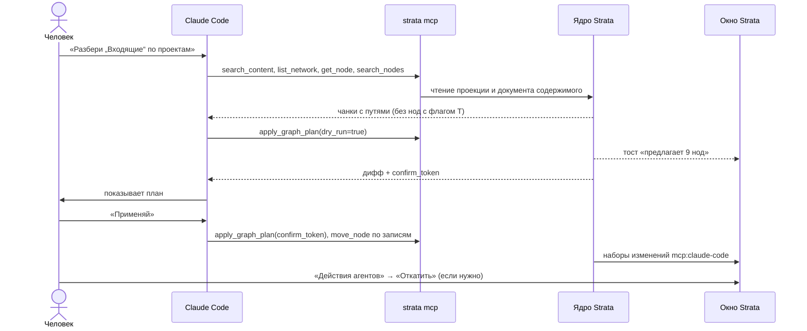

# 04. Пользователи и сценарии

> Статус: черновик. Кто работает в Strata, какие задачи решает и как это выглядит по шагам: клавиши, жесты, что видно на экране. Сценарии — вход для [06](06-canvas-ux.md), [08](08-view-3d.md), [09](09-search-navigation.md), [10](10-storage-sync-collab.md), [12](12-mcp-ai.md), [13](13-interop.md) и для приёмки MVP в [16](16-roadmap.md).
>
> Опора: ответы раунда 1 ([02](02-questions.md)) и раунда 2 ([17](17-open-questions.md)), [видение](03-vision.md), [модель данных](05-domain-model.md) (ядро), исследования [R1](research/R1-houdini-kinopio-ux.md), [R6](research/R6-mcp-ai.md), [R8](research/R8-competitors.md). Обозначения: ✅ решено ответами, ☑ решено по делегированию (раунд 2), 💡 предложение (с 2026-10-19 считается принятым, [README](README.md)), ❓ вопрос (собраны в [17-open-questions.md](17-open-questions.md)). Термины — по [глоссарию](glossary.md).

## Кратко

- Четыре персоны: **соло-исследователь** (основная, MVP), **лид** и **участник** небольшой команды (✅ A1, этап 3), **AI-агент через MCP** — квази-пользователь, действующий от имени человека (✅ K1; локально — MVP+ 1.1).
- 12 задач (JTBD) раскрыты в 10 сценариях с клавишами Houdini (✅ D1) и критериями готовности.
- Этапы — по [16](16-roadmap.md) §4.8, §5.2. ☑ Q-04-5: приёмка MVP — S1, S4, S2 целиком; S3, S5, S6, S10 — частично, по шагам [16](16-roadmap.md) §4.8. S8 — MVP+ 1.1, S9 локально — MVP+ 1.4. ☑ Q-04-4: свой сервер для своих устройств — этап 2, командная работа в реальном времени (S7, ссылки на сервер) — этап 3, как в [03](03-vision.md).
- ✅ R2: сценарии проверяются на macOS и Windows (Q-15-1); интерфейс — русский и английский с MVP (Q-07-1). Linux — только автотесты в CI.
- Риски, которые видны из сценариев: порог входа Houdini-UX для участников команды, путаница появлений и путей (☑ Q-04-9), молчаливые сбои синхронизации у конкурентов как антиобразец ([R8](research/R8-competitors.md)).

## 1. Персоны

### 1.1. Сводка

| # | Персона | Режим | Роль | Основная платформа | Этап |
|---|---|---|---|---|---|
| P1 | Соло-исследователь | Соло | Основной пользователь, владелец продукта | Десктоп: macOS и Windows (✅ R2) | MVP |
| P2 | Лид небольшой команды | Команда | Планирует, раздаёт задачи, ведёт базу знаний команды | Десктоп + веб | Соло-часть — MVP, команда — этап 3 |
| P3 | Участник команды | Команда | Берёт задачи, пополняет базу | Веб, десктоп | Этап 3 |
| P4 | AI-агент через MCP | Соло и команда | Ищет по содержимому, раскладывает тексты, кладёт картинки | Claude Code, Codex CLI, Claude Desktop, Cursor | MVP+ 1.1 — локально, этап 3 — сервер |

### 1.2. P1. Соло-исследователь

**Кто.** Владелец продукта. Мыслит нодами; главный референс навигации — сетевой редактор Houdini, ноды для него — узлы mind map (✅ A2). Профессия не уточнялась; основной сценарий — «проект игры»: диздок, задачи, референсы, баги (☑ Q-04-1). Работает на Mac и на ПК с Windows и на них проверяет сборки вех (✅ R2, Q-15-1); догадка про Linux (Omarchy) снята. Интерфейс — русский или английский по выбору (✅ R2, Q-07-1).

**Цели.**
- Одна база для информации и проектов: тексты, картинки, задачи, доски референсов (✅ A1).
- Ходить по глубокой структуре так же быстро, как по сетям Houdini (✅ D1, O1).
- Переиспользовать одно содержимое в нескольких проектах (✅ C3).
- Видеть, что горит, прямо на графе, без отдельного трекера.

**Контекст.** Работает один, база сейчас в Obsidian ([бриф](00-brief.md)). Размер vault не важен (✅ R2, Q-14-6): пороги импорта и скорости проверяются на синтетических наборах ([14](14-nfr.md) §1.3). Число нод не ограничивается (✅ A4), приложение не должно тормозить на тысячах нод (✅ N1).

**Что раздражает сейчас.**
- Obsidian «слишком простой»: карточка и связь, без типов, задач и погружения (бриф, ✅ A2).
- Глобальный граф Obsidian на форуме называют «красивым, но почти бесполезным»; вложенный canvas — ссылка без превью и без возврата наверх; насыщенный Canvas «choppy» ([R8](research/R8-competitors.md) §9, §17).
- Heptabase советует держать два уровня досок, лаги начинаются со 100–150 карточек; self-host нет ([R8](research/R8-competitors.md) §2).
- Anytype сбрасывает раскладку графа при каждом входе (#2142), лицензия не OSI ([R8](research/R8-competitors.md) §3).
- В Tana ценность появляется только после настройки supertags ([R8](research/R8-competitors.md) §6).
- Навигация по задачам неудобная, визуал примитивный (✅ A2).

**Что нужно от Strata.**
- Импорт vault без ручных правок, ссылки становятся нитями (✅ O1, C8) — S1.
- Механики Houdini: Tab-меню, нырок и выход, вставка в нить, встряхивание, нож, `L` (✅ D1) — S4, S5.
- Одна нода в нескольких сетях — S2.
- Звёздная карта, где можно найти, долететь и войти (✅ H1) — S6.
- Свои иконки и фоны в едином стиле (✅ I2) — S10.
- Claude и Codex с доступом к графу (✅ K1) — S8, MVP+ 1.1.
- Интерфейс на русском и английском с первой версии (✅ R2, Q-07-1).

**Частота и платформа.** 💡 Ежедневно, основная рабочая среда: от минутных заходов до многочасовых сессий. Десктоп на macOS и Windows (✅ R2); веб — с сервером команды, этап 3 (☑ Q-16-3).

### 1.3. P2. Лид небольшой команды

**Кто.** Ведёт команду до ~10 человек (✅ A1). ☑ Q-04-3: считаем, что лид — владелец (P1).

**Цели.**
- Разложить проект на задачи с дедлайнами и ответственными, в которые можно нырнуть ([бриф](00-brief.md), [05 §4.3](05-domain-model.md)).
- Раз в неделю за минуту понять, что горит и кто чем занят.
- Держать знания команды рядом с задачами, а не во втором приложении.
- Поднять свой сервер без DevOps и без лимита мест.

**Контекст.** Сервер команды self-hosted (бриф), совместная работа в реальном времени обязательна (✅ J2). Участники приходят по ссылке, не все знают Houdini.

**Что раздражает сейчас.**
- У трекеров (Plane, Linear) нет графа, знания живут отдельно; пользователи PKM держат «второе приложение для задач» ([R8](research/R8-competitors.md) §13, §16).
- Свёрток прогресса по вложенности в PKM-инструментах не найдено, у Heptabase не найдено напоминаний ([R8](research/R8-competitors.md) §16).
- Self-host AFFiNE бесплатно — до 10 мест на пространство, ровно размер команды; Plane CE — 13 сервисов и от 4 ГБ ОЗУ; Anytype — 8 сервисов и ломающие миграции ([R8](research/R8-competitors.md) §4, §13, §18).
- Молчаливый сбой синхронизации с потерей часов работы: AFFiNE #14846 закрыт как «not planned» ([R8](research/R8-competitors.md) §4).
- Capacities принципиально без команд ([R8](research/R8-competitors.md) §7).

**Что нужно от Strata.**
- Задачи как атрибуты на любой ноде, задачи с подзадачами (✅ R2, Q-05-1), свёртки и визуальная срочность на графе — S3.
- Линза «Горит» и вид-линза «Список» — S3, MVP+ 1.4.
- Ссылка на ноду, которая переживает переименование и перенос — S9.
- Совместная правка без конфликтов и всегда видимый статус синхронизации — S7.
- Сервер одним процессом, без лимита мест (💡, [11](11-server-selfhost.md)).

**Частота и платформа.** 💡 Ежедневно; обзор недели — по понедельникам. Десктоп для планирования, веб — с чужого компьютера.

### 1.4. P3. Участник команды

**Кто.** Художник, программист, дизайнер — состав ролей не уточнялся (☑ Q-04-3). С нодовыми редакторами может быть не знаком.

**Цели.** Открыть свою задачу по ссылке, понять контекст, обновить статус, положить референс, дописать заметку.

**Контекст.** Заходит из браузера без установки или из десктопа. Работает урывками, иногда офлайн: дорога, плохой Wi-Fi.

**Что раздражает сейчас.**
- Контекст задачи и знания живут в разных программах ([R8](research/R8-competitors.md) §13).
- Модель «одна сущность — много мест» сбивает с толку: документация Anytype признаёт, что удаление там «труднее понять»; в plex TheBrain теряется ориентация «где я» ([R8](research/R8-competitors.md) §3, §8).
- На высокий порог входа жалуются у TheBrain, InfraNodus и Tana ([R8](research/R8-competitors.md), «Риски»).
- AFFiNE 0.27 требует клиент не старше сервера: обновление одной стороны ломает работу ([R8](research/R8-competitors.md) §4).

**Что нужно от Strata.**
- Ссылка открывает ровно нужную ноду — S9.
- Любое действие доступно не только клавишей: контекстное меню, палитра `Ctrl+P`, подсказки — S4.
- Разные команды и значки для «убрать отсюда» и «удалить везде» — S2.
- Офлайн и слияние без диалогов «чья версия» — S7.

**Частота и платформа.** 💡 Ежедневно, короткие сессии по 5–20 минут. Веб чаще десктопа.

### 1.5. P4. AI-агент через MCP (квази-пользователь)

**Кто.** Claude Code, Codex CLI, Claude Desktop, Cursor, подключённые к Strata как к MCP-серверу (✅ K1). Действует от имени человека; каждая правка — набор изменений с источником `mcp:<клиент>` ([05 §11](05-domain-model.md)).

**Цели.** Выполнить просьбу человека: найти по содержимому, прочитать, разложить текст по нодам, связать, положить картинку на доску. Потратить минимум токенов и не испортить граф.

**Контекст** ([R6](research/R6-mcp-ai.md) §2–3):
- Claude Code подключает stdio-сервер одной командой; ответ инструмента — до 25 000 токенов по умолчанию, предупреждение с 10 000.
- Codex CLI в режиме `writes` не спрашивает подтверждения у инструментов с `readOnlyHint: true`, а инструменты без аннотаций считает записывающими.
- Claude Desktop в конфиге принимает только локальные stdio-серверы; custom connectors ходят из облака Anthropic и не видят LAN.
- У Anthropic нет генерации картинок; base64 в аргументах инструмента портит файлы.

**Что мешает в других инструментах.** MCP есть у Heptabase, Anytype, Logseq, Miro и Tana, но это чтение и запись карточек. Графовых операций, предпросмотра и отката одной командой там не найдено ([R8](research/R8-competitors.md) §19).

**Что нужно от Strata** (💡, [R6](research/R6-mcp-ai.md) §4):
- 26 инструментов в MVP+ 1.1, у каждого аннотации `readOnly` / `destructive` / `idempotent` / `openWorld`;
- короткие ответы с путём и ID в каждой строке, адресация ноды по ID или по пути, ошибки с подсказкой;
- `apply_graph_plan` с `dry_run`, журнал наборов изменений (панель «Действия агентов») и откат;
- флаг «Скрыть от AI» соблюдается всегда;
- картинки — по локальному пути или тикету загрузки, не base64.

**Частота и права.** По запросу человека, всплесками. 💡 Лимиты: 60 записей в минуту, 200 нод на один план ([R6](research/R6-mcp-ai.md) §4.3, §4.6). Локально по умолчанию — чтение и запись без удаления (☑ Q-12-1 в [12](12-mcp-ai.md)).

## 2. Задачи (Jobs to be done)

| ID | Когда… | я хочу… | чтобы… | Персоны | Сценарии |
|---|---|---|---|---|---|
| J1 | Когда база годами копилась в Obsidian | перенести её одной операцией, со ссылками и вложениями | не начинать с нуля и не чинить связи руками | P1 | S1 |
| J2 | Когда собираю референсы, которые подходят нескольким проектам | держать их на одной доске и показывать в каждом проекте | обновлять один раз, а не синхронизировать копии | P1, P2 | S2 |
| J3 | Когда начинаю проект | разложить его на задачи, в которые можно нырнуть | видеть и общую структуру, и детали каждой задачи | P2, P1 | S3 |
| J4 | Когда начинается неделя | одним действием увидеть, что горит и где просрочка | ничего не пропустить, не открывая каждую задачу | P2, P1 | S3 |
| J5 | Когда возвращаюсь к работе | попасть в нужную ноду по имени или пути за пару нажатий | не тратить время на поиски и не терять ориентацию | P1, P3 | S4, S9 |
| J6 | Когда структура устарела | перестроить связи жестами, как в Houdini, без меню и диалогов | мысль не сбивалась на интерфейс | P1 | S5 |
| J7 | Когда хочу охватить всё пространство | облететь его в 3D и сразу войти в найденное | обзор работал как навигация, а не как витрина | P1 | S6 |
| J8 | Когда работаем вместе | видеть, где коллеги, и править одновременно, даже офлайн | не ждать друг друга и не терять правки | P2, P3 | S7 |
| J9 | Когда накопился неразобранный текст | поручить агенту найти и разложить его, проверить и откатить | рутина ушла агенту, а граф остался целым | P1, P4 | S8 |
| J10 | Когда нужно обсудить конкретную задачу | отправить ссылку, которая откроет ровно эту ноду | ссылка работала и после переименования и переноса | P2, P3 | S9 |
| J11 | Когда холст выглядит безлико | поставить свои иконки и фон | пространство стало «моим», но не превратилось в хаос | P1 | S10 |
| J12 | Когда человек просит что-то найти или поменять (взгляд агента) | получить короткий ответ с путями и менять граф одной операцией с предпросмотром | не тратить контекст и не ломать связи | P4 | S8 |

## 3. Сценарии

### 3.1. Обзор

| # | Сценарий | Персоны | Этап | Частота (💡 гипотеза) |
|---|---|---|---|---|
| S1 | Первый запуск и импорт vault Obsidian | P1 | MVP; повторный импорт со слиянием и экспорт — MVP+ 1.2 | Один раз, затем повторный импорт со слиянием |
| S2 | Доска референсов в двух проектах | P1, P2 | MVP | Еженедельно |
| S3 | Планирование проекта и «что горит» | P2, P1 | MVP — шаги 1–9; линзы и «Список» — MVP+ 1.4; канбан и календарь — этап 2 | Еженедельно, обзор — по понедельникам |
| S4 | Ежедневная навигация | P1, P3 | MVP, включая быстрые метки и мини-карту | Ежедневно, десятки раз |
| S5 | Реструктуризация | P1 | MVP; точки, рамки и стикеры — MVP+ 1.3 | Еженедельно |
| S6 | 3D-исследование | P1 | MVP — шаги 1–6, 8; линзы — MVP+ 1.4; локальный режим — этап 2 | Еженедельно |
| S7 | Командная сессия в реальном времени | P2, P3 | Этап 3 | Ежедневно в команде |
| S8 | AI-агент через MCP | P4, P1 | MVP+ 1.1; поиск по смыслу и генерация — этап 2 | По запросу |
| S9 | Шаринг пути и ссылки на ноду | P2, P3 | Путь — MVP; `strata://` — MVP+ 1.4; `https://` — этап 3 | Ежедневно в команде |
| S10 | Кастомизация иконок, фона и темы | P1 | MVP; темы кроме «Тумана» — этап 2 | При настройке |

### 3.2. Общие правила

- 💡 Клавиши — раскладка Houdini ([R1](research/R1-houdini-kinopio-ux.md)); сами механики подтверждены (✅ D1). Однобуквенные хоткеи работают только при фокусе на холсте и привязаны к `KeyboardEvent.code`, поэтому действуют и в русской раскладке. Для сочетаний, которые перехватывает браузер, есть отдельный веб-пресет ([06](06-canvas-ux.md)). На macOS `Ctrl` в сценариях — это `Cmd`, `Backspace` — синоним `Delete` ([06](06-canvas-ux.md) §17).
- 💡 Каждый жест — одна транзакция отмены (`Ctrl+Z` / `Ctrl+Shift+Z`) и один набор изменений с автором и источником: `user`, `mcp:<клиент>`, `ai`, `import` или `system` ([05 §11](05-domain-model.md)).
- 💡 Изменения структуры анимируются за 150–250 мс; при `prefers-reduced-motion` — без анимации ([R1](research/R1-houdini-kinopio-ux.md)).
- СКМ — средняя кнопка мыши, ПКМ — правая. Имена нод в примерах условные.

### S1. Первый запуск и импорт vault Obsidian

- **Персона:** P1. **Этап:** MVP (✅ O1); повторный импорт со слиянием и экспорт — MVP+ 1.2 ([16](16-roadmap.md) §5.2).
- **Триггер:** установил десктоп-приложение и хочет перенести рабочий vault.
- **Функции:** импорт и отчёт — [13](13-interop.md); раскладка `L` — [06](06-canvas-ux.md); призраки — [05 §8.5](05-domain-model.md); наборы изменений — [10](10-storage-sync-collab.md).

| # | Действие | Ввод | Что видит |
|---|---|---|---|
| 1 | Первый запуск | — | Ретро-окно «Добро пожаловать»: «Новое пространство», «Импорт из Obsidian», 💡 «Демо-пространство» (MVP+ 1.4), «Подключиться к серверу» (этап 2 — свои устройства, этап 3 — команда; [16](16-roadmap.md) §4.6). Язык интерфейса — 💡 по языку системы, переключатель «RU / EN» в этом же окне (✅ R2: оба языка в MVP) |
| 2 | Выбрать импорт и папку vault | Клик, системный диалог | Strata ищет dot-папку с `app.json`: её имя не обязательно `.obsidian` ([R2](research/R2-obsidian-format.md)) |
| 3 | Изучить предпросмотр | — | Окно «Импорт»: число заметок, вложений, `.canvas`, `.excalidraw.md`, папок; найденные настройки ссылок и вложений; что пропустим: `.obsidian/`, `.trash/`, исключения пользователя. Vault не меняется ([R2](research/R2-obsidian-format.md)) |
| 4 | Выбрать параметры | Флажки | 💡 Куда: новое пространство. Папки → сети (по умолчанию). `.canvas` → сеть с раскладкой или доска. Заметка из одних `- [ ]` → список |
| 5 | Запустить | `Enter` на «Импортировать» | Окно закрывается, внизу прогресс фоновой задачи «Импорт: 1 840 из 3 200». Холст живой, сети появляются пачками |
| 6 | Осмотреть результат | `H` — показать всё | Корневая сеть с баблами сетей-папок, внутри каждой уже применена `L`. Битые ссылки — призраки: пунктирные приглушённые баблы рядом с источником |
| 7 | Открыть отчёт | Клик по уведомлению «Импорт завершён · отчёт» | Разделы: призраки, неоднозначные ссылки, неподдержанный синтаксис плагинов, переименованные файлы. Клик по строке — переход к ноде |
| 8 | Исправить неоднозначную ссылку | Выбрать цель в отчёте | 💡 Strata уточняет ссылку в тексте заметки (в своей копии), нить перепривязывается |
| 9 | Пройти подсказки | `Tab`, `Enter`, `U` | 💡 Подсказки над холстом гаснут после первого нажатия каждой клавиши |
| 10 | Откатить, если не понравилось | `Ctrl+Z` или «История изменений» → «Откатить» | Импорт — один набор изменений с источником `import`, уходит целиком |

Что во что превращается ([R2](research/R2-obsidian-format.md), подробно — [13](13-interop.md)):

| В vault | В Strata |
|---|---|
| Папка | Сеть, путь `/папка/подпапка` |
| `.md` | Заметка, тело — Markdown как есть, без нормализации ([R4](research/R4-app-shell-rendering.md)) |
| `[[X]]` в тексте | Нить «заметка → X» с происхождением `text` (✅ C8, [05 §8.2](05-domain-model.md)) |
| Ссылка на несуществующий файл | Призрак ([05 §8.5](05-domain-model.md)) |
| Свойства, теги, `aliases` | Атрибуты, теги, атрибут `aliases` — по нему тоже ищет поиск по именам ([05 §6.1](05-domain-model.md)) |
| Задачи плагина Tasks с `📅` | Атрибут «дедлайн» (на пункте или на ноде — [13](13-interop.md)) |
| Вложения | Ассеты по SHA-256 ([05 §12](05-domain-model.md)) и медиа-ноды |
| `.canvas` | Сеть с раскладкой или доска |
| `.excalidraw.md` | Доска ([R5](research/R5-board-engine.md)) |

**Результат.** Vault живёт в Strata, сам vault не тронут. Повторный импорт того же vault (MVP+ 1.2) сливается по соответствию «путь → ID», без дублей ([R2](research/R2-obsidian-format.md)); в MVP страхуют нетронутый vault и откат импорта одним набором.

**Граничные случаи.**
- Одинаковые имена файлов в разных папках дают неоднозначные ссылки — они попадают в отчёт.
- В vault с тысячами ссылок нитей много. Читаемость держат `L` и скрытие нитей в конкретной сети ([05 §8.3](05-domain-model.md)). ☑ Q-13-3: направление нитей из текста не меняется; настройка сети «Нити из текста: все / приглушённые / скрыты»; `L` строит дерево прежде всего по ручным нитям.
- Огромная заметка не тормозит холст: содержимое не грузится, пока ноду не открыли (✅ N1).
- Кириллица в NFC и NFD — в тестовом корпусе импорта ([R2](research/R2-obsidian-format.md)).

**Готово, если** (☑ Q-04-5: S1 — в приёмке MVP целиком):
- реальный vault владельца импортируется без ручных правок, ссылки становятся нитями (критерий из [03](03-vision.md)); владелец проверяет на macOS и Windows;
- во время импорта холст отзывчив; численные пороги — в [14](14-nfr.md), меряются на синтетических наборах ([14](14-nfr.md) §1.3), набор V-owner не нужен (✅ R2, Q-14-6);
- импорт → экспорт даёт нулевой diff тел `.md` ([R2](research/R2-obsidian-format.md)) — проверяется, когда появится экспорт (MVP+ 1.2).

### S2. Доска референсов и одна нода в двух проектах

- **Персоны:** P1, P2. **Этап:** MVP.
- **Триггер:** собирает референсы для «Игры» и понимает, что те же подойдут «Комиксу».
- **Функции:** появления, `Delete` / `Shift+Delete` — [05 §5](05-domain-model.md), [06](06-canvas-ux.md); доска — [ADR-0006](adr/0006-board-engine.md); значок ярлыка — [07](07-design-system.md).

| # | Действие | Ввод | Что видит |
|---|---|---|---|
| 1 | Создать доску в `/Проекты/Игра` | `Tab` → «реф» → класс «Референсы» → `Enter` → имя → `Enter` | Tab-меню под курсором; бабл доски встаёт под курсором. Если была выделена нода, новая встаёт её ребёнком с нитью ([R1](research/R1-houdini-kinopio-ux.md)) |
| 2 | Открыть доску | `Enter` / `I` / двойной клик | Редактор доски со своим ретро-тулбаром в окне рядом с баблом; окно закрепляется у края, `Shift+Enter` — на весь экран (☑ Q-06-4, [06](06-canvas-ux.md)) |
| 3 | Набросать картинки | Перетащить файлы из файлового менеджера или браузера, `Ctrl+V` | Картинки на доске. Оригиналы — в хранилище ассетов по SHA-256, на доске — рабочие копии WebP; повторная картинка не дублируется |
| 4 | Добавить виджеты | Инструменты «Заметка» и «To-do» на тулбаре | Короткая подпись и to-do «Найти рефы по свету» (✅ C2; 💡 в MVP — простые галочки) |
| 5 | Вернуться | `U` | Бабл «Референсы»; удержание СКМ — инфокарточка с миниатюрой доски и счётчиками из превью |
| 6 | Скопировать | Выделить, `Ctrl+C` | — |
| 7 | Перейти в «Комикс» | `Ctrl+O` → «комикс» → `Enter`, затем `Enter` | Камера у ноды «Комикс»; второй `Enter` — внутрь |
| 8 | Вставить как появление | `Ctrl+Shift+V` | Тот же бабл со значком ярлыка в углу. Альтернатива: `Tab` → «Референсы»; в списке строка с пометкой «существующая · /Проекты/Игра» |
| 9 | Связать | Тянуть от края бабла «Сценарий» к «Референсам» | Нить «Сценарий → Референсы». Нить от «Арта» из «Игры» здесь не рисуется, на бабле значок внешних связей «↗1» ([05 §8.3](05-domain-model.md)) |
| 10 | Добавить картинку из «Комикса» | `Enter`, перетащить файл, `U` | В «Игре» новая картинка уже есть: это одна нода (✅ C3) |
| 11 | Посмотреть, где ещё лежит | Наведение на значок ярлыка, клик | «×2»; панель «Где размещена»: два пути, основной отмечен, клик — переход ([05 §5](05-domain-model.md), [R8](research/R8-competitors.md) рек. 2) |
| 12 | Убрать из «Комикса» | `Delete` | Бабл исчезает вместе с нитями, видимыми здесь (залечивание, [05 §8.4](05-domain-model.md)). Тост «Убрано из „Комикс“. Нода осталась в 1 сети · Отменить» |
| 13 | Удалить везде (вместо шага 12) | `Shift+Delete` | Размещений ≥ 2 или задет каскад — диалог «Нода размещена в 2 сетях: …» со списком путей; иначе тост с отменой. Нода уходит в корзину с восстановлением ([05 §5, §11](05-domain-model.md)) |

**Результат.** Одна нода «Референсы» с двумя размещениями; канонический путь — `/Проекты/Игра/Референсы`.

**Граничные случаи.**
- `Ctrl+V` создаёт независимую копию ([05 §5](05-domain-model.md)). 💡 Тост «Вставлена копия · Сделать появлением» снимает путаницу: многоместность — главный источник ошибок у конкурентов ([R8](research/R8-competitors.md), «Риски»).
- Вторая вставка в ту же сеть отклоняется: нода в сети размещена не больше одного раза; камера показывает существующий бабл. Перенос в сеть, где нода уже размещена, снимает переносимое размещение, позиция существующего не меняется; тост «Нода уже была здесь», один набор изменений ([05 §5](05-domain-model.md)).
- Сеть нельзя разместить в самой себе или в потомке: сообщение показывает путь цикла.
- Удалили основное размещение — основным становится самое старое из оставшихся, канонический путь меняется.
- «Сделать основным» в панели «Где размещена» переназначает основное размещение: ID и ссылки те же, канонический путь меняется; одна отмена ([05 §5](05-domain-model.md)).
- Вошли в «Референсы» из «Комикса»: строка пути показывает путь захода, `U` ведёт по нему обратно в «Комикс», канонический путь — серым ([05 §9.3](05-domain-model.md); ☑ Q-04-9).
- Сотни картинок: файлы доски подгружаются по видимой области ([R5](research/R5-board-engine.md), действенность не проверена).

**Готово, если** (☑ Q-04-5: S2 — в приёмке MVP целиком): правка доски в одном проекте видна в другом без перезагрузки; ни одно действие не удаляет ноду молча; проверено на macOS и Windows.

### S3. Планирование проекта: задачи, дедлайны, ответственные, «что горит»

- **Персоны:** P2, P1. **Этап:** MVP — шаги 1–9; линзы и вид-линза «Список» (шаги 10–11) — MVP+ 1.4; канбан и календарь — этап 2; ответственные-участники сервера — этап 3 ([16](16-roadmap.md) §4.8).
- **Триггер:** старт проекта; дальше — обзор каждый понедельник.
- **Функции:** классы и атрибуты — [05 §4.3, §6](05-domain-model.md); флаги — [05 §7](05-domain-model.md); подсветка и свёртки — [07](07-design-system.md); линзы и вид-линзы — [09](09-search-navigation.md).

| # | Действие | Ввод | Что видит |
|---|---|---|---|
| 1 | Создать проект | В `/Проекты`: `Tab` → «проект» → `Enter` → «Вертикальный срез» → `Enter` | Бабл сети класса «Проект» |
| 2 | Войти | `Enter` | Пустой холст, строка пути `/Проекты/Вертикальный срез` |
| 3 | Создать задачи | `Tab` → «задача» → «Боёвка» → `Enter`; при выделенной «Боёвке» снова `Tab` → «задача» → «Анимации удара» → `Enter` | Вторая задача встаёт ребёнком выделенной, с нитью «Боёвка → Анимации удара», без клика ([R1](research/R1-houdini-kinopio-ux.md)) |
| 4 | Выстроить цепочку | `J` + штрих через «Прототип», «Плейтест», «Полировка» | Нити в порядке штриха |
| 5 | Заполнить атрибуты | Выделить, `P` | Плавающая панель свойств: статус, начало, дедлайн, ответственные, приоритет. 💡 При нескольких выделенных правка идёт всем |
| 6 | Отметить главное и отложенное | Навести на «Боёвку» → `R`; на «Мультиплеер» → `Q` | «Боёвка» крупнее (ключевая); «Мультиплеер» полупрозрачный, выпадает из свёрток и линз срочности |
| 7 | Заглянуть в задачу | `Enter` на «Анимациях удара» | Внутри уже есть заметка «Описание» и список «Требования» ([05 §4.3](05-domain-model.md)); заполнить. Подзадачи — здесь же `Tab` → «задача»: прогресс и ближайший срок по ним видны на бабле задачи снаружи (✅ R2, Q-05-1). `U` |
| 8 | Следить за сроками | — (идут дни) | 💡 До дедлайна меньше 3 дней — мягкое жёлтое свечение; сегодня — пульсация; просрочка при нефинальном статусе — красное кольцо и метка; финальный статус — бабл приглушён. Каждое состояние продублировано значком ([05 §6.3](05-domain-model.md), [07](07-design-system.md)) |
| 9 | Посмотреть снаружи | `U` | Бабл проекта несёт свёртку: прогресс «4 из 11», ближайший дедлайн, слабая подсветка «внутри горит» ([05 §6.4](05-domain-model.md)) |
| 10 | Понедельничный обзор (MVP+ 1.4) | Линза «Горит»: панель «Линза ▾» в статусной строке ([06](06-canvas-ux.md) §15), `\` или `Ctrl+P` → «Линза» | Совпавшие ноды яркие, остальные приглушены; сети, внутри которых есть совпадения, отмечены |
| 11 | Список (MVP+ 1.4) | Вид-линза «Список»: переключатель «Холст \| Список» в статусной строке | Таблица: имя, путь, статус, дедлайн, ответственные, сортировка по дедлайну. `Enter` на строке — переход к ноде; смена статуса в таблице меняет ту же ноду |
| 12 | Этап 2 | Вид-линза «Канбан» или «Календарь» | Те же ноды по статусу или по дате |

Линза «Горит» (💡, псевдоструктура; запрос и формат — [09](09-search-navigation.md) §8.1):

```yaml
lens: "Горит"
scope: текущая сеть и вложенные
match:
  deadline: { before: today + N }        # N — настройка 05 §6.3, по умолчанию 3 дня; просроченные и сегодняшние тоже попадают
  status:   { not: [Готово, Отменено] }
  flags:    { not: [пауза] }
style:
  others: приглушить                     # степень — 07
  networks_with_matches: метка свёртки
presets: [Горит, Мои, Открытые, Здоровье]
```

Горизонт на неделю — свой запрос в поле линзы, например `due:<7d status:open` (синтаксис [09](09-search-navigation.md) §3.6); сохранённые линзы — этап 2.

**Результат.** План с вложенными задачами, свёртками и визуальной срочностью; недельный обзор — одной линзой (MVP+ 1.4).

**Граничные случаи.**
- Задача размещена в двух проектах — в каждой свёртке считается один раз ([05 §6.4](05-domain-model.md)); свёртки — на всю глубину, ноды на паузе не участвуют (☑ Q-05-2).
- Дедлайн можно поставить любой ноде, например заметке ([05 §1](05-domain-model.md), принцип 3).
- Ответственные в MVP — локальный список людей ([05 §10](05-domain-model.md)), в команде — участники сервера.
- Напоминания вне приложения: в MVP — только подсветка на холсте, системные уведомления — этап 2 (☑ Q-04-10).
- Тот же обзор агенту: промпт `weekly_review` (MVP+ 1.1, [R6](research/R6-mcp-ai.md) §4.5).

**Готово, если** (💡; ☑ Q-04-5: в приёмке MVP частично, шаги — [16](16-roadmap.md) §4.8): ответ на «что горит» — не больше двух действий из любой сети; срочность различима без цвета; прогресс и ближайший срок задачи по подзадачам видны снаружи.

### S4. Ежедневная навигация

- **Персоны:** P1, P3. **Этап:** MVP, включая быстрые метки и мини-карту `O` ([16](16-roadmap.md) §4.4).
- **Триггер:** начало рабочего дня, переключение между задачами.
- **Функции:** Tab-меню, строка пути, история, `Ctrl+O`, `Ctrl+F` — [09](09-search-navigation.md); хоткеи холста — [06](06-canvas-ux.md).

| # | Действие | Ввод | Что видит |
|---|---|---|---|
| 1 | Открыть приложение | — | Последняя сеть и положение камеры восстановлены (локальное состояние, [05 §13](05-domain-model.md)) |
| 2 | Перейти к ноде по имени | `Ctrl+O` → «боевка» → `Enter` | Список по мере ввода: имя, вид, путь. Находит с опечаткой и по части слова (бриф); 💡 без «ё» и при наборе в неверной раскладке (`,jtdrf`). Камера перелетает к ноде в её сети, нода выделена |
| 3 | Нырнуть и выйти | `Enter` / `I` / двойной клик; `U` | Холст сети изнутри; `U` — уровень выше, камера на ноде, из которой вышли |
| 4 | Прыгнуть по пути | Клик по компоненту строки пути `/Проекты/Игра/Боёвка` | Переход сразу на нужный уровень |
| 5 | Назад и вперёд | `Alt+←` / `Alt+→`; `` ` `` | История переходов, как в браузере; `` ` `` переключает два последних вида ([R1](research/R1-houdini-kinopio-ux.md)) |
| 6 | Создать или вставить на месте | `Tab` → «пв» | Нечёткий поиск по именам (✅ G1): первые буквы слов («пв» → «План встреч»), недавние сверху. Источники: виды и классы, существующие ноды с пометкой «существующая», шаблоны (флаг `E`) |
| 7 | Найти в текущей сети | `Ctrl+F` → `анимац*` → `Enter` | Синтаксис Houdini Find: `*`, `?`, `"точно"`, `@вид`, `+флаг`. `Enter` выделяет все совпадения, `Ctrl+G` / `Ctrl+Shift+G` — следующее и предыдущее ([R1](research/R1-houdini-kinopio-ux.md)) |
| 8 | Кадрировать | `H` / `G` (`F`) | Вся сеть / выделенное |
| 9 | Пройти по цепочке | `PgUp` / `PgDn`, `Shift+PgUp` / `Shift+PgDn` | Выделение идёт выше или ниже по течению, затем по соседям |
| 10 | Подсмотреть, не входя | Удерживать СКМ на ноде | Инфокарточка: статус, дедлайн, превью, обратные ссылки, «также в: …» |
| 11 | Команда без хоткея | `Ctrl+P` → «скопировать путь» | Палитра команд со всеми действиями и их клавишами — путь для тех, кто не знает раскладку Houdini |
| 12 | Быстрые метки | `Ctrl+1` — поставить, `1` — вернуться; в вебе — удержание `1` дольше 600 мс | Метка хранит сеть, позицию и масштаб только на этом устройстве ([R1](research/R1-houdini-kinopio-ux.md)) |

**Результат.** Любая нода — в пределах трёх действий из любого места, без мыши при желании.

**Граничные случаи.**
- Одинаковые имена различает путь в списке; надёжная ссылка всегда по ID ([05 §9.3](05-domain-model.md)).
- Нода в корзине: 💡 `Ctrl+O` показывает её с пометкой «в корзине» и кнопкой «Восстановить».
- Вход через появление: строка пути — путь захода, `U` — по нему ([05 §9.3](05-domain-model.md); ☑ Q-04-9).
- В вебе `Alt+←/→`, `Ctrl+O`, `Ctrl+F`, `Ctrl+G` пересекаются с браузером — веб-пресет ([06](06-canvas-ux.md)).

**Готово, если** (☑ Q-04-5: S4 — в приёмке MVP целиком): переход к ноде — не больше трёх действий; задержка списка `Ctrl+O` укладывается в бюджет [14](14-nfr.md) на macOS и Windows; поиск и подсказки работают в русском и английском интерфейсе.

### S5. Реструктуризация

- **Персона:** P1. **Этап:** MVP; точки, рамки и стикеры — MVP+ 1.3 ([16](16-roadmap.md) §4.4).
- **Триггер:** структура проекта устарела, связи надо пересобрать.
- **Функции:** операции над нитями — [05 §8.4](05-domain-model.md), [06](06-canvas-ux.md); «Обернуть в сеть» — [05 §4.2](05-domain-model.md); глобальные нити — [ADR-0001](adr/0001-global-edges.md).

| # | Действие | Ввод | Что видит |
|---|---|---|---|
| 1 | Вставить ноду в нить | Тащить «Референсы боя» на нить «Боёвка → Анимации удара» | Через ~200 мс нить подсвечивается жёлтым; после отпускания — «Боёвка → Референсы боя → Анимации удара», соседи раздвигаются с анимацией ([R1](research/R1-houdini-kinopio-ux.md)) |
| 2 | Бросить, не вставляя | Удерживать `8` при отпускании | Нода ложится рядом, нить не меняется |
| 3 | Выдернуть из цепочки | Встряхнуть «Старую идею» в цепочке «A → Старая идея → B» | Один вход в этой сети → цепочка залечена: «A → B» (✅ D1). Нода свободна |
| 4 | То же при нескольких входах | Встряхнуть ноду с двумя входами | 💡 Нода только отсоединяется; тост «Отсоединено без залечивания: 2 входа · Отменить» (☑ Q-06-1) |
| 5 | Извлечь командой | `Ctrl+Shift+X` | То же, что встряхивание, для выделенных ([R1](research/R1-houdini-kinopio-ux.md)) |
| 6 | Разрезать | Удерживать `Y`, провести штрих через три нити | Нити под штрихом подсвечены, после отпускания удалены. Для нити из `[[ссылки]]` — один вопрос «Убрать ссылку из текста?» с вариантами «Убрать из текста» / «Скрыть нить в этой сети» (☑ Q-05-4) |
| 7 | Соединить цепочкой | `J` + штрих через четыре бабла | Нити в порядке штриха |
| 8 | Ответвить | `Shift` + тянуть из середины нити «A → B» к «C» | 💡 Новая нить «A → C» (вариант «а», [R1](research/R1-houdini-kinopio-ux.md)). С точками (MVP+ 1.3) в месте захвата ставится незакреплённая точка (вариант «б»). ☑ Q-06-12 |
| 9 | Обернуть в сеть | Выделить рамкой 6 нод → 💡 `Shift+C` ([06](06-canvas-ux.md)), `Ctrl+P` или контекстное меню | Новая сеть на месте выделения, поле имени в фокусе. Ноды переехали внутрь, ID те же ([R8](research/R8-competitors.md) рек. 4). Нити между ними видны внутри; у внешних нод, связанных с переехавшими, — значки «↗N» ([05 §8.3](05-domain-model.md)), 💡 плюс пунктирные сводные нити к баблу новой сети (только отображение, [06](06-canvas-ux.md)) |
| 10 | Разложить | `L` — выделенное или вся сеть; `A` + тянуть вверх или вниз | Анимированная раскладка одним шагом отмены; `A` раскладывает ветку выше или ниже по течению |
| 11 | Убрать ноду из середины | `Delete` | «Убрать отсюда» с залечиванием: как встряхивание, затем удаление размещения. Последнее размещение → корзина, тост с отменой |
| 12 | Отменить любой шаг | `Ctrl+Z` | Каждый жест отменяется одним шагом |

**Результат.** Структура перестроена без диалогов и меню; каждое изменение — отдельный набор изменений в истории.

**Граничные случаи.**
- Нить видна и в других сетях (оба конца размещены там) — изменение затрагивает и их; тост «Связь изменена ещё в 2 сетях · Отменить» ([ADR-0001](adr/0001-global-edges.md)).
- Встряхивание трогает только нити, видимые в текущей сети; связи с нодами вне сети не меняются ([05 §8.4](05-domain-model.md)).
- Порог встряхивания настраивается, 0 отключает жест ([R1](research/R1-houdini-kinopio-ux.md)).
- Вставить в нить можно только ноду без нитей, видимых в этой сети (новую или только что извлечённую); иначе сначала встряхнуть ([05 §8.4](05-domain-model.md)).
- Вставка в отрезок, идущий через точку, — во все ветви после точки (MVP+ 1.3, вместе с точками).
- Циклы «A → B → A» разрешены, раскладка их выдерживает ([05 §8.2](05-domain-model.md)).

**Готово, если** (💡; ☑ Q-04-5: в приёмке MVP частично, шаги — [16](16-roadmap.md) §4.8): соавтор видит каждый жест целиком, без промежуточных кадров; ни один жест не требует диалога, кроме удаления нити из текста.

### S6. 3D-исследование

- **Персона:** P1. **Этап:** MVP (✅ O1: 3D в пятёрке MVP) — шаги 1–6, 8; линзы (шаг 7) — MVP+ 1.4; локальный режим — этап 2 ([16](16-roadmap.md) §4.8).
- **Триггер:** хочется охватить пространство целиком и найти забытое.
- **Функции:** звёздная карта, полёт, инфокарточки, создание — [08](08-view-3d.md), [ADR-0005](adr/0005-rendering.md); линзы — [09](09-search-navigation.md).

| # | Действие | Ввод | Что видит |
|---|---|---|---|
| 1 | Перейти в 3D | Кнопка «3D» у строки пути или `Ctrl+P` → «Звёздная карта» (хоткей — [08](08-view-3d.md)) | «Камера-мост»: баблы текущей сети становятся звёздами на тех же местах экрана, камера отъезжает к карте пространства ([R4](research/R4-app-shell-rendering.md)) |
| 2 | Осмотреться | — | Звёзды — ноды, скопления — сети ([R8](research/R8-competitors.md) рек. 6). Ключевые крупнее и ярче, на паузе — тусклые, срочность — тем же жёлтым и красным. Загружены только индекс и превью ([05 §13](05-domain-model.md)) |
| 3 | Полететь | Зажать ПКМ + `W` `A` `S` `D`, `Q` / `E` — вниз и вверх, мышь — взгляд; колесо — скорость; 💡 `Shift` — ускорение | Свободный полёт в стиле Unreal ([R4](research/R4-app-shell-rendering.md)). Отпустил ПКМ — курсор свободен, звезда под ним подписана |
| 4 | Найти и перелететь | `Ctrl+O` → «плейтест» → `Enter` | Камера плавно перелетает к звезде (💡 около 1 с; при reduced motion — мгновенно) |
| 5 | Прочитать справку | Подлететь ближе | 💡 Когда звезда достаточно крупная на экране, рядом открывается инфокарточка: имя, вид, путь, статус, дедлайн, краткая справка или превью, число нитей, ключевые ноды внутри ([05 §4.1, §7](05-domain-model.md)). Одновременно — не больше 5 карточек |
| 6 | Создать ноду | Навести на «Плейтест», `Tab` → «заметка» → «Итоги плейтеста 1» → `Enter` | 💡 Новая заметка — ребёнок «Плейтеста»: размещается в той же сети, нить «Плейтест → Итоги». Звезда появляется рядом и успокаивается физикой. Правило выбора сети — [08](08-view-3d.md) §6.4, ☑ Q-08-12 |
| 7 | Подсветить срочное (MVP+ 1.4) | Линза «Горит» | Та же линза, что в 2D: совпавшие звёзды яркие, остальные гаснут |
| 8 | Войти | `Enter` на звезде под курсором или в центре экрана | Сеть — «камера-мост» обратно в 2D, внутрь сети. Заметка или доска — открывается редактор |
| 9 | Локальный режим (этап 2) | 💡 Команда «Только окрестность» | Звёзды в N шагах от текущей ноды и её пути, остальные скрыты ([R8](research/R8-competitors.md) рек. 6) |

**Результат.** Найти → долететь → войти без переключения в 2D; новая нода создана прямо в 3D (✅ H1).

**Граничные случаи.**
- В 2D `Q` и `E` — флаги, в 3D под зажатой ПКМ — полёт. 💡 Без ПКМ и вне режима `V` клавиши флагов действуют на звезду под курсором. В режиме `V` (этап 2) `Q` и `E` — полёт, флаги — только `R` и `T`; пауза и шаблон — через кольцо флагов или контекстное меню. Правило — [08](08-view-3d.md) §5.2.
- Позиции звёзд стабильны между сеансами. Звезду можно закрепить командой «Закрепить на карте» (`B`): локально, своим значком; это не `pinned` из 2D, который синхронизируется ([05 §9.2](05-domain-model.md)). ☑ Q-08-8 в [08](08-view-3d.md).
- Сироты и призраки подсвечивает линза «Здоровье» (MVP+ 1.4) — проверка здоровья базы ([R8](research/R8-competitors.md) §17).
- Графику 3D владелец проверяет на macOS (WKWebView) и Windows (WebView2) по сборкам вех и веб-странице бенчмарка (✅ R2, Q-15-1). На Linux WebKitGTK может молча перевести WebGL на медленный путь ([R4](research/R4-app-shell-rendering.md)) — там только автотесты в CI.

**Готово, если** (💡; ☑ Q-04-5: в приёмке MVP частично, шаги — [16](16-roadmap.md) §4.8): выполняется критерий из [03](03-vision.md) «найти ноду, долететь и войти, не переключаясь в 2D»; создание ноды в 3D не требует перехода в 2D; fps — в [14](14-nfr.md), меряется на macOS и Windows владельца.

### S7. Командная сессия в реальном времени

- **Персоны:** P2 (лид), P3 (участник). **Этап:** этап 3 (✅ J2 — обязательно; ☑ Q-04-4).
- **Триггер:** разбор спринта, оба работают в одной сети.
- **Функции:** присутствие, слияние, офлайн, undo — [10](10-storage-sync-collab.md), [ADR-0003](adr/0003-sync-engine.md); сервер и права — [11](11-server-selfhost.md).

| # | Действие | Ввод | Что видит |
|---|---|---|---|
| 1 | Лид зовёт участника | Отправляет ссылку на сеть «Спринт 3» (S9) | Участник открывает её в браузере и после входа попадает в ту же сеть |
| 2 | Увидеть друг друга | — | 💡 Аватары в статусной строке с текущей сетью каждого ([06](06-canvas-ux.md) §16); курсоры с именами на холсте; чужое выделение — контуром цвета участника. Эфемерный канал не чаще 30 Гц, в историю не пишется ([R3](research/R3-crdt-sync.md), [R5](research/R5-board-engine.md)) |
| 3 | Лид раскладывает | Выделяет 8 нод, `L` | У участника — одна анимированная перестановка, без промежуточных кадров |
| 4 | Участник пишет | Открывает заметку «Описание», печатает | Лид в той же заметке видит курсор и текст участника; правки сливаются посимвольно ([R3](research/R3-crdt-sync.md)) |
| 5 | Одновременно связать | Оба тянут нить «A → B» | Одна нить: её ID — хеш пары ([05 §8.1](05-domain-model.md)) |
| 6 | Одновременно вставить в одну нить | Лид бросает X на «A → B», участник — Y | 💡 Применяются обе вставки: «A → X → B» и «A → Y → B». Развилка видна сразу, каждый отменяет своё |
| 7 | Одновременно сменить статус | Оба меняют статус одной задачи | 💡 Остаётся последнее значение; оба изменения видны в истории с авторами |
| 8 | Удалить то, что правит другой | Лид: `Shift+Delete` на заметке, которую пишет участник | 💡 У участника баннер «Лид удалил ноду · Восстановить». Правки сохранены, восстановление возвращает размещения и нити ([05 §11](05-domain-model.md)) |
| 9 | Отменить своё | `Ctrl+Z` | 💡 Отменяется только своя операция, чужие не трогаются |
| 10 | Уйти офлайн | Связь пропала | Индикатор «Офлайн · 7 изменений сохранены локально». Открытые сети и ноды доступны, правки копятся локально |
| 11 | Вернуться | Связь появилась | «Слияние…» → «Синхронизировано». Чужие изменения появляются с анимацией, диалогов «чья версия» нет |
| 12 | Закрыть вкладку с неотправленным | `Ctrl+W` | Предупреждение браузера `beforeunload` ([R8](research/R8-competitors.md) рек. 7) |

Индикатор синхронизации: состояния, тексты и переходы — [10](10-storage-sync-collab.md) §8.6 («Синхронизировано», «Синхронизация… (N)», «Офлайн · N изменений сохранены локально», «Слияние», «Только чтение», «Ошибка»).

**Результат.** Двое работают в одной сети без блокировок и без потери правок; каждый видит, где другой.

**Граничные случаи.**
- Долгий офлайн: сервер хранит полную историю, поэтому старые правки вливаются ([R3](research/R3-crdt-sync.md)); допустимый срок офлайна — [10](10-storage-sync-collab.md).
- Сеть удалили, пока участник офлайн добавлял в неё ноды, — каскад по [05 §5](05-domain-model.md): новые ноды без других размещений уходят в корзину вместе с сетью, восстановление сети возвращает и их; сверка — [10](10-storage-sync-collab.md) §8.5 (☑ Q-05-6).
- Права на поддеревья и приглашения — [11](11-server-selfhost.md) (J4).
- «Замок» из контекстного меню защищает ноду от случайной правки (MVP+ 1.1, вместе с MCP).

**Готово, если** (💡): 10 человек одновременно правят одно пространство без конфликтов (критерий из [03](03-vision.md)); статус синхронизации виден всегда, молчаливых сбоев нет.

### S8. AI-агент: поиск по содержимому, раскладка «Входящих», картинка на доску

- **Персоны:** P4, P1. **Этап:** MVP+ 1.1 (локальный MCP, полнотекст, флаги `T` и «Замок», [16](16-roadmap.md) §4.5); поиск по смыслу, `generate_image` и баблы предпросмотра плана — этап 2; удалённый `/mcp` — этап 3.
- **Триггер:** в сети `/Входящие` накопились сырые записи — каждая отдельной нодой ([09](09-search-navigation.md) §7, ☑ Q-09-10), разбирать их руками долго.
- **Функции:** инструменты, права, журнал — [12](12-mcp-ai.md), [ADR-0008](adr/0008-mcp-architecture.md); наборы изменений — [05 §11](05-domain-model.md); флаг «Скрыть от AI» — [05 §7](05-domain-model.md).
- **Подготовка (один раз):** Настройки → «Подключить AI» → «Claude Code» → скопировать `claude mcp add --scope user strata -- strata mcp --workspace ~/Strata/Main`. Для Codex — готовый блок TOML с `default_tools_approval_mode = "writes"`. Конфиги клиентов Strata не правит, только показывает ([R6](research/R6-mcp-ai.md) §2, рек. 1).

| # | Действие | Ввод | Что видит |
|---|---|---|---|
| 1 | Скрыть личное | В Strata: навести на «Дневник», `T` | Значок «скрыто от AI» на бабле; нода и содержимое не видны через MCP |
| 2 | Попросить агента | В Claude Code: «Найди всё про крафт и разбери „Входящие“: разнеси записи по проектам и свяжи» | — |
| 3 | Агент ищет | `get_ui_context`, `search_content(query: "крафт", mode: keyword)` | Чанки с путём, сниппетом и ID; «Дневника» в выдаче нет. В MVP+ 1.1 — полнотекст, поиск по смыслу — этап 2 ([R6](research/R6-mcp-ai.md) §5.5) |
| 4 | Агент читает | `list_network("/Входящие")`, затем `get_node(<запись>, include: [content])` | Состав сети: записи с путями и ID; текст записи — Markdown до 8 000 символов, дальше — по `offset` |
| 5 | Агент ищет, что переиспользовать | `search_nodes("крафт")` | Существующая заметка «Крафт» войдёт в план как появление, а не дубликат ([R6](research/R6-mcp-ai.md) §5.6) |
| 6 | Предпросмотр | `apply_graph_plan(dry_run: true)` | Агенту — дифф «+9 нод, +12 нитей, 1 появление» и `confirm_token`. В окне Strata — тост «Claude Code предлагает 9 нод · Показать» и строка в «Действиях агентов». Баблы предпросмотра плана (точечный обод, 50 %, «✦») — этап 2 ([12](12-mcp-ai.md) §6.5, ☑ Q-12-14) |
| 7 | Подтвердить | Человек: «применяй» → `apply_graph_plan(confirm_token)` | Ноды появляются (💡 < 200 мс — цель спайка, [R6](research/R6-mcp-ai.md) «Спайки», п. 2); один набор изменений `mcp:claude-code` |
| 8 | Разнести записи | `move_node(<запись>, from_network: "/Входящие", to_network: …)`; длинную запись дописать — `edit_note(str_replace)` в ней самой | Разобранные записи уходят из «Входящих» в проекты, ID те же; `[[ссылки]]` в новом тексте сразу дают нити (✅ C8) |
| 9 | Проверить и откатить | Панель «Действия агентов» → строка «apply_graph_plan · +9 нод» → «Откатить» | Набор плана уходит одной кнопкой; переносы `move_node` — свои строки журнала, откатываются так же. Откат тоже записан в журнал ([R6](research/R6-mcp-ai.md) §4.4) |
| 10 | Положить картинку | «Положи на доску „Референсы“ ~/Downloads/craft-ui.png» → `add_to_board(path)` | Оригинал — в хранилище ассетов, на доске — рабочая копия WebP. Путь принимается только из разрешённых каталогов ([R6](research/R6-mcp-ai.md) §4.3) |
| 11 | Попросить удалить | «Удали старые черновики» → `trash_node` | 💡 Профиль по умолчанию без удаления: ошибка с подсказкой про `--allow-delete` (☑ Q-12-1) |



Картинки: Codex генерирует файл встроенным `image_gen` и кладёт его тем же `add_to_board(path)`; Claude Code сам картинки не генерирует ([R6](research/R6-mcp-ai.md) §5.7–5.8). Генерация внутри Strata (`generate_image`) — этап 2.

**Результат.** Записи «Входящих» разнесены по проектам и связаны нитями; всё сделанное агентом видно в журнале и откатывается целиком.

**Граничные случаи.**
- Путь неоднозначен — ошибка со списком кандидатов ([R6](research/R6-mcp-ai.md) §4.1).
- Нода под «Замком» — отказ в правке; снять «Замок» агент не может ([R6](research/R6-mcp-ai.md) §4.4).
- Больше 20 нод или любое удаление — 💡 предпросмотр и подтверждение обязательны ([R6](research/R6-mcp-ai.md) §4.6).
- Текст нод для агента — данные, а не инструкции (защита от prompt injection, [R6](research/R6-mcp-ai.md) §3).
- Длинный ответ режется на страницы с `next_cursor`.
- Человек правит ту же запись одновременно: `edit_note` ложится в CRDT-текст и не затирает правку.

**Готово, если** (💡): любая правка агента откатывается одним действием; нода с флагом «Скрыть от AI» не попадает ни в один ответ; сценарий проходит в Claude Code и Codex CLI без ручной правки JSON, Claude Desktop подключается через `.mcpb` (☑ Q-04-8); проверка — на macOS и Windows.

### S9. Шаринг пути и ссылки на ноду

- **Персоны:** P2 → P3. **Этап:** путь и «Скопировать путь» — MVP; `strata://` и «Скопировать ссылку» — MVP+ 1.4; `https://` на сервер — этап 3 ([16](16-roadmap.md) §5.2, §7.2).
- **Триггер:** нужно обсудить конкретную задачу в мессенджере.
- **Функции:** строка пути, глубокие ссылки — [05 §9.3–9.4](05-domain-model.md), [09](09-search-navigation.md); вход и права — [11](11-server-selfhost.md).

| # | Действие | Ввод | Что видит |
|---|---|---|---|
| 1 | Скопировать путь | ПКМ по строке пути → «Скопировать путь» | В буфере `/Проекты/Игра/Боёвка/Анимации удара` — канонический путь. ПКМ по пути открывает меню, как в Houdini ([R1](research/R1-houdini-kinopio-ux.md)) |
| 2 | Скопировать ссылку | ПКМ по строке пути или по баблу → «Скопировать ссылку» | Серверное пространство: `https://<сервер>/w/<workspace-id>/n/<node-id>`; локальное: `strata://<workspace-id>/n/<node-id>?path=…` |
| 3 | Отправить | Вставить в мессенджер | — |
| 4 | Открыть | Участник кликает | `https://` — веб-клиент (💡 с кнопкой «Открыть в приложении»), `strata://` — десктоп. Сеть ноды открыта, нода выделена и кадрирована, 💡 один раз мигает |
| 5 | Открыть после переименования | Лид переименовал ноду и перенёс в «Спринт 4» | Ссылка ведёт к той же ноде по ID; путь в ссылке — только подпись |
| 6 | Открыть удалённую | — | «Нода удалена» или переход в корзину, если есть права |
| 7 | Открыть без входа | Участник не вошёл | Экран входа, затем переход к ноде; права — [11](11-server-selfhost.md) |
| 8 | Вставить ссылку в заметку | `Ctrl+V` в редакторе заметки | 💡 Ссылка превращается в `[[…]]` и создаёт нить (✅ C8); формат — [09](09-search-navigation.md), [13](13-interop.md) |

**Результат.** Коллега попадает ровно в нужную ноду, даже если её переименовали или перенесли.

**Граничные случаи.**
- У ноды несколько размещений — ссылка ведёт в каноническое место, панель «Где размещена» рядом. Ссылка с параметром `net` открывает ноду в этой сети, путь захода — до неё по основным размещениям ([05 §9.3](05-domain-model.md)).
- Публичная ссылка только для чтения без аккаунта (G3, вариант «в») — этап 4, после прав и аудита безопасности сервера команды ([16](16-roadmap.md) §8.2, ☑ Q-16-10).
- Локальное пространство опубликовали на сервер: ID нод сохраняются; 💡 старые `strata://` ссылки работают через сопоставление пространств ([09](09-search-navigation.md)).

**Готово, если** (💡): ссылка открывает ту же ноду после любых переименований и переносов; путь копируется в один клик.

### S10. Кастомизация: своя иконка, фон и тема

- **Персона:** P1. **Этап:** MVP — пресеты game-icons, конвейер «привести к стилю», фон, тема «Туман»; этап 2 — темы «BSOD», «Терминал», «Dinolab» (💡), набор «Гравюры».
- **Триггер:** хочется, чтобы пространство выглядело своим (✅ I2: кастомизация иконок и фона важна).
- **Функции:** иконки, фоны, темы — [07](07-design-system.md); поле `icon` и `IconStyle` — [05 §4.1](05-domain-model.md); фон — структура `Background` ([05 §3](05-domain-model.md)), у сети — [05 §9.2](05-domain-model.md).

| # | Действие | Ввод | Что видит |
|---|---|---|---|
| 1 | Открыть палитру иконки | Выделить «Боёвку», `Z` | Палитра иконки и размера (палитра форм — после v1, ☑ Q-16-1): пресеты game-icons с поиском и автором под иконкой, «Свои», эмодзи ([R7](research/R7-retro-design-assets.md)) |
| 2 | Загрузить свою | «Загрузить…» или перетащить PNG, JPEG, WebP, AVIF, SVG, GIF | SVG санитизируется и растеризуется ([R7](research/R7-retro-design-assets.md)) |
| 3 | Убрать фон | Диалог «Привести к стилю» | Альфа, заливка от углов или ластик |
| 4 | Стилизовать | Режим «Гравюра» (по умолчанию, ☑ Q-05-7), ползунок порога, «Инвертировать» | Предпросмотр сразу в бабле в трёх состояниях: обычное, выделенное, приглушённое. Другие режимы: «Пиксель», «Силуэт», «Фото», «Как есть» (8 бит серого без порога, [05 §4.1](05-domain-model.md)). Картинка 512×512 обрабатывается за 9–12 мс в воркере ([R7](research/R7-retro-design-assets.md); проверяется спайком 9) |
| 5 | Применить | `Enter`; с `Ctrl` — по умолчанию для вида ноды ([R1](research/R1-houdini-kinopio-ux.md)) | Маски 32/64/128 px — производный ассет по хешу; оригинал и параметры хранятся, производные пересобираются |
| 6 | Цвет ноды | `C` → цвет | Тонкое цветное кольцо по кромке, заливка бабла остаётся белой ([R7](research/R7-retro-design-assets.md)) |
| 7 | Фон пространства | Настройки пространства → «Фон» → пресет или загрузка | Пресеты процедурные и из CC0-фото. Загруженное фото размывается в воркере, яркость нормализуется (не выше 0,10 по 95-му перцентилю), сохраняется WebP ([R7](research/R7-retro-design-assets.md)) |
| 8 | Свой фон сети | Настройки сети «Комикс» → «Фон: свой» | Фон наследуется от пространства и переопределяется на уровне сети |
| 9 | Тема | Настройки → «Тема» | «Туман» (по умолчанию), «BSOD» (`#0000AA`), «Терминал», «Dinolab»; «Режим читаемости»; `prefers-reduced-motion` соблюдается, анимированный фон выключен по умолчанию ([07](07-design-system.md)) |
| 10 | Авторы иконок | Настройки → «Благодарности» | Поштучная атрибуция game-icons (CC BY 3.0) из `credits.json` ([R7](research/R7-retro-design-assets.md)) |

**Результат.** Свои иконки и фоны вписаны в общую грамматику холста: монохромные баблы, читаемые нити (принцип 6 в [03](03-vision.md)).

**Граничные случаи.**
- Форма ноды запрошена (✅ D1), но в v1 бабл — круг: вид кодируется кромкой и значком ([07](07-design-system.md) §1.5); палитра форм — после v1 (☑ Q-16-1).
- Цветные эмодзи и «кислотные» PNG проходят тот же порог, холст остаётся монохромным.
- GIF анимируется только при наведении или выделении, до 64 кадров ([R7](research/R7-retro-design-assets.md)).
- На мелких баблах детальная гравюра рябит — нужна упрощённая иконка (LOD, [R7](research/R7-retro-design-assets.md)).
- Яркое фото без нормализации ломает контраст бабла и нити ([R7](research/R7-retro-design-assets.md)).

**Готово, если** (💡; ☑ Q-04-5: в приёмке MVP частично, шаги — [16](16-roadmap.md) §4.8): своя картинка в режиме «Гравюра» выглядит приемлемо без ручной правки в большинстве случаев (доля — спайк [R7](research/R7-retro-design-assets.md)); контраст бабла и нити держится на любом фоне.

## 4. Матрица «сценарий × функция × этап»

● — сценарий опирается на функцию, ○ — использует попутно. Этап — по функции, строго по [16](16-roadmap.md) §4–§8 и §11.

| Функция | Документ | Этап | S1 | S2 | S3 | S4 | S5 | S6 | S7 | S8 | S9 | S10 |
|---|---|---|---|---|---|---|---|---|---|---|---|---|
| Импорт vault Obsidian с отчётом | [13](13-interop.md) | MVP | ● | | | | | | | | | |
| Экспорт по запросу, повторный импорт со слиянием; зеркало Markdown — этап 2 | [13](13-interop.md) | MVP+ 1.2 | ○ | | | | | | | | | |
| Tab-меню: виды, классы, существующие ноды | [06](06-canvas-ux.md), [09](09-search-navigation.md) | MVP | ○ | ● | ● | ● | ○ | ● | | | | |
| Нырок `Enter` / `I`, выход `U`, строка пути (путь захода), «Скопировать путь» | [06](06-canvas-ux.md), [09](09-search-navigation.md) | MVP | ○ | ● | ● | ● | | ● | | | ● | |
| История `Alt+←/→`, `` ` ``, `H` / `G`, инфокарточка | [09](09-search-navigation.md) | MVP | | ○ | | ● | | | | | ○ | |
| `Ctrl+O`, `Ctrl+F`, палитра `Ctrl+P` | [09](09-search-navigation.md) | MVP | | ● | ○ | ● | ○ | ● | | | | |
| Быстрые метки, мини-карта `O` | [06](06-canvas-ux.md), [09](09-search-navigation.md) | MVP | | | | ○ | | | | | | |
| Избранное (на устройстве) | [09](09-search-navigation.md) | MVP+ 1.4 | | | | ○ | | | | | | |
| Появления: `Ctrl+Shift+V`, ярлык, «Где размещена» | [05](05-domain-model.md), [06](06-canvas-ux.md) | MVP | | ● | | ○ | | | | ○ | ○ | |
| `Delete` / `Shift+Delete`, корзина | [05](05-domain-model.md), [06](06-canvas-ux.md) | MVP | | ● | | | ● | | ○ | ○ | | |
| Вставка в нить, встряхивание, нож, `J`, ответвление «а» | [06](06-canvas-ux.md) | MVP | | | ○ | | ● | | ○ | | | |
| «Обернуть в сеть» | [05](05-domain-model.md), [06](06-canvas-ux.md) | MVP | | | | | ● | | | | | |
| Раскладка `L`, `A` + drag | [06](06-canvas-ux.md) | MVP | ● | | | | ● | | ○ | | | |
| Точки, ответвление «б», рамки, стикеры | [06](06-canvas-ux.md) | MVP+ 1.3 | | | | | ○ | | | | | |
| Флаги `R`, `Q`, `E` | [05](05-domain-model.md), [06](06-canvas-ux.md) | MVP | | | ● | ○ | | ○ | | | | |
| Флаги «Скрыть от AI» `T` и «Замок» | [05](05-domain-model.md), [06](06-canvas-ux.md) | MVP+ 1.1 | | | | | | | ○ | ● | | |
| Атрибуты, панель `P`, классы «Задача», «Проект», «Референсы» | [05](05-domain-model.md), [06](06-canvas-ux.md) | MVP | ○ | ○ | ● | | | | ○ | | | |
| Подсветка дедлайнов, свёртки | [05](05-domain-model.md), [07](07-design-system.md) | MVP | | | ● | | | ○ | | | | |
| Линзы (в 2D и 3D), вид-линза «Список» | [09](09-search-navigation.md) | MVP+ 1.4 | | | ● | | | ○ | | | | |
| Вид-линзы «Канбан», «Календарь» | [09](09-search-navigation.md) | Этап 2 | | | ○ | | | | | | | |
| Доска: картинки, виджеты заметки и to-do | [ADR-0006](adr/0006-board-engine.md) | MVP | ○ | ● | | | | | | ● | | |
| Редактор заметок | [ADR-0007](adr/0007-text-editor.md) | MVP | ○ | | ○ | | | | ● | ○ | ○ | |
| 3D: полёт, поиск-перелёт, инфокарточка, нырок, создание | [08](08-view-3d.md) | MVP | | | | | | ● | | | | |
| 3D: локальный режим | [08](08-view-3d.md) | Этап 2 | | | | | | ○ | | | | |
| Ссылки `strata://`, «Скопировать ссылку» | [09](09-search-navigation.md) | MVP+ 1.4 | | | | | | | | | ● | |
| Ссылки `https://` на сервер | [09](09-search-navigation.md), [11](11-server-selfhost.md) | Этап 3 | | | | | | | ○ | | ● | |
| Сервер, участники, права | [11](11-server-selfhost.md) | Этап 3 | | | ○ | | | | ● | | ○ | |
| Присутствие, совместная правка, офлайн и слияние | [10](10-storage-sync-collab.md) | Этап 3 | | | | | | | ● | | | |
| Undo и наборы изменений с источником | [05](05-domain-model.md), [10](10-storage-sync-collab.md) | MVP | ● | ○ | | | ● | | ● | ● | | |
| Локальный MCP: 26 инструментов, «Действия агентов», откат | [12](12-mcp-ai.md), [ADR-0008](adr/0008-mcp-architecture.md) | MVP+ 1.1 | | | ○ | | | | | ● | | |
| Поиск по смыслу, `generate_image`, «Разобрать в ноды», баблы предпросмотра плана | [12](12-mcp-ai.md) | Этап 2 | | | | | | | | ○ | | |
| Удалённый `/mcp` с токенами | [11](11-server-selfhost.md), [12](12-mcp-ai.md) | Этап 3 | | | | | | | | ○ | | |
| Иконки: пресеты game-icons, конвейер стилизации | [07](07-design-system.md) | MVP | | ○ | | | | | | | | ● |
| Фон пространства и сети | [07](07-design-system.md) | MVP | | | | | | | | | | ● |
| Тема «Туман», режим читаемости, reduced motion | [07](07-design-system.md) | MVP | | | | | | ○ | | | | ● |
| Интерфейс на русском и английском (✅ R2, Q-07-1) | [07](07-design-system.md), [14](14-nfr.md) | MVP | ○ | | | ○ | | | | | | ○ |
| Темы «BSOD», «Терминал», «Dinolab»; набор «Гравюры» | [07](07-design-system.md) | Этап 2 | | | | | | | | | | ○ |

## 5. Антисценарии

Чего Strata не делает в v1 — по не-целям [03](03-vision.md) и решениям выше.

| Антисценарий | Почему нет | Что вместо |
|---|---|---|
| Полноценная работа с телефона | ✅ B1: мобилка потом; не-цель v1 | Десктоп и веб |
| Спринты, burn-down, отчёты, роли на сотни людей | Не-цель v1: не заменяем Jira для больших команд | Задачи как атрибуты, свёртки, линзы (S3) |
| Графический редактор уровня Figma на доске | ✅ E1: уровень Excalidraw | Доска Excalidraw, инструменты дорабатываются позже |
| Регистрация в облаке Strata | Не-цель (✅, [03](03-vision.md)): только локально и self-hosted | Локальное пространство или свой сервер |
| Установка плагинов из каталога | Не-цель v1 | Агенты через MCP (S8) |
| Сервер не видит содержимое (E2E) | Не-цель v1; мешает поиску и MCP на сервере ([R3](research/R3-crdt-sync.md), [R6](research/R6-mcp-ai.md)) | Свой сервер под своим контролем |
| Встроенный AI-чат в приложении | Не-цель v1 | Агенты через MCP; отдельные AI-функции этапа 2 |
| Полнотекстовый или смысловой поиск в строке поиска | ✅ G1: в интерфейсе — по именам | `search_content` агента (S8, MVP+ 1.1) |
| Сменить вид ноды: заметку превратить в доску | Вид неизменяем ([05 §4.2](05-domain-model.md)) | «Обернуть в сеть» или новая нода нужного вида |
| Длинный текст на доске | ✅ C2: на доске — только короткие виджеты | Нода-заметка рядом с доской |
| Править одну папку в Obsidian и Strata одновременно, включая структуру и канвасы | Полное двустороннее зеркало отвергнуто ([R2](research/R2-obsidian-format.md)); ✅ J1 — желательно, не обязательно | Этап 2: зеркало, из Obsidian принимаются только текст и свойства заметок |
| Лимит мест или платная редакция своего сервера | Главная причина недоверия к AFFiNE и Plane ([R8](research/R8-competitors.md) §18) | 💡 Без лимитов в коде; лицензия — AGPL-3.0-or-later на весь репозиторий (☑ B4, Q-07-11) |
| Конструктор типов как обязательный первый шаг | Отпугивает в Tana ([R8](research/R8-competitors.md) §6) | Готовые классы; пользовательские — этап 2 ([05 §4.3](05-domain-model.md)) |
| Глобальный граф-«клубок» как главный экран | «Красивый, но бесполезный» ([R8](research/R8-competitors.md) §17) | 2D-сети; 3D со скоплениями, линзами и нырком |
| Автоудаление «осиротевших» нод | Пространство не теряет данные молча | 💡 Линза «Здоровье» (MVP+ 1.4) — подсказки по образцу Anytype Cleanup, а не удаление ([R8](research/R8-competitors.md) рек. 1) |
| Агент очищает корзину, удаляет пространство, управляет участниками, снимает «Замок» | Не выставляется через MCP ([R6](research/R6-mcp-ai.md) §4.4) | Только человек в интерфейсе |

## Открытые вопросы

Все вопросы раунда 2 решены 2026-10-19 (✅ R2 — ответ владельца, ☑ R2 — решение по делегированию). Новые вопросы добавляются сюда.

- **Q-04-1.** ☑ R2: основной сценарий — «проект игры» (диздок, задачи, референсы, баги); демо-пространство, пресеты классов и иконок и подсказки первого запуска строим на нём. (Чем владелец занимается и какие проекты поведёт первыми?)
- **Q-04-2.** ☑ R2: сначала база знаний и навигация; задачи в MVP — атрибуты, подзадачи (✅ Q-05-1), подсветка сроков, свёртки; линзы и «Список» — MVP+ 1.4 (Q-16-5); канбан и календарь — этап 2. (Что важнее в MVP: база знаний или задачи?)
- **Q-04-3.** ☑ R2: лид — владелец; участникам — палитра `Ctrl+P`, контекстные меню на каждое действие и подсказки; один пресет Houdini плюс веб-пресет ([06](06-canvas-ux.md) Q-06-5). (Владелец и лид — один человек, кто в команде?)
- **Q-04-4.** ☑ R2: MVP — локально, но с CRDT внутри; этап 2 — свой сервер для одного человека на нескольких устройствах; этап 3 — команда. (Устраивает ли командная работа на этапе 3 и нужен ли раньше свой сервер?)
- **Q-04-5.** ☑ R2: приёмка MVP — S1, S4, S2 целиком; S3, S5, S6, S10 частично, по шагам [16](16-roadmap.md) §4.8; владелец проходит сценарии на macOS и Windows. (Какие сценарии нужны, чтобы перенести базу в Strata?)
- **Q-04-6.** ☑ R2: нет; соло — десктоп на macOS и Windows, веб — клиент своего сервера. (Нужен ли сценарий «соло в браузере» без сервера?)
- **Q-04-7.** Снят: «Входящие» — сеть в корне `/Входящие`, каждая запись — нода; быстрый захват (F3) и его клавиша — один вопрос в [09](09-search-navigation.md) (см. Q-09-10).
- **Q-04-8.** ☑ R2: S8 проверяем на Claude Code и Codex CLI, Claude Desktop — через `.mcpb`; проверка — на macOS и Windows владельца. (Какими агентами пользуется владелец?)
- **Q-04-9.** ☑ R2: да, как в [05 §9.3](05-domain-model.md): строка пути — путь захода, канонический путь — серым и при «Скопировать путь», `U` — по пути захода. (Подходит ли правило пути захода?)
- **Q-04-10.** ☑ R2: в MVP — подсветка сроков на холсте, в MVP+ 1.4 — линза «Горит», системные уведомления десктопа и повторяющиеся задачи — этап 2; поля `recurrence` и `remindAt` зарезервированы ([05 §6.1](05-domain-model.md)). (Нужны ли в MVP напоминания и повторяющиеся задачи?)
