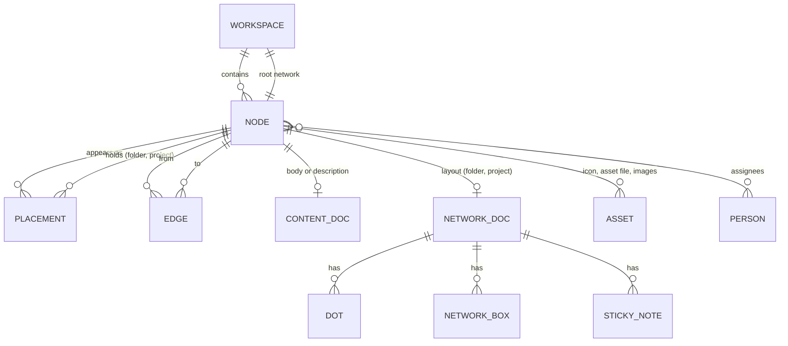

# 05. Модель данных

> Ядро продукта. Остальные документы опираются на сущности и инварианты отсюда. Модель не зависит от выбора библиотек: как это ложится на CRDT и файлы, описано в [10-storage-sync-collab.md](10-storage-sync-collab.md).
>
> Обозначения: ✅ решено ответами, ☑ решено по делегированию (раунд 2), 💡 предложение (с 2026-10-19 считается принятым, [README](README.md)), ❓ вопрос (собраны в [17-open-questions.md](17-open-questions.md)). Термины — в [глоссарии](glossary.md).

## 1. Принципы

1. ✅ **Одна нода — много появлений.** Нода существует один раз. В разных сетях она появляется через размещения. Правка в одном месте видна везде (C3).
2. ✅ **Одно содержимое на ноду.** Вид содержимого выбирается при создании (C2).
3. ✅ **У каждого вида свой набор свойств** ([ADR-0010](adr/0010-kinds-not-classes.md)). Поля задачи — статус, приоритет, сроки, ответственные — есть только у задачи и проекта; цвет, теги, алиасы и пользовательские атрибуты — у любой ноды. До 2026-10-24 действовало 💡 «атрибуты не зависят от вида».
4. ✅ **Нити соединяют ноды, а не их появления.** Нить без типа, направленная, входов и выходов сколько угодно (C4). ☑ Q-05-5: нить глобальна — она видна в каждой сети, где размещены оба конца ([ADR-0001](adr/0001-global-edges.md)).
5. ✅ **Метаданные лёгкие и всегда в памяти, содержимое грузится по требованию** (N1).
6. 💡 **Стабильные ID везде.** Имена и пути — для людей, ID — для ссылок и синхронизации.

## 2. Обзор сущностей



## 3. Пространство (`Workspace`)

| Поле | Тип | Описание |
|---|---|---|
| `id` | ID | Стабильный идентификатор: UUIDv7, текстовая форма — как у ноды (§4.1) |
| `name` | строка | Название |
| `rootNetworkId` | ID ноды | Корневая сеть, путь `/` |
| `settings` | объект | Стиль нитей по умолчанию, тема, фон, набор статусов, схемы атрибутов, шаблоны, срок хранения корзины, сеть «Входящие» для быстрого захвата (`inboxNetworkId`, [09](09-search-navigation.md) §7, ☑ Q-09-10) |
| `people` | список | Люди для назначения ответственными (см. §10) |

💡 Фон пространства и сети описывается одной структурой (параметры конвейера — [07-design-system.md](07-design-system.md)):

```
Background {
  source:   пресет | ассет (SHA-256)
  params:   { blur, desaturate, maxL, vignette }   // предобработка один раз, результат — производный ассет
  grain:    0…1                                      // непрозрачность зерна = grain × 0,06
  fog:      0…1                                      // 0 — туман выключен; сила = альфа спрайтов тумана
  animated: да/нет                                   // только по желанию пользователя
}
```

Значения нормированы и не зависят от темы: как они рисуются, решает [07](07-design-system.md) §7.

Пространство бывает локальным (папка на диске) или серверным. 💡 Локальное пространство можно опубликовать на сервер, серверное — выгрузить локально.

## 4. Нода (`Node`)

### 4.1. Поля

| Поле | Тип | Описание |
|---|---|---|
| `id` | ID | 💡 UUIDv7: сортируется по времени, генерируется офлайн. Текстовая форма одна — 26 символов Crockford base32 (MCP, ссылки, экспорт); на входе принимается и UUID с дефисами. Детерминированные ключи нитей и размещений (§14 п. 1) считаются от 16-байтовых ID, а не от строк ([10](10-storage-sync-collab.md) §2.5) |
| `kind` | `NodeKind` | Вид содержимого. Неизменяем, кроме пар «задача ↔ проект» и «папка ↔ проект» (§4.2) |
| `primaryNetworkId` | ID папки или проекта | 💡 Сеть основного размещения (§5). Одно значение на ноду, поэтому основное размещение всегда ровно одно ([10](10-storage-sync-collab.md) §2.3). У корневой сети пусто |
| `name` | строка | Название. Глобально не уникально (см. §9.3) |
| `icon` | `IconRef` | Пресет (например, `game-icons/<автор>/<id>`), загруженный ассет или эмодзи. 💡 Для загруженных и эмодзи — параметры стилизации `IconStyle { mode: гравюра / пиксель / силуэт / фото / как есть, threshold, dither, invert, background, ink }`: по ним маски 32/64/128 px пересобираются из оригинала. «Как есть» (`as-is`) — 8 бит серого без порога. У сгенерированных иконок — ещё `{ provider, model, prompt }` для перегенерации ([07](07-design-system.md) §6.8). Подкраска — только «чернилами» с контрастом не ниже 7:1 к бумаге ([07](07-design-system.md)). ☑ Q-05-7: по умолчанию «Гравюра», параметры хранятся, режим «Как есть» отключает стилизацию |
| `color` | цвет палитры или пусто | Цвет ноды (аналог цвета ноды в Houdini): полоса 3u по внутренней кромке бабла ([07](07-design-system.md) §4.3). 💡 Палитра людей и нод из [07](07-design-system.md) §2.2 — без жёлтого, оранжевого и красного: эти цвета зарезервированы за сроками. ☑ Q-05-8: 8 цветов |
| `shape` | форма или пусто | ✅ D1: форма ноды запрошена. 💡 В v1 бабл — круг: вид кодируется кромкой и значком ([07](07-design-system.md) §1.5). Палитра форм — после v1 (☑ Q-16-1) |
| `summary` | строка до 280 символов | 💡 Ручная краткая справка. Если пусто, берётся автоматическое превью |
| `attributes` | словарь | Поля задачи (только у задачи и проекта), теги, алиасы, у ассета — файл, ссылка, тип и значок, пользовательские поля (§6) |
| `flags` | набор | Ключевая, пауза, шаблон, скрыть от AI, замок (§7) |
| `preview` | объект | Вычисляемое: сниппет текста, миниатюра, счётчики, свёртки (§6.4) |
| `createdAt`, `createdBy`, `updatedAt`, `updatedBy` | время, человек | Аудит |
| `trashedAt` | время или пусто | Мягкое удаление (§11) |

Сделано (2026-10-31): `icon` любой ноды — пресет `game-icons/<автор>/<id>`; имя значка Хрома — только у ассета (§4.4); остальное ядро отклоняет, тест на правило. Загруженные иконки и эмодзи — с конвейером ассетов.

### 4.2. Виды нод (`NodeKind`)

✅ Принцип «одно содержимое на ноду» — C2. ✅ Владелец 2026-10-24 ([ADR-0010](adr/0010-kinds-not-classes.md)): классов нет, семь видов, у каждого свой набор свойств. Внутрь можно провалиться только в папку и проект; внутри — холст с нодами, технически «сеть».

| Вид | Содержимое | Что происходит при входе | Свойства |
|---|---|---|---|
| **Папка** `network` | Холст с вложенными нодами | Ныряем внутрь, как в subnet Houdini | Имя, цвет, описание |
| **Проект** `project` | Холст с вложенными нодами | Ныряем внутрь | Поля задачи (§4.3), описание; прогресс и ближайший срок — по задачам внутри |
| **Задача** `task` | Описание (Markdown) | Не ныряем: свойства — в панели | Поля задачи (§4.3), описание; подзадачи — по нитям |
| **Заметка** `note` | Markdown-текст | Открывается текстовый редактор | Имя, цвет, текст |
| **Доска** `board` | Сцена доски (Excalidraw): рисование и картинки | Открывается доска | Имя, цвет |
| **Список** `checklist` | Пункты с галочками, вложенность пунктов | Не ныряем: пункты — в панели свойств | Имя, цвет, пункты |
| **Ассет** `asset` | Один файл (картинка, видео, звук, PDF, прочее) или ссылка | Открывается просмотр | Тип, значок, описание (§4.4) |

💡 Позже: **Запрос** `query` (сохранённый фильтр, показывающий ноды по условию — основа для канбана и календаря). Ссылка (`bookmark`) вошла в ассет.

Правила:
- Вид неизменяем, кроме пар «задача ↔ проект» и «папка ↔ проект» — команды «Сделать проектом», «Сделать задачей», «Сделать папкой» в меню по ПКМ (2026-10-24, операция ядра `setKind`): меняется то, можно ли провалиться внутрь, описание остаётся. Задачей проект становится, только если внутри пусто; у папки полей задачи нет, поэтому переход «проект → папка» снимает их тем же шагом отмены. Корень — всегда папка.
- 💡 Чтобы собрать группу нод в одну, есть операция **«Обернуть в папку»** (аналог Collapse into Subnet в Houdini): в центре выделения создаётся папка, выделенные размещения переезжают внутрь (основные остаются основными, появления — появлениями), нити не меняются. Нити между нодами внутри и снаружи после этого видны снаружи как сводные (§8.3). Сделано 2026-10-28: `Shift+C`, меню по ПКМ и палитра `Ctrl+P` — папка и операции «Перенести» одним набором изменений; одна нода даёт папке своё имя, для нескольких имя вводится сразу и входит в тот же шаг отмены ([06](06-canvas-ux.md) §13.3).
- ✅ Полноценный текстовый редактор — у заметки; описание задачи, проекта, папки и ассета — тот же Markdown в их собственном документе содержимого ([10](10-storage-sync-collab.md) §2.4). На доске — только короткие виджеты.
- Ноды, созданные до [ADR-0010](adr/0010-kinds-not-classes.md), читаются без класса: задача-сеть — папка, `media` — ассет.
- ✅ Владелец 2026-10-24: у списка нет своего окна — пункты правятся в панели свойств, как поля задачи. Пункт — текст и галочка, вложенность любой глубины; отдельные пункты не ноды и нитей не имеют.

### 4.3. Задача, проект и подзадачи

✅ Владелец 2026-10-24 ([ADR-0010](adr/0010-kinds-not-classes.md), заменяет Q-05-1 R2): **задача — единица работы, в которую нельзя провалиться; проект — задача, в которую можно провалиться.**

Поля задачи и проекта:

| Поле | Значения |
|---|---|
| Название | Строка |
| Статус `status` | Входящие → К работе → В работе → На проверке → Готово / Отменено (§6.1) |
| Приоритет `priority` | Низкий, средний, высокий, срочный |
| Начало `start`, дедлайн `deadline` | Дата или дата и время (§6.1) |
| Ответственные `assignees` | Люди пространства (§10) |
| Описание | Markdown: жирный, курсив, списки |

**Подзадачи.** Подзадача — задача (или проект), к которой ведёт нить от задачи или проекта (§8.1: источник — «родитель»). Отдельной сущности, поля и типа нити нет (✅ C4): смысл даёт пара видов на концах.
- На холсте подзадача — отдельная нода; в свойствах родителя — превью-чеклист всей иерархии: подзадачи, их подзадачи и так далее, галочка ставит статус «Готово».
- Создать подзадачу — в свойствах задачи «Новая подзадача» или нить от задачи к новой задаче. Подзадача — полноценная задача: свои сроки, ответственные, описание и подзадачи.
- Нить от задачи к заметке, ассету, доске или списку делает приёмник **материалом** задачи: он показан в её свойствах.
- В проекте превью-чеклист — задачи и проекты внутри (кроме тех, что уже чьи-то подзадачи в этом проекте) с их подзадачами по нитям; папки внутри — заголовками, если в них есть задачи. Нить от задачи к папке делает папку материалом, а не подзадачей: она остаётся своей строкой. Задачи, замкнутые нитями в цикл без корня, показываются от первой по времени создания — превью показывает каждую задачу, которую считает свёртка.
- Циклы по нитям разрешены (§8.2 п. 3): иерархия и свёртки обходят каждую ноду один раз.

**Прогресс** — свёртка §6.4:
- у задачи — по её подзадачам по нитям на всю глубину;
- у проекта и папки — по задачам и проектам внутри на всю глубину и их подзадачам по нитям.

Ближайший срок и признак просрочки — свёртка по `deadline` тех же задач. Собственный `deadline` задачи или проекта хранится отдельно и свёрткой не перезаписывается; подсветка свёртки слабее подсветки собственного срока (§6.4, [07](07-design-system.md)).

### 4.4. Ассет

✅ Владелец 2026-10-24: ассет — одно вложение: фото, видео, звук, файл (PDF, документы) или ссылка.

| Поле | Что |
|---|---|
| `asset` | SHA-256 файла ([10](10-storage-sync-collab.md) §11) |
| `mime` | Тип файла, по нему — тип ассета: `image/*` — фото, `video/*` — видео, `audio/*` — звук, остальное — файл |
| `url` | Ссылка вместо файла |
| `icon` | Значок, выбранный руками; по умолчанию — по типу содержимого ([07](07-design-system.md) §6.1) |
| `preview` | У ссылки — SHA-256 картинки её страницы (✅ Q-13-16, [ADR-0012](adr/0012-link-preview.md)); ставит ядро |

У фото картинка — в теле ноды, вырезанная по гексагону ([ADR-0011](adr/0011-hexagon-nodes.md)); у ссылки с превью — картинка её страницы. Описание — в документе содержимого ассета.

Превью ссылки (✅ Q-13-16, ADR-0012) — производное состояние: ядро читает страницу (Open Graph, Twitter, `<title>`), картинку хранит ассетом по SHA-256 (10 §11) и пишет `preview` одним шагом системы, вне отмены пользователя (§11). Заголовок страницы становится именем, только пока имя — то, что нода получила со ссылкой: хост, сама ссылка или пусто. Новая ссылка снимает старое превью в том же шаге; поздний ответ для сменённой ссылки отбрасывается. В браузере превью до сервера этапа 2 нет (✅ Q-13-17).

## 5. Размещение (`Placement`)

Размещение — это факт «нода X лежит в сети N».

| Поле | Тип | Описание |
|---|---|---|
| Ключ | `{networkId}/{nodeId}` | Детерминирован (§14 п. 1); собственного ID у размещения нет |
| `networkId` | ID ноды вида «сеть» | Где лежит |
| `nodeId` | ID ноды | Что лежит |
| `createdAt`, `createdBy` | | Аудит |

💡 Признак основного (домашнего) размещения хранится не на размещении, а в поле ноды `primaryNetworkId` (§4.1): булев флаг на каждом размещении при параллельных правках дал бы ноль или два основных ([10](10-storage-sync-collab.md) §2.3, [ADR-0002](adr/0002-multi-placement.md)).

Позиция, размер и прочая раскладка хранятся в документе сети (§9.2), а не здесь: они нужны только при открытой сети.

### Инварианты размещений

1. Каждая нода, кроме корневой сети и нод в корзине, имеет хотя бы одно размещение.
2. Ровно одно размещение ноды основное: `primaryNetworkId` указывает на одно из её размещений. Если это размещение параллельно убрали, основным считается самое старое из оставшихся ([10](10-storage-sync-collab.md) §8.5).
3. 💡 В одной сети нода размещена не больше одного раза. Это упрощает отрисовку нитей: внутри сети нода однозначна.
4. Вложенность без циклов: нельзя поместить сеть внутрь самой себя или своего потомка. Проверяется при каждом размещении.

### Операции

| Операция | Смысл |
|---|---|
| Создать ноду | Новая нода + основное размещение в текущей сети |
| Разместить здесь | Новое появление существующей ноды в другой сети. 💡 Через Tab-меню (поиск находит существующие ноды), перетаскивание из поиска или «Вставить как появление» (`Ctrl+Shift+V`) |
| Копировать / вставить | 💡 Обычные `Ctrl+C` / `Ctrl+V` создают **независимую копию** (новая нода, копия содержимого). Так же, как в Houdini. Сеть копируется глубоко: ноды с основным размещением внутри копируются, появления остаются появлениями тех же нод. Если появление внутри копии создаёт цикл с целевой сетью (инвариант 4), это появление пропускается, тост перечисляет пропущенные; остальная копия вставляется |
| Убрать отсюда (`Delete`) | Удаляет только это размещение, видимые здесь цепочки залечиваются (§8.4). Если размещение было основным, основным становится самое старое из оставшихся (`primaryNetworkId` переназначается). Если было последним — нода уходит в корзину (с отменой) |
| Удалить везде (`Shift+Delete`) | Нода уходит в корзину вместе со всеми размещениями и нитями. 💡 Если размещений ≥ 2 или задет каскад удаления сети — диалог с перечнем всех путей, где нода размещена; иначе тост с отменой ([06](06-canvas-ux.md) §12.3) |
| Удаление сети | ☑ Q-05-6: каскад — вложенные ноды, у которых нет других размещений, уходят в корзину вместе с сетью; ноды, размещённые где-то ещё, теряют только это размещение (основное при необходимости переназначается). Перед удалением — диалог с числом затронутых нод и перечнем их путей ([06](06-canvas-ux.md) §12.3) |
| Перенести | Вырезать и вставить: размещение переезжает в другую сеть, ID ноды не меняется; основное остаётся основным. 💡 Если в целевой сети нода уже размещена (инвариант 3), переносимое размещение снимается, основное при необходимости переходит к существующему, позиция существующего не меняется; тост «Нода уже была здесь». Всё — один набор изменений |
| Сделать основным | 💡 Переназначает `primaryNetworkId` на выбранное размещение (панель «Где размещена», [06](06-canvas-ux.md) §12.2). ID и ссылки не меняются, канонический путь меняется. Один набор изменений, одна отмена |
| Обернуть в сеть | См. §4.2 |

💡 Появление визуально отличается значком ярлыка в углу бабла (стрелка, как у ярлыков Windows) и счётчиком «×3» при наведении. По клику — список всех мест, где нода размещена.

Сделано в ядре (2026-10-26, `workspace/places.rs`): операции `place` («Разместить здесь»), `unplace` («Убрать отсюда»), `setPrimary` («Сделать основным»), `relocate` («Перенести») с проверкой инвариантов 3 и 4 и тестом на каждое правило. Основное размещение читается по правилу [10](10-storage-sync-collab.md) §8.5: `primaryNet`, пока он называет живое размещение, иначе самое старое. Корзина сети — каскад ☑ Q-05-6 одним набором изменений; в списке корзины — только верх партии, «Вернуть» возвращает всю партию; запертая нода внутри (§7) не даёт удалить сеть. Шаблон (§7) копирует появления внутри появлениями тех же нод, с их ручными нитями к копиям; появление, которое дало бы цикл, пропускается. Выписка сети несёт признак появления и число размещений, карточка ноды — места размещения с путями. В интерфейсе (06 §5.3, §12.2–12.3): появление через меню `Tab`, ярлык и «×N» на бабле, «Где размещена» в панели свойств, «Убрать отсюда» и «Удалить везде» с диалогом.

Сделано в интерфейсе (2026-10-28, [06](06-canvas-ux.md) §12.1, §13.3): «Перенести» — `Ctrl+X` → `Ctrl+V`, бросок на бабл папки или проекта с удержанием 500 мс и перетаскивание строк в «Нодах»; «Разместить здесь» — `Ctrl+Shift+V` и `Alt+Ctrl+Shift`+бросок; «Копировать» — `Ctrl+C` → `Ctrl+V` (вызов ядра `copyNodes`: несколько нод со всем, что внутри, одним набором); «Обернуть в сеть» — `Shift+C`. До броска интерфейс спрашивает ядро, что целевая сеть не примет (вызов `placeable`): нарушение инварианта 4 — подсветка «⊘»; нода уже там (инвариант 3) — для появления «⊘ Нода уже здесь», для переноса — тост «Нода уже была здесь». Каждое действие — один набор изменений и один шаг отмены; тест на каждое правило — в `crates/strata-core/src/tests.rs` и e2e в Chromium и WebKit.

## 6. Атрибуты

### 6.1. Встроенные

| Ключ | Тип | Назначение |
|---|---|---|
| `status` | выбор из статусов пространства | Состояние. 💡 По умолчанию: «Входящие», «К работе», «В работе», «На проверке», «Готово», «Отменено» |
| `deadline` | дата или дата-время | Срок. Подсвечивает ноду (§6.3). Хранится как `YYYY-MM-DD` или `YYYY-MM-DDTHH:MM` — время по часам смотрящего, как `datetime` в Obsidian; в день срока со временем нода «просрочена», когда время прошло. Как дата и время читаются (порядок, 24 или 12 часов) — настройка устройства (✅ Q-06-23), не данные |
| `start` | дата или дата-время | Начало; хранится так же, как `deadline` (✅ владелец 2026-10-24: время `чч:мм` у сроков) |
| `assignees` | список людей | Ответственные |
| `priority` | выбор | Низкий, средний, высокий, срочный |
| `tags` | список строк | Теги, совместимые с тегами Obsidian (вложенные `a/b`) |
| `aliases` | список строк | 💡 Другие имена ноды: участвуют в поиске по именам ([09](09-search-navigation.md) §2.1), совместимы со свойством `aliases` Obsidian ([13](13-interop.md) §2.4) |
| `recurrence` | правило повтора | 💡 Зарезервировано под повторяющиеся задачи (этап 2), чтобы не мигрировать модель позже |
| `remindAt` | дата-время | 💡 Зарезервировано под напоминания (этап 2) |

### 6.2. Пользовательские

💡 Схема атрибутов задаётся на уровне пространства и вида. Типы подобраны так, чтобы один к одному ложиться на свойства Obsidian:

| Тип | В Obsidian |
|---|---|
| Текст (одна строка) | text |
| Число | number |
| Флажок | checkbox |
| Дата, дата-время | date, datetime |
| Выбор, множественный выбор | text / list |
| Человек | text / list |
| Ссылка на ноду | text со `[[ссылкой]]` |
| URL | text |

### 6.3. Атрибуты, влияющие на вид

Подробные визуальные правила — в [07-design-system.md](07-design-system.md). Модель только фиксирует, какие данные их питают:

| Данные | Визуальный эффект (💡) |
|---|---|
| Дедлайн: больше N дней | Нет эффекта |
| Дедлайн: меньше N дней (настройка, по умолчанию 3) | Мягкое свечение акцентным цветом |
| Дедлайн: сегодня | Пульсация |
| Дедлайн прошёл, статус не финальный | Красное кольцо и метка |
| Статус финальный («Готово», «Отменено») | Бабл приглушается, как неактивные узлы в «Море» |
| Флаг «пауза» | Полупрозрачный бабл |
| Ответственные | Аватары-точки на кромке бабла |

### 6.4. Свёртки (roll-up)

💡 У сети вычисляются и хранятся в превью:
- прогресс: доля задач и проектов в финальном статусе среди всех задач и проектов внутри и их подзадач по нитям (рекурсивно, каждая нода считается один раз, даже если размещена в нескольких местах; [ADR-0010](adr/0010-kinds-not-classes.md));
- ближайший дедлайн внутри и признак просрочки;
- число нод по видам.

💡 У списка своя свёртка — доля отмеченных пунктов на всей глубине вложенности; срока у пунктов нет.

☑ Q-05-2: свёртки считаются по всей глубине вложенности, каждая нода — один раз, ноды на паузе (флаг `Q`) не участвуют. ✅ 2026-10-24 ([ADR-0010](adr/0010-kinds-not-classes.md)): статус есть только у задач и проектов, поэтому свёртка считает их; у задачи — по подзадачам по нитям, у проекта и папки — по задачам внутри и их подзадачам по нитям (§4.3).

Свёртка подсвечивает сеть снаружи слабее, чем собственный атрибут: видно, что «внутри что-то горит».

## 7. Флаги

💡 Флаги Houdini, переосмысленные для заметок и задач (подробности и источники — [R1](research/R1-houdini-kinopio-ux.md)):

| Флаг Houdini | Флаг Strata | Клавиша | Смысл |
|---|---|---|---|
| Display | **Ключевая** | `R` | Бабл крупнее, как ключевые узлы в «Море». Ключевые ноды сети первыми попадают в её превью и в 3D-справку. В сети может быть несколько ключевых |
| Bypass | **Пауза** | `Q` | Нода «отложена» или в архиве: бабл приглушён, нода не участвует в свёртках |
| Template | **Шаблон** | `E` | Нода появляется в Tab-меню как заготовка: при выборе создаётся её копия |
| — | **Скрыть от AI** | `T` | Нода и её содержимое не видны через MCP и AI-функции |
| Lock | **Замок** | Только контекстное меню, как в Houdini | Нода только для чтения, защищена от случайных правок |

Клавиши флагов действуют на ноду под курсором. 💡 Этапы — по [16](16-roadmap.md) §4.3, §4.5: `R`, `Q`, `E` — MVP; «Скрыть от AI» (`T`) и «Замок» получают интерфейс вместе с MCP в MVP+ 1.1, а биты есть в модели с MVP. 💡 «Замок» запрещает менять имя, атрибуты, содержимое и удалять ноду; двигать её и менять её нити можно. MCP и AI замок соблюдают и снять не могут. ☑ Q-05-3: набор и смысл флагов приняты.

Правила 💡 (тесты — `crates/strata-core/src/tests.rs`):
- Флаг ставится и снимается одной операцией `setFlag`; каждое переключение — один шаг отмены. Нода в корзине флагов не получает.
- «Пауза» выводит ноду из свёрток (§6.4) и превью-чеклиста (§4.3), а приостановленную папку или проект — вместе со всем, что внутри; подзадача на паузе по нити тоже не считается. Своя свёртка у приостановленной ноды остаётся.
- Копия шаблона — как «Копировать» (§5): новая нода того же вида — имя, поля, ответственные, флаги, документ содержимого; папка и проект — со всем, что внутри основными размещениями, с позициями, нитями между копиями (`manual` и `import`) и стилем нитей. Флаг «Шаблон» копия не берёт, шаблон внутри шаблона остаётся шаблоном. Нити из текста заметок-копий строит текст (§8.2, правило 4). Нити, протянутые к месту копии (Tab-меню на конце нити), входят в тот же шаг.
- «Замок» соблюдает и система: превью ссылки (§4.4) запертую ноду не переименовывает и картинку не ставит.

## 8. Нити (`Edge`)

### 8.1. Поля

| Поле | Тип | Описание |
|---|---|---|
| `id` | ID | 💡 Детерминированный: хеш пары `from → to` от 16-байтовых ID (§4.1); у нити к призраку (§8.5) — хеш `from` и `?linkKey(X)` ([13](13-interop.md) §3.4). Две одновременные правки, создавшие одну и ту же нить, сливаются в одну |
| `from` | ID ноды | Источник (выше по течению, «родитель» в mind map) |
| `to` | ID ноды или пусто | Приёмник (ниже по течению, «ребёнок»). У нити к призраку пусто, вместо него хранится имя `X` (§8.5) |
| `origins` | набор | Откуда нить: `manual` (протянута руками), `text` (ссылка `[[…]]` в заметке), `import` |
| `label` | строка или пусто | 💡 Необязательная подпись. Типов связей нет (✅ C4) |
| `createdAt`, `createdBy` | | Аудит |

### 8.2. Правила

1. ✅ Нить направленная. Входов и выходов у ноды сколько угодно.
2. Петля «нода сама на себя» запрещена. Между упорядоченной парой нод — не больше одной нити.
3. 💡 Циклы A → B → A разрешены: это смысловые связи, а не вычислительный граф. Выделение «выше/ниже по течению» и автораскладка корректно обрабатывают циклы.
4. ✅ Ссылка `[[X]]` в тексте заметки создаёт нить «заметка → X» с происхождением `text` (C8). Убрали ссылку из текста — нить исчезла.
5. ☑ Q-05-4: если удалить на холсте нить, у которой есть происхождение `text`, приложение спрашивает «Убрать ссылку из текста?» с вариантами «Убрать из текста» и «Скрыть нить в этой сети» (§8.3); молча текст не меняется. Жесты, которые разрывают нити пачкой (вставка в нить, встряхивание, нож, `Delete` с залечиванием), снимают только происхождения `manual` и `import`; нити с происхождением `text` остаются, пока ссылка есть в тексте, а в конце жеста показывается один общий вопрос.
6. ✅ 2026-10-24 ([ADR-0010](adr/0010-kinds-not-classes.md)): нить от задачи или проекта к задаче или проекту — «подзадача», к ноде другого вида — «материал» (§4.3). Типов нитей нет (✅ C4): смысл даёт пара видов на концах.
7. 💡 Ручная нить не меняет текст заметки. При экспорте в Obsidian она записывается в свойство `strata-inputs` ноды-приёмника списком `[[ссылок]]` (так Obsidian видит её в обратных ссылках и переписывает при переименовании; подробности — [13-interop.md](13-interop.md), [R2](research/R2-obsidian-format.md)).

### 8.3. Нити и сети: что видно где

Нить связывает ноды, а не размещения. Поэтому:

- нить A → B **рисуется в сети N**, если и A, и B размещены в N;
- 💡 нить можно **скрыть в конкретной сети**, не удаляя её (настройка в документе сети);
- ☑ Q-13-3: нити, у которых единственное происхождение — `text`, можно для всей сети показать, приглушить или скрыть настройкой «Нити из текста: все / приглушённые / скрыты» (§9.2). Это только отображение: направление нити не меняется, данные не меняются; раскладка `L` строит дерево прежде всего по ручным нитям;
- если второй конец нити в этой сети не размещён, на бабле появляется значок **внешних связей** «↗2». По клику — список таких нитей с путями и действия «Перейти» и «Показать здесь» (создать появление). Сделано (2026-10-25): счёт и список ведёт ядро, концы в корзине не считаются; «Показать здесь» — с 2026-10-31 (операция `place`, 06 §14).

Пример:

```
Сеть «Проект А»:   Арт ──► Референсы ◄── Звук
Сеть «Проект Б»:   Референсы ◄── Сценарий
```

«Референсы» — одна нода с двумя размещениями. В «Проекте А» видны нити от «Арт» и «Звук», в «Проекте Б» — от «Сценария». Нити от «Арт» и «Звук» в «Проекте Б» не рисуются, потому что этих нод там нет; на бабле «Референсов» в «Проекте Б» будет значок «↗2».

💡 **Сводные нити.** Если в сети N размещена сеть S, а нить связывает ноду внутри S с нодой, размещённой в N, такая нить рисуется в N как сводная — пунктир от бабла S со счётчиком. Это только отображение: в данных таких нитей нет. Сделано (2026-10-25): нити между одними и теми же двумя баблами считаются вместе, в обе стороны, — одна сводная нить; нить из глубины S тоже сводится к баблу S, а между двумя сетями, размещёнными в N, сводная нить идёт от бабла к баблу.

Почему глобальные нити, а не локальные для каждой сети:
- ссылки `[[…]]` в Obsidian глобальны — так импорт и зеркало остаются честными;
- 3D-карта показывает все связи пространства сразу;
- AI-агенту через MCP проще отвечать на вопрос «что связано с X».

Цена решения: вставка ноды в нить в одной сети меняет связь и в других сетях, где видны оба конца. ☑ Q-05-5: нити глобальные, [ADR-0001](adr/0001-global-edges.md) принят.

### 8.4. Операции над нитями

| Операция | Семантика |
|---|---|
| Соединить | Создать `from → to` |
| Разъединить | Удалить нить (с учётом правила 5 из §8.2) |
| Вставить в нить | Нода X брошена на нить A → B: нить A → B удаляется, создаются A → X и X → B. 💡 Предусловие: у X нет нитей, видимых в этой сети (новая нода или только что извлечённая встряхиванием), как в брифе: «поднести новую ноду» (00). Если отрезок нити общий для нескольких нитей через точку (точки — MVP+ 1.3), вставка происходит во все ветви после точки |
| Встряхнуть | Нода X выдёргивается из цепочек; 💡 затрагиваются только нити, **видимые в текущей сети**. ✅ D1: если у X в этой сети не больше одного входа P, цепочка «залечивается»: P соединяется со всеми выходами X. 💡 Если входов больше, X просто отсоединяется, как в Houdini (иначе появилось бы M×N новых нитей), и показывается уведомление с отменой (☑ Q-06-1). Связи X с нодами вне текущей сети не трогаются. Порог встряхивания настраивается, 0 отключает жест |
| Удалить с залечиванием | 💡 `Delete` на холсте: как «встряхнуть», затем «убрать отсюда» |
| Разрезать ножом | Удалить все нити, которые пересёк росчерк |
| Ответвить | 💡 Протянуть из середины нити A → B новую нить A → C (вариант «а», MVP). Когда в сети есть точки (MVP+ 1.3), в месте захвата ставится незакреплённая точка, и A → B, A → C идут через неё (вариант «б»). ☑ [Q-06-12](06-canvas-ux.md) |

### 8.5. Неразрешённые ссылки

💡 Если в тексте есть `[[X]]`, а ноды X нет (опечатка, ещё не создана, битая ссылка после импорта), нить ведёт к **призраку**: у нити вместо ID приёмника хранится имя `X`, а ключ нити — хеш `from` и `?linkKey(X)` (§8.1, [13](13-interop.md) §3.4). Призрак — не нода: у него нет размещений и содержимого. На холсте он рисуется рядом с источником как пунктирный приглушённый бабл. Клик по призраку создаёт настоящую заметку X на его месте (как в Obsidian). Как только появляется нода с именем X, все призраки X разрешаются автоматически.

Разрешение призрака — одна операция: нить к призраку снимается, создаётся `from → X` с теми же происхождениями, оформление из документов сетей (маршрут, точки, `hidden`) переносится на новый ключ.

Сделано (2026-10-25, `crates/strata-core/src/workspace/links.rs`):
- Ссылка находит ноду по правилу [13](13-interop.md) §3.5 — залипание, путь от корня и от папки заметки, ближайшая по дереву, короче путь, старше; ключ — `linkKey` ([13](13-interop.md) §3.4).
- Нить к призраку — `{ from, ghost: X }` без `to` с происхождением `text`; `X` — как написано в тексте первым.
- Ссылки пересчитываются после правки текста и после каждого шага, который меняет имя, вид, корзину или основное размещение ноды, — в том числе после отмены и повтора. Пересчёт — системный набор изменений: отмена шага «создать X» возвращает призрак, повтор снова его разрешает.
- Нить к ноде в корзине остаётся скрытой (§14 п. 6); новая ссылка на имя, которое есть только в корзине, — призрак, «Вернуть из корзины» его разрешает.
- Оформления нитей в документах сетей ещё нет, переносить при разрешении пока нечего.
- Переименование ноды переписывает `[[Старое]]` → `[[Новое]]` в текстах, чьи ссылки её называли (☑ Q-10-9, [13](13-interop.md) §6.5): нить остаётся на месте. Имя, которое нельзя записать в ссылку, оставляет её призраком.

## 9. Сеть изнутри

### 9.1. Что принадлежит сети

Сеть — холст папки (`network`) или проекта (`project`), в которые можно провалиться ([ADR-0010](adr/0010-kinds-not-classes.md)). Её «содержимое» — документ сети: всё, что нужно, чтобы нарисовать холст. Описание папки и проекта — отдельно, в их документе содержимого (§13).

### 9.2. Документ сети (`NetworkDoc`)

| Элемент | Поля |
|---|---|
| Раскладка размещений | `nodeId → { x, y, size?, collapsed?, pinned? }`: в документе сети N нода однозначно задаёт размещение `N/nodeId` (инвариант 3). 💡 Размер бабла по умолчанию вычисляется (вид, число связей, флаг «ключевая»), вручную можно задать S / M / L / XL. `pinned` — позиция закреплена: авто-раскладка `L`, `A`+перетаскивание и раздвигание соседей её не трогают. `pinned` синхронизируется, в отличие от локального «Закрепить на карте» в 3D ([08](08-view-3d.md) §3.5) |
| Точки | `{ id, x, y, pinned }` |
| Маршруты нитей | `edgeId → { dots: [dotId…], style?, bend?, hidden? }` — через какие точки идёт нить; стиль `straight` / `bezier` / `kinetic` (переопределяет стиль сети); `bend` — ручной изгиб отдельной нити, как в Kinopio; скрыта ли нить в этой сети |
| Рамки | `{ id, rect, title, color, collapsed, members: [nodeId…] }` |
| Стикеры | `{ id, rect, text, color }` — короткий текст, не нода |
| Настройки сети | Фон — структура `Background` (§3; 💡 наследуется от пространства, можно переопределить), направление раскладки (сверху вниз / радиально / свободно), стиль нитей по умолчанию, показ нитей из текста: все / приглушённые / скрыты (☑ Q-13-3, §8.3) |

💡 Точки, рамки и стикеры получают интерфейс в MVP+ 1.3, но место под них в документе сети есть с MVP: миграции не будет ([16](16-roadmap.md) §4.4).

Камера (позиция и масштаб) — локальное состояние каждого пользователя, не синхронизируется.

### 9.3. Пути

- Путь размещения — цепочка имён сетей от корня: `/Проекты/Игра/Спринт 3/Задача`.
- **Канонический путь** строится по основным размещениям. Его копирует «Скопировать путь»; в строке пути он показывается серым, если путь захода с ним не совпадает ([06](06-canvas-ux.md) §10.2); он же — подпись `path` в глубоких ссылках.
- 💡 **Путь захода** — цепочка сетей, по которой пользователь пришёл в сеть. Строка пути показывает именно его, а `U` поднимается по нему: если войти в общие «Референсы» из «Проекта Б», `U` вернёт в «Проект Б», а не в канонический «Проект А». Если пришли по ссылке без `net` или из поиска, путь захода совпадает с каноническим; ссылка с `net` даёт путь до этой сети по основным размещениям ([09](09-search-navigation.md) §5.1).
- У ноды с появлениями путей несколько. 💡 Показываем канонический и «ещё N путей» по клику; полный список вычисляется лениво, потому что при вложенных появлениях число путей может расти быстро.
- 💡 Имена внутри одной сети не обязаны быть уникальными, но при совпадении приложение предупреждает. Поэтому путь — это **подпись**, а надёжная ссылка всегда несёт ID.

### 9.4. Глубокие ссылки

💡 Формат:
- в приложении: `strata://<workspace-id>/n/<node-id>?path=/Проекты/Игра/Задача`;
- на сервере: `https://<сервер>/w/<workspace-id>/n/<node-id>`;
- виджет доски: `strata://<workspace-id>/widget/<board-id>/<widget-id>` — `validateEmbeddable` на доске пропускает только такие ссылки ([ADR-0006](adr/0006-board-engine.md)).

💡 Этапы — по [16](16-roadmap.md): `strata://` и «Скопировать ссылку» — MVP+ 1.4, `https://`-ссылки — этап 3. ID стабильны с MVP, поэтому поздние ссылки не ломаются.

ID главнее пути: если ноду переименовали или перенесли, ссылка всё равно откроет её. Если нода удалена, ссылка ведёт в корзину (если есть права) или показывает «Нода удалена». Подробнее — [09-search-navigation.md](09-search-navigation.md).

## 10. Люди и ответственные

💡
- На сервере человек — это участник пространства (аккаунт).
- В локальном пространстве — запись в списке людей: имя, цвет, аватар. По умолчанию там только владелец. 💡 Цвет человека, если его не выбрали, — следующий цвет палитры по порядку добавления ([07](07-design-system.md) §2.2 «Раздача цветов»).
- При публикации локального пространства на сервер локальные люди сопоставляются с аккаунтами.

## 11. Корзина и история

- 💡 Удаление мягкое: у ноды проставляется `trashedAt`, её размещения и нити остаются в данных скрытыми ([10](10-storage-sync-collab.md) §10.3). Восстановление возвращает всё на места (если сети-родители ещё существуют; иначе — в корень).
- 💡 Корзина очищается автоматически через 30 дней (настройка пространства).
- 💡 История: у каждого документа есть журнал изменений с автором и временем. Можно посмотреть и откатить версию ноды. Детали зависят от движка синхронизации — [10-storage-sync-collab.md](10-storage-sync-collab.md).
- Отмена (`Ctrl+Z`) работает на уровне операций пользователя: «вставить в нить» отменяется одним шагом, хотя меняет три нити. Стек отмены — у пространства, пока оно открыто: переключение вкладок и главная его не теряют, закрытие вкладки отпускает пространство вместе со стеком (2026-10-25; тесты `tabs_keep_their_workspaces_and_their_undo` и e2e «workspaces open in tabs»).
- 💡 **Набор изменений** (`Changeset`): каждая операция записывается как набор изменений с автором, временем и источником — `user`, `mcp:<клиент>`, `ai`, `import`, `system` (действия ведущего ядра: сверка инвариантов, миграции, переписывание ссылок при переименовании, очистка корзины; автор показывается как «Strata»). Набор хранит значения затронутых ключей до и после и откатывается целиком: откат записывает прежнее значение, если текущее равно «после», иначе пропускает ключ и показывает его в отчёте ([10](10-storage-sync-collab.md) §9.1, §9.3). На этом строятся журнал действий агентов (`AgentLog`, в интерфейсе — панель «Действия агентов») и откат массовых правок ([12-mcp-ai.md](12-mcp-ai.md)).

## 12. Ассеты

- 💡 Файлы (картинки, PDF, иконки, фоны) хранятся по хешу содержимого (SHA-256): одинаковые файлы не дублируются.
- Для картинок генерируются миниатюры нескольких размеров, для фонов — заранее размытые версии. Это нужно для производительности (никакого размытия «на лету» на каждом кадре).
- На файл ассета ссылаются ноды вида «ассет», иконки, фоны, элементы досок.

## 13. Разбиение данных на документы

Логическая схема, общая для локального и серверного режимов:

| Документ | Что внутри | Когда загружается |
|---|---|---|
| **Индекс пространства** | Настройки, люди, метаданные всех нод (без содержимого), превью, размещения, нити | На десктопе и сервере — всегда; тонкий веб видит его через выписки проекции ([10](10-storage-sync-collab.md) §5, §7.3). Нужен для поиска по именам, путей, свёрток и 3D |
| **Документ сети** | Раскладка конкретной сети (§9.2) | При входе в сеть; 💡 с упреждающей загрузкой родителя и соседей |
| **Документ содержимого** | Текст заметки, сцена доски, пункты списка; описание задачи, проекта, папки и ассета | При открытии ноды или её превью |
| **Ассеты** | Бинарные файлы | При показе; сначала миниатюры |
| **Локальное состояние** | Камеры, открытые окна, недавние ноды, избранное ([09](09-search-navigation.md) §6.3, ☑ Q-09-7), настройки интерфейса | Только на этом устройстве, не синхронизируется |

Объём по замерам [спайк 4](spikes/S4-loro.md) (раскладка 10 §2.3, 1,5 нити и 1,1 размещения на ноду): 0,65–0,68 КБ на ноду со всей историей и 0,43–0,46 КБ в shallow-снапшоте, то есть 68 и 46 МБ на 100 000 нод. Оценка [R3](research/R3-crdt-sync.md) (0,22–0,33 КБ) оказалась занижена в 2–3 раза: основную массу дают текстовые ключи. Для «неограниченного» масштаба (✅ A4) 💡 индекс делится на шарды по хешу ID ноды (сначала один шард, около 20 000 нод — 16 шардов, дальше — 64). Размещения и исходящие нити ноды лежат в её шарде. Превью и свёртки вынесены в отдельный вычисляемый документ — документ производных ([10](10-storage-sync-collab.md) §2.2).

💡 Поиск по именам, пути, свёртки, 3D и MCP читают не сам CRDT, а **проекцию** в SQLite, которая обновляется по событиям изменений. Подробности — [10-storage-sync-collab.md](10-storage-sync-collab.md).

### Как обновляются вычисляемые поля

- Превью заметки (первые строки), миниатюра доски и исходящие нити с происхождением `text` вычисляются из документа содержимого при его сохранении и записываются в индекс.
- Свёртки сетей пересчитываются при изменении атрибутов вложенных нод.
- Благодаря детерминированным ID нитей два клиента, одновременно пересчитавшие ссылки из одного и того же текста, не создадут дубликатов.

## 14. Сводка инвариантов

1. ID нод, пространств, точек, рамок, стикеров и наборов изменений никогда не переиспользуются. Нити и размещения адресуются детерминированными ключами от пары ID (`hash(from → to)`, `{networkId}/{nodeId}`): при повторном создании той же связи ключ совпадает — это и защищает инварианты 4 и 6 при одновременных правках.
2. Вид ноды неизменяем, кроме пар «задача ↔ проект» и «папка ↔ проект» (§4.2): у них одни поля, меняется только то, можно ли провалиться внутрь.
3. У каждой живой ноды (кроме корня) есть ровно одно основное размещение (`primaryNetworkId`, §5) и, возможно, другие.
4. Нода размещена в сети не больше одного раза.
5. Вложенность сетей ацикличная.
6. Нить соединяет две разные ноды (или ноду и призрак, §8.5); на упорядоченную пару — не больше одной нити. Пока один из концов в корзине, нить скрыта; удаляется она только при окончательном удалении ([10](10-storage-sync-collab.md) §10.4).
7. Нить с происхождением `text` существует, пока в тексте есть соответствующая ссылка.
8. Всё, что нужно для поиска, путей и 3D, есть в индексе; содержимое для этого не загружается.

## Открытые вопросы этого документа

Все вопросы раунда 2 решены 2026-10-19 (✅ R2 — ответ владельца, ☑ R2 — решение по делегированию). Новые вопросы добавляются сюда.

- **Q-05-1.** ✅ 2026-10-24, [ADR-0010](adr/0010-kinds-not-classes.md): задача — отдельный вид, в который нельзя провалиться; проект — задача, в которую можно; подзадачи — задачи по нитям, в свойствах — превью-чеклист иерархии (§4.3). Прежний ответ R2 («задача — сеть класса «Задача» с «Описанием» и «Требованиями» внутри») заменён. (Задача — это сеть с атрибутами и стартовым содержимым?)
- **Q-05-2.** ☑ R2: свёртки — по всей глубине вложенности, каждая нода считается один раз, ноды на паузе не участвуют (§6.4). (Свёртки по всей глубине или по прямым детям?)
- **Q-05-3.** ☑ R2: набор флагов принят — ключевая `R`, пауза `Q`, шаблон `E`, скрыть от AI `T`, замок (§7). (Подходит ли перевод флагов Houdini?)
- **Q-05-4.** ☑ R2: вопрос «Убрать ссылку из текста?» с вариантами «Убрать из текста» / «Скрыть нить в этой сети»; текст молча не меняется; групповые жесты — один общий вопрос в конце (§8.2 п. 5). (Что делать при удалении нити, созданной ссылкой из текста?)
- **Q-05-5.** ☑ R2: нити глобальные, [ADR-0001](adr/0001-global-edges.md) принят (§8.3). (Нити глобальные или свои у каждой сети?)
- **Q-05-6.** ☑ R2: каскад, как в §5, плюс диалог с числом затронутых нод и перечнем путей. (Что происходит с вложенными нодами при удалении сети?)
- **Q-05-7.** ☑ R2: автостилизация «Гравюра» по умолчанию, параметры `IconStyle` хранятся, режим «Как есть» отключает (§4.1). (Стилизовать ли загруженные иконки автоматически?)
- **Q-05-8.** ☑ R2: палитра цвета ноды — 8 цветов без жёлтого, оранжевого и красного (§4.1). (Ограничивать ли цвет ноды палитрой без цветов сроков?)
