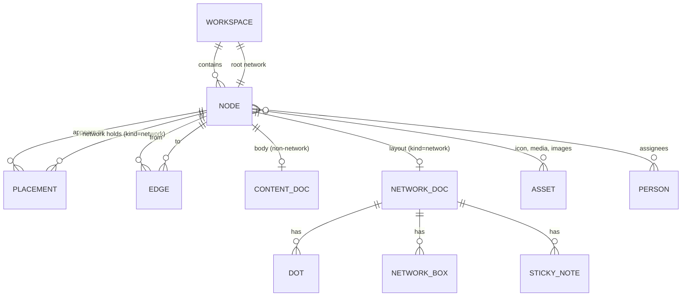

# 05. Модель данных

> Ядро продукта. Остальные документы опираются на сущности и инварианты отсюда. Модель не зависит от выбора библиотек: как это ложится на CRDT и файлы, описано в [10-storage-sync-collab.md](10-storage-sync-collab.md).
>
> Обозначения: ✅ решено ответами, 💡 предложение, ❓ вопрос (собраны в [17-open-questions.md](17-open-questions.md)). Термины — в [глоссарии](glossary.md).

## 1. Принципы

1. ✅ **Одна нода — много появлений.** Нода существует один раз. В разных сетях она появляется через размещения. Правка в одном месте видна везде (C3).
2. ✅ **Одно содержимое на ноду.** Вид содержимого выбирается при создании (C2).
3. 💡 **Атрибуты не зависят от вида.** Статус и дедлайн может получить любая нода, не только задача.
4. ✅ **Нити соединяют ноды, а не их появления.** Нить без типа, направленная, входов и выходов сколько угодно (C4). 💡 Нить глобальна: она видна в каждой сети, где размещены оба конца.
5. ✅ **Метаданные лёгкие и всегда в памяти, содержимое грузится по требованию** (N1).
6. 💡 **Стабильные ID везде.** Имена и пути — для людей, ID — для ссылок и синхронизации.

## 2. Обзор сущностей



## 3. Пространство (`Workspace`)

| Поле | Тип | Описание |
|---|---|---|
| `id` | ID | Стабильный идентификатор |
| `name` | строка | Название |
| `rootNetworkId` | ID ноды | Корневая сеть, путь `/` |
| `settings` | объект | Стиль нитей по умолчанию, тема, фон, набор статусов, схемы атрибутов, классы и шаблоны, срок хранения корзины |

💡 Фон пространства и сети описывается одной структурой (параметры конвейера — [07-design-system.md](07-design-system.md)):

```
Background {
  source:   пресет | ассет (SHA-256)
  params:   { blur, desaturate, maxL, vignette }   // предобработка один раз, результат — производный ассет
  grain:    0…1
  fog:      0…1
  animated: да/нет                                   // только по желанию пользователя
}
```
| `people` | список | Люди для назначения ответственными (см. §10) |

Пространство бывает локальным (папка на диске) или серверным. 💡 Локальное пространство можно опубликовать на сервер, серверное — выгрузить локально.

## 4. Нода (`Node`)

### 4.1. Поля

| Поле | Тип | Описание |
|---|---|---|
| `id` | ID | 💡 UUIDv7: сортируется по времени, генерируется офлайн |
| `kind` | `NodeKind` | Вид содержимого. Неизменяем |
| `class` | ID класса или пусто | 💡 Заготовка, из которой нода создана: «Задача», «Проект», пользовательский класс |
| `name` | строка | Название. Глобально не уникально (см. §8.3) |
| `icon` | `IconRef` | Пресет (например, `game-icons/<автор>/<id>`), загруженный ассет или эмодзи. 💡 Для загруженных — параметры стилизации `IconStyle { mode: гравюра / пиксель / силуэт / фото, threshold, dither, invert, background, ink }`: по ним маски 32/64/128 px пересобираются из оригинала. Подкраска — только «чернилами» с контрастом не ниже 7:1 к бумаге ([07](07-design-system.md)). ❓ Q-05-7 |
| `color` | цвет палитры или пусто | Цвет тонкого кольца бабла (аналог цвета ноды в Houdini). 💡 Палитра из 8 цветов без жёлтого и красного: эти два цвета зарезервированы за сроками ([07](07-design-system.md)). ❓ Q-05-8 |
| `shape` | форма или пусто | 💡 Круг по умолчанию; палитра форм как в Houdini — позже |
| `summary` | строка до 280 символов | 💡 Ручная краткая справка. Если пусто, берётся автоматическое превью |
| `attributes` | словарь | Статус, дедлайн, ответственные, теги, пользовательские поля (§6) |
| `flags` | набор | Ключевая, пауза, шаблон, скрыть от AI, замок (§7) |
| `preview` | объект | Вычисляемое: сниппет текста, миниатюра, счётчики, свёртки (§6.4) |
| `createdAt`, `createdBy`, `updatedAt`, `updatedBy` | время, человек | Аудит |
| `trashedAt` | время или пусто | Мягкое удаление (§11) |

### 4.2. Виды нод (`NodeKind`)

✅ Набор видов определён ответом C2; 💡 состав ниже — предложение.

| Вид | Содержимое | Что происходит при входе | Пример |
|---|---|---|---|
| **Сеть** `network` | Холст с вложенными нодами | Ныряем внутрь, как в subnet Houdini | Проект, раздел, «папка» |
| **Заметка** `note` | Markdown-текст | Открывается текстовый редактор | Конспект, статья, описание |
| **Доска** `board` | Сцена доски (Excalidraw) + виджеты коротких заметок и to-do | Открывается доска | Референсы, мудборд, схема |
| **Список** `checklist` | Пункты с галочками, вложенность пунктов | Открывается список | Чек-лист, требования |
| **Медиа** `media` | Один файл: картинка, PDF, видео, аудио, прочее | Открывается просмотрщик | Скриншот, PDF-документ |

💡 Позже: **Ссылка** `bookmark` (URL с превью), **Запрос** `query` (сохранённый фильтр, показывающий ноды по условию — основа для канбана и календаря).

Правила:
- Вид неизменяем. 💡 Чтобы «вырастить» заметку в раздел или собрать группу нод в одну, есть операция **«Обернуть в сеть»** (аналог Collapse into Subnet в Houdini): в центре выделения создаётся сеть, выделенные размещения переезжают внутрь (основные остаются основными, появления — появлениями), нити не меняются. Нити между нодами внутри и снаружи после этого видны снаружи как сводные (§8.3).
- ✅ Полноценный текстовый редактор есть только у заметки. На доске — только короткие виджеты.

### 4.3. Классы (`NodeClass`) и задача

Задача по брифу — объект с дедлайном, требованиями и ответственными, в который можно «зайти» и найти там свои ноды. При правиле «одно содержимое на ноду» это означает:

💡 **Задача — это класс поверх вида «Сеть».**

| Класс | Вид | Атрибуты по умолчанию | Содержимое при создании |
|---|---|---|---|
| Задача | сеть | статус, дедлайн, ответственные, приоритет | Заметка «Описание» и список «Требования» внутри |
| Проект | сеть | статус, даты начала и конца, ответственные | Пусто |
| Референсы | доска | теги | Пустая доска |
| Чек-лист | список | — | Пустой список |

- Класс — это заготовка: вид + схема атрибутов + иконка + стартовое содержимое. После создания нода — обычная нода своего вида.
- Короткие задачи без вложенности — это любая нода со статусом и дедлайном, например заметка или пункт списка. Класс «Задача» нужен, когда задачу хочется «разворачивать».
- 💡 Пользовательские классы (как супертеги в Tana или типы в Anytype) — этап 2. ❓ Подтвердить, что «Задача = сеть» соответствует ожиданиям (Q-05-1).

## 5. Размещение (`Placement`)

Размещение — это факт «нода X лежит в сети N».

| Поле | Тип | Описание |
|---|---|---|
| `id` | ID | Стабильный идентификатор |
| `networkId` | ID ноды вида «сеть» | Где лежит |
| `nodeId` | ID ноды | Что лежит |
| `isPrimary` | да/нет | Основное (домашнее) размещение |
| `createdAt`, `createdBy` | | Аудит |

Позиция, размер и прочая раскладка хранятся в документе сети (§9.2), а не здесь: они нужны только при открытой сети.

### Инварианты размещений

1. Каждая нода, кроме корневой сети и нод в корзине, имеет хотя бы одно размещение.
2. Ровно одно размещение ноды основное.
3. 💡 В одной сети нода размещена не больше одного раза. Это упрощает отрисовку нитей: внутри сети нода однозначна.
4. Вложенность без циклов: нельзя поместить сеть внутрь самой себя или своего потомка. Проверяется при каждом размещении.

### Операции

| Операция | Смысл |
|---|---|
| Создать ноду | Новая нода + основное размещение в текущей сети |
| Разместить здесь | Новое появление существующей ноды в другой сети. 💡 Через Tab-меню (поиск находит существующие ноды), перетаскивание из поиска или «Вставить как появление» (`Ctrl+Shift+V`) |
| Копировать / вставить | 💡 Обычные `Ctrl+C` / `Ctrl+V` создают **независимую копию** (новая нода, копия содержимого). Так же, как в Houdini. Сеть копируется глубоко: ноды с основным размещением внутри копируются, появления остаются появлениями тех же нод |
| Убрать отсюда (`Delete`) | Удаляет только это размещение, видимые здесь цепочки залечиваются (§8.4). Если размещение было основным, основным становится самое старое из оставшихся. Если было последним — нода уходит в корзину (с отменой) |
| Удалить везде (`Shift+Delete`) | Нода уходит в корзину вместе со всеми размещениями и нитями. 💡 Диалог подтверждения перечисляет все пути, где нода размещена |
| Удаление сети | 💡 Каскад: вложенные ноды, у которых нет других размещений, уходят в корзину вместе с сетью; ноды, размещённые где-то ещё, теряют только это размещение (основное при необходимости переназначается). ❓ Q-05-6 |
| Перенести | Вырезать и вставить: размещение переезжает в другую сеть, ID ноды не меняется |
| Обернуть в сеть | См. §4.2 |

💡 Появление визуально отличается значком ярлыка в углу бабла (стрелка, как у ярлыков Windows) и счётчиком «×3» при наведении. По клику — список всех мест, где нода размещена.

## 6. Атрибуты

### 6.1. Встроенные

| Ключ | Тип | Назначение |
|---|---|---|
| `status` | выбор из статусов пространства | Состояние. 💡 По умолчанию: «Входящие», «К работе», «В работе», «На проверке», «Готово», «Отменено» |
| `deadline` | дата или дата-время | Срок. Подсвечивает ноду (§6.3) |
| `start` | дата | Дата начала |
| `assignees` | список людей | Ответственные |
| `priority` | выбор | Низкий, средний, высокий, срочный |
| `tags` | список строк | Теги, совместимые с тегами Obsidian (вложенные `a/b`) |
| `recurrence` | правило повтора | 💡 Зарезервировано под повторяющиеся задачи (этап 2), чтобы не мигрировать модель позже |
| `remindAt` | дата-время | 💡 Зарезервировано под напоминания (этап 2) |

### 6.2. Пользовательские

💡 Схема атрибутов задаётся на уровне пространства и класса. Типы подобраны так, чтобы один к одному ложиться на свойства Obsidian:

| Тип | В Obsidian |
|---|---|
| Текст (одна строка) | text |
| Число | number |
| Флажок | checkbox |
| Дата, дата-время | date, datetime |
| Выбор, множественный выбор | text / list |
| Человек | text / list |
| Ссылка на ноду | text со `[[ссылкой]]` |
| URL | text |

### 6.3. Атрибуты, влияющие на вид

Подробные визуальные правила — в [07-design-system.md](07-design-system.md). Модель только фиксирует, какие данные их питают:

| Данные | Визуальный эффект (💡) |
|---|---|
| Дедлайн: больше N дней | Нет эффекта |
| Дедлайн: меньше N дней (настройка, по умолчанию 3) | Мягкое свечение акцентным цветом |
| Дедлайн: сегодня | Пульсация |
| Дедлайн прошёл, статус не финальный | Красное кольцо и метка |
| Статус финальный («Готово», «Отменено») | Бабл приглушается, как неактивные узлы в «Море» |
| Флаг «пауза» | Полупрозрачный бабл |
| Ответственные | Аватары-точки на кромке бабла |

### 6.4. Свёртки (roll-up)

💡 У сети вычисляются и хранятся в превью:
- прогресс: доля нод в финальном статусе среди всех нод со статусом внутри (рекурсивно, каждая нода считается один раз, даже если размещена в нескольких местах);
- ближайший дедлайн внутри и признак просрочки;
- число нод по видам.

Свёртка подсвечивает сеть снаружи слабее, чем собственный атрибут: видно, что «внутри что-то горит». ❓ Нужна ли рекурсия на всю глубину или только на один уровень (Q-05-2).

## 7. Флаги

💡 Флаги Houdini, переосмысленные для заметок и задач (подробности и источники — [R1](research/R1-houdini-kinopio-ux.md)):

| Флаг Houdini | Флаг Strata | Клавиша | Смысл |
|---|---|---|---|
| Display | **Ключевая** | `R` | Бабл крупнее, как ключевые узлы в «Море». Ключевые ноды сети первыми попадают в её превью и в 3D-справку. В сети может быть несколько ключевых |
| Bypass | **Пауза** | `Q` | Нода «отложена» или в архиве: бабл приглушён, нода не участвует в свёртках |
| Template | **Шаблон** | `E` | Нода появляется в Tab-меню как заготовка: при выборе создаётся её копия |
| — | **Скрыть от AI** | `T` | Нода и её содержимое не видны через MCP и AI-функции |
| Lock | **Замок** | Только контекстное меню, как в Houdini | Нода только для чтения, защищена от случайных правок |

Клавиши флагов действуют на ноду под курсором. 💡 «Замок» запрещает менять имя, атрибуты, содержимое и удалять ноду; двигать её и менять её нити можно. MCP и AI замок соблюдают и снять не могут. ❓ Подтвердить набор и смысл флагов (Q-05-3).

## 8. Нити (`Edge`)

### 8.1. Поля

| Поле | Тип | Описание |
|---|---|---|
| `id` | ID | 💡 Детерминированный: хеш пары `from → to`. Две одновременные правки, создавшие одну и ту же нить, сливаются в одну |
| `from` | ID ноды | Источник (выше по течению, «родитель» в mind map) |
| `to` | ID ноды | Приёмник (ниже по течению, «ребёнок») |
| `origins` | набор | Откуда нить: `manual` (протянута руками), `text` (ссылка `[[…]]` в заметке), `import` |
| `label` | строка или пусто | 💡 Необязательная подпись. Типов связей нет (✅ C4) |
| `createdAt`, `createdBy` | | Аудит |

### 8.2. Правила

1. ✅ Нить направленная. Входов и выходов у ноды сколько угодно.
2. Петля «нода сама на себя» запрещена. Между упорядоченной парой нод — не больше одной нити.
3. 💡 Циклы A → B → A разрешены: это смысловые связи, а не вычислительный граф. Выделение «выше/ниже по течению» и автораскладка корректно обрабатывают циклы.
4. ✅ Ссылка `[[X]]` в тексте заметки создаёт нить «заметка → X» с происхождением `text` (C8). Убрали ссылку из текста — нить исчезла.
5. 💡 Если удалить на холсте нить, у которой есть происхождение `text`, приложение спрашивает: «Убрать ссылку из текста?» Жесты, которые разрывают нити пачкой (вставка в нить, встряхивание, нож, `Delete` с залечиванием), снимают только происхождения `manual` и `import`; нити с происхождением `text` остаются, пока ссылка есть в тексте, а в конце жеста показывается один общий вопрос. ❓ Q-05-4.
6. 💡 Ручная нить не меняет текст заметки. При экспорте в Obsidian она записывается в свойство `strata-inputs` ноды-приёмника списком `[[ссылок]]` (так Obsidian видит её в обратных ссылках и переписывает при переименовании; подробности — [13-interop.md](13-interop.md), [R2](research/R2-obsidian-format.md)).

### 8.3. Нити и сети: что видно где

Нить связывает ноды, а не размещения. Поэтому:

- нить A → B **рисуется в сети N**, если и A, и B размещены в N;
- 💡 нить можно **скрыть в конкретной сети**, не удаляя её (настройка в документе сети);
- если второй конец нити в этой сети не размещён, на бабле появляется значок **внешних связей** «↗2». По клику — список таких нитей с путями и действия «Перейти» и «Показать здесь» (создать появление).

Пример:

```
Сеть «Проект А»:   Арт ──► Референсы ◄── Звук
Сеть «Проект Б»:   Референсы ◄── Сценарий
```

«Референсы» — одна нода с двумя размещениями. В «Проекте А» видны нити от «Арт» и «Звук», в «Проекте Б» — от «Сценария». Нити от «Арт» и «Звук» в «Проекте Б» не рисуются, потому что этих нод там нет; на бабле «Референсов» в «Проекте Б» будет значок «↗2».

💡 **Сводные нити.** Если в сети N размещена сеть S, а нить связывает ноду внутри S с нодой, размещённой в N, такая нить рисуется в N как сводная — пунктир от бабла S со счётчиком. Это только отображение: в данных таких нитей нет.

Почему глобальные нити, а не локальные для каждой сети:
- ссылки `[[…]]` в Obsidian глобальны — так импорт и зеркало остаются честными;
- 3D-карта показывает все связи пространства сразу;
- AI-агенту через MCP проще отвечать на вопрос «что связано с X».

Цена решения: вставка ноды в нить в одной сети меняет связь и в других сетях, где видны оба конца. ❓ Подтвердить (Q-05-5).

### 8.4. Операции над нитями

| Операция | Семантика |
|---|---|
| Соединить | Создать `from → to` |
| Разъединить | Удалить нить (с учётом правила 5 из §8.2) |
| Вставить в нить | Нода X брошена на нить A → B: нить A → B удаляется, создаются A → X и X → B. Если отрезок нити общий для нескольких нитей через точку, вставка происходит во все ветви после точки |
| Встряхнуть | 💡 Нода X выдёргивается из цепочек, **видимых в текущей сети**. Если у X в этой сети не больше одного входа P, цепочка «залечивается»: P соединяется со всеми выходами X. Если входов больше, X просто отсоединяется, как в Houdini (иначе появилось бы M×N новых нитей), и показывается уведомление с отменой. Связи X с нодами вне текущей сети не трогаются. Порог встряхивания настраивается, 0 отключает жест |
| Удалить с залечиванием | 💡 `Delete` на холсте: как «встряхнуть», затем «убрать отсюда» |
| Разрезать ножом | Удалить все нити, которые пересёк росчерк |
| Ответвить | Протянуть из середины нити новую нить от того же источника к другой ноде; в месте ответвления появляется точка (❓ [Q-06-12](06-canvas-ux.md)) |

### 8.5. Неразрешённые ссылки

💡 Если в тексте есть `[[X]]`, а ноды X нет (опечатка, ещё не создана, битая ссылка после импорта), нить ведёт к **призраку**: у нити вместо ID приёмника хранится имя `X`. Призрак — не нода: у него нет размещений и содержимого. На холсте он рисуется рядом с источником как пунктирный приглушённый бабл. Клик по призраку создаёт настоящую заметку X на его месте (как в Obsidian), и нить перепривязывается к ней. Как только появляется нода с именем X, все призраки X разрешаются автоматически.

## 9. Сеть изнутри

### 9.1. Что принадлежит сети

Сеть — это нода вида `network`. Её «содержимое» — документ сети: всё, что нужно, чтобы нарисовать холст.

### 9.2. Документ сети (`NetworkDoc`)

| Элемент | Поля |
|---|---|
| Раскладка размещений | `placementId → { x, y, size?, collapsed?, pinned? }`. 💡 Размер бабла по умолчанию вычисляется (вид, число связей, флаг «ключевая»), вручную можно задать S / M / L / XL. `pinned` — позиция закреплена: авто-раскладка `L`, `A`+перетаскивание и раздвигание соседей её не трогают |
| Точки | `{ id, x, y, pinned }` |
| Маршруты нитей | `edgeId → { dots: [dotId…], style?, bend?, hidden? }` — через какие точки идёт нить; стиль `straight` / `bezier` / `kinetic` (переопределяет стиль сети); `bend` — ручной изгиб отдельной нити, как в Kinopio; скрыта ли нить в этой сети |
| Рамки | `{ id, rect, title, color, collapsed, members: [placementId…] }` |
| Стикеры | `{ id, rect, text, color }` — короткий текст, не нода |
| Настройки сети | Фон — структура `Background` (§3; 💡 наследуется от пространства, можно переопределить), направление раскладки (сверху вниз / радиально / свободно), стиль нитей по умолчанию |

Камера (позиция и масштаб) — локальное состояние каждого пользователя, не синхронизируется.

### 9.3. Пути

- Путь размещения — цепочка имён сетей от корня: `/Проекты/Игра/Спринт 3/Задача`.
- **Канонический путь** строится по основным размещениям. Его копирует кнопка «Скопировать путь», он же показывается в подсказке строки пути и в глубоких ссылках.
- 💡 **Путь захода** — маршрут, по которому пользователь пришёл в сеть. Строка пути показывает именно его, а `U` поднимается по нему: если войти в общие «Референсы» из «Проекта Б», `U` вернёт в «Проект Б», а не в канонический «Проект А». Если пришли по ссылке или из поиска, путь захода совпадает с каноническим.
- У ноды с появлениями путей несколько. 💡 Показываем канонический и «ещё N путей» по клику; полный список вычисляется лениво, потому что при вложенных появлениях число путей может расти быстро.
- 💡 Имена внутри одной сети не обязаны быть уникальными, но при совпадении приложение предупреждает. Поэтому путь — это **подпись**, а надёжная ссылка всегда несёт ID.

### 9.4. Глубокие ссылки

💡 Формат:
- в приложении: `strata://<workspace-id>/n/<node-id>?path=/Проекты/Игра/Задача`;
- на сервере: `https://<сервер>/w/<пространство>/n/<node-id>`.

ID главнее пути: если ноду переименовали или перенесли, ссылка всё равно откроет её. Если нода удалена, ссылка ведёт в корзину (если есть права) или показывает «Нода удалена». Подробнее — [09-search-navigation.md](09-search-navigation.md).

## 10. Люди и ответственные

💡
- На сервере человек — это участник пространства (аккаунт).
- В локальном пространстве — запись в списке людей: имя, цвет, аватар. По умолчанию там только владелец.
- При публикации локального пространства на сервер локальные люди сопоставляются с аккаунтами.

## 11. Корзина и история

- 💡 Удаление мягкое: у ноды проставляется `trashedAt`, её размещения и нити запоминаются. Восстановление возвращает всё на места (если сети-родители ещё существуют; иначе — в корень).
- 💡 Корзина очищается автоматически через 30 дней (настройка пространства).
- 💡 История: у каждого документа есть журнал изменений с автором и временем. Можно посмотреть и откатить версию ноды. Детали зависят от движка синхронизации — [10-storage-sync-collab.md](10-storage-sync-collab.md).
- Отмена (`Ctrl+Z`) работает на уровне операций пользователя: «вставить в нить» отменяется одним шагом, хотя меняет три нити.
- 💡 **Набор изменений** (`Changeset`): каждая операция записывается как набор изменений с автором, временем и источником — `user`, `mcp:<клиент>`, `ai`, `import`, `system` (действия ведущего ядра: сверка инвариантов, миграции, переписывание ссылок при переименовании, очистка корзины; автор показывается как «Strata»). Набор можно откатить целиком. На этом строятся журнал действий AI-агентов и откат массовых правок ([12-mcp-ai.md](12-mcp-ai.md)).

## 12. Ассеты

- 💡 Файлы (картинки, PDF, иконки, фоны) хранятся по хешу содержимого (SHA-256): одинаковые файлы не дублируются.
- Для картинок генерируются миниатюры нескольких размеров, для фонов — заранее размытые версии. Это нужно для производительности (никакого размытия «на лету» на каждом кадре).
- На ассет ссылаются ноды вида «медиа», иконки, фоны, элементы досок.

## 13. Разбиение данных на документы

Логическая схема, общая для локального и серверного режимов:

| Документ | Что внутри | Когда загружается |
|---|---|---|
| **Индекс пространства** | Настройки, люди, метаданные всех нод (без содержимого), превью, размещения, нити | Всегда. Нужен для поиска по именам, путей, свёрток и 3D |
| **Документ сети** | Раскладка конкретной сети (§9.2) | При входе в сеть; 💡 с упреждающей загрузкой родителя и соседей |
| **Документ содержимого** | Текст заметки, сцена доски, пункты списка | При открытии ноды или её превью |
| **Ассеты** | Бинарные файлы | При показе; сначала миниатюры |
| **Локальное состояние** | Камеры, открытые окна, недавние ноды, настройки интерфейса | Только на этом устройстве, не синхронизируется |

Оценка объёма по замерам [R3](research/R3-crdt-sync.md): около 0,22–0,33 КБ CRDT-данных на ноду, то есть 22–28 МБ на 100 000 нод. Для «неограниченного» масштаба (✅ A4) 💡 индекс делится на шарды по хешу ID ноды (сначала один шард, около 20 000 нод — 16 шардов, дальше — 64). Размещения и исходящие нити ноды лежат в её шарде. Превью и свёртки вынесены в отдельный вычисляемый документ.

💡 Поиск по именам, пути, свёртки, 3D и MCP читают не сам CRDT, а **проекцию** в SQLite, которая обновляется по событиям изменений. Подробности — [10-storage-sync-collab.md](10-storage-sync-collab.md).

### Как обновляются вычисляемые поля

- Превью заметки (первые строки), миниатюра доски и исходящие нити с происхождением `text` вычисляются из документа содержимого при его сохранении и записываются в индекс.
- Свёртки сетей пересчитываются при изменении атрибутов вложенных нод.
- Благодаря детерминированным ID нитей два клиента, одновременно пересчитавшие ссылки из одного и того же текста, не создадут дубликатов.

## 14. Сводка инвариантов

1. ID нод, пространств, точек, рамок, стикеров и наборов изменений никогда не переиспользуются. Нити и размещения адресуются детерминированными ключами от пары ID (`hash(from → to)`, `{networkId}/{nodeId}`): при повторном создании той же связи ключ совпадает — это и защищает инвариант 4 при одновременных правках.
2. Вид ноды неизменяем.
3. У каждой живой ноды (кроме корня) есть ровно одно основное размещение и, возможно, другие.
4. Нода размещена в сети не больше одного раза.
5. Вложенность сетей ацикличная.
6. Нить соединяет две разные живые ноды (или ноду и призрак, §8.5); на упорядоченную пару — не больше одной нити.
7. Нить с происхождением `text` существует, пока в тексте есть соответствующая ссылка.
8. Всё, что нужно для поиска, путей и 3D, есть в индексе; содержимое для этого не загружается.

## Открытые вопросы этого документа

- **Q-05-1.** Задача — это сеть с атрибутами задачи и стартовыми «Описанием» и «Требованиями» внутри. Так ли это видится?
- **Q-05-2.** Свёртки (прогресс, ближайший дедлайн) считать по всей глубине вложенности или только по прямым детям?
- **Q-05-3.** Подходит ли перевод флагов Houdini: ключевая, пауза, шаблон, скрыть от AI, замок?
- **Q-05-4.** Что делать при удалении нити, созданной ссылкой из текста: спрашивать, удалять ссылку молча или запрещать?
- **Q-05-5.** Нити глобальные (видны везде, где есть оба конца) — подтверждаете? Альтернатива: у каждой сети свои нити, но тогда ссылки из текста и 3D-карта сложнее.
- **Q-05-6.** При удалении сети: вложенные ноды без других размещений уходят в корзину вместе с ней, общие теряют только это размещение. Так подходит, или спрашивать про каждую общую ноду?
- **Q-05-7.** Подходит ли автостилизация загруженных иконок в монохромную «гравюру» по умолчанию с хранением параметров и возможностью отключить?
- **Q-05-8.** Ограничиваем ли цвет ноды палитрой из 8 цветов без жёлтого и красного, чтобы цвет не путался со сроками?
