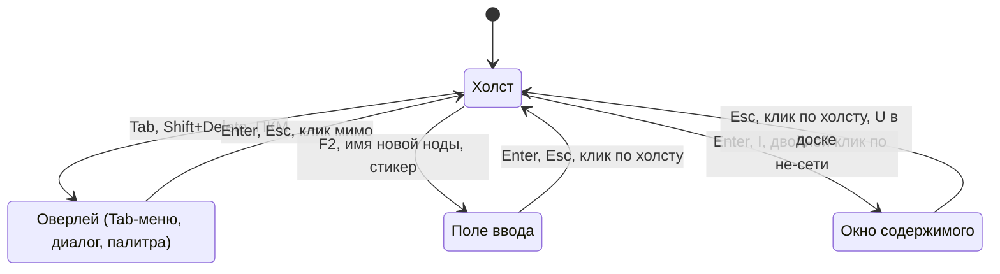

# 06. UX холста

> Статус: черновик. Полная спецификация взаимодействия на 2D-холсте сети: экран, камера, баблы, создание, нити, рамки, флаги, раскладка, навигация, выделение, появления, окна содержимого, линзы, совместная работа, горячие клавиши, устройства ввода, доступность.
>
> Опирается на [05-domain-model.md](05-domain-model.md) (ядро) и [глоссарий](glossary.md). Связано: [07-design-system.md](07-design-system.md) (как выглядят состояния), [08-view-3d.md](08-view-3d.md), [09-search-navigation.md](09-search-navigation.md), [10-storage-sync-collab.md](10-storage-sync-collab.md), [12-mcp-ai.md](12-mcp-ai.md), [14-nfr.md](14-nfr.md), [16-roadmap.md](16-roadmap.md), [ADR-0005](adr/0005-rendering.md), [ADR-0006](adr/0006-board-engine.md), [ADR-0007](adr/0007-text-editor.md). Источники фактов: [R1](research/R1-houdini-kinopio-ux.md) (главный), [R4](research/R4-app-shell-rendering.md), [R5](research/R5-board-engine.md), [R7](research/R7-retro-design-assets.md), [R8](research/R8-competitors.md).
>
> Обозначения: ✅ решено ответами, ☑ решено по делегированию владельца (раунд 2), 💡 предложение, ❓ вопрос (собраны в [17-open-questions.md](17-open-questions.md)). Все размеры в px — экранные CSS-пиксели, если не сказано «мировые единицы».
>
> Платформы (✅ R2, Q-15-1): основные — macOS (WKWebView) и Windows (WebView2), на них владелец принимает каждую веху; Linux собирается в CI и проходит автотесты, ручной приёмки нет. Правило клавиш для macOS — §17.
>
> Термины этого документа внесены в глоссарий: **порт**, **инфокарточка**, **кольцо флагов**, **текущая нода**, **строка пути**, **путь захода**, **быстрая метка**, **избранное**, **окно содержимого**, **режим фокуса**, **сводная нить**.
>
> Этапы — по [16-roadmap.md](16-roadmap.md) (§4.2–§4.4, §5.2, §11); пометки этапов здесь их только повторяют.

## 1. Принципы

✅ Главный референс навигации и работы с нодами — сетевой редактор Houdini (A2, D1); в MVP — «навигация по принципу Houdini» (O1).

| # | Принцип | Как выполняется |
|---|---|---|
| 1 | **Скорость руки** | Всё основное — мышь плюс одна клавиша, без меню и диалогов. Мышечная память Houdini переносится как есть ([R1](research/R1-houdini-kinopio-ux.md)). Диалог — только там, где действие трудно отменить (удалить везде, каскад сети) |
| 2 | **Режимы фокуса** | Холст / оверлей / поле ввода / окно содержимого (режим 3D — [08](08-view-3d.md) §5.2). Однобуквенные клавиши работают только при фокусе на холсте (§1.1) |
| 3 | **Один жест — одна транзакция** | Жест целиком (перетаскивание с встряхиванием и броском на нить, штрих `J`, нож, `L`, вставка) — один шаг `Ctrl+Z` и один набор изменений с источником `user` (05 §11). Соавтор видит цельное изменение, а не промежуточные кадры ([R1](research/R1-houdini-kinopio-ux.md)) |
| 4 | **Анимация структуры 150–250 мс** | Вставка, залечивание, раскладка, раздвигание соседей и удалённые структурные правки анимируются, чтобы не терять ментальную карту (аналог Animate Network Changes, [R1](research/R1-houdini-kinopio-ux.md)). При `prefers-reduced-motion` и настройке «Меньше движения» — мгновенно или фейд ≤ 150 мс ([R7](research/R7-retro-design-assets.md)) |
| 5 | **Пороги против ложных срабатываний** | Встряхивание, бросок на нить и протяжка срабатывают только после порога, с подсветкой и отменой (§1.3). Houdini понадобились клавиша `8` и Shake Distance ровно из-за этого ([R1](research/R1-houdini-kinopio-ux.md)) |
| 6 | **У каждого жеста есть команда** | Встряхивание → `Ctrl+Shift+X`, нож → выделить нить и `Delete`, `J`-штрих → Tab-меню, удержание СКМ → `Shift+I`, `A`+drag → `L` по выделению. Нужно для трекпада и клавиатуры (§18, §19) |
| 7 | **Позиция принадлежит размещению** | У каждого появления ноды свои координаты, размер и свёрнутость (05 §9.2) |
| 8 | **0 fps в покое** | Рендер по событию. Непрерывные анимации ограничены по времени (§6.8). Позиции нод живут в сцене холста, а не в состоянии React ([R4](research/R4-app-shell-rendering.md), [R7](research/R7-retro-design-assets.md)) |
| 9 | **Раскладку не трогаем без спроса** | Позиции сохраняются; `L` никогда не запускается сам. Сброс раскладки при входе — антипаттерн ([R8](research/R8-competitors.md), Anytype #2142) |

### 1.1. Режимы фокуса



| Режим | Кто получает клавиши | Что Strata перехватывает всегда |
|---|---|---|
| **Оверлей** (Tab-меню, диалог, палитра, контекстное меню) | Только оверлей | — |
| **Поле** (`input`, `textarea`, узлы внутри `.cm-editor`) | Поле | `Esc`, `Ctrl+P`, `Ctrl+O`, `F6` |
| **Окно содержимого** | Редактор окна (CM6, Excalidraw, просмотрщик) | `Esc` (если редактору нечего отменять), `F6`, `Ctrl+W`, `Ctrl+P`, `Ctrl+O` — в том числе в доске (принцип 6: палитра доступна везде); в доске ещё `U` и `Tab` ([R5](research/R5-board-engine.md)). 💡 Конфликт `Ctrl+P` / `Ctrl+O` с сочетаниями Excalidraw — проверить в спайке 5 ([16](16-roadmap.md) §3.2) |
| **Холст** | Карта клавиш холста | Всё из §17 |

💡 Маршрутизация — один обработчик `keydown` в фазе capture на `window`:

```ts
function route(e: KeyboardEvent) {
  if (e.isComposing) return;                         // ввод через IME
  const combo = comboOf(e);                          // модификаторы + e.code
  if (overlay.open) return overlay.handle(combo, e);
  if (isWritable(e.target)) return GLOBAL_IN_TEXT.has(combo) && run(combo, e);
  if (focus.kind === "window") return WINDOW_INTERCEPT[focus.engine].has(combo) && run(combo, e);
  return canvasKeymap.run(combo, e);                 // привязка по e.code, не по e.key
}
```

`isWritable` повторяет проверку Excalidraw `isWritableElement` ([R5](research/R5-board-engine.md)). Привязка по `KeyboardEvent.code` нужна, чтобы `L` не превратилась в `Д` в русской раскладке ([R1](research/R1-houdini-kinopio-ux.md)).

### 1.2. Отмена и наборы изменений

| Что | Правило |
|---|---|
| Стек граф-команд | Один на сеанс пространства, глубина 200 (💡). Команда хранит прежние значения ключей; отмена записывает их новыми операциями ([R3](research/R3-crdt-sync.md)) |
| Чужие правки | Отменяются только свои шаги. Если ключ после нас изменил другой человек, шаг пропускается с подсказкой ([R3](research/R3-crdt-sync.md)) |
| Отмена в другой сети | Применяется сразу; тост «Отменено: „Вставить в нить“ в /Проекты/Игра · Перейти» |
| Не попадают в стек | Камера, выделение, открытие окон, навигация |
| Внутри редакторов | Свой undo: UndoManager Loro (заметка, список, виджеты), встроенный undo Excalidraw (сцена доски) ([R5](research/R5-board-engine.md)). `Ctrl+Z` идёт туда, где фокус |
| Подпись набора изменений | Человекочитаемая: «Вставить в нить: „Звук“ между „Арт“ и „Референсы“». Нужна журналу и откату ([12-mcp-ai.md](12-mcp-ai.md)) |

### 1.3. Пороги (💡, все настраиваемые)

| Порог | Значение по умолчанию | Источник |
|---|---|---|
| Начало перетаскивания | 4 px мышь, 6 px перо, 10 px тач | свой |
| Двойной клик | интервал ОС или 400 мс, разброс ≤ 4 px | свой |
| Зона порта | кольцо снаружи бабла от `r` до `r + max(8 px, 0,25 r)` | свой |
| Попадание в нить | ≤ 6 px до кривой | свой |
| Бросок на нить | центр бабла ближе `r + 6 px` к кривой, кандидат держится ≥ 200 мс | [R1](research/R1-houdini-kinopio-ux.md) |
| Встряхивание | ≥ 4 разворота по одной оси (горизонталь или вертикаль), размах каждого ≥ D, всё за ≤ 600 мс; D = 40 px; D = 0 — жест выключен. ✅ S9 (2026-10-23): при D = 32 px и развороты обеих осей в сумме нода отцеплялась случайно — диагональная поправка давала два разворота, круг вокруг цели — четыре | 05 §8.4, [R1](research/R1-houdini-kinopio-ux.md) |
| Удержание СКМ → инфокарточка | 200 мс без сдвига ≥ 4 px; сдвиг раньше — панорама | свой |
| Наведение → инфокарточка | 600 мс, выключаемо | [R1](research/R1-houdini-kinopio-ux.md) |
| Кольцо флагов | появляется через 150 мс наведения, гаснет через 300 мс | свой |
| Нода к краю рамки | < 300 px/с — рамка растёт; ≥ 300 px/с — нода выходит | [R1](research/R1-houdini-kinopio-ux.md) (медленно/быстро) |
| Бросок на бабл сети | удержание ≥ 500 мс → «положить внутрь» | свой |
| Цифра → быстрая метка | удержание ≥ 600 мс | [R1](research/R1-houdini-kinopio-ux.md) |
| Гистерезис семантического зума | 10 % | свой |

### 1.4. Длительности анимаций (💡)

| Анимация | Обычно | Меньше движения |
|---|---|---|
| Структура: вставка, залечивание, раздвигание, `L`, удалённые структурные правки | 200 мс, ease-out | мгновенно |
| Камера: `H`, `G`, переход к ноде | 250 мс | мгновенно |
| Нырок и подъём | 250 мс зум в бабл + смена фона кроссфейдом 300 мс ([R7](research/R7-retro-design-assets.md)) | фейд ≤ 150 мс |
| Наведение на бабл | масштаб 1,05 за 80 мс ([R7](research/R7-retro-design-assets.md)) | без масштаба |
| Тост | появление 150 мс, живёт 6 с (с отменой — 10 с) | без сдвига |

## 2. Экран

### 2.1. Области

```
┌──────────────────────────────────────────────────────────────────────────────┐
│ [Игра] [Спринт 3 ×] [+]                                        вкладки сетей │
│ ◄ ► ▾  / Проекты / Игра ▾ / Спринт 3 ▾        ★1 ★2 ·3 ·4 ·5   ⧉   2D | 3D  │ строка пути
├─────────────────────────────────────────────────┬────────────────────────────┤
│                                                 │ ┌ ЗАМЕТКА · Диздок ◎ ▭ □ ×┐│
│     холст: фон, баблы, нити, рамки, стикеры     │ │ текст (CM6)             ││
│                                                 │ │                         ││
│         ┌ Tab-меню ┐        ┌ Свойства (P) ┐    │ └─────────────────────────┘│
│  ┌ мини-карта (O) ┐                             │  окно, закреплённое справа │
├─────────────────────────────────────────────────┴────────────────────────────┤
│ ● Синхронизировано · 2 участника · Выделено 4 · Линза: Горит · 100 %         │ статусная строка
│ ЛКМ — выделить · СКМ — панорама · Tab — создать · J+штрих — цепочка          │ подсказки ввода
└──────────────────────────────────────────────────────────────────────────────┘
```

| Область | Содержимое | Этап ([16](16-roadmap.md)) |
|---|---|---|
| Вкладки сетей | Вкладка = сеть + камера + своя история. Появляются, когда открыто больше одной | этап 2 |
| Строка пути | `◄ ►` и `▾` — история; путь захода (§10.2); слоты быстрых меток ★1–★5; «Скопировать ссылку» `⧉`; переключатель 2D/3D ([08-view-3d.md](08-view-3d.md)) | MVP; `⧉` — MVP+ 1.4 |
| Холст | Фон, баблы, нити, точки, рамки, стикеры, призраки, курсоры соавторов | MVP; точки, рамки, стикеры — MVP+ 1.3; курсоры соавторов — этап 3 |
| Окна содержимого | Ретро-окна заметок, досок, списков, ассетов (§2.2, §13) | MVP |
| Плавающие панели | Свойства ноды `P` (статус, дедлайн, ответственные, теги, свои поля), мини-карта `O`, палитра цвета `C`, палитра иконки и размера `Z` (палитра форм — после v1, ☑ Q-16-1) | MVP |
| Статусная строка | Синхронизация, присутствие, счётчик выделения, активная линза, зум, свёрнутые окна | MVP; присутствие — этап 3, линза — MVP+ 1.4 |
| Подсказки ввода | Что делают кнопки мыши и клавиши в текущем контексте (под курсором бабл, нить, пусто; зажата `Y`/`J`/`A`). Снижают порог входа Houdini-UX ([R8](research/R8-competitors.md)) | MVP, отключаемо |

Статус синхронизации всегда на виду, молчаливых сбоев нет ([R8](research/R8-competitors.md), рекомендация 7):

| Состояние | Текст | Действие по клику |
|---|---|---|
| Локальное пространство | «Сохранено» | — |
| Связь есть, всё отправлено | «Синхронизировано» | Журнал ([10](10-storage-sync-collab.md)) |
| Идёт отправка | «Синхронизация… (N)» | — |
| Подключение, догон ленты | «Слияние…» | — |
| Нет связи | «Офлайн · N изменений сохранены локально» | Повторить |
| Ошибка | «Ошибка синхронизации» + причина | Подробности; при несохранённом закрытие вкладки блокируется (`beforeunload`) |

Полный набор состояний и переходов, включая «Только чтение», — [10](10-storage-sync-collab.md) §8.6. В MVP пространство локальное, виден только статус «Сохранено»; остальные — с сервером, с этапа 2 ([16](16-roadmap.md) §4.6).

Все тексты холста — статусы, тосты, подсказки ввода, пункты меню, диалоги — идут через ключи каталога: интерфейс на русском и английском с MVP (✅ R2, Q-07-1; длины и типографика — [07](07-design-system.md) §12). Примеры в этом документе — по-русски.

### 2.2. Модель окон (вопрос D7)

💡 **Холст всегда главный, содержимое — в ретро-окнах поверх него.**

| Элемент | Поведение |
|---|---|
| Вкладки сетей | Как в браузере: параллельные контексты. `Ctrl+Enter` по сети — открыть во вкладке |
| Окно содержимого | Плавающее окно в экранных координатах (не ездит с камерой). Заголовок: значок вида, имя, кнопки `◎` (показать бабл на холсте), `▭` (закрепить у края), `□` (на весь экран), `_` (свернуть в статусную строку), `×` |
| Закреплённое окно | Док слева или справа, делит экран с холстом; ширина 40 %, минимум 320 px, разделитель тянется. Это и есть сплит «граф слева, текст справа» |
| Развёрнутое | Всё между строкой пути и статусной строкой. `Shift+Enter` по ноде открывает сразу так |
| Несколько окон | Сколько угодно открытых; живых редакторов смонтировано ≤ 4, остальные показывают статичный снимок и монтируются по фокусу |
| Переход по сетям | Окна привязаны к нодам, а не к сети: при нырке остаются открытыми |
| Сплит двух холстов | Две панели с разными сетями, перетаскивание нод между ними — перенос или появление |
| Отдельное окно ОС | Только десктоп: окно содержимого отрывается в окно приложения |

Этапы: плавающие, закреплённые и развёрнутые окна — MVP; вкладки — этап 2 ([16](16-roadmap.md) §4.4); сплит двух холстов и окна ОС — позже, в 16 этап не назначен. ☑ Q-06-11.

Почему так:
- граф остаётся на виду: «граф — главный экран» (03, принцип 2);
- «окна-диалоги как главная метафора» — общий знаменатель мудборда (00), MDI в духе ретро;
- док снимает главный минус плавающих окон — перекрытие холста при долгой работе с текстом;
- положение и размер окон — локальное состояние устройства (05 §13).

## 3. Камера

| Действие | Мышь | Трекпад | Клавиатура | Источник |
|---|---|---|---|---|
| Панорама | СКМ-drag; `Space`+ЛКМ-drag | Два пальца | `Shift`+стрелки (⅛ экрана) | Houdini ([R1](research/R1-houdini-kinopio-ux.md)) |
| Зум к курсору | Колесо; `Space`+ПКМ-drag | Щипок | `=` / `-` (шаг ×1,25), `0` — 100 % | Houdini; клавиши — свои |
| Показать всё | — | — | `H` (отступ 10 %) | Houdini |
| Показать выделенное | — | — | `G`; `F` — алиас (в Houdini `F` не найден) | Houdini; `F` — Blender, Figma |
| Горизонтальная панорама | `Shift`+колесо | — | — | свой |

- 💡 Пределы зума 5–800 %. Колесо: `zoom *= exp(−deltaY × 0,0015)`, щипок — с коэффициентом 0,01. Коэффициенты подбираются в спайке.
- 💡 Режим колеса: «Авто / Мышь (колесо — зум) / Трекпад (два пальца — панорама, щипок — зум)». Как браузеры и WebView (основные — WKWebView и WebView2) отдают щипок (`wheel` с `ctrlKey` или отдельные события жеста) — **не проверено**, это пункт спайка R4. Автоопределение трекпада по `deltaMode` и дробным дельтам ненадёжно, поэтому ручной выбор обязателен.
- Камера — локальное состояние на сеть, не синхронизируется (05 §9.2). При входе восстанавливается последняя; при первом входе — `H`.
- При создании, вставке и `PgUp`/`PgDn` камера сдвигается, только если результат вышел за экран (с отступом 48 px).

**Сетка и привязка** (💡; режимы — как в Houdini: без сетки, точки, линии; [R1](research/R1-houdini-kinopio-ux.md)):

| Настройка | По умолчанию | Примечание |
|---|---|---|
| Показ сетки | Нет в теме «Туман», точки в «Dinolab» | Шаг 24 мировых единицы (половина бабла M) |
| Привязка к сетке | Выкл. | Включается в меню «Вид» |
| Направляющие выравнивания | Вкл. | Центр бабла прилипает к X или Y соседей в пределах 6 px, рисуется тонкая линия |
| Временное отключение привязки | Удерживать `X` | свой |

## 4. Бабл на холсте

Визуальные состояния (цвета, кольца, прозрачность, значки) — в [07-design-system.md](07-design-system.md) по таблице [R7](research/R7-retro-design-assets.md) п. 4. Здесь — анатомия, размеры и поведение.

### 4.1. Анатомия

| Место (по циферблату) | Что | Источник |
|---|---|---|
| Центр | Значок вида; у ассета-фото — картинка, вырезанная по гексагону ([ADR-0011](adr/0011-hexagon-nodes.md)) | 05 §4.1, [R7](research/R7-retro-design-assets.md) |
| Кромка целиком | Цвет ноды — полоса 3u внутри кромки (поле `color`, 05 §4.1; радиусы — 07 §4.3), двойная кромка ключевой, кольцо дедлайна «сегодня» или просрочки, дуга прогресса свёртки у сети | [R7](research/R7-retro-design-assets.md), 07 §4.3 |
| 12 ч | Ответственные — точки-аватары, до 3, затем «+N» | 05 §6.3 |
| 10–11 ч | Значки флагов: пауза, замок, шаблон; «скрыто от AI» — только в AI-линзе | 05 §7, [R7](research/R7-retro-design-assets.md) |
| 1–2 ч | Внешние связи «↗N» (§14) | 05 §8.3 |
| 4–5 ч | Срок и статус: часы (скоро, сегодня), «!» (просрочено), галочка (готово) | [R7](research/R7-retro-design-assets.md) |
| 6 ч | Мини-значок вида 8×8 | [R7](research/R7-retro-design-assets.md) |
| 7–8 ч | Ярлык появления; «×N» при наведении (§12) | 05 §5 |
| Под баблом | Подпись до 2 строк, ширина ≤ 160 px, обрезка «…»; ниже — строка превью | [R7](research/R7-retro-design-assets.md) |
| Угол, где нить выходит и входит | Пометки концов нитей на углу гексагона, обращённом к другому концу (ADR-0011): кружок на обоих концах (07 §5, ✅ Q-07-20). Значки часов уступают им место (07 §4.7 п. 5) | ✅ S9 (2026-10-23), ✅ Q-07-23 |
| Снаружи при наведении | Порт (§6.1), кольцо флагов (§8) | [R1](research/R1-houdini-kinopio-ux.md) |

Значки и подписи — экранного размера, кратного пиксельной единице `u`; пиксельный шрифт только в экранном пространстве ([R7](research/R7-retro-design-assets.md), [R4](research/R4-app-shell-rendering.md)).

### 4.2. Размеры

💡 Диаметры в мировых единицах (при зуме 100 % — в px): **S 32 · M 48 · L 72 · XL 108** (шаг ×1,5).

| Правило | Размер |
|---|---|
| Сеть | M |
| Прочие виды | S |
| ≥ 8 нитей, видимых в этой сети | +1 ступень |
| Флаг «Ключевая» | +1 ступень ([R7](research/R7-retro-design-assets.md)) |
| Ручной размер (палитра `Z`, контекстное меню) | S / M / L / XL, перекрывает расчёт (05 §9.2) |

Зона попадания курсора — не меньше 24×24 px, даже если бабл мельче (WCAG 2.5.8, [R7](research/R7-retro-design-assets.md)).

### 4.3. Семантический зум

Уровень выбирается по экранному диаметру `d = диаметр × зум`; пороги — по [R7](research/R7-retro-design-assets.md), гистерезис 10 %.

| `d` | Бабл | Подпись | Значки | Нити |
|---|---|---|---|---|
| < 12 px | Точка 2–4 px в цвете состояния | Нет | Нет | Тоньше и бледнее (значения — в 07) |
| 12–32 px | Круг + значок вида 8×8 или 16×16 | Только у ключевых, выделенных, под курсором | Один, самый важный: просрочено > сегодня > скоро > готово > пауза | Обычные |
| 32–96 px | Круг + детальная иконка | Да | Все | Обычные |
| > 96 px | То же | Да | Все | + строка превью: статус, дедлайн, счётчики; у сети — прогресс свёртки и ближайший дедлайн |

- Подписи не перекрываются: при наложении остаётся более важная (выделенная > под курсором > ключевая > остальные).
- Содержимое нод на холсте не рендерится, только превью из индекса (✅ N1).

### 4.4. Инфокарточка

| Как вызвать | Поведение |
|---|---|
| Удерживать СКМ на бабле | Карточка видна, пока кнопка зажата (Houdini, [R1](research/R1-houdini-kinopio-ux.md)) |
| Наведение 600 мс | Карточка до ухода курсора (настройка, по умолчанию вкл.) |
| `Shift+I` или кнопка `i` в кольце флагов | Закрепить: карточка становится маленьким окном, следует за выделением (💡) |

Состав: имя, вид, канонический путь, статус, дедлайн, ответственные, теги, ручная сводка или превью (сниппет, миниатюра), счётчики входов и выходов, «↗N», «также в: …» (появления), обратные ссылки из текста, кто и когда менял. Всё берётся из индекса и проекции, содержимое не грузится (05 §13).

## 5. Создание: Tab-меню

### 5.1. Как открыть

| Вызов | Где появляется | Что делает выбор |
|---|---|---|
| `Tab` на холсте | Под курсором (без мыши — у выделенной ноды или в центре экрана) | Создать или вставить (§5.3) |
| Двойной клик по пустому месту | В точке клика | То же |
| `Shift+Tab` при выделенной ноде | Под курсором | Создать **соседа**: новая нода получает те же входы, что выделенная; входов нет — встаёт рядом без нитей (💡) |
| `Tab` при выделенной нити | У середины нити | Вставить новую ноду в нить (§6.4) |
| `Tab` во время протяжки нити | На свободном конце нити | Новая нода на конце, нить подключается к ней ([R1](research/R1-houdini-kinopio-ux.md)) |
| ПКМ по пустому месту → «Создать…» | В точке клика | То же, что `Tab` |
| `Tab` в окне доски | В окне доски | Вставить виджет, картинку, позже — карточку ноды ([R5](research/R5-board-engine.md)) |

### 5.2. Что ищет и как

Источники (поиск только по **именам**, ✅ G1):

| Раздел | Что | Пример |
|---|---|---|
| Виды | Папка, проект, задача, заметка, доска, список, ассет ([ADR-0010](adr/0010-kinds-not-classes.md)) | «доска» |
| Шаблоны | Ноды с флагом «Шаблон»: выбор создаёт копию (05 §7) | «Баг» |
| Существующие ноды | По имени и алиасам (атрибут `aliases`, 05 §6.1; совместим со свойством `aliases` Obsidian — [R2](research/R2-obsidian-format.md)) | «Референсы» |
| Призраки | Неразрешённые `[[X]]` этой сети: создание ноды X разрешает их (05 §8.5) | «Создать „X“ · разрешит 3 ссылки» |

Сопоставление 💡 (движок общий с `Ctrl+O` и MCP `search_nodes`, [R6](research/R6-mcp-ai.md); владелец алгоритма — [09](09-search-navigation.md) §2.3, там же полный список ступеней и вес алиасов). Кратко:

| Ступень | Пример | Вес |
|---|---|---|
| Точное имя | `диздок` → «Диздок» | 1000 |
| Префикс | `диз` → «Диздок» | 800 |
| Первые буквы слов | `дуд` → «Диздок уровня два»; `pw` → «Point Wrangle», как в Houdini ([R1](research/R1-houdini-kinopio-ux.md)) | 700 |
| Подстрока | `здок` → «Диздок» | 400 |
| Опечатки | расстояние Дамерау — Левенштейна ≤ 1 при длине слова запроса 4–7, ≤ 2 от 8 | 300 − 100 × расстояние |
| Исправление раскладки | `lbpljr` → «диздок»: запрос пробуется в обеих раскладках, берётся лучший | ступень исправленного запроса − 20 |

Поправки: недавние +150 (затухают), ноды из соседних сетей и родителя +50, ноды в корзине не ищутся. Нормализация: регистр, `ё` → `е`, пунктуация. Цель — список за ≤ 50 мс p95 на 100 000 нод, расчёт в воркере (💡, [14-nfr.md](14-nfr.md)).

Пустой запрос — разделы по порядку: **Недавние** (последние 8 выборов, локально, — только те, которых нет среди видов ниже), **Виды** в постоянном порядке, **Шаблоны**. Пока шаблонов нет, недавние повторяли бы виды, поэтому меню показывает только виды (ревью 2026-10-24). Шаблоны — со всего пространства, по имени; запрос, совпавший с именем шаблона, как и с именем вида, не предлагает «Заметку «…»» — первым идёт шаблон. Копию со всем, что внутри, делает ядро одним шагом отмены (05 §7). Сделано 2026-10-25.

С запросом — два раздела:

```
[ реф_                                                     ]
СОЗДАТЬ
  ▸ Заметка «реф»                                  Enter      ← первый, если запрос не совпал с видом
    Доска «реф»
ВСТАВИТЬ ЗДЕСЬ
    Референсы          /Проекты/Игра    ⤷ ещё в 3   Alt+Enter
    Референсы звука    /Звук
    Реф. персонажей    уже здесь — связать
Enter — создать · Alt+Enter — появление · Esc — закрыть
```

☑ Q-06-20: синтаксис «вид: имя»: `доска: Мудборд` создаёт доску «Мудборд», `зад: Починить сборку` — задачу. Префикс вида сопоставляется нечётко и принимается на обоих языках интерфейса: `доска:` и `board:`, `зад:` и `task:` (✅ R2: русский и английский — с MVP).

**Подзадача** (✅ 2026-10-24, [ADR-0010](adr/0010-kinds-not-classes.md)) — задача, к которой ведёт нить от задачи: при выделенной задаче `Tab` → `зад: Имя` → `Enter` ставит новую задачу её ребёнком с нитью; или «Новая подзадача» в свойствах задачи. Прогресс и ближайший срок задачи — свёртка по подзадачам (05 §6.4; по всей глубине, без нод на паузе — ☑ Q-05-2), на бабле — дуга прогресса (§4.1).

### 5.3. Действия

| Клавиша | Пункт «создать» | Пункт «существующая нода» |
|---|---|---|
| `Enter` | Создать; при выделенной ноде — её ребёнком с автоместом | Вставить появление. Если нода уже в этой сети: есть выделение — соединить выделенную с ней, нет — кадрировать её |
| `Shift+Enter` | Создать без нити и поставить вручную: нода «висит» на курсоре, клик ставит; пока висит, можно тянуть от её порта ([R1](research/R1-houdini-kinopio-ux.md)) | То же, вручную |
| `Alt+Enter` | Вставить появление лучшего совпадения среди существующих | Вставить появление |
| `Ctrl+Enter` | — | Вставить независимую копию (MVP+ 1.3) |
| `↑` `↓`, `PgUp` `PgDn`, `Tab` | Движение по пунктам и разделам | |
| `Esc` | Закрыть без изменений | |

Сделано (2026-10-26): раздел «Вставить здесь» ищет по всему пространству (коллекция `space` поиска) и по нодам холста; у ноды другой сети в строке — путь её основного размещения, у ноды этой сети — «уже здесь». `Enter` и `Alt+Enter` на ноде другой сети — операция ядра `place` с нитями от выделенных, одна отмена. `Ctrl+Enter` (копия) — в MVP+ 1.3.

**Одношаговое создание: `Tab` → имя → `Enter`.** Если ввод не совпал с видом или шаблоном, первым и выделенным стоит «Создать заметку „…“» (вид по умолчанию — заметка, настройка пространства). Если совпал с видом («доска»), нода создаётся с именем вида, и подпись сразу открывается на ввод: `Enter` подтверждает, `Esc` оставляет имя вида.

### 5.4. Куда встаёт новая нода

| Ситуация | Место | Нити |
|---|---|---|
| Выделена одна нода P | Автоместо по направлению раскладки сети (ниже), анимация 200 мс | P → новая |
| Выделено несколько | Под центром выделения | От каждой выделенной (принцип Merge, [R1](research/R1-houdini-kinopio-ux.md)) |
| Ничего не выделено | Сразу в точке вызова меню (💡; в Houdini — висит до клика, это `Shift+Enter`) | Нет |
| Выделена нить | На маршруте нити, вставка (§6.4) | A → новая → B |

После создания новая нода становится выделенной и текущей. Поэтому серия `Tab` → имя → `Enter` строит цепочку, а `Shift+Tab` — веер детей одного родителя.

💡 Родителя задаёт выделение, а не наведение: бабл под курсором при пустом выделении родителем не становится, иначе случайное наведение давало бы неожиданную нить. ☑ Q-06-20: правило одно для 2D и 3D — звезда под курсором при пустом выделении родителем тоже не становится ([08](08-view-3d.md) §6.4, Q-08-12).

💡 Автоместо (тот же алгоритм у MCP `create_node` без `position`, [R6](research/R6-mcp-ai.md)):

```
autoPlace(P, X):
  dir = network.layoutDirection
  "сверху вниз": точка под P на 2,5·r(M); по X — правее последнего ребёнка P
  "радиально":   середина самого широкого свободного сектора вокруг P, в стороне от родителя P; расстояние 3·r(M)
  "свободно":    продолжение направления «родитель P → P» (или вправо); расстояние 3·r(M)
  коллизии:      спиральный поиск с шагом r(M) по rbush до места без пересечений с зазором 16
  соседи:        если места нет — раздвинуть (§9.4)
```

### 5.5. Отпустили нить в пустоте

💡 Сразу создаётся заметка в точке отпускания, нить подключена, подпись открыта на ввод имени — как в Kinopio, быстрее для mind map ([R1](research/R1-houdini-kinopio-ux.md)). `Tab` или `/` в пустом поле превращает его в Tab-меню с введённым текстом как запросом. `Esc` при пустом имени отменяет весь жест: ни ноды, ни нити. Альтернатива из Houdini — Tab-меню у точки отпускания. ☑ Q-06-2.

## 6. Нити

### 6.1. Протяжка

| Шаг | Поведение |
|---|---|
| Порт | При наведении на зону порта (§1.3) на кромке со стороны курсора появляется порт. Внутри круга — перемещение ноды, на кольце — протяжка |
| Протяжка | Нить следует за курсором; цель подсвечивается кольцом. Входом служит **весь** бабл, входов сколько угодно (✅ C4) |
| Отпустить на ноде | Нить `источник → цель`. Петля на себя и повтор существующей нити не создаются (05 §8.2): существующая нить мигает подсветкой |
| Двухкликовый режим | Клик по порту без движения — нить «в руке»; можно панорамировать и зумить; клик по цели соединяет, клик по пустому — как отпускание в пустоте (§5.5), `Esc` отменяет ([R1](research/R1-houdini-kinopio-ux.md)) |
| Несколько в один | Выделено N нод, тянем от порта одной из них — нити от **каждой** выделенной к цели ([R1](research/R1-houdini-kinopio-ux.md)) |
| `J` + штрих | Удерживать `J`, провести ЛКМ через 2+ бабла: цепочка в порядке пересечения, существующие нити пропускаются. Штрих рисуется пунктиром ([R1](research/R1-houdini-kinopio-ux.md)) |
| Развернуть направление | Контекстное меню нити «Развернуть» |
| Подпись нити | `F2` на выделенной нити; подпись у середины (05 §8.1) |
| Выделить нить с клавиатуры | `Alt+PgDn` / `Alt+PgUp` — исходящая / входящая нить текущей ноды, повтор — следующая (💡) |

### 6.2. Геометрия и стили

| Стиль | Геометрия | Хранение |
|---|---|---|
| Прямая | Отрезок между углами гексагонов, обращёнными друг к другу (ADR-0011) | Стиль по умолчанию — в настройках сети (05 §9.2); переключение — `Shift+S` (в Houdini по форуму, не проверено, [R1](research/R1-houdini-kinopio-ux.md)) |
| Безье | Кубическая S-кривая от угла к углу (✅ Q-07-23, [ADR-0011](adr/0011-hexagon-nodes.md)): у каждой ноды — угол, ближайший по направлению к другой; касательные по радиусу угла, контрольные точки на половине расстояния между углами (не меньше 16, не больше 240), 48 отрезков. Сверху вниз нить выходит из нижнего угла и входит в верхний; при ничьей между углами (ноды строго рядом) направление чуть повёрнуто по часовой у обоих концов, и нить остаётся S-образной — из правого нижнего угла в левый верхний. Раньше (✅ владелец 2026-10-24, круг): вдоль главной оси пары — из бока в бок или снизу вверх | То же |
| Кинетическая | Безье + кинетика (§6.8) | То же; при «меньше движения» рисуется как Безье |
| Ручной изгиб (MVP+ 1.3) | Тянем тело нити — кривая проходит под курсором; двойной клик сбрасывает (Kinopio, [R1](research/R1-houdini-kinopio-ux.md)) | Поле `bend` маршрута нити в документе сети (05 §9.2) |

Сделано 2026-10-25: прямая, Безье и кинетическая; `Shift+S` переключает их по кругу этой таблицы, каждый раз — шаг отмены. Меню по ПКМ на пустом холсте (2026-10-28) — все три стиля: у текущего галочка, у следующего по кругу — подсказка `Shift+S`. Стиль хранится в настройках сети (`settings.wireStyle`, 10 §2.4); без ключа — Безье. Прямая нить — та же кубика с контрольными точками на трети отрезка: шейдер, хит-тест, ножницы и кружки концов считают одну кривую. Кинетика (§6.8): пружина ω = 28 с⁻¹ без перелёта (успокоение ≈ 0,25 с), дрожание 6 px трижды по 0,8 с у нитей только что выделенной ноды, не больше 256 нитей сразу.

Крепление к углу при движении соседа переходит на соседний угол скачком, а не скользит по стороне; кружок конца стоит на месте, пока сосед в том же секторе 60° ([ADR-0011](adr/0011-hexagon-nodes.md)). Ортогональные нити — не в MVP: кандидат этапа 4 ([16](16-roadmap.md) §8.2; ☑ Q-06-8). Отрисовка — один инстансный меш, кривая в вершинном шейдере, хит-тест через rbush ([R4](research/R4-app-shell-rendering.md)).

☑ Q-13-3: **нити из текста** (единственное происхождение — `text`, 05 §8.1) по умолчанию рисуются как ручные; настройка сети «Нити из текста: все / приглушённые / скрыты» меняет только отображение (вид — [07](07-design-system.md) §5). Направление нитей не меняется (05 §8.2 п. 4). Поле в настройках сети — 05 §9.2.

### 6.3. Направление

💡 Стрелок по умолчанию нет — спокойная картинка «Мора». Направление показывают:
- ✅ S9 (2026-10-23): пометки концов — всегда, с уровня «иконка» (≥ 32 px, 07 §4.9): кружок выхода у источника, у приёмника кружок входа, стрелка или кружок и стрелка посередине нити — вариант выбирается (Q-07-20, вид — 07 §5);
- бегущая точка от источника к приёмнику раз в 3 с ([R1](research/R1-houdini-kinopio-ux.md)) — на нити под курсором (пока курсор на ней) и на нитях выделенной ноды (3 пробега, затем стоп);
- статичный шеврон на 60 % длины — при «меньше движения» и в настройке «Стрелки: у выделенного / всегда».

☑ Q-06-7.

### 6.4. Вставка ноды броском на нить

1. 💡 Тянем **одну** ноду без нитей, видимых в этой сети: новую или только что извлечённую встряхиванием (предусловие операции ядра, 05 §8.4). Нода с нитями при броске не вставляется — сначала встряхнуть. Иначе бросок связанной ноды молча добавлял бы две нити к уже существующим.
2. Бабл подходит к нити ближе порога (§1.3), кандидат держится 200 мс → нить подсвечивается **жёлтым** (редкий акцент «внимание», [R1](research/R1-houdini-kinopio-ux.md), [R7](research/R7-retro-design-assets.md)); контуры показывают, куда отъедут соседи.
3. Отпустили → A → B удаляется, создаются A → X и X → B (05 §8.4); X встаёт на маршрут; B и всё ниже по течению от B в этой сети (кроме закреплённых) сдвигается вдоль A → B на `2·r(X) + 24`, 200 мс (Blender Auto-offset, [R1](research/R1-houdini-kinopio-ux.md)).
4. Несколько нитей-кандидатов — берётся ближайшая к центру бабла. Отрезок до точки, общий для нескольких нитей, — вставка во все ветви после точки (05 §8.4; точки — MVP+ 1.3).
5. Удержание `8` подавляет вставку; переключатель «Вставлять при броске на нить» в меню, `8` инвертирует его (Houdini, [R1](research/R1-houdini-kinopio-ux.md)).
6. Если A и B размещены ещё в других сетях — тост «Связь изменена ещё в 2 сетях · Отменить» ([ADR-0001](adr/0001-global-edges.md)).

### 6.5. Ответвление (вопрос D2)

| Вариант | Жест | Результат | Этап ([16](16-roadmap.md) §4.4) |
|---|---|---|---|
| «а» — развилка от источника | `Shift`+drag из середины нити A → B | Новая нить A → C (C — цель отпускания или новая заметка по §5.5) | MVP |
| «б» — через точку | То же, когда в продукте есть точки | В месте захвата — незакреплённая точка; A → B и A → C идут через неё (05 §8.4) | MVP+ 1.3, вместе с точками |

Без точек нить A → C рисуется от бабла A обычным образом, «развилка» видна только во время жеста. ☑ Q-06-12.

Сделано 2026-10-25 (вариант «а»): во время жеста ветка идёт от точки развилки на старой нити до курсора; отпускание — как у протяжки (§6.1, §5.5), `Tab` открывает Tab-меню на конце. Без `Shift` перетаскивание с нити — рамка выделения, как раньше.

### 6.6. Точки

Этап — MVP+ 1.3 ([16](16-roadmap.md) §4.4); место под точки в документе сети есть с MVP (05 §9.2).

| Действие | Жест ([R1](research/R1-houdini-kinopio-ux.md)) |
|---|---|
| Поставить точку на нити | `Alt+клик` по нити; без `Alt` — навести на нить и нажать `.` |
| Закрепить или открепить | `Alt+клик` по точке |
| Промежуточные точки при протяжке | `Alt+клик` в пустоте; `Ctrl+Alt+клик` — закреплённая |
| Собрать нити в точку | `Alt`+drag точки «подбирает» нити, через которые проходит |
| Тянуть новую нить из точки | От точки — нить от того же источника (вариант «б» ответвления) |
| Удалить точку | Выделить, `Delete`: маршрут выпрямляется, связи не меняются |

Правила: у точки один вход — все нити через неё имеют общий источник; незакреплённая точка исчезает, когда через неё не идёт ни одной нити; закреплённая остаётся пустой (Houdini, [R1](research/R1-houdini-kinopio-ux.md); 05 §9.2).

### 6.7. Разъединение

| Операция | Жест | Семантика |
|---|---|---|
| Встряхнуть | Потрясти ноду при перетаскивании (порог §1.3) | Извлечь из цепочек, **видимых в этой сети**. ✅ D1: ≤ 1 входа P здесь — P соединяется со всеми выходами X здесь (без петель и дублей). ☑ Q-06-1: ≥ 2 входов — только отсоединить и тост «Отсоединено без залечивания: 2 входа · Отменить»; настройка «Встряхивание: залечивать / только отсоединять». Связи с нодами вне сети не трогаются (05 §8.4). Нити «отщёлкиваются» за 150 мс, нода остаётся на курсоре — её можно бросить на другую нить. Весь жест — один шаг отмены |
| Извлечь | `Ctrl+Shift+X` по выделению | То же для набора: входы набора извне соединяются с его выходами (как Reconnect Around Selected, [R1](research/R1-houdini-kinopio-ux.md)); правило «≤ 1 входа» применяется к набору целиком |
| Ножницы (в ранних документах — «Нож») | Удерживать `Y` + ЛКМ-штрих; алиас `Ctrl`+ПКМ-штрих (`Cmd` на macOS: там `Ctrl`+клик — это ПКМ) | Удалить все пересечённые нити одним шагом отмены. Пока штрих идёт, пересечённые нити отмечаются пунктиром и засечками — не красным: красный только для просрочки ([R7](research/R7-retro-design-assets.md)). `Esc` отменяет штрих. Сделано 2026-10-25; нити из текста ножницы не трогают (ниже) |
| Удалить нить | Клик по нити, `Delete` | Нить глобальна и исчезает везде; «Скрыть в этой сети» — в контекстном меню (05 §8.3). Нить из текста — вопрос ниже |
| Убрать ноду с залечиванием | `Delete` по ноде | Как «Извлечь», затем «Убрать отсюда» (05 §8.4, §12.3) |

💡 **Нити из текста.** У нити может быть несколько происхождений (05 §8.1). Жесты снимают только `manual` и `import`. Если остаётся `text`, нить живёт, пока в тексте есть ссылка (05 §14, инвариант 7). Поэтому встряхивание, вставка, нож и `Delete` такие нити молча не трогают. ☑ Q-05-4: текст молча не меняется; удаление одной такой нити спрашивает «Убрать ссылку из текста?» [Убрать из текста] [Скрыть нить в этой сети]; групповой жест задаёт один общий вопрос в конце: «2 нити идут из ссылок в тексте. Убрать ссылки из текста?» [Убрать из текста] [Скрыть нити в этой сети] (05 §8.2 п. 5).

### 6.8. Кинетика и производительность

| Эффект | Параметры | Когда |
|---|---|---|
| Пружина | Контрольные точки догоняют цель по критически демпфированной пружине, успокоение 200–300 мс, без колебаний ([R1](research/R1-houdini-kinopio-ux.md)) | Перетаскивание ноды, протяжка |
| Дрожание | Контрольная точка ходит на 4–8 px с периодом около 0,8 с (у Kinopio около 24 px; для тонких белых нитей мягче, [R1](research/R1-houdini-kinopio-ux.md)) | 3 цикла после выделения, затем стоп |
| Бегущая точка | Белая частица раз в 3 с | §6.3 |

Ограничение по времени — ради 0 fps в покое и WCAG 2.2.2 (движение дольше 5 с должно останавливаться, [R7](research/R7-retro-design-assets.md)).

**Правило производительности.** Анимируются только активные нити: под курсором, выделенные, у перетаскиваемых и выделенных нод, создаваемые. Не больше 256 одновременно (💡); остальные — статичный батч с отсечением по экрану ([R1](research/R1-houdini-kinopio-ux.md), [R4](research/R4-app-shell-rendering.md)). Подход «SVG на каждую связь» для тысяч нод не годится ([R1](research/R1-houdini-kinopio-ux.md)).

## 7. Рамки и стикеры

Этап — MVP+ 1.3 ([16](16-roadmap.md) §4.4); формат рамок и стикеров есть в документе сети с MVP (05 §9.2).

Рамки ([R1](research/R1-houdini-kinopio-ux.md) §6, 05 §9.2; состав — `members: [nodeId…]`):

| Действие | Жест | Поведение |
|---|---|---|
| Создать | `Shift+O` | Вокруг выделения с отступом 24; без выделения — пустая 320×200 у курсора. Заголовок сразу на ввод |
| Добавить ноду | Перетащить внутрь | Входит, когда центр бабла внутри; членство — по размещению |
| К краю медленно / быстро | Порог 300 px/с | Медленно — рамка растёт; быстро — нода выходит наружу |
| Двигать | Тянуть заголовок | Ноды внутри едут вместе |
| Свернуть / развернуть | `Shift+J` / `Shift+K` (выделенные рамки и стикеры); кнопка `−` | Свёрнутая — только заголовок со счётчиком «▣ 12»; нити изнутри наружу сходятся к её краю. `Ctrl+клик` по `−` ещё и раздвигает соседей |
| Подогнать | `Shift+M` | Под содержимое |
| Цвет | Палитра `C` | — |
| Удалить рамку | `Delete` | Ноды остаются |
| Удалить рамку с содержимым | `Shift+Delete` | 💡 Рамка + «Убрать отсюда» для каждой ноды внутри (как `Delete`), **не** «Удалить везде». Подтверждение со счётчиком. ☑ Q-06-18 |

Вложенные рамки — этап 2 ([16](16-roadmap.md) §4.4).

Стикеры: `Shift+P` у курсора, текст сразу на ввод, до 500 символов, без разметки (💡). Цвет — `C`; `Shift` при ресайзе масштабирует текст ([R1](research/R1-houdini-kinopio-ux.md)). Стикер — не нода: не участвует в поиске, нитях и графе MCP ([R1](research/R1-houdini-kinopio-ux.md)).

## 8. Флаги на холсте

| Клавиша | Флаг (05 §7) | Аналог в Houdini ([R1](research/R1-houdini-kinopio-ux.md)) | Этап ([16](16-roadmap.md) §4.3, §4.5) |
|---|---|---|---|
| `R` | Ключевая | Display | MVP |
| `Q` | Пауза | Bypass | MVP |
| `E` | Шаблон | Template | MVP |
| `T` | Скрыть от AI | Render | MVP+ 1.1, вместе с MCP |
| Только контекстное меню | Замок | Lock | MVP+ 1.1, вместе с MCP |

Биты «Скрыть от AI» и «Замок» есть в модели с MVP; интерфейс (клавиша, слот кольца, значок) приходит в 1.1.

Правила (💡):
- Клавиша бьёт по ноде **под курсором** (05 §7, как в Houdini). Если она входит в выделение — по всему выделению (так в Houdini работает клик по флагу). Если под курсором пусто — по выделению.
- Смешанное состояние: если флаг снят хоть у одной — ставится всем; иначе снимается у всех.
- Каждое переключение — один шаг отмены.
- Замок: подтверждение не нужно, снятие — тоже из меню. MCP замок уважает и снять не может ([R6](research/R6-mcp-ai.md)). На холсте замок запрещает переименование, правку атрибутов и содержимого, удаление; двигать ноду и менять её нити можно (💡, 05 §7).
- Набор и смысл флагов приняты (☑ Q-05-3); этапы — [16](16-roadmap.md) §4.3, §4.5.
- Меню по ПКМ ноды: «Ключевая» `R`, «Пауза» `Q`, «Шаблон» `E` — пункты с галочкой; галочка стоит, если флаг есть у всех нод, по которым бьёт пункт.

Сделано 2026-10-25: клавиши `R`, `Q`, `E` и пункты меню по правилам выше, вид флагов на бабле (07 §4.5), шаблоны в Tab-меню (§5.2); замок соблюдает ядро. Кольцо флагов: через 150 мс покоя курсора на бабле — три слота 16u на чернильных плашках строкой над баблом, по центру, в 6u над уголками рамки выделения (r + 12u) и в 6u друг от друга, не ближе 28 px к центру (ревью 2026-10-28: дуга на половине одиннадцатого у маленького бабла шла по уголкам рамки, слоты сходились углами); над слотом под курсором — его имя и клавиша («Ключевая — R»); цель клика — не меньше 24 px (WCAG 2.5.8); по пути от бабла к слотам кольцо не гаснет; режим показа — в «Настройках», раздел «Холст»: «При отдалении» — на баблах меньше 32 px на экране, где значки флагов уже не читаются (07 §4.9). Кнопка `i` придёт вместе с инфокарточкой, слот «Скрыть от AI» — с MCP.

**Кольцо флагов** (node ring, [R1](research/R1-houdini-kinopio-ux.md)): при наведении над баблом появляется строка фиксированного экранного размера (не ближе 28 px к центру; имя «кольцо» — от Houdini) со слотами «Ключевая», «Пауза», «Шаблон», «Скрыть от AI» (с MVP+ 1.1) и кнопкой `i` (закрепить инфокарточку). Клик по слоту переключает флаг (у выделения — если бабл в нём). Удержание `Ctrl` гасит кольцо, если оно закрывает соседа. Режим показа: «Всегда / Только при отдалении / Никогда», по умолчанию «Всегда».

## 9. Раскладка

### 9.1. Команды

| Команда | Жест | Поведение |
|---|---|---|
| Раскладка | `L` | Есть выделение — только оно, центр выделения остаётся на месте; нет — вся сеть. Анимация 200 мс (`dur-structure`, §1.4), один шаг отмены, тост «Раскладка · Отменить». Закреплённые ноды не двигаются и служат опорой |
| Ветка | Удерживать `A` + тянуть ноду | Вверх или влево — раскладка выше по течению, вниз или вправо — ниже. При выделении двигается только оно. Предпросмотр по ходу, фиксация на отпускании ([R1](research/R1-houdini-kinopio-ux.md)) |
| Выровнять | `Shift+A` + тянуть по ноде-образцу | Горизонтальное движение — выделенное в одну строку, вертикальное — в один столбец ([R1](research/R1-houdini-kinopio-ux.md)) |
| Распределить | `Alt+A` + тянуть | Равномерно вдоль оси движения ([R1](research/R1-houdini-kinopio-ux.md)) |
| Закрепить позицию | Контекстное меню, палитра команд | Значок булавки 8×8; `L`, `A` и раздвигание ноду не двигают. То, о чём годами просят пользователи Houdini ([R1](research/R1-houdini-kinopio-ux.md)). Поле `pinned` синхронизируется (05 §9.2), в отличие от локального «Закрепить на карте» в 3D ([08](08-view-3d.md) §3.5) |
| Порядок детей | `Shift+R` | Циклический сдвиг детей выделенной ноды по оси раскладки (в Houdini — порядок входов) |

`L` на всю сеть рискованна: пользователь Houdini потерял ручную раскладку дальше, чем доставал undo ([R1](research/R1-houdini-kinopio-ux.md)). Поэтому у нас — один шаг отмены на всю раскладку и закрепление.

Этапы ([16](16-roadmap.md) §4.4): `L`, ветка `A`+drag, закрепление позиции — MVP; выравнивание и распределение — MVP+ 1.3; порядок детей `Shift+R` — этап 2.

### 9.2. Направление и алгоритмы

Направление раскладки — настройка сети (05 §9.2). Оно задаёт автоместо (§5.4), форму Безье (§6.2), сторону раздвигания (§9.4) и алгоритм `L`:

| Направление | Алгоритм `L` (💡) | Детали |
|---|---|---|
| Сверху вниз (по умолчанию для сетей-задач) | Слоистый DAG (Sugiyama) | Циклы разрешены (05 §8.2) и разрываются разворотом обратных рёбер при обходе в глубину; слои — по длиннейшему пути; пересечения — барицентрические проходы (4–8); координаты — компактная укладка с выравниванием по родителям |
| Радиально (по умолчанию для корня и mind map) | Радиальное дерево | Корни — ноды без входов в этой сети или ключевые; сектор пропорционален размеру поддерева; нити вне остовного дерева рисуются как есть |
| Свободно | Силовая с ограничениями | Отталкивание, длина нити, неподвижные закреплённые, рамки как группы; до 300 итераций; фиксированное зерно — результат воспроизводим |

Рамки при `L` раскладываются как единые блоки, затем подгоняются (`Shift+M`). Расчёт — в воркере ([R4](research/R4-app-shell-rendering.md)). Готовые библиотеки раскладки в исследованиях не проверялись, выбор — в [15-architecture.md](15-architecture.md) и спайке 10 ([16](16-roadmap.md) §3.2). ☑ Q-06-9.

☑ Q-13-3: остовное дерево, слои и корни `L` строятся прежде всего по ручным нитям (`manual`, `import`); нити только из текста — вторым приоритетом, когда ручных связей у ноды нет (💡). Нити, скрытые настройкой «Нити из текста» (§6.2), раскладка не учитывает (💡).

### 9.3. Импорт

Сети из импорта Obsidian без координат раскладываются `L` один раз при импорте ([R2](research/R2-obsidian-format.md)); дальше — только по команде.

### 9.4. Раздвигание соседей (вопрос D4)

💡 Соседи раздвигаются автоматически при вставке в нить (§6.4) и при постановке новой ноды, если места нет (Houdini делает так же, переключатель в меню Tools, [R1](research/R1-houdini-kinopio-ux.md)). Постоянной физики на 2D-холсте нет: физика — только в 3D ([R1](research/R1-houdini-kinopio-ux.md)). Переключатель «Раздвигать соседей» — в меню «Вид». ☑ Q-06-13.

## 10. Навигация

### 10.1. Нырок и подъём

| Действие | Жест | Поведение |
|---|---|---|
| Нырнуть | `Enter`, `I`, двойной клик по сети ([R1](research/R1-houdini-kinopio-ux.md)) | Зум в бабл 250 мс, кроссфейд фона, камера сети восстанавливается |
| Открыть содержимое | То же по не-сети | §13 |
| Наверх | `U` | По пути захода, а не по каноническому пути (05 §9.3). Камера центрируется на бабле, из которого вышли. Если зашли из поиска или по ссылке без `net` — путь захода совпадает с каноническим; ссылка с `net` даёт путь до этой сети по основным размещениям ([09](09-search-navigation.md) §5.1) |
| Открыть во вкладке | `Ctrl+Enter` по сети | Новая вкладка с этой сетью (этап 2) |

### 10.2. Строка пути

✅ Q-06-25 (владелец 2026-10-25): путь — в **левом нижнем углу холста**, а не полосой над ним (её убрали 2026-10-24). Сделано 2026-10-25:

- В 16u от левого и нижнего края холста, в рамке, как группа инструментов в шапке; виден с глубины 2 — в корне где ты, говорит вкладка.
- Корень — только значок: имя пространства во вкладке, второй раз его не пишем. Дальше — каждая папка и проект со значком своего вида, разделитель — треугольник дерева «Нод». Клик по папке или проекту — переход туда; сеть на холсте замыкает путь и кнопкой не является.
- Одна строка шириной не больше 64ch, слева от гекона и панели свойств. Когда места мало, имена предков уступают значкам (у каждого остаются значок и «…»), имя сети на холсте держится дольше всех, до 40ch. Полное имя — в `title` сегмента, весь путь — в `title` строки.
- Видимого текста интерфейса нет, только имена: ширина от языка не зависит. На звёздной карте путь скрыт.

Дальше — пункты, которые путь получит по мере вех:

- Показывает **путь захода** (05 §9.3): `/ Проекты / Игра / Спринт 3`. Клик по компоненту — переход на уровень ([R1](research/R1-houdini-kinopio-ux.md)).
- Если путь захода не совпадает с каноническим (на нём есть появление), путь захода белый, а канонический ниже — серым: «канонически: /Архив/Референсы» ([R8](research/R8-competitors.md), рекомендация 2). У компонента-появления — значок ярлыка и меню «Также в: …» с путями (полный список — лениво, 05 §9.3).
- `▾` у компонента — дочерние сети этого уровня для быстрого перехода (💡; есть ли такое в Houdini — не проверено, [R1](research/R1-houdini-kinopio-ux.md)).
- `⧉` — скопировать глубокую ссылку `strata://` с путём-подписью (05 §9.4; MVP+ 1.4).
- ПКМ по пути — «Скопировать путь» (канонический, 05 §9.3), «Открыть во вкладке» (этап 2), «В избранное» (избранное — [09](09-search-navigation.md) §6.3, MVP+ 1.4). Полный список пунктов — [09](09-search-navigation.md) §4.3.

### 10.3. История, быстрые метки, обход

| Действие | Десктоп | Веб | Источник |
|---|---|---|---|
| Назад / вперёд | `Alt+←` / `Alt+→`, кнопки `◄ ►` | То же через History API: кнопки браузера ведут по той же истории (💡, проверить в спайке) | Houdini |
| Предыдущий вид | `` ` `` — туда и обратно между двумя видами, в том числе в разных сетях | = | Houdini |
| Поставить быструю метку | `Ctrl+1…5` или удерживать `1…5` ≥ 600 мс | Только удержание: `Ctrl+1…9` в браузере переключает вкладки, перехват не проверен ([R1](research/R1-houdini-kinopio-ux.md)) | Houdini; удержание — [R1](research/R1-houdini-kinopio-ux.md) 💡 |
| Перейти к метке | `1…5` (в документации Houdini есть и `Shift+1…5` — расхождение не разрешено; берём `1…5`, как подтверждает сообщество, [R1](research/R1-houdini-kinopio-ux.md)) | = | Houdini |
| По цепочке | `PgUp` / `PgDn` — выделить ноду выше или ниже; при нескольких — ближайшую по направлению | = | Houdini |
| По соседям | `Shift+PgUp` / `Shift+PgDn` | = | Houdini |
| Пространственно | Стрелки — к ближайшей ноде в направлении; без выделения — к ближайшей к центру экрана | = | свой |
| Мини-карта | `O`: обзор в правом нижнем углу 200×150, клик и drag панорамируют | = | Houdini |
| Радиальное меню | Удерживать `N`: 8 секторов — наверх, назад, вперёд, `H`, `G`, мини-карта, переход к ноде, 3D | = | Houdini |

Быстрая метка = сеть + камера, локально, не синхронизируется (как в Houdini). Слоты ★1–★5 видны в строке пути: клик — переход, ПКМ — очистить. Быстрые метки и мини-карта — MVP, радиальное меню `N` — этап 2 ([16](16-roadmap.md) §4.4). Избранное (на устройстве, MVP+ 1.4) — [09](09-search-navigation.md) §6.3. Камера следует за выделением при `PgUp`/`PgDn` и стрелках.

Сделано (2026-10-25):
- `Alt+←` / `Alt+→` и `` ` `` — по истории [09](09-search-navigation.md) §6.1; кнопки `◄ ►` — в шапке рядом с отменой (строки пути наверху больше нет, ✅ Q-06-25), значки SerenityOS `go-back` и `go-forward`.
- Быстрые метки: удержание `1…5` ≥ 600 мс ставит, `Ctrl+1…5` — сразу (в браузере эти клавиши забирает он сам), `1…5` — переход. Поставленные метки — плашкой ★ с цифрой справа от пути внизу слева (на корне — одни метки); пустые слоты не показываются: один факт — один раз. Клик — переход, правая кнопка — убрать.
- Стрелки — к ближайшей ноде в конусе 60° (вдоль плюс дважды поперёк); `Shift`+стрелки по-прежнему двигают холст. `PgUp` / `PgDn` — ко входу или выходу, ближайшему по направлению; `Shift+PgUp` / `Shift+PgDn` — к соседям по общему входу слева направо. На призрак клавиши не попадают.
- Мини-карта `O`: 200 × 150 px в правом нижнем углу холста, левее открытой панели свойств; ноды — точками 3 px, видимое — рамкой акцентного цвета, клик и перетаскивание ставят туда камеру. Своя 2D-канва вне сцены: точки перерисовываются, только когда меняется граф или вписывание. Пока карта открыта, дом гекона и строка пути уступают ей место. Открыта или нет — до конца сеанса, для всех сетей.
- Ещё нет: радиального меню `N` (этап 2), 3D-камеры в записях (запись 3D хранит скопление в фокусе), истории браузера через History API (§17.1).

`Ctrl+O` (переход к ноде по имени), `Ctrl+F` (поиск в сети), `Ctrl+P` (палитра команд) — [09-search-navigation.md](09-search-navigation.md). Переход к ноде открывает её сеть, кадрирует и выделяет ноду: камера перелетает за 450 мс — центр по прямой, масштаб в равных долях, с плавным началом и концом; «Меньше движения» — без перелёта; жест или колесо останавливают его (сделано 2026-10-25).

## 11. Выделение

| Действие | Жест | Источник |
|---|---|---|
| Выделить | Клик | общее |
| Добавить / переключить | `Shift+клик` / `Ctrl+клик` | общее |
| Рамкой | ЛКМ-drag по пустому; `Shift` — добавить, `Ctrl` — вычесть. Попадает всё, что рамка задела | Houdini |
| Рамкой поверх нод | Удерживать `S` — режим «только выделение» | Houdini ([R1](research/R1-houdini-kinopio-ux.md)) |
| Ветка вверх | `Alt+Shift+клик` — нода и всё выше по течению в этой сети | Houdini ([R1](research/R1-houdini-kinopio-ux.md)) |
| Ветка вниз | `Alt+Ctrl+клик` — нода и всё ниже по течению | Houdini ([R1](research/R1-houdini-kinopio-ux.md)) |
| Всё | `Ctrl+A` — ноды, точки, рамки, стикеры сети | общее |
| Снять | `Esc` (если нечего отменять) или клик по пустому | общее |
| По линзе | «Выделить подсвеченные» в панели линз (MVP+ 1.4) | свой |

Обход по течению — с множеством посещённых: циклы допустимы (05 §8.2). Нити между выделенными нодами считаются выделенными для копирования. **Текущая нода** — последняя кликнутая; на неё смотрят `Tab`, `PgUp`/`PgDn`, `P` ([R7](research/R7-retro-design-assets.md): отдельная отметка).

## 12. Копирование и появления

### 12.1. Жесты

| Жест | Результат | Источник | Этап ([16](16-roadmap.md)) |
|---|---|---|---|
| `Alt`+drag | Независимая копия: новая нода, копия содержимого и атрибутов, нити между скопированными | Houdini ([R1](research/R1-houdini-kinopio-ux.md)) | MVP |
| `Alt+Shift`+drag / `Alt+Ctrl`+drag | Копия вместе со всем выше / ниже по течению | Houdini | MVP+ 1.3 |
| `Alt+Ctrl+Shift`+drag на бабл другой сети (удержание 500 мс) или в панель сплита | **Появление** той же ноды там (аналог reference copy). В текущей сети появление невозможно (инвариант 3): курсор «⊘ Нода уже здесь», жест работает как обычное перетаскивание | Houdini ([R1](research/R1-houdini-kinopio-ux.md)) | MVP (сплит — позже) |
| `Ctrl+D` | Копия рядом со сдвигом на 24 | свой; алиас для Linux, где оконный менеджер забирает `Alt`+drag ([R1](research/R1-houdini-kinopio-ux.md)) | MVP |
| `Ctrl+C` → `Ctrl+V` | Независимая копия у курсора, взаимное расположение сохраняется (05 §5) | общее | MVP |
| `Ctrl+Shift+V` | Вставить как появление (05 §5) | 05 | MVP |
| `Ctrl+X` → `Ctrl+V` | Перенос: размещение переезжает, ID ноды прежний (05 §5) | общее | MVP |
| Обычный drag на бабл сети (удержание 500 мс) | Перенести внутрь; с `Alt` — копия внутрь; с `Alt+Ctrl+Shift` — появление внутрь | свой: метафора файлового менеджера из брифа (00) | MVP |
| Перетаскивание между панелями сплита | Перенос; с модификаторами — как выше | свой | позже |

Правила (💡):
- Нода в сети размещена не больше одного раза (05 §5, инвариант 3). Появление в той же сети невозможно: жест работает как обычное перетаскивание, курсор «⊘ Нода уже здесь». Вставка появления туда, где нода уже есть, кадрирует её.
- **Перенос туда, где нода уже размещена** (`Ctrl+X` → `Ctrl+V`, бросок на бабл сети): переносимое размещение снимается, основное при необходимости переходит к существующему, позиция существующего не меняется; тост «Нода уже была здесь». Один набор изменений и один шаг отмены (05 §5, «Перенести»). Подсветка «⊘» не нужна: действие допустимо.
- Вложенность без циклов (инвариант 4): бабл сети, внутрь которой нельзя положить (это сама нода или её предок), подсвечивается «⊘».
- **Вырезать** не удаляет сразу: ноды становятся полупрозрачными с пометкой «вырезано» до `Ctrl+V`; `Esc` отменяет. Ничего не теряется, если вставка не случилась. ☑ Q-06-17.
- **Копия сети**: ноды, чьё основное размещение внутри копируемого поддерева, копируются; появления (основное размещение снаружи) вставляются появлениями той же ноды. Как ярлыки в копии папки остаются ярлыками. Если появление внутри копии создаёт цикл с целевой сетью (инвариант 4), это появление пропускается, тост перечисляет пропущенные; остальная копия вставляется (05 §5). ☑ Q-06-16.
- Внешнее содержимое из буфера: картинка → ассет, ссылка → ассет-ссылка, текст → заметка (первая строка — имя). Подробно — [13-interop.md](13-interop.md). Сделано 2026-10-24: вставка ложится у курсора над холстом, иначе рядом с текущей нодой, иначе в середину вида; поля, редакторы и окна вставляют в себя.

Сделано (2026-10-28): все жесты таблицы, кроме `Ctrl+D`, `Alt+Shift` / `Alt+Ctrl`+drag (MVP+ 1.3) и сплита. Каждое действие — один набор изменений и один шаг отмены; пункты «Вырезать», «Копировать», «Вставить», «Вставить как появление», «Обернуть в папку» — в меню по ПКМ и в палитре `Ctrl+P`.
- `Ctrl+X` и `Ctrl+C` запоминают выделенные ноды, их сеть и взаимное расположение; `Ctrl+V` кладёт их у курсора (иначе рядом с текущей нодой). Вырезанное — 50 % и пунктирный гексагон вокруг; после вставки вырезанное забыто, скопированное можно вставлять снова. Пока в «буфере нод» что-то есть, `Ctrl+V` вставляет его, а не системный буфер.
- 💡 `Esc` отменяет вырез в той сети, где он сделан: там его видно. В другой сети `Esc` только снимает выделение.
- 💡 Скопированное забывается, когда окно приложения теряет фокус: в другой программе системный буфер мог получить картинку или ссылку для вставки (13 §3.9). Вырезанное остаётся — его видно.
- Вырезанная нода, которая с тех пор ушла из своей сети (перенесена, в корзине), не переносится.
- Бросок: под курсором бабл папки или проекта — сначала тонкая рамка, через 500 мс — салатовая, отпустить — внутрь; пролёт над баблом без остановки — обычное перемещение. 💡 Внутри ноды встают справа от того, что там лежит, со своим взаимным расположением.
- Появление в текущей сети (`Ctrl+Shift+V` там, где нода есть, или `Alt+Ctrl+Shift`+drag мимо баблов сетей) — значок «⊘» и «Нода уже здесь» у курсора (тостом — для `Ctrl+Shift+V`), нода кадрируется; жест идёт как обычное перетаскивание. «⊘» — свой 1-битный значок 16u (07 §6.2): в шрифте интерфейса такого знака нет.
- Цикл (инвариант 4): при броске — «⊘» на баблах и строках «Нод», бросок ничего не меняет; при вставке такие папки остаются на месте, тост «Папка не ляжет сама в себя: …», остальное вставляется.
- Что сеть не примет, интерфейс спрашивает у ядра до броска (вызов `placeable`, 05 §5); ядро проверяет то же самое ещё раз при шаге.
- В «Нодах» строку перетаскивают на строку папки или проекта — внутрь, на другую строку — в её сеть, на пустое место списка — в корень; выделенные на холсте строки едут вместе; `Esc` возвращает. Переезжает основное размещение: дерево «Нод» — по основным (05 §5).

### 12.2. Как видно появление

- Ярлык 8×8 у кромки на 7–8 ч — всегда; «×N» — при наведении (05 §5, [R7](research/R7-retro-design-assets.md)). Выбор «всегда / при наведении» — настройка. ☑ Q-06-10.
- Клик по ярлыку или «также в…» в инфокарточке — панель **«Где размещена»** (как whiteboard location в Heptabase, [R8](research/R8-competitors.md)):

```
ГДЕ РАЗМЕЩЕНА · Референсы
  ⌂ /Проекты/Игра      основное   [Перейти]
  ⤷ /Проекты/Фильм                [Перейти] [Сделать основным] [Убрать оттуда]
  ⤷ /Входящие          вы здесь              [Сделать основным]
```

- «Сделать основным» — операция ядра (05 §5): переназначает `primaryNetworkId` на выбранную сеть. ID и ссылки не меняются, канонический путь меняется; одна отмена. Тост «Основным стало /Проекты/Фильм · Отменить».
- Размер и свёрнутость — у размещения: одна нода крупная в одном проекте и мелкая в другом ([R8](research/R8-competitors.md)).

Сделано (2026-10-26): ярлык на 7–8 ч у появления, «×N» при наведении у ноды в нескольких сетях; клик по ярлыку выделяет ноду и отдаёт клавиатуру разделу **«Где размещена»** панели свойств (`Inspector.tsx`). Раздел есть, только когда сетей больше одной: одну уже называет путь в углу холста. Строка — ⌂ или ярлык, путь кнопкой «Перейти»; своя сеть — простым текстом; у появления — кнопка ⌂ «Сделать основным», у чужой сети — ✕ «Убрать оттуда». Пути — от корня без его имени, корень — своим именем (`paths.ts`). Размер и свёрнутость у размещения — позже, вместе с размером бабла (05 §5). Ревью 2026-10-28: ⌂ и ✕ — два столбца значков в каждой строке, пустая ячейка там, где у строки такого шага нет; щелчок в середину маленького бабла выделяет его, а не попадает в ярлык или «↗N» (внутренняя половина тела — бабла, цель значка — снаружи); при наведении на ярлык, «×N» или «↗N» рядом со значком, с внешней стороны, — подпись словами: «Появление · размещена в 2 сетях», «Внешние связи: 1» — у холста нет `title`.

### 12.3. Удаление

Две команды с разными названиями и значками, в меню не рядом ([R8](research/R8-competitors.md)):

| Команда | Клавиша | Диалог | Что происходит (05 §5) |
|---|---|---|---|
| **Убрать отсюда** (значок: ярлык с минусом) | `Delete`, `Backspace` | Нет; тост с отменой | Залечивание (§6.7), удаляется это размещение. Было основным — основным становится самое старое; тост «Основным стало /Проекты/Фильм». Было последним — нода в корзину, тост «В корзине · Отменить» |
| **Удалить везде** (значок: корзина) | `Shift+Delete`, `Shift+Backspace` | Да, с перечнем путей, если размещений ≥ 2 или задет каскад; иначе тост с отменой (05 §5) | Нода в корзину со всеми размещениями и нитями. Нити не удаляются, а скрыты до окончательного удаления (05 §14, п. 6) |

Сделано (2026-10-26): обе команды — в контекстном меню, в палитре `Ctrl+P` и на клавишах таблицы; диалог `DeleteDialog.tsx` — одно окно на всё выделение, `Esc` и «Отмена» ничего не трогают, «Убрать только отсюда» — при «Удалить везде» ноды в нескольких сетях. Перечень того, что останется, ядро считает до шага (`trashPreview`), тем же каскадом, что и сам шаг. Число нитей в тексте диалога — позже.

Диалоги (💡):

```
УДАЛИТЬ ВЕЗДЕ?
  «Референсы» размещена в 3 сетях:
    /Проекты/Игра  (основное)
    /Проекты/Фильм
    /Входящие
  Нода и 7 её нитей уйдут в корзину на 30 дней.
  [Убрать только отсюда]   [Удалить везде]   [Отмена]

СЕТЬ УЙДЁТ В КОРЗИНУ
  «Спринт 3» (/Проекты/Игра/Спринт 3) и 42 ноды внутри уйдут в корзину.
  3 ноды размещены ещё где-то — они останутся там:
    Референсы   /Проекты/Фильм
    Палитра     /Архив
    Диздок      /Входящие
  [В корзину]   [Отмена]
```

Каскад при удалении сети (05 §5, ☑ Q-05-6: каскад как в 05 §5, диалог с числом затронутых нод и перечнем путей): вложенные ноды без других размещений уходят в корзину вместе с сетью одним шагом отмены, общие теряют только это размещение. Диалог каскада показывается и для `Delete`, если убирается последнее размещение сети с содержимым. При множественном выделении — один сводный диалог.

## 13. Открытие содержимого

### 13.1. По видам (вопрос D8)

| Вид | Двойной клик, `Enter`, `I` | `Shift+Enter` | `Ctrl+Enter` |
|---|---|---|---|
| Папка, проект | Нырок (Houdini) | — | Во вкладке |
| Задача | Свойства в панели: поля, описание, превью-чеклист подзадач, материалы ([ADR-0010](adr/0010-kinds-not-classes.md)); внутрь не ныряем | — | — |
| Заметка | Окно редактора (CM6, [ADR-0007](adr/0007-text-editor.md)) рядом с баблом, 560×640 | На весь экран | Закрепить справа |
| Доска | Окно доски на 80 % холста | На весь экран | Закрепить справа |
| Список | Пункты в панели свойств, курсор — в «Новый пункт» (✅ владелец 2026-10-24: без своего окна) | — | — |
| Ассет | Просмотрщик (§13.4): картинка по размеру, плеер видео и звука, PDF; файл и ссылка — их панель | На весь экран | Закрепить справа |

💡 Окно открывается со стороны бабла, где больше места; положение и размер запоминаются на ноду (локально). Окно уже открыто — фокус переходит к нему. `F2` или двойной клик по подписи — переименовать на месте. ☑ Q-06-4.

| В окне | Поведение |
|---|---|
| `Esc` | Сначала отмена внутри редактора (снять выделение в доске и т. п.), затем фокус на холст; окно остаётся |
| `U` в доске | Фокус на холст; из полноэкранного режима — возврат к холсту |
| `Ctrl+W` | Закрыть окно (десктоп; в вебе не перехватывается, [R1](research/R1-houdini-kinopio-ux.md)) |
| `◎` | Перейти к баблу: открыть его сеть, кадрировать |

### 13.2. Доска

По [R5](research/R5-board-engine.md) и [ADR-0006](adr/0006-board-engine.md):
- Excalidraw с `ui={false}`, свой пиксельный тулбар и панель свойств; прозрачный фон поверх тумана Strata.
- **Изоляция клавиш.** Когда фокус в окне доски, буквы уходят в Excalidraw: `L` там — линия, `R` — прямоугольник, `N` — стикер. Strata перехватывает в фазе capture только `U`, `Tab`, `Esc` (по §13.1), `F6`, `Ctrl+W`, `Ctrl+P`, `Ctrl+O` (§1.1). Подсказка ввода в статусной строке переключается на «Клавиши доски».
- Колесо и СКМ ведут себя как на холсте сетей.
- `Ctrl+Z` в сцене — undo Excalidraw, в виджете — UndoManager Loro ([R5](research/R5-board-engine.md)).
- `Tab` — Tab-меню доски: «Заметка», «To-do», «Картинка»; позже — карточка ноды. Пункты to-do в MVP — простые галочки (💡; вопрос Q-R5-1 — в зоне 05 и [ADR-0006](adr/0006-board-engine.md)).

### 13.3. Обернуть в сеть

💡 `Shift+C` — свой хоткей. В Houdini это Collapse into Subnet; его клавиша в исследованиях не проверена ([R8](research/R8-competitors.md) упоминает только операцию).

1. Выделение (одна или несколько нод) → новая сеть в центре выделения; имя — для одной ноды её имя, иначе «Папка» с открытым вводом (в интерфейсе нода вида `network` — «Папка», [глоссарий](glossary.md); команда — «Обернуть в папку»).
2. Размещения выделенных переезжают внутрь с сохранением взаимного расположения; ID нод не меняются (05 §4.2).
3. Рамки, целиком состоявшие из выделенных, переезжают тоже.
4. Один шаг отмены.

Нити глобальны и привязаны к нодам, поэтому после обёртки нить «Арт → Звук» (Звук теперь внутри) снаружи не рисуется, а у «Арта» появляется «↗1». Чтобы не терять контекст, 💡 **сводные нити**: в сети, где размещена сеть N, нити от внешних нод к нодам внутри N рисуются тонким пунктиром к баблу N со счётчиком «×3». Это только отображение, в данных таких нитей нет. ☑ Q-06-14.

Сводные нити сделаны (2026-10-25), сама операция — 2026-10-28: `Shift+C`, «Обернуть в папку» в меню по ПКМ и палитре `Ctrl+P`. Папка и переезды — один набор изменений; имя, введённое сразу, входит в тот же шаг отмены, `Esc` в поле оставляет «Папка». Рамки (п. 3) — вместе с рамками: на холсте их пока нет. Ядро считает их в выписке сети ([10](10-storage-sync.md) §7.3): нити между одними и теми же двумя баблами — в обе стороны вместе. На холсте — точечная 1u при 50 % (07 §5), «×N» на плашке посередине; ни хит-теста, ни ножниц, ни гнёзд. Сводная нить рядом с настоящей нитью между теми же баблами выгибается в сторону, чтобы не лечь на неё.

### 13.4. Просмотрщик ассета

Сделано 2026-10-24.

- Двойной клик, `Enter` или глаз «Показать» в панели открывают окно у бабла, со стороны, где больше места; окно встаёт между «Нодами» и панелью свойств.
- Картинка — в своём размере, не больше холста; видео — так же, с плеером; звук — плеер в окне шириной 48ch.
- PDF — встроенный просмотрщик WebView во фрейме, на долю холста, как доска; ❓ Q-06-24.
- Пока окно открыто, панель не показывает тот же файл второй раз (один факт — один раз): ни картинку, ни плеер.
- Файл без просмотра и ссылка не открывают окна: их место — панель.
- Пока фокус в окне, клавиши холста выключены, как у доски. `Esc` возвращает клавиши холсту, окно и выделение остаются; × закрывает.
- CSP десктопа пускает `blob:` в `media-src` и `frame-src`: без этого видео и звук не играли и в панели.

## 14. Внешние связи и призраки

**Внешние связи «↗N»** (05 §8.3): N — число нитей ноды (входящих и исходящих), второй конец которых не размещён в этой сети; ноды в корзине не считаются.

```
ВНЕШНИЕ СВЯЗИ · Референсы ↗3
  ВХОДЫ
    Арт        /Проекты/Фильм   ручная      [Перейти] [Показать здесь]
    Сценарий   /Проекты/Фильм   из текста   [Перейти] [Показать здесь]
  ВЫХОДЫ
    Палитра    /Архив           ручная      [Перейти] [Показать здесь]
                                            [Показать все здесь]
```

- «Перейти» — открыть сеть основного размещения второй ноды, кадрировать её.
- «Показать здесь» — создать появление второй ноды рядом (автоместо, §5.4); нить становится видимой.
- «Показать все здесь» — с подтверждением, если нод больше 10.
- 💡 Настройка «Обрубки внешних нитей»: короткие бледные штрихи 12 px от кромки в сторону, где второй конец. По умолчанию выкл.

Сделано (2026-10-25, `workspace/ExternalList.tsx`): «↗N» на 1–2 ч, клик по нему (зона не меньше 24 px, только при `d` ≥ 32 px, 07 §4.10) выбирает ноду и открывает окно Tab-меню шириной 64ch рядом со значком, а если места нет — слева от бабла, в видимой части холста. Строка — направление стрелкой («←» — нить входит, «→» — выходит, расшифровка — в `title`), вид и имя второго конца, путь сети его основного размещения, происхождение («из текста» или «ручная»); входы идут первыми. Заголовков «Входы» и «Выходы» нет: направление уже стоит в каждой строке. Клик или `Enter` — «Перейти» (09 §3.4), `Esc` закрывает. Счёт обновляется после каждого шага и правки текста.

Сделано (2026-10-31): «Показать здесь» — ярлык в конце строки или `Alt+Enter` (как появление в Tab-меню, §5.3): появление второго конца рядом с нодой — входы над ней, выходы под ней, рядом друг с другом, не на других нодах; один шаг отмены. Сеть, внутри которой лежит эта, сюда не положить (05 §5, инвариант 4): её ярлык выключен, причина — в `title`; это говорит тот же вызов ядра `placeable`, что и «⊘» жестов (§12.1). «Показать все здесь» — кнопка под строками, если концов больше одного; больше 10 — вопрос «Показать здесь N нод?» в том же окне с «Отмена» и «Показать». Обрубков ещё нет.

**Призраки** (05 §8.5): пунктирный приглушённый бабл с «?» ([R7](research/R7-retro-design-assets.md)) рядом с источником. Позиция не хранится: она вычисляется детерминированно вокруг источника (угол — по хешу имени), поэтому призрак нельзя перетащить.
- Клик — создать заметку X на месте призрака. Разрешение — одна операция (05 §8.5): нить к призраку (ключ — хеш `from` и `?linkKey(X)`) снимается, создаётся `from → X`, оформление из документов сетей переносится на новый ключ; один шаг отмены.
- `Shift+клик` — Tab-меню с именем X: выбрать вид.
- Показ призраков — переключатель в меню «Вид» и линза «Призраки», по умолчанию вкл.

Сделано (2026-10-25): призрак стоит в 88 единицах мира от заметки, угол — по хешу имени (FNV-1a); при перетаскивании заметки он идёт рядом, сам не перетаскивается, не выделяется, к нему не тянут нити, его нить не режут ножницы, встряхивание её не снимает. Клик — заметка `X` на месте призрака, `Shift+клик` — Tab-меню с семью видами для имени `X`; призрак уходит в том же шаге, нить к нему становится нитью заметки. Tab-меню показывает призраков сети разделом «Призраки» (09 §3.1). Ещё нет: переключателя и линзы «Призраки» (меню «Вид» и линзы — MVP+ 1.4), выбора файла по клику на призрак с расширением ([13](13-interop.md) §2.5).

## 15. Линзы на холсте (вопрос F2)

💡 Линза — фильтр или подсветка поверх холста (глоссарий). Та же линза действует в 3D ([08-view-3d.md](08-view-3d.md), [R8](research/R8-competitors.md) рекомендация 6). Этап — MVP+ 1.4 ([16](16-roadmap.md) §5.2, ☑ Q-16-5); синтаксис запросов — [09](09-search-navigation.md) §3.6, §8.1.

| Критерий | Значения |
|---|---|
| Статус | Набор статусов; «не финальный» |
| Дедлайн | Просрочено, сегодня, ≤ N дней, без дедлайна, диапазон |
| Ответственный | Люди, «я», «без ответственного» |
| Тег | С вложенностью `a/b` |
| Вид | Папка, проект, задача, заметка… |
| Флаги и прочее | Ключевая, пауза, скрыто от AI, появления, призраки |

| Режим | Совпавшие | Остальные |
|---|---|---|
| Подсветить (по умолчанию) | Как есть | Приглушены до 25 % |
| Скрыть | Как есть | Не рисуются вместе со своими нитями |
| Отметить | Значок линзы | Как есть |

- Включение: панель «Линза ▾» в статусной строке (критерии и режим), `\` — включить или выключить последнюю линзу.
- Готовые линзы ([09](09-search-navigation.md) §8.1, [16](16-roadmap.md) §5.2): «Горит» (просрочено, сегодня, ≤ 3 дня — порог из 05 §6.3), «Мои», «Открытые», «Здоровье» (сироты и призраки).
- Сеть, внутри которой есть совпадения, подсвечивается слабее, как свёртка: «внутри что-то есть».
- Состояние линзы — локальное; сохранённые линзы пространства — этап 2.
- Расчёт по проекции в воркере; применение — одна запись буфера альфы инстансов.

☑ Q-06-22.

## 16. Совместная работа на холсте

✅ Совместная работа в реальном времени обязательна (J2). Протокол и хранение — [10-storage-sync-collab.md](10-storage-sync-collab.md); здесь — что видно на холсте. Этап — 3 ([16](16-roadmap.md) §4.6, §7.2): в MVP готова только архитектура. Строка «Правки AI и MCP» работает и локально — с MVP+ 1.1.

| Что | Как показываем | Канал |
|---|---|---|
| Кто где | Аватары в статусной строке с текущей сетью; клик — перейти в ту сеть. Режим «следовать за камерой» — позже | Эфемерный |
| Курсоры | Пиксельная стрелка цвета участника с именем; гаснет через 3 с покоя; только в той же сети | Эфемерный, ≤ 30 Гц ([R3](research/R3-crdt-sync.md), [R5](research/R5-board-engine.md)) |
| Выделение | Тонкое кольцо цвета участника (цвет пользователя — кольцо, не заливка, [R7](research/R7-retro-design-assets.md)) | Эфемерный |
| Перетаскивание и протяжка | Видны вживую, как в Kinopio ([R1](research/R1-houdini-kinopio-ux.md)); в документ — по окончании жеста | Эфемерный → набор изменений |
| Открытое содержимое | Точка-аватар «редактирует» на бабле | Эфемерный |
| Структурные правки других | Анимация 200 мс, без тостов | CRDT |
| Правки AI и MCP | Обводка изменённых нод на 5 с, тост «Claude: 5 изменений · Откатить» (откат набора изменений, 05 §11; журнал — панель «Действия агентов», [12](12-mcp-ai.md) §6.7) | CRDT |

Конфликты (💡): пока я тяну ноду, удалённые правки её позиции не применяются; после отпускания — последний коммит побеждает. Удалённое удаление ноды, которую я тяну, отменяет мой жест с тостом.

## 17. Горячие клавиши

Обозначения: «=» — как на десктопе; «—» — нет. Этапы — по [16-roadmap.md](16-roadmap.md) §4.2–§4.4, §5.2, §6.2.

**macOS и Windows** — основные платформы (✅ R2, Q-15-1); таблица записана в обозначениях Windows. 💡 Правило для macOS:
- `Ctrl` в сочетаниях и в жестах мыши — это `Cmd`, `Alt` — `Option`: `Ctrl+клик` на macOS — ПКМ ([R1](research/R1-houdini-kinopio-ux.md)). Например, `Ctrl+O` → `Cmd+O`, `Ctrl+Shift+V` → `Cmd+Shift+V`, `Alt+Ctrl+клик` → `Option+Cmd+клик`.
- Однобуквенные клавиши холста, `Shift`, `Tab`, `Space`, цифры, стрелки и `PgUp`/`PgDn` — те же на обеих ОС.
- Исключение: вкладки — `Ctrl+Tab` / `Ctrl+Shift+Tab` и на macOS, потому что `Cmd+Tab` занят системой (§17.1).
- В `comboOf` (§1.1) это логический модификатор `Mod`: `metaKey` на macOS, `ctrlKey` на Windows и Linux. Подсказки ввода, меню и справка `?` показывают обозначения своей ОС: `⌘`, `⌥`, `⇧` на macOS; `Ctrl`, `Alt`, `Shift` на Windows.

| Действие | Десктоп | Веб-пресет | `KeyboardEvent.code` | Источник | Этап |
|---|---|---|---|---|---|
| **Камера** | | | | | |
| Панорама | СКМ-drag, `Space`+ЛКМ, `Shift`+стрелки | = | `Space`, `Arrow*` | Houdini | MVP |
| Зум | Колесо, `Space`+ПКМ-drag, `=` `-`, `0` — 100 % | = | `Equal`, `Minus`, `Digit0` | Houdini; клавиши свои | MVP |
| Показать всё / выделенное | `H` / `G`, `F` | = | `KeyH`, `KeyG`, `KeyF` | Houdini; `F` — Blender | MVP |
| Мини-карта | `O` | = | `KeyO` | Houdini | MVP |
| Радиальное меню | `N` удерживать | = | `KeyN` | Houdini | этап 2 |
| **Навигация** | | | | | |
| Нырнуть / открыть | `Enter`, `I`, двойной клик | = | `Enter`, `KeyI` | Houdini | MVP |
| Наверх | `U` | = | `KeyU` | Houdini | MVP |
| Назад / вперёд | `Alt+←` / `Alt+→` | = (History API) | `ArrowLeft`, `ArrowRight` | Houdini | MVP |
| Предыдущий вид | `` ` `` | = | `Backquote` | Houdini | MVP |
| Быстрая метка: поставить | `Ctrl+1…5`, удерживать `1…5` | Удерживать `1…5` | `Digit1`–`Digit5` | Houdini; удержание — свой | MVP |
| Быстрая метка: перейти | `1…5` | = | `Digit1`–`Digit5` | Houdini | MVP |
| По цепочке / по соседям | `PgUp` `PgDn` / `Shift+PgUp` `PgDn` | = | `PageUp`, `PageDown` | Houdini | MVP |
| Пространственный переход | Стрелки | = | `Arrow*` | свой | MVP |
| Сеть во вкладке; содержимое — закреплённым окном | `Ctrl+Enter` | = | `Enter` | свой | MVP (окно), этап 2 (вкладка) |
| На весь экран | `Shift+Enter` | = | `Enter` | свой | MVP |
| Вкладки: следующая / предыдущая | `Ctrl+Tab` / `Ctrl+Shift+Tab` | Палитра команд | `Tab` | общее | этап 2 |
| Закрыть окно или вкладку | `Ctrl+W` | Кнопка `×`, палитра | `KeyW` | общее | MVP |
| Переход к ноде / поиск в сети / палитра | `Ctrl+O` / `Ctrl+F` / `Ctrl+P`, `Ctrl+Shift+P` | `Ctrl+O` / `Ctrl+F` / `Ctrl+P`, без `Ctrl+Shift+P` (перехват не проверен) | `KeyO`, `KeyF`, `KeyP` | Obsidian, Houdini ([09](09-search-navigation.md) §3.1) | MVP; `Ctrl+Shift+P` — этап 2 |
| Переход между областями | `F6` / `Shift+F6` | `Ctrl+F6` (не проверено) | `F6` | свой | MVP |
| 2D ↔ 3D | `M`, кнопка «2D \| 3D» в строке пути | = | `KeyM` | свой ([08](08-view-3d.md) §5.2, ☑ Q-08-14) | MVP |
| Справка по клавишам | `?` | = | `Slash` + `Shift` | свой | MVP |
| **Создание** | | | | | |
| Tab-меню | `Tab`, двойной клик по пустому | = | `Tab` | Houdini | MVP |
| Tab-меню соседа | `Shift+Tab` | = | `Tab` | свой | MVP |
| В меню: создать / вручную / появление / копия | `Enter` / `Shift+Enter` / `Alt+Enter` / `Ctrl+Enter` | = | `Enter` | Houdini; модификаторы — свои | MVP; копия — MVP+ 1.3 |
| Переименовать | `F2`, двойной клик по подписи | = | `F2` | свой | MVP |
| Обернуть в сеть | `Shift+C` | = | `KeyC` | свой | MVP |
| Рамка / стикер | `Shift+O` / `Shift+P` | = | `KeyO`, `KeyP` | Houdini | MVP+ 1.3 |
| **Нити** | | | | | |
| Соединить | Протянуть от порта; клик по порту, клик по цели | = | — | Houdini, Kinopio | MVP |
| Цепочка | `J` + штрих | = | `KeyJ` | Houdini | MVP |
| Выделить исходящую / входящую нить | `Alt+PgDn` / `Alt+PgUp` | = | `PageDown`, `PageUp` | свой | MVP |
| Ножницы | `Y` + штрих; `Ctrl`+ПКМ-штрих | = | `KeyY` | Houdini, Blender | MVP |
| Не вставлять в нить | `8` удерживать | = | `Digit8` | Houdini | MVP |
| Ответвление | `Shift`+drag по нити | = | — | свой (D2) | MVP (вариант «а»); «б» — MVP+ 1.3 |
| Точка / закрепить точку | `Alt+клик` по нити / по точке; `.` над нитью | = | `Period` | Houdini; `.` — свой | MVP+ 1.3 |
| Изгиб / сброс | drag по нити / двойной клик | = | — | Kinopio | MVP+ 1.3 |
| Стиль нитей сети | `Shift+S` | = | `KeyS` | Houdini (форум, не проверено) | MVP |
| Извлечь и залечить | Встряхнуть; `Ctrl+Shift+X` | = | `KeyX` | Houdini (изменено) | MVP |
| Порядок детей | `Shift+R` | = | `KeyR` | Houdini | этап 2 |
| **Правка** | | | | | |
| Убрать отсюда | `Delete`, `Backspace` | = | `Delete`, `Backspace` | Houdini, 05 | MVP |
| Удалить везде | `Shift+Delete`, `Shift+Backspace` | = | `Delete`, `Backspace` | 05 | MVP |
| Копия / появление перетаскиванием | `Alt`+drag / `Alt+Ctrl+Shift`+drag на бабл другой сети (в текущей сети появление невозможно, §12.1) | = | — | Houdini | MVP |
| Копия с предками / потомками | `Alt+Shift`+drag / `Alt+Ctrl`+drag | = | — | Houdini | MVP+ 1.3 |
| Дублировать | `Ctrl+D` | = (перехват не проверен) | `KeyD` | свой | MVP |
| Копировать / вставить / вставить как появление / вырезать | `Ctrl+C` / `Ctrl+V` / `Ctrl+Shift+V` / `Ctrl+X` | = (проверить `Ctrl+Shift+V`) | `KeyC`, `KeyV`, `KeyX` | общее, 05 | MVP |
| Отменить / вернуть | `Ctrl+Z` / `Ctrl+Shift+Z` | = | `KeyZ` | общее | MVP |
| Сдвинуть выделенное | `Ctrl`+стрелки (шаг сетки), `Ctrl+Shift`+стрелки (4 единицы) | = | `Arrow*` | свой | MVP |
| Перемещение с предками / потомками | `Shift`+drag / `Ctrl`+drag (направление в Houdini не проверено) | = | — | Houdini | MVP+ 1.3 |
| Без привязки | `X` удерживать | = | `KeyX` | свой | MVP |
| **Выделение** | | | | | |
| Выделить, добавить, переключить | Клик, `Shift+клик`, `Ctrl+клик` | = | — | общее | MVP |
| Рамкой / поверх нод | ЛКМ-drag / `S` удерживать | = | `KeyS` | Houdini | MVP |
| Ветка вверх / вниз | `Alt+Shift+клик` / `Alt+Ctrl+клик` | = | — | Houdini | MVP |
| Всё / снять | `Ctrl+A` / `Esc` | = | `KeyA`, `Escape` | общее | MVP |
| **Флаги и свойства** | | | | | |
| Ключевая / пауза / шаблон / скрыть от AI | `R` / `Q` / `E` / `T` | = | `KeyR`, `KeyQ`, `KeyE`, `KeyT` | Houdini (переосмыслено) | MVP; `T` — MVP+ 1.1 |
| Замок | Контекстное меню | = | — | Houdini | MVP+ 1.1 |
| Палитра цвета / палитра иконки и размера (палитра форм — после v1, ☑ Q-16-1) | `C` / `Z` | = | `KeyC`, `KeyZ` | Houdini | MVP |
| Панель свойств | `P` | = | `KeyP` | Houdini | MVP |
| Инфокарточка / закрепить | СКМ удерживать / `Shift+I` | = | `KeyI` | Houdini; `Shift+I` — свой | MVP |
| Скрыть кольцо флагов | `Ctrl` удерживать | = | — | Houdini | MVP |
| **Раскладка** | | | | | |
| Раскладка | `L` | = | `KeyL` | Houdini (форум) | MVP |
| Ветка | `A` + drag | = | `KeyA` | Houdini | MVP |
| Выровнять / распределить | `Shift+A` / `Alt+A` + drag | = | `KeyA` | Houdini | MVP+ 1.3 |
| Рамки: свернуть / развернуть / подогнать | `Shift+J` / `Shift+K` / `Shift+M` | = | `KeyJ`, `KeyK`, `KeyM` | Houdini | MVP+ 1.3 |
| **Линзы** | | | | | |
| Линза вкл. / выкл. | `\` | = | `Backslash` | свой | MVP+ 1.4 |

### 17.1. Конфликты и как их обходим

| Конфликт | Где | Решение (💡) |
|---|---|---|
| Буквы в русской раскладке | Везде | Привязка по `code`; подсказки показывают латинскую букву ([R1](research/R1-houdini-kinopio-ux.md)) |
| `Ctrl+W/T/N` не отменяются | Chrome, Safari ([R1](research/R1-houdini-kinopio-ux.md)) | В вебе не используем |
| `Ctrl+1…9` переключает вкладки | Браузеры; перехват не проверен ([R1](research/R1-houdini-kinopio-ux.md)) | Быстрая метка удержанием цифры |
| `Alt+←/→` — «назад» браузера | Браузеры | Своя история через History API: оба пути ведут туда же |
| `F6` — фокус адресной строки | Браузеры | В вебе `Ctrl+F6` (не проверено) |
| `Ctrl+D`, `Ctrl+F`, `Ctrl+O`, `Ctrl+P` | Браузеры: закладка, поиск, открыть, печать | `preventDefault` при фокусе на холсте; работоспособность — пункт спайка |
| `Alt`+drag, `Alt+клик` | Оконные менеджеры Linux ([R1](research/R1-houdini-kinopio-ux.md): Linux Mint) | Linux — не основная платформа (✅ R2): ручной приёмки нет, жесты проверяют автотесты CI. У каждого `Alt`-жеста всё равно есть замена: `Ctrl+D`, `.` над нитью, контекстное меню |
| `Ctrl+клик` = ПКМ | macOS ([R1](research/R1-houdini-kinopio-ux.md)) | `Ctrl` → `Cmd` (правило §17) |
| `Ctrl`+стрелки — рабочие столы и Mission Control | macOS | Та же замена: сдвиг выделенного — `Cmd`+стрелки |
| `Cmd+Tab`, `Cmd+H`, `Cmd+M`, `Cmd+Q` — системные | macOS | В таблице нет `Ctrl+H`, `Ctrl+M`, `Ctrl+Q`, поэтому замена `Ctrl` → `Cmd` их не задевает; вкладки остаются на `Ctrl+Tab` (§17). `H`, `M`, `Q` холста — без модификаторов |
| `F2`, `F6` — через `Fn` | Клавиатуры Mac: верхний ряд по умолчанию отдан системным функциям | Замены: двойной клик по подписи вместо `F2`; 💡 команда палитры «Следующая область» вместо `F6` |
| `Delete` нет на клавиатурах Mac | macOS | `Backspace` — синоним |
| `Tab` как ловушка фокуса | Доступность | `F6` уводит фокус из холста |
| Буквы Excalidraw (`L`, `R`, `N`…) | Окно доски ([R5](research/R5-board-engine.md)) | Контекст окна; перехват только `U`, `Tab`, `Esc`, `F6`, `Ctrl+W`, `Ctrl+P`, `Ctrl+O` (§13.2) |
| `C`, `Z` во вьюпорте Houdini зависят от контекста ([R1](research/R1-houdini-kinopio-ux.md)) | — | У нас только палитры на холсте |

💡 Переназначение клавиш (настройки, экспорт и импорт JSON, проверка конфликтов) — этап 2 ([16](16-roadmap.md) §4.4). Веб-пресет — с веб-клиентом, этап 3 ([16](16-roadmap.md) §7.2). ☑ Q-06-5: один пресет Houdini плюс веб-пресет; второй пресет «Обычный» — по запросу.

## 18. Устройства ввода (вопрос D3)

| Устройство | Роль (💡) | Особенности |
|---|---|---|
| **Мышь с СКМ** | Основное | ЛКМ — выделить, двигать, тянуть; СКМ — панорама и инфокарточка; ПКМ — контекстное меню; колесо — зум |
| **Трекпад** | Полноценный второй; на Mac владельца каждая сборка вехи проверяется и с трекпадом (✅ R2: приёмка на macOS и Windows) | Два пальца — панорама, щипок — зум, клик двумя пальцами — ПКМ. Нет СКМ: инфокарточка — наведением 600 мс или `Shift+I`. Встряхивание неудобно — `Ctrl+Shift+X` и отдельный порог для трекпада. Нож и цепочка: `Y`/`J` + перетаскивание с зажатой кнопкой |
| Перо | Этап 4 ([16](16-roadmap.md) §8.2) | Как мышь без давления; кнопка на корпусе — СКМ; нож — росчерк ([R1](research/R1-houdini-kinopio-ux.md)); порог начала перетаскивания 6 px |
| Тач | Этап 4, вместе с мобильным (✅ B1, [16](16-roadmap.md) §8.2) | Один палец — выделение и перемещение, два — панорама и зум, долгое нажатие 500 мс — контекстное меню; порог 10 px |

Ввод — Pointer Events с `pointerType`; встроенная система событий Pixi для тысяч объектов выключена, свой слой ввода поверх rbush ([R4](research/R4-app-shell-rendering.md)). ☑ Q-06-6.

## 19. Доступность

Требования WCAG и «читаемый режим» — [R7](research/R7-retro-design-assets.md), [07](07-design-system.md), [14](14-nfr.md). На холсте:

**Сценарии без мыши** (💡, все — MVP; флаг `T` — с MVP+ 1.1):

| Задача | Клавиши |
|---|---|
| Создать цепочку идей | `Tab` → имя → `Enter`, повторить |
| Веер детей | Выделить родителя, `Shift+Tab` → имя → `Enter` |
| Соединить две существующие ноды | Выделить источник, `Tab` → имя цели → `Enter` (пункт «уже здесь — связать») |
| Вставить ноду в нить | Выделить A, `Alt+PgDn` (исходящая нить; повтор — следующая), `Tab` → имя → `Enter` |
| Удалить нить | `Alt+PgDn` / `Alt+PgUp` до нужной, `Delete` |
| Двигать ноду | `Ctrl`+стрелки |
| Ходить по графу | Стрелки, `PgUp`/`PgDn`, `Enter`, `U` |
| Флаги, удаление, раскладка | `R` `Q` `E` `T`, `Delete`, `L` |
| Выйти из холста | `F6` |

- Фокус клавиатуры — пунктир 2 `u` снаружи бабла, отличный от выделения ([R7](research/R7-retro-design-assets.md)).
- Холст недоступен скринридеру, поэтому нужен параллельный DOM-вид «список» текущей сети с теми же клавишами (`Enter`, `U`, флаги) и объявлениями `aria-live`: «Создана заметка „Сюжет“, связана с „Идеи“» ([R7](research/R7-retro-design-assets.md)). Включается в меню «Вид». Этап — MVP+ 1.4: это тот же компонент, что вид-линза «Список» ([16](16-roadmap.md) §5.2, [09](09-search-navigation.md) §8.2). В MVP доступность без мыши обеспечивают клавиатурные сценарии выше.
- Зона попадания ≥ 24×24 px (§4.2).
- `prefers-reduced-motion` и «Меньше движения»: без пружины, дрожания, бегущей точки (вместо неё — шеврон), пульса и анимированного фона; структура и камера — мгновенно; нырок — фейд ≤ 150 мс ([R7](research/R7-retro-design-assets.md)). Жест встряхивания работает (движение задаёт сам пользователь), но без анимации «отщёлкивания»; ему всегда есть замена `Ctrl+Shift+X`.
- Ничего не движется само дольше 5 с (§6.8, WCAG 2.2.2).
- Цвет — не единственный канал: жёлтая подсветка броска дублируется контуром, нож — засечками (§6.4, §6.7).

## Открытые вопросы

Все вопросы раунда 2 решены 2026-10-19 (✅ R2 — ответ владельца, ☑ R2 — решение по делегированию). Новые вопросы добавляются сюда.

- **Q-06-1.** ☑ R2: при ≥ 2 входах — только отсоединить, тост с отменой; настройка «Встряхивание: залечивать / только отсоединять» есть (§6.7). (Что делает встряхивание при ≥ 2 входах?)
- **Q-06-2.** ☑ R2: сразу заметка с вводом имени; `Tab` или `/` в пустом поле превращают его в Tab-меню с введённым текстом (§5.5). (Что происходит, если отпустить нить в пустоте?)
- **Q-06-3.** Снят: набор, смысл и клавиши флагов — вопрос ядра (05 §7), этапы решены в 16 §4.3, §4.5: `R`, `Q`, `E` — MVP, `T` и «Замок» — MVP+ 1.1 (см. Q-05-3).
- **Q-06-4.** ☑ R2: окно рядом с баблом, закрепляемое у края; `Shift+Enter` — на весь экран; двойной клик по сети — нырок (§13). (Где открывается содержимое, D8?)
- **Q-06-5.** ☑ R2: один пресет Houdini и веб-пресет (этап 3), подсказки ввода в статусной строке, переназначение клавиш — этап 2; пресет «Обычный» — по запросу (§17.1). (Нужен ли второй пресет клавиш «Обычный»?)
- **Q-06-6.** ☑ R2: мышь — основное, трекпад — полноценный второй и проверяется на Mac владельца в каждой сборке вехи; перо и тач — этап 4 (§18). (Какие устройства ввода в приоритете, D3?)
- **Q-06-7.** ☑ R2: стрелок нет; бегущая точка при наведении и выделении; настройка «Стрелки: у выделенного / всегда» (§6.3). (Как показывать направление нити?)
- **Q-06-8.** ☑ R2: стиль на сеть — прямая / Безье / кинетическая (MVP); ручной изгиб нити в сети — MVP+ 1.3 (поле `bend`, 05 §9.2); ортогональные — этап 4 (§6.2). (Стиль нитей, D5: на сеть или на нить, нужны ли ортогональные?)
- **Q-06-9.** ☑ R2: по направлению сети — слоистый DAG / радиальное дерево / силовая с ограничениями; дерево строится прежде всего по ручным нитям (☑ Q-13-3); библиотеку выбирает спайк 10 (§9.2). (Какой алгоритм у `L`?)
- **Q-06-10.** ☑ R2: ярлык появления — всегда, «×N» — при наведении, выбор «всегда / при наведении» — в настройках; `Delete` по появлению — «Убрать отсюда» (§12.2). (Значок появления всегда или при наведении, Q-R8-8?)
- **Q-06-11.** ☑ R2: модель §2.2 — плавающие, закреплённые и развёрнутые окна в MVP, вкладки сетей — этап 2, сплит двух холстов и окна ОС — позже. (Подходит ли модель окон, D7?)
- **Q-06-12.** ☑ R2: вариант «а» — в MVP; «б» — в MVP+ 1.3 вместе с точками, тогда `Shift`+drag ставит незакреплённую точку в месте захвата (§6.5). (Ответвление, D2: «а» или «б»?)
- **Q-06-13.** ☑ R2: соседей раздвигаем с анимацией 200 мс, переключатель — в меню «Вид»; физика — только в 3D (§9.4). (Раздвигать ли соседей автоматически, D4?)
- **Q-06-14.** ☑ R2: четыре уровня семантического зума в MVP; сводные нити — да, пунктиром, только отображение (§4.3, §13.3). (Хватает ли четырёх уровней зума и нужны ли сводные нити, D6?)
- **Q-06-15.** Снят: дублирует вопрос ядра о нитях из текста; поведение жестов записано в 05 §8.2 п. 5 и §6.7 (см. Q-05-4).
- **Q-06-16.** ☑ R2: как в 05 §5 — основные размещения поддерева копируются, появления остаются появлениями; появление, дающее цикл с целевой сетью, пропускается с тостом (§12.1). (Как копируется сеть с появлениями внутри?)
- **Q-06-17.** ☑ R2: только после `Ctrl+V`; до того нода помечена «вырезано», `Esc` отменяет (§12.1). («Вырезать» убирает ноду сразу или после вставки?)
- **Q-06-18.** ☑ R2: «Убрать отсюда» для каждой ноды внутри, с подтверждением и счётчиком; «Удалить везде» — только явным выделением нод (§7). (Что делает `Shift+Delete` на рамке?)
- **Q-06-19.** Снят: смысл «Замка» — часть вопроса о флагах ядра; 💡 в 05 §7 позицию и нити менять можно, остальное — нет (см. Q-05-3).
- **Q-06-20.** ☑ R2: нода встаёт сразу в точку вызова, висячий режим — `Shift+Enter`; родителя задаёт только выделение — одинаково в 2D и 3D (Q-08-12); вид по умолчанию — заметка; синтаксис «вид: имя» — да, префиксы на русском и английском (§5). (Куда встаёт нода без выделения и кто её родитель?)
- **Q-06-21.** Снят: быстрые метки решены в 16 §4.4 — MVP, жест удержания цифры 600 мс на десктопе и в вебе — 💡 §10.3, §17.1; раскладка механик Houdini целиком подтверждается в Q-16-1 (см. Q-16-1).
- **Q-06-22.** ☑ R2: линзы по статусу, дедлайну, ответственному, тегу; режим по умолчанию — «подсветить»; готовые «Горит», «Мои», «Открытые», «Здоровье»; этап — MVP+ 1.4, ☑ Q-16-5 (§15). (Какой режим линз по умолчанию и хватает ли готовых, F2?)
- **Q-06-23.** ✅ Владелец 2026-10-24: да — «Настройки» по шестерёнке справа в шапке (2026-10-28: окно под ней, не вкладка — вкладка повторяла шестерёнку): «Профиль» (имя), «Язык и формат» (язык; формат даты — как в языке, ДД/ММ/ГГГГ, ДД.ММ.ГГГГ, ММ/ДД/ГГГГ или ГГГГ-ММ-ДД; часы — как в языке, 24 или 12), «О программе»; серверы — с этапа 2. По умолчанию RU — день первым и 24 часа, EN — месяц первым и 12 часов. Главная — только список пространств. (Настройки — отдельной вкладкой? [ревью 2026-10-24](reviews/2026-10-24-ui-ux.md), п. 1.)
- **Q-06-24.** ❓ PDF в просмотрщике (§13.4). Сейчас — свой просмотрщик WebView: есть в WebView2 (Windows) и WKWebView (macOS), нет в WebKitGTK (Linux); листать страницы и искать там умеет он сам, не Strata. 💡 Предложение: оставить так на 1B, а постраничный вид для всех ОС — pdf.js (Apache-2.0, ленивая загрузка, как Excalidraw) в 1C, если владелец подтвердит, что PDF в окне нужен и на Linux; до решения на Linux PDF открывается системой.
- **Q-06-25.** ✅ Владелец 2026-10-25: путь — в левом нижнем углу холста, без полосы над ним; сегменты кликабельны, одна строка с многоточием, полный путь — в `title` (§10.2). (Хлебные крошки: где показывать путь и нужен ли он после того, как 2026-10-24 убрали строку пути?)
