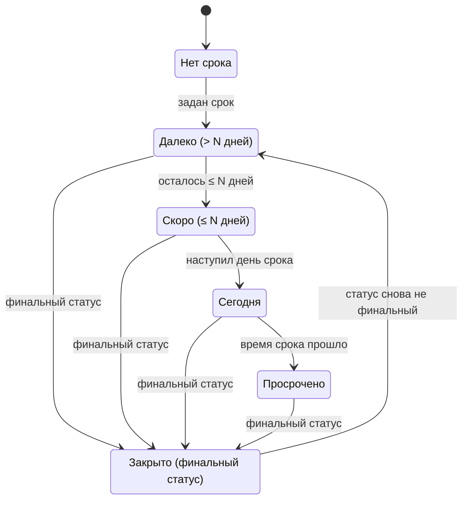
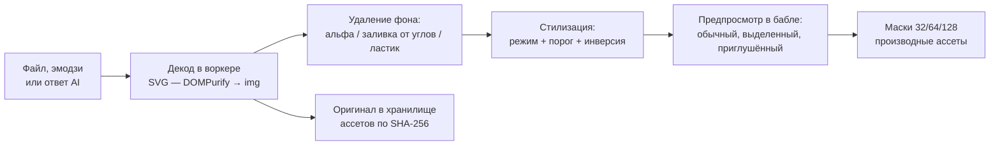
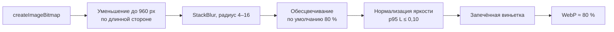

# 07. Дизайн-система

> Статус: черновик. Визуальный язык Strata: два слоя, токены, шрифты, бабл и его состояния, нити, иконки, фоны, ретро-окна, темы, эффекты, доступность, тон текстов.
>
> Опирается на [05-domain-model.md](05-domain-model.md) (ядро) и [глоссарий](glossary.md). Поведение и жесты — в [06-canvas-ux.md](06-canvas-ux.md), здесь только внешний вид. Связано: [08-view-3d.md](08-view-3d.md), [09-search-navigation.md](09-search-navigation.md), [12-mcp-ai.md](12-mcp-ai.md), [14-nfr.md](14-nfr.md), [15-architecture.md](15-architecture.md), [16-roadmap.md](16-roadmap.md), [ADR-0005](adr/0005-rendering.md), [ADR-0006](adr/0006-board-engine.md), [ADR-0007](adr/0007-text-editor.md). Источники фактов: [R7](research/R7-retro-design-assets.md) (главный), [R4](research/R4-app-shell-rendering.md), [R5](research/R5-board-engine.md), [R8](research/R8-competitors.md), [R1](research/R1-houdini-kinopio-ux.md).
>
> Обозначения: ✅ решено ответами, ☑ решено по делегированию (раунд 2), 💡 предложение, ❓ вопрос (собраны в [17-open-questions.md](17-open-questions.md)). Единицы: **px** — CSS-пиксели; **физ. px** — физические пиксели экрана; **`u`** — пиксельная единица (§2.3); **мировые единицы** — координаты холста, при зуме 100 % равны px (06).
>
> Термины **Сцена**, **Хром**, **пиксельная единица**, **режим читаемости**, **гало**, **маска иконки**, **предпросмотр плана**, **значок состояния** — в [глоссарии](glossary.md).
>
> Платформы (✅ R2, Q-15-1): основные — macOS (WKWebView) и Windows (WebView2), на них владелец принимает вид и чёткость каждой вехи; Linux (WebKitGTK) — сборка и скриншот-тесты в CI без ручной приёмки. Язык интерфейса — русский и английский с MVP (✅ R2, Q-07-1).

## 1. Концепция

### 1.1. Два слоя

💡 Интерфейс состоит из двух слоёв с разными законами. ✅ I2: схема «тёмный холст с баблами, вокруг ретро-окна» — «можно попробовать».

| | **Сцена** | **Хром** |
|---|---|---|
| Что входит | 2D-холст сети и звёздная карта: фон, баблы, нити, точки, рамки, стикеры, призраки, курсоры соавторов | Окна содержимого, панели, меню, Tab-меню, строка пути, статусная строка, тосты, диалоги, инфокарточки, тулбар доски |
| Референс | Майндмэп Pathologic 2 (✅ I1) | Мудборд из брифа: BSOD, ч/б диалоги ошибок, dinolab ([00](00-brief.md)) |
| Характер | Тихий, фотографический, монохромный. Гладкие линии со сглаживанием | Громкий, пиксельный, жёсткие рамки без размытия |
| Цвет | Бумага, чернила, туман; цвет — только акценты срока и кольца | Палитра темы с одним насыщенным цветом |
| Пиксель | Только экранные значки и подписи (§3.4) | Везде: шрифты, рамки, фаски, иконки |
| Рендер | PixiJS 8 (WebGL) и three.js ([R4](research/R4-app-shell-rendering.md)) | DOM + CSS на токенах ([R4](research/R4-app-shell-rendering.md)) |
| Масштаб | Плавный зум 5–800 % (06) | Целые физические пиксели, без дробного масштаба |

В общих решениях первый слой назван «Пространство». 💡 Здесь он называется **Сцена**: в глоссарии «Пространство» — это `Workspace`, и фраза «фон пространства» стала бы двусмысленной.

### 1.2. Референс «Мор» словами

✅ I1: скриншот майндмэпа Pathologic 2 — ориентир по контрастной визуализации и детальному подходу, а не буквальная копия.

- Фон — туманная чёрно-белая фотография, размытая и тёмная. Она ничего не сообщает и ни с чем не спорит.
- Ноды — одинаковые белые круги. Внутри каждого — детальная чёрная иконка в манере гравюры: одно «перо», ровная толщина штриха.
- Связи — тонкие белые линии, без стрелок и подписей.
- Иерархия передаётся размером: ключевые круги крупнее.
- Второстепенное приглушено и полупрозрачно; будущее показано пунктиром.
- Цвет почти отсутствует. Редкий слабый жёлтый означает «внимание», а не упрёк; красный — «требует действия» ([R7](research/R7-retro-design-assets.md) §6).

### 1.3. Мудборд Хрома

| Картинка (бриф, 00) | Что считываем |
|---|---|
| «SEO IS DEAD» | Плоский синий фон в духе BSOD, белый крупный пиксельный шрифт, тонкие белые рамки диалогов, кнопки `OK`, моноширинный мелкий текст, пунктирные разделители, инвертированные плашки-заголовки |
| Ретро-диалоги на чёрном | Окна `ERROR` с крестиком, ч/б и синие варианты, каскад окон, песочные часы, сегментный прогресс-бар, палитра инструментов в духе Paint, ироничные подписи |
| dinolab | Светло-серый фон в сетку, розовый акцентный блок с «рваным» пиксельным краем, крупный пиксельный заголовок, пиксельные иконки в карточках |

### 1.4. Что берём и чего не делаем

| Источник | Берём | Не делаем |
|---|---|---|
| Pathologic 2 | Принципы: размер — важность, прозрачность — неактивность, пунктир — «ещё не существует», жёлтый — внимание, один круг обновляется вместо цепочки (свёртки, 05 §6.4) | Не копируем скриншоты, иконки, шрифты, текстуры и вёрстку игры — это чужое произведение ([R7](research/R7-retro-design-assets.md), риски) |
| Windows 95/98, 98.css | Техники: фаски из двух слоёв `inset`-теней, инверсный заголовок, кнопка по умолчанию с лишней рамкой, точечный фокус как идея | Ни иконок Windows, ни шрифта MS Sans Serif, ни кнопки «Пуск», ни точной копии окна — риск trade dress ([R7](research/R7-retro-design-assets.md)). Файлы китов не копируем |
| system.css | 1-битные узоры, штриховка заголовка, тени-смещения | Шрифты из репозитория (`monaco.woff` без лицензии, [R7](research/R7-retro-design-assets.md)) |
| BSOD, dinolab | Палитры как темы (§9) | Логотипы и надписи с картинок мудборда |
| Kinopio | Кинетику нитей как поведение (06) | Код: PolyForm Noncommercial ([R8](research/R8-competitors.md)) |

### 1.5. Грамматика

Восемь правил, на которых держится всё остальное (💡, по [R7](research/R7-retro-design-assets.md) §6 и принципам 5–6 из [03](03-vision.md)):

1. **В v1 бабл — круг.** Вид ноды кодируется кромкой и значком, а не формой. Форму ноды владелец запросил (✅ D1): поле `shape` есть в модели (05 §4.1), палитра форм — после v1, по макету, где форма не спорит с кромкой вида (☑ Q-16-1).
2. **Сцена монохромна.** Бумага `#F2EFE6`, чернила `#111111`, туман. Цвет появляется только как кольцо, полоса или плашка.
3. **Три независимых канала:** размер — важность, прозрачность — активность, акцент — срочность.
4. **Жёлтый — внимание, красный — только просрочка** (☑ Q-07-9). Во всём продукте, включая Хром. Ошибки и опасные действия красным не красим.
5. **Цвет никогда не единственный канал.** У каждого состояния есть форма или значок (WCAG 1.4.1).
6. **Пиксель — в Хроме и в экранных значках.** Всё, что масштабируется вместе с холстом, рисуется гладко.
7. **Ничего не движется само дольше 5 с.** В покое 0 кадров в секунду ([R4](research/R4-app-shell-rendering.md), WCAG 2.2.2).
8. **Кастомизация проходит через «привести к стилю».** Свои иконки и фоны нормализуются, иначе холст превращается в хаос (03, принцип 6).

## 2. Токены

### 2.1. Именование и уровни

Формат: `--st-{категория}-{роль}[-{вариант}][-{состояние}]`.

| Категория | Префикс | Пример |
|---|---|---|
| Примитив палитры | `--st-p-` | `--st-p-paper`, `--st-p-red-500` |
| Цвет Хрома | `--st-color-` | `--st-color-text-muted` |
| Сцена | `--st-scene-` | `--st-scene-edge-alpha` |
| Шрифт | `--st-font-` | `--st-font-ui`, `--st-font-ui-size` |
| Отступ, размер | `--st-space-`, `--st-size-` | `--st-space-4`, `--st-size-control` |
| Рамка, фаска, тень, радиус | `--st-border-`, `--st-bevel-`, `--st-shadow-`, `--st-radius-` | `--st-bevel-raised` |
| Слой | `--st-z-` | `--st-z-modal` |
| Движение | `--st-dur-`, `--st-ease-` | `--st-dur-structure` |
| Компонент | `--st-{компонент}-` | `--st-button-bg-active` |

Три уровня: **примитивы** (сырые значения) → **семантические** (роль: «текст», «внимание») → **компонентные** (только там, где компонент отступает от семантики). Тема переопределяет только семантический уровень.

💡 Источник правды — `tokens/*.json`. Сборка генерирует CSS-переменные для Хрома и TS-модуль констант для Сцены: Pixi и three не читают CSS на каждом кадре. Смена темы пересоздаёт буфер цветов инстансов одним вызовом.

### 2.2. Цвета

**Примитивы** (💡):

| Токен | HEX | Назначение |
|---|---|---|
| `p-ink-1000` | `#000000` | Тени, фон «Терминала» |
| `p-ink-900` | `#0B0B0C` | Утопленные поля |
| `p-ink-850` | `#111111` | Чернила иконок, фон приложения, фон режима читаемости ([R7](research/R7-retro-design-assets.md)) |
| `p-ink-800` | `#1A1A1C` | Поверхность окна |
| `p-ink-700` | `#26262A` | Приподнятая поверхность |
| `p-ink-600` | `#3A3A3F` | Иконка «готовой» ноды, нижняя фаска |
| `p-gray-500` | `#595959` | Граница яркости фона: L = 0,10 ([R7](research/R7-retro-design-assets.md)) |
| `p-gray-400` | `#6B6B6B` | Неактивный текст, разделители |
| `p-gray-250` | `#9A9A9A` | Заливка «готовой» ноды ([R7](research/R7-retro-design-assets.md)) |
| `p-gray-200` | `#A3A3A3` | Приглушённый текст |
| `p-gray-100` | `#E4E4E4` | Фон Dinolab |
| `p-fog-text` | `#E6E6E6` | Текст и рамки Хрома в тёмных темах |
| `p-paper` | `#F2EFE6` | Бабл, нити, подписи ([R7](research/R7-retro-design-assets.md)) |
| `p-yellow-500` | `#E8C547` | Внимание ([R7](research/R7-retro-design-assets.md)) |
| `p-yellow-800` | `#8A6A00` | Внимание на светлом фоне (только графика) |
| `p-red-500` | `#D64545` | Просрочка: кольца, плашки с чернильным знаком ([R7](research/R7-retro-design-assets.md)) |
| `p-red-700` | `#B3261E` | Просрочка: плашки с текстом |
| `p-blue-bsod` | `#0000AA` | Тема BSOD ([R7](research/R7-retro-design-assets.md)) |
| `p-pink-400` | `#FF6FAE` | Акцент Dinolab: плашки с чернильным текстом |
| `p-pink-700` | `#C2185B` | Розовый текст на светлом |

**Цвета людей.** Одна палитра на кольца участников (06 §16), точки-аватары ответственных и поле `color` ноды (05 §4.1). ☑ Q-05-8: 8 цветов, в ней нет жёлтого, оранжевого и красного, чтобы цвет человека не читался как срок. Каждый цвет даёт ≥ 3:1 с фоном L = 0,10 (расчёт этого документа, формула WCAG):

| № | Имя | HEX | Контраст с фоном L 0,10 / 0,05 |
|---|---|---|---|
| 1 | Зелёный | `#6BD18A` | 3,71 / 5,57 |
| 2 | Бирюзовый | `#2EC4B6` | 3,23 / 4,86 |
| 3 | Голубой | `#5EC8E5` | 3,63 / 5,45 |
| 4 | Синий | `#8AB8FF` | 3,46 / 5,21 |
| 5 | Сиреневый | `#C9A7FF` | 3,49 / 5,24 |
| 6 | Орхидея | `#F0ABFC` | 3,98 / 5,99 |
| 7 | Розовый | `#F28DC6` | 3,14 / 4,71 |
| 8 | Стальной | `#B0BEC5` | 3,68 / 5,53 |

**Семантические токены Хрома** (значения темы «Туман»; остальные темы — §9):

| Токен | Значение | Контраст с `surface` |
|---|---|---|
| `color-bg` | `p-ink-850` | — |
| `color-surface` / `-raised` / `-sunken` | `p-ink-800` / `p-ink-700` / `p-ink-900` | — |
| `color-text` | `p-fog-text` | 13,9:1 |
| `color-text-muted` | `p-gray-200` | 6,9:1 |
| `color-text-disabled` | `p-gray-400` | 3,3:1 (неактивные элементы исключены из 1.4.3) |
| `color-frame` | `p-fog-text` | 13,9:1 |
| `color-bevel-hi` / `-hi-2` | `#5A5A60` / `p-ink-600` | — |
| `color-bevel-lo` / `-lo-2` | `p-ink-1000` / `p-ink-900` | — |
| `color-title-bg` / `-fg` | `p-fog-text` / `p-ink-850` | 15,1:1 (инверсная плашка) |
| `color-selection-bg` / `-fg` | `p-fog-text` / `p-ink-850` | Выделение в Хроме — инверсия |
| `color-focus` | `p-fog-text` + подложка `p-ink-1000` | — |
| `color-attention` / `-on` | `p-yellow-500` / `p-ink-850` | 10,4:1; чернила на жёлтом 11,3:1 |
| `color-overdue` / `-strong` / `-on` | `p-red-500` / `p-red-700` / `p-paper` | Бумага на `-strong` 5,7:1 |
| `color-divider` | `p-gray-400`, пунктир | — |
| `color-shadow` | `p-ink-1000` | — |
| `color-backdrop` | `rgba(0,0,0,.6)` | — |

В Хроме внимание и просрочка рисуются **плашками** (заливка + чернильная рамка + значок), а не цветным текстом: так контраст не зависит от темы.

**Токены Сцены** (💡, общие для всех тем; режим читаемости переопределяет):

| Токен | Значение | Где |
|---|---|---|
| `scene-bubble-fill` / `-ink` / `-rim` | `p-paper` / `p-ink-850` / `p-ink-850` α 60 % | Бабл |
| `scene-edge` / `-alpha` / `-width` | `p-paper` / 0,60 / 1,5 px | Нить ([R7](research/R7-retro-design-assets.md)) |
| `scene-edge-alpha-active` / `-width-active` | 1,0 / 2 px | Выделенный путь |
| `scene-edge-alpha-far` / `-width-far` | 0,40 / 1 px | `d` < 12 px |
| `scene-done-fill` / `-ink` / `-alpha` | `p-gray-250` / `p-ink-600` / 0,40 | Финальный статус ([R7](research/R7-retro-design-assets.md)) |
| `scene-pause-alpha` | 0,60 | Пауза |
| `scene-ghost-alpha` / `scene-cut-alpha` | 0,50 | Призрак, вырезано |
| `scene-lens-dim-alpha` | 0,25 | Не совпало с линзой (06 §15) |
| `scene-label-fg` / `-plate` | `p-paper` / `rgba(0,0,0,.7)` | Подписи всегда на плашке ([R7](research/R7-retro-design-assets.md)) |
| `scene-halo-attention` | `p-yellow-500` α 0,45, спрайт | «Срок скоро» |
| `scene-ring-today` / `-overdue` / `-outline` | `p-yellow-500` / `p-red-500` / `p-paper` | Кольца срока |
| `scene-selection` | `p-paper` | Выделение |
| `scene-bg-max-l` | 0,10 (95-й перцентиль) | Нормализация фона (§7) |
| `scene-grain-opacity` | 0,04 (диапазон 0,03–0,06) = `grain` × 0,06 (§7.1) | Зерно ([R7](research/R7-retro-design-assets.md)) |
| `scene-parallax` | 0,03 (диапазон 0,02–0,05) | Фон и туман |

**Проверка контраста Сцены** (расчёт этого документа; альфа смешивается в sRGB, как в [R7](research/R7-retro-design-assets.md) §7):

| Пара | L фона 0,10 | L 0,05 | Вывод |
|---|---|---|---|
| Бабл к фону | 6,1:1 | 9,2:1 | Проходит 1.4.11 |
| Нить α 60 % к фону | 3,3:1 | 4,5:1 | Проходит |
| Нить α 40 % (дальний зум) | 2,3:1 | 2,9:1 | Не проходит; на этом уровне нити — фактура, подробности — при приближении |
| Жёлтое кольцо к фону | 4,2:1 | 6,3:1 | Проходит |
| **Красное кольцо к фону** | **1,6:1** | **2,4:1** | **Не проходит.** Даже `#FF0000` даёт 1,75:1. 💡 Кольцо просрочки получает бумажный контур 1 `u` снаружи (контур к фону 6,1:1, красный к бумаге 3,8:1), а смысл несёт значок «!» |
| Чернильный «!» на красной плашке | 4,3:1 | | Проходит 3:1 для графики |
| Подпись на плашке поверх белого фото | 7,4:1 | | Плашка α 0,7 спасает даже на белом |

### 2.3. Пиксельная единица и сетка

Пиксельный шрифт и рамки чёткие, только когда пиксель рисунка совпадает с целым числом физических пикселей. `-webkit-font-smoothing` работает только на macOS, на Windows и Linux сглаживание не отключить ([R7](research/R7-retro-design-assets.md) §2, [R4](research/R4-app-shell-rendering.md) §2.7).

💡 Правила:
- `u = max(1, round(DPR))` физ. px; в CSS это `--u = u / DPR` px.
- Рамки, фаски, отступы, значки Хрома и экранные значки Сцены — целое число `u`.
- Кегли пиксельных шрифтов — целое число физических пикселей на пиксель шрифта (§2.4).
- Размеры с нижней границей в px (контрол ≥ 24 px) округляются вверх до кратного `u`.
- JS пересчитывает всё при смене DPR через `matchMedia('(resolution: …)')`.

```ts
function applyPixelUnit(scale = 1) {                 // scale — «Масштаб интерфейса»: 1 | 1.25 | 1.5 | 2
  const dpr = window.devicePixelRatio;
  const u = Math.max(1, Math.round(dpr));            // физ. px
  const U = u / dpr;                                 // CSS px
  const snap = (minPx: number) => Math.ceil((minPx * scale) / U) * U;
  const root = document.documentElement.style;
  root.setProperty('--u', `${U}px`);
  root.setProperty('--st-size-control', `${snap(24)}px`);   // WCAG 2.5.8
  root.setProperty('--st-size-scrollbar', `${snap(16)}px`);
}
```

| DPR | `u`, физ. px | `--u`, px | Контрол ≥ 24 px |
|---|---|---|---|
| 1 | 1 | 1,0 | 24 px = 24 физ. px |
| 1,25 | 1 | 0,8 | 24 px = 30 физ. px |
| 1,5 | 2 | 1,333 | 24 px = 36 физ. px |
| 2 | 2 | 1,0 | 24 px = 48 физ. px |
| 3 | 3 | 1,0 | 24 px = 72 физ. px |

Таблица покрывает обе основные платформы: на Windows частый масштаб экрана — 100, 125 и 150 % (DPR 1; 1,25; 1,5), на Retina-экранах Mac — DPR 2. Поэтому скриншот-тест NFR-118 идёт по всем строкам на WebView2 и WKWebView (💡).

**Отступы:** `space-1` 1u · `space-2` 2u · `space-3` 4u · `space-4` 6u · `space-5` 8u · `space-6` 12u · `space-7` 16u · `space-8` 24u · `space-9` 32u.

**Размеры:**

| Токен | Значение | Где |
|---|---|---|
| `size-control` | ≥ 24 px, кратно `u` | Кнопки, строки меню, вкладки, строки Tab-меню, статусная строка |
| `size-titlebar` | кегль `display-s` + 8u | Заголовок окна |
| `size-glyph-s` / `-m` | 8u / 16u | Значки на баблах / в Хроме и кольце флагов |
| `size-icon-ui` | 16u: 16·k физ. px, k — целое (✅ 2026-10-24) | Значки SerenityOS нарисованы на 16 (§6.1); раньше — Pixelarticons на 24 ([R7](research/R7-retro-design-assets.md)) |
| `size-scrollbar` | ≥ 16 px, кратно `u` | Полосы прокрутки |
| `size-hit-min` | 24 px | Зона попадания на Сцене и в Хроме |

Сетка холста — 24 мировые единицы, половина бабла M (06 §3).

### 2.4. Типографика: шкала

💡 Кегль пиксельного шрифта: `css_px = m × N / DPR`, где `N` — родная сетка шрифта, `m` — наименьшее целое, при котором `css_px ≥ T × scale` ([R7](research/R7-retro-design-assets.md) §2: «`css_px = k × native / DPR`, где `k` — целое»). Межстрочный интервал тоже в целых физ. px.

| Токен | Шрифт | `N` | `T` (минимум, px) | Интерлиньяж | Где |
|---|---|---|---|---|---|
| `font-display-s` | Press Start 2P | 8 | 16 | m × 12 физ. px | Заголовки окон и диалогов |
| `font-display-m` | Press Start 2P | 8 | 24 | m × 12 | Пустые состояния, заголовки разделов настроек |
| `font-display-l` | Press Start 2P | 8 | 32 | m × 12 | Экран ошибки, крупные цифры |
| `font-ui` | Departure Mono | 11 | 11 | m × 16 | Меню, Tab-меню, строка пути, статусная строка, подписи баблов, бейджи |
| `font-ui-prop` | Tiny5 | 8 | 16 | m × 11 | Длинные подписи в узких панелях |
| `font-text` | Golos Text | — | 16 (14–18) | 1,5 | Заметки, инфокарточки, виджеты доски |
| `font-text-h1/h2/h3` | Golos Text 600 | — | 28 / 22 / 18 | 1,25 | Заголовки в заметках |
| `font-mono` | JetBrains Mono | — | 14 (13–16) | 1,5 | Код, моноширинный режим заметок |

Получается при масштабе 100 % (расчёт этого документа):

| DPR | `display-s` | `display-m` | `display-l` | `ui` | `ui-prop` |
|---|---|---|---|---|---|
| 1 | 16 физ. = 16 px | 24 = 24 px | 32 = 32 px | 11 = 11 px | 16 = 16 px |
| 1,25 | 24 = 19,2 px | 32 = 25,6 px | 40 = 32 px | 22 = 17,6 px | 24 = 19,2 px |
| 1,5 | 24 = 16 px | 40 = 26,7 px | 48 = 32 px | 22 = 14,7 px | 24 = 16 px |
| 2 | 32 = 16 px | 48 = 24 px | 64 = 32 px | 22 = 11 px | 32 = 16 px |
| 3 | 48 = 16 px | 72 = 24 px | 96 = 32 px | 33 = 11 px | 48 = 16 px |

При DPR 1,25 у Departure Mono есть только 8,8 или 17,6 px — берём больший, как в примере [R7](research/R7-retro-design-assets.md) §2. ☑ Q-07-14: `ui` 11 px при DPR 1 — по умолчанию; кому мелко — масштаб интерфейса (§11.4) или режим читаемости.

### 2.5. Рамки и фаски

| Токен | Значение | Где |
|---|---|---|
| `border-1` / `border-2` | 1u / 2u сплошная `color-frame` | Окна, меню, плашки / Dinolab, фокус |
| `border-dashed` | 1u пунктир 2u/2u `color-divider` | Разделители (мудборд) |
| `bevel-raised` | Четыре `inset`-тени: −1u −1u `bevel-lo`, 1u 1u `bevel-hi`, −2u −2u `bevel-lo-2`, 2u 2u `bevel-hi-2` | Кнопки, ползунки прокрутки |
| `bevel-sunken` | То же с переставленными hi и lo | Поля ввода, нажатая кнопка, трек прогресса |
| `bevel-field` | `bevel-sunken` + 1u `color-frame` | Поля на тёмной поверхности |

Техника двухслойных `inset`-теней взята из 98.css (MIT) как приём, файлы не копируем ([R7](research/R7-retro-design-assets.md) §3).

```css
.st-button {
  min-height: var(--st-size-control);
  border: calc(var(--u)) solid var(--st-color-frame);
  background: var(--st-color-surface-raised);
  box-shadow:
    inset calc(-1 * var(--u)) calc(-1 * var(--u)) 0 var(--st-color-bevel-lo),
    inset var(--u) var(--u) 0 var(--st-color-bevel-hi),
    inset calc(-2 * var(--u)) calc(-2 * var(--u)) 0 var(--st-color-bevel-lo-2),
    inset calc(2 * var(--u)) calc(2 * var(--u)) 0 var(--st-color-bevel-hi-2);
}
.st-button:active { box-shadow: var(--st-bevel-sunken); padding-top: calc(var(--u)); }
```

### 2.6. Тени, радиусы, узоры

- **Тени — жёсткий сдвиг без размытия:** `shadow-window` 4u 4u 0 `color-shadow`; `shadow-menu` и `shadow-toast` 2u 2u 0. Модальное окно — та же тень плюс затемнение `color-backdrop`, без блюра холста.
- **Радиусы:** `radius-0` = 0 для всего Хрома; `radius-round` = 50 % для баблов, аватаров, радиокнопок. В Dinolab `corner-style: notch` — «рваный» пиксельный угол лесенкой 1u через `clip-path`.
- **Узоры:** 1-битные PNG 2×2 и 4×4 (шахматка 50 %, штриховка 45°) с `image-rendering: pixelated`, `background-size` кратен `u`: неактивный заголовок, трек полосы прокрутки, отключённые контролы ([R7](research/R7-retro-design-assets.md) §3).

### 2.7. Слои z

| Токен | Значение | Что |
|---|---|---|
| `z-scene` | 0 | `<canvas>` Сцены |
| `z-scene-hud` | 10 | Мини-карта, подсказки линз, DOM-инфокарточка |
| `z-dock` | 100 | Закреплённые окна |
| `z-window` | 200–299 | Плавающие окна; окно в фокусе получает верх диапазона |
| `z-panel` | 300 | Палитра цвета `C`, палитра иконки и размера `Z` (палитра форм — после v1, ☑ Q-16-1), панель свойств `P` |
| `z-bar` | 400 | Вкладки, строка пути, статусная строка |
| `z-menu` | 500 | Меню, контекстное меню, Tab-меню |
| `z-tooltip` | 600 | Тултипы |
| `z-toast` | 700 | Тосты |
| `z-modal` | 800 | Затемнение и диалог |
| `z-debug` | 1000 | Оверлей замеров |

### 2.8. Длительности и кривые

Совпадают с 06 §1.4. При `prefers-reduced-motion` и настройке «Меньше движения» все `dur-*`, кроме фейдов, становятся 0.

| Токен | Значение | Что |
|---|---|---|
| `dur-hover` | 80 мс | Масштаб бабла 1,05 при наведении |
| `dur-fast` | 150 мс | Тост, «отщёлкивание» нитей, фейд вместо движения |
| `dur-structure` | 200 мс | Вставка, залечивание, раскладка, раздвигание |
| `dur-camera` | 250 мс | Камера, нырок |
| `dur-bg-fade` | 300 мс | Смена фона при нырке ([R7](research/R7-retro-design-assets.md)) |
| `dur-bridge` | 600 мс | Мост 2D ↔ 3D (в [R4](research/R4-app-shell-rendering.md) 400–800 мс) |
| `dur-pulse` | 800 мс | Один пульс «срок сегодня» |
| `dur-ants` | 3 с | Бег «муравьёв» до остановки |
| `dur-window-steps` | 120 мс, 4 кадра | Открытие окна «прямоугольниками» от бабла |
| `dur-tooltip-delay` / `dur-infocard-delay` | 500 / 600 мс | Задержки показа (06 §1.3) |
| `dur-toast-life` / `-undo` | 6 / 10 с | Время жизни тоста (06 §1.4) |

| Кривая | Значение | Где |
|---|---|---|
| `ease-out` | `cubic-bezier(.2, .8, .2, 1)` | Структура, камера |
| `ease-in-out` | `cubic-bezier(.4, 0, .2, 1)` | Мост 2D ↔ 3D, смена фона |
| `ease-steps` | `steps(4, end)` | Хром: открытие окон, сегменты прогресса |
| `ease-linear` | `linear` | Муравьи, бегущая точка |
| Пружина | Критически демпфированная (ζ = 1), успокоение 200–300 мс, считается в JS | Нити (06 §6.8) |

### 2.9. Пример: JSON и сгенерированный CSS

```json
{
  "meta": { "id": "fog", "name": "Туман", "schema": 1 },
  "primitives": {
    "paper": "#F2EFE6", "ink-850": "#111111", "ink-800": "#1A1A1C",
    "fog-text": "#E6E6E6", "yellow-500": "#E8C547", "red-500": "#D64545"
  },
  "semantic": {
    "color.surface": "{ink-800}",
    "color.text": "{fog-text}",
    "color.attention": "{yellow-500}",
    "color.overdue": "{red-500}",
    "scene.bubble.fill": "{paper}",
    "scene.edge.alpha": 0.6,
    "dur.structure": "200ms"
  }
}
```

```css
:root[data-theme="fog"] {
  --st-color-surface: #1A1A1C;
  --st-color-text: #E6E6E6;
  --st-color-attention: #E8C547;
  --st-color-overdue: #D64545;
  --st-dur-structure: 200ms;
}
@media (prefers-reduced-motion: reduce) {
  :root:not([data-motion="full"]) { --st-dur-structure: 0ms; --st-dur-camera: 0ms; }
}
```

## 3. Шрифты

### 3.1. Набор

Все шрифты проверены в [R7](research/R7-retro-design-assets.md) по таблице `cmap` файла, а не по метаданным: 66 букв русского алфавита, `«»—–…№`, `ЄІЇҐЎ`. Латиницу и английскую типографику (`“”‘’`) R7 отдельно не проверял; интерфейс на двух языках с MVP (✅ R2, Q-07-1), поэтому их проверяет CI-тест §3.5.

| Слот | Шрифт, версия | Лицензия | Кириллица (RU / блок) | Родная сетка | Поставка |
|---|---|---|---|---|---|
| `display` | Press Start 2P 3.000 | OFL 1.1, RFN «Press Start 2P» | 66 / 184, все знаки | 8 px | `@fontsource/press-start-2p` 5.3.0 |
| `ui` | Departure Mono 1.500 | OFL 1.1 (шрифт; корневой MIT — для сайта) | 66 / 216, все знаки | 11 px | Из репозитория автора: в Fontsource его нет |
| `ui-prop` | Tiny5 2.007 | OFL 1.1 | 66 / 240, все знаки | 8 px | `@fontsource/tiny5` 5.3.0 |
| `text` | Golos Text 2.004 | OFL 1.1 | 66 / 172, все знаки | — | `@fontsource/golos-text` 5.3.0 |
| `mono` | JetBrains Mono 2.211 | OFL 1.1 | 66 / 98, все знаки | — | `@fontsource/jetbrains-mono` 5.3.0 |
| `fallback-pixel` | GNU Unifont 17.0.03 (релиз 2026 года не проверен) | Двойная: GPL-2.0+ с исключением или OFL 1.1 — берём OFL-ветку (по данным поиска) | Весь BMP | 8×16 / 16×16 | Подмножество в сборку |

Не берём: **Pixelify Sans** (нет О, П, І — «ПРОЕКТ» не набрать), Silkscreen, Jersey, VT323, Geist Pixel и другие без кириллицы, «MS Sans Serif» из 98.css (CC BY-SA 3.0, нет кириллицы), PxPlus (CC BY-SA 4.0: ShareAlike распространяется на изменённый шрифт, возможно, и на подмножество WOFF2, а набора под OFL хватает — ☑ Q-07-11) ([R7](research/R7-retro-design-assets.md) §1).

**Лицензии** (☑ Q-07-11, B4): код Strata — AGPL-3.0-or-later на весь репозиторий; шрифты, иконки и прочие ассеты остаются под своими лицензиями — OFL 1.1, CC BY 3.0, MIT, CC0. Компоненты только под GPL-2.0-only не берём: с (A)GPL-3.0 они несовместимы ([FSF, список лицензий](https://www.gnu.org/licenses/license-list.html)). GPL-компонент берём, только если в нём явно указано «or later» (например, `potrace` — по [R7](research/R7-retro-design-assets.md) GPL-2.0, вариант не уточнён — проверить до включения). Unifont — OFL-ветка двойной лицензии.

### 3.2. Где какой

| Место | Шрифт | Почему |
|---|---|---|
| Заголовки окон, диалогов, пустых состояний | `display`, строки ≤ 30 символов, ПРОПИСНЫЕ для вида ноды | Широкий, «8-бит» ([R7](research/R7-retro-design-assets.md)) |
| Меню, Tab-меню, строка пути, статусная строка, тосты, тултипы, бейджи, подписи баблов и нитей | `ui` | Компактная сетка 11 px |
| Узкие панели, где моноширинный не влезает | `ui-prop` | Пропорциональный, ось `wdth` |
| Текст заметки (CodeMirror 6), инфокарточка, текст виджетов доски | `text` | Читаемость на длинном тексте |
| Код, моноширинный режим заметок | `mono` | Тот же шрифт в CM6 ([R4](research/R4-app-shell-rendering.md)) |
| Подписи в мировом пространстве: стикеры, заголовки рамок | `text` в MSDF | Масштабируются с холстом (§3.4) |
| Холст доски (Excalidraw) | Nunito или Excalifont — оба с кириллицей | Своих шрифтов в публичном API Excalidraw нет; Golos и пиксель на холсте доски — только через форк ([R5](research/R5-board-engine.md) §6) |
| Режим читаемости, везде | `text` вместо `display`, `ui`, `ui-prop`; `mono` остаётся | §11 |

☑ Q-07-2 (I4): пиксель — только в Хроме и экранных подписях, текст заметок — Golos Text. «Пиксель везде» — опция темы на этапе 2: 💡 `font-text` в заметках и инфокарточках заменяется на `ui-prop`; подписи в мировом пространстве и виджеты доски остаются на Golos Text (§3.4, §8.4). Режим читаемости, наоборот, убирает пиксель отовсюду.

### 3.3. Правила чёткости

1. Кегль — по формуле §2.4, ступенями, никогда не плавно.
2. Позиция текста округляется до целого физического пикселя. На дробных координатах Firefox смешивает краевые пиксели ([R7](research/R7-retro-design-assets.md) §2).
3. Никаких `transform: scale()` с дробным масштабом у элементов с пиксельным шрифтом. Анимация окна — `steps()` по готовым прямоугольникам, без масштабирования текста.
4. Растровые значки — `image-rendering: pixelated` ([R7](research/R7-retro-design-assets.md) §2).
5. `-webkit-font-smoothing: none` ставим, но рассчитываем на него только на macOS.

### 3.4. Текст на Сцене: пиксель и MSDF

| Текст | Пространство | Как рисуем |
|---|---|---|
| Подписи баблов, подписи нитей, «×N», «↗N», бейджи | Экранное | Pixi `BitmapText` из заранее растеризованного атласа Departure Mono в точном физическом кегле, `textureStyle: { scaleMode: 'nearest' }` (Pixi 8.10+, [R4](research/R4-app-shell-rendering.md) §2.7). Позиция после трансформации камеры округляется до физ. px. Кегль меняется ступенями по зуму: `ui` при `d` ≤ 160 px, ×2 при `d` > 160 px |
| Стикеры, заголовки рамок | Мировое | MSDF-атлас Golos Text. Генератор `msdf-atlas-gen` (MIT), `-type msdf`, charset задаётся явно: ASCII, `[0x400, 0x4FF]`, `«»—–…№“”‘’`. Без charset берётся только ASCII ([R4](research/R4-app-shell-rendering.md) §2.7) |
| Все подписи в режиме читаемости | Экранное | MSDF Golos Text, кегль ≥ 14 px |
| Подписи в 3D | Мировое / DOM | По [08](08-view-3d.md): инфокарточки — DOM-оверлей в стиле Хрома ([R4](research/R4-app-shell-rendering.md) §3.3) |

Пиксельный шрифт в мировом пространстве запрещён: при плавном зуме он мылится ([R4](research/R4-app-shell-rendering.md) §2.7). 💡 «Тотальный пиксель-арт» через рендер кадра в низком разрешении не делаем: он ломает детальные гравюрные иконки ([R4](research/R4-app-shell-rendering.md) §2.7). ☑ Q-07-17.

### 3.5. Поставка и CI-тест

- Никаких шрифтовых CDN: шрифты лежат в сборке, это обязательно для офлайн-десктопа ([R7](research/R7-retro-design-assets.md)). То же для шрифтов Excalidraw: `EXCALIDRAW_ASSET_PATH` ([R5](research/R5-board-engine.md)).
- Тексты OFL и лицензий ассетов — на экране «Благодарности»; там же 💡 лицензия Strata (AGPL-3.0-or-later, ☑ Q-07-11) и ссылка на исходный код.
- 💡 **CI-тест шрифтов для русского и английского** (✅ R2: оба языка с MVP). Для каждого файла шрифта в сборке и для каждого MSDF-атласа:
  1. по `cmap` проверить все 66 букв русского алфавита, `«»—–…№` и `ЄІЇҐЎ` (☑ Q-07-1), латиницу `A–Z`, `a–z`, цифры, ASCII-пунктуацию и `“”‘’`;
  2. отрендерить в headless-браузере строки `ПРОЕКТ ёжик № «тест» — …` и `PROJECT “test” — it’s…` и сравнить ширину каждого глифа с `.notdef`;
  3. при пропуске — сборка падает с перечнем недостающих символов.

  Тест ловит ловушки вроде Pixelify Sans, у которой метаданные заявляют кириллицу ([R7](research/R7-retro-design-assets.md), риски).

## 4. Бабл

### 4.1. Анатомия и порядок отрисовки

Места значков совпадают с 06 §4.1:

```
                 12 ч: ответственные (до 3 точек, «+N»)
   10–11 ч: флаги (пауза, шаблон, замок)   1–2 ч: «↗N», ножницы
               ╭───────────────╮
               │  ▓▓ иконка ▓▓ │   ← тело: бумага, значок вида (§6.1)
               │   (0,55 · d)  │   ← полоса цвета ноды 6u поверх кромки
               ╰───────────────╯
   7–8 ч: ярлык появления                  4–5 ч: срок / статус
          6 ч: значок вида (только у пресета, §6.3)
                 ┌───────────────┐
                 │ Подпись ноды  │  ← плашка, ≤ 2 строк, ≤ 160 px
                 └───────────────┘
```

Порядок отрисовки снизу вверх (один инстансный проход на слой, [R4](research/R4-app-shell-rendering.md)): гало → тело → иконка → полоса цвета и кромка → кружки и стрелки концов нитей (§5) → кольца срока и свёртки → кольцо выделения и уголки → кольца участников и фокуса → значки → подписи.

### 4.2. Размеры

💡 Диаметры в мировых единицах, как в 06 §4.2: **S 32 · M 48 · L 72 · XL 108** (шаг ×1,5).

| Правило | Размер |
|---|---|
| Сеть | M |
| Прочие виды | S |
| ≥ 8 нитей, видимых в этой сети | +1 ступень |
| Флаг «Ключевая» (05 §7) | +1 ступень и двойная кромка; на XL — только двойная кромка |
| Ручной размер (05 §9.2) | Перекрывает расчёт |

Тело и иконка масштабируются с зумом. Кромки, кольца и значки — экранного размера в `u`, иначе на отдалении они превращаются в кашу, а вблизи — в «бублик».

### 4.3. Радиальный стек колец

Отступы от кромки тела радиуса `r`, экранные (💡):

| Слой | Радиус | Толщина | Что в нём |
|---|---|---|---|
| Второе кольцо сети | r − 6u | 1u | Чернила α 60 % — «стопка» (§4.4) |
| Полоса цвета ноды | r − 4u … r + 2u | 6u | Поле `color` (05 §4.1), палитра людей §2.2; без своего цвета — цвет вида (задача, проект, список; [ADR-0010](adr/0010-kinds-not-classes.md)). ✅ Владелец 2026-10-24: толще прежних 3u, полоса сама становится кромкой |
| Кромка | r | 1u | Чернила α 60 %; пунктир у паузы и призрака |
| Второй контур ключевой | r + 2u | 1u | Бумага: вместе с кромкой даёт «двойную кромку» |
| Кольцо срока или свёртки | r + 4u … r + 6u | 2u | «Сегодня» — жёлтое; «просрочено» — красное + бумажный контур 1u на r + 7u; у сети без своего срока — дуга прогресса свёртки |
| Кольцо выделения | r + 9u … r + 11u | 2u | Выделение; наведение — 1u на том же месте; «муравьи» текущей ноды; цель «положить внутрь» |
| Уголки выделения | Квадрат с полустороной r + 12u | 1u, плечо 4u | `⌜⌝⌞⌟` |
| Кольцо участника | r + 14u | 1u | Выделение и правка другим человеком, изменения AI |
| Фокус клавиатуры | r + 16u … r + 18u | 2u пунктир 2u/2u | Бумага на подложке 1u чернилами |
| Гало | до 1,5 r | Спрайт | «Срок скоро» |

Иконка занимает круг диаметром 0,55 d, чтобы не задевать второе кольцо сети. Внешние кольца есть только у выделенных, наведённых и сфокусированных нод, поэтому плотная раскладка не страдает.

### 4.4. Виды в v1: круг, кромка и значок

Форма бабла в v1 не меняется (§1.5 п. 1); палитра форм — после v1 (☑ Q-16-1).

| Вид | Тело | Кромка | Значок вида на 6 ч |
|---|---|---|---|
| Папка | Иконка | Двойное кольцо «стопкой» (второе — на r − 6u) + дуга прогресса свёртки на кольце срока: бумага α 100 % по треку α 30 %, от 12 ч по часовой; свёртка — по задачам внутри на всю глубину, без нод на паузе (☑ Q-05-2) | Две вложенные рамки |
| Проект | Иконка | Как у папки. Если у проекта свой срок в состоянии «скоро», «сегодня» или «просрочено», кольцо занимает он, а прогресс уходит в строку превью | Портфель |
| Задача | Иконка | Одинарная; дуга прогресса — доля готовых подзадач по нитям (05 §4.3), если они есть | Песочные часы |
| Заметка | Иконка | Одинарная | Лист со строками |
| Доска | Иконка | Одинарная | Холст с кнопкой |
| Список | Иконка | Одинарная | Квадрат с галочкой и строки |
| Ассет | Значок по типу содержимого; у фото — картинка в круге | Одинарная | Кадр с горой |

✅ Владелец 2026-10-24: в пространстве тело несёт значок SerenityOS своего вида (§6.1), тот же, что в «Слоях»; значок вида на 6 ч тогда не рисуется — он повторял бы тело. У ассета — значок по типу содержимого или выбранный руками, у фото — картинка в круге. Значки на 6 ч остаются у пресетов game-icons в прототипе.

### 4.5. Состояния

Полная таблица (💡 по [R7](research/R7-retro-design-assets.md) «Рекомендация» п. 4, 05 §6.3, 06). «М. д.» — поведение при «Меньше движения».

| Состояние | Данные | Тело и иконка | Кромка и кольца | Альфа | Значок и место | Движение (м. д.) |
|---|---|---|---|---|---|---|
| По умолчанию | — | Бумага, чернильная иконка | Кромка 1u | 100 % | — | — |
| Наведение | Курсор в зоне попадания | — | Кольцо 1u на месте кольца выделения | 100 % | Подпись сразу; кольцо флагов через 150 мс (06 §8) | Масштаб 1,05 за 80 мс (без масштаба) |
| Выделено | В выделении | — | Кольцо 2u + пиксельные уголки | 100 % | — | — |
| Текущая | Последняя кликнутая (06 §11) | — | Как «выделено» + «муравьи»: пунктир 3u/3u на кольце выделения | 100 % | — | Бег 3 с, затем статичный пунктир (сразу статичный) |
| Фокус клавиатуры | Фокус холста на ноде | — | Пунктир 2u снаружи всех колец (§4.3) | — | — | — |
| Ключевая | Флаг `R` | — | Двойная кромка: второй контур бумагой на r + 2u | 100 % | ★ в кольце флагов | Размер +1 ступень |
| Пауза | Флаг `Q` | Поверх — 1-битная штриховка 45°, шаг 4u, 50 % | Пунктир 3u/2u | 60 % | ‖ на 10–11 ч | — |
| Шаблон | Флаг `E` | — | — | 100 % | Трафарет на 10–11 ч | — |
| Замок (MVP+ 1.1) | Флаг «Замок» | — | — | 100 % | Замок на 10–11 ч | — |
| Скрыто от AI (MVP+ 1.1) | Флаг `T` | — | — | 100 % | Перечёркнутый глаз — только в AI-линзе и в кольце флагов (06 §4.1) | — |
| Готово | Статус «Готово» | `#9A9A9A`, иконка `#3A3A3F` | Без колец срока | 40 % | Галочка на чернильной плашке, 4–5 ч | — |
| Отменено | Статус «Отменено» | Как «готово» | — | 40 % | Прочерк на 4–5 ч | — |
| Срок скоро | ≤ N дней, N = 3 (05 §6.3) | — | Статичное жёлтое гало | 100 % | Песочные часы на жёлтой плашке, 4–5 ч | — |
| Срок сегодня | День срока | — | Жёлтое кольцо 2u | 100 % | Песочные часы | 3 пульса по 800 мс при первом появлении в кадре за сеанс, затем статично (без пульса) |
| Просрочено | Срок прошёл, статус не финальный | — | Красное кольцо 2u + бумажный контур 1u | 100 % | «!» чернилами на красной плашке с чернильной обводкой | Без анимации |
| Свёртка горит | Внутри сети просрочка или срок ≤ N (05 §6.4) | — | Трек дуги прогресса становится красным или жёлтым, 1u — слабее собственного кольца 2u | 100 % | Малый «!» или часы с точкой на 4–5 ч | — |
| Появление | Неосновное размещение (05 §5) | — | — | 100 % | Ярлык на 7–8 ч; «×N» при наведении | — |
| Внешние связи | Второй конец не размещён здесь (05 §8.3) | — | — | 100 % | «↗N» на 1–2 ч | — |
| Призрак | `[[X]]` без ноды (05 §8.5) | Без заливки, «?» вместо иконки | Пунктир 1u, 3u/3u, бумага | 50 % | «?» | — |
| Ответственные | `assignees` | — | — | — | Точки 8u цвета человека с чернильной обводкой 1u, до 3 и «+N», 12 ч | — |
| Выделено другим | Эфемерный канал (06 §16) | — | Кольцо участника 1u его цветом | — | — | — |
| Редактирует другой | Содержимое открыто у участника | — | Кольцо 1u цвета участника с разрывом на 12 ч | — | Плашка цвета участника с инициалами и карандашом над баблом | — |
| Изменено AI или MCP (MVP+ 1.1) | Набор изменений с источником `mcp:*` или `ai` (05 §11) | — | Точечный контур 1u бумагой на кольце участника | — | «✦» перед подписью | Статично 5 с, затем фейд 150 мс (06 §16) |
| Предпросмотр плана (этап 2) | `apply_graph_plan` до применения ([12](12-mcp-ai.md)) | Заливка 50 % | Точечный контур 1u | 50 % | «✦» в центре | — |
| Приглушено линзой (MVP+ 1.4) | Не совпало с линзой (06 §15) | — | — | 25 % | — | — |
| Вырезано | После `Ctrl+X` до вставки (06 §12.1) | — | Пунктир | 50 % | Ножницы на 1–2 ч | — |
| Цель «положить внутрь» | Тянем ноду на бабл сети (06 §1.3) | — | Пунктир 2u на кольце выделения + дуга таймера 500 мс | — | «⊘», если нельзя (цикл вложенности) | Дуга заполняется (без дуги) |

### 4.6. Срок: машина состояний



- «Сегодня» считается в часовом поясе зрителя. Срок-дата просрочен после конца дня, срок-дата-время — после указанного времени.
- Пересчёт — таймером на полночь и на ближайший срок в кадре: один кадр, а не непрерывный рендер.
- Пульс «сегодня» запускается при первом попадании бабла в кадр за сеанс, не чаще одного раза на ноду.

### 4.7. Сочетания и приоритеты

1. **Срок:** одно кольцо, приоритет просрочено > сегодня > скоро. Финальный статус гасит всё про срок.
2. **Пауза:** собственное кольцо и гало срока не рисуются, остаётся только значок срока — нода отложена (05 §7: пауза не участвует в свёртках).
3. **Прозрачность:** берётся минимальная из готово 40 %, призрак 50 %, вырезано 50 %, пауза 60 %, линза 25 %. Кольца выделения, фокуса, участников и значки всегда 100 %, иначе выделенную «готовую» ноду не видно.
4. **`prefers-reduced-transparency`** (только Chromium, [R7](research/R7-retro-design-assets.md) §7): альфа заменяется серой заливкой и штриховкой.
5. **Один час — один значок.** Если на место претендуют два, второй сдвигается на час по часовой стрелке. ✅ S9 (2026-10-23): места концов нитей (§5) заняты первыми — значок, попавший на кружок или острие стрелки, сдвигается к ближайшему свободному месту шагом в полчаса в обе стороны, не дальше двух часов.
6. **Уровень 12–32 px** (§4.9): один значок по приоритету просрочено > сегодня > скоро > готово > пауза (06 §4.3).
7. **Цвет ноды** не может быть жёлтым или красным: палитра §2.2 (☑ Q-05-8). Иконку можно подкрасить только «чернилами» (§6.6).

### 4.8. Прочие элементы Сцены

| Элемент | Вид (💡) | Поведение |
|---|---|---|
| Порт (06 §6.1) | Бумажная точка 4u с чернильной обводкой 1u на кромке со стороны курсора | 06 |
| Кольцо флагов (06 §8) | Радиус ≥ 28 px; слоты 16u на чернильных плашках: ★ ‖ ▤ глаз `i`; включённый флаг — инверсия слота | 06 |
| Точка на нити (MVP+ 1.3) | Бумажный круг 3u; закреплённая — кольцо 3u с чернильной сердцевиной | 06 §6.6 |
| Рамка (MVP+ 1.3) | Заливка цветом из палитры §2.2 α 8 %, контур 1u α 60 %, заголовок — MSDF Golos на плашке; свёрнутая — плашка «▣ 12» | 06 §7 |
| Стикер (MVP+ 1.3) | Бумажная или цветная (палитра §2.2 с осветлением) карточка без тени, текст MSDF Golos чернилами | 06 §7 |
| Курсор участника | Пиксельная стрелка 16u цвета участника с чернильной обводкой 1u, имя на плашке того же цвета чернилами | Гаснет через 3 с покоя (06 §16) |
| Протяжка участника | Нить пунктиром 4u/4u цвета участника | 06 §16 |
| Сетка | Нет в «Тумане»; в Dinolab — точки 1u бумаги α 12 % с шагом 24 мировые единицы | 06 §3 |
| Направляющие выравнивания | Линия 1u бумаги α 40 % | 06 §3 |
| Контуры раздвигания соседей | Пунктирные круги 1u α 40 % там, куда уедут ноды | 06 §6.4 |
| Штрих ножа и `J` | Пунктир 2u бумаги α 80 % | 06 §6.7 |
| Рамка выделения | Пунктир 1u бумаги, заливка α 6 % | 06 §11 |

### 4.9. Семантический зум

Пороги по экранному диаметру `d = диаметр × зум` ([R7](research/R7-retro-design-assets.md) п. 4), гистерезис 10 % (06 §1.3):

| `d` | Бабл | Подпись | Значки | Нити |
|---|---|---|---|---|
| < 12 px | Точка 2–4 px цвета главного состояния: бумага, серый (готово), жёлтый (скоро, сегодня), красный с бумажным контуром (просрочено) | Нет | Нет | 1 px, α 40 % |
| 12–32 px | Круг + значок вида 8u или 16u вместо иконки: детальная гравюра на кружке < 32 px рябит ([R7](research/R7-retro-design-assets.md)) | У ключевых, выделенных, под курсором | Один, по приоритету §4.7 | Обычные |
| 32–96 px | Круг + детальная иконка | Да | Все | Обычные |
| > 96 px | То же | Да, кегль ступенью крупнее при `d` > 160 px | Все | Обычные + строка превью: статус, дедлайн, счётчики; у сети — прогресс и ближайший срок |

Маска иконки выбирается из 32/64/128 так, чтобы её размер был не меньше экранного размера иконки в физ. px (§6.7).

### 4.10. Зона попадания

Не меньше 24×24 px, даже если бабл мельче (WCAG 2.5.8, [R7](research/R7-retro-design-assets.md)). При перекрытии зон выигрывает бабл, центр которого ближе к курсору. Значки на кромке (ярлык, «↗N») кликабельны только при `d` ≥ 32 px, в остальных случаях клик идёт в бабл.

## 5. Нити

Механика — в 06 §6. ✅ C4: типов связей нет, поэтому стиль нити кодирует геометрию и состояние, но не смысл связи.

| Свойство | Значение (💡) | Источник |
|---|---|---|
| Цвет | Бумага `#F2EFE6` | [R7](research/R7-retro-design-assets.md) |
| Толщина и альфа | 1,5 px, α 60 % | [R7](research/R7-retro-design-assets.md) |
| Выделенная нить, нити выделенной ноды, под курсором | 2 px, α 100 % | [R7](research/R7-retro-design-assets.md) |
| Дальний зум (`d` < 12 px) | 1 px, α 40 % | §4.9 |
| Приглушено линзой | α 15 % | 06 §15 |
| Нить из текста (единственное происхождение — `text`, 05 §8.1) | ☑ Q-07-15, Q-13-3: по умолчанию — как ручная, происхождение — в тултипе нити и в инфокарточке. Настройка сети «Нити из текста»: «приглушённые» — 1 px, α 40 % (значения `scene-edge-width-far` и `scene-edge-alpha-far`); под курсором и у выделенной ноды — как обычная; «скрыты» — не рисуются | 06 §6.2, 05 §9.2 |
| Концы | На окружности по линии центров, без зазора: конец нити уходит под пометку конца; нити под баблами | 06 §6.2 |
| Пометки концов | ✅ Q-07-20 (2026-10-24): на обоих концах одинаковый кружок — тёмный диск радиусом 6u, кольцо 1,5u и точка 2u в цвете ноды (или бумажные, если цвета нет); стрелки — только в прототипе для сравнения. Раньше (✅ S9, 2026-10-23): бумажный кружок 4u у источника, полый у приёмника | 06 §4.1, §6.3 |
| Направление | Стрелок нет. Бегущая точка: бумажный круг радиусом 2u, раз в 3 с. При «меньше движения» или настройке «Стрелки» — статичный шеврон 6u на 60 % длины | 06 §6.3, [R1](research/R1-houdini-kinopio-ux.md) |
| Подпись (05 §8.1) | `ui` на плашке у середины; видна при `d` ≥ 32 px | — |
| К призраку | Пунктир 4u/4u, α 50 % | 05 §8.5 |
| Сводная нить (06 §13.3) | Точечная 1u, α 50 %, плашка «×3» | 06 |
| Обрубок внешней связи | Штрих 12 px от кромки, α 30 %; по умолчанию выкл. | 06 §14 |
| Кандидат на вставку броском | Жёлтая 2 px + пунктирные контуры будущих позиций соседей. Жёлтый здесь — кратковременное «внимание: сейчас сработает» | 06 §6.4, [R1](research/R1-houdini-kinopio-ux.md) |
| Пересечена ножом | Пунктир + засечки каждые 8u; не красным: красный только для просрочки | 06 §6.7 |
| Скрыта в этой сети | Не рисуется | 05 §8.3 |

**Стили** (06 §6.2): прямая, кубическая Безье, кинетическая (Безье + кинетика). Ортогональные — позже.

**Кинетика — только как вид**, ограниченная по времени (06 §6.8):

| Эффект | Вид | Длительность | Меньше движения |
|---|---|---|---|
| Пружина | Контрольные точки догоняют цель без колебаний | 200–300 мс | Мгновенно |
| Дрожание | Контрольная точка ходит на 4–8 px, период около 0,8 с | 3 цикла после выделения | Нет |
| Бегущая точка | §5 выше | Пока курсор на нити; у выделенной ноды — 3 пробега | Шеврон |

**Производительность** ([R4](research/R4-app-shell-rendering.md) §2.6):
- одна инстансная полоса на все нити; атрибуты инстанса — P0..P3, толщина, цвет, альфа, фаза анимации, тип пунктира;
- кривая считается в вершинном шейдере, сглаживание — по расстоянию во фрагментном, пунктир и бегущая точка — в шейдере без пересборки геометрии;
- обновляется только буфер изменённых нитей; анимируются не больше 256 нитей одновременно (06 §6.8);
- бюджет — ≤ 4 мс на кадр (§10.3).

## 6. Иконки

### 6.1. Три слоя (плюс будущий четвёртый)

| Слой | Что | Источник, лицензия | Сетка | Этап |
|---|---|---|---|---|
| 1. Свои значки | ~40 значков вида, состояния, флагов, операций | Рисуем сами, лицензия репозитория — AGPL-3.0-or-later (☑ Q-07-11) | 8×8 и 16×16 | MVP |
| 2. Иконки Хрома и нод | Шапка, «Слои», карточки главной, панель свойств; значок вида или класса в теле ноды | ✅ Владелец 2026-10-24: в духе Windows 98 — набор SerenityOS 16×16 ([SerenityOS/serenity](https://github.com/SerenityOS/serenity), `Base/res/icons`), BSD 2-Clause, файлы без изменений; список и коммит — `packages/ui/src/icons/serenity/README.md`. Прежний кандидат — Pixelarticons (MIT, [R7](research/R7-retro-design-assets.md) §4.2) | 16, целые кратные | MVP |
| 3. Пресеты иконок нод | Детальные силуэты «под Мор» | game-icons: 4133 иконки в `@iconify-json/game-icons` 1.2.4, CC BY 3.0 (часть авторов — CC0) ([R7](research/R7-retro-design-assets.md) §4.1) | 512 → маски | MVP |
| 4. «Гравюры» | 100–200 настоящих гравюр, кадрированных в круг | The Met Open Access (CC0), Wellcome (Public Domain Mark), Old Book Illustrations — статус каждой картинки проверяется отдельно ([R7](research/R7-retro-design-assets.md) §4.3) | Маски | Этап 2 |

Значки SerenityOS (✅ 2026-10-24):

| Что | Файл |
|---|---|
| Папка (свёрнута и развёрнута в «Слоях») | `filetype-folder`, `filetype-folder-open` |
| Проект, задача | `office` (портфель); задача — свои песочные часы `hourglass.png` в той же манере (✅ владелец 2026-10-24: «задачу сделай песочными часами»), лицензия репозитория |
| Заметка, доска, список | `filetype-text`, `app-pixel-paint`, `table-view` |
| Ассет: фото, видео, звук, ссылка, PDF, прочий файл | `filetype-image`, `app-video-player`, `app-sound-player`, `internet`, `filetype-pdf`, `filetype-unknown`; руками можно выбрать и `filetype-music`, `filetype-symlink`, `filetype-html`, `book` |
| Импорт, экспорт | `open`, `save` |
| Переименовать, удалить | `rename`, `trash-can` |
| Отмена, повтор, «+», закрыть | `undo`, `redo`, `plus`, `window-close` — маской цветом текста: чёрный контур пропадает на тёмном Хроме |

В Хроме значок — `` 16u с `image-rendering: pixelated`; на Сцене — атлас ×8 целыми пикселями с mip-уровнями (`createPixelIcons`), спрайт без тинта, 0,6 d. Логотип, треугольники свёртки и значки на кромке — свои (§6.2).

Пасхалки и пиксельные курсоры — Kenney 1-Bit Pack (CC0, по данным поиска). HackerNoon Pixel Icon Library не берём: в npm указан MIT, но сами иконки под CC BY 4.0 ([R7](research/R7-retro-design-assets.md)).

### 6.2. Свои значки

💡 1-битные, без сглаживания, штрих 1 пиксель рисунка, PNG и SVG из квадратов. Работа на 1–2 дня ([R7](research/R7-retro-design-assets.md)).

| Группа | Значки |
|---|---|
| Виды (5 + 2 на будущее) | Сеть, заметка, доска, список, медиа; ссылка, запрос |
| Срок и статус (6) | Песочные часы, «!», галочка, прочерк, часы с точкой (свёртка), малый «!» (свёртка) |
| Флаги (5) | ★ ключевая, ‖ пауза, трафарет (шаблон), перечёркнутый глаз (скрыть от AI), замок |
| Размещение и связи (5) | Ярлык появления, «↗», ⌂ основное размещение, «?» призрак, «⊘» нельзя |
| Люди и AI (4) | Карандаш «редактирует», «✦» AI, стрелка курсора участника, аватар-заглушка |
| Операции (6) | Ножницы, корзина («Удалить везде»), ярлык с минусом («Убрать отсюда»), линза, порт «+», `i` |
| Синхронизация (4) | Сохранено, идёт отправка, офлайн, ошибка |
| Навигация (6) | ★ быстрая метка, ⧉ копировать ссылку, 2D, 3D, булавка «Закрепить позицию» (2D, 06 §9.1), булавка с орбитой «Закрепить на карте» (3D, [08](08-view-3d.md) §3.6) |

«Убрать отсюда» и «Удалить везде» — разные значки, в меню не рядом ([R8](research/R8-competitors.md) §14, 06 §12.3).

### 6.3. Пресеты game-icons

- Сборочный скрипт строит `credits.json` (иконка → автор) по 36 авторским папкам репозитория: в Iconify-JSON авторства нет ([R7](research/R7-retro-design-assets.md) §4.1).
- Пикер иконок показывает автора: «© Lorc, CC BY 3.0». Экран «Благодарности» — все авторы и ссылка на лицензию.
- Нода хранит ссылку на пресет `game-icons/lorc/ace`, а не копию файла: при экспорте атрибуция не теряется ([R7](research/R7-retro-design-assets.md)).
- Белый силуэт на чёрном инвертируется в чёрный на бумаге. CC BY 3.0 при адаптации просит указать, что работа изменена (раздел 4(b), не юридическая консультация) — пишем «инвертировано» на экране благодарностей.
- ☑ Q-07-3: атрибуция CC BY 3.0 допустима, game-icons берём по правилам выше.
- 💡 Q-07-21: новая нода получает иконку своего вида (05 §4.2); случайной иконки нет. Таблица пресетов по умолчанию — в вопросе и в `packages/canvas/src/looks.ts` (`DEFAULT_ICONS`).
- ✅ Владелец 2026-10-24: в пространствах вместо пресета по умолчанию — значок SerenityOS (§6.1); пресеты game-icons остаются в прототипе (`?proto`) до пикера иконок.

### 6.4. Загрузка своей иконки

Требование брифа ([00](00-brief.md)): иконки нод выбираются из пресетов или загружаются свои. ✅ I2: кастомизация иконок важна.

| Формат | Приём | Ограничения |
|---|---|---|
| PNG, JPEG, WebP, AVIF | `createImageBitmap` в воркере → `OffscreenCanvas` | ≤ 10 МБ, ≤ 4096×4096, учёт EXIF-ориентации ([R7](research/R7-retro-design-assets.md) §4.5) |
| SVG | Санитизация DOMPurify 3.4.17 (MPL-2.0 OR Apache-2.0) с SVG-профилем: без `<script>`, `foreignObject`, внешних `href`, `on*`. Затем растеризация через ``: скрипты там не исполняются | Пользовательский SVG никогда не вставляется в DOM — это XSS на общем сервере. Хранится оригинал, рисуются только растровые производные |
| GIF | `ImageDecoder` (WebCodecs), фолбэк — gifuct-js 2.1.2 (MIT). В WebKit, то есть в Safari и Tauri на macOS и Linux, `ImageDecoder` нет: на macOS, основной платформе, всегда работает фолбэк | ≤ 64 кадров; играет только при наведении и выделении; при `prefers-reduced-motion` не играет |
| Эмодзи | Рендер системного эмодзи-шрифта в canvas → тот же конвейер | Вид зависит от ОС |



**Удаление фона без нейросети:** у картинки с альфой — альфа; у непрозрачной — заливка от углов по цвету угла с допуском; ручная кисть-ластик в диалоге. `@imgly/background-removal` — AGPL-3.0 ([R7](research/R7-retro-design-assets.md) §4.6): при лицензии Strata AGPL-3.0-or-later (☑ Q-07-11) лицензия больше не препятствие, но в MVP его не берём — удаления фона без нейросети хватает; нейросетевой вариант — 💡 кандидат этапа 2.

### 6.5. Стилизация

Библиотека — `@thi.ng/pixel-dither` 1.1.206 (Apache-2.0, около 1 КБ): Atkinson, Bayer, Floyd–Steinberg, Threshold и другие. Замеры на 512×512: Atkinson 11,6 мс, Floyd–Steinberg 9,5 мс, Bayer 8×8 8,5 мс — в воркере ползунок пересчитывается вживую ([R7](research/R7-retro-design-assets.md) §4.6).

| Режим | Алгоритм | Маска | Для чего |
|---|---|---|---|
| **Гравюра** (по умолчанию, ☑ Q-05-7) | Ч/б → уровни → авто-порог Otsu → лёгкий unsharp | 1 бит | Фото, рисунки, сканы гравюр |
| **Пиксель** | Уменьшение до 24 или 32 → Bayer 4×4 / 8×8 или Atkinson → увеличение ближайшим соседом | 1 бит | Логотипы, «ретро» |
| **Силуэт** | Альфа → сплошная заливка | 1 бит | Клипарт с прозрачностью |
| **Фото** | Floyd–Steinberg | 1 бит | Медиа-ноды, крупные обложки |
| **Как есть** | Обрезка в круг, перевод в оттенки серого | 8 бит серого | Когда пороги портят картинку. Цвет на Сцену не попадает (03, принцип 6); цветной оригинал виден в инфокарточке |

Ручки: ползунок порога, «Инвертировать», выбор дизеринга для «Пикселя». Встроенного пиксельного редактора в MVP нет (☑ Q-07-5).

### 6.6. Хранение

Маски — производные ассеты по SHA-256 в хранилище ассетов (05 §12): пересобираются из оригинала и параметров, поэтому в данных ноды хранятся только ссылка на оригинал и параметры. 💡 Поле `icon` (05 §4.1, ☑ Q-05-7; предложение из [R7](research/R7-retro-design-assets.md)) в коде:

```ts
type IconRef =
  | { kind: 'preset'; id: string }                         // 'game-icons/lorc/ace', 'strata/kind-note'
  | { kind: 'asset'; original: Sha256; style: IconStyle;
      generated?: { provider: string; model: string; prompt: string } }  // иконка от AI (§6.8): для перегенерации
  | { kind: 'emoji'; char: string; style: IconStyle };

type IconStyle = {
  mode: 'engraving' | 'pixel' | 'silhouette' | 'photo' | 'as-is';
  threshold?: number;                                      // 0..255; пусто — Otsu
  dither?: 'bayer4' | 'bayer8' | 'atkinson' | 'floyd-steinberg';
  invert: boolean;
  background: 'alpha' | 'flood' | 'manual';
  ink?: InkId;                                             // подкраска (05 §4.1)
};
// Ключ производной маски: derived(sha256(original) + hash(style) + size), size ∈ {32, 64, 128}
```

**Подкраска** (поле `ink`, 05 §4.1). 💡 Только «чернила», контраст с бумагой ≥ 7:1: чёрные `#111111`, сепия `#3B2A1A`, индиго `#1E2A4A`, тёмно-зелёные `#1F3A2A`, кармин `#4A1A1F`. Яркая подкраска сломала бы монохром Сцены.

### 6.7. Атлас и LOD

- Маски всех видимых иконок лежат в одном атласе Pixi с мип-уровнями; тонирование чернилами и альфа состояния — в шейдере ([R7](research/R7-retro-design-assets.md), «Рекомендация» §3, п. 5).
- Размер маски: 32 при экранной иконке ≤ 32 физ. px, 64 — до 64, 128 — больше.
- При `d` < 32 px вместо иконки — значок вида (§4.9).
- Иконки, которые больше не видны, выгружаются из атласа по LRU.

### 6.8. Генерация иконок AI

Этап 2 ([12-mcp-ai.md](12-mcp-ai.md)). ✅ K1: генерация картинок на холстах — «было бы здорово». 💡 Ответ провайдера через адаптер — это ещё один вход того же конвейера (§6.4): удаление фона → стилизация «Гравюра» → маски. Провайдер, модель и промпт сохраняются рядом с параметрами стиля (`generated` в §6.6, 05 §4.1), чтобы иконку можно было перегенерировать.

## 7. Фоны

Требование брифа ([00](00-brief.md)): фон в размытии — своя картинка или пресет, абстрактный, не шумный, в тёмных тонах. ✅ I2: кастомизация фона важна.

### 7.1. Конвейер загрузки



- Всё — в воркере, единицы миллисекунд: StackBlur на 480×270 с радиусом 8 — 6,6 мс; на 4K с радиусом 60 — 581 мс, поэтому сначала уменьшаем. Сильно размытая картинка состоит из низких частот, и уменьшенная копия неотличима от полного блюра ([R7](research/R7-retro-design-assets.md) §5.1). Библиотека — `stackblur-canvas` 3.0.1 (MIT).
- Оригинал и параметры хранятся, производная пересобирается (05 §12).

**Нормализация яркости** (💡). При L фона ≤ 0,10 бабл контрастирует с фоном 6,1:1, нить α 60 % — 3,3:1 ([R7](research/R7-retro-design-assets.md) §7):

```ts
const p95 = percentile(pixels.map(relativeLuminance), 0.95);
if (p95 > maxL) {                       // maxL = scene-bg-max-l = 0.10
  const k = maxL / p95;                 // множитель в линейном RGB масштабирует и яркость
  for (const p of pixels) p.linear = p.linear.map(c => c * k);
}
// виньетка: умножение на радиальный спад, края × 0,7
```

**Хранение** (💡, поле в настройках пространства и сети, 05 §3, §9.2):

```ts
type Background = {
  source: { kind: 'preset'; id: string } | { kind: 'asset'; original: Sha256 };
  params: { blur: number; desaturate: number; maxL: number; vignette: number };
  grain: number;          // 0..1; непрозрачность зерна = grain × 0,06
  fog: number;            // 0..1; 0 — туман выключен, иначе альфа спрайтов тумана
  animated: boolean;      // опция, по умолчанию false
};
```

Значения нормированы и не зависят от темы, как в 05 §3; в пиксели и альфу их переводит рендер (§7.2).

### 7.2. Рендер

- Один спрайт «cover», параллакс 2–5 % от движения камеры, никакого блюра в кадре.
- Поверх — статичная тайловая текстура зерна 256×256 в режиме `overlay` с непрозрачностью `grain` × 6 %: по умолчанию 4 % (`grain` ≈ 0,67), рабочий диапазон 3–6 % — `grain` 0,5–1,0. Затем 2–3 больших спрайта тумана с тем же параллаксом и альфой `fog`; при `fog` = 0 они не рисуются. Туман сам не дрейфует: дрейф требует непрерывного кадра.
- `backdrop-filter` и живой `BlurFilter` не используем: они пересчитываются каждый кадр и опасны на WebKitGTK ([R7](research/R7-retro-design-assets.md) §5.1, [R4](research/R4-app-shell-rendering.md)). Под модальным окном — затемнение `color-backdrop`, без блюра.

### 7.3. Пресеты

| Пресет | Источник | Этап |
|---|---|---|
| «Туман» | fBm-шум, серый, процедурный | MVP, по умолчанию |
| «Глубина» | Радиальный градиент | MVP |
| «Сумерки» | Обесцвеченный mesh-градиент | MVP |
| «Пыль» | Шум + редкие точки | MVP |
| «Пасмурный пейзаж» | HDRI Poly Haven (CC0) → LDR-кроп → ч/б → блюр | MVP |
| «Гравюра» | Лист из Met Open Access (CC0) как фактура | MVP |

Процедурные пресеты генерируются при первом запуске и кешируются — ноль байт в поставке и ноль юридических рисков. Фото с Unsplash и Pexels в поставку не кладём: их лицензии не CC0; пользователь может загрузить такое фото сам ([R7](research/R7-retro-design-assets.md) §5.4).

### 7.4. Где задаётся и как меняется

- Фон пространства по умолчанию плюс переопределение на сеть (05 §9.2). ☑ Q-07-6.
- При нырке в сеть с другим фоном — кроссфейд 300 мс; при «меньше движения» — мгновенно.
- **Анимированный фон** — опция, выключен по умолчанию. Свой фильтр Pixi (fBm, 2–3 октавы) рендерится в отдельную текстуру в ¼ разрешения на 15–30 fps и композится. Замирает вне фокуса окна, при скрытой вкладке, при `prefers-reduced-motion` и в режиме экономии. `@paper-design/shaders` напрямую не монтируем: каждый монтаж создаёт свой WebGL2-контекст рядом с Pixi; нужный GLSL переносим в фильтр (Apache-2.0, NOTICE обязателен) ([R7](research/R7-retro-design-assets.md) §5.2).

## 8. Хром: ретро-окна

✅ R2 (A5: RU + EN с первого дня) ⇒ **правило стабильной вёрстки.** Ни одно окно и ни одна панель Хрома не меняют размер при смене языка, масштаба интерфейса и DPR:
- ширина окна задаётся токеном и не зависит от текста;
- колонка подписей рассчитана на самый длинный язык (`ch`-единицы, а не `max-content`);
- значения в одну строку с многоточием и подсказкой `title`; перенос — только там, где высота зарезервирована под две строки;
- переключатели состояний показывают все варианты сразу (сегменты «RU | EN»), а не одну подпись, меняющую длину.

Проверка автоматическая: тест вёрстки в `packages/ui/e2e` рендерит каждую поверхность Хрома в RU и EN, при 800×500 и 1280×800, DPR 1 и 2, в Chromium (≈ WebView2) и WebKit (≈ WKWebView). Тест падает, если рамка окна сдвинулась больше чем на 0,5 px или текст обрезан. Скриншоты — артефакт CI `ui-layout-screenshots`.

💡 Своя библиотека компонентов на токенах: 300–500 строк CSS и около десятка компонентов дешевле и безопаснее любого кита ([R7](research/R7-retro-design-assets.md) §3). Из 98.css берём технику фасок и фокуса, из system.css — 1-битные узоры, штриховку заголовка и тени-сдвиги, из мудборда — инверсные плашки и пунктирные разделители. Семантический HTML: `dialog`, `menu`, роли ARIA (§11.6).

### 8.1. Окно

```
┌───────────────────────────────────────────────┐
│▓ ЗАМЕТКА · Диздок                  ◎ ▭ □ _ × ▓│ ← инверсная плашка, display-s
├───────────────────────────────────────────────┤
│ тело: color-surface, отступ space-5           │
│                                               │
│                                            ▞▞ │ ← ручка размера, узор 2×2
└───────────────────────────────────────────────┘▌
 ▀▀▀▀▀▀▀▀▀▀▀▀▀▀▀▀▀▀▀▀▀▀▀▀▀▀▀▀▀▀▀▀▀▀▀▀▀▀▀▀▀▀▀▀▀▀▀  ← shadow-window 4u
```

| Часть | Вид | Токены |
|---|---|---|
| Рамка | 1u сплошная | `border-1`, `color-frame` |
| Заголовок активного | Инверсная плашка: вид ноды прописными + имя | `size-titlebar`, `color-title-bg/-fg`, `font-display-s` |
| Заголовок неактивного | Узор 50 %, текст приглушён | `color-text-muted`, узор 2×2 |
| Кнопки заголовка | `◎` к баблу, `▭` закрепить, `□` на весь экран, `_` свернуть, `×` закрыть (06 §2.2). Значок 16u в зоне 24 px | `size-control`, `size-glyph-m` |
| Тело | Отступ `space-5` | `color-surface` |
| Тень | Жёсткий сдвиг | `shadow-window` |

Состояния: активное, неактивное, перетаскивание (то же окно, без контура перетаскивания), свёрнутое (кнопка в статусной строке), закреплённое (без тени, разделитель 4u с ручкой), развёрнутое. Открытие — 4 кадра «прямоугольниками» от бабла к окну за 120 мс (`ease-steps`); при «меньше движения» — сразу.

### 8.2. Компоненты

| Компонент | Анатомия | Состояния | Токены |
|---|---|---|---|
| **Кнопка** | Рамка 1u, `bevel-raised`, подпись `ui`, отступы 0 × `space-5`, высота ≥ 24 px | Обычная; основная — лишняя внешняя рамка 1u, как кнопка по умолчанию в ретро-ОС; наведение — `surface-raised` светлее на шаг; нажатие — `bevel-sunken`, подпись сдвигается на 1u; фокус — §11.3; отключена — без фаски, узор 50 %, `text-disabled` | `size-control`, `bevel-*`, `color-*` |
| **Опасная кнопка** | Как обычная + значок операции + глагол («Удалить везде») | Никогда не кнопка по умолчанию | Без красного (§1.5, п. 4) |
| **Поле ввода** | `bevel-field`, фон `surface-sunken`, `ui` или `text` | Фокус — §11.3; ошибка — пунктирная рамка, «!» и текст под полем, без красного; отключено — узор; плейсхолдер — `text-muted`; выделение — инверсия | `bevel-field`, `color-selection-*` |
| **Чекбокс, радио, переключатель** | Квадрат 16u; радио — пиксельный круг лесенкой; галочка — свой значок | Как у кнопки; зона попадания 24 px вместе с подписью | `size-glyph-m`, `size-hit-min` |
| **Меню, контекстное меню** | `surface-raised`, рамка 1u, `shadow-menu`; строки ≥ 24 px; слева значок 16u, справа клавиша `text-muted`; разделители — `border-dashed`; подменю `▸` | Наведение и клавиатура — инверсия строки; отключено — `text-disabled`; «Убрать отсюда» и «Удалить везде» в разных группах, с разными значками ([R8](research/R8-competitors.md)) | `z-menu`, `shadow-menu` |
| **Вкладки** | Высота 24 px, активная сливается с телом (без нижней рамки), неактивные — узор 50 % | `×` при наведении и на активной; переполнение — `◂ ▸` | `size-control` |
| **Строка пути** | Сегменты пути захода (05 §9.3) — плоские кнопки, разделитель « / » `text-muted`; текущий сегмент — инверсия; сегмент-появление — со значком ярлыка; ниже серым «канонически: /Архив/…»; `▾`, `◄ ►`, ★1–★5, `⧉`, переключатель 2D \| 3D | Наведение — рамка 1u; меню `▾` — как контекстное меню | `font-ui`, `z-bar` |
| **Tab-меню** | Окно без заголовка, ширина 360 px; поле с приглашением `>`; до 12 строк: значок вида 16u, имя (совпавшие буквы подчёркнуты 1u), путь `text-muted` справа; группы «СОЗДАТЬ», «УЖЕ ЕСТЬ», «ШАБЛОНЫ» прописными `text-muted`; внизу подсказки клавиш | Текущая строка — инверсия; пусто — строка «Ничего. `Enter` — создать заметку „…“» | `z-menu`, `font-ui` |
| **Тост** | Снизу по центру над статусной строкой; рамка 1u, `shadow-toast`; текст `ui` + кнопка действия с клавишей | Стопка ≤ 3; живёт 6 с, с отменой 10 с; пауза таймера при наведении и фокусе; `aria-live="polite"` | `dur-toast-*`, `z-toast` |
| **Тултип** | Чернильная плашка, текст `ui` бумагой, рамка 1u, без тени; клавиша — `text-muted` | Задержка 500 мс; не содержит единственную копию важной информации | `dur-tooltip-delay`, `z-tooltip` |
| **Прогресс-бар** | Трек `bevel-sunken`, сегменты 6u с зазором 2u; заголовок вида «ИМПОРТ.EXE» | Определённый — заполнение целыми сегментами; неопределённый — 3 сегмента шагают по 120 мс; при «меньше движения» — статичная штриховка и текст «…» | `ease-steps` |
| **Диалог подтверждения** | Модальное окно: значок 32u слева («!» или «?»), текст `ui`, списки путей `ui`, кнопки справа | Фокус по умолчанию — на безопасной кнопке; `Esc` — «Отмена»; `Enter` — кнопка в фокусе | `z-modal`, `color-backdrop` |
| **Статусная строка** | Высота 24 px, верхняя рамка 1u; сегменты через `border-dashed`: синхронизация (значок + текст, 06 §2.1), участники (точки 16u), выделение, линза, зум, свёрнутые окна; вторая строка — подсказки ввода `text-muted` | «Ошибка синхронизации» — инверсная плашка + «!», не красным | `z-bar`, `font-ui` |
| **Полосы прокрутки** | Ширина ≥ 16 px; трек — узор 50 %; ползунок — `bevel-raised`, длина ≥ 24 px; стрелки — только в BSOD | — | `size-scrollbar`. Поддержка стилизации полос в WKWebView и Firefox не проверена — пункт спайка 9; WebKitGTK — только скриншот-тест CI |
| **Тулбар доски** | Вертикальная полоса кнопок 32 px со значками Хрома (§6.1) и латинской клавишей в углу; группы: выбор, рука \| прямоугольник, ромб, эллипс, стрелка, линия, карандаш, текст, картинка, ластик \| стикер, фрейм \| «Заметка», «To-do» (свои `custom`-инструменты, [R5](research/R5-board-engine.md)) | Активный инструмент — инверсия; панель свойств — маленькое окно с палитрой Strata | `size-control`, `size-icon-ui` |
| **Инфокарточка** | Маленькое окно без фасок, 280–320 px: значок вида и имя `ui`, пары «поле — значение», сниппет `text` | Закреплённая (06 §4.4) получает заголовок окна | `z-scene-hud` |
| **Пустое состояние, экран ошибки** | Заголовок `display-m`, строка `ui`, одна кнопка; пиксельная картинка по желанию (Kenney 1-Bit, CC0) | — | §12 |

### 8.3. Диалог «Удалить везде»

Текст — по 06 §12.3. Вид:

```
┌ УДАЛИТЬ ВЕЗДЕ? ──────────────────────────────────── × ┐
│  ▄▄                                                   │
│ ▐!!▌  «Референсы» размещена в 3 сетях:                │
│  ▀▀     ⌂ /Проекты/Игра        основное               │
│         ⤷ /Проекты/Фильм                              │
│         ⤷ /Входящие                                   │
│ - - - - - - - - - - - - - - - - - - - - - - - - - - - │
│  Нода и 7 её нитей уйдут в корзину на 30 дней.        │
│                                                       │
│  [Убрать только отсюда]  [Удалить везде]  [[Отмена]]  │
└───────────────────────────────────────────────────────┘
```

- Пути — `ui`, канонический помечен `⌂`, при > 8 путях список прокручивается и заканчивается «…и ещё N».
- Фокус по умолчанию — «Отмена» (кнопка по умолчанию с лишней рамкой, на схеме `[[…]]`). «Удалить везде» — значок корзины и глагол, без красного.
- Тот же каркас у каскада удаления сети и у диалога «Убрать ссылки из текста?» (06 §6.7).

### 8.4. Доска внутри окна

По [R5](research/R5-board-engine.md) §6 и [ADR-0006](adr/0006-board-engine.md):
- Excalidraw с `ui={false}` — окно, тулбар и панели наши.
- Тема Excalidraw — `light`: в `dark` каждый цвет элемента инвертируется на 93 % с поворотом тона на 180°, и белая линия перестаёт быть белой.
- `viewBackgroundColor: "transparent"` — за доской туманный фон Strata. 💡 Поэтому цвет линии по умолчанию (`currentItemStrokeColor`) — бумага, `roughness: 0`, быстрые цвета `colorTopPicks` — бумага, чернила, жёлтый и палитра людей.
- Виджеты «Заметка» и «To-do» — DOM: текст Golos Text. Пиксельный шрифт в виджетах мылится при дробном зуме доски ([R5](research/R5-board-engine.md), риски).

## 9. Темы

### 9.1. Палитры

💡 Тема меняет Хром и пресет фона Сцены по умолчанию. Грамматика Сцены (белые баблы, бумажные нити, жёлтый и красный) одна во всех темах. В MVP — «Туман» и режим читаемости, остальные темы — этап 2 ([04](04-personas-scenarios.md), S10; [16](16-roadmap.md) §6.2). ☑ Q-07-8.

| Токен | Туман | BSOD | Терминал | Dinolab |
|---|---|---|---|---|
| `color-bg` | `#111111` | `#000080` | `#000000` | `#E4E4E4` + сетка точками |
| `color-surface` | `#1A1A1C` | `#0000AA` | `#000000` | `#FFFFFF` |
| `color-surface-raised` | `#26262A` | `#0000AA` | `#111111` | `#F2F2F2` |
| `color-text` | `#E6E6E6` (13,9:1) | `#FFFFFF` (13,3:1) | `#E6E6E6` (16,8:1) | `#111111` (18,9:1 на белом) |
| `color-text-muted` | `#A3A3A3` (6,9:1) | `#C8C8FF` (8,3:1) | `#8C8C8C` (6,3:1) | `#555555` (5,9:1) |
| `color-frame` | `#E6E6E6`, 1u | `#FFFFFF`, 1u | `#E6E6E6`, двойная линия | `#111111`, 2u |
| `color-title-bg` / `-fg` | `#E6E6E6` / `#111111` | `#FFFFFF` / `#0000AA` | `#E6E6E6` / `#000000` | `#FF6FAE` / `#111111` (7,3:1) |
| Фаски кнопок | Тёмные | Плоские, рамка 1u | Нет, рамка 1u | Плоские, рамка 2u |
| `color-attention` | `#E8C547` (10,4:1) | `#E8C547` (7,9:1) | `#E8C547` (12,5:1) | Плашка `#E8C547` с рамкой `#111111`; жёлтый текст запрещён (1,3:1) |
| `color-overdue` | `#D64545` / `#B3261E` | `#D64545` (3,0:1 к синему, только графика) | `#D64545` (4,8:1) | `#B3261E` (5,1:1) |
| `color-shadow` | `#000000` | `#000000` | Нет | `#111111` |
| Угол | Прямой | Прямой | Прямой | «Рваный» |
| Пресет фона Сцены | «Туман» | «Глубина» с синим тоном, нормализованный | «Пыль» | «Туман» + точки сетки |

В скобках — контраст с `color-surface` (расчёт этого документа). Акцент «Терминала» в янтарном варианте (`#FFB000`) совпадает по тону с вниманием, поэтому в нём внимание рисуется инверсной плашкой со значком.

### 9.2. Пользовательская тема

💡 Файл `*.strata-theme.json`, этап 2:

```json
{
  "schema": 1,
  "id": "amber",
  "name": "Янтарь",
  "extends": "terminal",
  "semantic": {
    "color.text": "#FFB000",
    "color.frame": "#FFB000",
    "color.title-bg": "#FFB000",
    "color.title-fg": "#000000"
  },
  "scene": { "background.preset": "dust" }
}
```

Правила:
- переопределяются только семантические токены Хрома и пресет фона; грамматика Сцены и токены `scene-*` недоступны;
- при импорте проверяется контраст: текст ≥ 4,5:1, пиксельный текст — цель 7:1, рамки и значки ≥ 3:1. Нарушение — предупреждение с перечнем пар;
- предупреждение, если тон акцента темы близок к жёлтому вниманию или красному;
- тема пространства по умолчанию лежит в `settings` (05 §3), личный выбор — в локальном состоянии устройства (05 §13);
- опция темы «Пиксель везде» — этап 2 (☑ Q-07-2, §3.2);
- режим читаемости перекрывает любую тему.

**Светлая тема холста.** Грамматика инвертируется: чёрные баблы на светлом тумане, нормализация «p5 L ≥ 0,85», нити чернилами. Нужен второй набор токенов Сцены и проверка всех пар контраста. ☑ Q-07-8: светлая Сцена — после отдельного макета.

## 10. Эффекты

### 10.1. Что по умолчанию, что опционально, чего нет

| Эффект | По умолчанию | Опция | Не делаем |
|---|---|---|---|
| Зерно | Статичное 3–6 % на Сцене (`grain` 0,5–1,0, §7.2) | Выкл. (`grain` = 0); пресет «Кино» с анимированным зерном 12 fps | — |
| Туман | 2–3 спрайта с параллаксом, альфа `fog` | Выкл. (`fog` = 0) | Полноэкранный fBm на каждом кадре |
| Виньетка | Запечена в фон | — | Живая |
| Дизеринг | Только запечённый в ассеты: иконки, миниатюры медиа | 3D: пост-проход Bayer или blue noise («Обра Динн»), выкл. | Экранный дизеринг 2D-холста: при зуме узор рябит и «плывёт» ([R7](research/R7-retro-design-assets.md) §5.3) |
| CRT-сканлайны | Выкл. | «Ретро-экран»: CSS-оверлей `repeating-linear-gradient` на Хром, кроме полей ввода и текста заметок; в 3D — `CRTFilter` | Мерцание, «глитч», больше 3 вспышек в секунду (WCAG 2.3.1) |
| Свечение | Спрайты гало для сроков | — | `GlowFilter`, Bloom на каждую ноду |
| Звуки | Выкл. | Короткие 8-битные щелчки: создание, соединение, нож, ошибка; громкость | Звук как единственный канал сообщения |
| Пиксельные курсоры | Выкл., системные | Набор PNG 1×/2× (вид на дробном DPR — пункт спайка) | Анимированные курсоры |
| Анимированные GIF-иконки | Только при наведении и выделении | — | Автопроигрывание на холсте |
| Анимированный фон | Выкл. | §7.4 | — |
| Ироничный тон | В пустых состояниях и пасхалках | «Серьёзный тон» выключает | В ошибках и подтверждениях (§12) |
| Пасхалки | Вкл., редкие, только в ответ на действие | Выкл. | Окна, всплывающие сами |
| Ступенчатое открытие окон | Вкл. | Выкл. | — |

☑ Q-07-7.

### 10.2. Рендер по требованию

В покое — 0 кадров ([R4](research/R4-app-shell-rendering.md), [R7](research/R7-retro-design-assets.md)). Кадр запрашивают только: ввод, камера, изменение данных, наведение, таймеры срока (§4.6) и анимации с конечной длительностью:

| Анимация | Предел |
|---|---|
| Пружина нитей, «отщёлкивание» | ≤ 300 мс |
| Структура, камера, нырок, мост 2D ↔ 3D | 200 / 250 / 250 / 600 мс |
| Пульс «сегодня» | 3 × 800 мс = 2,4 с |
| «Муравьи» текущей ноды | 3 с |
| Дрожание нити | 3 цикла ≈ 2,4 с |
| Бегущая точка | Пока курсор на нити; у выделенной ноды — 3 пробега |
| Анимированный фон (опция) | Единственный бесконечный, 15–30 fps в ¼ разрешения |

Всё непрерывное останавливается при `document.hidden`, вне фокуса окна и в режиме экономии.

### 10.3. Бюджет кадра

Цель [R4](research/R4-app-shell-rendering.md): p95 ≤ 16,7 мс при 5000 нод на встроенной графике. Распределение из [R7](research/R7-retro-design-assets.md) п. 6 (оценка, проверяется спайком 9 и бенчмарком NFR-09 на Mac и Windows владельца по сборкам вех, ☑ Q-15-12):

| Слой | Бюджет | По умолчанию | Меньше движения | Экономия, слабый GPU |
|---|---|---|---|---|
| Фон: спрайт, туман, зерно | ≤ 0,5 мс | Вкл. | Туман без параллакса | Только спрайт |
| Баблы и иконки (инстансы, атлас) | ≤ 6 мс | — | — | Без мип-переходов LOD |
| Нити (инстансный шейдер) | ≤ 4 мс | Безье | Без кинетики | Прямые |
| Гало и кольца | ≤ 1 мс | Спрайты | Без пульса | Спрайты |
| Пост: дизеринг, CRT | ≤ 1,5 мс в ½ разрешения | Выкл. | Выкл. | Выкл. |
| Анимированный фон | ≤ 1 мс | Выкл. | Выкл. | Выкл. |
| Запас | ≈ 4 мс | | | |

## 11. Доступность

### 11.1. Контраст

| Что | Порог | Как обеспечиваем |
|---|---|---|
| Текст Хрома | ≥ 4,5:1 (WCAG 1.4.3); для пиксельного текста 💡 цель 7:1 | Палитры §9.1 проверены расчётом; пользовательская тема проверяется при импорте |
| Баблы, нити, кольца, значки | ≥ 3:1 к соседним цветам (1.4.11) | Нормализация фона p95 L ≤ 0,10; бумажный контур у красного кольца; плашки значков с обводкой |
| Подписи на Сцене | ≥ 4,5:1 | Всегда на плашке `rgba(0,0,0,.7)`, а не по фото |
| Приглушённые «готовые» ноды | Ниже 3:1 (1,5:1) | Допустимо: неактивные компоненты исключены из 1.4.11; статус дублирован галочкой ([R7](research/R7-retro-design-assets.md) §7) |

### 11.2. Не только цвет

У каждого состояния — своя форма или значок (§4.5): часы, «!», галочка, прочерк, ‖, «?», ярлык, «↗N». Цвета участников подписаны инициалами. Жёлтая подсветка броска на нить дублируется контурами соседей, нож — засечками (06 §19).

### 11.3. Фокус

- **Хром:** сплошная рамка 2u `color-focus` снаружи элемента плюс подложка 1u `color-shadow` — видна на любой поверхности. Пунктир 1px из 98.css слишком слаб (WCAG 2.4.13, [R7](research/R7-retro-design-assets.md) §3). Только `:focus-visible`.
- **Сцена:** пунктир 2u снаружи всех колец, отличный от выделения (§4.3).
- `F6` / `Shift+F6` переводят фокус между областями (06).

### 11.4. Масштаб интерфейса и режим читаемости

- **Масштаб интерфейса:** 100 / 125 / 150 / 200 %. Влияет на `T` в §2.4 и минимальные размеры; правило пиксельной единицы сохраняется. Зум браузера меняет DPR, и `applyPixelUnit` пересчитывает всё.
- 💡 **Режим читаемости** — переключатель в настройках. Предлагается автоматически при `prefers-contrast: more` и `forced-colors: active` ([R7](research/R7-retro-design-assets.md) §7):
  - все пиксельные шрифты → Golos Text и JetBrains Mono; подписи на Сцене — MSDF Golos ≥ 14 px;
  - иконки Хрома → Phosphor;
  - зерно, туман, CRT, дизеринг-пост выключены;
  - фон — сплошной `#111111` или пользовательский с p95 L ≤ 0,05;
  - нити α 100 %, кегль UI ≥ 14 px.
- **`forced-colors: active`:** Хром переходит на системные цвета CSS (`Canvas`, `CanvasText`, `ButtonText`, `Highlight`), фаски заменяются рамкой 1px. Сцена не подчиняется системной палитре (это `<canvas>`), поэтому включается режим читаемости. Главный случай — контрастные темы Windows в WebView2: проверяется на сборке вехи. Поведение в WKWebView и WebKitGTK не проверено.

### 11.5. Движение

`prefers-reduced-motion` или настройка «Меньше движения» выключают:
- пульс «сегодня», бег «муравьёв», дрожание и пружину нитей, бегущую точку (вместо неё шеврон);
- масштаб бабла при наведении, ступенчатое открытие окон, шагающий прогресс;
- анимированные GIF и анимированный фон, параллакс тумана;
- перелёты камеры, нырок и мост 2D ↔ 3D заменяются мгновенным переходом или фейдом ≤ 150 мс.

Остаётся WASD-полёт в 3D: это движение, которым управляет сам пользователь ([R7](research/R7-retro-design-assets.md) §7). Поддержка медиазапросов: `prefers-reduced-motion` — Chrome 74, Firefox 63, Safari 10.1; `prefers-contrast` — Chrome 96, Firefox 101, Safari 14.1; `forced-colors` — Chrome 89, Firefox 89, Safari 16; `prefers-reduced-transparency` — экспериментальный, только Chrome 118+ ([R7](research/R7-retro-design-assets.md) §7).

**Без мерцания:** ничего не вспыхивает чаще 3 раз в секунду (WCAG 2.3.1). Пульс «сегодня» — 1,25 Гц, амплитуда — альфа кольца 1,0 → 0,4, без смены яркости фона.

### 11.6. Скринридеры и размер целей

- Холст недоступен скринридеру. Параллельно — DOM-вид «список» текущей сети с теми же клавишами и объявлениями `aria-live` (06 §19); приходит в MVP+ 1.4 вместе с вид-линзой «Список» ([16](16-roadmap.md) §5.2). Значки состояний озвучиваются словами: «Просрочено», «Пауза», «Появление, ещё 2 места».
- Хром — семантический HTML: `role="dialog"` с ловушкой фокуса, `menu` / `menuitem`, `tablist` / `tab`, заголовок окна — `h2`.
- Цели ≥ 24×24 px (WCAG 2.5.8): контролы Хрома, зона попадания бабла, слоты кольца флагов. Мелкие контролы 98.css (чекбокс 13 px) не копируем.

## 12. Тон текстов

💡 Ирония — там, где ничего не сломано. Ясность — там, где решается судьба данных.

| Где | Тон | Правило |
|---|---|---|
| Пустые состояния, пасхалки, заголовки долгих операций, экран «О программе» | Ироничный ретро | Коротко, без сленга; ирония не про пользователя |
| Ошибки, подтверждения, удаление, синхронизация, права, действия AI | Ясный | Что случилось → что с данными → что сделать. Кнопки — глаголы, не «OK». Числа и пути вместо «некоторых» |

Ещё правила: никаких шуток про потерю данных; прописные — только в заголовках `display` ≤ 30 символов; приколы с `.EXE` — только в пасхалках и заголовках прогресса; в русском каталоге — «ёлочки», ё, длинное тире.

**Два языка** (✅ R2, Q-07-1, Q-16-8): интерфейс на русском и английском — с MVP. Все строки идут через ключи каталога, оба каталога заполнены на 100 % ([14](14-nfr.md) NFR-107). Правила (💡):

| Что | Правило |
|---|---|
| Ширина | Кнопки, строки меню, вкладки и заголовки рассчитаны на более длинный из двух переводов; ширина под текст одного языка не фиксируется |
| Заголовки `display` | ≤ 30 символов в обоих языках; длиннее — короткая форма в каталоге |
| Переполнение | Обрезка «…», полный текст — в тултипе; числа и пути не обрезаются (§8.3) |
| Типографика | RU — «ёлочки», ё, « — »; EN — “кавычки”, апостроф ’, тире по правилам английского |
| Тон | Одинаковый в обоих каталогах; шутки переводятся по смыслу, а не дословно |
| Проверка в CI | Полнота обоих каталогов; строка длиннее лимита своего слота — предупреждение; скриншот-тест ключевых окон (§8.1–§8.3) на обоих языках; шрифты — §3.5 |

| Ситуация | Пример |
|---|---|
| Пустая сеть | «ТУТ ПУСТО» · «`Tab` — создать ноду. Можно и посидеть в тишине.» |
| Пустая сеть, английский каталог | “NOTHING HERE” · “`Tab` creates a node. Or just enjoy the quiet.” |
| Пустой поиск | «Ничего не нашлось. Даже призраков.» |
| Пустая корзина | «КОРЗИНА ПУСТА» · «Ничего не потеряно.» |
| Импорт | «ИМПОРТ.EXE» · «412 из 1 380 заметок · осталось около минуты» |
| Пасхалка: очистить пустую корзину | Окно «ОШИБКА» · «Нельзя выбросить ничего. Мы проверили.» [Понятно] |
| Нет связи | «Нет связи с сервером. 12 изменений сохранены на этом устройстве и уйдут, когда связь вернётся.» [Повторить] |
| Удалить везде | По 06 §12.3: пути, число нитей, «уйдут в корзину на 30 дней» |
| Замок | «Нода под замком. Снять замок — в контекстном меню.» |
| Изменения AI | «Claude: 5 изменений в /Проекты/Игра» [Посмотреть] [Откатить] (06 §16) |
| Иконка не загрузилась | «Файл больше 10 МБ. Уменьшите картинку или выберите другую.» |
| Ссылка на удалённую ноду | «Нода удалена 3 дня назад.» [Открыть корзину] |

## 13. Что нарисовать и собрать

✅ O1: первичный дизайн — в MVP. ☑ Q-07-4 (I8): всё из таблицы делает Claude по правилам этого документа (✅ R2: B2, B3); иконку приложения и отбор «Гравюр» Claude готовит черновиком, владелец утверждает их на сборке вехи; внешний дизайнер — по желанию владельца. Календарных сроков нет (✅ B3): «Объём» — грубая трудоёмкость для планирования вех, а не срок. Вид и чёткость каждой строки владелец принимает на своих Mac и Windows.

| Артефакт | Состав | Формат | Кто | Объём (оценка) | Этап |
|---|---|---|---|---|---|
| Прототип холста | 200 баблов game-icons на трёх фонах (процедурный туман, HDRI Poly Haven, своё фото с нормализацией); все состояния §4.5; проверка контраста по §2.2 | Ветка спайка Pixi | Claude | Спайк 9 ([16](16-roadmap.md) §3.2, [R7](research/R7-retro-design-assets.md) §8) | До MVP |
| Свои значки | ~40 значков §6.2, 8×8 и 16×16 | PNG + SVG из квадратов | Claude по правилам §6.2 | 1–2 дня ([R7](research/R7-retro-design-assets.md)) | MVP |
| Макеты Хрома | Окно, диалоги (в том числе §8.3), Tab-меню, строка пути, статусная строка, тосты, тулбар доски — в «Тумане» и режиме читаемости | Живая HTML-страница на токенах, обе локали | Claude | 3–5 дней | MVP |
| Проверка шрифтов | Departure Mono 11/22 и Press Start 2P 16 на DPR 1, 1,25, 1,5, 2, русские и английские строки: Tauri на WKWebView и WebView2 (машины владельца), Chrome, Firefox, Safari; WebKitGTK — скриншот-тест CI | Скриншоты | Claude | Спайк 9 ([R7](research/R7-retro-design-assets.md) §8) | До MVP |
| Пресеты фонов | 4 процедурных генератора + 2 CC0-фото | GLSL/TS + WebP | Claude | 1–2 дня | MVP |
| Конвейер иконок | 20 разнородных картинок через «Гравюру»: доля приемлемых без ручной правки | Отчёт | Claude | Спайк 9 ([R7](research/R7-retro-design-assets.md) §8) | До MVP |
| `credits.json` и экран «Благодарности» | Скрипт по папкам game-icons, тексты OFL, NOTICE, лицензия Strata AGPL-3.0-or-later (☑ Q-07-11) | JSON + страница | Claude | 1 день | MVP |
| Иконка приложения и MCP-сервера | Пиксельный значок 16/32/256 и SVG; MCP с ревизии `2025-11-25` поддерживает иконки ([R6](research/R6-mcp-ai.md)) | PNG, ICO, ICNS, SVG | Claude (черновик), утверждает владелец | 1 день | MVP; значок MCP-сервера — MVP+ 1.1 ([16](16-roadmap.md) §4.5) |
| Темы BSOD, Терминал, Dinolab | Палитры §9.1 + проверка контраста | JSON токенов | Claude | 1 день на тему | Этап 2 |
| «Гравюры» | 100–200 мотивов (книга, ключ, сердце, глаз, часы, компас, дом, человек, дерево, письмо…) из PD-источников через конвейер | Маски | Claude (отбор и проверка статуса каждой картинки), утверждает владелец | 2–4 дня ([R7](research/R7-retro-design-assets.md) §4.3) | Этап 2 |
| Звуки, пиксельные курсоры, пасхалки | По §10.1 | WAV/OGG, PNG | Claude | — | Этап 2 ([16](16-roadmap.md) §6.2) |

## Открытые вопросы

Все вопросы раунда 2 решены 2026-10-19 (✅ R2 — ответ владельца, ☑ R2 — решение по делегированию). Новые вопросы добавляются сюда.

- **Q-07-1.** ✅ R2: русский и английский интерфейс с первого дня (MVP), строки — через ключи каталога; ☑ `ЄІЇҐЎ` входят в CI-тест шрифтов вместе с латиницей и английской типографикой (§3.5, §12). (Язык интерфейса и нужны ли украинские и белорусские буквы, A5?)
- **Q-07-2.** ☑ R2: пиксельный шрифт — только в Хроме и экранных подписях, текст заметок — Golos Text; «пиксель везде» — опция темы на этапе 2; режим читаемости убирает пиксель отовсюду (§3.2). (Пиксель только в окнах или везде, I4?)
- **Q-07-3.** ☑ R2: game-icons под CC BY 3.0 берём: `credits.json`, автор в пикере, экран «Благодарности», ссылка на пресет в данных ноды (§6.3). (Допустима ли атрибуция CC BY 3.0?)
- **Q-07-4.** ☑ R2: значки, макеты Хрома, конвейер и пресеты делает Claude по правилам этого документа; иконку приложения и отбор «Гравюр» Claude готовит черновиком, владелец утверждает на сборке вехи; внешний дизайнер — по желанию владельца (§13). (Кто готовит фирменные ассеты, I8?)
- **Q-07-5.** ☑ R2: встроенного пиксельного редактора в MVP нет, конвейер «привести к стилю» закрывает потребность (§6.5). (Нужен ли пиксельный редактор иконок, I6?)
- **Q-07-6.** ☑ R2: фон пространства + переопределение на сеть с кроссфейдом 300 мс; анимированный фон — опция, выключен по умолчанию (§7.4). (Фон на пространство или на сеть, I7?)
- **Q-07-7.** ☑ R2: по таблице §10.1 — по умолчанию статичное зерно, туман, ироничный тон в пустых состояниях и редкие пасхалки, остальное — опции. (Какие эффекты включены по умолчанию, I5?)
- **Q-07-8.** ☑ R2: MVP — «Туман» и режим читаемости; BSOD, «Терминал», Dinolab и пользовательские темы — этап 2; светлая Сцена — после отдельного макета (§9). (Какие темы в MVP и нужна ли светлая Сцена, I3?)
- **Q-07-9.** ☑ R2: жёлтый — только внимание и кандидат броска на нить, красный — только просрочка, в том числе в Хроме; выделение — формой: кольцо и пиксельные уголки (§1.5, §4.5). (Палитра акцентов и вид выделения?)
- **Q-07-10.** Снят: дубль вопроса о стиле 3D (H7, Q-R7-10), его ведёт [08](08-view-3d.md); здесь — только общие токены Сцены (см. Q-08-6).
- **Q-07-11.** ☑ R2: лицензия Strata — AGPL-3.0-or-later на весь репозиторий; ассеты — под своими лицензиями (OFL, CC BY 3.0, MIT, CC0); компоненты только под GPL-2.0-only не берём; PxPlus (CC BY-SA 4.0) не берём — набора OFL хватает; Unifont — OFL-ветка (§3.1). (Лицензия Strata и допустимость GPL- и CC BY-SA-компонентов, B4?)
- **Q-07-12.** Снят: `IconStyle` с подкраской «чернилами» уже в ядре (05 §4.1), код — §6.6; вопрос о стилизации иконок ведёт 05 (см. Q-05-7).
- **Q-07-13.** Снят: дубль вопроса о палитре цвета ноды; вид цвета — полоса 3u внутри кромки (§4.3) (см. Q-05-8).
- **Q-07-14.** ☑ R2: `ui` 11 px по умолчанию, масштаб интерфейса в настройках, режим читаемости — для тех, кому мелко (§2.4). (Подходит ли кегль интерфейса 11 px при DPR 1?)
- **Q-07-15.** ☑ R2: по умолчанию на холсте не различаются, происхождение — в тултипе нити и в инфокарточке; настройка сети «Нити из текста: все / приглушённые / скрыты» (☑ Q-13-3, §5). (Различать ли на холсте нити из ссылок и ручные?)
- **Q-07-16.** ☑ R2: тот же серый бабл 40 %, но значок — прочерк (§4.5). («Отменено» показывать как «Готово» или своим значком?)
- **Q-07-17.** ☑ R2: тотальный пиксель-арт не делаем; пиксель — по §1.5 п. 6 и §3.4, ретро-вид дают CRT-оверлей и темы (§9, §10.1). (Рендерить ли весь кадр в низком разрешении, Q-R4-8?)
- **Q-07-18.** ❓ Кегль пиксельного шрифта при DPR 1,25 и 1,5 (масштаб Windows 125 и 150 %): по §2.4 — «крупнее» (Departure Mono 17,6 и 14,7 px — 22 физ. px), вариант — «мельче» (8,8 и 7,3 px — 11 физ. px, родной размер). 💡 «Крупнее», как в §2.4; владелец сравнивает оба в окне «Шрифты» прототипа (переключатель «Кегль») на MO-win ([S9](spikes/S9-prototype.md)).
- **Q-07-19.** ❓ Фото-пресеты фона §7.3 «Пасмурный пейзаж» (HDRI Poly Haven, CC0) и «Гравюра» (лист Met Open Access, CC0) требуют скачать по одному файлу. В прототипе их нет: проверка фона на фото идёт через кнопку «Фото…» со своей картинкой владельца. 💡 Скачать два файла к вехе 1D, когда появится конвейер ассетов; до тех пор — четыре процедурных пресета ([S9](spikes/S9-prototype.md)).
- **Q-07-20.** ✅ 2026-10-24: круги на обоих концах, одинаковые и крупнее — тёмный диск 6u, кольцо и точка в цвете ноды или бумажные; в пространствах всегда так, переключатель остался только в прототипе. (Концы нитей (§5): «Круги» — полный кружок у источника и полый у приёмника; «Стрелка» — кружок у источника, стрелка у приёмника; «Оба» — кружки на концах и стрелка посередине нити. Все три — в прототипе, переключатель «Концы нитей» в окне сверху. 💡 «Стрелка»: направление читается сразу, у приёмника одна пометка вместо двух ([S9](spikes/S9-prototype.md)).)
- **Q-07-21.** ❓ Иконка новой ноды и поиск пресетов (§6.3). ✅ 2026-10-24 по умолчанию: в пространствах — значок SerenityOS вида (§6.1), классов больше нет ([ADR-0010](adr/0010-kinds-not-classes.md)); открыт поиск пресетов. 💡 Новая нода получает иконку своего класса, без класса — своего вида; случайной иконки нет. Пресеты по умолчанию: сеть — `family-tree`, заметка — `quill-ink`, доска — `palette`, список — `scroll-unfurled`, медиа — `photo-camera`; «Задача» — `hourglass`, «Проект» — `compass`, «Референсы» — `bookshelf`, «Чек-лист» — `scroll-quill`. Палитра `Z` ищет по курируемому набору 200–400 пресетов с тегами RU и EN, по полному набору 4133 — только по-английски. Подсказка иконки по имени ноды — после MVP. В прототипе — с 2026-10-23 ([S9](spikes/S9-prototype.md)).
