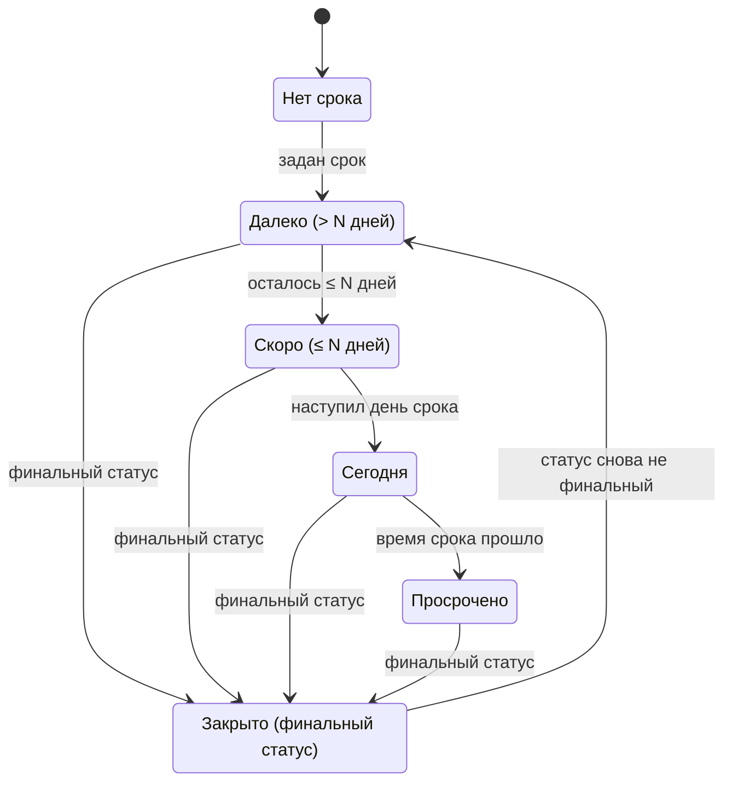

# 07. Дизайн-система

> Статус: черновик. Визуальный язык Strata: два слоя, токены, шрифты, бабл и его состояния, нити, иконки, фоны, ретро-окна, темы, эффекты, доступность, тон текстов.
>
> Опирается на [05-domain-model.md](05-domain-model.md) (ядро) и [глоссарий](glossary.md). Поведение и жесты — в [06-canvas-ux.md](06-canvas-ux.md), здесь только внешний вид. Связано: [08-view-3d.md](08-view-3d.md), [09-search-navigation.md](09-search-navigation.md), [12-mcp-ai.md](12-mcp-ai.md), [14-nfr.md](14-nfr.md), [15-architecture.md](15-architecture.md), [16-roadmap.md](16-roadmap.md), [ADR-0005](adr/0005-rendering.md), [ADR-0006](adr/0006-board-engine.md), [ADR-0007](adr/0007-text-editor.md). Источники фактов: [R7](research/R7-retro-design-assets.md) (главный), [R4](research/R4-app-shell-rendering.md), [R5](research/R5-board-engine.md), [R8](research/R8-competitors.md), [R1](research/R1-houdini-kinopio-ux.md).
>
> Обозначения: ✅ решено ответами, ☑ решено по делегированию (раунд 2), 💡 предложение, ❓ вопрос (собраны в [17-open-questions.md](17-open-questions.md)). Единицы: **px** — CSS-пиксели; **физ. px** — физические пиксели экрана; **`u`** — пиксельная единица (§2.3); **мировые единицы** — координаты холста, при зуме 100 % равны px (06).
>
> Термины **Сцена**, **Хром**, **пиксельная единица**, **режим читаемости**, **гало**, **маска иконки**, **предпросмотр плана**, **значок состояния** — в [глоссарии](glossary.md).
>
> Платформы (✅ R2, Q-15-1): основные — macOS (WKWebView) и Windows (WebView2), на них владелец принимает вид и чёткость каждой вехи; Linux (WebKitGTK) — сборка и скриншот-тесты в CI без ручной приёмки. Язык интерфейса — русский и английский с MVP (✅ R2, Q-07-1).

## 1. Концепция

### 1.1. Два слоя

💡 Интерфейс состоит из двух слоёв с разными законами. ✅ I2: схема «тёмный холст с баблами, вокруг ретро-окна» — «можно попробовать».

| | **Сцена** | **Хром** |
|---|---|---|
| Что входит | 2D-холст сети и звёздная карта: фон, баблы, нити, точки, рамки, стикеры, призраки, курсоры соавторов | Окна содержимого, панели, меню, Tab-меню, строка пути, статусная строка, тосты, диалоги, инфокарточки, тулбар доски |
| Референс | Майндмэп Pathologic 2 (✅ I1) | Мудборд из брифа: BSOD, ч/б диалоги ошибок, dinolab ([00](00-brief.md)) |
| Характер | Тихий, фотографический, монохромный. Гладкие линии со сглаживанием | Громкий, пиксельный, жёсткие рамки без размытия |
| Цвет | Бумага, чернила, туман; цвет — только акценты срока и кольца | Палитра темы с одним насыщенным цветом |
| Пиксель | Только экранные значки и подписи (§3.4) | Везде: шрифты, рамки, фаски, иконки |
| Рендер | PixiJS 8 (WebGL) и three.js ([R4](research/R4-app-shell-rendering.md)) | DOM + CSS на токенах ([R4](research/R4-app-shell-rendering.md)) |
| Масштаб | Плавный зум 5–800 % (06) | Целые физические пиксели, без дробного масштаба |

В общих решениях первый слой назван «Пространство». 💡 Здесь он называется **Сцена**: в глоссарии «Пространство» — это `Workspace`, и фраза «фон пространства» стала бы двусмысленной.

### 1.2. Референс «Мор» словами

✅ I1: скриншот майндмэпа Pathologic 2 — ориентир по контрастной визуализации и детальному подходу, а не буквальная копия.

- Фон — туманная чёрно-белая фотография, размытая и тёмная. Она ничего не сообщает и ни с чем не спорит.
- Ноды — одинаковые белые круги. Внутри каждого — детальная чёрная иконка в манере гравюры: одно «перо», ровная толщина штриха.
- Связи — тонкие белые линии, без стрелок и подписей.
- Иерархия передаётся размером: ключевые круги крупнее.
- Второстепенное приглушено и полупрозрачно; будущее показано пунктиром.
- Цвет почти отсутствует. Редкий слабый жёлтый означает «внимание», а не упрёк; красный — «требует действия» ([R7](research/R7-retro-design-assets.md) §6).

### 1.3. Мудборд Хрома

| Картинка (бриф, 00) | Что считываем |
|---|---|
| «SEO IS DEAD» | Плоский синий фон в духе BSOD, белый крупный пиксельный шрифт, тонкие белые рамки диалогов, кнопки `OK`, моноширинный мелкий текст, пунктирные разделители, инвертированные плашки-заголовки |
| Ретро-диалоги на чёрном | Окна `ERROR` с крестиком, ч/б и синие варианты, каскад окон, песочные часы, сегментный прогресс-бар, палитра инструментов в духе Paint, ироничные подписи |
| dinolab | Светло-серый фон в сетку, розовый акцентный блок с «рваным» пиксельным краем, крупный пиксельный заголовок, пиксельные иконки в карточках |

### 1.4. Что берём и чего не делаем

| Источник | Берём | Не делаем |
|---|---|---|
| Pathologic 2 | Принципы: размер — важность, прозрачность — неактивность, пунктир — «ещё не существует», жёлтый — внимание, один круг обновляется вместо цепочки (свёртки, 05 §6.4) | Не копируем скриншоты, иконки, шрифты, текстуры и вёрстку игры — это чужое произведение ([R7](research/R7-retro-design-assets.md), риски) |
| Windows 95/98, 98.css | Техники: фаски из двух слоёв `inset`-теней, инверсный заголовок, кнопка по умолчанию с лишней рамкой, точечный фокус как идея | Ни иконок Windows, ни шрифта MS Sans Serif, ни кнопки «Пуск», ни точной копии окна — риск trade dress ([R7](research/R7-retro-design-assets.md)). Файлы китов не копируем |
| system.css | 1-битные узоры, штриховка заголовка, тени-смещения | Шрифты из репозитория (`monaco.woff` без лицензии, [R7](research/R7-retro-design-assets.md)) |
| BSOD, dinolab | Палитры как темы (§9) | Логотипы и надписи с картинок мудборда |
| Kinopio | Кинетику нитей как поведение (06) | Код: PolyForm Noncommercial ([R8](research/R8-competitors.md)) |

### 1.5. Грамматика

Восемь правил, на которых держится всё остальное (💡, по [R7](research/R7-retro-design-assets.md) §6 и принципам 5–6 из [03](03-vision.md)):

1. **В v1 бабл — круг.** Вид ноды кодируется кромкой и значком, а не формой. Форму ноды владелец запросил (✅ D1): поле `shape` есть в модели (05 §4.1), палитра форм — после v1, по макету, где форма не спорит с кромкой вида (☑ Q-16-1).
2. **Сцена монохромна.** Бумага `#F2EFE6`, чернила `#111111`, туман. Цвет появляется только как кольцо, полоса или плашка.
3. **Три независимых канала:** размер — важность, прозрачность — активность, акцент — срочность.
4. **Жёлтый — внимание, красный — только просрочка** (☑ Q-07-9). Во всём продукте, включая Хром. Ошибки и опасные действия красным не красим.
5. **Цвет никогда не единственный канал.** У каждого состояния есть форма или значок (WCAG 1.4.1).
6. **Пиксель — в Хроме и в экранных значках.** Всё, что масштабируется вместе с холстом, рисуется гладко.
7. **Ничего не движется само дольше 5 с.** В покое 0 кадров в секунду ([R4](research/R4-app-shell-rendering.md), WCAG 2.2.2).
8. **Кастомизация проходит через «привести к стилю».** Свои иконки и фоны нормализуются, иначе холст превращается в хаос (03, принцип 6).

## 2. Токены

### 2.1. Именование и уровни

Формат: `--st-{категория}-{роль}[-{вариант}][-{состояние}]`.

| Категория | Префикс | Пример |
|---|---|---|
| Примитив палитры | `--st-p-` | `--st-p-paper`, `--st-p-red-500` |
| Цвет Хрома | `--st-color-` | `--st-color-text-muted` |
| Сцена | `--st-scene-` | `--st-scene-edge-alpha` |
| Шрифт | `--st-font-` | `--st-font-ui`, `--st-font-ui-size` |
| Отступ, размер | `--st-space-`, `--st-size-` | `--st-space-4`, `--st-size-control` |
| Рамка, фаска, тень, радиус | `--st-border-`, `--st-bevel-`, `--st-shadow-`, `--st-radius-` | `--st-bevel-raised` |
| Слой | `--st-z-` | `--st-z-modal` |
| Движение | `--st-dur-`, `--st-ease-` | `--st-dur-structure` |
| Компонент | `--st-{компонент}-` | `--st-button-bg-active` |

Три уровня: **примитивы** (сырые значения) → **семантические** (роль: «текст», «внимание») → **компонентные** (только там, где компонент отступает от семантики). Тема переопределяет только семантический уровень.

💡 Источник правды — `tokens/*.json`. Сборка генерирует CSS-переменные для Хрома и TS-модуль констант для Сцены: Pixi и three не читают CSS на каждом кадре. Смена темы пересоздаёт буфер цветов инстансов одним вызовом.

### 2.2. Цвета

**Примитивы** (💡):

| Токен | HEX | Назначение |
|---|---|---|
| `p-ink-1000` | `#000000` | Тени, фон «Терминала» |
| `p-ink-900` | `#0B0B0C` | Утопленные поля |
| `p-ink-850` | `#111111` | Чернила иконок, фон приложения, фон режима читаемости ([R7](research/R7-retro-design-assets.md)) |
| `p-ink-800` | `#1A1A1C` | Поверхность окна |
| `p-ink-700` | `#26262A` | Приподнятая поверхность |
| `p-ink-600` | `#3A3A3F` | Иконка «готовой» ноды, нижняя фаска |
| `p-gray-500` | `#595959` | Граница яркости фона: L = 0,10 ([R7](research/R7-retro-design-assets.md)) |
| `p-gray-400` | `#6B6B6B` | Неактивный текст, разделители |
| `p-gray-250` | `#9A9A9A` | Заливка «готовой» ноды ([R7](research/R7-retro-design-assets.md)) |
| `p-gray-200` | `#A3A3A3` | Приглушённый текст |
| `p-gray-100` | `#E4E4E4` | Фон Dinolab |
| `p-fog-text` | `#E6E6E6` | Текст и рамки Хрома в тёмных темах |
| `p-paper` | `#F2EFE6` | Бабл, нити, подписи ([R7](research/R7-retro-design-assets.md)) |
| `p-yellow-500` | `#E8C547` | Внимание ([R7](research/R7-retro-design-assets.md)) |
| `p-yellow-800` | `#8A6A00` | Внимание на светлом фоне (только графика) |
| `p-red-500` | `#D64545` | Просрочка: кольца, плашки с чернильным знаком ([R7](research/R7-retro-design-assets.md)) |
| `p-red-700` | `#B3261E` | Просрочка: плашки с текстом |
| `p-blue-bsod` | `#0000AA` | Тема BSOD ([R7](research/R7-retro-design-assets.md)) |
| `p-pink-400` | `#FF6FAE` | Акцент Dinolab: плашки с чернильным текстом |
| `p-pink-700` | `#C2185B` | Розовый текст на светлом |

**Цвета людей.** Одна палитра на кольца участников (06 §16), точки-аватары ответственных и поле `color` ноды (05 §4.1). ☑ Q-05-8: 8 цветов, в ней нет жёлтого, оранжевого и красного, чтобы цвет человека не читался как срок. Каждый цвет даёт ≥ 3:1 с фоном L = 0,10 (расчёт этого документа, формула WCAG):

| № | Имя | HEX | Контраст с фоном L 0,10 / 0,05 |
|---|---|---|---|
| 1 | Зелёный | `#6BD18A` | 3,71 / 5,57 |
| 2 | Бирюзовый | `#2EC4B6` | 3,23 / 4,86 |
| 3 | Голубой | `#5EC8E5` | 3,63 / 5,45 |
| 4 | Синий | `#8AB8FF` | 3,46 / 5,21 |
| 5 | Сиреневый | `#C9A7FF` | 3,49 / 5,24 |
| 6 | Орхидея | `#F0ABFC` | 3,98 / 5,99 |
| 7 | Розовый | `#F28DC6` | 3,14 / 4,71 |
| 8 | Стальной | `#B0BEC5` | 3,68 / 5,53 |

**Семантические токены Хрома** (значения темы «Туман»; остальные темы — §9):

| Токен | Значение | Контраст с `surface` |
|---|---|---|
| `color-bg` | `p-ink-850` | — |
| `color-surface` / `-raised` / `-sunken` | `p-ink-800` / `p-ink-700` / `p-ink-900` | — |
| `color-text` | `p-fog-text` | 13,9:1 |
| `color-text-muted` | `p-gray-200` | 6,9:1 |
| `color-text-disabled` | `p-gray-400` | 3,3:1 (неактивные элементы исключены из 1.4.3) |
| `color-frame` | `p-fog-text` | 13,9:1 |
| `color-bevel-hi` / `-hi-2` | `#5A5A60` / `p-ink-600` | — |
| `color-bevel-lo` / `-lo-2` | `p-ink-1000` / `p-ink-900` | — |
| `color-title-bg` / `-fg` | `p-fog-text` / `p-ink-850` | 15,1:1 (инверсная плашка) |
| `color-selection-bg` / `-fg` | `p-fog-text` / `p-ink-850` | Выделение в Хроме — инверсия |
| `color-focus` | `p-fog-text` + подложка `p-ink-1000` | — |
| `color-attention` / `-on` | `p-yellow-500` / `p-ink-850` | 10,4:1; чернила на жёлтом 11,3:1 |
| `color-overdue` / `-strong` / `-on` | `p-red-500` / `p-red-700` / `p-paper` | Бумага на `-strong` 5,7:1 |
| `color-divider` | `p-gray-400`, пунктир | — |
| `color-shadow` | `p-ink-1000` | — |
| `color-backdrop` | `rgba(0,0,0,.6)` | — |

В Хроме внимание и просрочка рисуются **плашками** (заливка + чернильная рамка + значок), а не цветным текстом: так контраст не зависит от темы.

**Токены Сцены** (💡, общие для всех тем; режим читаемости переопределяет):

| Токен | Значение | Где |
|---|---|---|
| `scene-bubble-fill` / `-ink` / `-rim` | `p-paper` / `p-ink-850` / `p-ink-850` α 60 % | Бабл |
| `scene-edge` / `-alpha` / `-width` | `p-paper` / 0,60 / 1,5 px | Нить ([R7](research/R7-retro-design-assets.md)) |
| `scene-edge-alpha-active` / `-width-active` | 1,0 / 2 px | Выделенный путь |
| `scene-edge-alpha-far` / `-width-far` | 0,40 / 1 px | `d` < 12 px |
| `scene-done-fill` / `-ink` / `-alpha` | `p-gray-250` / `p-ink-600` / 0,40 | Финальный статус ([R7](research/R7-retro-design-assets.md)) |
| `scene-pause-alpha` | 0,60 | Пауза |
| `scene-ghost-alpha` / `scene-cut-alpha` | 0,50 | Призрак, вырезано |
| `scene-lens-dim-alpha` | 0,25 | Не совпало с линзой (06 §15) |
| `scene-label-fg` / `-plate` | `p-paper` / `rgba(0,0,0,.7)` | Подписи всегда на плашке ([R7](research/R7-retro-design-assets.md)) |
| `scene-halo-attention` | `p-yellow-500` α 0,45, спрайт | «Срок скоро» |
| `scene-ring-today` / `-overdue` / `-outline` | `p-yellow-500` / `p-red-500` / `p-paper` | Кольца срока |
| `scene-selection` | `p-paper` | Выделение |
| `scene-bg-max-l` | 0,10 (95-й перцентиль) | Нормализация фона (§7) |
| `scene-grain-opacity` | 0,04 (диапазон 0,03–0,06) = `grain` × 0,06 (§7.1) | Зерно ([R7](research/R7-retro-design-assets.md)) |
| `scene-parallax` | 0,03 (диапазон 0,02–0,05) | Фон и туман |

**Проверка контраста Сцены** (расчёт этого документа; альфа смешивается в sRGB, как в [R7](research/R7-retro-design-assets.md) §7):

| Пара | L фона 0,10 | L 0,05 | Вывод |
|---|---|---|---|
| Бабл к фону | 6,1:1 | 9,2:1 | Проходит 1.4.11 |
| Нить α 60 % к фону | 3,3:1 | 4,5:1 | Проходит |
| Нить α 40 % (дальний зум) | 2,3:1 | 2,9:1 | Не проходит; на этом уровне нити — фактура, подробности — при приближении |
| Жёлтое кольцо к фону | 4,2:1 | 6,3:1 | Проходит |
| **Красное кольцо к фону** | **1,6:1** | **2,4:1** | **Не проходит.** Даже `#FF0000` даёт 1,75:1. 💡 Кольцо просрочки получает бумажный контур 1 `u` снаружи (контур к фону 6,1:1, красный к бумаге 3,8:1), а смысл несёт значок «!» |
| Чернильный «!» на красной плашке | 4,3:1 | | Проходит 3:1 для графики |
| Подпись на плашке поверх белого фото | 7,4:1 | | Плашка α 0,7 спасает даже на белом |

### 2.3. Пиксельная единица и сетка

Пиксельный шрифт и рамки чёткие, только когда пиксель рисунка совпадает с целым числом физических пикселей. `-webkit-font-smoothing` работает только на macOS, на Windows и Linux сглаживание не отключить ([R7](research/R7-retro-design-assets.md) §2, [R4](research/R4-app-shell-rendering.md) §2.7).

💡 Правила:
- `u = max(1, round(DPR))` физ. px; в CSS это `--u = u / DPR` px.
- Рамки, фаски, отступы, значки Хрома и экранные значки Сцены — целое число `u`.
- Кегли пиксельных шрифтов — целое число физических пикселей на пиксель шрифта (§2.4).
- Размеры с нижней границей в px (контрол ≥ 24 px) округляются вверх до кратного `u`.
- JS пересчитывает всё при смене DPR через `matchMedia('(resolution: …)')`.

```ts
function applyPixelUnit(scale = 1) {                 // scale — «Масштаб интерфейса»: 1 | 1.25 | 1.5 | 2
  const dpr = window.devicePixelRatio;
  const u = Math.max(1, Math.round(dpr));            // физ. px
  const U = u / dpr;                                 // CSS px
  const snap = (minPx: number) => Math.ceil((minPx * scale) / U) * U;
  const root = document.documentElement.style;
  root.setProperty('--u', `${U}px`);
  root.setProperty('--st-size-control', `${snap(24)}px`);   // WCAG 2.5.8
  root.setProperty('--st-size-scrollbar', `${snap(16)}px`);
}
```

| DPR | `u`, физ. px | `--u`, px | Контрол ≥ 24 px |
|---|---|---|---|
| 1 | 1 | 1,0 | 24 px = 24 физ. px |
| 1,25 | 1 | 0,8 | 24 px = 30 физ. px |
| 1,5 | 2 | 1,333 | 24 px = 36 физ. px |
| 2 | 2 | 1,0 | 24 px = 48 физ. px |
| 3 | 3 | 1,0 | 24 px = 72 физ. px |

Таблица покрывает обе основные платформы: на Windows частый масштаб экрана — 100, 125 и 150 % (DPR 1; 1,25; 1,5), на Retina-экранах Mac — DPR 2. Поэтому скриншот-тест NFR-118 идёт по всем строкам на WebView2 и WKWebView (💡).

**Отступы:** `space-1` 1u · `space-2` 2u · `space-3` 4u · `space-4` 6u · `space-5` 8u · `space-6` 12u · `space-7` 16u · `space-8` 24u · `space-9` 32u.

**Размеры:**

| Токен | Значение | Где |
|---|---|---|
| `size-control` | ≥ 24 px, кратно `u` | Кнопки, строки меню, вкладки, строки Tab-меню, статусная строка |
| `size-titlebar` | кегль `display-s` + 8u | Заголовок окна |
| `size-glyph-s` / `-m` | 8u / 16u | Значки на баблах / в Хроме и кольце флагов |
| `size-icon-ui` | 24·k физ. px, наименьшее k, при котором ≥ 16 px | Pixelarticons чёткие на 24/48/72/96 ([R7](research/R7-retro-design-assets.md)) |
| `size-scrollbar` | ≥ 16 px, кратно `u` | Полосы прокрутки |
| `size-hit-min` | 24 px | Зона попадания на Сцене и в Хроме |

Сетка холста — 24 мировые единицы, половина бабла M (06 §3).

### 2.4. Типографика: шкала

💡 Кегль пиксельного шрифта: `css_px = m × N / DPR`, где `N` — родная сетка шрифта, `m` — наименьшее целое, при котором `css_px ≥ T × scale` ([R7](research/R7-retro-design-assets.md) §2: «`css_px = k × native / DPR`, где `k` — целое»). Межстрочный интервал тоже в целых физ. px.

| Токен | Шрифт | `N` | `T` (минимум, px) | Интерлиньяж | Где |
|---|---|---|---|---|---|
| `font-display-s` | Press Start 2P | 8 | 16 | m × 12 физ. px | Заголовки окон и диалогов |
| `font-display-m` | Press Start 2P | 8 | 24 | m × 12 | Пустые состояния, заголовки разделов настроек |
| `font-display-l` | Press Start 2P | 8 | 32 | m × 12 | Экран ошибки, крупные цифры |
| `font-ui` | Departure Mono | 11 | 11 | m × 16 | Меню, Tab-меню, строка пути, статусная строка, подписи баблов, бейджи |
| `font-ui-prop` | Tiny5 | 8 | 16 | m × 11 | Длинные подписи в узких панелях |
| `font-text` | Golos Text | — | 16 (14–18) | 1,5 | Заметки, инфокарточки, виджеты доски |
| `font-text-h1/h2/h3` | Golos Text 600 | — | 28 / 22 / 18 | 1,25 | Заголовки в заметках |
| `font-mono` | JetBrains Mono | — | 14 (13–16) | 1,5 | Код, моноширинный режим заметок |

Получается при масштабе 100 % (расчёт этого документа):

| DPR | `display-s` | `display-m` | `display-l` | `ui` | `ui-prop` |
|---|---|---|---|---|---|
| 1 | 16 физ. = 16 px | 24 = 24 px | 32 = 32 px | 11 = 11 px | 16 = 16 px |
| 1,25 | 24 = 19,2 px | 32 = 25,6 px | 40 = 32 px | 22 = 17,6 px | 24 = 19,2 px |
| 1,5 | 24 = 16 px | 40 = 26,7 px | 48 = 32 px | 22 = 14,7 px | 24 = 16 px |
| 2 | 32 = 16 px | 48 = 24 px | 64 = 32 px | 22 = 11 px | 32 = 16 px |
| 3 | 48 = 16 px | 72 = 24 px | 96 = 32 px | 33 = 11 px | 48 = 16 px |

При DPR 1,25 у Departure Mono есть только 8,8 или 17,6 px — берём больший, как в примере [R7](research/R7-retro-design-assets.md) §2. ☑ Q-07-14: `ui` 11 px при DPR 1 — по умолчанию; кому мелко — масштаб интерфейса (§11.4) или режим читаемости.

### 2.5. Рамки и фаски

| Токен | Значение | Где |
|---|---|---|
| `border-1` / `border-2` | 1u / 2u сплошная `color-frame` | Окна, меню, плашки / Dinolab, фокус |
| `border-dashed` | 1u пунктир 2u/2u `color-divider` | Разделители (мудборд) |
| `bevel-raised` | Четыре `inset`-тени: −1u −1u `bevel-lo`, 1u 1u `bevel-hi`, −2u −2u `bevel-lo-2`, 2u 2u `bevel-hi-2` | Кнопки, ползунки прокрутки |
| `bevel-sunken` | То же с переставленными hi и lo | Поля ввода, нажатая кнопка, трек прогресса |
| `bevel-field` | `bevel-sunken` + 1u `color-frame` | Поля на тёмной поверхности |

Техника двухслойных `inset`-теней взята из 98.css (MIT) как приём, файлы не копируем ([R7](research/R7-retro-design-assets.md) §3).

```css
.st-button {
  min-height: var(--st-size-control);
  border: calc(var(--u)) solid var(--st-color-frame);
  background: var(--st-color-surface-raised);
  box-shadow:
    inset calc(-1 * var(--u)) calc(-1 * var(--u)) 0 var(--st-color-bevel-lo),
    inset var(--u) var(--u) 0 var(--st-color-bevel-hi),
    inset calc(-2 * var(--u)) calc(-2 * var(--u)) 0 var(--st-color-bevel-lo-2),
    inset calc(2 * var(--u)) calc(2 * var(--u)) 0 var(--st-color-bevel-hi-2);
}
.st-button:active { box-shadow: var(--st-bevel-sunken); padding-top: calc(var(--u)); }
```

### 2.6. Тени, радиусы, узоры

- **Тени — жёсткий сдвиг без размытия:** `shadow-window` 4u 4u 0 `color-shadow`; `shadow-menu` и `shadow-toast` 2u 2u 0. Модальное окно — та же тень плюс затемнение `color-backdrop`, без блюра холста.
- **Радиусы:** `radius-0` = 0 для всего Хрома; `radius-round` = 50 % для баблов, аватаров, радиокнопок. В Dinolab `corner-style: notch` — «рваный» пиксельный угол лесенкой 1u через `clip-path`.
- **Узоры:** 1-битные PNG 2×2 и 4×4 (шахматка 50 %, штриховка 45°) с `image-rendering: pixelated`, `background-size` кратен `u`: неактивный заголовок, трек полосы прокрутки, отключённые контролы ([R7](research/R7-retro-design-assets.md) §3).

### 2.7. Слои z

| Токен | Значение | Что |
|---|---|---|
| `z-scene` | 0 | `<canvas>` Сцены |
| `z-scene-hud` | 10 | Мини-карта, подсказки линз, DOM-инфокарточка |
| `z-dock` | 100 | Закреплённые окна |
| `z-window` | 200–299 | Плавающие окна; окно в фокусе получает верх диапазона |
| `z-panel` | 300 | Палитра цвета `C`, палитра иконки и размера `Z` (палитра форм — после v1, ☑ Q-16-1), панель свойств `P` |
| `z-bar` | 400 | Вкладки, строка пути, статусная строка |
| `z-menu` | 500 | Меню, контекстное меню, Tab-меню |
| `z-tooltip` | 600 | Тултипы |
| `z-toast` | 700 | Тосты |
| `z-modal` | 800 | Затемнение и диалог |
| `z-debug` | 1000 | Оверлей замеров |

### 2.8. Длительности и кривые

Совпадают с 06 §1.4. При `prefers-reduced-motion` и настройке «Меньше движения» все `dur-*`, кроме фейдов, становятся 0.

| Токен | Значение | Что |
|---|---|---|
| `dur-hover` | 80 мс | Масштаб бабла 1,05 при наведении |
| `dur-fast` | 150 мс | Тост, «отщёлкивание» нитей, фейд вместо движения |
| `dur-structure` | 200 мс | Вставка, залечивание, раскладка, раздвигание |
| `dur-camera` | 250 мс | Камера, нырок |
| `dur-bg-fade` | 300 мс | Смена фона при нырке ([R7](research/R7-retro-design-assets.md)) |
| `dur-bridge` | 600 мс | Мост 2D ↔ 3D (в [R4](research/R4-app-shell-rendering.md) 400–800 мс) |
| `dur-pulse` | 800 мс | Один пульс «срок сегодня» |
| `dur-ants` | 3 с | Бег «муравьёв» до остановки |
| `dur-window-steps` | 120 мс, 4 кадра | Открытие окна «прямоугольниками» от бабла |
| `dur-tooltip-delay` / `dur-infocard-delay` | 500 / 600 мс | Задержки показа (06 §1.3) |
| `dur-toast-life` / `-undo` | 6 / 10 с | Время жизни тоста (06 §1.4) |

| Кривая | Значение | Где |
|---|---|---|
| `ease-out` | `cubic-bezier(.2, .8, .2, 1)` | Структура, камера |
| `ease-in-out` | `cubic-bezier(.4, 0, .2, 1)` | Мост 2D ↔ 3D, смена фона |
| `ease-steps` | `steps(4, end)` | Хром: открытие окон, сегменты прогресса |
| `ease-linear` | `linear` | Муравьи, бегущая точка |
| Пружина | Критически демпфированная (ζ = 1), успокоение 200–300 мс, считается в JS | Нити (06 §6.8) |

### 2.9. Пример: JSON и сгенерированный CSS

```json
{
  "meta": { "id": "fog", "name": "Туман", "schema": 1 },
  "primitives": {
    "paper": "#F2EFE6", "ink-850": "#111111", "ink-800": "#1A1A1C",
    "fog-text": "#E6E6E6", "yellow-500": "#E8C547", "red-500": "#D64545"
  },
  "semantic": {
    "color.surface": "{ink-800}",
    "color.text": "{fog-text}",
    "color.attention": "{yellow-500}",
    "color.overdue": "{red-500}",
    "scene.bubble.fill": "{paper}",
    "scene.edge.alpha": 0.6,
    "dur.structure": "200ms"
  }
}
```

```css
:root[data-theme="fog"] {
  --st-color-surface: #1A1A1C;
  --st-color-text: #E6E6E6;
  --st-color-attention: #E8C547;
  --st-color-overdue: #D64545;
  --st-dur-structure: 200ms;
}
@media (prefers-reduced-motion: reduce) {
  :root:not([data-motion="full"]) { --st-dur-structure: 0ms; --st-dur-camera: 0ms; }
}
```

## 3. Шрифты

### 3.1. Набор

Все шрифты проверены в [R7](research/R7-retro-design-assets.md) по таблице `cmap` файла, а не по метаданным: 66 букв русского алфавита, `«»—–…№`, `ЄІЇҐЎ`. Латиницу и английскую типографику (`“”‘’`) R7 отдельно не проверял; интерфейс на двух языках с MVP (✅ R2, Q-07-1), поэтому их проверяет CI-тест §3.5.

| Слот | Шрифт, версия | Лицензия | Кириллица (RU / блок) | Родная сетка | Поставка |
|---|---|---|---|---|---|
| `display` | Press Start 2P 3.000 | OFL 1.1, RFN «Press Start 2P» | 66 / 184, все знаки | 8 px | `@fontsource/press-start-2p` 5.3.0 |
| `ui` | Departure Mono 1.500 | OFL 1.1 (шрифт; корневой MIT — для сайта) | 66 / 216, все знаки | 11 px | Из репозитория автора: в Fontsource его нет |
| `ui-prop` | Tiny5 2.007 | OFL 1.1 | 66 / 240, все знаки | 8 px | `@fontsource/tiny5` 5.3.0 |
| `text` | Golos Text 2.004 | OFL 1.1 | 66 / 172, все знаки | — | `@fontsource/golos-text` 5.3.0 |
| `mono` | JetBrains Mono 2.211 | OFL 1.1 | 66 / 98, все знаки | — | `@fontsource/jetbrains-mono` 5.3.0 |
| `fallback-pixel` | GNU Unifont 17.0.03 (релиз 2026 года не проверен) | Двойная: GPL-2.0+ с исключением или OFL 1.1 — берём OFL-ветку (по данным поиска) | Весь BMP | 8×16 / 16×16 | Подмножество в сборку |

Не берём: **Pixelify Sans** (нет О, П, І — «ПРОЕКТ» не набрать), Silkscreen, Jersey, VT323, Geist Pixel и другие без кириллицы, «MS Sans Serif» из 98.css (CC BY-SA 3.0, нет кириллицы), PxPlus (CC BY-SA 4.0: ShareAlike распространяется на изменённый шрифт, возможно, и на подмножество WOFF2, а набора под OFL хватает — ☑ Q-07-11) ([R7](research/R7-retro-design-assets.md) §1).

**Лицензии** (☑ Q-07-11, B4): код Strata — AGPL-3.0-or-later на весь репозиторий; шрифты, иконки и прочие ассеты остаются под своими лицензиями — OFL 1.1, CC BY 3.0, MIT, CC0. Компоненты только под GPL-2.0-only не берём: с (A)GPL-3.0 они несовместимы ([FSF, список лицензий](https://www.gnu.org/licenses/license-list.html)). GPL-компонент берём, только если в нём явно указано «or later» (например, `potrace` — по [R7](research/R7-retro-design-assets.md) GPL-2.0, вариант не уточнён — проверить до включения). Unifont — OFL-ветка двойной лицензии.

### 3.2. Где какой

| Место | Шрифт | Почему |
|---|---|---|
| Заголовки окон, диалогов, пустых состояний | `display`, строки ≤ 30 символов, ПРОПИСНЫЕ для вида ноды | Широкий, «8-бит» ([R7](research/R7-retro-design-assets.md)) |
| Меню, Tab-меню, строка пути, статусная строка, тосты, тултипы, бейджи, подписи баблов и нитей | `ui` | Компактная сетка 11 px |
| Узкие панели, где моноширинный не влезает | `ui-prop` | Пропорциональный, ось `wdth` |
| Текст заметки (CodeMirror 6), инфокарточка, текст виджетов доски | `text` | Читаемость на длинном тексте |
| Код, моноширинный режим заметок | `mono` | Тот же шрифт в CM6 ([R4](research/R4-app-shell-rendering.md)) |
| Подписи в мировом пространстве: стикеры, заголовки рамок | `text` в MSDF | Масштабируются с холстом (§3.4) |
| Холст доски (Excalidraw) | Nunito или Excalifont — оба с кириллицей | Своих шрифтов в публичном API Excalidraw нет; Golos и пиксель на холсте доски — только через форк ([R5](research/R5-board-engine.md) §6) |
| Режим читаемости, везде | `text` вместо `display`, `ui`, `ui-prop`; `mono` остаётся | §11 |

☑ Q-07-2 (I4): пиксель — только в Хроме и экранных подписях, текст заметок — Golos Text. «Пиксель везде» — опция темы на этапе 2: 💡 `font-text` в заметках и инфокарточках заменяется на `ui-prop`; подписи в мировом пространстве и виджеты доски остаются на Golos Text (§3.4, §8.4). Режим читаемости, наоборот, убирает пиксель отовсюду.

### 3.3. Правила чёткости

1. Кегль — по формуле §2.4, ступенями, никогда не плавно.
2. Позиция текста округляется до целого физического пикселя. На дробных координатах Firefox смешивает краевые пиксели ([R7](research/R7-retro-design-assets.md) §2).
3. Никаких `transform: scale()` с дробным масштабом у элементов с пиксельным шрифтом. Анимация окна — `steps()` по готовым прямоугольникам, без масштабирования текста.
4. Растровые значки — `image-rendering: pixelated` ([R7](research/R7-retro-design-assets.md) §2).
5. `-webkit-font-smoothing: none` ставим, но рассчитываем на него только на macOS.

### 3.4. Текст на Сцене: пиксель и MSDF

| Текст | Пространство | Как рисуем |
|---|---|---|
| Подписи баблов, подписи нитей, «×N», «↗N», бейджи | Экранное | Pixi `BitmapText` из заранее растеризованного атласа Departure Mono в точном физическом кегле, `textureStyle: { scaleMode: 'nearest' }` (Pixi 8.10+, [R4](research/R4-app-shell-rendering.md) §2.7). Позиция после трансформации камеры округляется до физ. px. Кегль меняется ступенями по зуму: `ui` при `d` ≤ 160 px, ×2 при `d` > 160 px |
| Стикеры, заголовки рамок | Мировое | MSDF-атлас Golos Text. Генератор `msdf-atlas-gen` (MIT), `-type msdf`, charset задаётся явно: ASCII, `[0x400, 0x4FF]`, `«»—–…№“”‘’`. Без charset берётся только ASCII ([R4](research/R4-app-shell-rendering.md) §2.7) |
| Все подписи в режиме читаемости | Экранное | MSDF Golos Text, кегль ≥ 14 px |
| Подписи в 3D | Мировое / DOM | По [08](08-view-3d.md): инфокарточки — DOM-оверлей в стиле Хрома ([R4](research/R4-app-shell-rendering.md) §3.3) |

Пиксельный шрифт в мировом пространстве запрещён: при плавном зуме он мылится ([R4](research/R4-app-shell-rendering.md) §2.7). 💡 «Тотальный пиксель-арт» через рендер кадра в низком разрешении не делаем: он ломает детальные гравюрные иконки ([R4](research/R4-app-shell-rendering.md) §2.7). ☑ Q-07-17.

### 3.5. Поставка и CI-тест

- Никаких шрифтовых CDN: шрифты лежат в сборке, это обязательно для офлайн-десктопа ([R7](research/R7-retro-design-assets.md)). То же для шрифтов Excalidraw: `EXCALIDRAW_ASSET_PATH` ([R5](research/R5-board-engine.md)).
- Тексты OFL и лицензий ассетов — на экране «Благодарности»; там же 💡 лицензия Strata (AGPL-3.0-or-later, ☑ Q-07-11) и ссылка на исходный код.
- 💡 **CI-тест шрифтов для русского и английского** (✅ R2: оба языка с MVP). Для каждого файла шрифта в сборке и для каждого MSDF-атласа:
  1. по `cmap` проверить все 66 букв русского алфавита, `«»—–…№` и `ЄІЇҐЎ` (☑ Q-07-1), латиницу `A–Z`, `a–z`, цифры, ASCII-пунктуацию и `“”‘’`;
  2. отрендерить в headless-браузере строки `ПРОЕКТ ёжик № «тест» — …` и `PROJECT “test” — it’s…` и сравнить ширину каждого глифа с `.notdef`;
  3. при пропуске — сборка падает с перечнем недостающих символов.

  Тест ловит ловушки вроде Pixelify Sans, у которой метаданные заявляют кириллицу ([R7](research/R7-retro-design-assets.md), риски).

## 4. Бабл

### 4.1. Анатомия и порядок отрисовки

Места значков совпадают с 06 §4.1:

```
                 12 ч: ответственные (до 3 точек, «+N»)
   10–11 ч: флаги (пауза, шаблон, замок)   1–2 ч: «↗N», ножницы
               ╭───────────────╮
               │  ▓▓ иконка ▓▓ │   ← тело: бумага, чернильная маска иконки
               │   (0,55 · d)  │   ← полоса цвета ноды 6u поверх кромки
               ╰───────────────╯
   7–8 ч: ярлык появления                  4–5 ч: срок / статус
                     6 ч: значок вида
                 ┌───────────────┐
                 │ Подпись ноды  │  ← плашка, ≤ 2 строк, ≤ 160 px
                 └───────────────┘
```

Порядок отрисовки снизу вверх (один инстансный проход на слой, [R4](research/R4-app-shell-rendering.md)): гало → тело → иконка → полоса цвета и кромка → кружки и стрелки концов нитей (§5) → кольца срока и свёртки → кольцо выделения и уголки → кольца участников и фокуса → значки → подписи.

### 4.2. Размеры

💡 Диаметры в мировых единицах, как в 06 §4.2: **S 32 · M 48 · L 72 · XL 108** (шаг ×1,5).

| Правило | Размер |
|---|---|
| Сеть | M |
| Прочие виды | S |
| ≥ 8 нитей, видимых в этой сети | +1 ступень |
| Флаг «Ключевая» (05 §7) | +1 ступень и двойная кромка; на XL — только двойная кромка |
| Ручной размер (05 §9.2) | Перекрывает расчёт |

Тело и иконка масштабируются с зумом. Кромки, кольца и значки — экранного размера в `u`, иначе на отдалении они превращаются в кашу, а вблизи — в «бублик».

### 4.3. Радиальный стек колец

Отступы от кромки тела радиуса `r`, экранные (💡):

| Слой | Радиус | Толщина | Что в нём |
|---|---|---|---|
| Второе кольцо сети | r − 6u | 1u | Чернила α 60 % — «стопка» (§4.4) |
| Полоса цвета ноды | r − 4u … r + 2u | 6u | Поле `color` (05 §4.1), палитра людей §2.2; без своего цвета — цвет класса (задача, проект, референсы, чек-лист). ✅ Владелец 2026-10-24: толще прежних 3u, полоса сама становится кромкой |
| Кромка | r | 1u | Чернила α 60 %; пунктир у паузы и призрака |
| Второй контур ключевой | r + 2u | 1u | Бумага: вместе с кромкой даёт «двойную кромку» |
| Кольцо срока или свёртки | r + 4u … r + 6u | 2u | «Сегодня» — жёлтое; «просрочено» — красное + бумажный контур 1u на r + 7u; у сети без своего срока — дуга прогресса свёртки |
| Кольцо выделения | r + 9u … r + 11u | 2u | Выделение; наведение — 1u на том же месте; «муравьи» текущей ноды; цель «положить внутрь» |
| Уголки выделения | Квадрат с полустороной r + 12u | 1u, плечо 4u | `⌜⌝⌞⌟` |
| Кольцо участника | r + 14u | 1u | Выделение и правка другим человеком, изменения AI |
| Фокус клавиатуры | r + 16u … r + 18u | 2u пунктир 2u/2u | Бумага на подложке 1u чернилами |
| Гало | до 1,5 r | Спрайт | «Срок скоро» |

Иконка занимает круг диаметром 0,55 d, чтобы не задевать второе кольцо сети. Внешние кольца есть только у выделенных, наведённых и сфокусированных нод, поэтому плотная раскладка не страдает.

### 4.4. Виды в v1: круг, кромка и значок

Форма бабла в v1 не меняется (§1.5 п. 1); палитра форм — после v1 (☑ Q-16-1).

| Вид | Тело | Кромка | Значок вида на 6 ч |
|---|---|---|---|
| Сеть | Иконка | Двойное кольцо «стопкой» (второе — на r − 6u) + дуга прогресса свёртки на кольце срока: бумага α 100 % по треку α 30 %, от 12 ч по часовой. Если у сети свой срок в состоянии «скоро», «сегодня» или «просрочено», кольцо занимает он, а прогресс уходит в строку превью. У задачи дуга — доля готовых подзадач (✅ Q-05-1); свёртка — по всей глубине, без нод на паузе (☑ Q-05-2) | Две вложенные рамки |
| Заметка | Иконка | Одинарная | Лист со строками |
| Доска | Иконка | Одинарная | Холст с кнопкой |
| Список | Иконка | Одинарная | Квадрат с галочкой и строки |
| Медиа | Иконка; если не задана — ч/б миниатюра в круге (Floyd–Steinberg) | Одинарная | Кадр с горой |

### 4.5. Состояния

Полная таблица (💡 по [R7](research/R7-retro-design-assets.md) «Рекомендация» п. 4, 05 §6.3, 06). «М. д.» — поведение при «Меньше движения».

| Состояние | Данные | Тело и иконка | Кромка и кольца | Альфа | Значок и место | Движение (м. д.) |
|---|---|---|---|---|---|---|
| По умолчанию | — | Бумага, чернильная иконка | Кромка 1u | 100 % | — | — |
| Наведение | Курсор в зоне попадания | — | Кольцо 1u на месте кольца выделения | 100 % | Подпись сразу; кольцо флагов через 150 мс (06 §8) | Масштаб 1,05 за 80 мс (без масштаба) |
| Выделено | В выделении | — | Кольцо 2u + пиксельные уголки | 100 % | — | — |
| Текущая | Последняя кликнутая (06 §11) | — | Как «выделено» + «муравьи»: пунктир 3u/3u на кольце выделения | 100 % | — | Бег 3 с, затем статичный пунктир (сразу статичный) |
| Фокус клавиатуры | Фокус холста на ноде | — | Пунктир 2u снаружи всех колец (§4.3) | — | — | — |
| Ключевая | Флаг `R` | — | Двойная кромка: второй контур бумагой на r + 2u | 100 % | ★ в кольце флагов | Размер +1 ступень |
| Пауза | Флаг `Q` | Поверх — 1-битная штриховка 45°, шаг 4u, 50 % | Пунктир 3u/2u | 60 % | ‖ на 10–11 ч | — |
| Шаблон | Флаг `E` | — | — | 100 % | Трафарет на 10–11 ч | — |
| Замок (MVP+ 1.1) | Флаг «Замок» | — | — | 100 % | Замок на 10–11 ч | — |
| Скрыто от AI (MVP+ 1.1) | Флаг `T` | — | — | 100 % | Перечёркнутый глаз — только в AI-линзе и в кольце флагов (06 §4.1) | — |
| Готово | Статус «Готово» | `#9A9A9A`, иконка `#3A3A3F` | Без колец срока | 40 % | Галочка на чернильной плашке, 4–5 ч | — |
| Отменено | Статус «Отменено» | Как «готово» | — | 40 % | Прочерк на 4–5 ч | — |
| Срок скоро | ≤ N дней, N = 3 (05 §6.3) | — | Статичное жёлтое гало | 100 % | Песочные часы на жёлтой плашке, 4–5 ч | — |
| Срок сегодня | День срока | — | Жёлтое кольцо 2u | 100 % | Песочные часы | 3 пульса по 800 мс при первом появлении в кадре за сеанс, затем статично (без пульса) |
| Просрочено | Срок прошёл, статус не финальный | — | Красное кольцо 2u + бумажный контур 1u | 100 % | «!» чернилами на красной плашке с чернильной обводкой | Без анимации |
| Свёртка горит | Внутри сети просрочка или срок ≤ N (05 §6.4) | — | Трек дуги прогресса становится красным или жёлтым, 1u — слабее собственного кольца 2u | 100 % | Малый «!» или часы с точкой на 4–5 ч | — |
| Появление | Неосновное размещение (05 §5) | — | — | 100 % | Ярлык на 7–8 ч; «×N» при наведении | — |
| Внешние связи | Второй конец не размещён здесь (05 §8.3) | — | — | 100 % | «↗N» на 1–2 ч | — |
| Призрак | `[[X]]` без ноды (05 §8.5) | Без заливки, «?» вместо иконки | Пунктир 1u, 3u/3u, бумага | 50 % | «?» | — |
| Ответственные | `assignees` | — | — | — | Точки 8u цвета человека с чернильной обводкой 1u, до 3 и «+N», 12 ч | — |
| Выделено другим | Эфемерный канал (06 §16) | — | Кольцо участника 1u его цветом | — | — | — |
| Редактирует другой | Содержимое открыто у участника | — | Кольцо 1u цвета участника с разрывом на 12 ч | — | Плашка цвета участника с инициалами и карандашом над баблом | — |
| Изменено AI или MCP (MVP+ 1.1) | Набор изменений с источником `mcp:*` или `ai` (05 §11) | — | Точечный контур 1u бумагой на кольце участника | — | «✦» перед подписью | Статично 5 с, затем фейд 150 мс (06 §16) |
| Предпросмотр плана (этап 2) | `apply_graph_plan` до применения ([12](12-mcp-ai.md)) | Заливка 50 % | Точечный контур 1u | 50 % | «✦» в центре | — |
| Приглушено линзой (MVP+ 1.4) | Не совпало с линзой (06 §15) | — | — | 25 % | — | — |
| Вырезано | После `Ctrl+X` до вставки (06 §12.1) | — | Пунктир | 50 % | Ножницы на 1–2 ч | — |
| Цель «положить внутрь» | Тянем ноду на бабл сети (06 §1.3) | — | Пунктир 2u на кольце выделения + дуга таймера 500 мс | — | «⊘», если нельзя (цикл вложенности) | Дуга заполняется (без дуги) |

### 4.6. Срок: машина состояний



- «Сегодня» считается в часовом поясе зрителя. Срок-дата просрочен после конца дня, срок-дата-время — после указанного времени.
- Пересчёт — таймером на полночь и на ближайший срок в кадре: один кадр, а не непрерывный рендер.
- Пульс «сегодня» запускается при первом попадании бабла в кадр за сеанс, не чаще одного раза на ноду.

### 4.7. Сочетания и приоритеты

1. **Срок:** одно кольцо, приоритет просрочено > сегодня > скоро. Финальный статус гасит всё про срок.
2. **Пауза:** собственное кольцо и гало срока не рисуются, остаётся только значок срока — нода отложена (05 §7: пауза не участвует в свёртках).
3. **Прозрачность:** берётся минимальная из готово 40 %, призрак 50 %, вырезано 50 %, пауза 60 %, линза 25 %. Кольца выделения, фокуса, участников и значки всегда 100 %, иначе выделенную «готовую» ноду не видно.
4. **`prefers-reduced-transparency`** (только Chromium, [R7](research/R7-retro-design-assets.md) §7): альфа заменяется серой заливкой и штриховкой.
5. **Один час — один значок.** Если на место претендуют два, второй сдвигается на час по часовой стрелке. ✅ S9 (2026-10-23): места концов нитей (§5) заняты первыми — значок, попавший на кружок или острие стрелки, сдвигается к ближайшему свободному месту шагом в полчаса в обе стороны, не дальше двух часов.
6. **Уровень 12–32 px** (§4.9): один значок по приоритету просрочено > сегодня > скоро > готово > пауза (06 §4.3).
7. **Цвет ноды** не может быть жёлтым или красным: палитра §2.2 (☑ Q-05-8). Иконку можно подкрасить только «чернилами» (§6.6).

### 4.8. Прочие элементы Сцены

| Элемент | Вид (💡) | Поведение |
|---|---|---|
| Порт (06 §6.1) | Бумажная точка 4u с чернильной обводкой 1u на кромке со стороны курсора | 06 |
| Кольцо флагов (06 §8) | Радиус ≥ 28 px; слоты 16u на чернильных плашках: ★ ‖ ▤ глаз `i`; включённый флаг — инверсия слота | 06 |
| Точка на нити (MVP+ 1.3) | Бумажный круг 3u; закреплённая — кольцо 3u с чернильной сердцевиной | 06 §6.6 |
| Рамка (MVP+ 1.3) | Заливка цветом из палитры §2.2 α 8 %, контур 1u α 60 %, заголовок — MSDF Golos на плашке; свёрнутая — плашка «▣ 12» | 06 §7 |
| Стикер (MVP+ 1.3) | Бумажная или цветная (палитра §2.2 с осветлением) карточка без тени, текст MSDF Golos чернилами | 06 §7 |
| Курсор участника | Пиксельная стрелка 16u цвета участника с чернильной обводкой 1u, имя на плашке того же цвета чернилами | Гаснет через 3 с покоя (06 §16) |
| Протяжка участника | Нить пунктиром 4u/4u цвета участника | 06 §16 |
| Сетка | Нет в «Тумане»; в Dinolab — точки 1u бумаги α 12 % с шагом 24 мировые единицы | 06 §3 |
| Направляющие выравнивания | Линия 1u бумаги α 40 % | 06 §3 |
| Контуры раздвигания соседей | Пунктирные круги 1u α 40 % там, куда уедут ноды | 06 §6.4 |
| Штрих ножа и `J` | Пунктир 2u бумаги α 80 % | 06 §6.7 |
| Рамка выделения | Пунктир 1u бумаги, заливка α 6 % | 06 §11 |

### 4.9. Семантический зум

Пороги по экранному диаметру `d = диаметр × зум` ([R7](research/R7-retro-design-assets.md) п. 4), гистерезис 10 % (06 §1.3):

| `d` | Бабл | Подпись | Значки | Нити |
|---|---|---|---|---|
| < 12 px | Точка 2–4 px цвета главного состояния: бумага, серый (готово), жёлтый (скоро, сегодня), красный с бумажным контуром (просрочено) | Нет | Нет | 1 px, α 40 % |
| 12–32 px | Круг + значок вида 8u или 16u вместо иконки: детальная гравюра на кружке < 32 px рябит ([R7](research/R7-retro-design-assets.md)) | У ключевых, выделенных, под курсором | Один, по приоритету §4.7 | Обычные |
| 32–96 px | Круг + детальная иконка | Да | Все | Обычные |
| > 96 px | То же | Да, кегль ступенью крупнее при `d` > 160 px | Все | Обычные + строка превью: статус, дедлайн, счётчики; у сети — прогресс и ближайший срок |

Маска иконки выбирается из 32/64/128 так, чтобы её размер был не меньше экранного размера иконки в физ. px (§6.7).

### 4.10. Зона попадания

Не меньше 24×24 px, даже если бабл мельче (WCAG 2.5.8, [R7](research/R7-retro-design-assets.md)). При перекрытии зон выигрывает бабл, центр которого ближе к курсору. Значки на кромке (ярлык, «↗N») кликабельны только при `d` ≥ 32 px, в остальных случаях клик идёт в бабл.

## 5. Нити

Механика — в 06 §6. ✅ C4: типов связей нет, поэтому стиль нити кодирует геометрию и состояние, но не смысл связи.

| Свойство | Значение (💡) | Источник |
|---|---|---|
| Цвет | Бумага `#F2EFE6` | [R7](research/R7-retro-design-assets.md) |
| Толщина и альфа | 1,5 px, α 60 % | [R7](research/R7-retro-design-assets.md) |
| Выделенная нить, нити выделенной ноды, под курсором | 2 px, α 100 % | [R7](research/R7-retro-design-assets.md) |
| Дальний зум (`d` < 12 px) | 1 px, α 40 % | §4.9 |
| Приглушено линзой | α 15 % | 06 §15 |
| Нить из текста (единственное происхождение — `text`, 05 §8.1) | ☑ Q-07-15, Q-13-3: по умолчанию — как ручная, происхождение — в тултипе нити и в инфокарточке. Настройка сети «Нити из текста»: «приглушённые» — 1 px, α 40 % (значения `scene-edge-width-far` и `scene-edge-alpha-far`); под курсором и у выделенной ноды — как обычная; «скрыты» — не рисуются | 06 §6.2, 05 §9.2 |
| Концы | На окружности по линии центров, без зазора: конец нити уходит под пометку конца; нити под баблами | 06 §6.2 |
| Пометки концов | ✅ Q-07-20 (2026-10-24): на обоих концах одинаковый кружок — тёмный диск радиусом 6u, кольцо 1,5u и точка 2u в цвете ноды (или бумажные, если цвета нет); стрелки — только в прототипе для сравнения. Раньше (✅ S9, 2026-10-23): бумажный кружок 4u у источника, полый у приёмника | 06 §4.1, §6.3 |