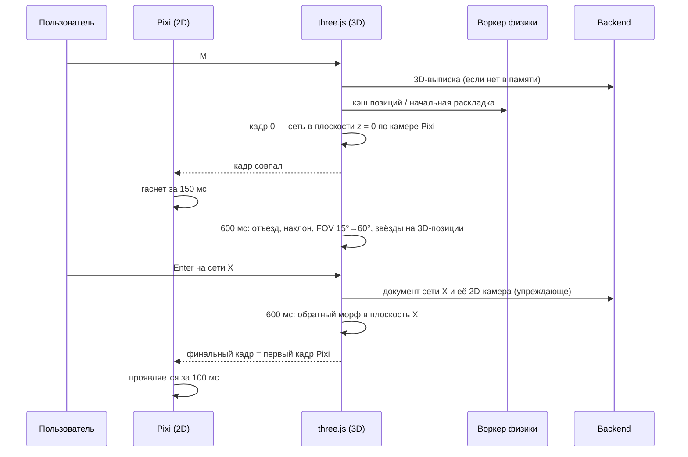

# 08. 3D-режим (звёздная карта)

> Статус: черновик. Звёздная карта — 3D-представление всего пространства: что на ней видно, как раскладываются звёзды, как летать, искать, входить и создавать ноды, как устроен переход 2D↔3D и сколько это стоит по кадру.
>
> Опирается на [05-domain-model.md](05-domain-model.md) (ядро) и [глоссарий](glossary.md). Связано: [06-canvas-ux.md](06-canvas-ux.md) (2D-холст, клавиши, линзы), [07-design-system.md](07-design-system.md) (состояния и темы), [09-search-navigation.md](09-search-navigation.md) (поиск, история, линзы), [10-storage-sync-collab.md](10-storage-sync-collab.md), [12-mcp-ai.md](12-mcp-ai.md), [14-nfr.md](14-nfr.md), [16-roadmap.md](16-roadmap.md), [ADR-0005](adr/0005-rendering.md). Источники фактов: [R4](research/R4-app-shell-rendering.md) (главный), [R7](research/R7-retro-design-assets.md), [R8](research/R8-competitors.md), [R1](research/R1-houdini-kinopio-ux.md), [R6](research/R6-mcp-ai.md).
>
> Обозначения: ✅ решено ответами, ☑ решено по делегированию владельца (раунд 2), 💡 предложение, ❓ вопрос (собраны в [17-open-questions.md](17-open-questions.md)). Единица длины в 3D — мировая единица 2D-холста (бабл M = 48), чтобы «камера-мост» не пересчитывала масштаб.
>
> Платформы (✅ R2, Q-15-1): основные — macOS (WKWebView) и Windows (WebView2); графику 3D владелец проверяет на своих машинах по сборкам вех и веб-странице бенчмарка (Safari ≈ WKWebView, Edge и Chrome ≈ WebView2). Linux (WebKitGTK) собирается в CI и проходит автотесты, ручной приёмки нет. Тексты 3D (справка, тосты, панель, меню) идут через ключи каталога: русский и английский с MVP (✅ R2, Q-07-1).
>
> Термины документа — **камера-мост**, **отражение** (появление в 3D), **контекстная сеть**, **туманность** (скопление издалека), **скопление в фокусе**, **локальный режим**, **3D-выписка**, **сирота** (нода без нитей с одним размещением, [R8](research/R8-competitors.md)) — внесены в [глоссарий](glossary.md).

## 1. Назначение

✅ H1: «Преимущественно красивая визуализация, но перемещение, поиск, создание нод и вход в ноды должны работать и в 3D». ✅ O1: 3D — в пятёрке MVP. Бриф (00 §7): ноды как скопления звёзд, справка при приближении, навигация поиском или WASD, примитивная физика.

| Задача | Как решает звёздная карта | Раздел |
|---|---|---|
| Обзор | Всё пространство сразу: скопления — сети, размер — важность, яркость — активность, жёлтый и красный — срочность | §2, §4 |
| Исследование | Полёт, орбита; линзы и подсветка сирот и призраков (MVP+ 1.4); локальный режим (этап 2) | §5, §6.6 |
| Поиск | `Ctrl+O` → перелёт к звезде; `Ctrl+F` → подсветка совпадений | §6.1 |
| Вход | `Enter`: сеть — «камера-мост» в 2D, остальное — окно содержимого поверх 3D | §6.3, §7 |
| Создание | `Tab` → Tab-меню, нода создаётся в сети по правилу §6.4 | §6.4 |

**Главное правило** ([R8](research/R8-competitors.md) §17, рек. 6): 3D отвечает на вопросы, а не служит витриной. Глобальный «клубок» Obsidian пользователи называют «красивым, но почти бесполезным». Полезным граф делают локальность, стабильные позиции, фильтры, интерпретация и действия. Исследования по выдержкам R8: для обзора и запоминания 2D быстрее, 3D требует больше навигации точкой обзора. Отсюда роль 3D — быстрый путь «найти → подлететь → войти», рабочий режим — 2D-холст ([06](06-canvas-ux.md)).

### 1.1. Чего 3D не делает

| Не делает | Почему | Где это делается |
|---|---|---|
| Ручная раскладка баблов, точки, маршруты и стили нитей, рамки, стикеры | 3D-позиции — производные данные, а раскладка сети живёт в документе сети (05 §9.2) | 2D, [06](06-canvas-ux.md) §9 |
| Жесты нитей: бросок на нить, встряхивание, нож `Y`, `J`-штрих, ответвление | Попадание в нить в перспективе ненадёжно; одна механика — один дом | 2D, [06](06-canvas-ux.md) §6 |
| Правка содержимого «в мире» | Содержимое в 3D не грузится (✅ N1, 05 §14 п. 8) | Окна содержимого (DOM поверх 3D, [06](06-canvas-ux.md) §2.2) |
| Выделение рамкой, копирование, «Обернуть в сеть» | Нужна плоскость и раскладка | 2D |
| Пиксельный шрифт в мировом пространстве | Размывается при перспективе и дробном DPR ([R4](research/R4-app-shell-rendering.md) §2.7, [R7](research/R7-retro-design-assets.md)) | Подписи — DOM в экранном пространстве |

### 1.2. Состав по этапам (💡, итог — в [16](16-roadmap.md))

| Этап | Что входит |
|---|---|
| **MVP** | Карта всего пространства, скопления по вложенности, отражения появлений; полёт (ПКМ + WASD/QE), орбита, перелёт `F`/`G`/`H`; `Ctrl+O` и `Ctrl+F` с перелётом; справка при приближении; `Enter`/`I`/`U`; создание `Tab`; флаги `R`/`Q`/`E`; удаление; быстрые метки; «камера-мост» в обе стороны; схватить и швырнуть, «Закрепить на карте», затухание; пресеты качества |
| **MVP+ 1.1** | Флаг «Скрыть от AI» `T` и «Замок» — вместе с MCP ([16](16-roadmap.md) §4.5) |
| **MVP+ 1.4** | Линзы как в 2D, в том числе «Здоровье» (§2.5, §6.6) ([16](16-roadmap.md) §5.2) |
| **Этап 2** | Локальный режим; соединение нитями в 3D; режим «полёт с клавиатуры» `V`; дыхание как опция; «Собрать окрестность»; 1-битный дизеринг |
| **Этап 3** | Присутствие участников, общая карта команды (общие закрепления — по запросу, ☑ Q-08-8), линза «сообщества и мосты», AI-резюме в справке ([R6](research/R6-mcp-ai.md)) |

## 2. Что показывается

### 2.1. Состав сцены

| Объект модели | На звёздной карте | Данные |
|---|---|---|
| Живая нода | Одна звезда, даже если размещена в нескольких сетях (✅ C3, 05 §1 п. 1) | 3D-выписка проекции (§8.3) |
| Нода в корзине | Не показывается | — |
| Корневая сеть | Звезда в начале координат, «ядро» | — |
| Сеть | Звезда-ядро своего скопления: её содержимое расположено вокруг неё | — |
| Основное размещение | Определяет, в каком скоплении звезда | 05 §5 |
| Появление | Отражение в скоплении другой сети (§2.3) | 05 §5 |
| Нить | Линия между звёздами; все нити пространства, потому что нити глобальны (05 §8.3, [ADR-0001](adr/0001-global-edges.md)) | — |
| Призрак `[[X]]` | Полое пунктирное кольцо «?» рядом с источником, вне физики; позиция по хешу имени, как в 2D ([06](06-canvas-ux.md) §14) | 05 §8.5 |
| Точки, рамки, стикеры | Не показываются: это оформление документа сети | 05 §9.2 |
| Флаг «Скрыть от AI» (MVP+ 1.1) | Значок — только в AI-линзе, как в 2D ([R7](research/R7-retro-design-assets.md)) | 3D-выписка, бит флага (§8.3) |

Всё берётся из проекции: метаданные, превью, свёртки. Содержимое нод не загружается (05 §13, инвариант 8). ☑ Q-08-2 (H3 «всё пространство или текущий уровень»): всё пространство с LOD и туманностями (§4.2), локальный режим как противовес (§6.6).

### 2.2. Скопления

💡 По умолчанию **скопление = сеть по основным размещениям**. У каждой живой ноды ровно одно основное размещение, вложенность ацикличная (05 §14, п. 3 и 5), поэтому основные размещения образуют дерево с корнем в корневой сети. Получается иерархия «галактика → звёздная система → планеты»: проект — скопление, задача-сеть внутри — подскопление.

| Источник скоплений | Этап | Плюсы | Минусы |
|---|---|---|---|
| **Вложенность** (по умолчанию) | MVP | Совпадает с путями и 2D; стабильна; глоссарий: скопление «образовано вложенностью или связями» | Нити между проектами длинные |
| Сообщества по нитям (модулярность) | Этап 3, линза (§2.4) | Интерпретация, как у InfraNodus ([R8](research/R8-competitors.md) §10) | Неустойчиво при правках, трудно запомнить |
| Теги | Позже, линза-группировка | Понятно | Несколько тегов — неоднозначность |
| Смысловая близость | Не раньше этапа 3 | «Похожее рядом» | Нужны эмбеддинги ([R6](research/R6-mcp-ai.md), этап 2) |

Как видна вложенность:
- близостью: дети сети лежат в шаре вокруг её звезды (§3.2);
- туманностью: издалека скопление рисуется одним облаком (§4.2);
- «спицами»: при наведении или выделении звезды-сети на 2 с проступают тонкие линии к её прямым детям (альфа 15 %). Постоянные линии вложенности не рисуем: это и есть «клубок» ([R8](research/R8-competitors.md)).

☑ Q-08-1 (H2).

### 2.3. Появления: отражения

💡 Звезда ноды одна и стоит в скоплении основного размещения. В каждом скоплении, где у ноды есть появление, рисуется **отражение**:

| Элемент | Вид |
|---|---|
| Отражение | Полое кольцо 60 % размера звезды, белое 50 %, значок ярлыка 8×8 на ближнем LOD (как у появления в 2D, [06](06-canvas-ux.md) §12.2) |
| Связь отражения со звездой | Пунктир, альфа 20 %; виден, когда скопление близко или звезда выделена |
| Физика | Слабая пружина тянет звезду к каждому скоплению с её появлением (§3.2). Общие ноды сами дрейфуют к границам и становятся видимыми «мостами» между проектами |
| Клик по отражению | Выделяет ноду с **контекстной сетью** = сеть отражения: от неё считаются `Tab`, `Delete` и «Где размещена» |
| Справка | «×N» и список путей «Также в: …» |

| Альтернатива | Почему нет |
|---|---|
| Отдельная звезда на каждое размещение | Нарушает принцип «одна нода — одна сущность» (05 §1), удваивает счётчики и нити |
| Одна звезда «между» скоплениями без отражений | Теряется ответ на вопрос «где ещё она лежит» |

☑ Q-08-9.

### 2.4. Линза «сообщества и мосты» (этап 3)

💡 Интерпретация поверх карты, по образцу InfraNodus ([R8](research/R8-competitors.md) §10, рек. 6). Код InfraNodus под SPUL — заимствуем только идею ([R8](research/R8-competitors.md)).

| Что | Как |
|---|---|
| Сообщества | Разбиение графа нитей (без направлений) по модулярности. Алгоритм (Louvain или Leiden) и библиотека не выбраны — не проверено, решается в спайке. Расчёт в воркере или ядре, кэш по `seq` проекции |
| Показ | Полупрозрачная оболочка-туман с номером узора дизеринга, а не цветом: палитра монохромная ([R7](research/R7-retro-design-assets.md) §6). Подпись — 3 ключевые или самые связанные ноды |
| Мосты | Ноды с высокой посредничностью между сообществами: значок «◇» и белая обводка |
| Структурные пробелы | Пары крупных сообществ с малым числом нитей: пунктирная метка «разрыв» между ними ([R8](research/R8-competitors.md) §10) |
| Позиции | Не меняются: карта стабильна. Кнопка «Разложить по сообществам» строит временную раскладку до `Esc` |

[R8](research/R8-competitors.md) ставит эту линзу на этап 2; по общему плану этап 2 занят семантическим поиском и AI-функциями ([R6](research/R6-mcp-ai.md)), поэтому — этап 3.

### 2.5. Линза «Здоровье»

💡 MVP+ 1.4, вместе с остальными линзами ([16](16-roadmap.md) §5.2); стоит дёшево, потому что это просто запрос: `is:orphan` и `is:ghost` ([09](09-search-navigation.md) §3.6). Подсвечивает сирот (нода без нитей с единственным размещением) и призраков — «проверка здоровья базы», ради которой граф Obsidian и ценят ([R8](research/R8-competitors.md) §17). Ничего не удаляет.

## 3. Раскладка и физика

### 3.1. Принципы

1. **Стабильность важнее «живости».** Позиции сохраняются между сеансами; полный пересчёт карты сам не запускается. Сброс раскладки при входе — антипаттерн ([R8](research/R8-competitors.md): Anytype #2142).
2. **Детерминированность.** Результат полного расчёта зависит только от выписки, версии алгоритма и зерна.
3. **Вне главного потока.** Расчёт в Web Worker: ngraph.forcelayout 3.3.1 (BSD-3-Clause, Barnes–Hut за `n·log n`) или d3-force-3d 3.0.6 (MIT, octree) ([R4](research/R4-app-shell-rendering.md) §3.5). Позиции передаются в главный поток transferable `Float32Array`; `SharedArrayBuffer` требует COOP/COEP, в протоколе Tauri не проверено ([R4](research/R4-app-shell-rendering.md)) — проверяется спайком 2 в WKWebView и WebView2. Выбор между двумя библиотеками — спайк 2 ([16](16-roadmap.md) §3.2).
4. **Живая физика — только рядом.** В реальном времени считаются тронутая звезда с окрестностью и скопления у камеры; остальное заморожено ([R4](research/R4-app-shell-rendering.md) §3.5 п. 2).
5. **0 fps в покое** после затухания (общее правило рендера, [06](06-canvas-ux.md) §1 п. 8).

### 3.2. Силовая модель (💡, коэффициенты стартовые, подбираются в спайке)

| Сила | Формула и параметры | Зачем |
|---|---|---|
| Отталкивание | `F = −k_r · m_i · m_j / d²`, Barnes–Hut θ = 0,8; масса `m = 1 + 0,5·ключевая + 0,25·log2(1 + степень)` | Звёзды не слипаются, важные расталкивают сильнее |
| Пружина вложенности | Нода ↔ звезда сети основного размещения; длина `0,6·R(N)`, жёсткость `k_h = 0,08` | Собирает скопления |
| Пружина нити | Длина `L_e = 60`; жёсткость 0,02 внутри скопления, 0,005 между скоплениями | Связанные рядом, но проекты не схлопываются друг в друга |
| Пружина отражения | Нода ↔ звезда сети каждого появления; длина `R(N')`, жёсткость `0,3·k_h` | Общие ноды тянутся к границам (§2.3) |
| Столкновение | Радиус звезды + 2 | Без наложений вблизи |
| Центрирование | Слабое притяжение к началу, 0,001 | Вселенная не расползается |
| Затухание | Скорость × 0,6 за тик | Устойчивость |

Радиус скопления сети N: `R(N) = 40 · ∛(1 + subtreeSize(N))`, где `subtreeSize` — число нод в поддереве основных размещений. Объём скопления растёт пропорционально числу нод, плотность одинакова на любом уровне.

### 3.3. Начальная раскладка

```text
layoutFull(extract, seed):
  pos[root] = (0, 0, 0)
  for N in обход в ширину по дереву основных размещений:
    for c in дети N, по возрастанию id:                 // UUIDv7 → порядок создания
      dir = unitVector(hash64(seed, c.id))               // не зависит от числа соседей
      r   = isNetwork(c) ? R(N) + R(c)
                         : R(N) · (0,4 + 0,5 · frac(hash64(c.id)))
      pos[c] = pos[N] + dir · r
  simulate(ticks = 300, alpha 1 → 0,001, prng = xorshift(seed))
  for p in закреплённые: pos[p] = pinned[p]
  return pos
```

- Направление по хешу ID, а не по номеру среди соседей: новая сеть-сосед не сдвигает остальные.
- Иерархическая расстановка даёт осмысленную карту в первом кадре, ещё до симуляции. Пользователь видит карту сразу, симуляция уточняет её в фоне (§8.1).
- Зерно — ID пространства. Версия алгоритма хранится рядом с кэшем: после обновления Strata старые позиции остаются, пока пользователь не нажмёт «Пересчитать карту».
- Ограничение: тригонометрия и `Math.exp` в разных JS-движках могут расходиться в последних битах, а силовая симуляция хаотична. Карта на разных устройствах, в том числе на Mac и Windows владельца, может отличаться — не проверено, проверяется спайком 2. Для одинаковой карты у всей команды нужен один писатель: общая карта от сервера — этап 3 (§3.5, ☑ Q-08-8).

### 3.4. Инкрементальные изменения

| Событие | Что происходит со звёздами |
|---|---|
| Новая нода | Позиция по хешу рядом со звездой сети (или с родителем, если создана с нитью); локальная релаксация 60 тиков в окрестности 2 шагов; вспышка 300 мс |
| Перенос (сменилось основное размещение) | Перелёт 400 мс к позиции по хешу в новом скоплении, затем локальная релаксация |
| Новое появление | Только отражение и слабая пружина |
| Нить создана или удалена | Локальная релаксация концов, 30 тиков |
| Нода ушла в корзину | Звезда гаснет за 200 мс; дыра не схлопывается до пересчёта карты |
| Атрибуты, флаги, имя | Позиции не меняются, меняется только вид |
| Пересчёт карты | Только командой «Пересчитать карту» (палитра команд). Подсказка «Карта устарела», если с прошлого полного расчёта изменилось ≥ 20 % нод. Анимация 800 мс; «Вернуть прежнюю карту» одной кнопкой (предыдущие позиции держим в кэше) |

Сделано 2026-10-28 (без кэша между сеансами и без «Пересчитать карту»): полная раскладка — только при первом входе в карту за сеанс; дальше звёзды переносятся по ID, новые рождаются по хешу ID рядом с источником нити (на длине нити 60) или в шаре своей сети, затем 60 тиков локальной релаксации окрестности в 2 шага и вспышка 300 мс; ушедшая в корзину звезда гаснет за 200 мс, дыра остаётся; флаги, статус и срок меняют только вид.

### 3.5. Где хранятся позиции

| Данные | MVP | Этап 3 (☑ Q-08-8) |
|---|---|---|
| Базовые позиции | Кэш устройства: десктоп — таблица `star_layout` в локальной проекции; веб — IndexedDB. Ключ: пространство, версия алгоритма, `seq` проекции | Снимок от одного писателя (сервер), раздаётся всем как производные данные |
| Закрепления («Закрепить на карте») | Локальное состояние устройства, как камеры (05 §13). Не синхронизируется, в отличие от `pinned` в документе сети (05 §9.2) | Общие закрепления — по запросу: это новые пользовательские данные, требуют правки 05 |
| Временные смещения (бросок, дыхание) | Только в памяти | = |

Почему не CRDT: полный пересчёт двигает все звёзды разом, и в журнале CRDT появилась бы история правок каждой звезды. Позиции 3D — производные данные, как превью и свёртки.

```ts
interface StarLayout {
  algo: "force3d-v1";
  seed: string;             // ID пространства
  extractSeq: number;       // по какой версии проекции посчитано
  pos: Float32Array;        // 3·N, порядок — как в 3D-выписке
  pinned: Uint8Array;       // 1 — закреплена
}
```

### 3.6. Примитивная физика

✅ бриф (00 §7): «Сферы и связи обладают примитивной физикой». ☑ Q-08-5 (H6).

| Механика | Поведение (💡) | Reduced motion |
|---|---|---|
| Схватить | ЛКМ-drag по звезде: звезда идёт за курсором в плоскости экрана через её центр. Соседи по нитям на 2 шага тянутся пружинами, остальное заморожено | = (движение задаёт пользователь, [R7](research/R7-retro-design-assets.md) §7) |
| Швырнуть | Скорость отпускания — средняя за последние 80 мс, предел `2·R(N)` в секунду; инерция с затуханием; пружины возвращают звезду к равновесию за 1–3 с | Без инерции: звезда сразу встаёт в новое равновесие (60 тиков считаются без показа) |
| Закрепить на карте | `Shift` при отпускании или `B`: звезда остаётся на месте, значок «булавка с орбитой» 8×8 — другой, чем у «Закрепить позицию» в 2D ([06](06-canvas-ux.md) §9.1, [07](07-design-system.md) §6.2). `B` ещё раз — открепить. Закрепление локальное (§3.5). Закреплённые служат опорой физике | = |
| Затухание | `alpha × 0,97` за тик; стоп, когда максимальная скорость < 0,01 единицы за тик 30 тиков подряд. После этого рендер останавливается | = |
| Дыхание (этап 2) | Смещение в вершинном шейдере: амплитуда 0,3 % `R(N)`, период 6–10 с, фаза по хешу ID. Физику не пересчитывает. Гаснет через 60 с без ввода; кнопка «◐» в панели 3D ставит на паузу (WCAG 2.2.2, [R7](research/R7-retro-design-assets.md) §7) | Выключено |
| Локальная физика вокруг ноды | Релаксация окрестности N шагов при создании, переносе, броске (§3.4) | Без анимации, сразу итог |

Бросок не сохраняет итоговую позицию как «намерение»: без закрепления звезда остаётся там, куда её вернула физика, и эта позиция просто попадает в кэш.

Сделано 2026-10-28: схватить, швырнуть, `Shift` при отпускании и `B`; закрепления — в `localStorage` по пространству, в координатах раскладки. Живая физика идёт в воркере (`setFrozen`, `setVelocity`, `maxSpeed` у `Physics3d`): подвижны звезда и окрестность в 2 шага по нитям и вложенности, не больше 5 000 тел (NFR-17), закреплённые неподвижны всегда. Коэффициент подобран: при живой физике скорость теряет 5 % за тик, а не 40 %, как в полной раскладке, — иначе брошенная звезда останавливается за 3–4 тика и инерции не видно. Затухание — `alpha × 0,97` за тик, стоп — по правилу выше. Дыхание — этап 2.

## 4. Визуальный стиль

### 4.1. Сцена

✅ I1: ориентир — туманная ч/б фотография, белые баблы, тонкие белые нити, ключевые крупнее, второстепенные приглушены. ☑ Q-08-6 (H7, Q-R7-10): по [R7](research/R7-retro-design-assets.md) §6 по умолчанию **туманный космос со свечением**, 1-битный дизеринг — опция этапа 2, только в 3D.

| Слой | Реализация | Цена ([R4](research/R4-app-shell-rendering.md) §3.7) |
|---|---|---|
| Фон | Процедурный туман и редкая звёздная пыль, статичная текстура; параллакс 2–5 % от поворота камеры. Яркость фона ≤ 0,10 по 95-му перцентилю, как в 2D ([R7](research/R7-retro-design-assets.md) §5) | Один квад |
| Туман по глубине | `FogExp2`, цвет = цвет фона; плотность такая, что дальний край вселенной уходит в туман на 85 % | Почти бесплатно |
| Звёзды | `Points` или `InstancedMesh` из billboard-квадов со своим шейдером: круг с мягким гало ([R4](research/R4-app-shell-rendering.md) §3.3) | Один draw call |
| Ореолы состояний | Заранее отрисованные тонируемые спрайты, не фильтр ([R7](research/R7-retro-design-assets.md) §5.3) | Один draw call |
| Нити | Один `LineSegments` с аддитивным блендингом; толще 1 px — инстансные квады ([R4](research/R4-app-shell-rendering.md) §3.3) | 1–2 draw call |
| Туманности | Спрайт-импостор на скопление (§4.2) | Один draw call |
| Bloom | Половинное разрешение, только ключевые звёзды и ореолы; переключатель качества ([R4](research/R4-app-shell-rendering.md) §3.7) | Самый дорогой проход |
| Дизеринг 1 бит (опция) | Bayer или blue noise в финальном проходе. Экранный узор «плывёт» при движении камеры; Surface-Stable Fractal Dithering держит точки на поверхностях, его порты — под MPL-2.0 ([R7](research/R7-retro-design-assets.md) §5.3) | Один проход |

Фото-фон для 3D: только процедурный или снимки NASA с проверкой каждого; ESA (CC BY-SA 3.0 IGO) не берём ([R7](research/R7-retro-design-assets.md) §5.4).

### 4.2. LOD звезды и скопления

Уровень — по экранному диаметру звезды `d`; пороги совпадают с семантическим зумом 2D ([R7](research/R7-retro-design-assets.md) §4, [06](06-canvas-ux.md) §4.3), гистерезис 10 %.

| `d` | Что рисуем | Подпись | Справка |
|---|---|---|---|
| Скопление с экранным радиусом < 24 px | **Туманность**: один спрайт, размер ∝ `R(N)`, яркость ∝ log числа нод; ключевые звёзды внутри — яркие точки | Имя сети, если она ключевая или крупная | — |
| < 12 px | Точка 2–4 px в цвете состояния (белая, серая, жёлтая, красная) | Нет | — |
| 12–32 px | Круг + пиксельный значок вида 8×8 или 16×16 | У ключевых, выделенных, под курсором | — |
| 32–96 px | Бабл с детальной иконкой из того же атласа, что в 2D ([R4](research/R4-app-shell-rendering.md) §4) | Да | — |
| > 96 px | То же | Да | Краткая справка (§6.2), не больше 5 одновременно |

Нити на дальнем LOD: между туманностями — одна сводная линия на пару скоплений, альфа ∝ log числа нитей.

### 4.3. Состояния в 3D

Грамматика та же, что у бабла ([07](07-design-system.md), [R7](research/R7-retro-design-assets.md) §4): круг, белый `#F2EFE6`, жёлтый `#E8C547` — «внимание», красный `#D64545` — только просрочка, цвет пользователя — кольцо, не заливка.

| Состояние | Далеко (точка) | Близко (бабл) | Движение |
|---|---|---|---|
| Обычное | Белая точка | Белый бабл, чёрная иконка | — |
| Ключевая (флаг `R`) | Крупнее на ступень, попадает в bloom | Двойная кромка | — |
| Готово, отменено | Серая `#9A9A9A`, 40 % | + галочка 8×8 | — |
| Пауза (флаг `Q`) | 60 % | Штриховка, значок паузы | — |
| Дедлайн скоро (≤ N дней) | Статичный жёлтый ореол-спрайт | + песочные часы | — |
| Дедлайн сегодня | Жёлтая точка | Жёлтое кольцо 2 `u` | 3 пульса за 2–3 с при появлении в кадре, затем статично; при reduced motion — без пульса ([R7](research/R7-retro-design-assets.md)) |
| Просрочено | Красная точка | Красное кольцо + «!» | Без анимации |
| Свёртка «внутри горит» | Кромка туманности жёлтая или красная | Дуга по кромке звезды-сети | — |
| Призрак | — | Полое пунктирное кольцо «?», 50 % | — |
| Выделенная | Пиксельные уголки `⌜⌝⌞⌟` в экранном пространстве | = | — |
| Закреплена на карте | — | Булавка с орбитой 8×8 | — |

Сделано 2026-10-28: ключевая крупнее и в bloom, пауза тусклее, финальный статус серый, «скоро» — ореол, «сегодня» и «просрочено» — жёлтая и красная звезда по сроку из дерева ядра; выделенная — пиксельные уголки, закреплённая — значок `orbitPin` 8×8 (07 §6.2) вдвое. Значки вида на ближнем LOD — позже.

На уровне точки состояние передаётся только цветом и размером. Требование WCAG 1.4.1 закрывают значки на ближних уровнях, справка и (с MVP+ 1.4) линза «Горит» ([R7](research/R7-retro-design-assets.md) §7).

### 4.4. Нити, подписи, темы

- **Нити:** внутри скопления альфа 30 %, между скоплениями 12 %, у выделенной звезды 100 %. Направление — бегущая точка только у выделенной и наведённой, как в 2D ([06](06-canvas-ux.md) §6.3).
- **Подписи:** DOM-оверлей над проекцией ближних звёзд, Departure Mono в экранном пространстве, плашка `rgba(0,0,0,.7)` ([R4](research/R4-app-shell-rendering.md) §3.3, [R7](research/R7-retro-design-assets.md) §7). Не больше 48 подписей; при наложении остаётся более важная: выделенная > под курсором > ключевая > сеть > крупнее на экране. troika для подписей «в мире» — только если DOM не справится ([R4](research/R4-app-shell-rendering.md) §3.3).
- **Темы** «Туман», «BSOD», «Терминал», «Dinolab» ([07](07-design-system.md)): 3D берёт токены фона, акцентов и тумана из темы. Светлая тема 3D — только вместе со светлой темой холста (Q-R7-8 в зоне [07](07-design-system.md)).

### 4.5. Режим читаемости и reduced motion

| Настройка | Что меняется в 3D |
|---|---|
| Режим читаемости ([R7](research/R7-retro-design-assets.md) §7) | Без bloom, дизеринга и звёздной пыли; фон сплошной; нити внутри скопления 60 %; подписи Golos Text ≥ 14 px; LOD-подписи с порога 12 px |
| `prefers-reduced-motion`, «Меньше движения» | Перелёты и «камера-мост» — склейка или фейд ≤ 150 мс; без пульса, дыхания, инерции броска, вспышек новых звёзд. Полёт WASD и орбита остаются: движением управляет сам пользователь ([R7](research/R7-retro-design-assets.md) §7) |
| Вспышки | Никаких мерцаний чаще 3 раз в секунду (WCAG 2.3.1, [R7](research/R7-retro-design-assets.md)) |

## 5. Камера и управление

### 5.1. Режимы камеры

```mermaid
stateDiagram-v2
    state "Орбита (по умолчанию)" as Orbit
    state "Полёт" as Fly
    state "Перелёт" as Flight
    state "Захват звезды" as Grab
    state "Камера-мост" as Bridge
    [*] --> Bridge: M из 2D
    Bridge --> Orbit: конец анимации
    Orbit --> Fly: зажата ПКМ или V
    Fly --> Orbit: отпущена ПКМ, Esc
    Orbit --> Flight: F, G, H, U, I, Ctrl+O
    Flight --> Orbit: прилёт; любой ввод прерывает
    Orbit --> Grab: ЛКМ-drag по звезде
    Grab --> Orbit: отпускание
    Orbit --> Bridge: Enter на сети, M
    Bridge --> [*]: кадр совпал с 2D
```



**Опорная точка орбиты** — выделенная звезда; без выделения — точка пересечения луча через центр экрана со сферой скопления в фокусе.

**Скопление в фокусе** — сеть, относительно которой работают `Tab`, `Ctrl+F` и строка пути. При входе в 3D — сеть, из которой пришли; меняется по `I`, `U`, перелёту к звезде (её контекстная сеть) и `Ctrl+O`. Строка пути в 3D показывает путь захода к скоплению в фокусе (05 §9.3); после `Ctrl+O` и поиска он совпадает с каноническим.

### 5.2. Клавиши

💡 Отдельная карта клавиш для режима фокуса «3D» (дополнение к [06](06-canvas-ux.md) §1.1). Привязка по `KeyboardEvent.code`, как в 2D ([R1](research/R1-houdini-kinopio-ux.md)). На macOS `Ctrl` → `Cmd`.

| Действие | Ввод | Когда действует | Аналог в 2D | Этап |
|---|---|---|---|---|
| Взгляд | Зажать ПКМ + мышь | — | — | MVP |
| Вперёд, влево, назад, вправо | `W` `A` `S` `D` | При зажатой ПКМ или в режиме `V` | — | MVP |
| Вниз / вверх | `Q` / `E` | То же | — | MVP |
| Ускорение | `Shift` удерживать (×4) | То же | — | MVP |
| Скорость полёта | Колесо (×1,25 за щелчок, диапазон 0,1–10) | При зажатой ПКМ | — | MVP |
| Приближение к курсору | Колесо | Без ПКМ | Зум | MVP |
| Орбита | ЛКМ-drag по пустому | — | — | MVP |
| Панорама | СКМ-drag, `Space`+ЛКМ-drag | — | Панорама | MVP |
| Выделить, добавить, переключить | Клик, `Shift+клик`, `Ctrl+клик` | — | = | MVP |
| Схватить и швырнуть | ЛКМ-drag по звезде; `Shift` при отпускании — «Закрепить на карте» | — | Перетаскивание | MVP |
| Закрепить на карте / открепить | `B` | Звезда под курсором или выделенная | — (в 2D «Закрепить позицию» — меню, синхронизируется, 05 §9.2) | MVP |
| Перелёт к выделенному | `F`, `G` | — | Показать выделенное | MVP |
| Обзор всего пространства | `H` | — | Показать всё | MVP |
| Нырнуть в скопление (остаться в 3D) | `I` на звезде-сети | — | Нырок | MVP |
| Войти | `Enter`, двойной клик | — | Нырок / открыть | MVP |
| Содержимое на весь экран | `Shift+Enter` | Не-сеть | = | MVP |
| Скопление выше | `U` | — | Наверх | MVP |
| 2D ↔ 3D | `M`; кнопка «2D \| 3D» в строке пути; сектор «3D» радиального меню `N` (этап 2) | — | = | MVP |
| Создать | `Tab` | — | Tab-меню | MVP |
| Флаги: ключевая, пауза, шаблон | `R` `Q` `E` | Без ПКМ и вне режима `V`; звезда под курсором, иначе выделенная. В режиме `V` — только `R`; пауза и шаблон — через кольцо флагов или контекстное меню | = | MVP |
| Флаг «Скрыть от AI» | `T` | Как у флагов выше; в режиме `V` тоже действует | = | MVP+ 1.1 |
| Убрать отсюда / удалить везде | `Delete` / `Shift+Delete` | Контекстная сеть выделения | = | MVP |
| Панель свойств | `P` | — | = | MVP |
| Справка: удержать / закрепить | СКМ удерживать без сдвига 200 мс / `Shift+I` | — | = | MVP |
| Пространственный переход | Стрелки — к ближайшей звезде в направлении на экране | Без режима `V` | = | MVP |
| По нитям | `PgUp` / `PgDn` | — | = | MVP |
| Поиск, переход, палитра | `Ctrl+F`, `Ctrl+O`, `Ctrl+P` | — | = ([09](09-search-navigation.md)) | MVP |
| История, предыдущий вид | `Alt+←` / `Alt+→`, `` ` `` | — | = | MVP |
| Быстрые метки | `1…5`; поставить — `Ctrl+1…5` или удержание цифры | — | = | MVP ([16](16-roadmap.md) §4.4) |
| Линза вкл. / выкл. | `\` | — | = | MVP+ 1.4 |
| Локальный режим / глубина N | `L` / `Shift+L` | — | — (в 2D `L` — раскладка) | Этап 2 |
| Полёт с клавиатуры | `V` — вкл.; `WASD`/`QE` без ПКМ, стрелки — взгляд; `Esc` или `V` — выход | — | — | Этап 2 |
| Цепочка нитей | `J` удерживать + клики по звёздам | — | `J`-штрих | Этап 2 |
| Снять выделение, выйти из режима | `Esc` | — | = | MVP |

Сделано 2026-10-28: взгляд и полёт под ПКМ (`WASD` / `QE`, `Shift`, колесо — скорость, разгон 150 мс, торможение у звёзд по §5.3), орбита, панорама СКМ и `Space`+ЛКМ, приближение колесом к курсору, `Shift+клик` и `Ctrl+клик` — выделить (☑ Q-08-15), схватить и швырнуть, `B`, `F`/`G`, `H`, `I`, `U`, `Enter`, `Tab`, `R`/`Q`/`E`, `Delete`/`Shift+Delete`, `Shift+I`, `Ctrl+O`/`Ctrl+F`/`Ctrl+P`, история и быстрые метки, `Ctrl+Z`. Позже: стрелки и `PgUp`/`PgDn`, `P`, поворот у края экрана, жесты трекпада, `V` (этап 2).

Конфликтов с 2D нет: `Q` и `E` означают полёт только при зажатой ПКМ или в режиме `V`; без ПКМ и вне `V` — флаги, как в 2D и в сценарии [04](04-personas-scenarios.md) S6. В режиме `V` у каждой клавиши одно действие: `Q` и `E` — полёт, из флагов на клавишах остаются `R` и `T`. `W`, `A`, `S`, `D` без ПКМ ничего не делают, чтобы случайное нажатие не двигало камеру. `B` и `V` в 2D свободны, `M` и в 2D переключает 2D ↔ 3D ([06](06-canvas-ux.md) §17). ☑ Q-08-4 (H5), ☑ Q-08-14.

### 5.3. Скорость полёта

💡 `v = clamp(s · k · d_near, v_min, v_max)`, где `d_near` — расстояние до ближайшей звезды в конусе 30° впереди, `k = 1,5 с⁻¹`, `s` — множитель колеса (0,1–10), ×4 с `Shift`. Вдали летим быстро, у звёзд камера сама тормозит и не пролетает цель. `v_min = 5`, `v_max = 4·R(корень)` в секунду. Разгон и торможение — 150 мс.

### 5.4. Платформы и устройства

| Тема | Решение (💡) |
|---|---|
| Pointer Lock | В WKWebView не проверен ([R4](research/R4-app-shell-rendering.md) §3.6) — проверяется спайком 2 на Mac владельца, вместе с WebView2 на Windows; в WebKitGTK — без ручной проверки. По умолчанию без него (☑ Q-08-4): взгляд при зажатой ПКМ, у края экрана (зона 24 px) поворот продолжается сам. Pointer lock — опция в настройках, если `requestPointerLock` доступен |
| Контекстное меню | ПКМ без сдвига больше 4 px и короче 250 мс — контекстное меню звезды; иначе — полёт. `contextmenu` на холсте 3D подавляется |
| `Alt`-жесты | В 3D их нет: оконные менеджеры Linux забирают `Alt`+drag ([R1](research/R1-houdini-kinopio-ux.md)) |
| Трекпад | Два пальца — орбита, `Shift` + два пальца — панорама, щипок — приближение; полёт — режим `V` (этап 2), до него — перелёты `F`/`Ctrl+O`. Трекпад проверяется на Mac владельца в каждой сборке вехи (☑ Q-06-6); если на приёмке вехи 1D без полёта неудобно, `V` переносится в MVP (💡) |
| Веб | Те же клавиши; `Ctrl+O`, `Ctrl+F`, `Ctrl+P` — с оговорками веб-пресета [06](06-canvas-ux.md) §17.1 |
| Окна содержимого поверх 3D | Получают клавиши по правилам [06](06-canvas-ux.md) §1.1; `Esc` возвращает фокус в 3D |

## 6. Взаимодействия

### 6.1. Поиск и перелёт

| Ввод | Результат |
|---|---|
| `Ctrl+O` → имя → `Enter` | Список и ранжирование — [09](09-search-navigation.md) §3.4. Камера перелетает к звезде, звезда выделена, скопление в фокусе = её контекстная сеть, справка раскрыта |
| `Ctrl+F` | Поиск в скоплении в фокусе (без фокуса — во всём пространстве), синтаксис Houdini Find ([09](09-search-navigation.md) §3.3). Совпадения подсвечены как линзой, остальное приглушено; `Ctrl+G` / `Ctrl+Shift+G` — перелёт к следующему и предыдущему, `Enter` — выделить все |
| `Tab` → существующая нода → `Alt+Enter` | Вставить появление в сеть по правилу §6.4 (в 3D появляется отражение) |
| Клик по результату линзы, «Перейти» в справке | Перелёт |

**Перелёт** (💡): длительность `t = clamp(0,4 + 0,25·log2(1 + D/R), 0,5 с, 1,2 с)`, где `D` — расстояние до цели, `R` — радиус её скопления. Траектория — дуга с подъёмом над плоскостью «камера — цель» на 15 % `D`, чтобы не пролетать сквозь скопления; ease-in-out. Остановка — на расстоянии, где диаметр звезды на экране 120 px (справка уже видна), затем орбита вокруг цели. Любой ввод прерывает перелёт. Reduced motion — склейка ([R7](research/R7-retro-design-assets.md) §7). [04](04-personas-scenarios.md) S6 ждёт «около 1 с» — укладываемся.

Сделано 2026-10-28: дуга — подъём вверх по экрану, перпендикулярно пути (вбок, если путь идёт вверх по экрану); взгляд скользит к цели по прямой; остановка — на 120 px, по прилёте открывается полная справка (§6.2).

### 6.2. Справка при приближении

✅ бриф (00 §7): «при приближении к ноде выводится краткая справка». ☑ Q-08-3 (H4): состав — ниже, AI-резюме — этап 3.

| Уровень | Когда | Что |
|---|---|---|
| Подпись | `d` ≥ 12 px у важных, ≥ 32 px у всех (§4.2) | Имя |
| Краткая справка | `d` > 96 px; не больше 5, ближайшие к центру экрана ([04](04-personas-scenarios.md) S6) | Имя, вид, статус, дедлайн, одна строка превью |
| Полная справка | Цель перелёта, наведение 600 мс, удержание СКМ, закрепление `Shift+I` | Всё из таблицы ниже |

| Поле | Источник (без загрузки содержимого) |
|---|---|
| Имя, вид, класс, иконка | Индекс |
| Канонический путь, «ещё N путей» | Проекция (05 §9.3) |
| Статус, дедлайн, ответственные, теги, приоритет | Индекс, атрибуты (05 §6) |
| Ручная сводка `summary` (до 280 символов) | Индекс (05 §4.1) |
| Сниппет текста или миниатюра | Превью (05 §13) |
| Сеть: прогресс, ближайший дедлайн, просрочка внутри, число нод по видам | Свёртки (05 §6.4) |
| Сеть: ключевые ноды внутри, до 5 | Проекция: размещения + флаг «Ключевая» (05 §7) |
| Нити: входы и выходы, до 5 имён каждого | Проекция |
| «Также в: …» | Проекция, размещения |
| Изменено: кто и когда | Индекс (05 §4.1) |
| AI-резюме | Этап 3 ([R6](research/R6-mcp-ai.md) §4 дорожной карты) |

```
┌ СЕТЬ · Боёвка ─────────────────────── ◎ ×┐
│ /Проекты/Игра/Боёвка · ещё 1 путь         │
│ В работе · срок 17 окт, через 3 дня ⧗     │
│ ● Аня  ● Лёша                             │
│ Прогресс ▓▓▓▓▓░░░ 62 % · просрочка: 1 !   │
│ Внутри: 14 заметок, 6 задач, 2 доски      │
│ Ключевые: Комбо-система, Анимации удара   │
│ Нити: 5 входов, 3 выхода                  │
│ Изменено: Аня, 2 ч назад                  │
│ Enter — войти · I — к скоплению · F       │
└───────────────────────────────────────────┘
```

Сделано 2026-10-28: краткие справки — у пяти звёзд шире 96 px, ближайших к центру; полная — у цели перелёта, у звезды под курсором через 600 мс, по удержанию СКМ, `Shift+I` её оставляет (салатовая черта под заголовком), `Esc` и × закрывают. Справка — справа от звезды, слева, если нет места, ниже уже стоящей, если перекрыла бы её. В полной: путь и «ещё N путей», статус, срок, кто, прогресс, внутри по видам (значки с числами), ключевые внутри, нити «← N · → M» (имена — в `title`), «Также в». Строки превью нет: превью проекции (05 §13) в ядре ещё нет — у папки и проекта вместо неё число нод внутри. «Изменено» и подсказка клавиш строкой — нет: правило владельца «без поясняющих строк», клавиши — в `title` справки.

Справка — DOM-окно в ретро-стиле над проекцией звезды ([R4](research/R4-app-shell-rendering.md) §3.3). Поля запрашиваются у `Backend` по ID при пересечении порога, кэш на 500 нод; цель — ≤ 50 мс от порога до показа (§8.1). Подписи полей, даты и подсказки клавиш — из каталога языка интерфейса (RU или EN), ширина окна рассчитана на более длинный перевод ([07](07-design-system.md) §12); пример выше — русский каталог.

### 6.3. Вход

| Ввод | Звезда-сеть | Другая звезда |
|---|---|---|
| `Enter`, двойной клик | «Камера-мост» внутрь сети в 2D (§7.2) | Окно содержимого поверх 3D ([06](06-canvas-ux.md) §13); карта остаётся |
| `Shift+Enter` | Как `Enter` | Содержимое на весь экран |
| `I` | Перелёт внутрь скопления, оно становится скоплением в фокусе; остальное приглушено до 30 %. Остаёмся в 3D | Как `Enter` |
| `U` | Перелёт к скоплению-родителю по пути захода (05 §9.3); из корня — обзор `H` | = |
| `M` при выделенной звезде | «Камера-мост» в контекстную сеть звезды, звезда кадрирована и выделена | = |
| `M` без выделения | «Камера-мост» в сеть скопления в фокусе | — |

Сделано 2026-10-28: `Enter` и пункт меню на сети — мост в неё; на заметке, доске, картинке, видео, звуке, PDF — окно поверх карты у звезды (то же, что на холсте, 06 §13), карта остаётся, `Esc` отдаёт клавиши карте; задача, список, файл и ссылка — в 2D в их сеть с открытой панелью (☑ Q-08-17). Мост в чужую сеть идёт сразу: холст загружает сеть цели под картой, кадрирует и выделяет ноду, мост играет в этот кадр; через сеть, из которой пришли, не проходит. Так же — `M` с выделенной звездой, клик по звезде, история и быстрые метки.

Критерий [03](03-vision.md) «найти ноду, долететь до неё и войти внутрь, не переключаясь в 2D» выполняется так: поиск и полёт идут в 3D; заметка, доска, список и медиа открываются окном поверх карты; сеть можно «войти» двумя способами — `I` (остаться в 3D) или `Enter` (холст сети в 2D). ☑ Q-08-10: `Enter` на сети по умолчанию ведёт в 2D; переключатель в настройках меняет его на вход в скопление.

### 6.4. Создание ноды

✅ H1: создание нод работает в 3D. Правило выбора сети (💡) повторяет 2D ([06](06-canvas-ux.md) §5.4), где вместо «текущей сети» — контекстная сеть или скопление в фокусе:

| Ситуация при `Tab` | Где создаётся (основное размещение) | Нить |
|---|---|---|
| Выделена звезда P | Контекстная сеть P: сеть основного размещения или сеть отражения, через которое выделили | P → новая |
| Ничего не выделено (звезда под курсором не в счёт), есть скопление в фокусе F | В F | Нет |
| Ничего не выделено, фокуса нет (обзор `H`) | В корневой сети | Нет |

- Заголовок Tab-меню показывает цель: `→ /Проекты/Игра · от «Плейтест»`. Поиск, разделы и действия Tab-меню — как в 2D ([06](06-canvas-ux.md) §5, [09](09-search-navigation.md) §3.2).
- **Позиция в 2D.** Создание подгружает документ сети цели (он лёгкий) и ставит ноду функцией `autoPlace` ([06](06-canvas-ux.md) §5.4) — той же, что у MCP `create_node` без `position`. Не успел загрузиться (офлайн в вебе) — размещение создаётся без записи раскладки, и при первом открытии сети в 2D такие ноды расставляются `autoPlace` одним набором изменений.
- **Позиция в 3D.** Рядом с P (или со звездой сети) по хешу ID, затем локальная релаксация и вспышка 300 мс (§3.4).
- Один шаг `Ctrl+Z`, один набор изменений с источником `user` (05 §11).
- Пример из [04](04-personas-scenarios.md) S6: кликнуть «Плейтест», `Tab` → «Итоги плейтеста 1» → `Enter`: заметка в сети «Плейтеста», нить «Плейтест → Итоги».
- Сделано 2026-10-28: Tab-меню карты с заголовком цели; «Создать» — нода в сети цели по `autoPlace` (вариант «под родителем, правее его детей» или «правее всего, что в сети»), нить от выделенной, один шаг отмены ядра; вид без имени — поле имени под новой звездой, `Esc` отменяет создание; «Вставить здесь» — появление в сети цели; шаблон — копия. `Ctrl+Z` на карте — отмена ядра.
- **Одно правило с 2D** (☑ Q-06-20, ☑ Q-08-12): родителя задаёт только выделение. Звезда под курсором при пустом выделении родителем не становится, как и бабл в 2D ([06](06-canvas-ux.md) §5.4). Флаги, наоборот, действуют на звезду под курсором — тоже как в 2D (§6.7).

### 6.5. Нити в 3D (этап 2)

| Действие | Ввод |
|---|---|
| Соединить цепочкой | Удерживать `J`, кликать звёзды по порядку; отпустить `J` — один набор изменений |
| Соединить с найденной | Контекстное меню «Соединить с…» → поиск по имени ([09](09-search-navigation.md)) → выделенная → найденная |
| Разъединить | Справка → «Нити» → `✕` у нити. Нити с происхождением `text` — по правилу 05 §8.2 п. 5: вопрос «Убрать ссылку из текста?» (☑ Q-05-4) |

В MVP нити создаются только в 2D: прицельный выбор нити в перспективе ненадёжен, а владельцу в 3D нужны в первую очередь полёт, поиск, вход и создание (✅ H1). ☑ Q-08-13.

### 6.6. Линзы и локальный режим

**Линзы** (MVP+ 1.4, [16](16-roadmap.md) §5.2) — те же объекты, что в 2D: запрос в синтаксисе [09](09-search-navigation.md) §3.6 плюс режим ([06](06-canvas-ux.md) §15). Отличия 3D:

| Режим | Совпавшие | Остальные |
|---|---|---|
| Подсветить | Как есть, ключевые попадают в bloom | 10 % (в 2D 25 %: в 3D звёзд в кадре больше) |
| Скрыть | Как есть | Не рисуются вместе с нитями; туманности пересчитываются по совпавшим |
| Отметить | Значок линзы на ближнем LOD | Как есть |

Сеть, внутри которой есть совпадения, подсвечивает кромку туманности — «внутри что-то есть».

**Локальный режим** (этап 2, [R8](research/R8-competitors.md) рек. 6, [04](04-personas-scenarios.md) S6):
- `L` — включить вокруг выделенной звезды, `Shift+L` — глубина N: 1 → 2 → 3, по умолчанию 2;
- видны: звёзды на расстоянии до N нитей в обе стороны, сети канонического пути цели, прямые дети, если цель — сеть; остальное скрыто;
- позиции глобальные: карта не перестраивается. Кнопка «Собрать» строит временную компактную раскладку окрестности до `Esc`, без записи в кэш.

### 6.7. Флаги, свойства, удаление

- `R`, `Q`, `E` — как в 2D, на звезде под курсором, иначе на выделении ([06](06-canvas-ux.md) §8). `T` и «Замок» (контекстное меню) — с MVP+ 1.1, вместе с MCP ([16](16-roadmap.md) §4.5).
- `P` — панель свойств ([06](06-canvas-ux.md) §2.1), правка атрибутов прямо из 3D.
- `Delete` — «Убрать отсюда» из контекстной сети с залечиванием по 05 §8.4; `Shift+Delete` — «Удалить везде» с тем же диалогом, что в 2D ([06](06-canvas-ux.md) §12.3).
- Сделано 2026-10-28: `R`, `Q`, `E`, `Delete`, `Shift+Delete` и меню звезды по ПКМ (флаги с галочкой, «Закрепить на карте», «Справка», «Перелететь», «К скоплению»); шаги пишет ядро, холст перечитывает свою сеть перед возвратом в 2D. `P` — позже.

## 7. Переход 2D↔3D: «камера-мост»

💡 По [R4](research/R4-app-shell-rendering.md) §4: один движок на 2D и 3D не нужен. Pixi рисует холст, three.js — карту; переход режиссируется так, что подмена кадра незаметна. ☑ Q-08-7 (Q-R4-5).

### 7.1. Совпадение первого кадра

three.js строит текущую сеть в плоскости `z = 0` в тех же мировых координатах, что Pixi (ось Y развёрнута). Перспективная камера смотрит перпендикулярно плоскости, поэтому плоскость проецируется равномерным масштабом при любом FOV. Расстояние подбирается так, чтобы масштаб совпал с зумом Pixi:

```text
d = H / (2 · z · tan(φ / 2))
H — высота вьюпорта в CSS px, z — зум Pixi (px на мировую единицу), φ — вертикальный FOV
φ = 15° в первом кадре → d ≈ 3,8 · H / z
```

Узкий FOV в начале нужен, чтобы наклон камеры не давал резкой перспективы ([R4](research/R4-app-shell-rendering.md) §4 п. 1); за время отъезда он плавно растёт до рабочих 60°. `renderer.setPixelRatio` = разрешение Pixi.

✅ Спайк 3 (2026-10-23, [S3](spikes/S3-bridge.md)): в кадре 0 на плоскость сети кладётся **снимок кадра Pixi** — текселы один к одному, без преобразования цвета; звёзды сети стоят под ним на своих 2D-местах. Кадр 0 совпадает с холстом на 100 % пикселей при любом виде бабла; снимок гаснет за 150 мс, пока звёзды вылетают из плоскости. Снимок читается в той же задаче, что и кадр Pixi.

### 7.2. Хронометраж

| Время | 2D → 3D (`M`) | 3D → 2D (`Enter` на сети T, `M`) |
|---|---|---|
| Заранее | 3D-выписка и кэш позиций загружены при первом входе; в покое держатся в памяти | При наведении на T, выделении T или перелёте к T — упреждающая загрузка документа сети T и её последней 2D-камеры (05 §9.2, §13) |
| 0 мс | Первый кадр three совпадает с Pixi: те же иконки и атлас, баблы того же экранного размера | Камера разворачивается перпендикулярно будущей плоскости холста T |
| 0–150 мс | Pixi-слой гаснет; нити Безье 2D сменяются прямыми линиями 3D кроссфейдом | Остальные звёзды и туманности гаснут, туман редеет |
| 0–600 мс | Камера отъезжает и наклоняется на 25°, FOV 15° → 60°. Звёзды текущей сети летят из плоскости на свои 3D-позиции с задержкой по удалённости ≤ 100 мс, баблы уменьшаются до уровня звезды. Появления текущей сети становятся отражениями у границы скопления, а не летят через всю карту. Фон 2D сменяется космосом кроссфейдом 300 мс ([R7](research/R7-retro-design-assets.md) §5) | Дети T летят из 3D-позиций в свои 2D-координаты на плоскости, звёзды растут до баблов, FOV 60° → 15° |
| 400–600 мс | Проявляются остальные скопления | Финальный кадр совпадает с первым кадром Pixi: последняя камера сети или кадр `H` |
| Конец | Орбита вокруг скопления текущей сети; выделение сохраняется | Pixi проявляется за 100 мс; цикл рендера three останавливается, ресурсы GPU держатся 5 мин для быстрого возврата |

Длительность 600 мс (диапазон [R4](research/R4-app-shell-rendering.md) — 400–800 мс). Если документ сети T не загрузился к 500 мс, финальный кадр 3D держится с индикатором загрузки: пустой холст не показываем. Новые ноды T без записи раскладки (§6.4) получают `autoPlace` до начала морфа.



### 7.3. Нужные данные

| Данные | Откуда | Зачем |
|---|---|---|
| Камера 2D: центр, зум; размер вьюпорта, DPR | Локальное состояние, Pixi | Совпадение первого и последнего кадра |
| Раскладка текущей сети: позиции, размеры, свёрнутость размещений | Документ сети (05 §9.2), уже загружен | Плоскость `z = 0` |
| Атлас иконок, MSDF-шрифты | Общий ассет-слой 2D и 3D ([R4](research/R4-app-shell-rendering.md), риск 6) | Одинаковая картинка в кадре 0 |
| 3D-позиции звёзд | Кэш раскладки (§3.5) | Цель морфа |
| Ноды, нити, размещения, состояния всего пространства | 3D-выписка проекции (§8.3) | Остальная карта |
| Для обратного пути: документ сети цели и её последняя 2D-камера | Упреждающая загрузка | Финальный кадр |

Холсты: 💡 два `<canvas>` друг над другом, 3D инициализируется лениво при первом входе. Pixi и three умеют делить один WebGL-контекст через `resetState()`, если оба на WebGL ([R4](research/R4-app-shell-rendering.md) §2.3, §4) — проверить в спайке R4 п. 3 как оптимизацию памяти.

### 7.4. Reduced motion и сбои

- Reduced motion: кроссфейд ≤ 150 мс сразу в итоговый вид, без отъезда и морфа ([R7](research/R7-retro-design-assets.md) §7).
- 3D отключена или недоступна (§8.4): кнопка «2D | 3D» и `M` показывают тост с причиной.
- Потеря WebGL-контекста (`webglcontextlost`): «3D перезапускается», восстановление сцены из выписки и кэша.
- Другая вкладка или другая сеть, загруженная под открытой картой, приходит в 2D: старая карта уходит вместе с мостом и раскладкой, что не доиграли, и больше не меняет вид экрана; `M` открывает карту нового пространства (сделано 2026-10-25).

## 8. Производительность

### 8.1. Бюджеты (💡, проверяются спайком 2 на macOS и Windows владельца)

☑ Q-15-12: GPU-бенчмарки (`map-orbit`, `bridge`) идут на машинах владельца по сборкам вех, харнесс выдаёт отчёт для копирования; в CI — CPU-бенчмарки (раскладка, физика, выписка) и функциональные тесты, в том числе на Linux. Приёмка MVP — бюджеты [14](14-nfr.md) на macOS и Windows владельца (☑ Q-16-6). Данные — синтетические наборы [14](14-nfr.md) §1.3 (vault владельца не нужен, ✅ R2, Q-14-6).

| Метрика | Цель | Основание |
|---|---|---|
| Кадр: 20 000 звёзд, 30 000 нитей, туман, bloom в ½, встроенная графика | p95 ≤ 16,7 мс | Объём спайка [R4](research/R4-app-shell-rendering.md) п. 2; порог кадра — как у 2D (R4 п. 1) |
| Кадр: 100 000 звёзд с туманностями, без bloom | p95 ≤ 33 мс (≥ 30 fps) | Оценка; ✅ A4 — число нод не ограничено |
| Draw calls за кадр | ≤ 12 | Ориентир three.js «< 100 draw calls» ([R4](research/R4-app-shell-rendering.md) §2.4) |
| В покое | 0 кадров после затухания | [06](06-canvas-ux.md) §1 п. 8 |
| `M` → первый кадр 3D | ≤ 100 мс при готовом кэше; ≤ 1 с без кэша | [14](14-nfr.md) NFR-15 |
| «Камера-мост» | 600 мс | [R4](research/R4-app-shell-rendering.md) §4 |
| Перелёт | 0,5–1,2 с | [04](04-personas-scenarios.md) S6 |
| Полная раскладка 20 000 нод в воркере | ≤ 10 с в фоне; карта видна сразу по иерархической расстановке (§3.3) | Оценка, спайк |
| Тик локальной физики, ≤ 5 000 активных тел | ≤ 4 мс в воркере | Оценка |
| Справка после порога | ≤ 50 мс | — |
| Буферы GPU на 100 000 звёзд и 300 000 нитей | ≤ 16 МБ без текстур | Расчёт: звезда ≈ 24 Б (позиция 12, размер 4, состояние 4, ID 4) → 2,4 МБ; нить в `LineSegments` — 2 × 12 Б → 7,2 МБ |
| 3D-выписка, 100 000 нод и 300 000 нитей | ≤ 10 МБ; ≤ 1 с с десктопного ядра | Расчёт по §8.3: ≈ 30 Б на ноду + 8 Б на нить ≈ 5,4 МБ |

На macOS WKWebView частота кадров может быть ограничена 60 Гц даже на ProMotion ([R4](research/R4-app-shell-rendering.md) §1.3, не проверено для 2026), поэтому цель — 60 fps, а не 120. Проверяется спайком 2 на Mac владельца.

### 8.2. Приёмы

| Приём | Как |
|---|---|
| Инстансинг | Звёзды, ореолы, туманности — по одному draw call на слой ([R4](research/R4-app-shell-rendering.md) §3.3) |
| Отсечение | По фрустуму на уровне скоплений: невидимое скопление целиком пропускается; внутри — шейдер отбрасывает точки за туманом |
| LOD | §4.2: дальние скопления — один импостор, их нити — сводные линии |
| Рендер по требованию | Кадр — только при движении камеры, физике, анимации или изменении данных |
| Физика | В воркере; активная зона ≤ 5 000 тел; дальние скопления заморожены ([R4](research/R4-app-shell-rendering.md) §3.5). При росте до десятков тысяч активных тел — Barnes–Hut в Rust→WASM или compute-шейдер WebGPURenderer (там же, п. 4) |
| Пикинг | После остановки камеры экранные проекции видимых звёзд кладутся в flatbush (статичный индекс в одном ArrayBuffer, [R4](research/R4-app-shell-rendering.md) §2.8); во время движения — луч и сетка скоплений. GPU-пикинг по буферу ID — запасной путь |
| Подписи | ≤ 48 DOM-элементов с `transform`, пересчёт раз в кадр только при движении |
| Рендерер | `WebGLRenderer` three.js r186 (0.186.1, MIT), версия закреплена; WebGPURenderer — позже, когда понадобятся compute-шейдеры: под него пока не работают troika и pmndrs postprocessing v6 ([R4](research/R4-app-shell-rendering.md) §3.1). 3d-force-graph — только для спайка за день; Cosmograph (CC-BY-NC-4.0) не брать ([R4](research/R4-app-shell-rendering.md) §3.4–3.5) |

### 8.3. 3D-выписка

💡 3D читает не CRDT, а проекцию (05 §13). `Backend` отдаёт компактную выписку бинарными массивами и затем дельты по `seq` ([10](10-storage-sync-collab.md)): на десктопе — `tauri::ipc::Response` с ArrayBuffer ([R4](research/R4-app-shell-rendering.md) §1.4), в вебе — с сервера.

```ts
interface StarMapExtract {
  seq: number;               // версия проекции
  ids: string[];             // UUIDv7, текстовая форма — 26 символов Crockford base32 (05 §4.1); индекс в массиве = номер тела
  kind: Uint8Array;          // NodeKind
  flags: Uint8Array;         // биты: ключевая, пауза, шаблон, скрыть от AI, замок
  state: Uint8Array;         // 0 обычное, 1 скоро, 2 сегодня, 3 просрочено, 4 финальный статус
  primaryNet: Int32Array;    // тело сети основного размещения; −1 у корня
  instances: Int32Array;     // пары (нода, сеть) неосновных размещений
  edges: Uint32Array;        // пары (from, to)
  degree: Uint16Array;
  subtreeSize: Uint32Array;  // у сетей; у остальных 0
  rollup: Uint8Array;        // 0 нет, 1 скоро внутри, 2 просрочка внутри
}
```

Имена для подписей — из выписки имён поискового движка ([09](09-search-navigation.md) §2.7). Поля справки — по запросу (§6.2). Ноды с флагом «Скрыть от AI» в выписке есть: флаг ограничивает MCP и AI, а не интерфейс (05 §7).

### 8.4. Качество и фолбэк

| Пресет | Что включено | Когда выбирается |
|---|---|---|
| Высокое | Bloom ½, ореолы, дыхание (этап 2), 48 подписей, 60 fps | p95 первых 120 кадров ≤ 12 мс |
| Среднее (по умолчанию) | Без bloom; ореолы-спрайты; 32 подписи | p95 ≤ 20 мс |
| Экономия | Только точки и туманности, без ореолов и пульса, 16 подписей, предел 30 fps, физика только при касании | p95 > 20 мс |
| Выключено | 3D недоступна, 2D работает (в том числе через Canvas-фолбэк Pixi, [R4](research/R4-app-shell-rendering.md) §2.3) | Нет WebGL2, или в «Экономии» p95 > 50 мс; пользователь может включить принудительно |

- Определять слабую машину только по времени кадра: WebKitGTK маскирует строку рендерера и может молча уйти на медленный путь ([R4](research/R4-app-shell-rendering.md) §1.3).
- Пресет хранится в локальном состоянии устройства; ручной выбор главнее автоматического.
- У 3D нет Canvas2D-фолбэка: в three.js его нет ([R4](research/R4-app-shell-rendering.md) §4). ☑ Q-08-11 (часть Q-R4-4 про 3D).
- Сделано 2026-10-28: замер — первые 120 кадров движения (мост, перелёт, физика) в каждом сеансе, пока пресет не выбран рукой; итог хранится на устройстве и действует сразу, «Выключено» — со следующего `M`: тост с причиной, 2D работает. Без WebGL 2 — тост «нет WebGL 2». «Экономия» — без bloom и ореолов, 30 кадров в секунду, физика только при касании. Ручной выбор — меню карты по ПКМ на пустом месте («Качество карты: само / высокое / среднее / экономия») и палитра `Ctrl+P` (там же «Выключить звёздную карту» и обратное включение) — ☑ Q-08-16. В e2e на программном WebGL (`?plain`) кадры не замеряются, замер подменяется хуком `feedFrames` (NFR-19).

## 9. Совместная работа в 3D (этап 3)

✅ J2: совместная работа в реальном времени обязательна. В 3D она нужна меньше, чем на холсте, поэтому — этап 3 (💡).

| Что | Как показываем | Канал |
|---|---|---|
| Участник в 3D | Пиксельная «комета» цвета участника с именем в позиции его камеры, направление — хвостом | Эфемерный, ≤ 10 Гц с интерполяцией (общий предел канала — 30 Гц) |
| Участник в 2D | Кольцо цвета участника вокруг звезды сети, в которой он работает (цвет пользователя — кольцо, не заливка, [R7](research/R7-retro-design-assets.md)) | Эфемерный |
| Чужое создание, удаление, перенос | Вспышка и затухание звёзд, перелёты как в §3.4, без тостов | CRDT → проекция → дельта выписки |
| Правки AI и MCP | Обводка изменённых звёзд на 5 с и тост с откатом набора изменений, как в 2D ([06](06-canvas-ux.md) §16, [12](12-mcp-ai.md)) | CRDT |
| «Следовать за камерой» | Позже | Эфемерный |
| Общая карта; общие закрепления — по запросу | ☑ Q-08-8 | Производные данные одного писателя / новый документ |

MCP `get_ui_context` ([R6](research/R6-mcp-ai.md) §4.2) в 3D сообщает агенту режим `3d`, скопление в фокусе и выделенные звёзды ([12](12-mcp-ai.md)).

## 10. Навигация: состояние и шаг 2026-10-24

✅ Владелец 2026-10-24 выбрал для 3D задачу «Навигация». До неё карта в пространстве умела только `M` (мост), орбиту перетаскиванием и приближение колесом, а показывала текущую сеть на фоне синтетических 3 000 звёзд прототипа.

| Что | Как в этом шаге | Отличие от §5–7 |
|---|---|---|
| Данные | Всё пространство из ядра: звёзды — живые ноды дерева (`core.tree`: вид, сеть основного размещения, финальный статус), нити — все живые нити (`core.wires`, новый вызов). Выписка `spaceExtract` (§8.3) строится заново, когда меняются ноды или нити | Проекция и дельты (§8.3) — позже; состояния срока на звёздах — по статусу, без срока |
| Клик по звезде | ✅ Владелец: нода в 2D — «камера-мост» обратно, переход в сеть звезды, нода выделена и в кадре; клик по звезде-сети — внутрь неё | В §5.2 клик выделял; выделение теперь — у перелёта и поиска |
| `Ctrl+O` | Окно поиска по именам всего пространства (тот же ранжир, что у Tab-меню); `Enter` — перелёт к звезде, она выбрана и подписана | Справка (§6.2) — сделано 2026-10-28: у цели перелёта — полная справка вместо подписи |
| `Ctrl+F` | Строка поиска [09](09-search-navigation.md) §3.3: поиск в скоплении в фокусе (по поддереву, без фокуса — по всему пространству), совпадения светятся, остальное приглушено; `Ctrl+G` / `Ctrl+Shift+G` — перелёт к следующему и предыдущему (сделано 2026-10-25) | `Enter` оставляет выбранной одну звезду — ту, к которой перелетели: выбор на карте один |
| `Enter` | На выбранной звезде: сеть — мост внутрь неё в 2D; другая — в 2D к ней в её сети | Окно содержимого поверх 3D (§6.3) — сделано 2026-10-28 |
| `I` / `U` | `I` на выбранной сети — перелёт внутрь скопления, оно в фокусе, остальное приглушено; `U` — к скоплению-родителю, из корня — обзор всего | = |
| Перелёт | Длительность §6.1, траектория — сглаженная прямая; любой ввод прерывает; «уменьшить движение» — сразу | Дуга с подъёмом — сделано 2026-10-28 |
| Тесты | e2e: `M` → `Ctrl+O` → имя → `Enter` → выбрана; `Enter` — 2D в сети ноды; клик по звезде — 2D; `I` и `U` меняют скопление в фокусе | — |

## 11. Строка MVP: состояние 2026-10-28

Сделано 2026-10-28 по §1.2 и [04](04-personas-scenarios.md) S6, шаги 1–6 и 8: всё проходит на карте, без 2D.

| Пункт §1.2 | Как сделано | Раздел |
|---|---|---|
| Полёт ПКМ + `WASD` / `QE`, орбита, перелёты `F` / `G` / `H` | Взгляд под ПКМ, скорость по §5.3, колесо — множитель; приближение колесом к курсору, панорама СКМ и `Space` | §5 |
| `Ctrl+O`, `Ctrl+F` с перелётом | Перелёт по дуге, по прилёте — полная справка | §6.1 |
| Справка при приближении | Краткие у пяти ближних звёзд шире 96 px, полная — у цели, по наведению 600 мс, СКМ, `Shift+I` | §6.2 |
| `Enter` / `I` / `U`, мост в обе стороны | Окно содержимого поверх карты; мост сразу в чужую сеть | §6.3, §7 |
| Создание `Tab` | По §6.4, заголовок цели, `autoPlace` в 2D, рождение звезды у источника | §6.4 |
| Флаги `R` / `Q` / `E`, удаление | На звезде под курсором, иначе на выделенной; `Delete` — из контекстной сети, диалог как в 2D | §6.7 |
| Быстрые метки | `1…5`, `Ctrl+1…5` на карте; 3D-метка хранит камеру без сдвига моста; 2D-метка с карты — мост сразу в её сеть и камеру; слоты ★ — у пути скопления в фокусе | [09](09-search-navigation.md) §6.2 |
| Схватить и швырнуть, «Закрепить на карте», затухание | Живая физика в воркере, закрепления на устройстве | §3.6 |
| Пресеты качества | Высокое, среднее (по умолчанию), экономия, выключено; замер 120 кадров; меню карты и палитра | §8.4 |

Палитра `Ctrl+P` знает шаги карты (раздел «Карта» в реестре команд). Тесты: e2e `packages/ui/e2e/starmap.spec.ts` в Chromium и WebKit — S6 шаг за шагом, флаги, закрепления и удаление, бросок, быстрые метки и мост в чужую сеть, пресеты качества с подменой кадров; рамки справки в RU и EN при DPR 1 и 2. Юнит-тесты — `navigate.test.ts` (дуга, приближение к курсору, полёт), `live.test.ts` (окрестность, рождение, бросок, пресеты), тест `a_thrown_body_slows_down_and_frozen_ones_stay` в `strata-layout`.

Не сделано в этой строке и не входит в S6: кэш позиций между сеансами и «Пересчитать карту» (§3.4–3.5), отражения появлений (§2.3), туманности и LOD-значки (§4.2), `P` и стрелки (§5.2), поворот у края экрана (§5.4), строка превью в справке (§6.2) — без превью проекции.

## Открытые вопросы

Все вопросы раунда 2 решены 2026-10-19 (✅ R2 — ответ владельца, ☑ R2 — решение по делегированию). Новые вопросы добавляются сюда.

- **Q-08-1.** ☑ R2: скопления — по вложенности основных размещений; сообщества и мосты — линза этапа 3 без перестройки карты (§2.2, §2.4). (Что формирует скопления, H2?)
- **Q-08-2.** ☑ R2: всё пространство с LOD и туманностями; вложенность — близостью, туманностью и «спицами» по наведению; локальный режим — этап 2 (§2.1, §6.6). (Всё пространство или текущий уровень, H3?)
- **Q-08-3.** ☑ R2: краткая справка — имя, вид, статус, дедлайн, строка превью; полная — плюс путь, ответственные, свёртки, ключевые дети, нити, «Также в»; AI-резюме — этап 3 по ключу пользователя (§6.2). (Что в справке при приближении, H4?)
- **Q-08-4.** ☑ R2: камера как в §5 — полёт с зажатой ПКМ, орбита, перелёты `F`/`G`/`Ctrl+O`; pointer lock — опция, его работу в WKWebView и WebView2 проверяет спайк 2 (§5.4). (Подходит ли камера и нужен ли pointer lock по умолчанию, H5?)
- **Q-08-5.** ☑ R2: бросок, пружины и затухание — MVP; дыхание — опция этапа 2, гаснет через 60 с без ввода (§3.6); физику на 2D-холсте ведёт ☑ Q-06-13. («Примитивная физика» — то, что задумано, H6?)
- **Q-08-6.** ☑ R2: туманный космос со свечением по умолчанию; 1-битный дизеринг — только в 3D, опция этапа 2, с оговоркой про «плывущий» узор (§4.1); общие токены Сцены — [07](07-design-system.md). (Стиль 3D, H7, Q-R7-10?)
- **Q-08-7.** ☑ R2: «камеры-моста» для текущей сети достаточно: холст показывает одну сеть, карта — всё пространство (§7). (Нужен ли непрерывный морф всего пространства, Q-R4-5?)
- **Q-08-8.** ☑ R2: MVP — детерминированная раскладка, кэш и «Закрепить на карте» на устройстве (не `pinned` 2D); этап 3 — общая карта от сервера; общие закрепления — по запросу, с правкой 05 (§3.5). (Как хранить позиции звёзд и нужна ли общая карта, Q-R8-3?)
- **Q-08-9.** ☑ R2: одна звезда в основном скоплении и отражения в скоплениях появлений; общие ноды дрейфуют к границам (§2.3). (Как показывать появление в 3D?)
- **Q-08-10.** ☑ R2: `Enter` — «камера-мост» в 2D, `I` — внутрь скопления в 3D; переключатель в настройках (§6.3). (Что делает `Enter` на звезде-сети?)
- **Q-08-11.** ☑ R2: да — пресет качества по времени кадра, ручное включение; 2D остаётся (§8.4). (Можно ли упрощать или отключать 3D на слабой машине, Q-R4-4?)
- **Q-08-12.** ☑ R2: сеть — контекстная сеть выделенной звезды с нитью от неё, иначе скопление в фокусе, иначе корень, цель — в заголовке Tab-меню; родителя задаёт только выделение, как в 2D (☑ Q-06-20; §6.4). (Куда попадает нода, созданная в 3D, и кто её родитель?)
- **Q-08-13.** ☑ R2: этап 2 — `J` + клики и «Соединить с…»; жесты нитей остаются в 2D (§6.5). (Соединять ли ноды нитями в 3D?)
- **Q-08-14.** ☑ R2: `M` плюс кнопка «2D | 3D» в строке пути; сектор радиального меню `N` — этап 2 (§5.2). (Какая клавиша переключает 2D↔3D?)
- **Q-08-15.** ☑ 2026-10-31 (по делегированию владельца): клик ведёт в 2D, как решил владелец (✅ 2026-10-24, §10); выделить без перехода — `Shift+клик` и `Ctrl+клик`, выделяют и перелёты `Ctrl+O`, `Ctrl+F`, `F` — так сделано 2026-10-28. Вариант «клик выделяет, в 2D — `Enter` и двойной клик» отклонён: он отменял бы решение владельца. (Как выделить звезду, если клик по ней ведёт в 2D?)
- **Q-08-16.** ☑ 2026-10-31 (по делегированию владельца): меню карты по ПКМ на пустом месте и палитра `Ctrl+P`, как сделано 2026-10-28; строка «Звёздная карта» в «Настройках» — когда у «Настроек» появится раздел вида, не раньше: сейчас она повторила бы меню. (Где выбирать качество карты рукой, §8.4?)
- **Q-08-17.** ☑ 2026-10-31 (по делегированию владельца): в MVP задача, список, файл и ссылка по `Enter` на карте открываются в 2D с панелью свойств; панель поверх карты (`P`, §6.7) — когда панель научится писать в ядро ноду не с холста. (Открывать ли такие ноды в 2D, §6.3?)
