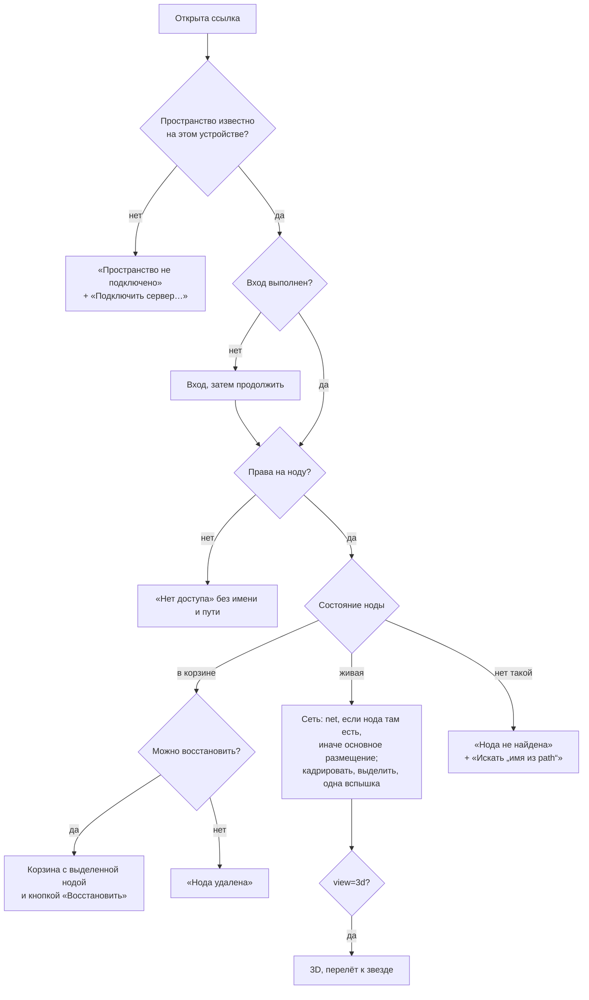
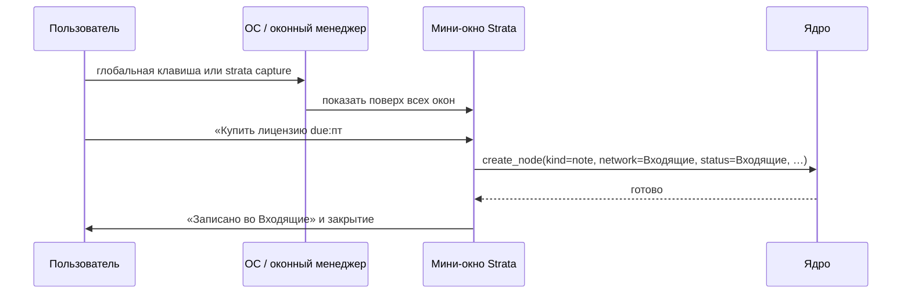

# 09. Поиск и навигация

> Статус: черновик. Как найти ноду и вернуться к ней: движок поиска по именам, Tab-меню, `Ctrl+F`, `Ctrl+O`, палитра команд, синтаксис фильтров, пути и строка пути, глубокие ссылки, история, быстрые метки, избранное, быстрый захват во «Входящие», линзы и вид-линзы.
>
> Опирается на [05-domain-model.md](05-domain-model.md) (ядро) и [глоссарий](glossary.md). Связано: [04-personas-scenarios.md](04-personas-scenarios.md) (S4, S9), [06-canvas-ux.md](06-canvas-ux.md) (Tab-меню, строка пути, клавиши, линзы на холсте), [08-view-3d.md](08-view-3d.md), [10-storage-sync-collab.md](10-storage-sync-collab.md), [11-server-selfhost.md](11-server-selfhost.md), [12-mcp-ai.md](12-mcp-ai.md), [13-interop.md](13-interop.md), [14-nfr.md](14-nfr.md), [16-roadmap.md](16-roadmap.md). Источники фактов: [R1](research/R1-houdini-kinopio-ux.md) (Houdini: Tab-меню, Find, навигация), [R6](research/R6-mcp-ai.md) (общий движок с MCP), [R2](research/R2-obsidian-format.md) (алиасы), [R4](research/R4-app-shell-rendering.md), [R7](research/R7-retro-design-assets.md), [R8](research/R8-competitors.md).
>
> Обозначения: ✅ решено ответами, ☑ решено по делегированию владельца (раунд 2), 💡 предложение, ❓ вопрос (собраны в [17-open-questions.md](17-open-questions.md)).
>
> Платформы (✅ R2, Q-15-1): основные — macOS и Windows, на них владелец принимает каждую веху; Linux собирается в CI и проходит автотесты. Интерфейс — русский и английский с MVP (✅ R2, Q-07-1); правила поиска от языка интерфейса не зависят (§2.8).
>
> Термины этого документа внесены в [глоссарий](glossary.md): **строка пути**, **быстрая метка** (вслед за [06](06-canvas-ux.md)), **палитра команд**, **избранное**, **недавние**, **быстрый захват**, **Входящие** (сеть для быстрого захвата), **выписка имён**; **путь захода** — термин ядра (05 §9.3). Этапы функций — по [16](16-roadmap.md), сводка — §9.

## 1. Принципы

| # | Принцип | Как выполняется |
|---|---|---|
| 1 | ✅ **Поиск в интерфейсе — по именам** (G1: «Ориентир — Houdini: поиск по названиям нод, а не по содержимому») | Tab-меню, `Ctrl+F`, `Ctrl+O` ищут по именам, алиасам и путям. Содержимое нод для поиска не загружается (✅ N1) |
| 2 | ✅ **Поиск по содержимому и смыслу — через AI и MCP** (G1, K1) | `search_content` в MCP: полнотекст tantivy (BM25, русский стеммер) с MVP+ 1.1 вместе с локальным MCP ([16](16-roadmap.md) §5.2), семантика с этапа 2 ([R6](research/R6-mcp-ai.md) §5.5, [12](12-mcp-ai.md)). Полнотекстовый индекс в проекции существует для MCP; панель «Искать в содержимом» в интерфейсе — этап 2 (☑ Q-09-1) |
| 3 | **Быстро и локально** | Список обновляется на каждое нажатие без похода в сеть: движок работает в воркере над выпиской имён (§2.7). Бюджет — §2.6 |
| 4 | **Один движок на всё** | Tab-меню, `Ctrl+O`, `Ctrl+F`, палитра команд, строка пути и MCP `search_nodes` используют одно сопоставление и одну нормализацию ([R6](research/R6-mcp-ai.md) §4.2: `search_nodes` — «тот же движок, что в Tab-меню») |
| 5 | **ID главнее имени** | Имена не уникальны (05 §9.3); путь — подпись, ссылка всегда несёт ID |
| 6 | **Навигация как в Houdini** | ✅ D1: Tab-меню, `Enter`/`I`/`U`, строка пути. История, `` ` ``, быстрые метки — тоже из Houdini ([R1](research/R1-houdini-kinopio-ux.md) §9) |
| 7 | **Из любого места — за три действия** | Критерий [04](04-personas-scenarios.md) S4 |

## 2. Движок поиска по именам

### 2.1. Что ищем

| Источник | Как участвует | Основание |
|---|---|---|
| Имя ноды | Основной текст | 05 §4.1 |
| Алиасы | Альтернативные имена, вес ниже имени. Из импорта Obsidian приходят в свойстве `aliases` | Атрибут `aliases`, 05 §6.1; [R2](research/R2-obsidian-format.md): алиасы — «готовый источник альтернативных имён для нечёткого поиска» |
| Путь | В режиме пути (запрос начинается с `/`, `./`, `../`) — по сегментам | 05 §9.3 |
| Вид, флаги, статус, дедлайн, теги, ответственные | Только фильтры (§3.6), не текст | 05 §6, §7 |
| Призраки `[[X]]` | Отдельный раздел в Tab-меню и `Ctrl+O`: выбор создаёт ноду X | 05 §8.5 |
| Ноды в корзине | Только `Ctrl+O`, отдельный раздел внизу | [04](04-personas-scenarios.md) S4 |
| Стикеры | Не ищутся: это не ноды ([R1](research/R1-houdini-kinopio-ux.md)) | — |
| Команды | Только палитра команд (§3.5) | — |

### 2.2. Нормализация

Одна функция `norm()` для имён, алиасов, запросов и путей:

| Шаг | Правило | Пример |
|---|---|---|
| 1 | Unicode NFC | — |
| 2 | Нижний регистр (полное сворачивание регистра Unicode) | `ДИЗДОК` → `диздок` |
| 3 | `ё` → `е` | «Боёвка» → `боевка` |
| 4 | Диакритика латиницы снимается; `й` не трогаем | `café` → `cafe` |
| 5 | Разделители слов: пробелы, `-_./\|:;,()[]{}«»"'`, граница camelCase, граница букв и цифр | `PointWrangle2` → `point wrangle 2` |
| 6 | Подряд идущие пробелы схлопываются | — |
| 7 | Инициалы — первые буквы слов | «План встреч» → `пв`; «Point Wrangle» → `pw` |

Отображение всегда по исходному имени; нормализованная форма живёт только в индексе.

### 2.3. Сопоставление

💡 Ступени и веса совпадают с [06](06-canvas-ux.md) §5.2 и уточняют их; этот раздел — владелец алгоритма.

| Ступень | Условие | Пример | Вес |
|---|---|---|---|
| Точное имя | `norm(имя) = norm(запрос)` | `диздок` → «Диздок» | 1000 |
| Префикс имени | Имя начинается с запроса | `диз` → «Диздок» | 800 |
| Первые буквы слов | Запрос ≥ 2 символов — префикс строки инициалов | `пв` → «План встреч»; `pw` → «Point Wrangle», как в Tab-меню Houdini ([R1](research/R1-houdini-kinopio-ux.md) §2) | 700 |
| Префиксы слов по порядку | Каждое слово запроса — префикс слова имени, порядок сохранён | `пла вст` → «План встреч»; `wran` → «Point Wrangle» | 600 |
| Слова в любом порядке | То же без порядка | `встреч план` → «План встреч» | 500 |
| Подстрока | Запрос ≥ 3 символов внутри имени | `здок` → «Диздок» | 400 |
| Опечатки | Расстояние Дамерау — Левенштейна (вариант OSA, перестановка соседних) ≤ 1 при длине слова запроса 4–7, ≤ 2 от 8; считается по словам и по префиксам слов | `боевак` → «Боёвка» | 300 − 100 × расстояние |
| Исправление раскладки | Любая ступень по запросу, переведённому в другую раскладку (§2.4) | `,jtdrf` → «Боёвка»; `lbpljr` → «Диздок» | Ступень − 20 |
| Алиас | Любая ступень по алиасу | — | Ступень − 50 |

- Запросы из 1–2 символов: только префикс и инициалы. Подстрока и опечатки на коротком запросе дают шум.
- **Подпоследовательность** («нужные буквы есть, но далеко друг от друга») не используем: именно так Dashbox Houdini в режиме Fuzzy «иногда находит странное» ([R1](research/R1-houdini-kinopio-ux.md) §2).
- Нода получает лучший результат среди имени, алиасов и обоих вариантов раскладки.

### 2.4. Раскладка и транслитерация

- **Раскладка** (💡 MVP). Запрос переводится по физическим клавишам QWERTY ↔ ЙЦУКЕН, включая `[` → `х`, `]` → `ъ`, `;` → `ж`, `'` → `э`, `,` → `б`, `.` → `ю`, `` ` `` → `ё`. Пробуются оба варианта, побеждает лучший; при равенстве — исходный. Пример [G1](02-questions.md): `ghbdtn` → `привет`. Исправление работает в обе стороны при любом языке интерфейса (§2.8). Совпадает ли таблица со стандартными русскими раскладками macOS и Windows в знаках препинания и `ё` — не проверено; это пункт чек-листа вехи 1B на машинах владельца.
- **Транслитерация** (`privet` → «привет», `zadacha` → «Задача»). 💡 Не в MVP: латиница и кириллица часто совпадают в коротких префиксах, это шум. Этап 2 — опция в настройках с одной простой схемой, выключена по умолчанию. ☑ Q-09-3.

### 2.5. Ранжирование

```text
score = max по (имя, алиасы, варианты раскладки) [ступень]
      + недавность    + 150 · 0,5^(дней с последнего открытия / 7)        // 06: +150 с затуханием
      + частота       + min(100, 20 · log2(1 + открытий за 30 дней))
      + близость      + 80, если нода размещена в текущей сети;
                      + 50, если в родительской, дочерней или соседней сети   // 06: +50
      + ключевая      + 40
      + неактивная    − 60 при финальном статусе или флаге «Пауза»
      + длина         − min(30, длина имени − длина запроса)                 // короткое точное выше
порядок при равенстве: имя по алфавиту, затем ID
```

| Сигнал | Где хранится | В MCP `search_nodes` |
|---|---|---|
| Ступень, ключевая, неактивная, длина | Выписка имён | Да |
| Близость | Текущая сеть интерфейса | Близость к `within` ([R6](research/R6-mcp-ai.md) §4.2) |
| Недавность, частота | Локальное состояние устройства (05 §13) | Нет: агенту нужен воспроизводимый порядок |

Ноды с флагом «Скрыть от AI» MCP не возвращает (05 §7); интерфейс показывает их как обычно.

### 2.6. Структуры данных и производительность

💡 **Бюджет:** ≤ 16 мс p95 на одно нажатие при 100 000 нод в воркере — один кадр 60 Hz, ввод не «залипает». Весь цикл до отрисовки списка ≤ 50 мс p95, как в [06](06-canvas-ux.md) §5.2. Итоговые цифры — в [14](14-nfr.md).

**Почему нужен индекс.** Полный перебор 100 000 имён нечётким сравнением на каждое нажатие — порядка 100 мс в JS (оценка: ~1 мкс на строку, не замер). Это в шесть раз больше бюджета, а число нод не ограничено (✅ A4).

```ts
interface NameIndex {
  recNode: Uint32Array;                       // запись (имя или алиас) → номер ноды
  recNorm: string[];                          // нормализованный текст записи
  tokens: string[];                           // уникальные слова, отсортированы
  tokenRecs: Uint32Array[];                   // слово → записи, по убыванию статического ранга
  initials: string[];                         // строки инициалов, отсортированы
  initialsRec: Uint32Array;
  trigrams: Map<string, Uint32Array>;         // триграмма → номера слов
  staticRank: Float32Array;                   // ключевая, неактивная, число нитей
}
```

| Ступень | Как находится | Сложность |
|---|---|---|
| Префикс, точное | Бинарный поиск диапазона в `tokens` | `O(log V + k)` |
| Инициалы | Бинарный поиск в `initials` | `O(log N + k)` |
| Подстрока | Пересечение списков триграмм, начиная с самого редкого, проверка `indexOf` | По длине редкого списка |
| Опечатки | Фильтр по числу общих триграмм: у слова на расстоянии ≤ k общих триграмм не меньше `(|q| + 2) − 3k`; кандидаты проверяются ленточным OSA | Сумма длин списков триграмм запроса, предел 50 000 |
| Ранжирование | Не больше 5 000 кандидатов, частичная сортировка до 50 | `O(c · log 50)` |

- **Ранний выход.** Списки слов отсортированы по статическому рангу, поэтому для 1–2 символов хватает первых 200 кандидатов.
- **Сужение.** Если запрос продолжает предыдущий (дописан символ), фильтруется прошлый набор кандидатов.
- **Оценки** (не замер): поиск 2–5 мс; построение индекса ≤ 300 мс в воркере; память 15–25 МБ. Проверяются бенчем `search-names` (NFR-34) на синтетике W-100k ([14](14-nfr.md) §1.3; vault владельца не нужен — ✅ R2, Q-14-6): в CI и в сборках вех на macOS и Windows владельца.
- **Обновление** по дельтам выписки: вставка или удаление записи — `O(слов · log V)`.
- **Сделано (2026-10-25):** крейт `strata-search` — нормализация, ступени, раскладка, ранжирование и индекс (слова для префиксов, инициалы, триграммы имён для подстрок и слов — для опечаток, кандидаты сужаются по каждому слову запроса, частичная сортировка до `limit`); пример `cargo run --release -p strata-search --example search_speed`. Замер на W-100k в облачном контейнере: построение — 0,44 с нативно и 0,9 с в WASM (V8); запрос в WASM — p95 от 0,5 до 13 мс по ступеням, дольше всех опечатка («мельнциа»); когда рядом шёл прогон e2e — до 22 мс. `Ctrl+F` с маской по всем 100 000 — 78 мс в воркере, по сети холста — единицы мс. Дельт выписки ядро пока не отдаёт ([10](10-storage-sync-collab.md) — лента `seq`): воркер строит индекс заново при каждом обновлении дерева, прежний отвечает до готовности нового. Перемерить на машинах владельца.

### 2.7. Где работает

```text
                    ┌──────────── strata-search (Rust) ────────────┐
                    │ norm · ступени · ранжирование · индекс §2.6   │
                    └───────┬───────────────────────────┬──────────┘
            WASM в воркере UI                     нативно в ядре и на сервере
   (Tab-меню, Ctrl+O, Ctrl+F, палитра)             (MCP search_nodes, разрешение путей)
                ▲                                           ▲
     выписка имён + дельты по seq                  SQLite-проекция (05 §13)
     (Backend: Tauri IPC / WebSocket)
```

- 💡 Один крейт: нативно в ядре (MCP, сервер), в WASM — в воркере интерфейса. Общий набор эталонных тестов гарантирует одинаковую выдачу. Ядро — на Rust (✅ R2, B2: план А), поэтому второй реализации движка на TypeScript нет.
- Сделано (2026-10-25): `crates/strata-search` (без IO; Unicode-нормализация — крейт [`unicode-normalization`](https://crates.io/crates/unicode-normalization), MIT или Apache-2.0; русский и английский текст идут коротким путём без таблиц), обёртка `strata-search-wasm`, пакет `@strata/search` — модуль и воркер с именованными коллекциями: `space` — дерево пространства от ядра, `net` — ноды холста из его графа. Временный движок на TypeScript в `packages/ui` удалён: Tab-меню, `Ctrl+O`, `Ctrl+F`, фильтр «Нод» и поиск звёздной карты спрашивают воркер. Посещения для ранжирования (§2.5) — на устройстве, `localStorage` по пространству: последние 20 открытий за 30 дней.
- **Выписка имён** — компактная копия из проекции, а не из CRDT (05 §13): ID, имя, алиасы, вид, флаги, признак финального статуса, сети размещений (основная первой), признак корзины. Около 60 Б на ноду, 100 000 нод ≈ 6 МБ (оценка). На десктопе приходит из локального ядра через `tauri::ipc::Response` ([R4](research/R4-app-shell-rendering.md) §1.4), в вебе — с сервера. Дальше — дельты по ленте `seq` ([10](10-storage-sync-collab.md)).
- Эту же выписку берёт 3D для подписей ([08](08-view-3d.md) §8.3).

### 2.8. Язык интерфейса

✅ R2 (Q-07-1): интерфейс на русском и английском с MVP. Выдача движка от языка интерфейса не зависит:

| Что | Правило |
|---|---|
| Имена, алиасы, пути | Данные пространства: ищутся как есть, на любом языке; `norm()` одна для всех (§2.2) |
| Исправление раскладки | Всегда в обе стороны QWERTY ↔ ЙЦУКЕН (§2.4) — при любом языке интерфейса и любой активной раскладке |
| Слова синтаксиса | Виды, флаги, значения сроков и приоритетов, `@я` / `@me` принимаются на обоих языках всегда (§3.3, §3.6). Автодополнение предлагает сначала форму языка интерфейса |
| Ключи фильтров | `status:`, `due:`, `in:` и остальные — одни для обоих языков и для MCP `query_nodes` |
| Команды | Название — ключ каталога; палитра ищет по названиям на обоих языках и по алиасам (§3.5) |
| Имена, которые создаёт приложение | «Входящие» (§7) получают имя на языке интерфейса в момент создания; дальше это обычное имя, а сеть находится по ID |
| Эталонные тесты | Набор `search-names` (NFR-34) — на русских и английских именах; прогон при обоих языках интерфейса даёт одну выдачу |

## 3. Точки входа

### 3.1. Сводка

| Вход | Клавиша | Где ищет | Что делает выбор | Этап (💡, итог — [16](16-roadmap.md)) |
|---|---|---|---|---|
| Tab-меню | `Tab`, двойной клик по пустому | Виды, шаблоны, все ноды пространства, призраки сети | Создать или вставить появление | MVP, [06](06-canvas-ux.md) §5 |
| Поиск в сети | `Ctrl+F` | Текущая сеть (переключатель — поддерево) | Подсветить, выделить, перейти по совпадениям | MVP (синтаксис Houdini Find, §3.3); остальные фильтры §3.6 — MVP+ 1.4 |
| Переход к ноде | `Ctrl+O` | Всё пространство | Перейти, открыть, вставить появление | MVP |
| Палитра команд | `Ctrl+P` | Команды | Выполнить | MVP |
| Всё сразу | `Ctrl+Shift+P` (только десктоп, [06](06-canvas-ux.md) §17) | Команды, ноды, настройки, справка | — | Этап 2 |
| Строка пути | Клик, `▾`, ввод пути | Сети по пути | Перейти | MVP |
| Линза | `\`, панель «Линза ▾» | Запрос §3.6 | Подсветить или скрыть | MVP+ 1.4 |

Призраки сети в Tab-меню — сделано (2026-10-25): раздел «Призраки» между шаблонами и «Вставить здесь», справа — имя заметки со ссылкой; выбор создаёт заметку `X` и разрешает призрак (05 §8.5).
| MCP `search_nodes`, `query_nodes` | — | Всё пространство (или `within`) | Ответ агенту | MVP+ 1.1, [12](12-mcp-ai.md) |

### 3.2. Tab-меню

✅ D1. Поведение, разделы и действия (`Enter` — создать, `Alt+Enter` — появление, `Shift+Enter` — поставить вручную) — [06](06-canvas-ux.md) §5. Отсюда — только сопоставление и ранжирование (§2). В 3D — то же меню с целевой сетью в заголовке ([08](08-view-3d.md) §6.4). Фильтры §3.6 в Tab-меню не работают: там действует синтаксис «вид: имя» ([06](06-canvas-ux.md) §5.2).

### 3.3. `Ctrl+F` — поиск в текущей сети

💡 Синтаксис и поведение Find из Houdini ([R1](research/R1-houdini-kinopio-ux.md) §11): голый текст — подстрока имени, есть `*` и `?`, кавычки — точное совпадение, флажок регистра, фильтры `@тип` и `+флаг`/`-флаг`, `Enter` выделяет все совпадения, `Ctrl+G` / `Shift+Ctrl+G` — следующее и предыдущее.

```
┌ НАЙТИ В СЕТИ · /Проекты/Игра ──────────────────────────────────────┐
│ [ анимац* @задача -пауза                 ]  Aa  ⊞ поддерево  3 из 12  ◄ ► │
│ Нечётко: ещё 2 ноды («Анимации удара», «Аниматик»)                  │
└─────────────────────────────────────────────────────────────────────┘
```

| Ввод | Смысл |
|---|---|
| `удар` | Подстрока имени, без учёта регистра и `ё` |
| `анимац*`, `сп?инт` | Маска по всему имени: `*` — любые символы, `?` — один |
| `"Удар"` | Имя целиком |
| `Aa` | Учитывать регистр (`ё` и `е` всё равно равны) |
| `@задача`, `+ключевая`, `-пауза` | Вид, флаг — как в Houdini Find, MVP. Английские формы (`@task`, `+key`, `-pause`) принимаются при любом языке интерфейса (§2.8), словарь — §3.6 |
| `status:open`, `due:<7d` … | Остальные фильтры §3.6 — MVP+ 1.4 |
| `⊞ поддерево` | Искать и во вложенных сетях; совпадения внутри подсвечивают бабл сети, как свёртка |

| Клавиша | Действие |
|---|---|
| Набор | Совпадения подсвечены, как линзой «Подсветить» ([06](06-canvas-ux.md) §15); счётчик «3 из 12» |
| `Enter` | Выделить все совпадения в этой сети и закрыть |
| `Ctrl+G` / `Ctrl+Shift+G`; в поле — `↓` / `↑` | Следующее и предыдущее: камера кадрирует ноду. В вебе `Ctrl+G` перехватывает браузер — перехват не проверен, поэтому стрелки работают всегда |
| `Esc` | Закрыть, вернуть прежнее выделение |
| «Сделать линзой» | Запрос уходит в панель линз (MVP+ 1.4) |

Ноль совпадений — строка «Нечётко: N нод» из движка §2: `Ctrl+F` предсказуем, как в Houdini, но опечатка не оставляет пустой экран. В 3D `Ctrl+F` ищет в скоплении в фокусе и перелетает по совпадениям ([08](08-view-3d.md) §6.1). ☑ Q-09-4.

Сделано на 2D (2026-10-25): строка поиска над холстом шириной 64 ch — поле с синтаксисом выше, переключатели «Aa» и «поддерево» (свои 1-битные значки, [07](07-design-system.md) §6.2), счётчик, ◄ ►; совпадения вложенных сетей подсвечивают бабл сети, в которой лежат; остальные ноды и нити — 25 % ([07](07-design-system.md) §4.5); `↓` / `↑` и `Ctrl+G` / `Ctrl+Shift+G` перелетают к следующему и предыдущему в порядке чтения холста. Пояснение синтаксиса — в подсказке поля. Заголовка с путём нет: путь — в углу холста ([06](06-canvas-ux.md) §10.2), один факт — один раз. Поиск по людям `@аня` — с остальными фильтрами §3.6 (MVP+ 1.4): до тех пор такой терм опускается.

### 3.4. `Ctrl+O` — переход к ноде

💡 Аналог Quick switcher в Obsidian ([R1](research/R1-houdini-kinopio-ux.md), таблица механик). Нечёткий поиск по всему пространству.

```
┌ ПЕРЕЙТИ К НОДЕ ──────────────────────────────────────────────────────┐
│ [ боевка_                                                            ]│
│ ▸ Боёвка              сеть     /Проекты/Игра               +1 путь    │
│   Боёвка: тест-план   заметка  /Проекты/Игра/Боёвка        ⧗ 17 окт   │
│   Реф. боёвки         доска    /Референсы                             │
│ В КОРЗИНЕ                                                             │
│   Боёвка (старая)     заметка  удалена 3 дня назад   [Восстановить]   │
│ Enter — перейти · Shift+Enter — открыть · Alt+Enter — сюда появлением │
└───────────────────────────────────────────────────────────────────────┘
```

| Состояние | Что в списке |
|---|---|
| Пустой запрос | Недавние (10), затем избранное (§6.3, с MVP+ 1.4) |
| Запрос | До 50 результатов: значок вида, имя с подсветкой совпадения, вид, канонический путь, «+N путей» у появлений, срок или статус значками |
| Только фильтры (`@задача due:overdue`, с MVP+ 1.4) | Все совпавшие, сортировка по дедлайну |
| Запрос начинается с `/`, `./`, `../` | Режим пути (§4.4): дополнение по сегментам, `Tab` дописывает сегмент |
| Призраки | Раздел «Неразрешённые ссылки»: выбор создаёт заметку X в сети первого источника (05 §8.5) |
| Корзина | Раздел внизу, не больше 3 строк, кнопка «Восстановить» ([04](04-personas-scenarios.md) S4) |

| Клавиша | Действие |
|---|---|
| `Enter` | Открыть сеть основного размещения, кадрировать и выделить ноду ([06](06-canvas-ux.md) §10.3); в 3D — перелёт ([08](08-view-3d.md) §6.1) |
| `Shift+Enter` | Открыть саму ноду: сеть — нырнуть внутрь, остальное — окно содержимого |
| `Alt+Enter` | Вставить появление в текущую сеть (как `Alt+Enter` в Tab-меню) |
| `Ctrl+Enter` | Во вкладке (вкладки сетей — этап 2, [16](16-roadmap.md) §4.4) |
| `Esc` | Закрыть |

Сделано на 2D (2026-10-25): окно в виде Tab-меню, 52 ch — значок вида, имя, путь сети (корень опущен: его называет вкладка); пустой запрос — посещённые недавно; ноды корзины — разделом «В корзине», выбор возвращает ноду и переходит к ней; `Enter` — сеть ноды, перелёт 450 мс и выделение («Меньше движения» — без перелёта), `Shift+Enter` — внутрь папки или проекта, иначе окно содержимого. Позже: `Alt+Enter` — с появлениями ([05](05-domain-model.md) §5), `Ctrl+Enter` — с вкладками сетей (этап 2), режим пути §4.4 и призраки — в 1C.

### 3.5. Палитра команд

💡 `Ctrl+P` — команды, как в Obsidian; `Ctrl+Shift+P` — «всё сразу», как Dashbox в Houdini ([R1](research/R1-houdini-kinopio-ux.md) §2). Палитра — путь для тех, кто не знает раскладку Houdini ([04](04-personas-scenarios.md) S4, [R8](research/R8-competitors.md): порог входа).

```ts
interface Command {
  id: string;                         // "canvas.layout"
  title: MessageKey;                  // ключ каталога: «Раскладка» / "Layout"
  aliases: string[];                  // ещё слова поиска: ["разложить", "arrange"]
  category: MessageKey;               // «Холст», «Навигация», «3D», «Вид»…
  hotkey?: { desktop?: string; web?: string };
  when(ctx: UiContext): boolean;      // доступна ли сейчас
  run(ctx: UiContext): void;
}
```

- Поиск — тот же движок (§2) по названию на обоих языках каталога и по алиасам: `layout` находит «Раскладку» в русском интерфейсе, `раскладка` — “Layout” в английском. Показывается название на языке интерфейса (✅ R2, Q-07-1: русский и английский с MVP; §2.8).
- Сверху — 5 недавних команд, справа в строке — клавиша для текущего пресета (десктоп или веб).
- Недоступные сейчас команды скрыты; флажок «Показать все» выводит их серыми с причиной.
- Префиксы: `/` — переход по пути (= режим пути `Ctrl+O`), `#` — линза по тегу (MVP+ 1.4), `?` — справка.
- Каждое действие холста и 3D обязано иметь команду: у каждого жеста есть команда ([06](06-canvas-ux.md) §1 п. 6).

### 3.6. Синтаксис фильтров

☑ Q-09-2 (G2): грамматика ниже; `@` сначала ищет вид, иначе человека (классов нет, [ADR-0010](adr/0010-kinds-not-classes.md)). Слова синтаксиса — на русском и английском, ключи — одни для обоих языков (§2.8). Этап — MVP+ 1.4, без скобок ([16](16-roadmap.md) §5.2); в MVP `Ctrl+F` понимает только синтаксис Houdini Find (§3.3). Один синтаксис для `Ctrl+F`, `Ctrl+O`, поля линзы, вид-линз и текстовой формы MCP `query_nodes`. Основа — Houdini Find (`@тип`, `+флаг`, [R1](research/R1-houdini-kinopio-ux.md) §11) и пример из опросника G2: `status:done due:<7d @anton #tag`.

```ebnf
query    = term , { ws , term } ;
term     = [ "-" ] , atom ;                         (* "-" — отрицание *)
atom     = at_f | flag_f | tag_f | field_f | phrase | word ;
at_f     = "@" , ident ;                            (* вид или человек *)
flag_f   = "+" , flagname ;                         (* "-ключевая" — через отрицание *)
tag_f    = "#" , tag , { "/" , tag } ;              (* вложенные теги a/b *)
field_f  = key , ":" , [ cmp ] , value , { "|" , value } ;
cmp      = "<=" | ">=" | "<" | ">" | "=" ;
value    = phrase | range | bare ;
range    = bare , ".." , bare ;
phrase   = '"' , { any - '"' } , '"' ;
word     = bare ;                                   (* текст по имени *)
```

| Элемент | Значения | Пример |
|---|---|---|
| `@…` | Вид, если имя совпало со словарём видов (`папка`, `проект`, `задача`, `заметка`, `доска`, `список`, `ассет` и английские `folder`, `project`, `task`, `note`, `board`, `checklist`, `asset`; прежние `сеть`, `network`, `медиа`, `media` — синонимы папки и ассета); иначе — человек. Словарь — оба языка при любом языке интерфейса (§2.8). `@я`, `@me` — текущий пользователь | `@задача`, `@task`, `@аня` |
| Длинные формы | `kind:`, `who:` — всегда однозначны | `who:задача` (человек с таким именем) |
| `+…`, `-+…` | Флаги: `ключевая`/`key`, `пауза`/`pause`, `шаблон`/`template`, `noai` (одна форма для обоих языков), `замок`/`lock` | `+ключевая -+пауза`, `+key -+pause` |
| `-слово` | Исключить по имени; известное имя флага после `-` трактуется как флаг, для слова — кавычки `-"пауза"` | `-черновик` |
| `#…` | Тег с вложенными | `#арт` находит и `#арт/референсы` |
| `status:` | Имена статусов пространства (нечёткий префикс) — это данные, ищутся на том языке, на котором заведены; `open` / `открытые` — не финальный; `closed` / `закрытые` — финальный | `status:"на проверке"\|готово` |
| `due:`, `start:` | `today`/`сегодня`, `tomorrow`/`завтра`, `week`/`неделя` (до конца недели), `overdue`/`просрочено` (прошёл, статус не финальный), `none`/`нет`, день недели `mon`…`sun` / `пн`…`вс` (ближайший, начиная с сегодня), дата `2026-10-20`, диапазон `2026-10-01..2026-10-31`, относительные `<7d` (с сегодня до +7 дней), `>2w`, `<-3d`; единицы — `d`/`д`, `w`/`н` | `due:<7d`, `due:пт` |
| `prio:` | `низкий`…`срочный` / `low`…`urgent` (05 §6.1) | `prio:>=высокий` |
| `in:` | Путь сети, поиск в поддереве; `in:.` — только текущая сеть | `in:/Проекты/Игра` |
| `is:` | `instance` (появление), `ghost`, `orphan` (без нитей, одно размещение, [R8](research/R8-competitors.md)), `trashed` | `is:orphan` |
| `changed:`, `created:` | Как даты | `changed:<3d` |
| Свои атрибуты | Имя поля из схемы пространства; разбор по типу (05 §6.2) | `оценка:>3` |

- Термы объединяются через «И». «Или» — только внутри значения через `|`; скобки и `OR` между термами — этап 2.
- Ошибки не ломают запрос: неизвестный ключ подчёркивается, рядом подсказка «Может, `status:`?» (нечёткое сопоставление по словарю ключей), терм игнорируется.
- Автодополнение: после `@` — виды, люди; после `status:` — статусы; после `#` — теги; после `in:` — пути.

| Запрос | Смысл |
|---|---|
| `@задача status:open due:<7d` | Открытые задачи со сроком в ближайшие 7 дней |
| `@я due:overdue` | Мои просроченные |
| `#арт @доска -+пауза` | Доски с тегом «арт» и вложенными, не на паузе |
| `+ключевая in:/Проекты/Игра` | Ключевые ноды в поддереве проекта |
| `@задача in:/Проекты/Игра` | Задачи проекта «Игра» на всю глубину; подзадачи задачи — по нитям ([ADR-0010](adr/0010-kinds-not-classes.md), 05 §4.3), в задачу не ныряют |
| `is:orphan` | Сироты — для линзы «Здоровье» ([08](08-view-3d.md) §2.5) |

**AST** — то, во что разбирается строка; его же принимает `filter` в MCP `query_nodes` ([R6](research/R6-mcp-ai.md) §4.2, [12](12-mcp-ai.md)):

```json
{ "and": [
  { "kind": ["task", "project"] },
  { "status": { "open": true } },
  { "due": { "from": "today", "to": "+7d" } },
  { "assignees": { "any": ["@me"] } },
  { "tags": { "any": ["арт"], "nested": true } },
  { "not": { "flags": { "has": ["pause"] } } },
  { "within": "/Проекты/Игра" },
  { "name": { "text": "боевка", "mode": "fuzzy" } }
] }
```

`mode` текста зависит от входа: `fuzzy` в `Ctrl+O` и MCP, `substring`/`glob`/`exact` в `Ctrl+F`. В MCP `@me` — владелец токена.

## 4. Пути

### 4.1. Виды путей

| Вид | Что это | Где виден |
|---|---|---|
| **Канонический** | По основным размещениям (05 §9.3) | Серым под строкой пути, если отличается от пути захода; «Скопировать путь», справка, ответы MCP, `?path=` в ссылке |
| **Путь захода** | Как пользователь пришёл, в том числе через появления. По ссылке без `net` и из поиска совпадает с каноническим; по ссылке с `net` — путь до этой сети по основным размещениям (05 §9.3) | Строка пути, по нему идёт `U` (💡 05 §9.3, [06](06-canvas-ux.md) §10.2, [R1](research/R1-houdini-kinopio-ux.md), [R8](research/R8-competitors.md) рек. 2) |
| **Пути появлений** | Остальные размещения | «Также в: …», панель «Где размещена» ([06](06-canvas-ux.md) §12.2), MCP `get_paths` |

Пути считаются лениво: при вложенных появлениях их число растёт быстро (05 §9.3). 💡 Обход вверх по размещениям с запоминанием, канонический первым, затем по длине и алфавиту; в интерфейсе — первые 20, дальше «ещё N».

### 4.2. Синтаксис пути

```text
путь       = "/" | { "/" , сегмент }+
относит.   = ( "." | ".." ) , { "/" , сегмент }
сегмент    = имя; "/" внутри имени пишется как "\/", "\" — как "\\"
```

- Сравнение сегментов — через `norm()` (§2.2): регистр и `ё` не важны; показывается исходное имя.
- Путь проходит по **любым** размещениям, не только по основным: `/A/B/C` верен, если C размещена в B, а B — в A.

### 4.3. Строка пути

✅ D1: строка пути сверху. Основа — [06](06-canvas-ux.md) §10.2. Уточнения (💡):

| Элемент | Поведение |
|---|---|
| Сегмент | Клик — переход на уровень ([R1](research/R1-houdini-kinopio-ux.md) §9) |
| `▾` после сегмента X | Дочерние сети X, то есть альтернативы следующему сегменту: сначала недавние, затем по алфавиту, ввод фильтрует, до 30 строк с прокруткой. У последнего сегмента — его дочерние сети. Есть ли такой список в Houdini — не проверено ([R1](research/R1-houdini-kinopio-ux.md)) |
| Сегмент-появление | Значок ярлыка, меню «Также в: …» |
| Канонический путь | Серым под путём захода, если они различаются ([06](06-canvas-ux.md) §10.2) |
| Клик по пустой части | Строка становится полем ввода с выделенным каноническим путём; `Enter` — разрешить (§4.4), `Esc` — отмена |
| ПКМ | «Скопировать путь», «Скопировать путь захода», «Скопировать ссылку» (MVP+ 1.4), «Скопировать как [[ссылку]]», «В избранное» (MVP+ 1.4), «Открыть во вкладке» (этап 2) |
| В 3D | Путь скопления в фокусе ([08](08-view-3d.md) §5.1) |

### 4.4. Ввод пути и разрешение

Тот же алгоритм у строки пути, режима пути `Ctrl+O`, палитры (`/`) и MCP (параметр `node` принимает ID или путь, [R6](research/R6-mcp-ai.md) §4.1):

```text
resolve(path, base):                       // base — текущая сеть (путь захода)
  set = path начинается с "/" ? {корень} : {base}
  for seg in segments(path):
    if seg == ".":  continue
    if seg == "..": set = родители set по пути захода, иначе по основному размещению; continue
    next = { n размещена в s ∈ set : norm(n.name) == norm(seg) или seg ∈ norm(n.aliases) }
    if next пусто:
      return НеНайдено(подсказки = нечёткий поиск seg среди детей set)   // §2.3
    set = next
  return set        // 1 — переход; > 1 — выбор (§4.5)
```

### 4.5. Неоднозначные имена

Имена в сети не обязаны быть уникальными; при совпадении приложение предупреждает (05 §9.3).

| Где | Поведение (💡) |
|---|---|
| Создание и переименование | Ненавязчивая подсказка «В этой сети уже есть „Референсы“», без запрета |
| Разрешение пути | Список кандидатов: значок вида, вид, «основное» или «появление», дата создания, сниппет превью, хвост ID |
| MCP | Ошибка со списком кандидатов: «Найдено 3 ноды с именем „Референсы“: …, укажите `id` или путь» ([R6](research/R6-mcp-ai.md) §3) |
| Ссылки | Всегда по ID (§5), неоднозначности нет |

### 4.6. Копирование

| Команда | Где | Что попадает в буфер |
|---|---|---|
| Скопировать путь | ПКМ по строке пути или баблу, палитра | Канонический путь с экранированием: `/Проекты/Игра/Боёвка` ([04](04-personas-scenarios.md) S9) |
| Скопировать путь захода | ПКМ по строке пути, если путь захода не совпадает с каноническим | Путь захода |
| Скопировать ссылку | `⧉` в строке пути, ПКМ, палитра; MVP+ 1.4 ([16](16-roadmap.md) §5.2) | Ссылка §5.1; вместе с `text/plain` — `text/html` вида `<a href="…">Имя</a>` |
| Скопировать как [[ссылку]] | ПКМ, палитра | `[[Имя]]` — вставка в заметку создаёт нить (✅ C8). Разрешение неоднозначных `[[Имя]]` — [13](13-interop.md), [ADR-0007](adr/0007-text-editor.md) |

Отдельных клавиш у команд копирования нет: в браузерах заняты `Ctrl+L`, `Ctrl+Shift+C` и соседние сочетания. 💡 Вставка ссылки на ноду этого же пространства в заметку превращается в `[[Имя]]` ([04](04-personas-scenarios.md) S9).

## 5. Глубокие ссылки

### 5.1. Форматы

Основа — 05 §9.4; необязательные параметры — 💡. Этапы — по [16](16-roadmap.md): `strata://` и «Скопировать ссылку» — MVP+ 1.4, `https://` — этап 3; ID стабильны с MVP, поэтому поздние ссылки не ломаются.

| Пространство | Формат |
|---|---|
| Локальное (десктоп) | `strata://<workspace-id>/n/<node-id>?path=/Проекты/Игра/Задача` |
| Серверное | `https://<сервер>/w/<workspace-id>/n/<node-id>` |
| Виджет доски (не нода) | `strata://<workspace-id>/widget/<board-id>/<widget-id>` — только такие ссылки пропускает `validateEmbeddable` ([ADR-0006](adr/0006-board-engine.md)) |

`<workspace-id>`, `<node-id>` и прочие ID в ссылках — одна текстовая форма: 26 символов Crockford base32 (05 §4.1). На входе обработчик принимает и UUID с дефисами, но копирует всегда base32. Человекочитаемый слаг пространства — 💡 позже, как перенаправление на ID.

| Параметр | Значение | Зачем |
|---|---|---|
| `path` | Канонический путь-подпись, только в `strata://` | Человек видит, куда ведёт ссылка. При открытии игнорируется |
| `net` | ID сети-размещения | Открыть ноду в конкретном появлении, а не в основном. Путь захода — путь до этой сети по основным размещениям (05 §9.3) |
| `view` | `3d` | Открыть на звёздной карте с перелётом к звезде |

### 5.2. Разрешение ссылки



Вспышка — одна, при reduced motion — статичная рамка на 2 с ([R7](research/R7-retro-design-assets.md) §7).

### 5.3. Ссылка после изменений

| Что случилось | Что видит открывший (💡) |
|---|---|
| Переименована | Открывается по ID; строка пути показывает новое имя ([04](04-personas-scenarios.md) S9) |
| Перенесена | Открывается в новом основном размещении |
| Сеть из `net` больше не содержит ноду | Основное размещение и тост «Нода больше не в /…» |
| В корзине | Корзина или «Нода удалена» по правам (05 §9.4) |
| Удалена из корзины навсегда | «Нода не найдена»; для `strata://` — кнопка поиска по имени из `path` |
| Нет прав на пространство или поддерево | «Нет доступа». Сервер не раскрывает имя и путь ([11](11-server-selfhost.md)) |
| Локальное пространство опубликовано на сервер | ID пространства и нод сохраняются ([04](04-personas-scenarios.md) S9), десктоп помнит соответствие «ID пространства → сервер», старые `strata://` работают ([10](10-storage-sync-collab.md), [11](11-server-selfhost.md)) |
| Флаг «Скрыть от AI» | Не влияет: флаг ограничивает MCP и AI |

`path` в `strata://` раскрывает имена сетей тому, кто видит ссылку. 💡 Настройка «Копировать ссылки без пути».

### 5.4. Где открывается

| Где | Как (💡) |
|---|---|
| Десктоп, `strata://` | Обработчик протокола регистрируется при установке. Механизм оболочки (deep link в Tauri: `Info.plist` в macOS, реестр в Windows, `x-scheme-handler` в Linux) и передача ссылки уже запущенному экземпляру — не проверены. Спайк оболочки (спайк 1, [16](16-roadmap.md) §3.2; [15](15-architecture.md)) проверяет их на macOS и Windows владельца, Linux — только в CI |
| Веб, `https://` | Маршрут SPA `/w/<ws>/n/<id>`; переход через History API, кнопки браузера ведут по той же истории (§6.1) |
| `https://` на машине с десктопом | Страница веб-клиента предлагает «Открыть в приложении» → `strata://<ws>/n/<id>` ([04](04-personas-scenarios.md) S9) |
| Веб, `strata://` | Браузер приложение не откроет, поэтому для серверных пространств копируется `https://` (☑ Q-09-5) |
| Внутри приложения | Клик по ссылке в заметке или справке — переход без перезагрузки |

### 5.5. Публичные ссылки только для чтения

☑ Q-09-6 (G3, пункт «в»): этап 4, после прав и аудита безопасности сервера команды ([16](16-roadmap.md) §8.2, ☑ Q-16-10; [11](11-server-selfhost.md)): `https://<сервер>/p/<токен>` — поддерево только для чтения, срок жизни, отзыв, без MCP и без раскрытия путей выше корня поддерева.

## 6. История, быстрые метки, избранное, недавние

☑ Q-09-8 (G4: назад и вперёд, хлебные крошки, мини-карта, закладки): состав ниже; закладки G4 здесь — избранное (§6.3). Этапы — по [16](16-roadmap.md): история, быстрые метки, недавние — MVP; избранное — MVP+ 1.4. Клавиши — [06](06-canvas-ux.md) §10.3, здесь — модель.

### 6.1. История

```ts
interface NavEntry {
  mode: "2d" | "3d";
  networkId: NodeId | null;     // текущая сеть; в 3D — скопление в фокусе
  arrivalPath: NodeId[];        // путь захода: ID сетей от корня; размещение = {сеть}/{нода}, своего ID нет (05 §5)
  camera2d?: { x: number; y: number; zoom: number };
  camera3d?: { pos: [number, number, number]; quat: [number, number, number, number] };
  selection?: NodeId[];         // не больше 50
  at: number;
}
```

| Создаёт запись | Не создаёт |
|---|---|
| Нырок, `U`, клик по строке пути, `Ctrl+O`, открытие ссылки, «Перейти» в панелях, переключение 2D↔3D, `Enter`/`I`/`U` и перелёт по `Ctrl+O` в 3D | Панорама, зум, `H`/`G`, выделение, открытие окна содержимого поверх холста |

- `Alt+←` / `Alt+→` — назад и вперёд; глубина 100 на вкладку; последние 20 записей переживают перезапуск (локальное состояние, 05 §13).
- Сделано (2026-10-25, `packages/ui/src/workspace/nav.ts`): запись оставляет шаг, который куда-то ведёт, — нырок, `U`, путь, `Ctrl+O`, «Ноды», ссылки панели, 2D ↔ 3D, `Enter`, клик по звезде, `I`, `U` и перелёт в 3D; хранится место, откуда ушли. Шаг, который никуда не увёл, второй записи не даёт; перелёт в той же сети — даёт. Выделение — до 50 нод. История и метки — в `localStorage` по пространству. 3D-запись хранит скопление в фокусе, а не камеру.
- `` ` `` — переключение между текущим и предыдущим видом, в том числе между сетями и между 2D и 3D ([R1](research/R1-houdini-kinopio-ux.md) §9).
- Веб: каждая запись — `pushState` с URL `/w/<ws>/n/<сеть>[?view=3d]`, поэтому кнопки браузера и `Alt+←/→` ведут по одной истории ([06](06-canvas-ux.md) §17.1).

### 6.2. Быстрые метки

Как quickmarks Houdini ([R1](research/R1-houdini-kinopio-ux.md) §9): 5 слотов на пространство на устройстве, не синхронизируются. Сделано (2026-10-25): клавиши и слоты — [06](06-canvas-ux.md) §10.3. Метка = `NavEntry` без выделения, поэтому хранит и 3D-камеру. Поставить — `Ctrl+1…5` (десктоп) или удержание `1…5` дольше 600 мс; перейти — `1…5`; слоты ★1–★5 в строке пути ([06](06-canvas-ux.md) §10.3). Этап — MVP ([16](16-roadmap.md) §4.4): метка — это `NavEntry`, новых данных нет.

### 6.3. Избранное

💡 Список нод (не видов), порядок ручной. Этап — MVP+ 1.4 ([16](16-roadmap.md) §5.2).

| Что | Как |
|---|---|
| Добавить, убрать | ПКМ по баблу или строке пути → «В избранное»; палитра; `★` в строке `Ctrl+O` |
| Где видно | Пустой `Ctrl+O` после недавних; раздел палитры; меню `▾` у корня строки пути |
| Хранение | Локальное состояние устройства, рядом с недавними (05 §13) |
| Синхронизация между устройствами одного человека | По запросу (☑ Q-09-7): нужен пользовательский документ — в 05 такого нет, понадобится правка модели и ADR |
| Общее «Закреплённое» команды | Настройки пространства (05 §3), этап 3 (☑ Q-09-7) |

### 6.4. Недавние

Последние 50 нод на устройстве (05 §13 прямо называет «недавние ноды» локальным состоянием): сети, в которые входили, открытые ноды, цели `Ctrl+O`, созданные ноды. Питают ранжирование (§2.5), пустой `Ctrl+O` и раздел «Недавние» Tab-меню (последние 8 выборов, [06](06-canvas-ux.md) §5.2). Команда «Очистить недавние».

## 7. Быстрый захват

☑ Q-09-10 (F3): быстрый захват нужен и пишет в сеть «Входящие»; этап 2, десктоп ([16](16-roadmap.md) §6.2). Q-04-7 в [04](04-personas-scenarios.md) снят в его пользу.



| Элемент | Поведение (💡) |
|---|---|
| Вызов | Глобальная клавиша, по умолчанию `Ctrl+Shift+Space` (на macOS — `Cmd+Shift+Space`, по правилу [06](06-canvas-ux.md) §17) с проверкой конфликтов при регистрации. Регистрация глобальных клавиш в Tauri на macOS и Windows — не проверено, проверяется до начала работ над быстрым захватом. На Linux под Wayland приложения могут не получать глобальные клавиши — не проверено, ручной приёмки нет. Запасной путь на любой ОС — команда `strata capture`, которую пользователь вешает на клавишу в настройках системы или конфиге оконного менеджера |
| Окно | Ретро-окно «ВХОДЯЩИЕ» 480×120 по центру активного монитора, поверх всех окон |
| Ввод | Первая строка — имя; `Shift+Enter` — новая строка, текст после первой строки становится телом заметки. Вставка картинки — ассет, вставка URL — ассет-ссылка (05 §4.4). `Tab` — сменить вид: заметка → задача → список → ассет |
| Разметка в строке | Синтаксис §3.6: `#тег`, `due:пт`, `@человек`, `+ключевая` — становятся атрибутами и флагами, из имени удаляются |
| `Enter` | Нода во «Входящих», статус «Входящие» (есть в наборе по умолчанию, 05 §6.1); окно закрывается, тост «Записано во Входящие» |
| `Esc` | Отмена; черновик хранится 10 мин |
| «Входящие» | Обычная сеть в корне, создаётся при первом захвате с именем на языке интерфейса: `/Входящие` или `/Inbox` (§2.8). Дальше это обычное имя: сеть находится по ключу `inboxNetworkId` в настройках пространства (05 §3), поэтому переименование и смена языка её не теряют. Там же целевую сеть можно сменить |
| Позиция в 2D | `autoPlace` ([06](06-canvas-ux.md) §5.4) при первом открытии «Входящих» |
| Набор изменений | Источник `user` (05 §11); один захват — одна отмена |
| Приложение закрыто | `strata capture` подключается к ядру через локальный сокет, как `strata mcp` ([R6](research/R6-mcp-ai.md) §1 рекомендации). Ядро не запущено — запись в очередь `inbox-spool.jsonl` в папке пространства, разбор при следующем запуске |
| Веб | Глобальной клавиши нет; команда палитры «Быстрая запись» и кнопка `+` в статусной строке |
| Агенты | Разбор «Входящих» — промпт MCP `triage_inbox` ([12](12-mcp-ai.md) §4.8, MVP+ 1.1) и сценарий S8 ([R6](research/R6-mcp-ai.md) §4.5, [04](04-personas-scenarios.md)) |

💡 «Входящие» — сеть, а не заметка: каждая запись — своя нода, её можно разложить, связать и перенести. Модель «Входящих» решена в ☑ Q-09-10; Q-04-7 в [04](04-personas-scenarios.md) снят и ссылается сюда.

## 8. Линзы и вид-линзы

### 8.1. Линза

Линза — фильтр и подсветка на холсте и в 3D (глоссарий). Критерии, режимы и интерфейс на холсте — [06](06-canvas-ux.md) §15, в 3D — [08](08-view-3d.md) §6.6. Этап — MVP+ 1.4 ([16](16-roadmap.md) §5.2). Модель:

```ts
interface Lens {
  query: string;                                 // синтаксис §3.6
  mode: "highlight" | "hide" | "mark";           // подсветить / скрыть / отметить
  scope: "network" | "subtree" | "workspace";    // 2D: сеть; 3D: всё пространство
  name?: string;                                 // у сохранённых линз (этап 2)
}
```

| Готовая линза | Запрос |
|---|---|
| Горит | `due:overdue\|today\|<3d status:open -+пауза` (3 дня — порог N из 05 §6.3; нода на паузе выпадает из срочности, [07](07-design-system.md) §4.7 п. 2) |
| Мои | `@я status:open` |
| Открытые | `status:open` |
| Здоровье | `is:orphan\|ghost` — сироты и призраки («или» внутри значения, §3.6; [08](08-view-3d.md) §2.5) |

- Расчёт — по проекции в воркере; результат — битовая маска нод, которую 2D и 3D применяют записью одного буфера альфы ([06](06-canvas-ux.md) §15).
- Состояние линзы — локальное; сохранённые линзы пространства — этап 2, в настройках пространства (05 §3).

### 8.2. Вид-линза «Список» (MVP+ 1.4)

💡 Вид-линза — «альтернативное представление тех же нод» (глоссарий; F1 — ☑ Q-09-9). [R8](research/R8-competitors.md) рек. 5: в MVP — список по запросу, канбан и календарь — этап 2. По [16](16-roadmap.md) §5.2 список приходит в MVP+ 1.4 вместе с DOM-видом для скринридера (один компонент). Список заодно закрывает доступность: холст недоступен скринридеру ([R7](research/R7-retro-design-assets.md) §7, [06](06-canvas-ux.md) §19).

| Свойство | Поведение (💡) |
|---|---|
| Охват | Текущая сеть (по умолчанию), поддерево или всё пространство |
| Запрос | Поле с синтаксисом §3.6; включённая линза переносится в список |
| Колонки | Имя, вид, статус, дедлайн, ответственные, теги, путь; набор настраивается |
| Сортировка и группировка | По любой колонке; группы — по статусу, виду, сети |
| Дубликаты | Нода с несколькими размещениями в охвате — одна строка с «×N» |
| Правка на месте | Статус и дедлайн; каждая правка — набор изменений |
| Клавиши | Как на холсте: `↑` `↓`, `Enter` (нырнуть или открыть), `U`, `R` `Q` `E` `T`, `F2`; `aria-live` объявляет действия ([06](06-canvas-ux.md) §19) |
| Удаление | При охвате «текущая сеть» `Delete` — «Убрать отсюда» (05 §5). При охвате «поддерево» и «всё пространство» строка — нода, а не размещение, поэтому `Delete` недоступна: есть `Shift+Delete` («Удалить везде»: при ≥ 2 размещениях или задетом каскаде — диалог с перечнем путей, иначе тост с отменой, 05 §5, ☑ Q-05-6) и меню строки «Где размещена» ([06](06-canvas-ux.md) §12.2) |
| Переключение | Переключатель «Холст \| Список» в статусной строке и команда палитры |

### 8.3. Канбан и календарь (этап 2)

| Вид | Как устроен (💡) |
|---|---|
| Канбан | Колонки — статусы пространства по порядку, «Отменено» свёрнута. Карточка: значок, имя, дедлайн, ответственные. Перетаскивание между колонками меняет статус. Порядок внутри колонки — по дедлайну и приоритету: ручной порядок потребовал бы новых данных в модели, поэтому его нет (☑ Q-09-9). Дорожки по ответственным — этап 3 |
| Календарь | Месяц и неделя; нода с дедлайном — точка, со `start` и дедлайном — полоса. Перетаскивание меняет даты. Просрочка — красным и значком «!» (цвет не единственный канал, [R7](research/R7-retro-design-assets.md) §7). Повторяющиеся — когда появится `recurrence` (05 §6.1) |
| Таймлайн, Гант | Не планируется: не-цель v1 (03) |

### 8.4. Сохранённые представления

Сохранить вид-линзу как ноду — это вид **Запрос** `query`, который 05 §4.2 откладывает на «позже». 💡 До этого вид-линзы — состояние интерфейса на устройстве; сохранённые представления — этап 3, вместе с видом `query`.

## 9. Состав по этапам

| Этап | Что (💡, итог — [16](16-roadmap.md)) |
|---|---|
| **MVP** | Движок §2 (нормализация, ступени, раскладка, ранжирование; один крейт с будущим MCP); слова синтаксиса и команды — на русском и английском (§2.8); Tab-меню; `Ctrl+F` с синтаксисом Houdini Find (§3.3); `Ctrl+O`; `Ctrl+P`; строка пути (путь захода) с `▾` и вводом пути; «Скопировать путь», «Скопировать путь захода», `[[ссылки]]`; история, `` ` ``; быстрые метки ([16](16-roadmap.md) §4.4); недавние |
| **MVP+ 1.1** | MCP `search_nodes`, `query_nodes`, `search_content` (полнотекст tantivy) вместе с локальным MCP ([16](16-roadmap.md) §5.2) |
| **MVP+ 1.4** | Синтаксис фильтров §3.6 без скобок; линзы «Горит», «Мои», «Открытые», «Здоровье» и `\`; вид-линза «Список»; `strata://` и «Скопировать ссылку»; избранное на устройстве ([16](16-roadmap.md) §5.2) |
| **Этап 2** | `Ctrl+Shift+P`; транслитерация (опция); `OR` и скобки; быстрый захват (десктоп); сохранённые линзы; канбан и календарь; вкладки сетей; панель «Искать в содержимом» (☑ Q-09-1) ([16](16-roadmap.md) §6.2) |
| **Этап 3** | `https://`-ссылки и «Открыть в приложении»; общее «Закреплённое»; сохранённые представления (вид `query`); дорожки канбана по ответственным ([16](16-roadmap.md) §7.2). Синхронизация избранного — по запросу (☑ Q-09-7) |
| **Этап 4** | Публичные ссылки только для чтения ([16](16-roadmap.md) §8.2, ☑ Q-09-6, ☑ Q-16-10) |

## Открытые вопросы

Все вопросы раунда 2 решены 2026-10-19 (✅ R2 — ответ владельца, ☑ R2 — решение по делегированию). Новые вопросы добавляются сюда.

- **Q-09-1.** ☑ R2: в MVP панели нет; на этапе 2 — панель «Искать в содержимом» поверх `search_content`, отдельно от `Ctrl+O`, чтобы поиск по именам оставался мгновенным (§1, §9). (Нужен ли в интерфейсе поиск по содержимому или смыслу, Q-R6-7?)
- **Q-09-2.** ☑ R2: синтаксис §3.6 принят; `@` сначала ищет вид, иначе человека (классов нет с [ADR-0010](adr/0010-kinds-not-classes.md)); однозначные длинные формы `kind:`, `who:`; слова синтаксиса — на русском и английском, ключи — одни для обоих языков (§2.8). (Подходит ли синтаксис фильтров и как быть с `@`, G2?)
- **Q-09-3.** ☑ R2: исправление раскладки — MVP; транслитерация — опция этапа 2, выключена по умолчанию (§2.4). (Нужна ли транслитерация в дополнение к исправлению раскладки?)
- **Q-09-4.** ☑ R2: строго, как Find в Houdini, с подсказкой «Нечётко: N нод» при пустом результате (§3.3). (`Ctrl+F` ищет строго или нечётко?)
- **Q-09-5.** ☑ R2: в серверном пространстве — `https://`; `strata://` — только для локальных пространств (§5.4). (Что копирует «Скопировать ссылку» в серверном пространстве?)
- **Q-09-6.** ☑ R2: кликабельный и копируемый путь — MVP; ссылки по ID переживают переименование и перенос: `strata://` — MVP+ 1.4, `https://` — этап 3; публичные ссылки только для чтения — этап 4, после прав сервера (§5, ☑ Q-16-10). (Какой шаринг нужен, G3?)
- **Q-09-7.** ☑ R2: MVP+ 1.4 — избранное на устройстве; этап 3 — общее «Закреплённое» в настройках пространства; синхронизация личного избранного — по запросу, через новый пользовательский документ с правкой 05 (§6.3). (Синхронизировать ли избранное и нужно ли общее «Закреплённое»?)
- **Q-09-8.** ☑ R2: история, `` ` ``, строка пути, недавние, быстрые метки и мини-карта — MVP; избранное — MVP+ 1.4; вкладки — этап 2 (§6, ☑ Q-16-1). (Что из навигации нужно, G4?)
- **Q-09-9.** ☑ R2: список — MVP+ 1.4; канбан и календарь — этап 2, порядок в колонке — по дедлайну и приоритету, без ручного; таймлайн не планируем (§8). (Какие вид-линзы и когда, F1?)
- **Q-09-10.** ☑ R2: сеть «Входящие» в корне, каждая запись — нода; клавиша `Ctrl+Shift+Space` (на macOS — `Cmd+Shift+Space`) с проверкой конфликтов; `strata capture` — запасной путь на любой ОС, в том числе на Linux под Wayland (§7). (Куда пишет быстрый захват и какая клавиша по умолчанию, F3?)
