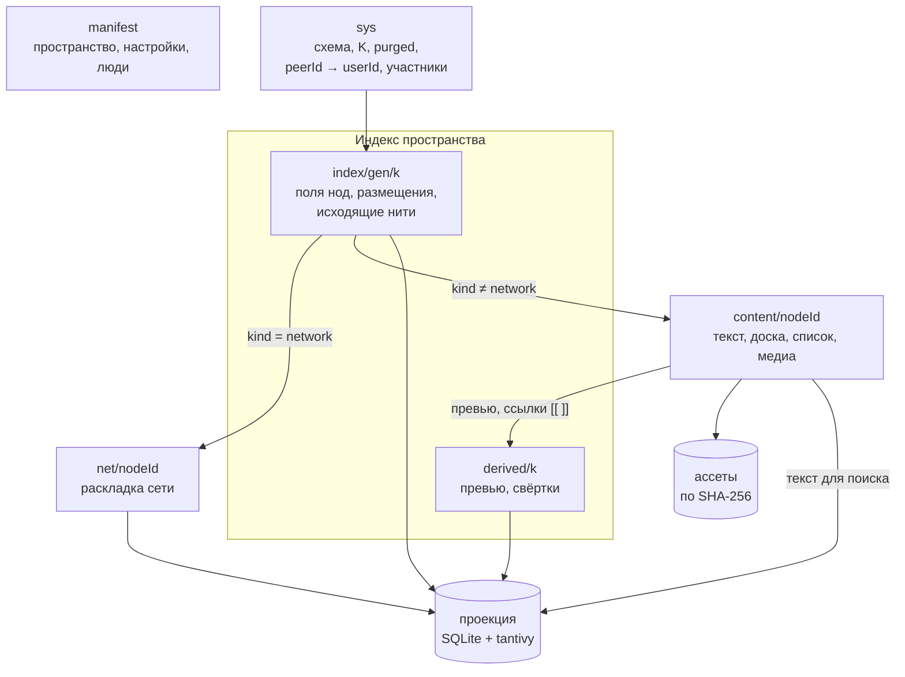
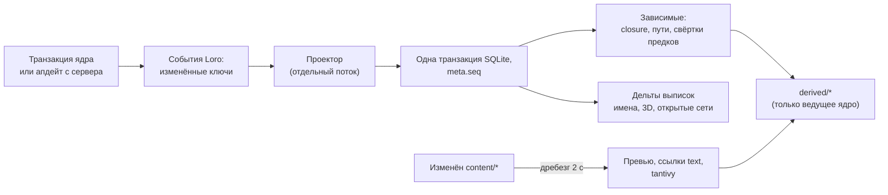
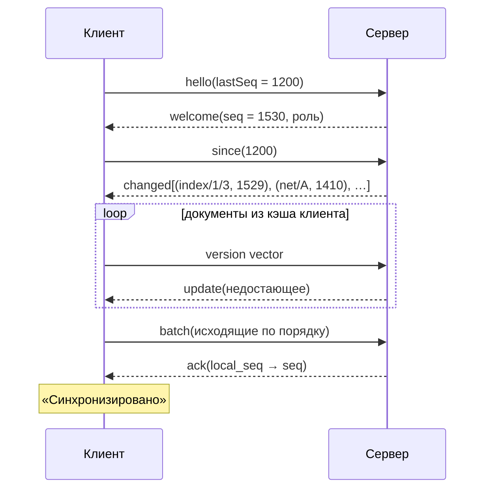
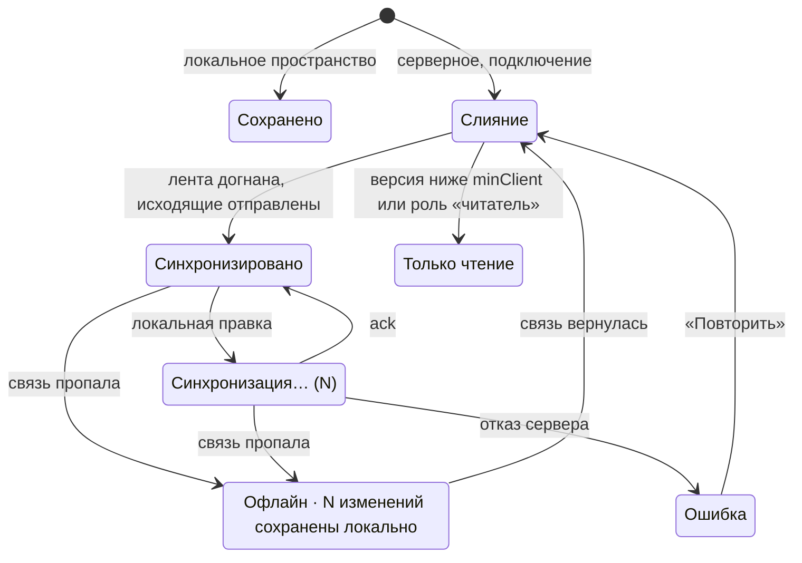

# 10. Хранение, синхронизация, совместная работа

> Статус: черновик. Как данные Strata лежат на диске и на сервере, как расходятся по устройствам и людям, как устроены отмена, история, корзина и ассеты. Решение о движке — [ADR-0003](adr/0003-sync-engine.md), сервер — [11](11-server-selfhost.md).
>
> Опирается на [05](05-domain-model.md) (ядро) и [глоссарий](glossary.md). Связано: [04](04-personas-scenarios.md) (S1, S7), [06](06-canvas-ux.md) (§1.2, §2.1, §16), [08](08-view-3d.md) (§3.5, §8.3), [09](09-search-navigation.md) (§2.7, §5), [12](12-mcp-ai.md), [13](13-interop.md), [14](14-nfr.md), [15](15-architecture.md), [16](16-roadmap.md). Источники фактов: [R3](research/R3-crdt-sync.md) (главный), [R2](research/R2-obsidian-format.md), [R4](research/R4-app-shell-rendering.md), [R5](research/R5-board-engine.md), [R6](research/R6-mcp-ai.md), [R7](research/R7-retro-design-assets.md), [R8](research/R8-competitors.md).
>
> Обозначения: ✅ решено ответами, ☑ решено по делегированию владельца (раунд 2), 💡 предложение (с 2026-10-19 считается принятым, [README](README.md)), ❓ вопрос (собраны в [17-open-questions.md](17-open-questions.md)). Числа и пороги без ✅ проверяются спайком (§15) или NFR [14](14-nfr.md). Ссылка «R3 §4» ведёт в раздел «Находки» исследования, «R3 рек. §4» — в раздел «Рекомендация».
>
> Термины документа уже в глоссарии: **манифест** (со служебной частью `sys`), **документ производных**, **ведущее ядро**, **реплика**, **комната**, **лента изменений**, **выписка**, **исходящие**, **окончательное удаление**, **спасённые правки**. Ещё предлагаются в глоссарий: **присутствие**, **перешардирование**.

## Кратко

- ✅ Совместная работа в реальном времени обязательна (J2). ✅ Одновременная работа с Obsidian желательна, но не обязательна (J1). ✅ Грузим только содержимое открытой ноды (N1). ✅ Число нод не ограничено (A4).
- 💡 Источник правды — собственное CRDT-хранилище Strata на Loro 1.16.x. Obsidian — проекция ([13](13-interop.md)).
- 💡 Данные разбиты на документы: манифест, K шардов индекса по хешу ID ноды, производные, `net/*`, `content/*`, ассеты по SHA-256. Индекс весит 0,65–0,68 КБ на ноду с историей и 0,43–0,46 КБ в shallow-снапшоте ([спайк 4](spikes/S4-loro.md); оценка [R3](research/R3-crdt-sync.md) §12.3 — 0,22–0,33 КБ — занижена).
- 💡 Формат CRDT-данных и проекции один для локального пространства и для сервера: `store.sqlite`, `projection.sqlite`, `search/`. Локальная папка держит рядом `assets/` и `cache/`; на сервере ассеты общие для всех пространств (§11.4).
- 💡 Граф меняется только доменными операциями `strata-core`: на десктопе — в процессе Tauri (ядро на Rust, план А — ✅ R2: B2), в вебе — на сервере. Редакторы содержимого синхронизируются как CRDT-комнаты.
- 💡 Один WebSocket, комнаты — документы, лента изменений `seq`, эфемерный канал не чаще 30 Гц.
- 💡 Полная история — на сервере, на клиентах — shallow-снапшоты. Окно офлайна равно глубине серверной истории.
- 💡 Отмена: свой стек граф-команд поверх наборов изменений; в редакторах — UndoManager Loro и undo Excalidraw.
- 💡 План Б — Yjs v14 + Hocuspocus. До фиксации — спайк 4 этапа 0 (§15); календарных сроков нет, прогресс — по вехам (✅ R2: B3).
- Этапы (☑ Q-04-4): MVP — локальное пространство, но с CRDT внутри, чтобы не мигрировать; сервер для своих устройств — этап 2; команда — этап 3 ([16](16-roadmap.md) §4.6).

## 1. Источник правды

### 1.1. Решение

| Слой | Роль | Почему |
|---|---|---|
| CRDT-документы Loro в хранилище Strata | Источник правды локально и на сервере | Офлайн-правки сливаются без диалогов «чья версия» (✅ J2). История, `checkout`, `revertTo`, shallow-снапшоты встроены ([R3](research/R3-crdt-sync.md) §4) |
| Проекция: SQLite + tantivy | Производные данные для чтения: имена, пути, свёртки, 3D, MCP | CRDT медленно отдаёт «всё сразу»: 0,94 с на чтение всех имён и нитей 100 тыс. нод даже при лучшей раскладке ([R3](research/R3-crdt-sync.md) §12.3) |
| Папка Obsidian | Проекция: разовый импорт (MVP) → экспорт и повторный импорт (MVP+ 1.2) → одностороннее зеркало с приёмом правок текста и свойств заметок (этап 2) ([16](16-roadmap.md) §5.2, ☑ Q-13-1) | [13](13-interop.md), [R2](research/R2-obsidian-format.md) |
| Локальное состояние устройства | Камеры, окна, недавние, кэш 3D | Не синхронизируется (05 §13) |

### 1.2. Почему не `.md`-файлы

✅ J1 оставляет выбор за нами. Против файлов как источника правды ([R2](research/R2-obsidian-format.md)):
- Obsidian переписывает весь frontmatter при правке любого свойства — «пинг-понг» при живом зеркале;
- внешние переименования Obsidian не распознаёт и ссылки не чинит; открытый в редакторе файл может затереть внешнюю правку (баг-репорт на 1.13.1);
- в файлах нет места раскладке сетей, появлениям (05 §5), посимвольному слиянию и истории;
- совместная работа поверх файлов — это синхронизация в духе Dropbox, а нужна реальная (✅ J2).

Альтернативы движков — [ADR-0003](adr/0003-sync-engine.md).

### 1.3. Ведущее ядро

💡 У каждого пространства есть **ведущее ядро** — экземпляр `strata-core`, который хранит полную историю и единолично пишет служебные данные.

| Режим | Ведущее ядро | Реплики |
|---|---|---|
| Локальное пространство | Ядро десктопа (MCP идёт через него же, [R6](research/R6-mcp-ai.md) §2.5) | Нет |
| Серверное пространство | `strata-server` ([11](11-server-selfhost.md)) | Десктопы — полная реплика (§3.7); веб — тонкий клиент (§5) |

Что делает только ведущее ядро:
- пишет документы производных и служебную часть манифеста (§2.2);
- сверяет инварианты после слияния (§8.5);
- перешардирует (§2.7), удаляет навсегда (§10.4), мигрирует (§13);
- после переименования ноды переписывает `[[ссылки]]` в текстах фоном ([R3](research/R3-crdt-sync.md) рек. §9, 05 §11); ☑ Q-10-9: включено по умолчанию, выключается настройкой пространства.

Реплики считают превью и свёртки сами для мгновенного отклика: результат лежит в их проекции поверх общих данных, а в общие документы не пишется.

## 2. Документы

### 2.1. Схема



### 2.2. Что где лежит

| Документ | Комната | Сущности 05 | Пишет | Грузится | Размер (оценка) |
|---|---|---|---|---|---|
| Манифест | `ws/{ws}/manifest` | Пространство (05 §3): имя, `rootNetworkId`, `settings` (статусы, схемы атрибутов, тема, фон, срок корзины); локальные люди (05 §10) | Все с правом записи | Всегда | Единицы КБ |
| Служебная часть манифеста | `ws/{ws}/sys` | Версия схемы, `K`, поколение шардов `gen`, состояние миграции, `purged`, `peerId → userId`, участники сервера (люди серверного пространства, 05 §10) | Только ведущее ядро | Всегда | КБ — сотни КБ |
| Шард индекса | `ws/{ws}/index/{gen}/{k}` | Поля ноды (05 §4.1) кроме `preview`, атрибуты (05 §6), флаги (05 §7), размещения ноды (05 §5), **исходящие** нити (05 §8) | Ведущее ядро и десктопы-реплики | Десктоп и сервер — все шарды; веб — нет (§5) | 0,65–0,68 КБ на ноду с историей, 0,43–0,46 КБ shallow; при K = 16 и 100 тыс. нод — около 4,2 МБ на шард ([спайк 4](spikes/S4-loro.md)) |
| Документ производных | `ws/{ws}/derived/{k}` | `preview` (05 §4.1), свёртки (05 §6.4), ID миниатюр, версия содержимого, по которой посчитано | Только ведущее ядро, регулярно компактируется в shallow | Вместе с индексом | ≈ 0,1 КБ на ноду (оценка) |
| Документ сети | `ws/{ws}/net/{nodeId}` | 05 §9.2: раскладка, точки, маршруты нитей, рамки, стикеры, настройки сети | Все с правом записи | При входе в сеть и упреждающе (§6) | 10–100 КБ ([R3](research/R3-crdt-sync.md) рек. §5) |
| Документ содержимого | `ws/{ws}/content/{nodeId}` | Тело ноды по виду (05 §4.2) | Все с правом записи | При открытии ноды | Сотни байт — мегабайты |
| Ассет | `sha256` | 05 §12 | Все с правом записи, через ведущее ядро | При показе, сначала миниатюры | — |

💡 В отличие от [R3](research/R3-crdt-sync.md) рек. §2, служебные поля манифеста вынесены в отдельную комнату `sys`: права проверяются на уровне комнаты (§12), поэтому «служебные поля пишет только сервер» внутри общей комнаты не обеспечить. По той же причине `derived/*` для клиентов — только чтение.

💡 Ручная справка `summary` (05 §4.1) остаётся в шарде индекса: её пишут люди, а у документа производных один писатель. В `derived` уходит только автоматическое `preview`. `updatedAt` и `updatedBy` в CRDT не храним — проекция берёт их из журнала наборов изменений (§9), иначе каждая правка дублировала бы запись в историю.

### 2.3. Шард индекса

💡 Раскладка «карта на поле»: самая быстрая при чтении для поиска и 3D (0,94 с против 6 с у «контейнера на ноду» на 100 тыс. нод) и вдвое экономнее по памяти ([R3](research/R3-crdt-sync.md) §12.3). Слияние идёт на уровне поля: переименование не затирает одновременную смену статуса. Создание ноды — один коммит в нескольких картах одного шарда.

```ts
// index/{gen}/{k} — LoroDoc. Ключ NodeId — UUIDv7 в текстовой форме: 26 символов Crockford base32 (05 §4.1, §2.5)
kind:       LoroMap<NodeId, NodeKind>         // пишется при создании; меняется только в парах задача ↔ проект, папка ↔ проект (05 §4.2)
                                              // карты class нет: классов нет (ADR-0010); class и media старых пространств читаются как без класса и asset
name:       LoroMap<NodeId, string>
icon:       LoroMap<NodeId, IconRef>          // 07 §6.6
color:      LoroMap<NodeId, Color>
shape:      LoroMap<NodeId, Shape>
summary:    LoroMap<NodeId, string>           // ручная справка ≤ 280 символов
status:     LoroMap<NodeId, StatusId>         // и так же deadline, start, priority, recurrence, remindAt (05 §6.1); только у задачи и проекта (ADR-0010)
attr:       LoroMap<`${NodeId}|${Key}`, Value>          // одиночные пользовательские атрибуты (05 §6.2) и поля ассета asset, mime, url, icon (05 §4.4)
set:        LoroMap<`${NodeId}|${Key}|${Value}`, 1>     // теги, ответственные, алиасы (aliases, 05 §6.1), множественный выбор
flag:       LoroMap<`${NodeId}|${Flag}`, 1>             // key | pause | template | hideAi | lock (05 §7)
primaryNet: LoroMap<NodeId, NodeId>           // сеть основного размещения — поле primaryNetworkId (05 §4.1, §5)
createdAt:  LoroMap<NodeId, Ts>               // и createdBy
trashedAt:  LoroMap<NodeId, Ts>               // и trashedBy, trashBatch (ID набора изменений, §10.3)
placement:  LoroMap<`${NetId}/${NodeId}`, { at: Ts; by: PersonId }>   // в шарде ноды
edge:       LoroMap<EdgeId, { from: NodeId; to: NodeId | null; ghost?: string; at: Ts; by: PersonId }>  // в шарде from; ghost — имя X призрака (05 §8.5)
edgeLabel:  LoroMap<EdgeId, string>
edgeOrigin: LoroMap<`${EdgeId}|${'manual' | 'text' | 'import'}`, { at: Ts }>
// нить жива, пока есть хотя бы один ключ edgeOrigin (05 §8.1 origins)
```

Почему составные ключи. Список целиком (`tags: string[]`) сливался бы по правилу «последний победил»: двое добавили по тегу — один тег пропал. Ключ на элемент множества даёт независимые добавления и удаления. По той же причине `origins` нити — набор ключей: ручная нить и ссылка `[[…]]` на ту же пару живут независимо (05 §8.2, правило 5).

Почему `primaryNet`, а не `isPrimary` на размещении. Два клиента параллельно «убирают отсюда» основное размещение в разных сетях — с булевым полем получилось бы ноль или два основных. Одно значение на ноду всегда даёт ровно одно; если оно указывает на убранное размещение, срабатывает правило §8.5. Так и записано в ядре: `primaryNetworkId` — поле ноды, а не размещения (05 §4.1, §5). Проекция отдаёт признак основного размещения столбцом `placements.is_primary` (§7.1).

### 2.4. Документы сети и содержимого

```ts
// net/{nodeId} — LoroDoc (05 §9.2). Ключ NodeId равнозначен размещению `${netId}/${nodeId}`
pos:       LoroMap<NodeId, [x: number, y: number]>   // LWW на пару
size:      LoroMap<NodeId, 'S' | 'M' | 'L' | 'XL'>
collapsed: LoroMap<NodeId, boolean>
pinned:    LoroMap<NodeId, boolean>                   // 05 §9.2: позиция закреплена; L, A+drag и раздвигание соседей её не трогают
dot:       LoroMap<DotId, { x: number; y: number; pinned: boolean }>
route:     LoroMap<EdgeId, { dots: DotId[]; style?: EdgeStyle; bend?: number }>   // bend — ручной изгиб нити (05 §9.2)
hidden:    LoroMap<EdgeId, 1>                         // «скрыта здесь» (05 §8.3)
box:       LoroMap<BoxId, { rect: Rect; title: string; color: Color; collapsed: boolean }>
boxMember: LoroMap<`${BoxId}|${NodeId}`, 1>
sticky:    LoroMap<StickyId, { rect: Rect; text: string; color: Color }>
settings:  LoroMap<string, unknown>                   // фон (07 §7), направление раскладки; wireStyle: 'straight' | 'bezier' | 'kinetic' (06 §6.2), нет ключа — Безье
```

| Вид (05 §4.2) | `content/{nodeId}` | Подробности |
|---|---|---|
| Заметка | `text: LoroText` — Markdown-исходник; `meta: { schema }` | [ADR-0007](adr/0007-text-editor.md); CM6 + `loro-codemirror` ([R3](research/R3-crdt-sync.md) §8) |
| Доска | `meta`, `elements: LoroMap<elementId, JSON>`, `files: LoroMap<fileId, {sha256, mime, w, h}>`, `widgets` с `LoroText` и `LoroMovableList` | [ADR-0006](adr/0006-board-engine.md), [R5](research/R5-board-engine.md) |
| Список | `items: LoroTree` пунктов (вложенность, 05 §4.2), узел — `{ text: LoroText, done }`; `text` создаётся как мерджимый контейнер (§2.6) | [R3](research/R3-crdt-sync.md) рек. §9; `packages/checklist` |
| Задача | `text: LoroText` — описание на Markdown, как у заметки | [ADR-0010](adr/0010-kinds-not-classes.md) |
| Папка, проект | `text: LoroText` — описание на Markdown; холст — `net/{nodeId}` | [ADR-0010](adr/0010-kinds-not-classes.md) |
| Ассет | `text: LoroText` — описание на Markdown; файл и ссылка — в индексе: `asset` (SHA-256), `mime`, `url`, `icon` (05 §4.4) | Байты — ассет (§11) |

### 2.5. Идентификаторы и ключи

| Что | ID | Почему |
|---|---|---|
| Нода, пространство, точка, рамка, стикер, набор изменений | UUIDv7 (05 §4.1); в ключах CRDT — текстовая форма, 26 символов Crockford base32 | Генерируется офлайн, сортируется по времени. Компактная форма: ключи на 100 тыс. нод сами по себе занимают мегабайты ([R3](research/R3-crdt-sync.md) рек. §3) |
| Нить | `h(from ‖ to)`; у нити к призраку — `h(from ‖ "?" ‖ linkKey(X))`, `linkKey` — [13](13-interop.md) §3.4 (05 §8.1, §8.5) | Две одинаковые нити, созданные одновременно, сливаются (05 §8.1, [ADR-0001](adr/0001-global-edges.md)) |
| Размещение | Ключ `"{netId}/{nodeId}"` из текстовых форм обоих ID | Инвариант 3 (05 §5) держится и при одновременных «Разместить здесь»: оба клиента пишут один ключ |
| Шард ноды | `u64(sha256(nodeId)[0..8]) mod K`, `u64` читается big-endian (`strata-model::shard_of`) | UUIDv7 начинается со времени: без хеша шарды были бы неровными |

`h` — первые 16 байт SHA-256, в ключе CRDT — те же 26 символов base32. `h` и шард считаются над 16 байтами ID, а не над строкой: `from`, `to`, `nodeId` — по 16 байт, `linkKey(X)` — UTF-8. ID, пришедший как UUID с дефисами (05 §4.1), сначала разбирается в 16 байт; ключ размещения строится из канонической текстовой формы. Так два клиента или повторный импорт получают один ключ для одной связи.

Повтор ключа при повторном создании той же нити или размещения — не переиспользование ID: 05 §14 п. 1 адресует нити и размещения детерминированными ключами от пары ID.

**Разрешение призрака** (05 §8.5) — одна доменная операция и один набор изменений: нить с ключом `h(from ‖ "?" ‖ linkKey(X))` снимается, создаётся нить `from → X` с ключом `h(from ‖ id(X))` и теми же происхождениями, а записи `route` и `hidden` в документах сетей (§2.4) переносятся со старого `EdgeId` на новый.

### 2.6. Мерджимые контейнеры

С Loro 1.13 два пира, одновременно впервые создавшие дочерний контейнер под одним ключом, получают один детерминированный `ContainerID` (`ensureMergeable*`, [R3](research/R3-crdt-sync.md) §4). 💡 Все вложенные контейнеры (текст виджета, пункты списка) создаём только так: две вкладки, одновременно создавшие виджет, не разойдутся.

### 2.7. Шардирование и перешардирование

✅ A4 запрещает искусственный потолок, поэтому индекс делится на шарды (05 §13).

| Нод в пространстве | K | Средний шард (≈ 0,28 КБ на ноду) |
|---|---|---|
| До ≈ 20 тыс. | 1 | ≤ 6 МБ |
| ≈ 20 тыс. → | 16 | ≤ 6 МБ до ≈ 320 тыс. нод |
| ≈ 320 тыс. → | 64 | ≤ 6 МБ до ≈ 1,3 млн нод |

💡 Порог — средний шард больше 6 МБ или больше 20 тыс. нод на шард. Почему по хешу, а не по сетям: при появлениях локальности всё равно нет, а поиску и 3D нужны все шарды; хеш даёт ровные шарды и ограниченную стоимость компактирования — около 0,25 с на шард при K = 16 ([R3](research/R3-crdt-sync.md) рек. §3).

Новое `K' = K · f` (f = 16 для первого раза, 4 для второго). Шард `k` распадается на `k + j·K`, `j = 0…f−1`: `hash mod K'` даёт остаток `k` по модулю `K`, поэтому каждый новый шард берёт ключи ровно из одного старого и копирование идёт параллельно.

Процедура (ведущее ядро, набор изменений с источником `system`, 05 §11):

1. Резервная копия `store.sqlite` (§3.5).
2. В `sys`: `migration = { kind: "reshard", from: {gen, K}, to: {gen+1, K'}, state: "copy" }`.
3. Текущие значения ключей копируются в новые документы `index/{gen+1}/{k'}` без истории. История старых шардов остаётся в архиве, история полей ноды в UI собирается из журнала наборов изменений (§10.1).
4. Один коммит в `sys`: `K = K'`, `gen = gen + 1`, `state = "forward"`.
5. Онлайн-клиенты получают `sys`, отправляют исходящие, выгружают старые шарды и загружают новые.
6. **Переадресация.** Апдейты, пришедшие от офлайн-реплик в старые шарды, ведущее ядро импортирует в архивную копию, выделяет изменённые ключи и записывает их в новые шарды. Автор в журнале — пользователь, приславший апдейт.
7. Через окно переадресации (☑ Q-10-3: 90 дней) старые шарды закрываются: апдейты к ним отвергаются, правки уходят в «спасённые» (§10.4).

В локальном режиме шаги 1–4 и 7 выполняются в одной транзакции. Цель — меньше 10 с на 20 тыс. нод (спайк §15, п. 7).

## 3. Локальное хранение

### 3.1. Папка пространства

```
Игра.strata/                 имя — любое; ID пространства — внутри
├── strata.json              workspaceId, formatVersion, режим (local | replica), адрес сервера
├── store.sqlite             CRDT-документы, журнал апдейтов, наборы изменений, исходящие, реестр импорта
├── store.sqlite-wal
├── assets/ab/cd/<sha256>    оригиналы, неизменяемы
├── projection.sqlite        проекция (§7) — пересобирается
├── search/                  индекс tantivy — пересобирается
├── cache/                   производные ассетов (§11.2) — пересобираются
├── backups/                 ежедневные снимки store.sqlite (§3.5)
├── rescued/                 спасённые правки (§10.4)
└── .lock                    pid, хост, время открытия, путь IPC-сокета ядра (15 §5.2)
```

| Файл | Без него | Что делать |
|---|---|---|
| `strata.json`, `store.sqlite`, `assets/` | Данные потеряны | Восстановить из копии |
| `projection.sqlite`, `search/` | Пересборка при открытии (§7.4) | Ничего |
| `cache/` | Производные пересчитываются при показе | Ничего |
| `backups/`, `rescued/` | Нет истории копий и спасённого | — |

Состояние устройства (камеры, окна, быстрые метки, 05 §13) хранится не в папке, а в каталоге данных приложения: при копировании папки на другую машину оно не переезжает. Кэш 3D `star_layout` лежит в проекции ([08](08-view-3d.md) §3.5) — это пересобираемые данные.

### 3.2. `store.sqlite`

💡 Все CRDT-документы одного пространства — в одной базе SQLite, а не в файле на документ. Так набор изменений, задевший несколько документов, записывается одной транзакцией, а 100 тыс. документов содержимого не превращаются в 100 тыс. файлов. Тот же формат — у пространства на сервере ([11](11-server-selfhost.md) §2).

```sql
CREATE TABLE docs (
  doc_id       TEXT PRIMARY KEY,   -- 'manifest', 'sys', 'index/0/3', 'net/<id>', 'content/<id>'
  kind         TEXT NOT NULL,      -- manifest | sys | index | derived | net | content
  snapshot     BLOB,               -- полный или shallow
  shallow_root BLOB,               -- frontiers корня, если shallow
  vv           BLOB,               -- version vector снапшота
  updated_at   INTEGER NOT NULL
);
CREATE TABLE updates (             -- апдейты после снапшота, по порядку
  local_seq  INTEGER PRIMARY KEY,
  doc_id     TEXT NOT NULL,
  bytes      BLOB NOT NULL,
  changeset  TEXT,                 -- набор изменений (§9)
  server_seq INTEGER,              -- NULL — ещё в исходящих; на сервере — seq ленты
  user_id    TEXT,                 -- на сервере проставляет сервер (§12)
  ts         INTEGER NOT NULL
);
CREATE TABLE changesets (id TEXT PRIMARY KEY, ts INTEGER, author TEXT, origin TEXT,
  label TEXT, reverts TEXT, status TEXT, body BLOB);     -- структура — §9.1
CREATE TABLE meta (key TEXT PRIMARY KEY, value BLOB);    -- lastSeq, peerId, версии
-- реестр импорта (13 §3.8): локальные таблицы устройства
CREATE TABLE import_sources (id TEXT PRIMARY KEY, body BLOB);                   -- ImportSource
CREATE TABLE source_files (source TEXT, path TEXT, body BLOB, PRIMARY KEY (source, path));  -- SourceFile, ключ — NFC-путь
```

Реестр импорта — локальный: не синхронизируется, не входит в публикацию на сервер ([11](11-server-selfhost.md) §7.3) и в архив `.strata.zip` (§3.5). В нём абсолютные пути этого устройства ([13](13-interop.md) §3.8).

### 3.3. Атомарность и долговечность

- SQLite в режиме WAL. 💡 `synchronous = FULL` для `store.sqlite` (записи мелкие, раз в жест), `NORMAL` для проекции.
- Один набор изменений — одна транзакция: апдейты всех затронутых документов и строка `changesets`. После сбоя записано всё или ничего.
- Исключение — долгие задачи, которые не помещаются в одну транзакцию: импорт ([13](13-interop.md) §3.3, [15](15-architecture.md) §3.7), перепись ссылок по многим текстам, перешардирование на сервере (§2.7). Набор изменений один, транзакций много: каждая пачка пишется своей транзакцией и несёт ID набора, набор до конца задачи в статусе `in-progress` (§9.1). После сбоя незавершённый набор виден: «Продолжить» с первой незавершённой пачки или «Откатить» целиком (§9.3).
- Порядок: ядро применяет операцию к документам в памяти → пишет транзакцию → только потом отдаёт подтверждение UI и отправляет на сервер. Если транзакция не прошла, документы в памяти перечитываются из `store`, UI получает ошибку.
- Набор текста: редактор присылает апдейты пачками не реже раза в 200 мс, ядро пишет на диск не реже раза в 500 мс (💡). Сбой теряет не больше полсекунды ввода.
- Ассет пишется во временный файл → `fsync` → проверка SHA-256 → переименование в `assets/…`.

### 3.4. Компактирование

- Если у документа больше 1000 апдейтов или больше 1 МБ (💡), фоновый поток экспортирует новый снапшот и в одной транзакции заменяет им снапшот и влитые апдейты.
- Полный экспорт индекса на 100 тыс. нод занимает около 3,9 с ([R3](research/R3-crdt-sync.md) §12.3), поэтому на диск пишем инкрементально, а компактируем по шардам.
- Документ производных компактируется в shallow регулярно: история превью никому не нужна ([R3](research/R3-crdt-sync.md) рек. §2).
- Реплика сдвигает корень shallow-снапшота вперёд, чтобы держать окно истории (§8.7).

### 3.5. Резервные копии

| Что | Когда | Сколько хранить |
|---|---|---|
| `VACUUM INTO backups/store-ГГГГММДД.sqlite` — онлайн, без остановки | Раз в сутки при открытом пространстве | 7 ежедневных + 4 еженедельных (💡) |
| То же | Перед каждой миграцией (§13) и перешардированием | До следующей успешной копии |
| «Экспорт архива пространства» — `.strata.zip`: `strata.json`, снимок `store` без реестра импорта (§3.2), `assets/` | Вручную, команда `strata backup` | — |

Ассеты в ежедневные копии не попадают: файлы по хешу неизменяемы. Полная копия — это копия всей папки или архив. Восстановление: «Восстановить из копии» → замена `store.sqlite` → пересборка проекции.

### 3.6. Перенос, копия, блокировка

- Папка самодостаточна. Приложение помнит `workspaceId → путь`; перенесённую папку открывают через «Открыть пространство…». Если путь пропал — «Пространство не найдено · Указать новое место».
- Главная (✅ Q-16-12, веха 1A) — список недавних пространств из этой памяти с превью корневой сети; там же «Новое пространство», «Открыть…» и архив `.strata.zip` (§3.5). Список и превью — локальное состояние устройства ([05](05-domain-model.md) §13).
- `.lock` не даёт открыть пространство второму процессу. `strata mcp` подключается к работающему ядру по IPC, а не открывает папку сам ([R6](research/R6-mcp-ai.md) §2.5).
- Копия папки с уже известным `workspaceId` по другому пути → диалог «Это копия? Сделать независимой» (новый ID пространства, ID нод сохраняются) или «Открыть как есть» (если оригинала больше нет).
- 💡 Папка в Syncthing, Dropbox, iCloud или на сетевом диске не поддерживается: два ядра писали бы в один файл SQLite без координации. Синхронизация своих устройств — через свой сервер (☑ Q-10-4); сервер для одного человека — этап 2 (☑ Q-04-4).

### 3.7. Серверное пространство на десктопе

- 💡 Реплика — папка того же формата в каталоге данных приложения, `strata.json` с `mode: "replica"` и адресом сервера.
- Первичная загрузка: shallow-снапшоты `manifest`, `sys`, всех шардов и `derived` (индекс 100 тыс. нод — 11–17 МБ, [R3](research/R3-crdt-sync.md) рек. §4) → все `net/*` → `content/*` фоном.
- 💡 Документы содержимого и миниатюры качаются фоном всегда, оригиналы ассетов — по показу. Настройка «Держать всё офлайн» (по умолчанию выключена) качает и оригиналы (☑ Q-10-8).
- История глубже корня запрашивается у сервера (§10.2).

## 4. Путь записи: доменные операции

💡 UI не пишет граф в CRDT напрямую. Он вызывает `Backend.apply(ops)` ([R4](research/R4-app-shell-rendering.md)), а `strata-core` выполняет доменную операцию: проверяет инварианты 05 §14 на известном ему состоянии, пишет все затронутые документы одной транзакцией и возвращает ID набора изменений.

| Клиент | Где выполняется операция | Почему |
|---|---|---|
| Десктоп | Ядро в процессе, Tauri IPC | Один писатель, мгновенный ответ |
| Веб (тонкий) | Сервер | Проверке циклов вложенности (05 §5) нужен весь граф, которого в браузере нет (§5) |
| MCP | То же ядро ([R6](research/R6-mcp-ai.md)) | Одна реализация модели данных |

Редакторы содержимого (CM6, Excalidraw, список) работают с Loro-документом напрямую в WASM и синхронизируются как комната с ядром или сервером: посимвольное слияние нельзя выразить доменными операциями.

```ts
interface Backend {
  apply(ops: DomainOp[], meta: { label: string; clientOpId: string }): Promise<{ changeset: string; seq: number }>;
  revert(changeset: string): Promise<RevertResult>;                  // §9.3
  extract(kind: 'names' | 'stars', sinceSeq?: number): Promise<ArrayBuffer>;  // 09 §2.7, 08 §8.3
  networkView(net: NodeId): Promise<NetworkView>;                    // выписка сети, §7.3
  openDoc(doc: DocId): Promise<DocHandle>;                           // комната content/*
  presence: PresenceChannel;                                          // §8.3
  assets: AssetStore;                                                 // §11
  status: Observable<SyncStatus>;                                     // §8.6
}
```

| Операция (05) | Документы | Шардов |
|---|---|---|
| Создать ноду | `index[k(X)]` (поля, размещение), `net[N]` (позиция), `content[X]` (стартовое содержимое класса) | 1 |
| Разместить здесь | `index[k(X)]`, `net[N]` | 1 |
| Соединить, разъединить | `index[k(from)]` | 1 |
| Вставить в нить A→B ноду X | `index[k(A)]`: −A→B, +A→X; `index[k(X)]`: +X→B; `net[N]` | 1–2 |
| Встряхнуть, убрать отсюда с залечиванием | `index[k(X)]` (−X→Y), `index[k(P)]` (−P→X, +P→Y), `net[N]` | 1–n |
| Переместить, `L` | `net[N]` | 0 |
| Поля, атрибуты, флаги | `index[k(X)]` | 1 |
| Удалить везде, каскад сети | `index` всех задетых нод | 1–K |
| Обернуть в сеть | `index` (новая сеть, размещения), `net[новая]`, `net[N]` | 1–n |
| Перенести, Сделать основным | `index[k(X)]` (размещения, `primaryNet`); при переносе — `net[откуда]`, `net[куда]` | 1 |
| Разрешить призрак (§2.5) | `index[k(from)]`, `net[*]` с оформлением этой нити | 1 |

В ядре операция атомарна. Между репликами — нет: апдейты разных документов приходят по отдельности. Как это сводится — §8.5.

## 5. Веб-клиент

💡 В v1 веб-клиент **тонкий**: CRDT индекса в браузере нет, есть выписки проекции и открытые документы.

| | Тонкий (☑ Q-10-1: v1) | Полный офлайн (по запросу после этапа 3, ☑ Q-10-1) |
|---|---|---|
| Что в браузере | Выписка имён (09 §2.7), 3D-выписка (08 §8.3), выписки открытых сетей, открытые и недавние `content/*`, исходящие | Полная реплика: `strata-core` в WASM, все шарды, проекция в SQLite WASM |
| Граф-операции | На сервере; офлайн копятся в исходящих с `clientOpId` | Локально |
| Хранилище | IndexedDB | OPFS: `opfs-sahpool` (Safari с 16.4) или `opfs` (нужен `SharedArrayBuffer` и COOP/COEP, не работает в Safari до 17) ([R4](research/R4-app-shell-rendering.md) §7) |
| Старт на 100 тыс. нод | Выписка имён ≈ 6 МБ без сжатия (09 §2.7) | Shallow-индекс 11–17 МБ, у Loro почти не сжимается ([R3](research/R3-crdt-sync.md) §12.3) |
| Память | Десятки МБ | Индекс ≈ 100 МБ + проекция; потолок wasm32 — 4 ГиБ ([R3](research/R3-crdt-sync.md) §4) |
| Офлайн | Открытые сети и ноды, `Ctrl+O` по кэшу имён; граф-операции копятся в очереди и сразу видны через оверлей | Всё |

Почему тонкий: [R3](research/R3-crdt-sync.md) рек. §5 — «браузер не обязан держать CRDT всего индекса»; трафик Loro-индекса втрое-вчетверо больше, чем у Yjs; проверке циклов нужен весь граф.

Офлайн в тонком режиме:
- граф-операции ложатся в исходящие IndexedDB и применяются к оверлею выписок — пользователь видит результат сразу;
- после связи сервер применяет их по порядку; ID новых нод и `clientOpId` придуманы клиентом, поэтому повтор идемпотентен;
- если операция стала невозможной (сеть удалили, замкнулся бы цикл), сервер её отвергает: оверлей откатывается, тост «Не применено: „Положить в Спринт 3“ — сеть удалена». Реплика десктопа так не поступает: её операция уже применена к CRDT и записана, поэтому она сходится сверкой (§8.5, строка «сеть в корзине»), а операцию тонкого веба сервер ещё не применил и может просто отвергнуть;
- при непустых исходящих закрытие вкладки блокируется `beforeunload` ([R8](research/R8-competitors.md) рек. 7). Запрос постоянного хранилища у браузера — не проверено для Safari.

Пространства целиком в браузере без сервера нет (☑ Q-04-6, [04](04-personas-scenarios.md)): соло — десктоп, веб — клиент своего сервера.

## 6. Ленивая загрузка

✅ N1: не грузить содержимое всех нод, только открытой.

### 6.1. Что когда грузится

| Событие | Десктоп (локально или реплика) | Веб (тонкий) |
|---|---|---|
| Старт | `sys`, `manifest` из `store`; проверка `seq` проекции и догон по журналу; выписка имён и выписка последней сети → первый кадр; фоном — шарды и `derived` в память (импорт Loro ленивый: 0,14 с на 100 тыс. нод, [R3](research/R3-crdt-sync.md) §12.3) | Оболочка из кэша Service Worker; выписка имён из IndexedDB и дельта по `seq`; выписка сети с сервера |
| Вход в сеть N | `net[N]` из памяти или `store`; размещения и нити — из проекции | Выписка сети N и комната `net[N]` |
| Упреждение при входе | `net` родителя по пути захода (05 §9.3) и видимых на холсте дочерних сетей, до 20 | То же, до 8 |
| Наведение на бабл-сеть ≥ 150 мс | `net` этой сети | То же |
| Инфокарточка, 3D-справка | Превью из проекции (`derived`); содержимое не трогается (05 §13) | Из выписки или запросом |
| Открытие ноды | `content[X]`; ассеты — сначала миниатюры (05 §12) | `content[X]` из кэша или с сервера |
| Доска | Картинки по видимой области ([R5](research/R5-board-engine.md)) | То же |
| 3D | 3D-выписка из проекции; кэш позиций ([08](08-view-3d.md) §3.5) | 3D-выписка с сервера |

### 6.2. Вытеснение из памяти

| Где | Всегда в памяти | LRU (💡, подобрать в спайке) |
|---|---|---|
| Ядро десктопа | `manifest`, `sys`, шарды, `derived` — около 100 МБ на 100 тыс. нод ([R3](research/R3-crdt-sync.md) рек. §5) | `net/*` и `content/*`: 200 документов или 256 МБ; документ без обращений 5 мин освобождается (`free()`) после сброса на диск |
| UI (WASM) | Документы открытых окон: живых редакторов ≤ 4 ([06](06-canvas-ux.md) §2.2) | Ещё 10 недавних |
| Кэш веба (IndexedDB) | Исходящие — никогда не вытесняются | 500 документов или 200 МБ |
| Сервер | Шарды и `derived` активного пространства | 1000 документов на пространство; пространство без подключений выгружается через 10 мин |

Утечки WASM на множестве контейнеров исправлены в Loro 1.16.0 ([R3](research/R3-crdt-sync.md) §4); точная версия Loro фиксируется без `^`.

### 6.3. Целевые времена (💡, итог — [14](14-nfr.md))

Числа проверяются NFR [14](14-nfr.md). Десктопные бюджеты принимаются на Mac и ПК с Windows владельца, Linux проходит функциональные тесты в CI (☑ Q-16-6); объёмы — синтетические наборы [14](14-nfr.md) §1.3 (✅ R2: Q-14-6).

| Метрика | Десктоп | Веб, LAN | Условие |
|---|---|---|---|
| Старт до первого кадра холста | ≤ 1,5 с | ≤ 2 с с кэшем, ≤ 4 с без | 100 тыс. нод |
| Вход в сеть, документ в кэше | ≤ 100 мс | ≤ 100 мс | Укладывается в зум 250 мс ([06](06-canvas-ux.md) §10.1) |
| Вход в сеть без кэша | — | ≤ 300 мс | — |
| Открытие заметки до 100 КБ | ≤ 100 мс | ≤ 300 мс | — |
| Инфокарточка | ≤ 16 мс | ≤ 16 мс из выписки | — |
| Правка поля в CRDT | ≤ 5 мс | — | Критерий спайка ([R3](research/R3-crdt-sync.md) рек. §11) |
| Правка видна соавтору | ≤ 200 мс p95 | ≤ 200 мс p95 | LAN |
| Проекция после правки | ≤ 50 мс | — | — |

## 7. Проекция SQLite

💡 Проекция — производная копия индекса для чтения (05 §13, глоссарий). Её читают поиск по именам ([09](09-search-navigation.md)), пути, свёртки, 3D ([08](08-view-3d.md)) и MCP ([12](12-mcp-ai.md)). Есть на десктопе и на сервере; у тонкого веба её нет — он получает выписки.

### 7.1. Таблицы

```sql
CREATE TABLE nodes (id BLOB PRIMARY KEY, kind INTEGER NOT NULL, class TEXT,
  name TEXT NOT NULL, name_norm TEXT NOT NULL,              -- нормализация 09 §2.2
  icon TEXT, color TEXT, shape TEXT, summary TEXT,
  status TEXT, status_final INTEGER, deadline TEXT, start TEXT, priority INTEGER,
  flags INTEGER NOT NULL DEFAULT 0,                         -- биты флагов 05 §7
  ai_hidden INTEGER NOT NULL DEFAULT 0,                     -- MVP+ 1.1: флаг T с наследованием по Q-12-3 (12 §6.3)
  primary_net BLOB,                                         -- эффективное основное размещение
  created_at INTEGER, created_by TEXT,
  updated_at INTEGER, updated_by TEXT,                      -- из журнала наборов изменений
  trashed_at INTEGER, trashed_by TEXT, shard INTEGER NOT NULL, seq INTEGER NOT NULL);
CREATE TABLE attrs (node BLOB, key TEXT, value TEXT, num REAL, PRIMARY KEY (node, key, value));
CREATE TABLE placements (net BLOB, node BLOB, is_primary INTEGER, added_at INTEGER, added_by TEXT,
  PRIMARY KEY (net, node));
CREATE INDEX placements_by_node ON placements (node);
CREATE TABLE edges (id BLOB PRIMARY KEY, src BLOB NOT NULL, dst BLOB, ghost TEXT,
  origins INTEGER NOT NULL, label TEXT,                     -- origins: биты manual | text | import
  embed INTEGER NOT NULL DEFAULT 0);                        -- пара встроена через ![[…]] (13 §2.5)
CREATE INDEX edges_by_src ON edges (src);
CREATE INDEX edges_by_dst ON edges (dst);
CREATE TABLE text_tags (node BLOB, tag TEXT, PRIMARY KEY (node, tag));             -- #теги из текста (13 §2.4)
CREATE TABLE task_items (node BLOB, item_key TEXT, text TEXT, status TEXT,         -- MVP: пункты Tasks (13 §2.9.1)
  due TEXT, scheduled TEXT, start TEXT, done TEXT, priority INTEGER,
  id TEXT, depends_on TEXT, PRIMARY KEY (node, item_key));
CREATE TABLE inline_fields (node BLOB, item_key TEXT, key TEXT, value TEXT);       -- MVP+ 1.2: поля Dataview (13 §2.9.2)
CREATE TABLE closure (anc BLOB, node BLOB, depth INTEGER, PRIMARY KEY (anc, node));  -- по всем размещениям (DAG)
CREATE TABLE paths (node BLOB PRIMARY KEY, canonical TEXT, ids BLOB);                -- 05 §9.3
CREATE TABLE previews (node BLOB PRIMARY KEY, snippet TEXT, thumb TEXT, counters TEXT, content_ver TEXT);
CREATE TABLE rollups (net BLOB PRIMARY KEY, total INTEGER, done INTEGER,
  next_deadline TEXT, overdue INTEGER, by_kind TEXT);       -- 05 §6.4: вся глубина, без нод на паузе (☑ Q-05-2); у задачи — по подзадачам (✅ Q-05-1)
CREATE TABLE asset_refs (sha TEXT, node BLOB, role TEXT, PRIMARY KEY (sha, node, role));
CREATE TABLE changeset_nodes (changeset TEXT, node BLOB, ts INTEGER);  -- история ноды, AgentLog
CREATE TABLE star_layout (…);                               -- кэш 3D, 08 §3.5
CREATE TABLE meta (key TEXT PRIMARY KEY, value);            -- seq, версия схемы проекции
-- этап 2: chunks, vec_meta и виртуальная таблица vec0 (sqlite-vec) для гибридного поиска (12 §9.3, R6 §5.4)
```

| Что | Где | Зачем |
|---|---|---|
| Поиск по именам | Индекс в памяти воркера над выпиской имён ([09](09-search-navigation.md) §2.6) | Tab-меню, `Ctrl+O`, `Ctrl+F`, `search_nodes` |
| Полнотекст по содержимому | tantivy в `search/`, BM25 с русским стеммером ([R4](research/R4-app-shell-rendering.md) §7) | MCP и AI — с MVP+ 1.1; панель «Искать в содержимом» — этап 2 (☑ Q-09-1, [16](16-roadmap.md) §6.2). В строке поиска UI — только имена (✅ G1) |
| Смысловой поиск | sqlite-vec + RRF с tantivy, этап 2 ([R6](research/R6-mcp-ai.md) §5.5) | [12](12-mcp-ai.md) |

`closure` хранит пары «сеть-предок → нода» по всем размещениям. ☑ Q-05-2: свёртки идут по всей глубине `closure`, считают каждую ноду один раз (05 §6.4) через `DISTINCT` и пропускают ноды на паузе (бит флага `Q` в `nodes.flags`). Прогресс и ближайший срок задачи — та же свёртка по её сети, то есть по подзадачам (✅ Q-05-1, 05 §4.3). 💡 Если `closure` превысит 50 строк на ноду (глубокие появления), для таких сетей переходим на обход в ширину по запросу.

### 7.2. Обновление по событиям



- События одной транзакции ядра — одна транзакция проекции. `meta.seq` — последний применённый апдейт: локальный `local_seq` или `seq` ленты сервера.
- Переименование меняет `paths` поддерева, размещение — `closure` и свёртки предков, смена статуса — свёртки предков.
- Ссылки `[[…]]` пересчитываются из документа содержимого при сохранении (05 §13): клиент, сохранивший текст, пишет ключи `edgeOrigin|text`, ведущее ядро сверяет их после слияния (§8.5).

### 7.3. Выписки и дельты

| Выписка | Содержимое | Кто читает |
|---|---|---|
| Имён | ID, имя, алиасы, вид, класс, флаги, финальность статуса, сети размещений, корзина; ≈ 60 Б на ноду ([09](09-search-navigation.md) §2.7) | Поиск, подписи 3D |
| 3D | Бинарные массивы `StarMapExtract` ([08](08-view-3d.md) §8.3) | 3D |
| Сети | Ноды, размещённые в N, их поля и превью, число появлений и внешних связей, нити между ними | Холст (десктоп и веб) |

Каждая выписка несёт `seq`. Дальше идут дельты: на десктопе — по IPC, в вебе — фреймами `proj` (§8.1). Если клиент отстал больше чем на 10 тыс. изменений (💡), сервер шлёт выписку заново.

### 7.4. Пересборка с нуля

Когда: проекции нет, она повреждена (`PRAGMA integrity_check`), сменилась её схема, команда `strata reproject`.

1. Массовое чтение шардов: раскладка «карта на поле» читается целиком за 0,94 с на 100 тыс. нод в WASM под Node ([R3](research/R3-crdt-sync.md) §12.3); на Rust не замерено.
2. `nodes`, `attrs`, `placements`, `edges` → `closure`, `paths`, `rollups` → `meta.seq`.
3. С этого момента работают холст, поиск по именам и 3D.
4. Фоном — полнотекст: каждый документ содержимого открывается, текст уходит в tantivy, документ освобождается. Время на 100 тыс. документов не замерено (спайк). Плашка «Индексация содержимого: 43 %»; `search_content` до конца отвечает с пометкой «индекс неполный».

## 8. Совместная работа

✅ J2: в реальном времени обязательно. Сервер для своих устройств — этап 2 (☑ Q-04-4); команда — этап 3 ([16](16-roadmap.md) §4.6, [04](04-personas-scenarios.md) S7); формат данных с MVP тот же.

### 8.1. Протокол

- Одно WebSocket-соединение на сервер: `wss://<сервер>/sync`. Комнаты — документы из §2.2, мультиплекс через `loro-protocol`: много комнат на одном соединении, хуки авторизации, 256 КиБ на сообщение с фрагментацией, подтверждения `Ack`, `RoomError` при вытеснении ([R3](research/R3-crdt-sync.md) §7).
- Фреймы Strata идут поверх. Позволяет ли `loro-protocol` свои типы сообщений — не проверено; иначе отдельный тип фрейма в том же сокете.

| Фрейм | Кто → кому | Содержимое |
|---|---|---|
| `hello` | К → С | Сессия или токен, `workspaceId`, версии протокола, приложения и схемы, `lastSeq`, `peerId` |
| `welcome` | С → К | Текущий `seq`, роль, `capabilities`, `minClient` (§13) |
| `since` / `changed` | К → С / С → К | «Что изменилось после `seq` X» → список `(docId, seq)` страницами |
| `join` / `leave` | К → С | Подписка на комнату |
| `update` | ↔ | Апдейт Loro одного документа, `changeset` |
| `batch` | ↔ | Апдейты нескольких документов одного набора изменений. Сервер применяет их одной транзакцией и рассылает одним фреймом |
| `ack` | С → К | `local_seq → seq` или отказ с причиной |
| `op` / `op_result` | К → С / С → К | Доменные операции тонкого веба (§5) → `changeset`, `seq` или отказ |
| `proj` | С → К | Дельты выписок по `seq` (§7.3) |
| `eph` | ↔ | Резерв. Присутствие идёт эфемерными комнатами `loro-protocol` (§8.3); свой фрейм — только если протокол не пропустит поля `Presence`. Проверка — спайк §15, п. 4 |
| `error` | С → К | Нет прав, документ удалён навсегда, нужна новая версия клиента |

### 8.2. Лента изменений и переподключение

Каждый принятый апдейт получает монотонный `seq` в пределах пространства. После переподключения клиент не перебирает 100 тыс. документов, а спрашивает изменения после своего `seq` и тянет только то, что лежит у него в кэше ([R3](research/R3-crdt-sync.md) рек. §4).



Повтор связи: 1 с → 30 с с джиттером; пинг каждые 25 с.

### 8.3. Присутствие

Комната `ws/{ws}/eph` на пространство и `ws/{ws}/eph/{nodeId}` на открытый документ содержимого (курсоры текста через `EphemeralStore` и `loro-codemirror`, [R3](research/R3-crdt-sync.md) §8). Данные не пишутся в историю и не хранятся на сервере.

```ts
interface Presence {
  userId: string; name: string; color: string;  // от сервера, не от клиента
  session: string;                               // вкладка или окно
  where: { mode: '2d' | '3d'; net?: NodeId };    // кто в какой сети (06 §16)
  cursor?: [x: number, y: number];               // мировые координаты сети
  selection?: NodeId[];                          // до 200 ID
  drag?: { nodes: NodeId[]; dx: number; dy: number };   // живое перетаскивание до коммита
  editing?: NodeId;                              // «редактирует» на бабле
  camera3d?: [number, number, number];           // 3D, ≤ 10 Гц (08 §9)
}
```

| Параметр | Значение | Источник |
|---|---|---|
| Частота | ≤ 30 Гц на клиента; 3D-камера — ≤ 10 Гц | [R3](research/R3-crdt-sync.md), [R5](research/R5-board-engine.md), [08](08-view-3d.md) §9 |
| Время жизни записи | 30 с без обновления; пульс раз в 10 с (💡) | Таймаут `EphemeralStore` ([R3](research/R3-crdt-sync.md) §4) |
| Сервер | Ретранслирует, лишнее прореживает до 30 Гц | 💡 |
| Видят | Все с правом чтения пространства | §12 |

Что из этого видно на холсте — [06](06-canvas-ux.md) §16, в 3D — [08](08-view-3d.md) §9.

### 8.4. Слияние по типам данных

| Данные | Контейнер | Правило | Пример |
|---|---|---|---|
| Поля ноды: имя, иконка, статус, дедлайн, справка | Карта «поле → нода» | LWW на пару (нода, поле) | Один переименовал, другой сменил статус — сохранились оба изменения. Оба сменили статус — одно значение, оба видны в истории ([04](04-personas-scenarios.md) S7, шаг 7) |
| Теги, ответственные, флаги, множественный выбор | Составные ключи | Элементы добавляются и удаляются независимо | Двое добавили разные теги — оба остались |
| Основное размещение | `primaryNet` | LWW + сверка §8.5 | — |
| Размещения | Ключ `{сеть}/{нода}` | LWW по ключу | Двое разместили ноду в одной сети — одно размещение |
| Нити | `edgeId` + ключи происхождения | Одинаковые нити сливаются; нить жива, пока есть происхождение | Двое протянули A→B — одна нить. Двое вставили X и Y в A→B — «A→X→B» и «A→Y→B» ([04](04-personas-scenarios.md) S7, шаги 5–6) |
| Позиции | `net`: нода → `[x, y]` | LWW на пару | Двое тянули одну ноду — победил один коммит. Пока я тяну, чужие позиции этой ноды не применяются ([06](06-canvas-ux.md) §16) |
| Точки, рамки, стикеры | `net`: объект по ID | LWW на объект; члены рамки — составные ключи | — |
| Текст заметки | `LoroText` (Fugue) | Посимвольно ([R3](research/R3-crdt-sync.md) §4) | Двое пишут в одном абзаце — сохраняются оба текста |
| Элементы доски | Карта `elementId → JSON` | LWW на элемент. Пишем только элементы с выросшим `version`, применяем через `reconcileElements`: элемент, который сейчас редактируется, не перетирается ([R3](research/R3-crdt-sync.md) §9, [R5](research/R5-board-engine.md)). 💡 Сходимость: итоговое значение — то, что в Loro. Порядок Loro не знает про `version`, поэтому он и `reconcileElements` могут выбрать разных победителей; если после слияния у клиента остался нередактируемый элемент новее значения в CRDT, биндинг записывает его в CRDT заново ([ADR-0006](adr/0006-board-engine.md) п. 7) | Двое тянут одну фигуру — побеждает одно положение, у всех одно и то же |
| Виджеты доски | `LoroText`, `LoroMovableList` | Посимвольно; перестановки без дублей ([R5](research/R5-board-engine.md)) | — |
| Список | `LoroTree` + `LoroText`; `done` — LWW | Перемещение пунктов без дублей | — |
| Настройки, люди | `manifest` | LWW по ключу | — |
| Производные | `derived` | Один писатель | — |

«Последний победил» в CRDT — не время на часах, а детерминированный порядок движка: все реплики выбирают одно и то же значение.

### 8.5. Межшардовые операции и сверка инвариантов

Операция, задевшая несколько документов, на уровне CRDT не атомарна ([R3](research/R3-crdt-sync.md), риск 6). Что делаем:
1. **Пакет.** Клиент шлёт апдейты одного набора изменений фреймом `batch`; сервер пишет их одной транзакцией и рассылает одним фреймом; реплика применяет пакет одной транзакцией `store`.
2. **Детерминированные ID** нитей и размещений: повтор и одновременное создание не плодят дублей.
3. **Сверка инвариантов** 05 §14. Ведущее ядро проверяет задетые ноды после каждого слияния и раз в сутки полностью. Исправление — набор изменений с источником `system` (05 §11) и тост авторам.

| Инвариант 05 §14 | Как ломается при слиянии | Исправление |
|---|---|---|
| 3. Ровно одно основное размещение | `primaryNet` указывает на размещение, которое параллельно убрали | Основным становится самое старое из оставшихся (05 §5). Читатели до записи исправления вычисляют то же правило сами |
| 3. У живой ноды есть размещение | Двое параллельно убрали два последних размещения в разных сетях | Нода уходит в корзину, как при «Убрать отсюда» последнего размещения (05 §5); восстановление — в корень (05 §11) |
| 3. У живой ноды есть размещение: сеть в корзине | Офлайн-реплика добавила ноду в сеть, которую параллельно отправили в корзину | Как каскад удаления сети (05 §5; §10.3): нода без других живых размещений получает тот же `trashBatch`, что и сеть; у ноды с другими размещениями это размещение снимается. Восстановление сети возвращает и её. Тост автору |
| 4. Не больше одного раза в сети | Не ломается: один ключ | — |
| 5. Вложенность без циклов | X положили в Y, а Y — в X | Убирается размещение, замкнувшее цикл, с большим `seq`. Тост автору: «„Спринт 3“ не положен в „Игру“: получился бы цикл» |
| 6. Нить между разными нодами | Нить к ноде, ушедшей в корзину | Не нарушение: по 05 §14 п. 6 нить скрыта, пока нода в корзине ([R3](research/R3-crdt-sync.md) рек. §7). Удаляется при окончательном удалении (§10.4) |
| 6. Одна нить на пару | Не ломается: `edgeId` детерминирован | — |
| 7. Нить `text` ↔ ссылка в тексте | Пересчёт на разных версиях текста | После слияния `content/*` ссылки пересчитываются по итоговому тексту |
| 2. Вид неизменяем | `kind` пишется один раз при создании; разойтись может только при коллизии UUIDv7 | Побеждает первый по журналу, запись в лог |

Пакет больше 256 КиБ идёт фрагментами; реплика применяет его только целиком, а после обрыва дотягивает недостающее по ленте (§8.2). Поэтому нарушения из таблицы возникают только из одновременных правок разных людей — их и закрывает сверка.

### 8.6. Офлайн и статус синхронизации

- **Десктоп** работает офлайн без ограничений: полная реплика, все операции. Предел — окно офлайна (§8.7, ☑ Q-10-3).
- **Веб** — по §5.
- Слияние при возвращении — без диалогов «чья версия»: чужие изменения появляются с анимацией 200 мс ([06](06-canvas-ux.md) §1.4).

Статус всегда виден, молчаливых сбоев нет ([R8](research/R8-competitors.md) рек. 7). Объединяет [04](04-personas-scenarios.md) S7 и [06](06-canvas-ux.md) §2.1; тексты состояний — по 06, новые — «Слияние», «Только чтение». Тексты — ключи каталога: интерфейс на русском и английском с MVP (✅ R2: Q-07-1), здесь — русские:



| Состояние (дополнение к 06 §2.1) | Текст в статусной строке | По клику |
|---|---|---|
| Слияние (новое) | «Слияние…» — догоняем ленту и отправляем исходящие | — |
| Только чтение (новое) | «Только чтение · обновите приложение» или «Только чтение · роль читателя» | Подробности, ссылка на обновление |
| Ошибка (уточнение) | «Ошибка синхронизации» + причина; правки сохранены локально | Подробности, «Повторить», журнал |

### 8.7. Ограничения shallow-снапшотов

Shallow-снапшот хранит историю только после корня, как `git clone --depth` ([R3](research/R3-crdt-sync.md) §4).
- С Loro 1.16.0 апдейты, конкурентные корню, отвергаются ошибкой `ImportUpdatesThatDependsOnOutdatedVersion`. Поэтому **сервер не делает себя shallow**: иначе давно офлайн-клиент не вольёт правки.
- Окно офлайна = глубина истории сервера. При бессрочной истории (☑ Q-10-2) окна нет. Если админ включил обрезку N дней, клиент за 7 дней до края показывает «Подключитесь: через 7 дней правки не сольются».
- Клиент не покажет версию старше корня сам — спросит сервер (§10.2).
- Реплика не заменяет серверную копию: история у неё неполная. Восстановление сервера из реплик — только частичное (спайк §15, п. 6).
- Клиент, отставший сильнее окна, загружается заново; его исходящие уходят в спасённые правки (§10.4).

## 9. Отмена и наборы изменений

### 9.1. Набор изменений

Каждая операция — набор изменений с автором, временем и источником, откатывается целиком (05 §11).

```ts
interface Changeset {
  id: string;                    // UUIDv7
  ts: number;                    // время ведущего ядра; на сервере — ещё seq ленты
  author: string;                // на сервере проставляет сервер (§12)
  origin: 'user' | `mcp:${string}` | 'ai' | 'import' | 'system';  // источник (05 §11); 'system' — ведущее ядро, автор «Strata»
  label: string;                 // «Вставить в нить: „Звук“ между „Арт“ и „Референсы“» (06 §1.2)
  op: string;                    // доменная операция или инструмент MCP
  keys: { doc: DocId; key: string; before: Value | null; after: Value | null }[];   // граф
  contentSpans: { doc: DocId; before: Frontiers; after: Frontiers }[];             // редакторы
  agent?: { client: string; tokenName?: string; argsSummary: string };            // AgentLog, панель «Действия агентов» (12 §6.7)
  reverts?: string; revertedBy?: string;
  status: 'in-progress' | 'applied' | 'reverted' | 'partially-reverted';           // in-progress — долгая задача (§3.3)
}
```

Структура и откат (§9.3) — общие для всех потребителей: MCP (12 §6.7) заполняет `agent` и пишет в `op` имя инструмента, затронутые ноды берутся из проекции `changeset_nodes` (§7.1).

| Что | Где граница набора |
|---|---|
| Граф-операция, жест | Один жест — один набор ([06](06-canvas-ux.md) §1) |
| Правка текста, доски, списка | 💡 Сессия: правки одного автора в одном документе без паузы дольше 60 с |
| Вызов MCP | Один вызов — один набор ([R6](research/R6-mcp-ai.md) §4.6) |
| Импорт | Один импорт — один набор из нескольких транзакций-пачек (§3.3, [13](13-interop.md) §3.3) |
| Сверка, миграция, перепись ссылок, окончательное удаление | Одна задача ведущего ядра — один набор; долгая задача пишется пачками, как импорт (§3.3) |

В Loro каждый коммит получает сообщение с ID набора (`setNextCommitMessage`) и источник (`setNextCommitOrigin`); метки времени включены, мелкие изменения сливаются (`setChangeMergeInterval`) ([R3](research/R3-crdt-sync.md) §4).

### 9.2. Стеки отмены

| Стек | Где | Что отменяет | Глубина | Механизм |
|---|---|---|---|---|
| Граф-команды | Сессия пространства в UI; сами наборы — в журнале ядра | Операции §4 | 200 ([06](06-canvas-ux.md) §1.2) | `revert(changeset)`: прежние значения ключей записываются новыми операциями ([R3](research/R3-crdt-sync.md) рек. §7) |
| Текст, виджеты, список | Документ содержимого в UI | Свои коммиты | 100, слияние за 1000 мс — умолчания UndoManager Loro ([R3](research/R3-crdt-sync.md) §4) | UndoManager откатывает только свои изменения |
| Сцена доски | Excalidraw | Свои жесты | Встроенная | Удалённые правки применяются с `CaptureUpdateAction.NEVER` и в историю не попадают ([R5](research/R5-board-engine.md)) |

- `Ctrl+Z` / `Ctrl+Shift+Z` идут туда, где фокус ([06](06-canvas-ux.md) §1.2).
- Отмена чужих правок через `Ctrl+Z` не делается.
- 💡 Граф-стек не переживает перезапуск; вчерашнюю правку откатывают из журнала (§9.4).

### 9.3. Откат набора изменений

1. Для каждого ключа из `keys`: если текущее значение равно `after` — записать `before`; иначе ключ после нас изменил кто-то другой — пропустить и запомнить.
2. Для каждого документа из `contentSpans`: если с `after` документ никто не менял — `revertTo(before)` (новые операции, синхронизируются и сами отменяемы, [R3](research/R3-crdt-sync.md) рек. §7). Иначе — обратная правка только диапазона `before → after`, применённая к текущему тексту, с предпросмотром: `revertTo` целиком стёр бы чужие правки. Механизм обратного диффа в Loro — не проверено, пункт спайка.
3. Всё — одной транзакцией (откат долгого набора — пачками, §3.3), новым набором с `reverts`; исходный получает `revertedBy` и `status`. Источник отката — тот, кто откатил.
4. Ответ: «Откачено полностью» или «Откачено частично: 3 изменения уже поменял Антон» со списком.

Redo — откат отката.

### 9.4. Кто что откатывает

| Кто | `Ctrl+Z` | Откат из журнала |
|---|---|---|
| Пользователь | Свои шаги текущей сессии | Локально — любые наборы: человек в пространстве один. На сервере редактор — свои наборы и наборы своих агентов (по своим токенам) |
| Агент через MCP | — | `revert_changeset` — не шире владельца токена ([11](11-server-selfhost.md) §6.3) и в пределах области токена ([12](12-mcp-ai.md) §6.7). Ключи нод, скрытых от AI или вне области, не трогаются и попадают в отчёт «пропущено» |
| Админ и владелец пространства | — | 💡 Любые наборы ([11](11-server-selfhost.md) §5) |

Тост «Claude: 5 изменений · Откатить» ([06](06-canvas-ux.md) §16) вызывает тот же откат.

## 10. История и корзина

### 10.1. Где история

| Где | Что | Срок |
|---|---|---|
| Сервер | Все апдейты с `seq` и `userId`, периодические снапшоты, наборы изменений | ☑ Q-10-2: бессрочно, обрезка — настройка админа |
| Десктоп, локальное пространство | Полная история в `store` | Бессрочно |
| Реплика, веб | Shallow-снапшот + апдейты после корня | ☑ Q-10-2: 30 дней, старше — запросом к серверу ([R3](research/R3-crdt-sync.md) предлагает 30–90) |

История ноды в UI склеивает два источника: наборы изменений, задевшие ноду (`changeset_nodes`), и коммиты её документа содержимого, сгруппированные по сессиям.

### 10.2. Просмотр и откат версии ноды

- **Просмотр.** Содержимое — `forkAt(frontiers)` в воркере, только чтение ([R3](research/R3-crdt-sync.md) рек. §7). Если версия старше корня реплики, сервер сам делает `forkAt` и отдаёт снапшот. Поля — из `before`/`after` наборов изменений.
- **Откат версии.** Содержимое — `revertTo(frontiers)`, поля — прежними значениями; всё одним набором изменений, который сам отменяем. Размещения и нити откат версии не трогает: структуру откатывают через наборы изменений (§9.3).

### 10.3. Корзина

- «Удалить везде» ставит `trashedAt`, `trashedBy` и `trashBatch` — ID набора изменений (05 §11). Размещения и нити не удаляются, а скрываются, пока нода в корзине ([R3](research/R3-crdt-sync.md) рек. §7).
- «Убрать отсюда» последнего размещения не удаляет размещение, а ставит `trashedAt`: так восстановление вернёт ноду на место.
- Каскад удаления сети (05 §5, ☑ Q-05-6; диалог с числом затронутых нод и перечнем путей — [06](06-canvas-ux.md) §12.3) — один набор изменений: вложенные ноды без других размещений получают тот же `trashBatch`, общие теряют только это размещение.
- 💡 **Восстановление** очищает `trashedAt` у всех нод того же `trashBatch` и возвращает убранные каскадом размещения общих нод, если они живы. Если сети-родители уже удалены — в корень (05 §11).
- Срок — 30 дней, настройка пространства (05 §11).

### 10.4. Окончательное удаление

Делает только ведущее ядро ([R3](research/R3-crdt-sync.md) рек. §7):
1. Удаляет ключи ноды из её шарда (поля, размещения, исходящие нити), входящие нити из чужих шардов (по `edges_by_dst` проекции), записи раскладки в документах сетей.
2. Удаляет `content/{id}` и `net/{id}` вместе с историей.
3. Вносит ID в `sys.purged`.
4. Уменьшает ссылки на ассеты (§11.4).
5. Записывает набор изменений с источником `system`.

Апдейты к документам из `purged` сервер отвергает, чтобы офлайн-клиент их не «воскресил». Ключи удалённых нод, пришедшие в шард, проекция игнорирует, компактирование вычищает.

💡 **Спасённые правки.** Клиент, получивший отказ, не выбрасывает свои изменения: текст уходит в `rescued/ГГГГ-ММ-ДД/Имя.md`, остальное — в JSON; тост «„Диздок“ удалён навсегда 3 дня назад. Ваши правки сохранены: Открыть папку». В вебе — скачивание файла.

Ограничение: поля удалённой ноды остаются в истории шарда, пока история не обрезана. Вычистка истории (`redactJsonUpdates`, [R3](research/R3-crdt-sync.md) §4) — не проверено.

## 11. Ассеты

### 11.1. Адресация, загрузка, выдача

Файлы хранятся по SHA-256 содержимого (05 §12): одинаковые не дублируются.

1. Клиент считает SHA-256 оригинала в воркере.
2. `HEAD /api/v1/ws/{ws}/assets/{sha}` → 200: файл уже есть в пространстве, загрузки нет.
3. Иначе `PUT` частями по 8 МБ с `Content-Range`, с докачкой (💡). Сервер пишет во временный файл, сверяет хеш, размер (по умолчанию ≤ 200 МБ, [11](11-server-selfhost.md) §8.4) и тип по сигнатуре, переносит в хранилище и связывает с пространством.
4. Ссылку на ассет клиент коммитит в CRDT после ответа 200. Офлайн ссылка коммитится сразу, а файл ждёт в исходящих; соавторы до загрузки видят заглушку «Загружается у Антона».

Выдача: `GET /api/v1/ws/{ws}/assets/{sha}?v=<производная>`, проверка членства, `Cache-Control: private, max-age=31536000, immutable` — адрес по хешу не меняется. Заголовки безопасности для SVG и HTML — [11](11-server-selfhost.md) §8.7.

Локально те же файлы лежат в `assets/` папки (§3.1).

### 11.2. Производные

Производная пересобирается из оригинала и параметров; ключ — `sha256(оригинала) + рецепт@версия` ([07](07-design-system.md) §6.6).

| Производная | Размер | Формат | Источник |
|---|---|---|---|
| Миниатюры картинок | 256 и 1024 px по длинной стороне | WebP | 05 §12 |
| Рабочая копия для доски | ≤ 2048 px, настройкой до 4096 | WebP | [R5](research/R5-board-engine.md) |
| Маски иконки | 32, 64, 128 px | 1 бит / 8 бит серого | [07](07-design-system.md) §6.4 |
| Размытый фон | 960 px по длинной стороне | WebP ≈ 80 % | [07](07-design-system.md) §7.1 |
| Миниатюра доски | 512 px | WebP | Делает клиент при закрытии доски: сервер без DOM её не отрисует ([R5](research/R5-board-engine.md)) |
| Превью PDF и видео | 1024 px | WebP | 💡 |

💡 Производные делает клиент в воркере: конвейеры дизеринга, размытия и Excalidraw уже живут в браузере ([R7](research/R7-retro-design-assets.md)). Клиент-загрузчик отправляет их на сервер, остальные скачивают; если производной нет, любой клиент пересчитывает её сам. Риск: участник может подложить неверную производную — для команды до 10 человек принимаем; серверная генерация на Rust — не проверено.

### 11.3. Ленивая подгрузка

- На холсте и в инфокарточках — только миниатюры; оригинал — при открытии просмотрщика или по двойному клику на картинку доски ([R5](research/R5-board-engine.md)).
- На доске `addFiles` — для картинок в видимой области с запасом, остальные — по прокрутке ([R5](research/R5-board-engine.md)).
- При входе в сеть упреждающе грузятся миниатюры её нод.

### 11.4. Дедупликация и сборка мусора

- На сервере файл хранится один раз на все пространства, а доступ проверяется по связке «пространство → ассет». `HEAD` в пространстве без связки отвечает 404, чтобы по хешу нельзя было узнать, есть ли файл в чужом пространстве; связка появляется только после загрузки байтов.
- Ссылки считает проекция (`asset_refs`): медиа, `files` досок, иконки (`IconRef`), фоны пространства и сетей. Производные живут, пока жив оригинал.
- 💡 Ассет без ссылок помечается, а через 30 дней (как корзина) удаляется, если ссылок так и не появилось и на него не ссылается нода в корзине. Старая версия ноды из истории может сослаться на удалённый файл — просмотрщик покажет «Файл удалён сборкой мусора».
- Команда `strata gc assets --dry-run` показывает, что будет удалено.

## 12. Безопасность данных

| Тема | Правило |
|---|---|
| `peerId` и `userId` | `peerId` в Loro объявляет сам клиент, ему нельзя верить. Сервер пишет в журнал (`seq`, `docId`, `userId`, `ts`, байты) аутентифицированного пользователя соединения ([R3](research/R3-crdt-sync.md) рек. §7). Карта `peerId → userId` в `sys` нужна только интерфейсу истории |
| Агент | Отдельный пир, источник `mcp:<клиент>`, автор — владелец токена ([R3](research/R3-crdt-sync.md) рек. §8, [R6](research/R6-mcp-ai.md)) |
| Права | Проверяет сервер на уровне комнат: сессия или токен при апгрейде соединения, затем `authenticate → read \| write` на комнату ([R3](research/R3-crdt-sync.md) рек. §8). Апдейт от читателя отвергается. `sys`, `derived/*` и `proj` — только чтение для всех клиентов. Роли — [11](11-server-selfhost.md) §5 |
| Мусорные комнаты | Сервер открывает только известные документы: `index/{gen}/{k}` с `k < K`, `net/{id}` для существующих сетей, `content/{id}` для существующих нод. Лимиты размера апдейта — [11](11-server-selfhost.md) §8.4 |
| Права на поддеревья | Не в v1: общий индекс отдаёт всем имена и структуру всего пространства ([R3](research/R3-crdt-sync.md), риск 9). Подробно — [11](11-server-selfhost.md) §5 |
| «Замок» | Защита от случайной правки (05 §7): доменные операции отказывают, но реплика, пишущая CRDT напрямую, его обойдёт. Это не граница безопасности |
| «Скрыть от AI» | Соблюдают ядро и сервер в MCP и AI-функциях ([12](12-mcp-ai.md)). Текст скрытых нод не уходит внешним провайдерам эмбеддингов и LLM |
| Локально | Папка пространства — права `0700` (💡), сокет ядра — `0600` + токен ([R6](research/R6-mcp-ai.md) §4.6). На Windows — основной платформе (✅ R2: Q-15-1) — вместо прав POSIX доступ только текущему пользователю (ACL, 💡), вместо сокета — именованный канал с тем же токеном ([15](15-architecture.md) §5.2) |
| В пути и на диске сервера | TLS; шифрование диска — забота админа ([11](11-server-selfhost.md) §8.6) |

**E2E в v1 нет** (☑ Q-10-5):
- серверная проекция, поиск, MCP на сервере и AI-функции требуют открытого текста на сервере ([R3](research/R3-crdt-sync.md) §11);
- зрелого решения нет: `secsync` в бете и не развивается с 2024-09, Keyhive — pre-alpha без аудита, `%ELO` в `loro-protocol` шифрует, но управление ключами оставляет приложению ([R3](research/R3-crdt-sync.md) §11);
- модель угроз v1: сервер свой, админ — член команды; не-цель v1 ([03](03-vision.md)).

Если позже понадобится «личная синхронизация через чужой сервер» — `%ELO` с ключом на пространство, без серверного MCP и поиска для такого пространства ([R3](research/R3-crdt-sync.md) рек. §10).

## 13. Версии формата и миграции

| Версия | Где | Правило |
|---|---|---|
| `formatVersion` папки | `strata.json` | Меняется при смене раскладки файлов |
| `schemaVersion` данных | `sys` | Раскладка §2.3–2.4 |
| Схема документа содержимого | `meta.schema` в документе | Например, доска: `schema: 1, engine: "excalidraw@…"` ([R5](research/R5-board-engine.md)) |
| Протокол синхронизации | `hello` / `welcome` | Мажорная и минорная версия |
| Схема проекции | `projection.sqlite` → `meta` | Несовпадение → пересборка (§7.4) |
| Loro | Точная версия без `^` | Минорные релизы бывают «potentially breaking», как `cid` в 1.16.0 ([R3](research/R3-crdt-sync.md) §4) |

| Изменение | Пример | Как проводим |
|---|---|---|
| Добавочное | Новое поле, новая карта | Без миграции: старый клиент не трогает неизвестные ключи, CRDT хранит их как есть |
| Производное | Новая свёртка | Ведущее ядро пересчитывает `derived`, проекции пересобираются |
| Преобразующее | Перешардирование, смена ключей | Миграция ведущего ядра по образцу §2.7: копия, `sys.migration`, переадресация старых документов на окно офлайна, источник `system` |
| Обновление Loro | Новая минорная версия | Отдельная задача с регрессионными тестами форматов; на сервере — после резервной копии |
| Схема содержимого | Новая версия Excalidraw | Адаптер `BoardEngine` поднимает схему при открытии ([ADR-0006](adr/0006-board-engine.md)) |

Совместимость клиента и сервера: клиент работает с сервером на одну минорную версию назад ([R8](research/R8-competitors.md) §18); старее `minClient` — режим «Только чтение» с сохранением исходящих. Полная таблица — [11](11-server-selfhost.md) §8.1.

## 14. План Б: Yjs v14 + Hocuspocus

Переходим, если ([R3](research/R3-crdt-sync.md) рек. §11):
- провален п. 1 или п. 2 спайка (§15) и своими силами в рамках спайка не чинится;
- п. 3 в браузере хуже Yjs по времени до первого взаимодействия;
- выбор WYSIWYG на TipTap вместо Markdown на CM6 — снят: ☑ Q-15-4, редактор — Markdown-исходник с live preview на CM6 ([ADR-0007](adr/0007-text-editor.md) принят);
- 💡 Loro ломает формат без пути миграции или перестаёт развиваться (риски зрелости и bus factor, [R3](research/R3-crdt-sync.md)).

| Слой | План А: Loro | План Б: Yjs |
|---|---|---|
| Клиент | `loro-crdt` 1.16 (WASM ≈ 1,1 МБ gzip) | `@y/y` 14.0.0-rc.28 (на 2026-10 — RC) или `yjs` 13.6.33 с будущей миграцией |
| Ядро и сервер | Crate `loro` | `yrs` 0.28, бинарно совместим с Yjs |
| Сервер синхронизации | Свой на `loro-protocol` | Hocuspocus 4.7.1 (MIT) на Node — ломает «один бинарник» ([11](11-server-selfhost.md) §3); либо свой на `yrs` с совместимым протоколом — не проверено |
| Переставляемые списки, деревья | `LoroMovableList`, `LoroTree` | Дробные индексы + `Y.Map` вручную |
| История | `checkout`, `forkAt`, `revertTo` | Снапшоты при `gc = false`, атрибуция в v14 |
| Undo | UndoManager + свой граф-стек | `Y.UndoManager`; мульти-док — `y-utility` 0.1.4 (2024-05) |
| CM6 | `loro-codemirror` 0.3.3 | `y-codemirror.next` 0.3.6 (v13) или `@y/codemirror` (beta) |
| Excalidraw | Свой биндинг | `y-excalidraw` 2.0.12 (2024-12) или свой |
| Индекс 100 тыс. нод | Импорт 0,14 с, +95 МБ | 2,5–5,5 с, +260…640 МБ — веб только тонкий |
| Горизонтальный бэкенд | — | `@y/hub` — AGPL-3.0 или платная. ☑ Q-11-7: Strata под AGPL-3.0-or-later, поэтому по лицензии допустим; по архитектуре — нет: Redis и отдельный воркер противоречат одному процессу ([11](11-server-selfhost.md) §3.1, §12) |

Все версии — [R3](research/R3-crdt-sync.md) §1. Не меняются: разбиение на документы, проекция, доменные операции, `Backend`, адаптер `DocEngine` в `strata-core` ([R3](research/R3-crdt-sync.md), «Изоляция решения»). Стоимость перехода не оценивалась.

## 15. Спайк

💡 Спайк 4 этапа 0 ([16](16-roadmap.md) §3.2) до фиксации [ADR-0003](adr/0003-sync-engine.md); сроков в неделях нет, прогресс — по вехам (✅ R2: B3). Пункты 1–5 — из [R3](research/R3-crdt-sync.md) рек. §11, обязательны; 6–8 — желательны.

☑ Q-15-12: пункты — CPU-замеры и функциональные тесты, их гоняет CI на macOS, Windows и Linux. Пункт 3 в WebView основных платформ (✅ R2: Q-15-1) владелец дополнительно запускает на своих Mac и ПК с Windows по сборке вехи или веб-странице бенчмарка: Safari ≈ WKWebView, Edge или Chrome ≈ WebView2.

| # | Что проверяем | Критерий приёмки |
|---|---|---|
| 1 | CM6 + `loro-codemirror`: 2 клиента, курсоры, undo, вставка 1 МБ Markdown, `updateByLine` из внешнего файла | Курсоры и undo только своих правок работают; вставка 1 МБ ≤ 200 мс; ввод p95 ≤ 16 мс; правка видна второму ≤ 100 мс в LAN |
| 2 | Биндинг Excalidraw ↔ `LoroMap` (§8.4): 3 клиента, 2000 элементов, перетаскивание группы, одновременные правки одного элемента с разными `version` | 10 минут случайных правок — состояния совпадают побайтно, сцена каждого клиента равна `elements` в Loro (правило сходимости §8.4); кадр при чужом перетаскивании p95 ≤ 16 мс |
| 3 | Индекс 100 тыс. нод в **Chrome и Safari** (≈ WebView2 и WKWebView): импорт, раскладка «карта на поле», событийное обновление проекции, память | Импорт < 0,5 с, память < 200 МБ, правка поля < 5 мс ([R3](research/R3-crdt-sync.md) рек. §11); событие → проекция ≤ 50 мс |
| 4 | `loro-websocket`: 1000 комнат на одном сокете, переподключение по ленте `seq`, пакет через несколько документов, эфемерные комнаты присутствия (§8.3) | Подписка на 1000 комнат ≤ 2 с; догон 1000 изменённых документов ≤ 3 с; пакет применяется целиком или никак; поля `Presence` проходят без своего фрейма `eph` (§8.1) или зафиксировано, что он нужен |
| 5 | Rust (Tauri) ↔ WASM: один бинарный формат и общая папка | Документы, записанные ядром, открываются в WASM и наоборот; хеш состояния совпадает |
| 6 | Офлайн 30 дней: реплика с shallow-снапшотом, сервер продолжает работу; восстановление сервера из копии и догон от реплик | Правки вливаются при полной истории сервера; отказ при обрезанной истории даёт спасённые правки; что из реплик возвращается после отката сервера — зафиксировать |
| 7 | Перешардирование 1 → 16 на 20 тыс. нод с онлайн-клиентами (§2.7) | Локально < 10 с; на сервере ни одна правка не потеряна, переадресация работает |
| 8 | Офлайн-очередь тонкого веба (§5): повтор операций, отказ | Повтор идемпотентен; отказ откатывает оверлей с тостом |

Итог спайка — статус ADR-0003 «Принято» либо новый ADR о переходе на план Б (§14).

## Открытые вопросы

Все вопросы раунда 2 решены 2026-10-19 (✅ R2 — ответ владельца, ☑ R2 — решение по делегированию). Новые вопросы добавляются сюда.

- **Q-10-1.** ☑ R2: v1 — тонкий веб-клиент (§5); полный офлайн с репликой в браузере — по запросу после этапа 3; пространства в браузере без сервера нет (☑ Q-04-6). (Хватит ли вебу тонкого режима или нужен полный офлайн?)
- **Q-10-2.** ☑ R2: сервер хранит историю бессрочно, обрезка — настройка админа; клиенты — 30 дней, старше — запросом к серверу (§10.1). (Сколько хранить историю на сервере и на клиентах?)
- **Q-10-3.** ☑ R2: без ограничения, пока сервер не обрезает историю; при обрезке окно равно её глубине с предупреждением за 7 дней; переадресация старых шардов и документов — 90 дней; отвергнутое уходит в спасённые правки (§8.7, §10.4). (Сколько клиент может быть офлайн и гарантированно влить правки?)
- **Q-10-4.** ☑ R2: да — свои устройства синхронизируются только через свой сервер, папка в Syncthing, Dropbox и iCloud не поддерживается (§3.6); сервер для одного человека — этап 2 (☑ Q-04-4). (Соло на нескольких устройствах — только через свой сервер?)
- **Q-10-5.** ☑ R2: в v1 сквозного шифрования нет (§12); позже — `%ELO` для «личной синхронизации через чужой сервер», без серверного MCP, поиска и AI для такого пространства. (Нужно ли E2E хотя бы для части пространств?)
- **Q-10-6.** Снят: источник `system` (сверка, миграции, перепись ссылок, очистка корзины; автор — «Strata») добавлен правкой 05 §11 (см. §9.1).
- **Q-10-7.** Снят: 05 §14 п. 1 уточнён правкой ядра — «ID никогда не переиспользуются» относится к нодам, пространствам, точкам, рамкам, стикерам и наборам изменений, а нити и размещения адресуются детерминированными ключами от пары ID (см. §2.5).
- **Q-10-8.** ☑ R2: документы и миниатюры качаются всегда, оригиналы ассетов — по показу; настройка «Держать всё офлайн» качает и оригиналы (§3.7). (Что держит десктоп-реплика серверного пространства?)
- **Q-10-9.** ☑ R2: перепись `[[Старое имя]]` → `[[Новое имя]]` при переименовании включена по умолчанию, выключается настройкой пространства; порядок с зеркалом — [13](13-interop.md) §6.5 (§1.3). (Переписывать ли ссылки при переименовании по умолчанию?)
