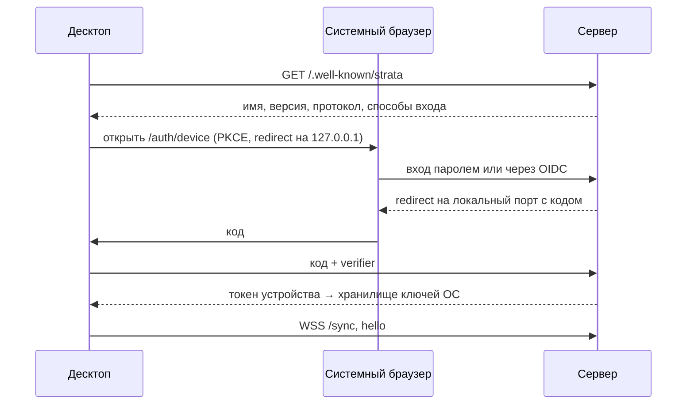

# 11. Self-hosted сервер

> Статус: черновик. Что делает сервер Strata, как его поставить, настроить, обновлять и восстанавливать, как устроены пространства, роли, вход и подключение клиентов. Данные, синхронизация и формат хранения — [10](10-storage-sync-collab.md), MCP — [12](12-mcp-ai.md), экспорт в Markdown и git — [13](13-interop.md).
>
> Опирается на [05](05-domain-model.md) (ядро) и [глоссарий](glossary.md). Связано: [04](04-personas-scenarios.md) (S7, S9), [09](09-search-navigation.md) (§5), [10](10-storage-sync-collab.md), [12](12-mcp-ai.md), [13](13-interop.md), [14](14-nfr.md), [15](15-architecture.md), [16](16-roadmap.md), [ADR-0003](adr/0003-sync-engine.md), [ADR-0008](adr/0008-mcp-architecture.md). Источники фактов: [R8](research/R8-competitors.md) (уроки self-hosting), [R3](research/R3-crdt-sync.md), [R4](research/R4-app-shell-rendering.md), [R6](research/R6-mcp-ai.md), [R7](research/R7-retro-design-assets.md).
>
> Обозначения: ✅ решено ответами, 💡 предложение, ❓ вопрос (собраны в [17-open-questions.md](17-open-questions.md)). Ссылка «R3 §4» ведёт в раздел «Находки» исследования, «R3 рек. §4» — в раздел «Рекомендация». Все цифры ресурсов — оценки.
>
> Новые термины, предлагаемые в глоссарий: **администратор сервера**, **роль в пространстве**, **персональный токен**, **приглашение**, **токен устройства**.

## Кратко

- ✅ Бриф: проект open source, каждый хостит сервер сам ([00](00-brief.md) §6). ✅ Совместная работа в реальном времени обязательна (J2). ✅ Облачного сервиса нет ([03](03-vision.md), не-цели).
- 💡 Один бинарник `strata` (`strata serve`) и Docker-образ. Внутри — SQLite, tantivy и Loro; ассеты на диске или в S3-совместимом хранилище. Один конфиг TOML, команда `strata doctor`. Redis, MongoDB и MinIO не нужны ([R8](research/R8-competitors.md) §18).
- 💡 Много пространств на сервере. Роли на уровне пространства: владелец, админ, редактор, читатель. Права на поддеревья — не в v1.
- 💡 Вход: локальные аккаунты и OIDC; персональные токены для MCP и API; OAuth 2.1 для MCP — позже ([R6](research/R6-mcp-ai.md)).
- 💡 Клиенты: «Добавить сервер» в десктопе, публикация локального пространства без повторного входа, веб-клиент на том же домене.
- 💡 Без ограничений по местам, без деления на CE и EE.
- 💡 Этап 3 — вместе с командной работой ([04](04-personas-scenarios.md)); раньше — только если Q-04-4 решится в пользу синхронизации своих устройств.

## 1. Роли сервера

| Роль | Что делает | Подробно |
|---|---|---|
| Ретранслятор синхронизации | WebSocket `/sync`: комнаты-документы, лента `seq`, пакеты, присутствие | [10](10-storage-sync-collab.md) §8 |
| Ведущее ядро пространства | Полная история, документы производных, сверка инвариантов, перешардирование, окончательное удаление, миграции | [10](10-storage-sync-collab.md) §1.3 |
| Хранение | CRDT в `store.sqlite` на пространство, ассеты на диске или в S3 | [10](10-storage-sync-collab.md) §3.2, §11 |
| Аутентификация и права | Аккаунты, сессии, OIDC, токены, роли; проверка прав на комнату | §5, §6 |
| Проекция и поиск | `projection.sqlite`, tantivy, выписки для веб-клиента | [10](10-storage-sync-collab.md) §7 |
| Доменные операции веба | Тонкий веб-клиент шлёт граф-операции, сервер выполняет их в `strata-core` | [10](10-storage-sync-collab.md) §4–5 |
| Веб-клиент | Раздаёт SPA той же версии | §7.6 |
| Удалённый MCP | `/mcp` (Streamable HTTP), персональные токены; OAuth 2.1 позже | [12](12-mcp-ai.md), [R6](research/R6-mcp-ai.md) |
| История и корзина | Просмотр и откат версий, корзина 30 дней, окончательное удаление | [10](10-storage-sync-collab.md) §10 |
| Экспорт | Markdown, JSON Canvas, git — команда `strata export` и кнопка в пространстве | [13](13-interop.md) |
| Администрирование | Веб-админка `/admin` и CLI | §9 |

## 2. Устройство

```
                ┌────────────────── strata serve (один процесс) ──────────────────┐
 браузер ─HTTPS─┤ SPA, /api/v1, /admin, /auth, /.well-known                        │
 десктоп ──WSS─►│ /sync — комнаты, лента seq, присутствие                          │
 агенты ──HTTPS►│ /mcp — rmcp, ревизии 2025-11-25 и 2026-07-28 (этап 3)            │
                │  ├─ strata-core: доменные операции, Loro, проекция, tantivy       │
                │  ├─ актор на пространство: один писатель, документы в памяти, LRU │
                │  └─ фоновые задачи: компактирование, сверка, корзина, копии       │
                └──────────┬──────────────────────────────┬────────────────────────┘
                     data_dir (SQLite)              ассеты: диск или S3
```

- 💡 Rust: `strata-core` + HTTP-сервер (axum или похожий) + серверная часть `loro-protocol` ([R3](research/R3-crdt-sync.md) рек. §8, [R4](research/R4-app-shell-rendering.md) §7). Тот же крейт работает в десктопе и в `strata mcp`. Если в команде нет Rust — Node-сервер на `loro-crdt` и `loro-websocket` (B2, Q-R4-2 — [15](15-architecture.md)).
- Актор пространства пишет последовательно: `seq` монотонен, набор изменений — одна транзакция. Чтение проекции идёт параллельно.
- MCP-эндпоинт «двухэпохальный»: `2025-11-25` и `2026-07-28`, `rmcp` с точной версией ([R6](research/R6-mcp-ai.md) §1.1, рек. §1).

```
/var/lib/strata/
├── server.sqlite              аккаунты, сессии, токены, пространства, участники, приглашения, аудит
├── workspaces/<wsId>/         тот же формат, что у локальной папки (10 §3.1)
│   ├── store.sqlite           CRDT, журнал seq с userId, наборы изменений
│   ├── projection.sqlite
│   └── search/
├── assets/ab/cd/<sha256>      общее хранилище по хешу, если assets = "disk"
├── derived-assets/            производные ассетов (10 §11.2)
└── backups/
```

Пространство на сервере — та же папка, что и локально ([10](10-storage-sync-collab.md) §3). Поэтому экспорт и импорт пространства — это архив папки, а публикация с десктопа — загрузка тех же документов.

## 3. Поставка

### 3.1. Что ставим

| Способ | Что | Для кого |
|---|---|---|
| Бинарник `strata` | Linux x86_64 и aarch64, macOS, Windows. Подкоманды: `serve`, `doctor`, `admin`, `backup`, `migrate`, `export`, `mcp` | Без Docker, systemd-юнит в комплекте |
| Docker-образ | Тот же бинарник, один контейнер, том `/var/lib/strata` | Основной способ (❓ Q-11-6) |
| Docker Compose | Один сервис, пример ниже | Порталы вроде Portainer, Coolify, TrueNAS — без `make` |

Почему один процесс: [R8](research/R8-competitors.md) §18 — у Anytype 8 сервисов и около 1 ГБ ОЗУ, compose «for personal use»; у Plane CE 13 сервисов и минимум 4 ГБ; у AFFiNE 4 контейнера. Хостят люди без DevOps, и каждая внешняя зависимость — будущая миграция: удаление образов MinIO сломало установки Anytype (#199, #178, #204).

| Зависимость | Strata v1 |
|---|---|
| СУБД | Встроенный SQLite (`rusqlite` с `bundled`, [R4](research/R4-app-shell-rendering.md) §7) |
| Полнотекст | Встроенный tantivy ([R4](research/R4-app-shell-rendering.md) §7) |
| Очереди, кэш, pub/sub | Нет: один процесс, один писатель на пространство |
| Хранилище файлов | Диск; по желанию — внешнее S3-совместимое, которое у админа уже есть |
| Вход | Свои аккаунты; по желанию — внешний OIDC-провайдер |
| Почта | Не нужна; по желанию SMTP для сброса пароля и приглашений письмом |
| TLS | Reverse proxy или файлы сертификата (§8.6) |

### 3.2. SQLite или Postgres

💡 В v1 только SQLite. Postgres не делаем.

| Довод | SQLite | Postgres |
|---|---|---|
| Нагрузка команды до 10 человек | Хватает: запись мелкая и последовательная внутри пространства | Избыточен |
| Число сервисов | 0 | +1 контейнер, свои обновления и бэкапы |
| Копия и перенос пространства | Файл на пространство (§2), `VACUUM INTO` онлайн | `pg_dump` и восстановление по таблицам |
| Удаление пространства | Удалить каталог | Каскад по таблицам |
| Горизонтальное масштабирование | Нет | Возможно, но это не цель (§11) |

Доступ к хранилищу закрыт трейтом в `strata-core`, поэтому Postgres можно добавить, если появится реальная потребность в нескольких узлах. R3 упоминает Postgres как опцию ([R3](research/R3-crdt-sync.md) рек. §8), R8 советует одну встроенную БД.

### 3.3. Ассеты: диск или S3

- По умолчанию — `data_dir/assets/` по хешу ([10](10-storage-sync-collab.md) §11).
- 💡 S3-совместимое хранилище (AWS S3, Cloudflare R2, Backblaze B2, Garage, MinIO админа) — опция для тех, у кого диск сервера мал. Клиентская библиотека не выбрана — не проверено ([15](15-architecture.md)).
- Сами объектные хранилища в поставку не входят.

### 3.4. Конфиг

Один файл TOML. Любое поле переопределяется переменной `STRATA_<СЕКЦИЯ>_<КЛЮЧ>`; секреты — только из переменных или файлов. Неизвестный ключ — ошибка запуска: неоднозначные параметры уже ломали синхронизацию у Anytype ([R8](research/R8-competitors.md) §18, #171).

```toml
# /etc/strata/strata.toml
[server]
listen          = "127.0.0.1:8080"         # за reverse proxy; в контейнере — "0.0.0.0:8080"
public_url      = "https://strata.example.com"
data_dir        = "/var/lib/strata"
trusted_proxies = ["127.0.0.1/32"]
cors_origins    = []                       # веб-клиент на том же домене (§8.7)

[tls]                                       # только без reverse proxy
# cert = "/etc/strata/tls/fullchain.pem"
# key  = "/etc/strata/tls/privkey.pem"

[storage]
assets = "disk"                             # "disk" | "s3"

[storage.s3]                                # если assets = "s3"
endpoint   = "https://s3.example.com"
bucket     = "strata-assets"
access_key = { env = "STRATA_S3_ACCESS_KEY" }
secret_key = { env = "STRATA_S3_SECRET_KEY" }

[auth]
registration   = "invite"                   # "open" | "invite" | "closed"
local_accounts = true
session_days   = 30
workspace_creators = "all"                  # "all" | "admins"

[auth.oidc]                                 # необязательно
issuer        = "https://id.example.com"
client_id     = "strata"
client_secret = { env = "STRATA_OIDC_SECRET" }
button        = "Войти через Authentik"

[mcp]                                       # этап 3
enabled           = true
writes_per_minute = 60                      # R6 §4.6

[limits]
asset_max_size      = "200MB"
workspace_quota     = "0"                   # 0 — без квоты
ws_messages_per_sec = 200

[history]
retention  = "forever"                      # или "365d" — ❓ Q-10-2
trash_days = 30                             # умолчание для новых пространств (05 §11)

[backup]
schedule    = "03:30"
target      = "/var/backups/strata"
keep_daily  = 7
keep_weekly = 4

[log]
level  = "info"
format = "json"

[metrics]
enabled = false
token   = { env = "STRATA_METRICS_TOKEN" }
```

```yaml
# compose.yaml
services:
  strata:
    image: <реестр>/strata:1.0              # реестр образа не выбран
    command: ["serve", "--config", "/etc/strata/strata.toml"]
    ports: ["127.0.0.1:8080:8080"]
    volumes:
      - ./strata.toml:/etc/strata/strata.toml:ro
      - strata-data:/var/lib/strata
      - ./backups:/var/backups/strata
    env_file: .env
    restart: unless-stopped
volumes:
  strata-data:
```

Первый запуск: `strata admin user add --admin <логин>` печатает одноразовую ссылку для установки пароля. Другой путь — страница `/setup`, доступная только с `127.0.0.1`, пока на сервере нет ни одного администратора.

## 4. `strata doctor`

💡 Одна команда отвечает на вопрос «почему не работает». Аналог `netcheck` у Anytype ([R8](research/R8-competitors.md) §18).

| Проверка | Что ловит |
|---|---|
| Конфиг | Неизвестные ключи, противоречия (`registration = "invite"` без способа входа) |
| Каталог данных | Права, свободное место (< 10 % — предупреждение) |
| Базы | `PRAGMA integrity_check` для `server.sqlite` и `store.sqlite` пространств; версии схемы; незавершённые миграции |
| Адрес и TLS | `public_url` отвечает; срок сертификата (< 14 дней — предупреждение); `X-Forwarded-Proto` доходит |
| WebSocket через прокси | Апгрейд `/sync` проходит, соединение живёт дольше 60 с |
| Ассеты | Запись, чтение и удаление пробного объекта (диск или S3) |
| OIDC | Discovery-документ, совпадение redirect URI |
| MCP | `/mcp` отвечает на запросы обеих ревизий ([R6](research/R6-mcp-ai.md) §1.1) |
| Копии | Цель доступна; возраст последней копии (> 2 суток — предупреждение) |
| Клиенты | Версии подключавшихся клиентов против `minClient` (§8.1) |

```
$ strata doctor
strata 1.2.0 · протокол 1.2 · схема данных 3
[OK]   Конфиг /etc/strata/strata.toml
[OK]   data_dir: запись есть, свободно 182 ГБ
[OK]   Базы: 4 пространства, integrity_check ok, миграции не нужны
[OK]   https://strata.example.com отвечает, сертификат до 2027-01-10
[FAIL] WebSocket /sync через прокси: ответ 400, нет Upgrade
       → добавьте в nginx proxy_set_header Upgrade и Connection (§8.6)
[WARN] Последняя резервная копия — 3 дня назад
[SKIP] S3: assets = "disk"
```

Ключи: `--json` для мониторинга, `--fix` для безопасных исправлений (создать каталоги, пересобрать проекцию). С десктопа: «Проверить подключение» в настройках сервера — та же проверка со стороны клиента (адрес, TLS, WebSocket, версия, вход).

## 5. Пространства, участники, роли

- 💡 На одном сервере сколько угодно независимых пространств (❓ Q-11-2, J5). Пространство — `UUIDv7`, человекочитаемый слаг позже ([09](09-search-navigation.md) §5.1).
- **Администратор сервера** — роль аккаунта, а не пространства: аккаунты, создание пространств, квоты, копии. В интерфейсе содержимое пространства он видит, только если сам в нём участник; экспорт и данные на диске ему доступны в любом случае — это свой сервер (E2E нет, [10](10-storage-sync-collab.md) §12).
- **Роль в пространстве** — одна на участника. Люди серверного пространства — его участники (05 §10).

| Действие | Читатель | Редактор | Админ | Владелец |
|---|---|---|---|---|
| Видеть пространство целиком: холст, 3D, поиск, историю | ✓ | ✓ | ✓ | ✓ |
| Экспорт пространства (💡) | ✓ | ✓ | ✓ | ✓ |
| MCP с токеном `strata:read` | ✓ | ✓ | ✓ | ✓ |
| Создавать, править, связывать, размещать, двигать | — | ✓ | ✓ | ✓ |
| «Убрать отсюда», «Удалить везде», восстановить из корзины | — | ✓ | ✓ | ✓ |
| Настройки пространства: статусы, классы, схемы атрибутов, фон (💡) | — | ✓ | ✓ | ✓ |
| MCP с `strata:write` и `strata:delete` | — | ✓ | ✓ | ✓ |
| Откат чужих наборов изменений из журнала | — | — | ✓ | ✓ |
| Очистить корзину, удалить навсегда | — | — | ✓ | ✓ |
| Приглашать, менять роли, исключать | — | — | ✓ | ✓ |
| Удалить пространство, передать владение | — | — | — | ✓ |

- Настройки лежат в манифесте, а права проверяются на уровне комнаты ([10](10-storage-sync-collab.md) §12), поэтому их правят все редакторы. Для команды до 10 человек это приемлемо; иначе манифест пришлось бы делить ещё раз.
- Роль «комментатор» не вводим: комментариев в модели нет (❓ Q-11-5).
- Исключённый участник теряет доступ сразу: сервер закрывает его соединения и отзывает его токены. Локальная реплика на его десктопе остаётся — отозвать уже скачанное невозможно.

**Почему нет прав на поддеревья в v1** (❓ Q-11-4, J4):
- индекс общий: шарды разбиты по хешу ID ноды, а не по сетям, и в любом шарде лежат имена и связи из всего пространства ([10](10-storage-sync-collab.md) §2.7). Закрыть сеть — значит перешардировать индекс по доменам прав ([R3](research/R3-crdt-sync.md), риск 9);
- нить глобальна и видна везде, где есть оба конца (05 §8): скрытая нода «просвечивала» бы через нити и значок внешних связей;
- проекцию, выписки, поиск и MCP пришлось бы фильтровать по правам.

Что вместо: отдельное пространство для другой аудитории. Публичные ссылки только для чтения — этап 3, [09](09-search-navigation.md) §5.5 (Q-09-6). Токен MCP можно ограничить поддеревом (`within`, [R6](research/R6-mcp-ai.md) §4.6): это фильтр операций агента, а не граница видимости данных.

## 6. Аутентификация

### 6.1. Способы входа

| Способ | Этап (💡) | Как |
|---|---|---|
| Локальный аккаунт: логин и пароль | 3 | Хеш пароля — Argon2id (крейт не выбран, не проверено); 5 попыток в минуту (§8.4) |
| Passkeys (WebAuthn) | После 3 | В веб-клиенте. В WebView Tauri, особенно WebKitGTK, не проверено, поэтому десктоп входит через системный браузер (§7.2) |
| OIDC | 3 | Authorization code + PKCE; любой провайдер с discovery (Authentik, Keycloak, Google и т. п.). Аккаунт создаётся при первом входе, если пускает `registration` или есть приглашение |
| Персональный токен (PAT) | 3 | Для MCP и API (§6.3) |
| OAuth 2.1 для MCP | После 3 | §6.4 |

Вход через GitHub или Google — частный случай OIDC (❓ Q-11-3).

### 6.2. Сессии и токены устройств

| Клиент | Что хранит | Срок (💡) | Отзыв |
|---|---|---|---|
| Веб | Cookie `HttpOnly; Secure; SameSite=Lax` | 30 дней, продлевается при работе | «Выйти на всех устройствах» |
| Десктоп | Токен устройства в хранилище ключей ОС (keychain, Credential Manager, Secret Service — [R6](research/R6-mcp-ai.md) §5.6; крейт выбирает [15](15-architecture.md)) | 90 дней, продлевается | Список устройств в профиле |
| `strata mcp --remote` | PAT из переменной окружения или хранилища ключей | По токену | Список токенов |

### 6.3. Персональные токены

- Формат `strata_pat_<32 случайных символа base32>`; показывается один раз, на сервере хранится хеш SHA-256.
- Скоупы `strata:read`, `strata:write`, `strata:delete`; привязка к пространству; необязательный `within` — корневые сети; срок по умолчанию 90 дней (💡); время последнего использования ([R6](research/R6-mcp-ai.md) рек. §3).
- Права токена не шире роли его хозяина: читатель не выпустит `strata:write`. При смене роли лишние скоупы гаснут.
- Клиенты подставляют токен так: Claude Code — `--header`, Codex — `bearer_token_env_var`, Cursor — `headers`, мост `strata mcp --remote` — сам ([R6](research/R6-mcp-ai.md) рек. §3).

### 6.4. OAuth 2.1 для MCP (после этапа 3)

Нужен для custom connectors Claude: они ходят к серверу из облака Anthropic и не видят `localhost` и LAN ([R6](research/R6-mcp-ai.md) §2.5). Требования спецификации: Protected Resource Metadata (RFC 9728), PKCE S256, CIMD для регистрации клиентов, проверка аудитории токена и отказ от token passthrough ([R6](research/R6-mcp-ai.md) §1.5). В `rmcp` OAuth есть только на стороне клиента ([R6](research/R6-mcp-ai.md) §1.6).

💡 Встроенный минимальный сервер авторизации: authorization code + PKCE + CIMD, вход — локальным аккаунтом или через подключённый OIDC. Почему не чистое делегирование внешнему OIDC: поддержку CIMD и RFC 8707 у типичных провайдеров никто не проверял, а без них MCP-клиенты не зарегистрируются. Цена — своя поверхность атаки ([R6](research/R6-mcp-ai.md), риски). ❓ Q-11-8.

### 6.5. Приглашения

- Ссылка `https://<сервер>/invite/<токен>`: пространство, роль, срок (💡 7 дней), одно- или многоразовая, отзывается.
- По приглашению можно завести аккаунт, даже если `registration = "invite"`.
- С SMTP — отправка письмом; без него ссылку копируют вручную.
- Сброс пароля без SMTP — `strata admin user reset-password` печатает одноразовую ссылку.

## 7. Подключение клиентов

### 7.1. Адреса

| Путь | Что |
|---|---|
| `/` | Веб-клиент (SPA) |
| `/w/{ws}/n/{node}` | Глубокие ссылки ([09](09-search-navigation.md) §5) |
| `/sync` | WebSocket синхронизации ([10](10-storage-sync-collab.md) §8.1) |
| `/api/v1/…` | HTTP API: ассеты, выписки, история, экспорт, токены, публикация |
| `/mcp` | MCP Streamable HTTP (этап 3) |
| `/admin` | Админка (§9) |
| `/auth/…`, `/invite/{token}`, `/setup` | Вход, OIDC-колбэк, приглашения, первый запуск |
| `/.well-known/strata` | Обнаружение сервера |
| `/.well-known/oauth-protected-resource` | Метаданные ресурса для MCP (после этапа 3) |
| `/healthz`, `/readyz`, `/metrics` | Эксплуатация (§8.3) |

```json
// GET /.well-known/strata
{ "name": "Студия", "version": "1.2.0", "protocol": { "min": "1.1", "max": "1.2" },
  "minClient": "1.1.0", "auth": ["password", "oidc"], "oidcButton": "Войти через Authentik",
  "mcp": "/mcp", "publicUrl": "https://strata.example.com" }
```

### 7.2. «Добавить сервер» в десктопе



- Вход через системный браузер одинаково работает для пароля, OIDC и позже passkeys и не зависит от WebView.
- Если версия клиента ниже `minClient`, десктоп сразу говорит, что сервер подключится только для чтения (§8.1).

### 7.3. Публикация локального пространства

Без выхода из аккаунта и без новой identity — то, чего не хватает пользователям Anytype ([R8](research/R8-competitors.md) §18).

1. «Опубликовать на сервер…» → выбор уже подключённого сервера.
2. Сервер проверяет право создавать пространства (`workspace_creators`).
3. Сопоставление людей (05 §10): локальные люди → участники, с подсказками по имени. Несопоставленные остаются записями без аккаунта.
4. Создаётся пространство **с тем же ID**; ID нод сохраняются, старые `strata://` продолжают работать ([09](09-search-navigation.md) §5.3).
5. Загрузка документов с полной историей пачками, затем ассеты, которых нет на сервере (`HEAD` → `PUT`, [10](10-storage-sync-collab.md) §11.1). Загрузка докачивается после обрыва; другие участники пространство не видят, пока она не закончится.
6. Сервер импортирует документы, строит проекцию, выдаёт `seq`.
7. Локальная папка переходит в режим реплики (`strata.json`, `mode: "replica"`).

Если пространство с этим ID на сервере уже есть (его публиковали из копии), десктоп предлагает «Слить с серверным» — документы с одинаковыми ID сливаются как CRDT — или «Опубликовать как новое» с новым ID пространства.

### 7.4. Выгрузка серверного пространства

| Вариант | Что получается |
|---|---|
| «Держать на этом устройстве» (по умолчанию на десктопе) | Реплика: работает офлайн, синхронизируется ([10](10-storage-sync-collab.md) §3.7) |
| «Отделить копию» | Локальное пространство с новым ID пространства, ID нод сохраняются; с сервером больше не связано |
| `strata admin workspace export` | Архив `.strata.zip` того же формата, что локальный ([10](10-storage-sync-collab.md) §3.5): перенос между серверами |

### 7.5. Несколько серверов

- 💡 Один клиент подключён к нескольким серверам сразу: личный и рабочий (❓ Q-11-2, J5).
- В переключателе пространств — группы «Локальные» и по серверу; у каждого сервера свой статус ([10](10-storage-sync-collab.md) §8.6).
- Отдельный токен и отдельное WebSocket-соединение на сервер.

### 7.6. Веб-клиент

- Раздаётся самим сервером: версия веб-клиента всегда равна версии сервера.
- Тонкий режим ([10](10-storage-sync-collab.md) §5): выписки, открытые документы, граф-операции на сервере.
- На машине с установленным десктопом страница предлагает «Открыть в приложении» ([09](09-search-navigation.md) §5.4).

## 8. Эксплуатация

### 8.1. Обновления, миграции, совместимость

- Обновление сервера — замена бинарника или образа. При старте: если нужна миграция, сначала автоматическая копия (`VACUUM INTO`) затронутых баз, затем миграция `server.sqlite`, затем миграции данных пространств фоном, с прогрессом в админке ([10](10-storage-sync-collab.md) §13).
- `strata migrate status | run`. Откат версии после миграции не поддерживается — только восстановление из копии.
- Десктоп обновляется встроенным апдейтером Tauri с обязательной подписью ([R4](research/R4-app-shell-rendering.md)).

Десктоп и сервер обновляются в разное время: жёсткая сцепка версий у AFFiNE («клиент не ниже сервера», 0.27) — антипример ([R8](research/R8-competitors.md) §18).

| Пара | Правило (💡) |
|---|---|
| Веб-клиент ↔ сервер | Всегда одна версия |
| Десктоп старее сервера на одну минорную | Работает полностью ([R8](research/R8-competitors.md) §18) |
| Десктоп ниже `minClient` | «Только чтение · обновите приложение»; исходящие хранятся локально и уйдут после обновления |
| Десктоп новее сервера | Работает по протоколу сервера; функции, которых сервер не объявил в `capabilities`, скрыты |
| Разные мажорные версии протокола | Подключение отклоняется с понятным текстом; реплика доступна для чтения |
| Схема данных новее у сервера | Старый клиент читает и пишет известные поля; неизвестные ключи CRDT хранит как есть |

`minClient` поднимается только преобразующей миграцией, которой нужен новый клиент, — не чаще раза в мажорную версию.

### 8.2. Резервные копии и восстановление

| Что | Как | Когда |
|---|---|---|
| `server.sqlite`, `store.sqlite` каждого пространства | `VACUUM INTO` онлайн, без остановки | По `backup.schedule`, перед миграцией |
| Ассеты на диске | Копируются только новые файлы: имена по хешу, файлы неизменяемы | Там же |
| Ассеты в S3 | Версионирование или репликация бакета — средствами хранилища | Настраивает админ |
| Конфиг | Копия `strata.toml` без секретов | Там же |
| Проекция, `search/`, производные | Не копируются: пересобираются | — |

- Хранение: 7 ежедневных + 4 еженедельных (💡), настраивается.
- `strata backup create | list | verify | restore`. `verify` проверяет `integrity_check`, открывает каждый документ движком и выборочно сверяет наличие ассетов.
- Восстановление: остановить сервер → `strata backup restore <каталог>` → запустить. Проекции пересобираются.
- После восстановления десктопы-реплики, у которых есть более свежие правки, присылают их при подключении: CRDT сольёт. Насколько полно это восстанавливает потерянное с shallow-репликами — пункт спайка ([10](10-storage-sync-collab.md) §15, п. 6).

### 8.3. Мониторинг и логи

| Что | Как |
|---|---|
| `/healthz` | Процесс жив |
| `/readyz` | Базы открыты, миграции завершены, хранилище ассетов доступно |
| `/metrics` | Формат Prometheus, по токену: соединения, комнаты, апдейты и байты в секунду, отставание проекции, ошибки авторизации, свободное место, возраст последней копии |
| Логи | JSON в stdout: уровень, ID запроса, пользователь, пространство. Никогда — содержимое, токены, пароли |
| Аудит | В `server.sqlite`: входы и неудачные попытки, роли, приглашения, токены, окончательные удаления, удаление и экспорт пространств. Хранится год (💡). Просмотр — в админке |

Телеметрии нет; сервер сам никуда не ходит, кроме настроенных OIDC, S3, SMTP и AI-провайдеров. Проверка обновлений — опция, выключена (💡; N3 — [14](14-nfr.md)).

### 8.4. Квоты и лимиты

Ограничений по числу мест в коде нет ([R8](research/R8-competitors.md) §18).

| Что | Лимит по умолчанию (💡) |
|---|---|
| Квота пространства (CRDT + ассеты) | Без квоты; админ задаёт |
| Размер ассета | 200 МБ |
| Загрузка ассетов | 2 ГБ в час на пользователя |
| Вход по паролю | 5 попыток в минуту на IP и логин, дальше задержка растёт |
| Регистрация по приглашению | 10 в час на IP |
| WebSocket | 200 сообщений в секунду на соединение, всплеск 1000; эфемерные прореживаются до 30 Гц |
| Апдейт | 256 КиБ на сообщение с фрагментацией ([R3](research/R3-crdt-sync.md) §7); ≤ 32 МБ на документ за раз |
| MCP-запись | 60 в минуту на токен ([R6](research/R6-mcp-ai.md) §4.6) |
| HTTP API | 50 запросов в секунду на пользователя |

### 8.5. Ресурсы для команды из 10 человек (оценка)

| Ресурс | Минимум | Рекомендуется | Из чего оценка |
|---|---|---|---|
| CPU | 1 vCPU | 2 vCPU | Ретрансляция и запись в SQLite дешёвые; пики — пересборка проекции и индексация tantivy |
| ОЗУ | 512 МБ | 1–2 ГБ | Индекс в памяти ≈ 100 МБ на 100 тыс. нод активного пространства ([R3](research/R3-crdt-sync.md) рек. §5); LRU документов ([10](10-storage-sync-collab.md) §6.2); на этапе 2 — модель эмбеддингов, сотни МБ ([R6](research/R6-mcp-ai.md)) |
| Диск | 1 ГБ + ассеты | 10 ГБ + ассеты × 2 под копии | Индекс 22–28 МБ на 100 тыс. нод ([R3](research/R3-crdt-sync.md) рек. §5); текст в CRDT больше исходника: 258 КБ на 105 тыс. символов в бенчмарке B4 ([R3](research/R3-crdt-sync.md) §12.1); история; картинки обычно перевешивают всё |
| Сеть | — | LAN или от 10 Мбит/с на пользователя | Эфемерный канал ≤ 30 Гц на клиента |

Для сравнения: Plane CE просит минимум 2 ядра и 4 ГБ ([R8](research/R8-competitors.md) §18). Цифры Strata проверяются нагрузочным тестом этапа 3 ([14](14-nfr.md)).

### 8.6. Reverse proxy и TLS

- 💡 По умолчанию сервер слушает `127.0.0.1` за reverse proxy (nginx, Caddy, Traefik), TLS — на прокси. Без прокси — секция `[tls]` с файлами сертификата. Встроенный ACME — не в v1.
- Требования к прокси: апгрейд WebSocket на `/sync`, таймаут чтения ≥ 120 с (пинг каждые 25 с, [10](10-storage-sync-collab.md) §8.2), тело запроса ≥ 16 МБ (ассеты идут частями по 8 МБ), `X-Forwarded-For` и `X-Forwarded-Proto`; сервер доверяет им только от `trusted_proxies`.
- Доступность из интернета или только из LAN и VPN — ❓ Q-11-1: от неё зависят custom connectors Claude и мобильный Claude ([R6](research/R6-mcp-ai.md)).

```nginx
server {
  listen 443 ssl;
  server_name strata.example.com;
  client_max_body_size 16m;
  location / {
    proxy_pass http://127.0.0.1:8080;
    proxy_set_header Host $host;
    proxy_set_header X-Forwarded-For $proxy_add_x_forwarded_for;
    proxy_set_header X-Forwarded-Proto $scheme;
  }
  location /sync {
    proxy_pass http://127.0.0.1:8080;
    proxy_http_version 1.1;
    proxy_set_header Upgrade $http_upgrade;
    proxy_set_header Connection "upgrade";
    proxy_set_header Host $host;
    proxy_read_timeout 120s;
  }
}
```

### 8.7. Веб-безопасность

**CORS.** Веб-клиент на том же домене — CORS выключен. Список разрешённых источников — `server.cors_origins`, по умолчанию пуст. `/mcp` проверяет `Origin` у каждого запроса — требование спецификации против DNS rebinding ([R6](research/R6-mcp-ai.md) §1.4): браузерный запрос с чужим `Origin` отвергается, запрос без `Origin` (CLI-агенты) принимается только с токеном.

| Заголовок | Значение (💡) | Зачем |
|---|---|---|
| `Content-Security-Policy` (SPA) | `default-src 'self'; script-src 'self' 'wasm-unsafe-eval'; style-src 'self' 'unsafe-inline'; img-src 'self' blob: data:; connect-src 'self'; frame-ancestors 'none'; object-src 'none'; base-uri 'none'` | Loro работает в WASM; inline-стили — для Excalidraw. Точный набор — пункт спайка |
| `Content-Security-Policy` (ассеты) | `sandbox; default-src 'none'` | Открытый напрямую файл не исполнит скрипт |
| `Content-Disposition` | `attachment` для SVG, HTML и всего, что не растровая картинка, PDF, видео или аудио | — |
| `X-Content-Type-Options` | `nosniff` | Тип — из сигнатуры при загрузке ([10](10-storage-sync-collab.md) §11.1) |
| `Strict-Transport-Security` | `max-age=31536000` при HTTPS | — |
| `Referrer-Policy` | `same-origin` | ID пространств и нод не уходят на чужие сайты |
| `Cross-Origin-Opener-Policy` | `same-origin` | — |
| `Cross-Origin-Embedder-Policy` | Не ставим в v1 | Нужен только VFS `opfs` с `SharedArrayBuffer` ([R4](research/R4-app-shell-rendering.md) §7); тонкому вебу не нужен, а картинки с чужих доменов на досках сломал бы |

**SVG.** Пользовательский SVG никогда не вставляется в DOM: клиент санитизирует его DOMPurify 3.4.17 и растеризует, на холсте и в интерфейсе — только растровые производные ([R7](research/R7-retro-design-assets.md), [07](07-design-system.md) §6.4). Сервер этому не доверяет: оригиналы SVG отдаёт только как вложение, а производные принимает только в растровых форматах (WebP, PNG — проверка сигнатуры).

## 9. Админка и CLI

💡 Минимальная админка `/admin` — ретро-окна того же Хрома ([07](07-design-system.md)):

| Страница | Что |
|---|---|
| Состояние | Версия, `strata doctor` в браузере, диск, соединения, отставание проекции, последняя копия |
| Аккаунты | Создать, отключить, сделать администратором, ссылка сброса пароля, устройства |
| Пространства | Список, владелец, размер, участники и роли, квота, экспорт, удаление, ход миграций |
| Приглашения и токены | Активные, отозвать |
| Аудит | Фильтр по пользователю, пространству, событию |

| Команда | Что делает |
|---|---|
| `strata serve [--config]` | Запуск сервера |
| `strata doctor [--json] [--fix]` | Диагностика (§4) |
| `strata admin user add \| list \| disable \| reset-password` | Аккаунты |
| `strata admin invite create --workspace --role --ttl` | Приглашение |
| `strata admin workspace list \| export \| import \| delete` | Пространства, архив `.strata.zip` |
| `strata admin token list \| revoke` | Токены |
| `strata backup create \| list \| verify \| restore` | Копии (§8.2) |
| `strata migrate status \| run` | Миграции (§8.1) |
| `strata reproject --workspace` | Пересборка проекции ([10](10-storage-sync-collab.md) §7.4) |
| `strata gc assets [--dry-run]` | Сборка мусора ассетов ([10](10-storage-sync-collab.md) §11.4) |
| `strata export --workspace --format md \| canvas \| json` | Экспорт ([13](13-interop.md)) |
| `strata mcp --remote <url>` | Мост stdio → `/mcp` для Claude Desktop ([R6](research/R6-mcp-ai.md) §2.5) |

Те же команды `doctor`, `backup`, `reproject`, `gc`, `export`, `mcp` работают с локальной папкой пространства на десктопе.

## 10. Этапы (💡, итог — [16](16-roadmap.md))

| Этап | Сервер |
|---|---|
| MVP | Сервера нет. CLI `strata` для локального пространства: `doctor`, `backup`, `reproject`, `export`, `mcp` |
| Этап 2 | Только если Q-04-4 решится в пользу синхронизации своих устройств: сервер для одного человека — синхронизация, локальный аккаунт, без ролей и веба |
| Этап 3 | Команда: роли, приглашения, OIDC, веб-клиент, присутствие, удалённый `/mcp` с персональными токенами, S3, админка |
| После | OAuth 2.1 для MCP, passkeys, публичные ссылки (Q-09-6), права на поддеревья (Q-11-4) |

## 11. Чего не делаем

| Не делаем | Почему |
|---|---|
| Облачный SaaS Strata | Не-цель v1 ([03](03-vision.md)); open source, каждый хостит сам ([00](00-brief.md)) |
| Деление на CE и EE, платные функции сервера | На этом теряют доверие AFFiNE и Plane ([R8](research/R8-competitors.md) §18, рек. 7) |
| Ограничения по местам | У AFFiNE бесплатно 10 мест — ровно размер целевой команды ([R8](research/R8-competitors.md)) |
| Зоопарк сервисов: Redis, MongoDB, MinIO, отдельные воркеры | [R8](research/R8-competitors.md) §18; один процесс (§3.1) |
| Кластер и горизонтальное масштабирование | Команда до 10 человек (✅ A1) |
| Postgres в v1 | §3.2 |
| E2E | [10](10-storage-sync-collab.md) §12 |
| Компоненты под AGPL, если лицензия Strata не AGPL (`@y/hub` в плане Б) | ❓ Q-11-7 |
| Телеметрия по умолчанию | §8.3 |

## Открытые вопросы

- **Q-11-1.** (Q-R6-6) Сервер команды будет доступен из интернета или только в локальной сети и через VPN? Из интернета работают custom connectors Claude и мобильный Claude, но нужны TLS, OAuth 2.1 и защита от перебора. 💡 Предложение: рассчитываем на оба варианта; в LAN агенты подключаются через `strata mcp --remote` с персональным токеном, OAuth 2.1 — когда сервер в интернете.
- **Q-11-2.** (J5) Нужны ли много пространств на одном сервере и подключение одного клиента к нескольким серверам сразу (личный и рабочий)? 💡 Предложение: да и да (§5, §7.5).
- **Q-11-3.** (J4) Какие способы входа нужны: логин и пароль, passkeys, OIDC (Authentik, Keycloak, Google, GitHub)? 💡 Предложение: этап 3 — пароль и OIDC; passkeys — после; десктоп входит через системный браузер.
- **Q-11-4.** (J4, вопрос 4 из [R3](research/R3-crdt-sync.md)) Нужны ли права на отдельные сети и поддеревья, или хватит ролей на всё пространство? Поддеревья требуют перешардировать индекс по доменам прав и фильтровать проекцию, поиск и MCP. 💡 Предложение: v1 — роли на пространство; другой аудитории — отдельное пространство; к поддеревьям вернуться по реальному сценарию.
- **Q-11-5.** Нужна ли роль «комментатор»? Комментариев в модели нет, а без них роль равна читателю. 💡 Предложение: не вводить, пока нет комментариев; их появление — правка 05.
- **Q-11-6.** (J6) Docker Compose как основной способ установки — подходит? Устраивает ли SQLite без Postgres в v1 и ассеты на диске с опцией S3? 💡 Предложение: да (§3.1–3.3); Postgres — только при потребности в нескольких узлах.
- **Q-11-7.** (B4, вопрос 8 из [R3](research/R3-crdt-sync.md), Q-R8-4) Какая лицензия у Strata, включая сервер: MIT или Apache-2.0, или AGPL-3.0? От неё зависит, можно ли в плане Б взять `@y/hub` (AGPL-3.0 или платная, [R3](research/R3-crdt-sync.md) §1). 💡 Предложение: одна OSI-лицензия на весь код, без платной редакции; до выбора AGPL-компоненты не берём.
- **Q-11-8.** OAuth 2.1 для MCP: встроенный минимальный сервер авторизации или только делегирование внешнему OIDC-провайдеру ([R6](research/R6-mcp-ai.md) рек. §3 оставляет выбор здесь)? 💡 Предложение: встроенный, с входом через локальный аккаунт или OIDC (§6.4); делегирование — если найдётся провайдер с CIMD.
- **Q-11-9.** Где будет жить сервер команды: домашний сервер, VPS, NAS? Кто его администрирует? От ответа зависят ARM-сборки, пакеты для NAS, инструкции и `strata doctor`. 💡 Предложение: Linux x86_64 и aarch64 в Docker и бинарником; инструкции для VPS и домашнего сервера с nginx.
