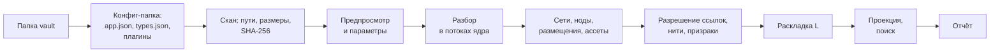
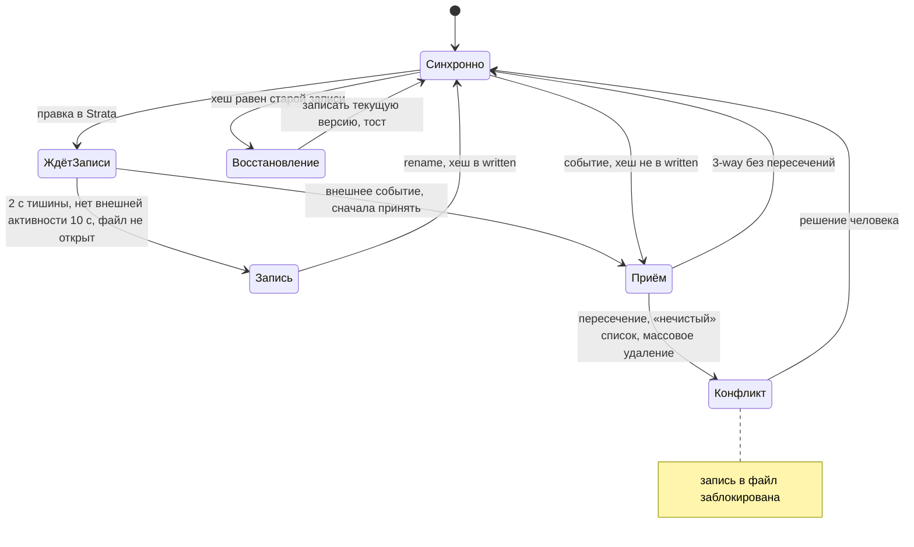

# 13. Совместимость: Obsidian и другие

> Статус: черновик. Как Strata забирает vault Obsidian, отдаёт данные обратно, живёт рядом с Obsidian на одной папке и что делает с другими инструментами и форматами.
>
> Опирается на [05](05-domain-model.md) (ядро) и [глоссарий](glossary.md). Связано: [04](04-personas-scenarios.md) (S1), [06](06-canvas-ux.md) (§4.2, §7, §9.3, §12.1, §14), [07](07-design-system.md) (§2.2, §6.6), [09](09-search-navigation.md) (§2.2, §4.6), [10](10-storage-sync-collab.md) (§1, §2.3–§2.5, §9, §10.4, §11), [11](11-server-selfhost.md), [12](12-mcp-ai.md) (`import_markdown`), [14](14-nfr.md), [15](15-architecture.md), [16](16-roadmap.md), [ADR-0001](adr/0001-global-edges.md), [ADR-0006](adr/0006-board-engine.md), [ADR-0007](adr/0007-text-editor.md). Источники фактов: [R2](research/R2-obsidian-format.md) (главный), [R5](research/R5-board-engine.md), [R8](research/R8-competitors.md), [R4](research/R4-app-shell-rendering.md).
>
> Обозначения: ✅ решено ответами, ☑ решено по делегированию владельца (раунд 2), 💡 предложение (с 2026-10-19 считается принятым, [README](README.md)), ❓ вопрос (собраны в [17-open-questions.md](17-open-questions.md)). «R2 §5» — раздел «Находки» исследования, «R2 рек. 3» — пункт раздела «Рекомендация».
>
> Термины документа в [глоссарии](glossary.md): **ключ ссылки**, **реестр импорта**, **отчёт импорта**, **владелец зеркала**, **карточка сети**, **форма frontmatter**, **пункт-задача**.

## Кратко

- ✅ Совместимость начинается с Obsidian ([бриф](00-brief.md), раздел 5). Импорт готовой базы — в пятёрке MVP (O1). `[[Ссылки]]` создают нити (C8). Одновременная работа с Obsidian желательна, но не обязательна (J1). Совместная работа в реальном времени обязательна (J2). L1 («что именно нужно от совместимости») решён в раунде 2: разовый переезд (☑ Q-13-1).
- 💡 Источник правды — хранилище Strata ([10](10-storage-sync-collab.md) §1). Папка Obsidian — проекция.
- ☑ Q-13-1. Лестница: **MVP** — разовый импорт, vault не меняется; **MVP+ 1.2** — экспорт по запросу и повторный импорт со слиянием по `strata-id`; **этап 2** — зеркало Strata → папка, из Obsidian принимаются текст и свойства `.md`. Полного двустороннего зеркала с `.canvas` нет.
- 💡 У каждой ноды ровно один «свой» файл. Сеть — папка, а в ней `.canvas` с раскладкой и карточка `.md`. Появления — file-карточки в `.canvas` других сетей.
- 💡 Тело заметки хранится байт-в-байт. Frontmatter раскладывается в атрибуты, а его исходная форма запоминается: неизменённые ключи записываются как были.
- 💡 `[[Ссылки]]` в Strata разрешаются по правилам Obsidian поверх канонических путей и «залипают» на найденной ноде.
- 💡 Каждая потеря — строка отчёта импорта. Молча ничего не теряется.
- 💡 Парсеры форматов пишем сами. Код плагинов не берём, даже когда его лицензия совместима с AGPL-3.0-or-later Strata (§8).

## 1. Цели и уровни

### 1.1. Что подтверждено

| Ответ | Следствие для совместимости |
|---|---|
| ✅ Бриф, раздел 5: «Начать с Obsidian» | Obsidian — первый формат, остальные — после него (§9) |
| ✅ O1: импорт готовой базы из Obsidian — в MVP | Реальный vault импортируется без ручных правок (критерий из [03](03-vision.md)) |
| ✅ C8: `[[ссылка]]` создаёт нить | Ссылки vault становятся нитями с происхождением `text` (05 §8.2) |
| ✅ C3: одна нода в нескольких ветках | Папками это не выразить: у файла одно место (R2 §8 п. 9). Нужен `.canvas` |
| ✅ J1: одновременное открытие с Obsidian желательно | Зеркало — этап 2, архитектура ему не подчиняется |
| ✅ J2: реальное время обязательно | Файл не сливается конкурентно, поэтому источник правды — CRDT ([10](10-storage-sync-collab.md) §1.2) |
| ☑ Q-13-1 (L1): разовый переезд | MVP — разовый импорт; экспорт и повторный импорт — MVP+ 1.2; зеркало остаётся на этапе 2 (J1: желательно), срочности в нём нет |

### 1.2. Лестница режимов

| Режим | Этап | Кто пишет в папку | Что принимаем из Obsidian | Зачем |
|---|---|---|---|---|
| Импорт | MVP | Никто: vault только читается | Всё, что разбирается (§2) | Переезд ([04](04-personas-scenarios.md) S1) |
| Повторный импорт | MVP+ 1.2 | Никто | При запуске: текст, свойства, имена, переносы, новые файлы, позиции в `.canvas` (§3.7) | Дожить в Obsidian и перенести правки |
| Экспорт | MVP+ 1.2 | Strata по команде | — | Данные не заперты (принцип 7 из [03](03-vision.md)); ручной цикл с Obsidian |
| Зеркало | Этап 2 | Strata постоянно, один владелец (§6.1) | Текст и свойства `.md`, переименования, переносы, новые и удалённые файлы (§6.3) | Obsidian открыт на той же папке (J1) |
| Полное двустороннее зеркало | Не делаем | — | — | §1.3 |

Этапы — по [16](16-roadmap.md) (глоссарий, «Этапы»): MVP+ — релизы 1.1–1.4 сразу после MVP. Экспорт, повторный импорт и прочие пункты MVP+ этого документа — релиз 1.2 «Данные не заперты» (16 §5.2). Исключения: интерфейс рамок и стикеров — 1.3 (§2.7.1), ссылки `strata://` — 1.4 (§3.9).

Зеркало Markdown одностороннее, с ограниченным приёмом правок; так его определяет и глоссарий.

### 1.3. Почему не полное двустороннее зеркало

Вариант E из R2 («Сравнение вариантов»): точность средняя, совместимость с реальным временем плохая, сложность очень высокая, риск потери данных высокий.

- **Форматы беднее модели.** В `.canvas` нет точек на нитях, флагов, стилей нитей, нитей между нодами разных сетей (05 §8.3). Сохраняет ли ядро Obsidian чужие ключи канваса при пересохранении — не проверено (R2 §5).
- **Файл — не CRDT.** Obsidian Sync решает конфликт `.canvas` по правилу «последний победил» (R2 §5). Раскладка, одновременно изменённая в Strata и в Obsidian, пропадает целиком.
- **Obsidian сам переписывает файлы:** весь frontmatter при правке любого свойства, все ссылающиеся файлы при переименовании (R2 §3, §8 п. 1).
- **Внешние переименования Obsidian не распознаёт** и ссылки не чинит (R2 §2).
- **Гонка с открытым редактором:** баг-репорт на 1.13.1 — устаревший буфер молча затирает внешнюю правку (R2 §8 п. 3).
- **Структура принадлежит Strata.** Появления, вложенность без циклов (05 §5), каскад удаления — инварианты, которые файловое дерево не проверяет.

Logseq пошёл тем же путём: БД — правда, Markdown Mirror — односторонняя проекция (R2 §9).

### 1.4. Принципы

1. Vault при импорте и повторном импорте только читается.
2. Без потерь, насколько позволяет модель 05. Каждая потеря — строка отчёта (§3.6).
3. Импорт — одна доменная операция ядра и один набор изменений с источником `import` (05 §11, [10](10-storage-sync-collab.md) §9.1). Откат — целиком.
4. Один разборщик для импорта, повторного импорта, зеркала, вставки из буфера и MCP `import_markdown` ([12](12-mcp-ai.md)).
5. Форматы читаем по описаниям (R2 §5–§7), а не по чужому коду (§8).

## 2. Соответствие Obsidian ↔ Strata

### 2.1. Файлы и папки

| В vault | В Strata | Этап | Правило | Потери |
|---|---|---|---|---|
| Vault | Новое пространство или новая сеть в текущем | MVP | Корень vault → корневая сеть `/` (или сеть с именем папки vault) | — |
| Папка | Сеть | MVP | Файлы папки — основные размещения в ней. Альтернативы «папки → теги» и «плоско» — выбор в предпросмотре (☑ Q-13-4) | — |
| `.md` | Заметка | MVP | Имя — имя файла без `.md`; тело — байт-в-байт без frontmatter (§7.1) | — |
| `.md` — «чистый» чек-лист | Список | MVP | Строгое правило §2.2, иначе заметка | — |
| `.canvas` | Сеть с раскладкой | MVP | §2.7 | Точки, стили, сужение карточки — в отчёт |
| `.canvas` | Доска (по выбору) | MVP+ 1.2 | §2.7.3 | — |
| `.excalidraw.md`, `.excalidraw` | Доска | MVP | §2.8 | Свой шрифт форка — в отчёт |
| Картинки, аудио, видео, PDF | Медиа-нода | MVP | §2.6 | — |
| `.base` | Медиа-нода «прочее» с исходным файлом | MVP | Не исполняется (☑ Q-13-8) | Вид не работает в Strata |
| Файл плагина Kanban | Заметка | MVP | Текст как есть; конверсия в сеть — MVP+ 1.2 (§2.9.3) | — |
| Прочие файлы | Медиа-нода «прочее» | MVP | Можно исключить в предпросмотре | — |
| `.md` не в UTF-8 | Медиа-нода «прочее» | MVP | Байты сохраняются | Текст не редактируется; строка отчёта |
| Конфиг-папка (`.obsidian/` или переименованная dot-папка с `app.json`) | Настройки источника | MVP | Только чтение: `app.json`, `types.json`, `daily-notes.json`, `community-plugins.json`, `plugins/<id>/data.json` (R2 §1) | — |
| `.trash/`, dot-файлы и dot-папки, `userIgnoreFilters` | Пропуск | MVP | Obsidian их не индексирует (R2 §1) | Счётчик в отчёте |
| Симлинки | Пропуск | MVP | Obsidian их не советует и изменения в них не отслеживает (R2 §1) | Строка отчёта |
| Вложенный vault (подпапка со своей конфиг-папкой) | Обычная сеть | MVP | Его конфиг игнорируется | Строка отчёта |

### 2.2. Заметка или список

Список (05 §4.2) хранит дерево пунктов `{ text, done }` ([10](10-storage-sync-collab.md) §2.4), а не Markdown. Поэтому файл становится списком, только если обратная запись даст те же байты.

```text
файл      = frontmatter? пустая* пункт+ пустая*
пункт     = отступ маркер " [" статус "] " текст ПС
маркер    = "-" | "*" | "+"                 — один на весь файл
статус    = " " | "x"   или   " " | "X"     — одна буква «готово» на файл
отступ    = k × единица; единица — таб, 2 или 4 пробела, одна на файл
запрещено = заголовки, абзацы, пустые строки между пунктами, перенос пункта на вторую строку,
            статусы кроме « » и «x» ([-], [/] из Tasks), ^id отдельной строкой
```

- Текст пункта хранится целиком, вместе с полями Tasks и ` ^id` в конце строки.
- Маркер, единица отступа, буква «готово», перевод строки и финальный перевод строки запоминаются в `meta` документа содержимого — для точной записи (уточнение схемы [10](10-storage-sync-collab.md) §2.4).
- `strata-kind: checklist` у «нечистого» файла не применяется: файл становится заметкой, строка отчёта.
- Флажок «Заметка из одних `- [ ]` → список» в окне импорта включён по умолчанию ([04](04-personas-scenarios.md) S1, шаг 4).

### 2.3. Свойства → атрибуты

**Ключи.** Встроенные атрибуты 05 §6.1 узнаются по списку синонимов; список правится в предпросмотре.

| Свойства Obsidian | Атрибут Strata | Примечание |
|---|---|---|
| `tags`, устар. `tag` | `tags` | `tag`, `alias`, `cssclass` устарели в 1.4 (R2 §3) |
| `aliases`, устар. `alias` | `aliases` | Атрибут ядра (05 §6.1): участвуют в поиске по именам ([09](09-search-navigation.md) §2.1); в CRDT — `set` шарда ([10](10-storage-sync-collab.md) §2.3) |
| `status`, `статус` | `status` | Значения сопоставляются со статусами пространства в предпросмотре; неизвестные становятся новыми статусами |
| `due`, `deadline`, `дедлайн`, `срок` | `deadline` | Дата или дата-время |
| `start`, `начало` | `start` | — |
| `priority`, `приоритет` | `priority` | `lowest`, `low` → низкий; `medium` → средний; `high` → высокий; `highest`, `urgent` → срочный |
| `assignees`, `assignee`, `ответственные` | `assignees` | Имя или `"[[Имя]]"` → человек (05 §10): найти по имени или создать локального |
| `cssclasses`, `cssclass`, `publish`, `permalink`, `excalidraw-*`, `kanban-plugin` | Не атрибут | Живут только в форме frontmatter и уходят в файл как были |
| Остальные | Пользовательский атрибут (05 §6.2) | Ключи со счётчиками — в предпросмотре, лишние снимаются |

**Типы.** Тип назначается имени свойства на весь vault (R2 §3), как схема атрибутов на пространство (05 §6.2).

| `types.json` (R2 §1) | Тип Strata (05 §6.2) | Вывод по значению, если ключа нет в `types.json` |
|---|---|---|
| `text` | Текст; `"[[X]]"` — ссылка на ноду; URL — URL | Строка |
| `multitext` | Множественный выбор; список `"[[X]]"` — список ссылок на ноды | Список |
| `number` | Число | Числовой литерал |
| `checkbox` | Флажок | `true` / `false` |
| `date`, `datetime` | Дата, дата-время | `2020-08-21`, `2020-08-21T10:30:00` |
| `aliases`, `tags` | Атрибуты `aliases` и `tags` (05 §6.1) | — |

- Значение, не подходящее под тип ключа, сохраняется строкой; строка отчёта «Несовпадение типа».
- Вложенные объекты Obsidian не поддерживает (R2 §3). Они сохраняются строкой YAML как есть; строка отчёта.
- JSON-frontmatter Obsidian читает и сохраняет как YAML (R2 §3). Strata тоже; форма — YAML.
- Битый YAML: frontmatter остаётся в теле заметки текстом, атрибутов нет; строка отчёта «Ошибка разбора». Ничего не теряется.
- Ссылки в свойствах (`"[[X]]"`, с 1.11 и Markdown-ссылки, R2 §3) дают атрибут-ссылку и нить «нода → X» с происхождением `import` и провенансом в реестре (§3.8, ☑ Q-13-11).
- Даты нитей не создают, даже когда в vault включены Daily notes и свойство-дата там работает как ссылка (R2 §3).
- `created`, если есть, → `createdAt`; иначе — время создания файла. `updated` атрибутом не становится: остаётся в форме frontmatter и пишется обратно как был. `updatedAt` в Strata — время последнего набора изменений ([10](10-storage-sync-collab.md) §2.2), после импорта — время набора импорта. Если исходная дата правки нужна для сортировки, сначала заводится атрибут в 05 §6.

**Форма frontmatter.** Obsidian переписывает YAML целиком при правке любого свойства (R2 §3). Чтобы обратная запись не плодила разницу, ядро хранит в `meta` документа содержимого исходный текст frontmatter и порядок ключей. Это не источник значений: значения живут в атрибутах. Свойства Obsidian плоские (R2 §3), поэтому хватает построчной правки: ключ — строка `key:` плюс следующие строки с отступом или `- `. При записи:
- ключ, чьё значение по смыслу не изменилось, пишется исходными строками;
- изменённый переписывается в стиле Obsidian: блочный список, ссылки в двойных кавычках (R2 §8 п. 7);
- новый добавляется в конец, удалённый вырезается;
- если Obsidian переписал frontmatter без смысловых изменений, Strata принимает его текст как новую форму и в ответ ничего не пишет.

### 2.4. Теги и алиасы

- Теги из frontmatter → атрибут `tags`. Теги `#tag` в тексте остаются в тексте; проекция собирает их в `text_tags`, а линза и фильтр `#tag` ([09](09-search-navigation.md) §3.6) ищут по объединению.
- Теги регистронезависимы, хранится первое встреченное написание. Вложенные `a/b` сохраняются. `#1984` — не тег: нужен хотя бы один нецифровой символ (R2 §4).
- При экспорте пробел в теге Strata заменяется на `-`: в Obsidian пробелы в тегах запрещены (R2 §4). Строка отчёта экспорта.
- Ссылку `[[Алиас]]` Obsidian через алиас не разрешает: при выборе алиаса он вставляет `[[Имя|Алиас]]` (R2 §4). Strata ведёт себя так же. Призрак, совпавший с алиасом ноды, отчёт помечает подсказкой «Привязать к „Имя“».

### 2.5. Ссылки и встраивания → нити

| Синтаксис (R2 §2) | Нить | В тексте |
|---|---|---|
| `[[X]]`, `[[X.md]]`, `[X](X.md)`, `[X](Папка/X%20Y.md)` | Заметка → X, `text` | Как есть |
| `[[X\|текст]]`, `[текст](X.md)` | То же | Как есть |
| `[[X#Заголовок]]`, `[[X#H1#H2]]`, `[[X#^id]]` | Заметка → X, `text`; якорь в нити не хранится | Якорь остаётся в тексте; переход к заголовку и блоку — дело редактора ([ADR-0007](adr/0007-text-editor.md)) |
| `[[#Заголовок]]`, `[[#^id]]` | Нет: петля запрещена (05 §8.2) | Как есть |
| `![[X]]`, `![[X#^id]]` | Заметка → X, `text` | Встраивание — свойство текста, не нити: типов связей нет (✅ C4). Проекция помечает пару флагом `embed` для инфокарточки и MCP |
| `![[img.png\|300]]`, `![[img.png\|640x480]]`, `![[Doc.pdf#page=3]]` | Заметка → медиа-нода | Размер и страница остаются в тексте |
| `[[X.canvas]]`, `![[X.canvas]]` | Заметка → сеть X | — |
| `![[F.base#Вид]]` | Заметка → медиа-нода `F.base` | — |
| ``, `[текст](https://…)` | Нет | Внешние картинки не скачиваются; флажок «Скачать внешние картинки», по умолчанию выкл. |
| Ссылка на несуществующий файл | Нить к призраку (05 §8.5) | Призрак с расширением (`[[scan.png]]`) по клику предлагает выбрать файл, а не создать заметку ([06](06-canvas-ux.md) §14) |
| Ссылка в свойстве | Нить `import` + атрибут-ссылка | §2.3 |
| `strata-inputs` | Нить `manual` | §4.2 |
| Tasks `🆔 a1` … `⛔ a1` | Нить `import` между нодами пунктов | §2.9.1 |
| `%%[[X]]%%`, ссылка в блоке кода | Нет | Комментарий и код связей не создают; так ли для `%%` в Obsidian — не проверено |

- ☑ Q-13-3: направление по 05 §8.2 п. 4 («заметка → X») не меняется; происхождения `text` и `manual` различаются. В настройках сети — «Нити из текста: все / приглушённые / скрыты», только отображение ([06](06-canvas-ux.md), [07](07-design-system.md)); раскладка `L` строит дерево прежде всего по ручным нитям.
- Две ссылки на один файл с разными якорями — одна нить: на упорядоченную пару не больше одной (05 §8.2).
- Как имя превращается в ноду — §3.5.

### 2.6. Вложения → медиа-ноды

- Каждый файл вложения → медиа-нода. Байты копируются в хранилище ассетов по SHA-256 (05 §12, [10](10-storage-sync-collab.md) §11), vault не меняется (§1.4 п. 1); одинаковые файлы — один ассет, ноды разные. R2 («Маппинг») предлагает ссылаться на файл в vault. Не берём: после разового импорта vault может исчезнуть, а серверу нужны байты.
- Имя ноды — имя файла с расширением.
- Основное размещение:

| `attachmentFolderPath` (R2 §1) | Где медиа-нода |
|---|---|
| `./` или `./sub` — рядом с заметкой | В сети своей папки (`sub` — вложенная сеть) |
| `/` или `path` — общая папка | В сети заметки, которая первой (по пути) встраивает файл. Никем не встроенные — в сети «Вложения без ссылок». Флажок «Вложения как папки» возвращает буквальную раскладку |

- Миниатюры при импорте не считаются: производные делаются при показе ([10](10-storage-sync-collab.md) §11.2).

### 2.7. JSON Canvas → сеть

#### 2.7.1. Элементы

| JSON Canvas 1.0 (R2 §5) | Strata (05 §9.2) |
|---|---|
| Файл `X.canvas` | Сеть «X» с основным размещением в сети папки. `X/X.canvas` (раскладка экспорта Strata, §5.1) — раскладка самой сети X, а не отдельная сеть |
| `file` на `.md`, медиа, `.base` | Размещение ноды: основное, если файл лежит в этой папке, иначе появление |
| `file` на `.canvas` | Размещение сети этого канваса — вложенная сеть с нырком и подъёмом |
| `file` с `subpath` (`#Заголовок`, `#^блок`) | Размещение ноды; сужение теряется — строка отчёта |
| Две `file`-карточки одного файла | Одно размещение (05 §5, инвариант 3); строка отчёта |
| `file` на отсутствующий файл | Стикер «Нет файла: путь»; строка отчёта |
| Канвас A содержит B, B содержит A | Размещение, замыкающее цикл, пропускается (05 §5, инвариант 4); строка отчёта |
| `text` до 500 символов без ссылок и рёбер | Стикер (лимит — [06](06-canvas-ux.md) §7) |
| `text` длиннее, со ссылками или с рёбрами | Заметка: имя — первый заголовок или первая строка до 80 символов, тело — текст карточки. Стикер не участвует в графе ([06](06-canvas-ux.md) §7), рёбра бы потерялись |
| `link` (`url`) | Заметка: имя — хост и путь, тело — URL. Вид «Ссылка» — позже (05 §4.2) |
| `group` | Рамка: `label` → заголовок, `color` → цвет. Членство по геометрии, как в спецификации: нода внутри, если центр её карточки внутри группы. `background` группы теряется — строка отчёта |
| `edge` между нодами | Нить `import`; `label` → подпись (05 §8.1). Нить глобальна ([ADR-0001](adr/0001-global-edges.md)) |
| `edge` к группе | Пропуск; строка отчёта |
| `fromEnd`, `toEnd` | Стрелка только на `to` (по умолчанию) — `from → to`; только на `from` — обратная; обе или ни одной — `from → to` |
| `fromSide`, `toSide`, `color` ребра | Теряются: баблы круглые, у нитей нет цвета |
| Порядок `nodes` (z-order) | Рамки под нодами; остальное не хранится |
| Ключи Advanced Canvas (R2 §5) | Игнорируются; счётчик в отчёте |

💡 Интерфейс рамок и стикеров — MVP+ 1.3 ([16](16-roadmap.md) §4.4), а место под них в документе сети есть с MVP (05 §9.2). Поэтому импорт MVP сразу пишет `group` в рамки документа сети, но до 1.3 они не рисуются; строка отчёта «Группы станут рамками в 1.3». `text`-карточки в MVP все становятся заметками, чтобы текст был виден; правило «до 500 символов — стикер» действует с 1.3. Рамки и стикеры остаются в 1.3 (☑ Q-16-1).

#### 2.7.2. Координаты, размеры, цвета

- Позиция бабла — центр карточки, умноженный на `k`. Карточки Canvas в разы крупнее баблов (S 32 … XL 108, [06](06-canvas-ux.md) §4.2), поэтому `k = clamp(120 / медиана расстояния до ближайшего соседа; 0,1; 1)`. Порог 120 подбирается на корпусе (§7.2).
- Членство в рамках считается до масштабирования.
- Карточка вдвое больше медианной по площади → размер `L`, остальные — по правилам [06](06-canvas-ux.md) §4.2.
- Цвет в модели — поле ноды (05 §4.1), а в Canvas — у карточки. Берётся самый частый цвет ноды по всем канвасам; при ничьей — без цвета.
- В палитре Strata 8 цветов и нет жёлтого, оранжевого и красного: это цвета сроков ([07](07-design-system.md) §2.2, ☑ Q-05-8).

| Canvas | Strata |
|---|---|
| `"1"` red, `"2"` orange, `"3"` yellow | Без цвета; строка отчёта «Цвета сроков сняты» |
| `"4"` green | Зелёный `#6BD18A` |
| `"5"` cyan | Бирюзовый `#2EC4B6` |
| `"6"` purple | Сиреневый `#C9A7FF` |
| Hex | Ближайший по тону из восьми цветов палитры; тон 0–60° — без цвета |

#### 2.7.3. Канвас как доска (MVP+ 1.2)

Для мудбордов: если не меньше 70 % `file`-карточек — картинки, предпросмотр предлагает «как доску». Картинки → элементы `image`; `text` → текст или `stickynote`; `file` на `.md` → текст `[[Имя]]` (нить от доски, `text`); `group` → фрейм; `edge` → стрелка с привязками. Нужен skeleton API Excalidraw, а ему для измерения текста нужен DOM или свой провайдер метрик ([R5](research/R5-board-engine.md) §4). Поэтому конверсию делает клиент, а не ядро, и отсюда этап MVP+ 1.2.

### 2.8. Excalidraw → доска

По [R5](research/R5-board-engine.md) («Совместимость с Obsidian», §12) и R2 §7:
- Файл узнаётся по `excalidraw-plugin: parsed` во frontmatter, а не только по имени. Устаревший чистый `.excalidraw` (JSON) — тоже доска.
- Блок ` ```compressed-json ` — LZString base64 строками по 256 символов; ` ```json ` — без сжатия. Распаковка → сцена `{"type":"excalidraw","version":2,…}` → `elements` как есть.
- `## Embedded Files` (`<fileId>: [[путь]]`) → ассеты. `fileId` из Obsidian (SHA-1) сопоставляется с SHA-256 через карту `files` ([R5](research/R5-board-engine.md), «Схема данных доски»).
- `[[ссылки]]` в текстовых элементах и в поле `link` элементов → нити от доски с происхождением `text`.
- `## Text Elements` — производная копия текстов, не читается.
- Текст над `# Excalidraw Data`, кроме служебного предупреждения, → отдельная заметка рядом с доской и нить доска → заметка; строка отчёта.
- Шрифт «Local Font» (слот 4 форка `@zsviczian/excalidraw`, [R5](research/R5-board-engine.md) §6) → шрифт по умолчанию; строка отчёта.
- `stickynote` знают Excalidraw `next` и форк плагина ([R5](research/R5-board-engine.md) §12), поэтому он сохраняется.

### 2.9. Плагины

Какие разборщики включать, подсказывает `community-plugins.json` (R2 §1); в предпросмотре их можно включить вручную. ☑ Q-13-5: MVP — Tasks, Excalidraw, Canvas; Dataview и Kanban → сеть — MVP+ 1.2; остальное — текст как есть.

#### 2.9.1. Tasks (MVP)

Формат — R2 §7. Задача — пункт `- [ ]` с полями. Если в настройках плагина задан global filter (например, `#task`), задачами считаются только строки с ним.

| Поле Tasks | Пункт-задача |
|---|---|
| `[ ]`, `[x]`, `[-]`, свои статусы | `open`, `done`, `cancelled`, как есть |
| `📅` due, `⏳` scheduled, `🛫` start, `➕` created, `✅` done, `❌` cancelled | Даты пункта |
| `⏬` `🔽` `🔼` `⏫` `🔺` | Приоритет: низкий, низкий, средний, высокий, срочный |
| `🔁 …`, `🏁 …` | Правило повтора — строкой. Новых экземпляров Strata не порождает: повторы — этап 2 (05 §6.1) |
| `🆔 a1` и `⛔ a1,b2` | Нить «нода с `🆔` → нода с `⛔`», `import`; внутри одной ноды — без нити |
| Dataview-формат `[due:: …]`, `[priority:: …]`, `[id:: …]`, `[dependsOn:: …]` | То же |

- Пункт-задача — не нода и не атрибут. Текст остаётся в заметке или списке, а проекция выводит таблицу `task_items`: нода, ключ пункта, текст, статус, даты, приоритет, `id`, `dependsOn`. Её читают линзы, фильтры ([09](09-search-navigation.md) §3.6) и MCP ([12](12-mcp-ai.md)).
- Ближайший открытый срок пунктов подсвечивает ноду слабее собственного дедлайна, как свёртка (05 §6.4). Это расширение свёрток на заметки и списки (☑ Q-13-10). Превращение пункта в ноду — команда «Вынести в ноду» после MVP.
- Пункт-задача — не подзадача: подзадача — нода вида «Задача», к которой ведёт нить от задачи (05 §4.3, [ADR-0010](adr/0010-kinds-not-classes.md)). В прогресс задачи пункты не входят.
- Ловушка: NBSP и variation selectors ломают распознавание эмодзи (R2 §7). Разборщик сравнивает эмодзи без селекторов вариантов, текст не меняет.
- При включённой совместимости с Tasks отметка пункта в Strata дописывает `✅ ГГГГ-ММ-ДД`, снятие отметки — убирает. Это минимальная правка текста (§7.1).

#### 2.9.2. Dataview (MVP+ 1.2)

- Строка `Ключ:: значение` → поле ноды; `[ключ:: значение]` и `(ключ:: значение)` в пункте → поле пункта. Ключи нормализуются: `Basic Field` → `basic-field` (R2 §7).
- Поля остаются в тексте; проекция выводит их в `inline_fields` только для чтения: инфокарточка («Поля из текста»), линзы, MCP.
- Флажок импорта «Перенести поля Dataview в свойства», по умолчанию выкл.: строки уходят из текста Strata в атрибуты, vault не меняется.
- Блоки ` ```dataview ` и ` ```dataviewjs ` — текст; строка отчёта «Неподдерживаемый синтаксис».

#### 2.9.3. Kanban (MVP — заметка, MVP+ 1.2 — сеть)

Формат — R2 §7: `kanban-plugin: board`, колонки `##`, карточки `- [ ]`, настройки в `%% kanban:settings %%`. Лицензия — GPL-3.0, автор ищет новых мейнтейнеров.
- MVP: файл — обычная заметка, текст как есть. Ничего не теряется, и файл читается в Obsidian без плагина.
- MVP+ 1.2, по выбору: сеть с именем доски. Колонка → рамка; карточка `[[X]]` → появление X; карточка-текст → заметка (имя до 80 символов). Колонка `**Complete**` и `[x]` → статус «Готово», прочие колонки → статус по имени колонки. Рамки встают в ряд слева направо; рисуются они с MVP+ 1.3 (§2.7.1), до того колонки видны по раскладке и статусам.
- Обратно в формат плагина не пишем; вместо него — `Tasks.base` (§5.5).

#### 2.9.4. Bases, Daily notes, шаблоны

- `.base` — описание вида над свойствами, данных в нём нет (R2 §6). Импорт — медиа-нода «прочее», байты сохраняются. Перевод фильтров в вид «Запрос» (05 §4.2) — позже (☑ Q-13-8).
- Daily notes: `daily-notes.json` даёт папку и формат moment.js, который может создавать подпапки (R2 §7). Дневные заметки — обычные заметки в сетях своих папок. Конфиг сохраняется в реестре (§3.8) для экспорта и зеркала. Свой журнал — вопрос E5 ([02](02-questions.md)).
- Шаблон дневной заметки (`template` в `daily-notes.json`) получает флаг «Шаблон» (`E`, 05 §7) и появляется в Tab-меню. Плейсхолдеры `{{date}}` остаются текстом. Где хранится папка core-плагина Templates — не проверено.
- Templater: `<% … %>` — текст; строка отчёта.

## 3. Импорт

### 3.1. Шаги



| # | Шаг | Что происходит |
|---|---|---|
| 1 | Конфиг | Любая dot-папка с `app.json`: имя меняется настройкой (R2 §1). Если их несколько — выбор в предпросмотре, по умолчанию самая свежая |
| 2 | Скан | Обход без симлинков, с фильтрами §2.1. Для файла: исходный путь, NFC-путь, размер, `mtime`, SHA-256 потоком |
| 3 | Предпросмотр | [04](04-personas-scenarios.md) S1, шаг 3: счётчики по видам, настройки ссылок и вложений, найденные плагины, ключи свойств с типами и счётчиками, значения `status`, место под ассеты. Места не хватает — импорт не стартует |
| 4 | Параметры | §3.2 |
| 5 | Разбор | Frontmatter; диапазоны ссылок, встраиваний, тегов, задач и полей в теле; вид файла; JSON канвасов; распаковка Excalidraw. В потоках ядра, UI не ждёт |
| 6 | Структура | Сети из папок и канвасов, ноды, основные размещения, появления из file-карточек `.canvas` (§2.7.1), документы содержимого, копирование ассетов — пачками (§3.3) |
| 7 | Связи | Таблица ключей ссылок по всем нодам → разрешение (§3.5) → нити `text` и `import`, призраки |
| 8 | Раскладка | `L` один раз на каждую сеть без координат ([06](06-canvas-ux.md) §9.3), в воркере. Для сетей-папок — направление «свободно»; ноды без нитей в этой сети — сеткой по алфавиту сбоку. Канвасы — по своим координатам (§2.7.2) |
| 9 | Проекция | По событиям изменений ([10](10-storage-sync-collab.md) §7.2); полнотекстовый индекс — фоном |
| 10 | Отчёт | Уведомление «Импорт завершён · отчёт» (S1, шаг 7) |

На десктопе импорт идёт в ядре с доступом к диску. В вебе — загрузка архива vault на сервер, этап 3 ([11](11-server-selfhost.md)).

### 3.2. Параметры

```ts
interface ObsidianImportOptions {
  target: { mode: 'new-workspace' } | { mode: 'network'; networkId: NodeId };
  ids: 'merge' | 'copy';                  // есть strata-id: слить по нему или выдать новые ID
  folders: 'networks' | 'tags' | 'flat';  // ☑ Q-13-4: по умолчанию networks
  canvas: 'network' | 'board' | 'auto';   // board и auto — MVP+ 1.2
  checklists: boolean;                    // §2.2; true
  attachments: 'auto' | 'as-folders';     // §2.6
  tasks: boolean;                         // по community-plugins.json
  dataviewToProperties: boolean;          // §2.9.2; false
  kanban: 'note' | 'network';             // network — MVP+ 1.2
  properties: {
    skip: string[];                                   // ключи, которые не становятся атрибутами
    keyMap: Record<string, BuiltinAttributeKey>;      // due → deadline и т. п.
    statusMap: Record<string, StatusId | 'new'>;      // in-progress → «В работе»
  };
  downloadExternalImages: boolean;        // false
  extraExcludes: string[];                // поверх userIgnoreFilters
}
```

### 3.3. Большие vault: фон и пакеты

Крупный импорт делаем фоновым и пакетным: Heptabase прямо предупреждает, что импорт бьёт по производительности (R8 рек. 10).

| Правило | Значение |
|---|---|
| Фоновая задача | Больше 50 файлов — фоновая задача с прогрессом «Импорт: 1 840 из 3 200» в строке состояния; тот же порог у MCP `import_markdown` ([12](12-mcp-ai.md)) |
| Пачка | 500 файлов на транзакцию `store`; сети появляются на холсте пачками (S1, шаг 5) |
| Набор изменений | Один на весь импорт: все пачки несут его ID, до конца импорта набор в статусе `in-progress` ([10](10-storage-sync-collab.md) §3.3, §9.1). Откат — целиком |
| Отмена | Кнопка в прогрессе: остановка и откат набора |
| Сбой | Журнал задачи в `store`: после перезапуска — «Продолжить» с первой незавершённой пачки или «Откатить» |
| Память | Документы содержимого пишутся и выгружаются пачками; в памяти — только индекс (✅ N1) |
| Отзывчивость | Разбор — в потоках ядра, раскладка — в воркере; всё время импорта p95 кадра холста ≤ 33 мс, ни одной задачи UI > 50 мс ([14](14-nfr.md) NFR-41) |
| Цель | 10 000 заметок без вложений — ≤ 60 с на M1, первые сети на холсте — ≤ 5 с от старта (NFR-40). Вложения — копирование с проверкой SHA-256 ≥ 50 МБ/с (NFR-42): 5 000 вложений на 5 ГБ добавляют около 100 с. Откат 10 000 заметок — ≤ 10 с (NFR-45) |
| Шарды | Рост K ([10](10-storage-sync-collab.md) §2.7: 1 → 16 около 20 тыс. нод) — после импорта, а не посреди |

### 3.4. Имена: кириллица, NFC/NFD, регистр

- Имя ноды — имя файла без расширения (`.md`, `.excalidraw.md`, `.canvas`), приведённое к NFC. Исходный путь на диске хранится в реестре (§3.8). На macOS имена приходят и в NFD: «й» и «ё» распадаются на букву и комбинирующий знак. macOS — основная платформа (✅ R2: Q-15-1), поэтому NFD — обязательный случай корпуса (§7.2). Как с этим справляется разрешение ссылок Obsidian — не проверено (R2 §8 п. 8).
- Если есть `strata-name` (§4.2), имя берётся из него.
- Тело заметки к NFC не приводится: байты как есть (§7.1).
- **Ключ ссылки** `linkKey(s) = casefold(NFC(s))` без расширения `.md`. Это не `norm()` поиска ([09](09-search-navigation.md) §2.2): `ё` ≠ `е`, разделители не схлопываются, иначе «Ёлка» и «Елка» склеились бы. Регистронезависимость — как в эмуляции официального importer (R2 §2); эталоном поведения Obsidian её не считаем.
- Имена с символами, ломающими ссылки (`# | ^ : %% [[ ]]`, R2 §2), сохраняются как есть; строка отчёта «На эти имена нельзя сослаться». Управляющие символы и пробелы по краям обрезаются; строка отчёта «Имя изменено».
- `Note.md` и `note.md` в одной папке (бывает на Linux) — две ноды. Строка отчёта: при экспорте на macOS и Windows им понадобятся разные имена (§5.2).

### 3.5. Разрешение ссылок и дубликаты имён

Одно правило для импорта и для Strata после импорта. Оно повторяет Obsidian (R2 §2, R2 рек. 2), но работает по каноническим путям (05 §9.3), которые после импорта совпадают с путями файлов. Здесь же — разрешение `[[Имя]]`, которое [09](09-search-navigation.md) §4.6 отсылает в этот документ.

```text
resolve(link, src):                    // link — путь из [[…]] без якоря и |текста; src — нода-источник
  k = linkKey(link)
  1. k содержит "/" → точный путь от корня; затем путь относительно папки src
  2. кандидаты = ноды, у которых linkKey(имя) = k      // имя файла или strata-name
                 или хвост канонического пути = k      // [[b/c]] → /a/b/c
  3. 0 кандидатов → призрак k (05 §8.5)
  4. 1 кандидат  → он
  5. > 1         → залипание: если нить src → C уже есть и C всё ещё кандидат — C;
                   иначе ближайший по дереву (глубже общий предок с src)
                   → короче канонический путь → раньше createdAt;
                   строка отчёта «Неоднозначная ссылка»
```

- **Залипание.** Нить хранит ID приёмника (05 §8.1). При пересчёте ссылок из текста (05 §13) нить сохраняется, пока её приёмник подходит под ссылку. Новая нода с тем же именем не перетягивает старые ссылки на себя.
- **Призраки.** Ключ нити к призраку — хеш `from` и `?linkKey(X)`, а не `norm()` (05 §8.1, [10](10-storage-sync-collab.md) §2.5). Появилась нода с подходящим именем — призраки разрешаются по тому же правилу. Разрешение — одна операция: нить к призраку снимается, создаётся `from → X` с теми же происхождениями, маршрут, точки и `hidden` из документов сетей переносятся на новый ключ (05 §8.5).
- **Исправление** из отчёта (S1, шаг 8): Strata дописывает в текст своей копии кратчайший однозначный путь `[[Проекты/Игра/Референсы]]`, как сама Obsidian при генерации ссылок (R2 §2). Нить перепривязывается.
- **Вставка ссылки** в Strata (`[[` в редакторе, «Скопировать как [[ссылку]]» в [09](09-search-navigation.md) §4.6) даёт кратчайший однозначный путь; при включённом зеркале — по `newLinkFormat` и `useMarkdownLinks` vault.

### 3.6. Отчёт импорта

Открывается из уведомления и из «Истории изменений» у набора импорта. Строка — переход к ноде и действия. Строки отчёта и имена служебных сетей, которые создаёт импорт («Вложения без ссылок»), — на языке интерфейса в момент импорта: русском или английском (✅ R2: Q-07-1). Серьёзность — значками `ⓘ`, `⚠`, `✖` без красного: красный — только просрочка ([07](07-design-system.md)).

| Раздел | Пример | Действия |
|---|---|---|
| Призраки | `[[Сценарий v2]]` в «Диздоке» — файла нет | Создать заметку; привязать к ноде; «Совпадает с алиасом „Сценарий“» |
| Неоднозначные ссылки | `[[todo]]` → `/Работа/todo`, есть ещё `/Личное/todo` | Выбрать цель (§3.5) |
| Неподдерживаемый синтаксис | `dataviewjs`, Templater, блок `query`, ключи Advanced Canvas | Открыть; текст сохранён |
| Изменённые имена | NFD → NFC, обрезанные пробелы, конфликт регистра | — |
| Свойства | Несовпадение типа, вложенный объект, битый YAML | Открыть |
| Канвасы | Сужение карточки, фон группы, ребро к группе, дубликат карточки, цикл, сняты цвета сроков | Открыть сеть |
| Пропущенные файлы | Симлинки, `userIgnoreFilters`, вложенный vault, не UTF-8 | Импортировать всё же |
| Слияние (MVP+ 1.2) | Конфликт правок, удалено в Obsidian, изменено в Obsidian и удалено в Strata | §3.7 |

```ts
interface ImportReportItem {
  section: 'ghost' | 'ambiguous' | 'unsupported' | 'renamed' | 'property' | 'canvas' | 'skipped' | 'merge';
  severity: 'info' | 'warn' | 'error';
  path: string;                 // путь в vault
  nodeId?: NodeId;
  detail: string;               // «[[todo]]: 2 кандидата»
  actions: ReportAction[];      // каждое действие — свой набор изменений с откатом
}
```

Отчёт хранится вместе с реестром (§3.8) и выгружается в Markdown по кнопке.

### 3.7. Повторный импорт и слияние (MVP+ 1.2)

**Узнавание файла:** `strata-id` (у медиа — `strata.node` в `.canvas`) → путь в реестре → у медиа — SHA-256 → новая нода. Файл с тем же SHA-256, что в реестре, пропускается целиком: так быстрее, и удалённые в Strata ноды не воскресают.

**База трёхстороннего слияния** — текст, который Strata в последний раз прочла из файла или записала в него: версия документа содержимого по `frontiers` из реестра плюс те же преобразования экспорта (§5.2). Если на реплике эту версию срезал shallow-снапшот ([10](10-storage-sync-collab.md) §8.7), слияние двустороннее: побеждает Obsidian, прежний текст остаётся в истории, строка отчёта с «Откатить» (R2 рек. 2).

| Что изменилось | Только в vault | И в vault, и в Strata |
|---|---|---|
| Тело `.md` | Правка применяется операциями `LoroText` по построчному diff | Непересекающиеся куски сливаются; на пересечении остаётся Strata, кусок из Obsidian — в отчёт: «Взять из Obsidian» / «Оставить» |
| Свойство | Атрибут меняется | Остаётся Strata, строка отчёта |
| Имя файла | Переименование ноды | Остаётся Strata, строка отчёта |
| Папка файла | Перенос основного размещения (05 §5); новая папка — новая сеть | Остаётся Strata |
| Новый файл | Новая нода | — |
| Файл исчез | Нода не трогается; «Удалено в Obsidian» → «В корзину» | — |
| Нода в корзине Strata, файл не менялся | Не воскрешаем | — |
| Нода в корзине Strata, файл изменён | «Изменено в Obsidian» → «Восстановить и принять» | — |
| `.canvas`: позиция карточки | Позиция = центр / `scale`; если `x`, `y` совпали с записанными — точная `strata.pos` | Остаётся Strata |
| `.canvas`: новая карточка, новое ребро | Новое появление, нить `import` | — |
| `.canvas`: убранная карточка | Строка отчёта, размещение не удаляется | — |
| `.canvas`: убранное ребро | Снимается происхождение `import`, если оно пришло из этого канваса; ручная нить — строка отчёта | — |

Все принятые изменения — один набор изменений повторного импорта с источником `import`, откат целиком.

### 3.8. Реестр импорта

Служебные таблицы ядра `import_sources` и `source_files` в `store.sqlite` ([10](10-storage-sync-collab.md) §3.2). Они локальные: не синхронизируются, не входят в публикацию на сервер ([11](11-server-selfhost.md) §7.3) и в архив `.strata.zip` ([10](10-storage-sync-collab.md) §3.5). Пути принадлежат устройству, а у зеркала один владелец (§6.1).

```ts
interface ImportSource {
  id: string;                         // UUIDv7
  kind: 'obsidian-vault' | 'markdown-folder' | 'json-canvas';
  root: string;                       // абсолютный путь на этом устройстве
  config: {                           // снимок настроек vault (R2 §1)
    configDir: string;
    useMarkdownLinks: boolean;
    newLinkFormat: 'shortest' | 'relative' | 'absolute';
    attachmentFolderPath: string;
    alwaysUpdateLinks: boolean;
    userIgnoreFilters: string[];
    dailyNotes?: { folder: string; format: string; template?: string };
    plugins: string[];                // community-plugins.json
  };
  options: ObsidianImportOptions;
  runs: { at: number; mode: 'import' | 'reimport' | 'export' | 'mirror'; changeset?: string }[];
}

interface SourceFile {                // ключ — (sourceId, NFC-путь)
  rawPath: string;                    // как на диске, может быть NFD
  role: 'note' | 'checklist' | 'board' | 'board-card' | 'network-card' | 'canvas' | 'media' | 'skipped';
  nodeId?: NodeId;
  size: number; mtime: number; sha256: string;   // по последнему чтению
  written: string[];                  // SHA-256 трёх последних записей Strata (§6.2)
  frontiers?: Frontiers;              // база 3-way: версия content/{nodeId}, совпадающая с файлом
  provenance: EdgeId[];               // нити с происхождением import, выведенные из этого файла
}
```

### 3.9. Буфер обмена и перетаскивание

Внешнее содержимое ([06](06-canvas-ux.md) §12.1) идёт через тот же разборщик.

| Что | Куда | Этап |
|---|---|---|
| Картинка из буфера | Медиа-нода у курсора | MVP |
| Текст | Заметка: первая строка — имя, остальное — тело; `[[ссылки]]` разрешаются по §3.5 | MVP |
| HTML | Как `text/plain`; HTML → Markdown — позже, библиотека не выбрана | MVP |
| URL | Заметка с URL; вид «Ссылка» — позже (05 §4.2) | MVP |
| Ссылка `strata://` этого пространства в редакторе | `[[кратчайший путь]]` ([09](09-search-navigation.md) §4.6) | MVP+ 1.4, вместе со `strata://` ([16](16-roadmap.md) §5.2) |
| Файл `.md`, `.canvas`, `.excalidraw.md` из ОС | Импорт одного файла в текущую сеть | MVP |
| Папка из ОС | Импорт vault в новую сеть текущей (`target: network`) | MVP |
| Картинки, PDF и прочие файлы из ОС | Медиа-ноды | MVP |

## 4. Метаданные для round-trip

### 4.1. Где что лежит

У каждой ноды ровно один «свой» файл: у заметки и списка — `.md`, у сети — карточка `.md`, у доски — карточка `.md` (MVP+ 1.2) или `.excalidraw.md` (этап 2), у медиа — сам файл. `strata-id` записан в своём файле; у медиа — в ключе `strata` её file-карточки в `.canvas` основной сети.

| Данные (05) | Нода с `.md` | Медиа-нода | Сеть |
|---|---|---|---|
| `id` | `strata-id` | `strata.node` file-карточки в `.canvas` основной сети | `strata-id` карточки и `strata.network` её `.canvas` |
| `kind` | По расширению; `strata-kind`, если не выводится | По расширению | `strata-kind: network` |
| `name` | Имя файла; `strata-name`, если имя санитизировано (§5.2) | Имя файла | Имя папки; `strata-name` |
| `summary`, `icon`, флаги | `strata-summary`, `strata-icon`, `strata-flags` | Ключ `strata` file-карточки в основной сети | В карточке; `summary` — её тело |
| `color` | `color` всех file-карточек ноды | То же | `color` file-карточки сети в канвасе родителя |
| Атрибуты (05 §6) | Свойства без префикса | Ключ `strata` карточки (Obsidian их не видит) | Свойства карточки |
| Нити `text` | Ссылки в теле | — | — |
| Нити `manual` и `import` | `strata-inputs` приёмника (§4.2) | `strata.inputs` | `strata-inputs` карточки |
| Основное размещение | Папка | Папка по `attachmentFolderPath` | Папка-родитель |
| Появления | file-карточки в `.canvas` других сетей | То же | file-карточка на `.canvas` сети |
| Раскладка, точки, маршруты, стили, рамки, стикеры, скрытые нити, настройки и фон сети | — | — | `.canvas` сети (§4.4); файл фона — во вложения |
| Люди | Имена в `assignees` | — | — |
| Статусы и схемы атрибутов пространства | — | — | `strata.workspace` в `.canvas` корня |
| Корзина, история, наборы изменений | Не экспортируются | | |

### 4.2. Свойства `strata-*`

Префикс отделяет служебные свойства от пользовательских (R2 рек. 3). Доменные атрибуты пишутся обычными свойствами без префикса, чтобы их видели Bases, Dataview и Tasks.

| Свойство | Тип в Obsidian | Когда пишется | Смысл |
|---|---|---|---|
| `strata-id` | Text | Всегда | UUIDv7 ноды в текстовой форме 05 §4.1: 26 символов Crockford base32; на входе принимается и UUID с дефисами. Переживает переименование и любые синхронизаторы; по нему «удаление + создание» узнаётся как переименование (R2 рек. 3). Правка в Obsidian игнорируется |
| `strata-kind` | Text | Вид не выводится из файла: `checklist`, `network`, `project`, `task`, `board` | Вид (05 §4.2); у задачи описание — тело `.md`, у проекта — карточка, как у папки |
| `strata-name` | Text | Имя файла ≠ имени ноды (§5.2) | Настоящее имя; оно же добавляется в `aliases`, чтобы находилось в Obsidian (R2 рек. 4) |
| `strata-icon` | Text | Иконка не по умолчанию | Пресет `game-icons/lorc/anvil-impact`, эмодзи или `"[[Вложения/anvil.png]]"` — оригинал загруженной иконки уходит во вложения ([07](07-design-system.md) §6.6) |
| `strata-icon-style` | Text | Загруженная иконка или эмодзи со стилем (05 §4.1) | `engraving bayer4 t=128 invert` — компактная запись `IconStyle` ([07](07-design-system.md) §6.6; режимы `engraving`, `pixel`, `silhouette`, `photo`, `as-is`): вложенных свойств Obsidian не знает. Параметры генерации иконки `{ provider, model, prompt }` — в ключе `strata` file-карточки в `.canvas` основной сети |
| `strata-flags` | List | Есть флаги | `key`, `pause`, `template`, `hide-ai`, `lock` (05 §7). Во frontmatter, а не только в `.canvas`: «Скрыть от AI» не должен теряться, если Obsidian сотрёт чужие ключи канваса |
| `strata-summary` | Text | Есть ручная справка | До 280 символов (05 §4.1) |
| `strata-inputs` | List | Есть нити `manual` или `import`, которые не воспроизводит сам файл источника (ссылка в теле, атрибут-ссылка, Tasks) | Источники входов. Подпись нити — текст ссылки: `"[[Арт\|референс]]"`. Порядок — по `createdAt` нити: порядка входов в модели нет (05 §8) |

Почему входы на приёмнике (05 §8.2 п. 6, R2 рек. 3): ссылки в свойствах Obsidian показывает в Backlinks с 1.4.4 и обновляет при переименовании с 1.5.7 (R2 §3); нить хранится один раз, на нижнем по течению конце, как вход в Houdini. Рисует ли их Graph view — не проверено (R2 §3).

### 4.3. Пример frontmatter

Задача — `.md`, описание в теле ([ADR-0010](adr/0010-kinds-not-classes.md)):

```yaml
---
strata-id: 01JBST8Z0YFCN9TG2YDXX8Q70D
strata-kind: task
strata-name: "Анимации: удар"
strata-icon: game-icons/lorc/anvil-impact
strata-flags:
  - key
strata-inputs:
  - "[[Спецификация]]"
  - "[[Архив/Палитра|цвета]]"
status: В работе
due: 2026-11-01
priority: высокий
assignees:
  - Иван
tags:
  - project/alpha
aliases:
  - "Анимации: удар"
---
Удары и реакции на них.
```

- `due` — имя свойства по умолчанию для `deadline`: так пишет пример R2 и так называется поле Tasks. Если в vault был ключ `deadline`, форма frontmatter его сохранит (§2.3).
- Статусы пишутся именами. Если при импорте было сопоставление (`in-progress` → «В работе»), пишется исходное значение.
- Ответственные — именами, а не `"[[Иван]]"`: без заметок о людях такие ссылки висели бы призраками. Для vault с заметками о людях — опция экспорта «Ответственные ссылками».
- Тело карточки сети — `summary`.

### 4.4. `.canvas` сети

Раскладка сети — файл `<сеть>/<сеть>.canvas`. В Obsidian сеть видна как Canvas, вложенные сети открываются кликом по карточке (R2 «Маппинг»). Фрагмент для сети «Игра»:

```json
{
  "nodes": [
    {"id": "d543ce61b02984e2", "type": "group", "label": "Боёвка",
     "x": -200, "y": -150, "width": 860, "height": 300, "color": "4",
     "strata": {"box": "01JBSTA79EFW08M4800000005H", "collapsed": false}},
    {"id": "073914e126740e7b", "type": "text", "text": "Сначала прототип",
     "x": 0, "y": 240, "width": 220, "height": 60,
     "strata": {"sticky": "01JBSTA79EFW08M48000000061"}},
    {"id": "533f1aca63d4dfff", "type": "file", "file": "Проекты/Игра/Диздок.md",
     "x": -30, "y": -75, "width": 300, "height": 150,
     "strata": {"node": "01JBST8000FCN9TG2YDXX8Q701", "pos": [40, 0], "size": "L"}},
    {"id": "cb4c86ef3aa2e658", "type": "file", "file": "Архив/Палитра.md",
     "x": 360, "y": -60, "width": 240, "height": 120, "color": "5",
     "strata": {"node": "01JBST8000FCN9TG2YDXX8Q702", "pos": [160, 0]}},
    {"id": "9131a826fb177fd3", "type": "file", "file": "Проекты/Игра/Звук/Звук.canvas",
     "x": 720, "y": -60, "width": 240, "height": 120,
     "strata": {"node": "01JBST8000FCN9TG2YDXX8Q703", "pos": [280, 0]}}
  ],
  "edges": [
    {"id": "eeb44fcf4371c3fe", "fromNode": "533f1aca63d4dfff", "toNode": "cb4c86ef3aa2e658",
     "toEnd": "arrow", "label": "референс",
     "strata": {"edge": "7H6S0RNGQ7AJYPNQ2AF8JBDTZ9",
                "route": {"dots": ["01JBSTA79EFW08M4800000006H"], "style": "bezier"}}}
  ],
  "strata": {"v": 1, "network": "01JBST8000FCN9TG2YDXX8Q700", "scale": 3,
             "settings": {"edgeStyle": "bezier", "layout": "top-down"},
             "dots": {"01JBSTA79EFW08M4800000006H": [100, -10, false]},
             "hidden": []}
}
```

- «Диздок» лежит в папке «Игры» — основное размещение; «Палитра» лежит в «Архиве» — здесь это появление; «Звук» — вложенная сеть.
- ID в ключах `strata` — текстовая форма 05 §4.1: 26 символов Crockford base32; ключ нити `edge` — `h(from ‖ to)` той же формы ([10](10-storage-sync-collab.md) §2.5).
- ID карточки — 16 hex-символов, как пишет Obsidian (R2 §5): первые 8 байт SHA-256 от 16-байтовых `networkId` и `nodeId` размещения, а не от строки ключа `{networkId}/{nodeId}`; у рамок, стикеров и рёбер — от 16 байт их ID или ключа нити. Повторный экспорт с любого клиента даёт те же ID и минимальный diff.
- `x`, `y`, `width`, `height` — целые (R2 §5): `x = round(pos.x × scale − width / 2)`, `scale = 3` — баблы на холсте Strata стоят плотнее карточек Canvas. Точная позиция — `strata.pos`.
- Карточка: 240 × 120; `L` — 300 × 150; `XL` — 360 × 180; картинки — ширина 240 по пропорции.
- Порядок `nodes` — z-order (R2 §5): рамки, стикеры, ноды.
- Рёбра — только нити, видимые в этой сети: оба конца размещены, нить не скрыта (05 §8.3). Сводные нити и призраки не пишутся — это только отображение.
- Цвет — палитра [07](07-design-system.md) §2.2 в hex; Зелёный, Бирюзовый и Сиреневый — пресетами `"4"`, `"5"`, `"6"`, чтобы Obsidian подставил свою палитру.
- Расширения Strata — в одном ключе `strata` на ноде, ребре и верхнем уровне, по прецеденту Advanced Canvas (R2 §5, R2 рек. 3). Сохраняет ли их ядро Obsidian при пересохранении — не проверено (§7.3), поэтому копия лежит в `.strata/canvas/<networkId>.json`.

### 4.5. `.strata/`

Dot-папка: Obsidian её не показывает и не индексирует, Obsidian Sync её не переносит (R2 §1). Поэтому там только то, что пересобирается из Strata.

| Файл | Зачем | Без него |
|---|---|---|
| `export.json` | ID пространства, версия формата, время экспорта: Strata узнаёт свой прошлый экспорт (§5.6) | Узнавание по `strata-id` в файлах |
| `canvas/<networkId>.json` | Копия ключей `strata` канваса | Если Obsidian стёр ключи, при импорте в другое пространство теряются точки, стили, ID рамок и стикеров. В своём пространстве всё есть в Strata |
| `mirror.lock` | Владелец зеркала: устройство, процесс, время (§6.1) | Второе зеркало на том же устройстве не узнает о первом |

Незаменимого там нет: реестр (§3.8) лежит в хранилище Strata.

## 5. Экспорт (MVP+ 1.2)

### 5.1. Дерево файлов

```text
Студия-vault/
├── Студия.canvas                    корневая сеть «/»; strata.workspace — статусы и схемы
├── Tasks.base                       §5.5
├── Проекты/
│   ├── Проекты.canvas
│   ├── Проекты.md                   карточка сети
│   ├── Игра/
│   │   ├── Игра.canvas              раскладка сети «Игра» (§4.4)
│   │   ├── Игра.md
│   │   ├── Диздок.md                заметка: основное размещение здесь
│   │   ├── Требования.md            список: strata-kind: checklist
│   │   ├── Референсы.md             карточка доски (MVP+ 1.2)
│   │   ├── Референсы.excalidraw     сцена доски (MVP+ 1.2); этап 2 — Референсы.excalidraw.md
│   │   ├── concept-01.png           медиа-нода (attachmentFolderPath = ./)
│   │   └── Звук/
│   │       ├── Звук.canvas
│   │       └── Звук.md
│   └── Фильм/
│       ├── Фильм.canvas             «Референсы» здесь — file-карточка на Проекты/Игра/Референсы.md
│       └── Фильм.md
├── Архив/
│   └── …
└── .strata/
```

| Правило | Почему |
|---|---|
| Файл ноды лежит в папке **основного** размещения | Канонический путь (05 §9.3) = путь файла: ссылки разрешаются одинаково в обоих приложениях (§3.5) |
| Появления — file-карточки в `.canvas` других сетей | Нативный способ Obsidian положить один файл в несколько канвасов (R2, «Кратко») |
| Сеть — папка, а в ней `<сеть>.canvas` и `<сеть>.md` | Перенос папки в Obsidian переносит всё вместе. Карточка нужна, чтобы `[[Игра]]` разрешался в Obsidian, чтобы у сети были свойства для Bases и `strata-inputs` |
| Корень — `<пространство>.canvas` в корне папки, без карточки | У корня нет размещения (05 §5) |
| Ноды в корзине не экспортируются | — |
| Призраки — только текст ссылок | Нодами они не являются (05 §8.5) |
| Экспорт одной сети | Ноды с основным размещением снаружи пишутся в канвасах текстовыми карточками «↗ /Путь/Нода»; строка отчёта |

### 5.2. Имена файлов

Имя ноды — свободный текст, имя файла — нет (R2 §8 п. 8).

| Проблема | Правило |
|---|---|
| `# \| ^ : %% [[ ]]` ломают ссылки (R2 §2) | Заменяются пробелом |
| Запрещённое в Windows: `< > " / \ ? *`, управляющие символы, точка и пробел в конце, имена `CON`, `NUL`, `COM1` и т. п. | Символы — пробелом; к зарезервированному имени — `_`. Правила ОС, в R2 они перечислены без деталей |
| Пробелы | Схлопываются, по краям обрезаются; пустое имя → «Без имени» |
| Длина | ≤ 180 байт UTF-8 без расширения: буква кириллицы — 2 байта |
| Нормализация | NFC |
| Совпадение в папке без учёта регистра и после NFC | Суффикс ` (2)`, ` (3)` по `createdAt` |
| Имя изменилось | `strata-name` с настоящим именем; оно же в `aliases` |

Ссылки в теле, которые после санитизации Obsidian не разрешит (`[[Анимации: удар]]`), в экспортной копии переписываются в `[[Анимации удар|Анимации: удар]]`; в Strata текст не меняется. База 3-way — записанный текст (§3.7), поэтому повторный импорт не принимает такую перепись за правку. Флажок «Не переписывать ссылки» отключает её.

### 5.3. Виды нод

| Вид | MVP+ 1.2 | Этап 2 |
|---|---|---|
| Сеть | Папка + `.canvas` + карточка | То же |
| Заметка | `.md`: форма frontmatter + тело байт-в-байт | То же |
| Список | `.md` из пунктов `- [ ]` по запомненной форме (§2.2) | То же |
| Доска | Карточка `.md`: свойства и тексты виджетов разделами «Заметки» и «To-do» с `- [ ]`. Рядом `<имя>.excalidraw` — сцена JSON, которую ядро собирает из `elements` и `files` без DOM; картинки — файлами | `<имя>.excalidraw.md` в формате плагина: несжатый блок `json`, виджеты — элементы `embeddable` со ссылками на сгенерированные `.md` ([R5](research/R5-board-engine.md), «Совместимость с Obsidian»), в зеркале без приёма правок (☑ Q-13-7) |
| Медиа | Исходный файл в папку по `attachmentFolderPath` относительно папки основной сети | То же |

- Превью доски — миниатюра 512 px из производных ([10](10-storage-sync-collab.md) §11.2), встроенная в карточку как `![[Референсы.webp]]`. SVG — только при экспорте из UI: рендер Excalidraw требует DOM ([R5](research/R5-board-engine.md) §11).
- В `.excalidraw` для внешних программ `stickynote` превращается в прямоугольник с текстом: Excalidraw 0.18.1 его выбрасывает ([R5](research/R5-board-engine.md), «Риски», п. 12). В `.excalidraw.md` стикер остаётся: форк плагина его знает.

### 5.4. Ссылки и настройки vault

- Экспорт в новую папку: wikilinks и `shortest` — значения Obsidian по умолчанию (R2 §1). `.obsidian/` не создаём: Obsidian создаст её сам при первом открытии.
- Экспорт в свой прошлый экспорт и зеркало: ссылки, которые генерирует Strata (`strata-inputs`, пути в канвасах, исправления §3.5), — по `useMarkdownLinks` и `newLinkFormat`; Markdown-ссылки — с URL-кодированием (`%20`, R2 §2). Ссылки, которые написал человек, не трогаются.
- `newFileLocation` не используется: место файла задаёт основное размещение.

### 5.5. `Tasks.base`

Bases хранят только вид над свойствами; Kanban-вид — с 1.14, на 2026-10 только в insider; перенос карточки в другую колонку меняет свойство заметки (R2 §6). При экспорте Strata генерирует в корне `Tasks.base`: пользователь Obsidian получает трекер задач без плагинов.

```yaml
filters:
  and:
    - 'status != ""'            # ноды со статусом; точное выражение сверить в спайке §7.3
properties:
  note.status:
    displayName: Статус
  note.due:
    displayName: Срок
  note.assignees:
    displayName: Ответственные
views:
  - type: table
    name: Все задачи
    order:
      - file.name
      - note.status
      - note.due
      - note.assignees
  - type: kanban                # Obsidian 1.14+
    name: По статусу
    groupBy: note.status
```

Ключи `filters`, `properties.displayName`, `views[].type/name/order/groupBy` и пространства имён `note.*`, `file.*` — из R2 §6. Имена типов видов и форма `groupBy` не проверены. Файл перезаписывается при каждом экспорте; если пользователь его изменил (хеш ≠ записанного), не трогаем — строка отчёта. ☑ Q-13-8: генерируется по умолчанию, отключается в диалоге экспорта. `displayName` — на языке интерфейса при экспорте (✅ R2: Q-07-1).

### 5.6. Куда экспортировать

| Папка | Поведение |
|---|---|
| Пустая | Пишем |
| Свой прошлый экспорт (`.strata/export.json` с тем же ID пространства) | Пишем только изменённые файлы; файлы нод, удалённых в Strata, — в корзину ОС. Если файл изменён после прошлой записи — сначала повторный импорт (§3.7) |
| Чужой vault или непустая папка | Отказ: «Папка не пуста. Экспортировать можно в пустую папку или в прошлый экспорт» |

- Ноды со «Скрыть от AI» экспортируются с `strata-flags: [hide-ai]`, но в папке их прочитает любой агент с доступом к файлам: флаг защищает только MCP и AI Strata ([12](12-mcp-ai.md)). Диалог экспорта предупреждает со счётчиком и предлагает «Не экспортировать скрытые от AI» (☑ Q-13-15).
- Экспорт — чтение пространства, наборов изменений не создаёт; в журнале — запись «Экспорт в … · 3 204 файла».

## 6. Зеркало (этап 2)

### 6.1. Владелец зеркала

В папку пишет ровно один процесс (R2 рек. 4).

| Режим | Владелец | Правки из Obsidian |
|---|---|---|
| Соло | Десктоп владельца пространства, папка на его диске | §6.3 |
| Команда | Один участник со своим десктопом **или** сервер ([11](11-server-selfhost.md)), который пишет проекцию в git-репозиторий | У сервера — только запись, правки из git не принимаются (☑ Q-13-9) |
| Не допускается | Несколько клиентов, каждый со своим зеркалом в общую папку Dropbox или Sync | Двойная синхронизация и петли (R2 рек. 4) |

Захват — `.strata/mirror.lock` и `strata.mirrorOwner` в `.canvas` корня. Второе нужно, потому что Obsidian Sync не переносит `.strata/` (R2 §1), а `.canvas` переносит: зеркало на другом устройстве увидит чужого владельца и не запустится.

### 6.2. Правила записи

| # | Правило | Почему |
|---|---|---|
| 1 | Не трогать конфиг-папку, `.trash/`, файлы из `userIgnoreFilters`, конфликтные копии `Имя (Conflicted copy <устройство> ГГГГММДДЧЧММ).md` | R2 §1, §8 п. 5, рек. 4 |
| 2 | Писать только при смысловом изменении: сравниваются разобранные значения, а не текст | R2 §8 п. 7 |
| 3 | Атомарно: `.<имя>.strata-tmp` в той же папке (dot-файл Obsidian не индексирует) → fsync → rename поверх | R2 §8 п. 4 |
| 4 | Эхо: SHA-256 трёх последних записей на путь (`written`, §3.8); событие вотчера с последним хешем — своё | R2 §8 п. 4 |
| 5 | Дебаунс: Strata → файл через 2 с тишины в ноде; файл → Strata через 500 мс тишины; лавина событий (переименование с переписью ссылок в N файлах) — окно до 5 с, одна пачка, один набор изменений | R2 §8 п. 1, п. 10 |
| 6 | Не писать в файл с внешней активностью за последние 10 с и в файл, открытый в Obsidian. Открытые файлы — из `workspace.json`, только чтение; его формат не проверен | R2 §8 п. 3 |
| 7 | YAML в стиле Obsidian; правятся только изменённые ключи по форме frontmatter (§2.3) | R2 §8 п. 7 |
| 8 | Ссылки, которые пишет Strata, — по `useMarkdownLinks` и `newLinkFormat`; вложения — по `attachmentFolderPath` | R2 §1 |
| 9 | Переименование: сначала ссылки, потом файл (§6.5) | R2 рек. 4 |
| 10 | Файл, выгруженный облаком (iCloud без «Keep Downloaded»), не считается удалённым | R2 §8 п. 5 |
| 11 | Массовое удаление — пауза (§6.6) | — |
| 12 | Вотчер — `notify` в ядре (8.2.0, CC0-1.0; `notify-debouncer-full` 0.7.0, [R4](research/R4-app-shell-rendering.md) §7) с пакетной обработкой. Лимиты FSEvents (macOS) и ReadDirectoryChangesW (Windows) — основные платформы — и inotify (Linux, только CI) на десятках тысяч файлов не проверены | R2 §8 п. 10 |

**Устаревший буфер.** Если внешний хеш равен одной из прошлых записей Strata, но не последней, скорее всего Obsidian сохранил устаревший буфер поверх нашей записи (баг 1.13.1, R2 §8 п. 3). Strata восстанавливает свою версию и показывает тост «Obsidian сохранил старую версию „Диздок“ — версия Strata восстановлена · Принять версию Obsidian».

### 6.3. Что принимаем из Obsidian

| Изменение в папке | Приём |
|---|---|
| Тело `.md` заметки | 3-way (§3.7) → операции `LoroText` |
| Тело `.md` списка | Файл остался «чистым» (§2.2) — пункты; иначе конфликт: запись в файл стоит до решения «Создать заметку из версии Obsidian» / «Перезаписать из Strata» |
| Свойства `.md` с `strata-id` | → атрибуты. `strata-id` и `strata-kind` неизменяемы: правка игнорируется и перезаписывается. Перенос карточки между колонками Kanban-вида Bases меняет `status` (R2 §6) — Strata это принимает |
| Переименование файла | Переименование ноды; узнаётся по `strata-id` |
| Перенос в другую папку | Перенос основного размещения (05 §5); новая папка — новая сеть |
| Новый `.md`, новая папка, новое вложение | Новая нода или сеть |
| Новый `.canvas` | Новая сеть по §2.7; дальше — как любой `.canvas` |
| Удаление файла | В корзину Strata (05 §11), с порогом §6.6 |
| Правка `.canvas` | Позиции карточек — опция, по умолчанию выкл. Остальное перезаписывается из Strata, прежний файл уходит в спасённые правки ([10](10-storage-sync-collab.md) §10.4) |
| Правка `.excalidraw.md`, `.excalidraw` | Перезаписывается, прежний файл — в спасённые правки; приём правок досок — после этапа 2 по запросу (☑ Q-13-7) |
| `.base` пользователя | Не трогаем; `Tasks.base` — §5.5 |

Набор изменений приёма — источник `import`, автор — владелец зеркала, подпись «Obsidian: правка „Диздок“».

### 6.4. Состояния файла



### 6.5. Переименования

| Откуда | Что происходит |
|---|---|
| Strata | 1) Ведущее ядро переписывает `[[Старое]]` → `[[Новое]]` во всех текстах одним набором изменений с источником `system` (05 §11, ☑ Q-10-9: включено по умолчанию). 2) Зеркало пишет изменённые файлы, `strata-inputs` и пути в канвасах. 3) Затем переименовывает файл. Obsidian видит «удаление + создание» и ничего не переписывает: ссылки уже верные (R2 §8 п. 2) |
| Obsidian, `alwaysUpdateLinks = true` | Obsidian переименовывает файл и переписывает ссылающиеся файлы. Пачка: сначала переименование ноды по `strata-id`, затем правки текстов; залипание (§3.5) держит нити на месте |
| Obsidian, `alwaysUpdateLinks = false` | Переименование принимается, тексты не переписываются — как и в Obsidian. Ссылки по старому имени становятся призраками и попадают в отчёт |
| Файловый менеджер | Как Obsidian с `false`; узнаётся по `strata-id` |

Альтернатива шагам 1–3 — делегировать перенос Obsidian CLI `obsidian move` (с 1.12, переписывает ссылки по настройкам vault, нужен запущенный Obsidian; R2 §2, §8 п. 2). По умолчанию не используем: одни и те же файлы писали бы два процесса.

### 6.6. Удаления и массовые изменения

- Файл удалён в папке → нода в корзину (30 дней, 05 §11); тост «3 ноды удалены в Obsidian → в корзине · Вернуть».
- Больше 20 файлов или 5 % файлов за пачку — зеркало встаёт на паузу: «Из папки пропало 4 200 файлов. Синхронизатор, выгрузка в облако? Удалить в Strata / Восстановить файлы / Пауза». Выгрузка iCloud и сбой синхронизатора не должны чистить пространство (R2 §8 п. 5).
- С 1.12 Obsidian при удалении файла предлагает удалить его вложения (R2 §8 п. 1): медиа-ноды уходят в корзину по тому же правилу.
- Конфликтные копии Obsidian Sync Strata не импортирует, но показывает в отчёте: их нужно слить руками.

### 6.7. Риски

| Риск | Источник | Мера |
|---|---|---|
| Пинг-понг frontmatter: Obsidian переписывает YAML целиком | R2 §3, §8 п. 7 | Смысловое сравнение; новая форма frontmatter принимается без ответной записи |
| Потеря правки в открытом редакторе Obsidian | R2 §8 п. 3 | Правило 6 (§6.2); распознавание устаревшего буфера; история Strata |
| Obsidian Sync: `.canvas` по «последний победил», `.strata/` не переносится | R2 §1, §5 | `.canvas` — проекция, правки в нём не принимаются (кроме позиций по опции); владелец записан в `.canvas` корня |
| Ключи `strata` в `.canvas` стёрты | R2 §5, не проверено | Копия в `.strata/`; в своём пространстве всё есть в Strata |
| Лавина переписей при переименовании | R2 §8 п. 1 | Пакетная обработка, один набор изменений |
| Daily notes и Templater создают файлы при старте Obsidian на каждом устройстве | R2 §8 п. 1 | Новые ноды; дубли имён — в отчёте |
| Неоднозначные ссылки Strata и Obsidian разрешают по-разному | R2 §2: правило выбора Obsidian не описано | Strata пишет однозначные пути (§3.5); отчёт |
| Нагрузка на Obsidian от массовых правок свойств | R2 §3: лаги больших vault исправлены только в 1.14 insider | Дебаунс и пачки; переименование статуса — одна пачка |
| Дрейф форматов: минорная версия Obsidian раз в 2–5 месяцев | R2, «Риски» | Корпус (§7.2) на каждой минорной версии |

## 7. Нормализация Markdown и тестовый корпус

### 7.1. Требования к редактору и ядру

Обещание «без потерь» рушится на первом сохранении, если редактор переписывает Markdown (R2, «Риски»).

| # | Требование | Чем обеспечивается |
|---|---|---|
| 1 | Открыть и сохранить без правок — те же байты | CodeMirror 6: документ — сам текст, сериализации нет, round-trip байт-в-байт ([R4](research/R4-app-shell-rendering.md) §6). ProseMirror-семейство (TipTap, Milkdown) нормализует Markdown и отвергнуто там же. [ADR-0007](adr/0007-text-editor.md) принят (☑ Q-15-4) |
| 2 | Переводы строк, BOM, финальный перевод строки сохраняются | Ядро запоминает их в `meta` при импорте и восстанавливает при записи. Как CM6 обходится с CRLF — не проверено (§7.3). Смешанные переводы строк приводятся к преобладающему; строка отчёта |
| 3 | Тело не приводится к NFC; NBSP и селекторы вариантов не трогаются | Нормализуются только ключи ссылок (§3.4) |
| 4 | OFM-синтаксис сохраняется байт-в-байт: `%%…%%`, `==…==`, цветные `==🔵…==` (1.14), callouts, сноски, `^id`, LaTeX, HTML, задачи (R2 §2) | Lezer-расширения разбирают, но не переписывают ([R4](research/R4-app-shell-rendering.md) §6) |
| 5 | Системные правки текста — точечные вставки и удаления, а не пересборка | Перепись ссылок при переименовании, исправление из отчёта, `✅ дата` Tasks |
| 6 | Ядро (Rust) и редактор (Lezer) находят одни и те же ссылки | Общий набор эталонов «текст → ссылки с позициями»; гоняется на обоих разборщиках |

### 7.2. Корпус

| Набор | Состав | Где | Критерий |
|---|---|---|---|
| Синтетический vault | Генератор: дубли имён; кириллица в NFC и NFD, «ё», «й»; все виды ссылок и встраиваний, `^id`; CRLF и BOM; YAML с комментариями, inline-списками, JSON-frontmatter и битый; `tag`, `alias`, `cssclass`; Tasks в эмодзи и dataview-формате, с NBSP; Dataview inline; Kanban; Excalidraw сжатый, несжатый и чистый `.excalidraw`; canvas с группами, вложенными канвасами, `subpath`, цветами, `link`-карточками; Bases; daily notes с подпапками; симлинк; `userIgnoreFilters`; файл не в UTF-8; `Note.md` + `note.md` | Репозиторий | Каждый раздел отчёта срабатывает ожидаемо |
| Масштаб | 10 000 и 100 000 заметок, 5 000 вложений | Генерируется в CI | Цели §3.3 и [14](14-nfr.md) |
| Справка Obsidian | 179 `.md` в `en/` и 179 в `ru/` из obsidian-help (R2 рек. 5) | Локально: лицензия не указана | Без ошибок разбора |
| Vault владельца | Необязателен (✅ Q-14-6): цели §3.3 считаются на синтетике ([14](14-nfr.md) §1.3). Если владелец импортирует свой vault на сборке вехи, найденные расхождения становятся случаями генератора | Локально, приватно | Импорт без ручных правок ([03](03-vision.md)) — проверка владельца по чек-листу вехи, не гейт CI |

Критерии:
- импорт → экспорт: тела `.md` совпадают байт-в-байт (R2 рек. 5); frontmatter совпадает байт-в-байт, если атрибуты не менялись, иначе отличаются только изменённые ключи;
- `.canvas`: те же карточки, рёбра и группы, позиции с точностью до 1 px;
- повторный экспорт без правок — нулевой diff по всей папке;
- корпус гоняется в CI при каждом изменении разборщика и вручную в новой минорной версии Obsidian: владелец на macOS или Windows открывает экспорт и убеждается, что Obsidian ничего не переписал.

### 7.3. Спайк совместимости (спайк 11, до MVP+ 1.2)

Сроков в неделях нет, прогресс — по вехам (✅ R2: B3). Пункты 1–5 требуют запущенного Obsidian: Claude готовит файлы и чек-лист, владелец проверяет на macOS и Windows.

Проверить то, что в R2 помечено «не проверено», и закрыть пробелы:
1. Сохраняет ли ядро Obsidian Canvas чужие ключи `strata` при пересохранении.
2. Синтаксис фильтров и видов `Tasks.base`, Kanban-вид в 1.14.
3. Формат `workspace.json`: можно ли узнать открытые файлы.
4. Как Obsidian разрешает ссылки при NFD-именах на macOS и при дубликатах имён.
5. Рисует ли Graph view нити из свойств (`strata-inputs`).
6. Поведение CM6 и `loro-codemirror` на CRLF.
7. Rust-крейты для Markdown, YAML, LZString и JSON Canvas в исследованиях не выбирались (R2 упоминает только крейт `jsoncanvas`). Выбор делает спайк 11 ([16](16-roadmap.md) §3.2) и записывает в [15](15-architecture.md) §2.6, строка «Разбор Markdown, YAML, LZString и JSON Canvas в Rust». `lz-string` — npm-пакет, не крейт (R2 §7). Крейты — только с лицензией, совместимой с AGPL-3.0-or-later (§8).

## 8. Лицензии

Лицензия Strata — AGPL-3.0-or-later на весь репозиторий (☑ R2: B4, Q-11-7, Q-R5-9; [11](11-server-selfhost.md) §12). По лицензии код под GPL-3.0 и AGPL-3.0 с ней совместим (п. 13 обеих лицензий, [GPL FAQ](https://www.gnu.org/licenses/gpl-faq.html#AllCompatibility)); GPL-2.0-only — нет, такие компоненты не берём. Правило прежнее: формат реализуем сами по описанию, чужой код плагинов не копируем и построчно не переводим — плагины написаны на TypeScript под API Obsidian, а разборщик живёт в Rust-ядре (§1.4 п. 5). Это не юридическая консультация.

| Компонент | Лицензия | Что берём |
|---|---|---|
| JSON Canvas 1.0, спецификация | MIT (R2 §5) | Формат. TS-библиотека `@trbn/jsoncanvas` 1.0.6 (MIT) — образец; лицензия крейта `jsoncanvas` не проверена |
| obsidian-importer | MIT (R2 §9) | Образец того, как Obsidian генерирует ссылки при импорте |
| obsidian-export (Rust) | BSD-2-Clause-Patent (R2 §9) | Образец экспорта в «чистый» Markdown |
| Excalidraw 0.18.1 | MIT (R2 §7) | Схема сцены |
| lz-string 1.5.0 | MIT (R2 §7) | Алгоритм распаковки |
| Tasks 8.5.0, Dataview | MIT (R2 §7) | Форматы |
| `yaml` 2.9.1 (npm) | ISC (R2 §8 п. 7) | Если правка YAML понадобится в TS; в ядре — построчная правка плоского frontmatter (§2.3) |
| Excalidraw для Obsidian 2.29.0 | AGPL-3.0 (R2 §7) | Только формат `.excalidraw.md` по R2 и R5 |
| Kanban 2.0.51, Advanced Canvas 7.1.0 | GPL-3.0 (R2 §5, §7) | Только формат |
| Obsidian Headless 0.0.14 | `UNLICENSED`, проприетарный (R2 §9) | Не зависим: мост к Obsidian Sync потребовал бы платного закрытого сервиса |
| Справка Obsidian (obsidian-help) | Не указана (R2 рек. 5) | Только локальный корпус, не в репозиторий |
| Kinopio (PolyForm NC), Anytype (ASAL) | R8 рек. 8 | Только поведение и форматы экспорта, без кода |

## 9. Другие инструменты и форматы

### 9.1. Экспорт из Strata (вопрос L3)

| Формат | Что | Этап | Основа |
|---|---|---|---|
| Папка Markdown + JSON Canvas | §5 | MVP+ 1.2 | R2 |
| JSON Canvas одной сети | `.canvas` без vault: `file`-карточки заменяются `text` с именем и превью | MVP+ 1.2 | Открывается в Kinopio, OrgPad и других (R2 §5) |
| JSON пространства | Полный дамп: ноды, размещения, нити с происхождениями, раскладки сетей, содержимое, версия схемы; ассеты — файлами по SHA-256 | MVP+ 1.2 | Данные не заперты ([03](03-vision.md)); формат — [15](15-architecture.md) |
| PNG сети | Снимок холста из рендера PixiJS | Этап 2 | [ADR-0005](adr/0005-rendering.md) |
| PNG, SVG доски | `exportToBlob`, `exportToSvg` — только в клиенте | Этап 2 | [R5](research/R5-board-engine.md) §11 |
| SVG сети | Свой сериализатор баблов и нитей | Этап 4 ([16](16-roadmap.md) §8.2) | Не исследовано |
| PDF | Печать заметки; сеть и доска — через SVG | Этап 4 | Не исследовано; экспорт в PDF — одна из самых частых просьб к Heptabase ([R8](research/R8-competitors.md) §2) |

☑ Q-13-14: этапы форматов — как в таблице.

### 9.2. Импорт после Obsidian (вопрос L2)

| Источник | Что известно | Путь в Strata |
|---|---|---|
| Папка Markdown | — | MVP+ 1.2: тот же импорт с выключенными правилами Obsidian. Подходит для Markdown-экспорта Heptabase, Tana, Logseq |
| Heptabase | Полный экспорт в Markdown ([R8](research/R8-competitors.md) §2) | Папка Markdown; раскладка досок — если она есть в экспорте (не проверено) |
| Kinopio и другие программы с JSON Canvas | Импорт и экспорт JSON Canvas (R2 §5) | Канвас → сеть (§2.7) |
| Logseq | Файловые графы требуют своей раскладки `pages/`, `journals/` и блочной модели; DB-версия экспортирует SQLite, EDN и Markdown без свойств блоков (R2 §9). Лицензия AGPL-3.0 ([R8](research/R8-competitors.md) §5) | Папка Markdown; свойства блоков теряются |
| Tana | Экспорт в Markdown и JSON ([R8](research/R8-competitors.md) §6, по выдержке поиска) | Папка Markdown |
| Anytype | Собственный экспорт; лицензия ASAL ([R8](research/R8-competitors.md) §3) | Формат не исследован |
| Notion | Не исследовано | — |

Отдельные импортёры Heptabase, Anytype, Logseq и Notion — этап 4 ([16](16-roadmap.md) §8.2); до него эти источники идут через импорт папки Markdown (MVP+ 1.2). После Obsidian R8 советует смотреть на Heptabase и Anytype: там аудитория, которой не хватает задач или self-host (R8 рек. 10). ☑ Q-13-13: на этапе 4 первым — Heptabase, остальные — по запросу.

## 10. Этапы

| Возможность | MVP | MVP+ 1.2 | Этап 2 |
|---|---|---|---|
| Импорт `.md`, папок, свойств, тегов, ссылок, вложений; отчёт | ● | | |
| `.canvas` → сеть, `.excalidraw.md` → доска, Tasks | ● | | |
| `.canvas` → доска, Kanban → сеть, Dataview inline | | ● | |
| Повторный импорт со слиянием | | ● | |
| Экспорт: папка, `.canvas`, `Tasks.base`, доски как `.excalidraw`; CLI `strata export` | | ● | |
| JSON Canvas сети, JSON пространства, импорт папки Markdown | | ● | |
| Доски → `.excalidraw.md` | | | ● |
| Зеркало с приёмом правок текста и свойств | | | ● |
| PNG сети и досок | | | ● |
| Зеркало сервера в git | | | Этап 3, вместе с сервером ([11](11-server-selfhost.md)) |

Этапы — по [16](16-roadmap.md) §4.2, §5.2, §6.2. В MVP группы и короткие `text`-карточки `.canvas` ждут интерфейса рамок и стикеров из 1.3 (§2.7.1). Этап 4 (16 §8.2): отдельные импортёры Heptabase, Anytype, Logseq, Notion; экспорт в SVG и PDF.

Готово для MVP, если: синтетический vault и справка Obsidian (§7.2) импортируются без ручных правок, каждая ссылка становится нитью или призраком; холст отзывчив во время импорта (NFR-41); каждый раздел отчёта проверен синтетическим корпусом ([04](04-personas-scenarios.md) S1); владелец проверил импорт на сборке вехи на macOS и Windows по чек-листу (✅ R2: B3, Q-15-1). Vault владельца для приёмки не нужен (✅ Q-14-6).

## Открытые вопросы

Все вопросы раунда 2 решены 2026-10-19 (✅ R2 — ответ владельца, ☑ R2 — решение по делегированию). Новые вопросы добавляются сюда.

- **Q-13-1.** ☑ R2: разовый переезд. MVP — разовый импорт; MVP+ 1.2 — экспорт и повторный импорт; зеркало остаётся на этапе 2 без срочности (§1.1, §1.2). (Как вы будете жить с Obsidian после перехода, L1?)
- **Q-13-2.** ☑ R2: да; набор `strata-*` минимальный (§4.2), карточки `<сеть>.md` и `<сеть>.canvas` — у всех сетей, настоящее имя — в `strata-name` и `aliases` (§5.2). (Устраивают ли свойства `strata-*`, карточки сетей и `strata-name` в экспорте?)
- **Q-13-3.** ☑ R2: направление по 05 §8.2 не меняем, различаем происхождения `text` и `manual`; в настройках сети — «Нити из текста: все / приглушённые / скрыты», только отображение; раскладка `L` строит дерево прежде всего по ручным нитям (§2.5). (Ссылка из текста строит иерархию или это «мягкая» связь?)
- **Q-13-4.** ☑ R2: папки — сети, выбор «сети / теги / плоско» в предпросмотре; канвас — сеть, «как доску» предлагаем канвасам из картинок (MVP+ 1.2) (§2.1, §2.7.3, §3.2). (Папки всегда становятся сетями? Канвас — сеть или доска?)
- **Q-13-5.** ☑ R2: MVP — Tasks, Excalidraw, Canvas; Dataview и Kanban → сеть — MVP+ 1.2; остальное — текст как есть (§2.9). (Какими плагинами вы реально пользуетесь?)
- **Q-13-6.** ☑ R2: зеркало проектируем под худший случай — Obsidian Sync (§6.7). (Как синхронизируется vault?)
- **Q-13-7.** ☑ R2: MVP+ 1.2 — карточка `.md` и сцена `.excalidraw`; этап 2 — `.excalidraw.md` в зеркале без приёма правок; приём правок досок — после этапа 2 по запросу (§5.3, §6.3). (Нужен ли экспорт досок в формат плагина Excalidraw, Q-R5-6?)
- **Q-13-8.** ☑ R2: `.base` хранить как медиа «прочее»; `Tasks.base` генерировать по умолчанию, с отключением в диалоге экспорта (§2.9.4, §5.5). (Что делать с `.base` и генерировать ли `Tasks.base`?)
- **Q-13-9.** ☑ R2: этап 3 — сервер пишет проекцию в git только в одну сторону; правки из git не принимаются (§6.1). (Нужна ли совместимость с Obsidian в командных пространствах?)
- **Q-13-10.** ☑ R2: текст + пункты-задачи в проекции; подсветка ноды — как у свёртки; в прогресс задачи пункты не входят, прогресс — свёртка по подзадачам (✅ Q-05-1); превращение в ноду — командой «Вынести в ноду» после MVP (§2.9.1). (Задачи Tasks — текстом с выводом в проекцию или нодами?)
- **Q-13-11.** ☑ R2: в MVP — `import` с провенансом в реестре (§3.8); затем происхождение `attr` — сначала правка 05 §8.1: нить живёт, пока атрибут-ссылка указывает на ноду (§2.3). (Какое происхождение у нитей из свойств-ссылок и зависимостей Tasks?)
- **Q-13-12.** ☑ R2: в корзину с тостом «Вернуть»; больше 20 файлов или 5 % за пачку — пауза и вопрос (§6.6). (Удалённые в Obsidian файлы — сразу в корзину или спрашивать?)
- **Q-13-13.** ☑ R2: MVP+ 1.2 — общая папка Markdown и JSON Canvas; на этапе 4 ([16](16-roadmap.md) §8.2) первым — Heptabase; остальные — по запросу (§9.2). (Какой импорт важнее после Obsidian, L2, Q-R8-6?)
- **Q-13-14.** ☑ R2: MVP+ 1.2 — Markdown с JSON Canvas и JSON пространства; этап 2 — PNG сети и досок; SVG и PDF — этап 4 (§9.1). (Какие форматы экспорта нужны, L3?)
- **Q-13-15.** ☑ R2: экспортировать с `strata-flags: [hide-ai]`, в диалоге предупреждать со счётчиком и предлагать исключить (§5.6). (Экспортировать ли ноды со «Скрыть от AI»?)
