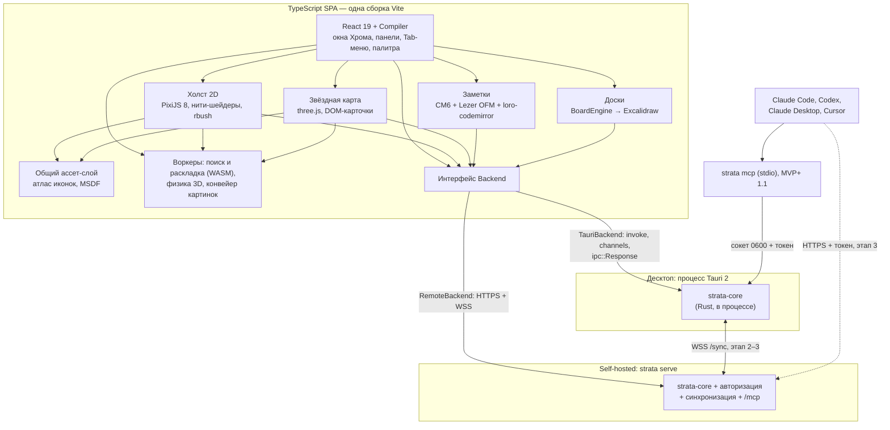
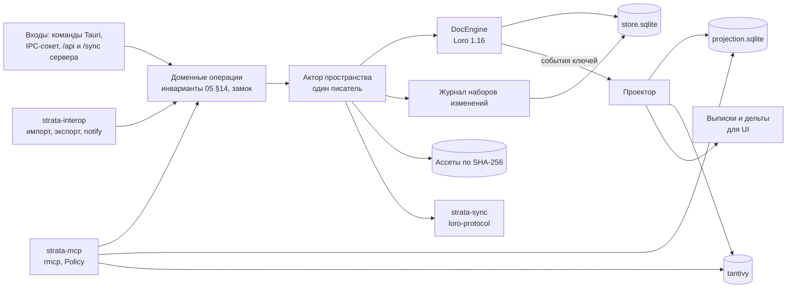
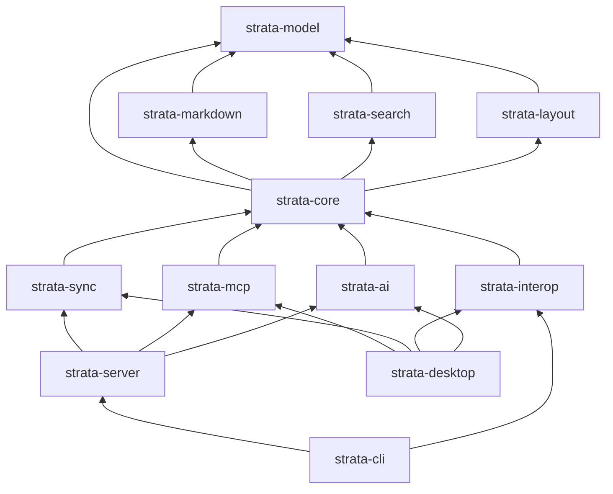
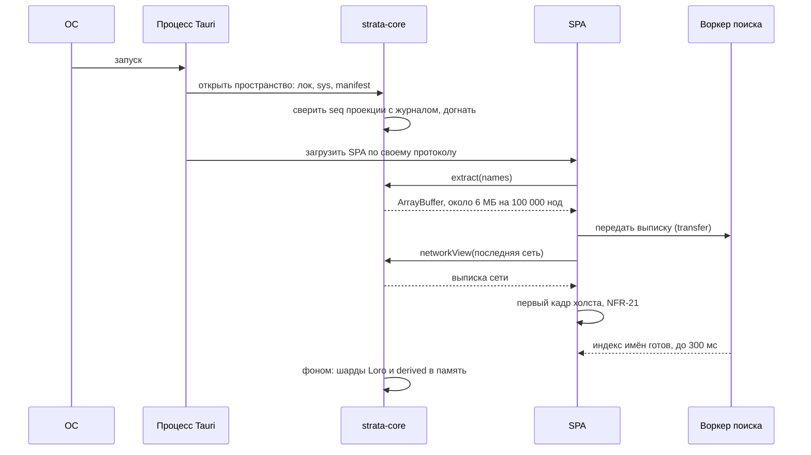
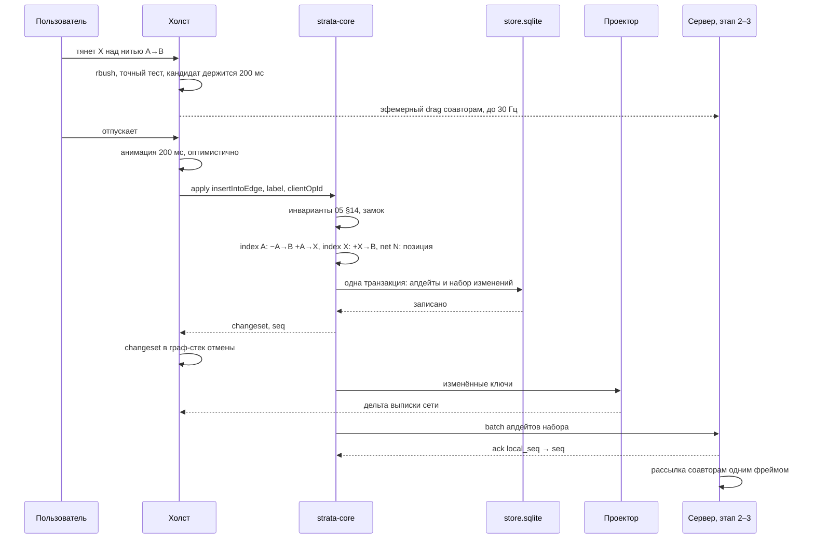
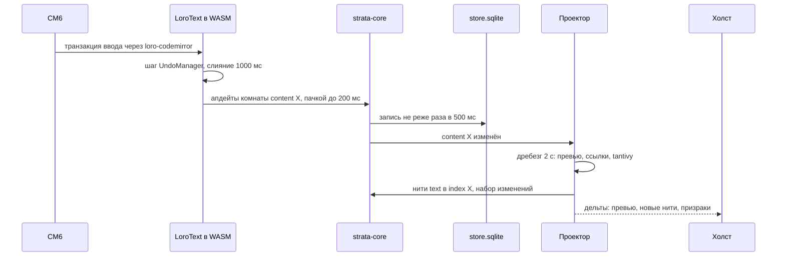
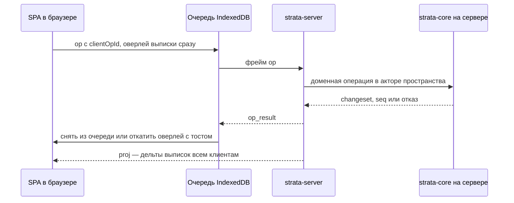
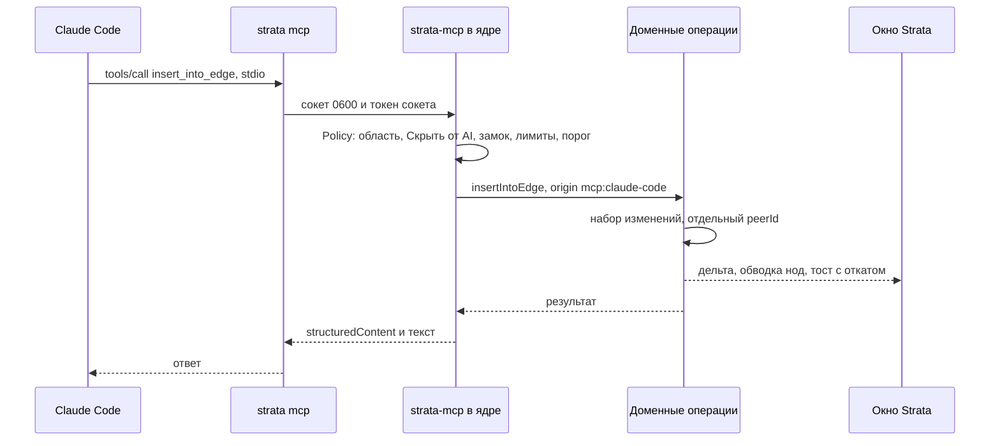
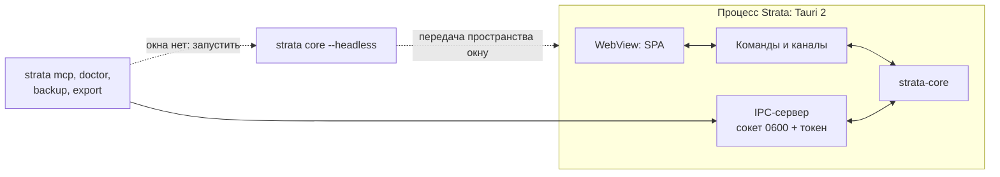
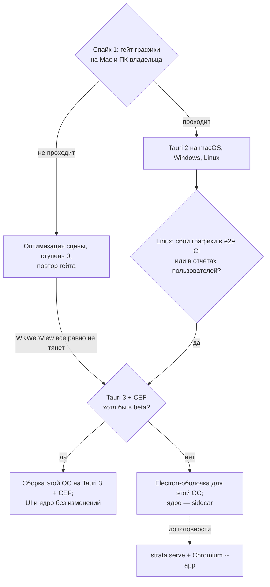

# 15. Архитектура и стек

> Статус: черновик. Компоненты, модули монорепозитория, потоки данных, правила горячего пути, платформы, запасной стек, спайки перед фиксацией, сборка и CI, индекс ADR.
>
> Опирается на [05-domain-model.md](05-domain-model.md) (ядро) и [глоссарий](glossary.md). Связано: [06](06-canvas-ux.md), [07](07-design-system.md), [08](08-view-3d.md), [09](09-search-navigation.md), [10](10-storage-sync-collab.md), [11](11-server-selfhost.md), [12](12-mcp-ai.md), [13](13-interop.md), [14](14-nfr.md) (бюджеты), [16](16-roadmap.md), ADR [0001](adr/0001-global-edges.md)–[0008](adr/0008-mcp-architecture.md). Источники фактов: [R4](research/R4-app-shell-rendering.md) (главный), [R3](research/R3-crdt-sync.md), [R5](research/R5-board-engine.md), [R6](research/R6-mcp-ai.md), [R7](research/R7-retro-design-assets.md).
>
> Обозначения: ✅ решено ответами, ☑ решено по делегированию владельца (раунд 2), 💡 предложение (с 2026-10-19 считается принятым, [README](README.md)), ❓ вопрос (собраны в [17-open-questions.md](17-open-questions.md)). ✅ R2: B2, Q-15-2 — стек по плану А; версии библиотек и пороги подтверждают спайки §7.

## Кратко

- ✅ R2: B2 — весь код пишет Claude, поэтому принят план А: Tauri 2 + ядро на Rust + одна TS SPA на React.
- 💡 **Одно ядро на Rust** (`strata-core`: Loro, rusqlite, tantivy, notify, rmcp) в трёх ролях: в процессе десктопа на Tauri 2, в self-hosted сервере `strata serve`, за командой `strata mcp`. Модель данных реализована один раз ([R4](research/R4-app-shell-rendering.md) §7).
- 💡 **Одна TypeScript SPA** (React 19 + React Compiler) для десктопа и веба. С данными она говорит только через интерфейс `Backend`: `TauriBackend` (IPC) на десктопе, `RemoteBackend` (HTTPS и WebSocket) в вебе ([R4](research/R4-app-shell-rendering.md) §1.7, [10](10-storage-sync-collab.md) §4).
- 💡 **Горячий путь мимо React:** холст — PixiJS 8 со своими нитями-шейдерами и rbush, карта — three.js; позиции нод живут в `SceneStore`, а не в состоянии React; рендер по требованию, 0 кадров в покое.
- 💡 Граф меняется только доменными операциями ядра; чтение для поиска, путей, 3D и MCP — из проекции SQLite; редакторы (CM6, Excalidraw) синхронизируют свои Loro-документы как комнаты.
- ✅ R2: Q-15-1 — основные платформы **macOS (WKWebView) и Windows (WebView2)**. Гейт графики — спайк 1 на Mac и ПК владельца по сборкам из CI и веб-странице бенчмарка (§5.3). Linux (WebKitGTK) собирается в CI и проходит автотесты; лестница отступления (Canvas-фолбэк → Tauri 3 + CEF → Electron-оболочка) — запасной план прежде всего для Linux.
- Запасной стек Electron + Node-ядро не нужен (✅ R2: B2, §6). ✅ R2: B3 — реализует Claude по [16](16-roadmap.md): календарных сроков нет, прогресс — по вехам; перед фиксацией ADR — спайки §7.
- ☑ R2: B4, Q-11-7 — лицензия **AGPL-3.0-or-later** на весь репозиторий; шрифты, иконки и прочие ассеты — под своими лицензиями (§8.4). Сборки CI: macOS universal, Windows x64, Linux x64, пока без подписи (§8.6).

## 1. Обзор

### 1.1. Компоненты



### 1.2. Ядро изнутри



Формат папки, документы, проекция, протокол — [10](10-storage-sync-collab.md); сервер — [11](11-server-selfhost.md); MCP — [12](12-mcp-ai.md).

### 1.3. Стек по слоям

Все версии — на 2026-10-13 из исследований; в сборке закрепляются точно (§8.5).

| Слой | Выбор (💡) | Версия, лицензия | Источник | ADR |
|---|---|---|---|---|
| Оболочка десктопа | Tauri 2 (wry: WebView2, WKWebView, WebKitGTK) | 2.12.3, Apache-2.0 OR MIT | [R4](research/R4-app-shell-rendering.md) §1 | [0004](adr/0004-app-shell.md) |
| UI-фреймворк | React 19 + React Compiler | 19.3.0, Compiler 1.0 | [R4](research/R4-app-shell-rendering.md) §5 | [0004](adr/0004-app-shell.md) |
| Холст 2D | PixiJS 8: WebGL, Canvas-фолбэк с 8.16 | 8.22.0, MIT | [R4](research/R4-app-shell-rendering.md) §2.3 | [0005](adr/0005-rendering.md) |
| Хит-тест | rbush (живой холст), flatbush (статичные слои) | 4.0.1 MIT; 4.6.2 ISC | [R4](research/R4-app-shell-rendering.md) §2.8 | [0005](adr/0005-rendering.md) |
| 3D | three.js `WebGLRenderer`, Points / InstancedMesh | 0.186.1, MIT | [R4](research/R4-app-shell-rendering.md) §3.1 | [0005](adr/0005-rendering.md) |
| Физика 3D | ngraph.forcelayout или d3-force-3d в воркере — спайк | 3.3.1 BSD-3-Clause; 3.0.6 MIT | [R4](research/R4-app-shell-rendering.md) §3.5 | [0005](adr/0005-rendering.md) |
| Редактор заметок | CodeMirror 6 + `lang-markdown` + свои Lezer-расширения | `@codemirror/view` 6.43.14, MIT | [R4](research/R4-app-shell-rendering.md) §6 | [0007](adr/0007-text-editor.md) |
| Доски | Excalidraw, закреплённый снапшот `next` | 0.18.0-43a92e6, MIT | [R5](research/R5-board-engine.md) | [0006](adr/0006-board-engine.md) |
| CRDT | Loro: crate в ядре, `loro-crdt` (WASM) в UI; `loro-codemirror` | 1.16.x, MIT; 0.3.3 | [R3](research/R3-crdt-sync.md) §4, §8 | [0003](adr/0003-sync-engine.md) |
| Хранилище и проекция | SQLite через rusqlite (`bundled`) | 0.40.2, MIT | [R4](research/R4-app-shell-rendering.md) §7 | [0003](adr/0003-sync-engine.md) |
| Полнотекст (MVP+ 1.1, [16](16-roadmap.md) §5.2) | tantivy, русский стеммер | 0.26.2, MIT | [R4](research/R4-app-shell-rendering.md) §7 | — |
| Вотчер (зеркало, этап 2) | notify + notify-debouncer-full | 8.2.0 CC0-1.0; 0.7.0 | [R4](research/R4-app-shell-rendering.md) §7 | — |
| MCP (MVP+ 1.1) | rmcp, ревизии `2025-11-25` и `2026-07-28` | 3.5.1, Apache-2.0 | [R6](research/R6-mcp-ai.md) §1.6 | [0008](adr/0008-mcp-architecture.md) |
| Сервер | axum на tokio + серверная часть `loro-protocol` | версии не проверялись | [R3](research/R3-crdt-sync.md) рек. §8, [11](11-server-selfhost.md) §2 | [0003](adr/0003-sync-engine.md) |
| AI (этап 2) | fastembed, sqlite-vec; LLM — свой трейт поверх `genai` | 7.1.1 Apache-2.0; 0.1.9 MIT OR Apache-2.0; 0.6.5 MIT OR Apache-2.0 | [R6](research/R6-mcp-ai.md) §5 | [0008](adr/0008-mcp-architecture.md) |
| Картинки и иконки | DOMPurify, `@thi.ng/pixel-dither`, `stackblur-canvas` в воркере | 3.4.17 MPL-2.0 OR Apache-2.0; Apache-2.0; 3.0.1 MIT | [R7](research/R7-retro-design-assets.md) §4–5, [07](07-design-system.md) §6–7 | — |
| Текст на Сцене | Подписи баблов, нитей и бейджи — пиксельный `BitmapText` Pixi в экранном пространстве с округлением позиции до физического пикселя ([07](07-design-system.md) §3.4); MSDF-атласы `msdf-atlas-gen` — для мирового текста (стикеры, заголовки рамок) и всех подписей в режиме читаемости | MIT | [R4](research/R4-app-shell-rendering.md) §2.7, [07](07-design-system.md) §3.4 | [0005](adr/0005-rendering.md) |

### 1.4. Принципы

| # | Принцип | Следствие |
|---|---|---|
| 1 | **Одно ядро, одна модель** | Доменные операции, инварианты 05 §14, наборы изменений и правила «Скрыть от AI» реализованы один раз в `strata-core`; UI, импорт, MCP и сервер их вызывают ([R4](research/R4-app-shell-rendering.md), [ADR-0008](adr/0008-mcp-architecture.md)) |
| 2 | **Писать — операциями, читать — из проекции** | UI не пишет граф в CRDT напрямую; поиск, пути, 3D и MCP не читают CRDT ([10](10-storage-sync-collab.md) §4, §7) |
| 3 | **UI не знает, где ядро** | Всё через `Backend`; веб и десктоп — одна сборка ([R4](research/R4-app-shell-rendering.md) §1.7) |
| 4 | **Горячий путь императивный** | Холст и карта — вне React; React рисует только Хром (§4) |
| 5 | **Движки за адаптерами** | `DocEngine` (Loro), `BoardEngine` (Excalidraw), `VectorIndex` (sqlite-vec), `SecretStore`, `LlmProvider`, `AssetBackend`: смена движка трогает один модуль |
| 6 | **Точные версии быстро меняющихся зависимостей** | Loro, rmcp, Excalidraw `next`, three.js, PixiJS — без `^`; обновление — отдельная задача с регрессией (§8.5) |
| 7 | **Содержимое — только по открытию** (✅ N1) | Холст, карта, поиск по именам и инфокарточки работают на индексе и превью (05 §13) |

## 2. Модули и пакеты

### 2.1. Монорепозиторий

```
strata/
├── LICENSE                    AGPL-3.0-or-later (☑ Q-11-7, §8.4)
├── .github/workflows/ci.yml   тесты и сборки macOS, Windows, Linux (§8.6)
├── Cargo.toml                 workspace Rust
├── package.json               pnpm workspaces
├── crates/
│   ├── strata-model           типы домена, DomainOp, Changeset, выписки; без IO; native + wasm32
│   ├── strata-core            доменные операции, инварианты, DocEngine, store, проекция, tantivy, ассеты, журнал, актор
│   ├── strata-markdown        разбор OFM: ссылки, embed, теги, свойства, задачи
│   ├── strata-search          поиск по именам (09 §2); native + wasm32
│   ├── strata-layout          раскладка L, A-drag, автоместо (06 §9); native + wasm32
│   ├── strata-sync            протокол поверх loro-protocol: клиент реплики и сервер, лента seq, пакеты, эфемерный канал
│   ├── strata-interop         импорт и экспорт: Obsidian, JSON Canvas, .excalidraw.md; зеркало на notify (этап 2)
│   ├── strata-mcp             MCP на rmcp: ToolRouter, Policy, ResponseFormatter, IPC-сервер сокета
│   ├── strata-ai              этап 2: эмбеддинги, VectorIndex, LlmProvider, ImageProvider
│   ├── strata-server          axum: /sync, /api/v1, /mcp, /auth, /admin; аккаунты, роли, токены
│   ├── strata-cli             бинарник strata: serve, core --headless, mcp, doctor, backup, migrate, export, reproject, gc, admin
│   └── strata-desktop         приложение Tauri 2: команды и каналы TauriBackend, окна, апдейтер, глубокие ссылки, ключи ОС
├── packages/
│   ├── ui                     React-приложение: Хром, панели, Tab-меню, палитра, строка пути, вид-линза «Список»; точка сборки Vite
│   ├── chrome                 ретро-кит компонентов на токенах (07 §8)
│   ├── design-tokens          JSON токенов → CSS-переменные и константы для Pixi и three (07 §2.9)
│   ├── backend                Backend, TauriBackend, RemoteBackend, DocHandle (loro-crdt + комната); типы из strata-model
│   ├── canvas                 PixiJS 8: SceneStore, баблы, нити-шейдеры, rbush, слой ввода, жесты, LOD, анимации
│   ├── view3d                 three.js: сцена, камера, DOM-карточки; «камера-мост» вместе с canvas
│   ├── scene-assets           атлас иконок и масок, MSDF-атласы, загрузка текстур — общие для 2D и 3D
│   ├── editor                 CM6 + Lezer OFM + live preview + loro-codemirror; лёгкий режим для виджетов
│   ├── board                  BoardEngine, адаптер Excalidraw, виджеты, биндинг Loro
│   ├── checklist              редактор списка (LoroTree + LoroText)
│   ├── media                  просмотрщики картинок, PDF, видео, аудио (библиотеки не исследовались)
│   ├── workers                воркеры: поиск и раскладка (WASM), физика 3D, конвейер картинок
│   ├── i18n                   каталоги RU и EN, плюральные правила
│   └── testkit                генератор наборов W-*, N-*, B-*, T-* (14 §1.3), харнесс бенчмарков, фикстуры
├── corpus/                    V-synth, образцы .excalidraw.md, XSS-образцы, пространства прошлых версий
└── tools/                     проверка cmap шрифтов (07 §3.5), сборка MSDF-атласов, отчёт бенчмарков
```

### 2.2. Rust-крейты

| Крейт | Отвечает за | Зависит от | Цели |
|---|---|---|---|
| `strata-model` | ID (UUIDv7, текстовая форма — 05 §4.1), `NodeKind`, поля, `DomainOp`, `Changeset` (структура и откат — [10](10-storage-sync-collab.md) §9.1, §9.3), форматы выписок | — | native, wasm32 |
| `strata-core` | Доменные операции и инварианты; `DocEngine` над Loro; `store.sqlite`, `projection.sqlite`, tantivy; ассеты; журнал и откат наборов; актор пространства; компактирование, перешардирование, миграции, сверка ([10](10-storage-sync-collab.md)) | model, markdown, search, layout | native |
| `strata-markdown` | Извлечение `[[ссылок]]`, embed, тегов, свойств, задач из Markdown для нитей с происхождением `text` и импорта. Rust-библиотеки разбора Markdown и YAML не выбирались (не исследовалось): выбор — спайк 11 (§2.6, §7) | model | native |
| `strata-search` | Нормализация, ступени сопоставления, ранжирование ([09](09-search-navigation.md) §2) | model | native, wasm32 |
| `strata-layout` | Слоистый DAG, радиальное дерево, силовая раскладка с ограничениями, раздвигание соседей ([06](06-canvas-ux.md) §9) | model | native, wasm32 |
| `strata-sync` | Фреймы [10](10-storage-sync-collab.md) §8.1 поверх `loro-protocol`; клиент реплики; серверный ретранслятор | core | native |
| `strata-interop` | Импорт Obsidian, JSON Canvas, `.excalidraw.md` (сжатие — формат JS-библиотеки `lz-string` 1.5.0, MIT, [R2](research/R2-obsidian-format.md); Rust-крейт — спайк 11, §2.6); экспорт (MVP+ 1.2); зеркало (этап 2) ([13](13-interop.md)) | core, markdown, layout | native |
| `strata-mcp` | rmcp, две ревизии; слои ToolRouter → Policy → DomainOps → ResponseFormatter ([12](12-mcp-ai.md) §2.4); IPC-сервер | core | native |
| `strata-ai` | Этап 2: fastembed, `VectorIndex` на sqlite-vec, `LlmProvider`, `ImageProvider` ([12](12-mcp-ai.md) §8–10) | core | native |
| `strata-server` | HTTP и WebSocket, аккаунты, сессии, роли, токены, `server.sqlite`, акторы пространств ([11](11-server-selfhost.md)) | core, sync, mcp, ai | native |
| `strata-cli` | Бинарник `strata` | server, mcp, core, interop | native |
| `strata-desktop` | Tauri 2: команды, каналы, окна, апдейтер, глубокие ссылки, `SecretStore` | core, mcp, sync, interop, ai | native |

Почему `strata-markdown` в Rust, а не только Lezer в UI: нити `text` пересчитывает ядро по итоговому тексту после слияния, импорта и правок агента, когда UI нет ([10](10-storage-sync-collab.md) §7.2). Lezer-грамматика UI нужна для подсветки, live preview и автодополнения `[[`. Расхождение ловит тест паритета на корпусе (§8.2).

### 2.3. TS-пакеты

| Пакет | Отвечает за | Можно импортировать | Нельзя |
|---|---|---|---|
| `ui` | Сборка приложения, Хром, роутинг, состояние интерфейса (не граф) | всё ниже | — |
| `chrome`, `design-tokens`, `i18n` | Ретро-компоненты, токены, строки | друг друга | `canvas`, `view3d`, `backend` |
| `backend` | Контракт данных и две реализации | `strata-model` (типы) | React, Pixi, three |
| `canvas` | Холст | `backend` (типы), `scene-assets`, `design-tokens`, `workers` | React, Excalidraw, CM6 |
| `view3d` | Карта | то же, что `canvas`, плюс `canvas` (только для «камеры-моста») | React, Excalidraw, CM6 |
| `scene-assets` | Атласы | `design-tokens` | — |
| `editor` | Редактор заметок | `backend`, `design-tokens`, `i18n` | `canvas`, `view3d` |
| `board` | Доски | `backend`, `editor` (лёгкий режим), `chrome`, `design-tokens` | `canvas`, `view3d` |
| `checklist`, `media` | Список, просмотрщики | `backend`, `chrome` | `canvas`, `view3d` |
| `workers` | Воркеры | WASM `strata-search`, `strata-layout` | DOM, React |

Только `board` импортирует `@excalidraw/excalidraw`; только `backend`, `editor`, `board`, `checklist` импортируют `loro-crdt`. В Rust Loro трогает только модуль `engine` в `strata-core` ([ADR-0003](adr/0003-sync-engine.md)). `strata-core` не зависит от `tauri`, `axum` и `rmcp`. Правила проверяются линтером импортов и `cargo deny` (§8.4).

### 2.4. Граф зависимостей



### 2.5. Ключевые интерфейсы

**`Backend`** — контракт из [10](10-storage-sync-collab.md) §4, здесь — как он реализован:

| Метод | `TauriBackend` | `RemoteBackend` |
|---|---|---|
| `apply(ops, meta)` | `invoke` → ядро в процессе | Фрейм `op` → `op_result` ([10](10-storage-sync-collab.md) §8.1); офлайн — очередь IndexedDB |
| `revert(changeset)` | `invoke` | `op` |
| `extract(kind, sinceSeq)` | `invoke` → `tauri::ipc::Response` с ArrayBuffer ([R4](research/R4-app-shell-rendering.md) §1.4) | HTTPS `GET /api/v1/extract/{kind}` → ArrayBuffer |
| `networkView(net)` | `invoke` → ArrayBuffer | HTTPS + комната `net/*` |
| `openDoc(doc)` | `DocHandle`: `LoroDoc` в WASM + комната через канал Tauri | `DocHandle` + комната по WSS |
| `presence` | Канал Tauri (локально — только свои окна и агенты) | Эфемерные комнаты `loro-protocol`: `ws/{ws}/eph` и `ws/{ws}/eph/{nodeId}` ([10](10-storage-sync-collab.md) §8.3); свой фрейм `eph` — резерв ([10](10-storage-sync-collab.md) §8.1) |
| `assets` | Свой протокол Tauri или ArrayBuffer → `blob:` URL — выбор в спайке 1 | HTTPS, ассеты по хешу |
| `status` | Канал Tauri | Состояние сокета и очереди |

**`DocEngine`** (Rust, в `strata-core`) — единственная точка вызова Loro:

```rust
pub trait DocEngine {
    type Doc;
    fn load(&self, id: &DocId, snapshot: Option<&[u8]>, updates: &[&[u8]]) -> Result<Self::Doc>;
    fn import(&self, doc: &mut Self::Doc, update: &[u8]) -> Result<ChangedKeys>;   // удалённое
    fn commit(&self, doc: &mut Self::Doc, meta: &CommitMeta) -> Result<Vec<u8>>;    // локальное → апдейт
    fn snapshot(&self, doc: &Self::Doc, shallow: bool) -> Result<Vec<u8>>;
    fn version(&self, doc: &Self::Doc) -> VersionVector;
    fn revert_to(&self, doc: &mut Self::Doc, at: &Frontiers) -> Result<()>;         // R3 §4
}
// CommitMeta { changeset: Id, origin: Origin, message: String } → setNextCommitMessage / Origin (R3 §4)
```

**`SceneStore`** (TS, в `canvas`) — позиции и состояния вне React:

```ts
interface SceneStore {
  count: number;                                  // размещения текущей сети
  id: Uint32Array;                                // слот → номер размещения в выписке
  x: Float32Array; y: Float32Array; r: Float32Array;
  state: Uint32Array;                             // биты: выделено, текущая, ключевая, пауза, срок, появление…
  icon: Uint32Array;                              // ячейка атласа
  edges: { from: Uint32Array; to: Uint32Array; style: Uint8Array; bend: Float32Array };
  dirty: DirtyRanges;                             // что перезалить в буферы GPU
  on(topic: 'selection' | 'current' | 'camera' | 'hover', cb: () => void): () => void; // React — не чаще кадра
}
```

`BoardEngine` — [ADR-0006](adr/0006-board-engine.md); `ToolContext` и слои MCP — [12](12-mcp-ai.md) §2.4.

### 2.6. Выборы библиотек, отложенные другими документами

| Задача | Выбор (💡) | Почему | Что не проверено |
|---|---|---|---|
| Раскладка `L`, `A`-drag, автоместо ([06](06-canvas-ux.md) Q-06-9) | Свой крейт `strata-layout`, нативно и в WASM | Нужна и в ядре (импорт раскладывает сети один раз, [06](06-canvas-ux.md) §9.3; автоместо для `apply_graph_plan`, [12](12-mcp-ai.md)), и в UI-воркере; одна реализация — одна выдача | Готовые библиотеки раскладки в исследованиях не проверялись. Если свои алгоритмы окажутся дорогими — сравнить готовые по лицензии и скорости в спайке 10 |
| Хранилище ключей ОС ([11](11-server-selfhost.md) §6.2, [12](12-mcp-ai.md) §8.6) | Трейт `SecretStore`, реализация — крейт `keyring` | Keychain, Credential Manager, Secret Service ([R6](research/R6-mcp-ai.md) §5.6) | Версия и лицензия `keyring`; Keychain и Credential Manager проверяет спайк 1 на машинах владельца; Secret Service на Linux — только в CI (✅ R2: Q-15-1). Запасной путь — файл с правами 0600 и предупреждением |
| LLM-клиент, этап 2 ([12](12-mcp-ai.md) §8.5) | Трейт `LlmProvider`, первая реализация на `genai` 0.6.5 (MIT OR Apache-2.0, мультипровайдер, [R6](research/R6-mcp-ai.md) §5.6) | Один клиент на Anthropic и OpenAI | Поддержка Ollama в `genai`; запасной — прямой HTTP к Ollama. `ollama-rs` не берём: лицензия «non-standard» |
| S3, этап 3 ([11](11-server-selfhost.md) §3.3) | Трейт `AssetBackend`; в v1 — диск | Выбор клиента не нужен до этапа 3 | Клиентские библиотеки S3 не исследовались |
| Глубокие ссылки `strata://` (MVP+ 1.4), один экземпляр приложения ([09](09-search-navigation.md) §5.4) | Механизмы Tauri | — | Не проверено; пункт спайка 1 |
| Типы TS из Rust | Генерация из `strata-model` | Один источник типов для `Backend` и выписок | Кандидаты `ts-rs` и `specta` не проверялись |
| Разбор Markdown, YAML, LZString и JSON Canvas в Rust ([13](13-interop.md) §7.3 п. 7) | Выбор — в спайке 11 (§7) | Нужны ядру: нити `text`, импорт и экспорт без UI (§2.2) | Из исследований известен только крейт `jsoncanvas` ([R2](research/R2-obsidian-format.md)); остальные крейты, их версии и лицензии не исследовались. Критерии выбора — белый список лицензий §8.4 и корпус NFR-122 |
| Просмотр PDF, видео и аудио для вида «Медиа» ([06](06-canvas-ux.md) §13.1) | — | Вид «Медиа» — в MVP ([16](16-roadmap.md) §4.2); выбор просмотрщика — зависимость MVP ([16](16-roadmap.md) §4.10) | Не исследовалось. Решить до вехи 1C ([16](16-roadmap.md) §4.7): библиотека PDF или средства WebView, кодеки видео и аудио в WKWebView и WebView2 (WebKitGTK — в CI), лицензия по §8.4. Код — в пакете `media` (§2.1) |

## 3. Потоки данных

### 3.1. Старт десктопа



Шарды индекса импортируются лениво (0,14 с на 100 000 нод в замере Loro, [R3](research/R3-crdt-sync.md) §12.3), поэтому первый кадр от них не зависит: холст и поиск читают проекцию.

### 3.2. Вход в сеть

| Шаг | Где | Что |
|---|---|---|
| 1 | Холст | `Enter` или `I` на бабле сети: зум в бабл 250 мс ([06](06-canvas-ux.md) §1.4); строка пути — путь захода |
| 2 | Ядро | `networkView(N)`: `net[N]` из памяти или `store`, размещения и нити — из проекции → ArrayBuffer |
| 3 | Холст | Заполняет `SceneStore`, заливает буферы, догружает недостающие ячейки атласа |
| 4 | Ядро | Упреждающе: `net` родителя по пути захода и видимых дочерних сетей, до 20 ([10](10-storage-sync-collab.md) §6.1) |

Бюджет — NFR-25 и NFR-26 ([14](14-nfr.md) §4).

### 3.3. Вставка в нить



- Подтверждение UI — только после записи транзакции (NFR-69). Если ядро отказало, оптимистичная анимация откатывается с тостом.
- Шарды: `index[k(A)]` и `index[k(X)]` — 1–2 документа ([10](10-storage-sync-collab.md) §4); между репликами атомарность держат пакет `batch` и сверка инвариантов ([10](10-storage-sync-collab.md) §8.5).

### 3.4. Правка заметки



Ссылки извлекает `strata-markdown` в ядре, а не UI: тот же путь работает для импорта, правок агента и чужих правок после слияния ([10](10-storage-sync-collab.md) §7.2).

### 3.5. Синхронизация и тонкий веб

Переподключение и догон по ленте `seq` — диаграмма [10](10-storage-sync-collab.md) §8.2. Граф-операция тонкого веб-клиента идёт на сервер:



### 3.6. Вызов MCP



Правка видна на холсте ≤ 200 мс (NFR-37). Лаунчер, ревизии и политика — [12](12-mcp-ai.md) §2.

### 3.7. Импорт vault

| Шаг | Где | Что |
|---|---|---|
| 1 | UI | Выбор папки (системный диалог), предпросмотр: число заметок, вложений, `.canvas`, `.excalidraw.md` ([04](04-personas-scenarios.md) S1) |
| 2 | Ядро | Фоновая задача: обход, `strata-markdown`, разрешение ссылок, призраки ([13](13-interop.md)) |
| 3 | Ядро | Запись пачками по сетям: каждая пачка — своя транзакция; все пачки несут один ID набора изменений с источником `import` и статусом `in-progress` ([10](10-storage-sync-collab.md) §3.3, §9.1) |
| 4 | Ядро | Раскладка новых сетей `strata-layout` один раз ([06](06-canvas-ux.md) §9.3) |
| 5 | UI | Сети появляются пачками по дельтам проекции; прогресс в статусной строке |
| 6 | Ядро | Конец: набор получает статус `applied`; отчёт |

💡 После сбоя на середине при следующем старте — диалог «Импорт прерван: продолжить или откатить частичный» ([13](13-interop.md) §3.3). Так «один импорт — один набор изменений» ([10](10-storage-sync-collab.md) §3.3, §9.1) совмещается с живым холстом во время импорта. Бюджеты — [14](14-nfr.md) §6.

## 4. Горячий путь

Горячий путь — код, который выполняется каждый кадр или на каждое событие указателя: рендер холста и карты, ввод, хит-тест, анимации.

### 4.1. Правила

| # | Правило | Почему |
|---|---|---|
| 1 | **Позиции нод не в React.** Они живут в `SceneStore` (typed arrays); React подписан только на выделение, текущую ноду и камеру — не чаще раза в кадр | Иначе «производительность рухнет» ([R4](research/R4-app-shell-rendering.md), риск 8); `@pixi/react` и R3F на холсте не используем ([R4](research/R4-app-shell-rendering.md) §2.3, §5) |
| 2 | **Рендер по требованию.** Кадр запрашивают ввод, камера, данные, наведение и анимации с конечной длительностью; в покое — 0 кадров | NFR-04; [07](07-design-system.md) §10.2 |
| 3 | **Один draw call на слой.** Баблы — инстансы с атласом иконок; нити — одна инстансная полоса, кривая считается в вершинном шейдере; гало — спрайты | ≤ 20 draw calls (NFR-11); схема нитей — [R4](research/R4-app-shell-rendering.md) §2.6 |
| 4 | **Частичная заливка буферов.** Обновляются только изменённые диапазоны (`dirty`); перетаскиваемое выделение на время жеста — своя render group, двигается одной трансформацией | Перетаскивание 100 нод не перезаливает 5 000: в спайке 1 — 0,5 мс CPU на кадр против 3,7 мс без своей группы ([S1](spikes/S1-canvas.md)) |
| 5 | **Свой ввод и хит-тест.** EventSystem Pixi выключен (`eventMode: 'none'`); события указателя → rbush → точный тест | Тысячи объектов, броски на нить, нож ([R4](research/R4-app-shell-rendering.md) §2.8) |
| 6 | **Свой culling** по тому же rbush, а не обход сцены | Дешевле `CullerPlugin` ([R4](research/R4-app-shell-rendering.md) §2.3). ☑ Подтверждено спайком 1: `Culler` из Pixi стоил 10–20 мс CPU на кадр при 5 000 баблов ([S1](spikes/S1-canvas.md)) |
| 6а | **Камера — трансформация render group.** Мир и каждый слой — render group Pixi 8; камера меняет одну трансформацию на GPU, дети не пересчитываются. Списки отрисовки слоёв строятся при загрузке сети. До N-10k отсечение по объектам не нужно, rbush — для хит-теста и сетей крупнее | ☑ Спайк 1: CPU на кадр 0,4 мс вместо 21–35 мс, 4–6 draw calls (NFR-11). Группы не объединяются в пачки, поэтому плитки-группы дали 25–127 draw calls ([S1](spikes/S1-canvas.md)) |
| 7 | **Анимируются только активные нити**, ≤ 256 одновременно | [06](06-canvas-ux.md) §6.8 |
| 8 | **Нет выделений памяти в цикле кадра**: пулы векторов и временных массивов | Паузы сборщика мусора дают рваные кадры |
| 9 | **Пиксельный шрифт — только в экранном пространстве**, в мире — MSDF | Иначе мыло при плавном зуме ([R4](research/R4-app-shell-rendering.md) §2.7, [07](07-design-system.md) §3.4) |
| 10 | **Никакого живого блюра**: фоны предразмыты, `backdrop-filter` и `BlurFilter` на кадр запрещены | [R7](research/R7-retro-design-assets.md) §5.1, опасно на WebKitGTK |
| 11 | **Тяжёлое — вне главного потока**: поиск, раскладка, физика, картинки — воркеры; разбор, проекция, индексация — ядро | 0 задач > 50 мс при взаимодействии (NFR-38) |
| 12 | **Большие данные — бинарно.** Выписки — ArrayBuffer; никаких JSON-массивов на 100 000 объектов через IPC | Сериализация JSON на горячем пути съедает кадр |
| 13 | **Содержимое на холсте не рендерится**, только превью из индекса (✅ N1); живых редакторов ≤ 4 ([06](06-canvas-ux.md) §2.2) | Память и старт не зависят от объёма содержимого |

### 4.2. Потоки и воркеры

| Где | Что | Обмен |
|---|---|---|
| Главный поток UI | React (Хром), рендер Pixi и three, CM6, Excalidraw, слой ввода | `SceneStore` |
| Воркер поиска | `strata-search` в WASM: индекс имён, запросы Tab-меню, `Ctrl+O`, `Ctrl+F` | Выписка имён и дельты (transfer) → номера нод |
| Воркер раскладки | `strata-layout` в WASM: `L`, предпросмотр `A`-drag, автоместо | Подграф сети → `Float32Array` позиций |
| Воркер физики | ngraph или d3-force-3d: раскладка карты, локальная физика | 3D-выписка → позиции, transferable `Float32Array` ([R4](research/R4-app-shell-rendering.md) §3.5) |
| Воркер картинок | Декод, санитизированный SVG → растр, стилизация иконок, блюр и нормализация фонов, WebP | `ImageBitmap` → маски и WebP ([07](07-design-system.md) §6–7) |
| Ядро: актор пространства | Доменные операции, запись `store` | Команды, апдейты |
| Ядро: проектор | Проекция, выписки, дельты | События ключей |
| Ядро: фоновые задачи | tantivy (низкий приоритет), компактирование, импорт, эмбеддинги (этап 2) | Очередь задач |

`SharedArrayBuffer` не используем: он требует COOP и COEP, а в протоколе Tauri это не проверено ([R4](research/R4-app-shell-rendering.md) §3.5); сервер COEP не ставит ([11](11-server-selfhost.md) §8.7).

### 4.3. Цикл кадра

```ts
let scheduled = false;
export function invalidate(): void {
  if (!scheduled) { scheduled = true; requestAnimationFrame(frame); }
}
function frame(t: number): void {
  scheduled = false;
  input.flush();             // накопленные pointer-события → жесты, хит-тест rbush
  const moving = anim.step(t); // только конечные анимации (07 §10.2)
  scene.uploadDirty();       // частичная заливка буферов GPU
  culler.update(camera);     // видимые слоты по rbush
  renderer.render(stage);
  ui.publish();              // одно событие на тему для React
  if (moving || input.active) invalidate();
}
```

### 4.4. Обмен UI ↔ ядро

| Что | Десктоп | Формат | Объём |
|---|---|---|---|
| Доменная операция | `invoke` | JSON | Сотни байт |
| Выписки имён, 3D, сети | `invoke` → `tauri::ipc::Response` | ArrayBuffer | До 10 МБ ([08](08-view-3d.md) §8.3, [09](09-search-navigation.md) §2.7) |
| Дельты выписок, статус, присутствие | Канал Tauri | Бинарные кадры | Не чаще кадра |
| Апдейты редакторов | Канал Tauri на комнату | Байты Loro | Пачки до 200 мс |

Event system Tauri «is not designed for low latency or high throughput» — для потоков только каналы ([R4](research/R4-app-shell-rendering.md) §1.4). В вебе те же сообщения идут по HTTPS (выписки) и фреймами WebSocket ([10](10-storage-sync-collab.md) §8.1).

### 4.5. OffscreenCanvas и рендер в воркере

- **2D-контекст в воркере** — для конвейера картинок. Safari 16.4 умел OffscreenCanvas только с 2D-контекстом ([R4](research/R4-app-shell-rendering.md) §1.3); WebKitGTK не проверено → при отсутствии конвейер работает в главном потоке кусками в простое.
- **WebGL в воркере**: в Safari с 17-й версии, для `webgl2` и WebKitGTK подтверждения нет ([R4](research/R4-app-shell-rendering.md) §1.3). Поэтому в MVP рендер холста и карты — в главном потоке за тонкой границей «сцена ← снапшот» ([R4](research/R4-app-shell-rendering.md) §2.9).
- Перенос рендера Pixi в воркер (`WebWorkerAdapter`, `transferControlToOffscreen`) — оптимизация после замеров. Цена: ввод с задержкой на кадр, без DOMContainer, AccessibilitySystem и загрузки FontFace в воркере ([R4](research/R4-app-shell-rendering.md) §2.3) — нам подходят только bitmap- и MSDF-шрифты, что уже так.

## 5. Платформы

### 5.1. Десктоп

| ОС | WebView в Tauri 2 | WebGL2 | WebGPU | Риски | Что делаем |
|---|---|---|---|---|---|
| macOS — основная | WKWebView, обновляется только с ОС | Да | Только macOS 26; в WKWebView сторонних приложений официально не подтверждено | Возможен потолок 60 Гц на ProMotion ([R4](research/R4-app-shell-rendering.md) §1.3) | Гейт §5.3 на Mac владельца; цель 60 fps (NFR-119) |
| Windows — основная | WebView2 (Chromium, обновляется сам) | Да | Да (Chromium с 113) | Минимальные | Гейт §5.3 на ПК владельца |
| Linux — только CI | WebKitGTK `webkit2gtk-4.1`, версия от дистрибутива | Формально да; может молча уйти на медленный путь | Не подтверждён | Пустое окно и мерцание на NVIDIA; строка рендерера замаскирована («Apple GPU»); ошибки не поймать ([R4](research/R4-app-shell-rendering.md) §1.3) | Сборка и автотесты в CI, Canvas-фолбэк, лестница §5.3 |

Факты таблицы — [R4](research/R4-app-shell-rendering.md) §1.3. WebGPU в v1 не используем ([14](14-nfr.md) §15). ✅ R2: Q-15-1 — владелец тестирует на Mac и ПК с Windows; Linux собирается в CI и проходит автотесты, ручной приёмки нет.

### 5.2. Процессная модель десктопа

💡 Ядро живёт в процессе, который первым открыл пространство: в окне Strata или, если окна нет, в `strata core --headless`. Лок — файл `.lock` в папке пространства (pid, хост, время открытия, [10](10-storage-sync-collab.md) §3.1, §3.6) — исключает второго писателя ([12](12-mcp-ai.md) §2.3).



| Событие | Что происходит |
|---|---|
| Окно открыто | Ядро в процессе Tauri; IPC-сервер слушает сокет для `strata mcp` и CLI |
| Окно закрыто, агентов нет | Сброс на диск, процесс завершается |
| Окно закрыто, агенты подключены | Процесс живёт без окна и выходит через 10 мин после ухода последнего клиента (как ядро без окна, [12](12-mcp-ai.md) §2.3). Как Tauri держит процесс без окон — не проверено |
| Окна нет, стартует агент | `strata mcp` поднимает `strata core --headless` (тот же код ядра в бинарнике CLI) за ≤ 5 с ([12](12-mcp-ai.md) §2.3) |
| Окно открывают при работающем headless-ядре | Передача: окно просит headless-ядро сбросить данные и снять лок, затем открывает пространство; лаунчеры переподключаются (до 3 попыток, [12](12-mcp-ai.md) §2.3) |
| Второй запуск или ссылка `strata://` | Аргументы передаются уже запущенному экземпляру; механизм — не проверено, спайк 1 |

💡 **Сокеты и поиск ядра.** IPC-сокет — один на процесс ядра, а не на пользователя ОС: если два пространства открыты в разных процессах (два окна или окно и headless-ядро), у каждого процесса свой сокет. Имя — путь из [12](12-mcp-ai.md) §2.3 с суффиксом PID (`core-<pid>.sock`, на Windows — канал `strata-<пользователь>-<pid>`); путь сокета процесс записывает в `.lock` пространства рядом с pid. Лаунчер `strata mcp --workspace …` и CLI находят папку пространства и читают `.lock`: процесс жив — подключаются к сокету из лока и называют `workspaceId` в рукопожатии; лока нет или процесс мёртв — поднимают `strata core --headless`. Процесс с несколькими пространствами держит один сокет и различает их по `workspaceId`. Проверяет спайк 7 ([12](12-mcp-ai.md) §11.2 п. 2).

☑ Q-12-9 (он же Q-R4-9): после закрытия окна ядро живёт, только пока подключены агенты, и выходит через 10 мин после ухода последнего; без окна его поднимает лаунчер по требованию; значка в трее в MVP+ 1.1 нет. Модель выше это и описывает. CLI `strata` поставляется вместе с десктопом как sidecar (`bundle.externalBin` с суффиксом целевой платформы, [R4](research/R4-app-shell-rendering.md) §1.4) и отдельными архивами для сервера.

### 5.3. Гейт графики macOS + Windows и лестница отступления

**Гейт графики** (✅ R2: Q-15-1) — спайк 1 на машинах владельца MO-mac и MO-win ([14](14-nfr.md) §1.2). Как проверяем:

- CI собирает неподписанные сборки спайка для macOS и Windows (§8.6, ☑ Q-15-11). Владелец запускает в них харнесс бенчмарка, отчёт копирует в задачу вехи (☑ Q-15-12).
- Веб-страница бенчмарка с тем же сценарием — быстрая проверка без установки: Safari ≈ WKWebView, Edge или Chrome ≈ WebView2. Порог гейта засчитывается по сборке Tauri: движок тот же, но окружение WebView другое.

| Критерий | Порог |
|---|---|
| Холст N-5k | NFR-01: p95 ≤ 16,7 мс на MO-mac и MO-win |
| Карта 20 000 звёзд | NFR-12: p95 ≤ 16,7 мс там же |
| Стабильность | 30 мин без пустого окна, мерцания, падения при ресайзе и потери WebGL-контекста |
| Окружение | На обеих ОС: щипок трекпада, `Alt`-жесты, `strata://` и один экземпляр, хранилище ключей ОС |

**Linux** (WebKitGTK) гейт не блокирует: сборка и функциональные e2e в CI. Порогов кадра в CI нет — на раннере без GPU WebGL уходит в программный растеризатор ([14](14-nfr.md) §17). Обходные переменные `WEBKIT_DISABLE_DMABUF_RENDERER` и `WEBKIT_DISABLE_COMPOSITING_MODE` отключают быстрый путь ([R4](research/R4-app-shell-rendering.md) §1.3), по умолчанию их не ставим.

**Лестница отступления** — запасной план прежде всего для Linux, где WebKitGTK может молча уйти на медленный путь. Ступени 1–2 годятся и для macOS, если WKWebView не пройдёт гейт. На Windows WebView2 — уже Chromium, поэтому провал гейта там — повод оптимизировать сцену, а не менять оболочку.



- **Ступень 0 — всегда:** Canvas-рендерер Pixi для 2D (NFR-10) и настройка «Рендерер: авто / WebGL / Canvas»: сама документация Tauri советует Linux «a non WebGL fallback» и переключатель ([R4](research/R4-app-shell-rendering.md) §1.3).
- **Ступень 1:** Tauri 3 выбирает рантайм при сборке: wry или CEF (`tauri-runtime-cef` 3.0.0-alpha.5, CEF 152); на 2026-10 это alpha, сроки стабилизации не объявлены ([R4](research/R4-app-shell-rendering.md) §1.1). Размер CEF-сборки не проверен (у Deno-CEF около 150 МБ, по данным поиска); Q-15-3 снят — бюджет размера считается, только если ступень включится (NFR-54).
- **Ступень 2:** Electron 44 (Chromium 152) как оболочка для платформы, где не прошёл гейт (прежде всего Linux); SPA та же, ядро — тот же `strata-core` sidecar-процессом со своим IPC (§6). Рантайм 117 МБ для linux-x64 ([R4](research/R4-app-shell-rendering.md) §1.2).
- **Ступень 3 (временно):** `strata serve` локально + Chromium в режиме `--app` ([R4](research/R4-app-shell-rendering.md), спайки п. 5).

### 5.4. Веб

| Что | Как |
|---|---|
| Раздача | SPA той же версии раздаёт `strata serve` на том же домене ([11](11-server-selfhost.md) §7.6); CORS выключен |
| Режим | Тонкий клиент: выписки и открытые документы, граф-операции на сервере ([10](10-storage-sync-collab.md) §5, ☑ Q-10-1) |
| Кэш | Оболочка — Service Worker; выписки, открытые документы и исходящие — IndexedDB ([10](10-storage-sync-collab.md) §6.1) |
| Безопасность | CSP с `wasm-unsafe-eval` для Loro и поиска, без COEP ([11](11-server-selfhost.md) §8.7) |
| Файлы | Импорт vault — на сервере или через `<input webkitdirectory>`: `showDirectoryPicker` есть только в Chromium ([R4](research/R4-app-shell-rendering.md) §1.7) |
| Этап | 3, вместе с сервером и командой ([11](11-server-selfhost.md) §10) |

### 5.5. Мобильные (позже)

✅ B1: мобильное приложение — опция на потом. Варианты:

| Вариант | Плюсы | Минусы |
|---|---|---|
| Tauri 2 mobile | iOS и Android официально, WKWebView и Android System WebView, плагины на Swift и Kotlin ([R4](research/R4-app-shell-rendering.md) §1.6); ядро — тот же Rust в процессе | Sidecar только на десктопе — `strata mcp` на телефоне нет; холст и Excalidraw под тач — отдельная работа |
| PWA на той же SPA | Ноль новой оболочки; тот же тонкий клиент, что веб | Только с сервером; офлайн — по ограничениям браузера |

☑ Q-15-10: сначала PWA для просмотра и быстрого захвата; Tauri mobile — если понадобится офлайн без сервера. Архитектура это не блокирует: SPA и `Backend` одинаковы, тач уже учтён в слое ввода ([06](06-canvas-ux.md) §18).

## 6. Запасной вариант: Electron + Node-ядро — неактуален

✅ R2: B2, Q-15-2 — весь код пишет Claude, ядро — на Rust (план А). Развилка «нет Rust в команде» снята, целостный запасной стек Electron + Node-ядро не готовим. Сравнение стеков слой за слоем — в [R4](research/R4-app-shell-rendering.md) («Если в команде нет Rust», §7).

Electron остаётся только **ступенью 2 лестницы отступления** (§5.3) — оболочкой для платформы, не прошедшей гейт графики, а не сменой стека:

| Слой | При ступени 2 |
|---|---|
| Оболочка | Electron 44: Chromium 152, Node 24.18.1, macOS 13+ ([R4](research/R4-app-shell-rendering.md) §1.1) |
| Ядро, сервер, MCP | Тот же `strata-core` на Rust: sidecar-процесс со своим IPC вместо команд и каналов Tauri |
| SPA, `Backend`, формат данных, протокол | Без изменений; нужна третья реализация транспорта `Backend` поверх IPC sidecar |
| Автообновление | `autoUpdater` на macOS и Windows; на Linux встроенного нет — `electron-updater` ([R4](research/R4-app-shell-rendering.md) §1.5) |
| Цена | 117–151 МБ рантайма, больше памяти — около 128 против 109 МБ после старта в тесте Better Stack, по данным поиска ([R4](research/R4-app-shell-rendering.md) §1.2) |

## 7. Спайки перед фиксацией

💡 До фиксации ADR-0003…0007 и начала MVP; ADR-0008 — до MVP+ 1.1 ([16](16-roadmap.md) §3.3). ✅ R2: B3 — спайки проводит Claude, календарных сроков нет. Столбец «Объём» — грубый ориентир размера работы из исследований для порядка, а не срок. Спайк, который касается графики или ввода, заканчивается сборкой из CI, которую владелец проверяет на Mac и ПК с Windows.

| # | Спайк | Объём | Что проверяем | Критерий | Решает |
|---|---|---|---|---|---|
| 1 | **Оболочка и холст на машинах владельца** | 1–2 нед. | Pixi 8: N-5k и N-10k с иконками, 15 000 анимированных нитей в инстансном шейдере, MSDF-подписи кириллицей; Tauri на WKWebView и WebView2 — на MO-mac и MO-win; веб-страница бенчмарка в Safari и Edge или Chrome; WebKitGTK и Firefox — в CI без порогов кадра. Плюс, на macOS и Windows: щипок трекпада, `Alt`-жесты, `strata://` и один экземпляр, хранилище ключей ОС, OffscreenCanvas 2D, отдача ассетов в WebView; размер universal-сборки macOS (§8.6) | Гейт §5.3; NFR-01, NFR-02 на MO-mac и MO-win | [ADR-0004](adr/0004-app-shell.md), [ADR-0005](adr/0005-rendering.md) |
| 2 | **Звёздная карта** | 3–5 дн. (внутри 1) | three.js: 20 000 точек, 30 000 связей, туман, bloom в ½; ngraph против d3-force-3d в воркере | NFR-12, NFR-16, NFR-17; выбор библиотеки физики | [ADR-0005](adr/0005-rendering.md), [08](08-view-3d.md) |
| 3 | **«Камера-мост»** | 2–3 дн. | 2D → 3D → 2D; общий атлас; общий WebGL-контекст через `resetState()` как опция | Кадр 0 three.js визуально совпадает с Pixi (разница ≤ 1 % пикселей, 💡); NFR-15 | [ADR-0005](adr/0005-rendering.md) |
| 4 | **Loro** | 2–3 нед. | Пункты 1–8 [10](10-storage-sync-collab.md) §15: CM6 + `loro-codemirror`, биндинг Excalidraw, индекс 100 000 нод в Chrome и Safari, 1 000 комнат, Rust ↔ WASM, офлайн 30 дней, перешардирование, офлайн-очередь веба | Критерии [10](10-storage-sync-collab.md) §15; иначе — план Б | [ADR-0003](adr/0003-sync-engine.md) |
| 5 | **Excalidraw-биндинг** | 1–2 нед. | Пункты 1–4 [R5](research/R5-board-engine.md) «Спайк до ADR-0006»: `next` с `ui={false}` в окне Strata, B-2k, биндинг `onIncrement` ↔ Loro на 3 клиентах, виджет to-do, импорт трёх реальных `.excalidraw.md` | NFR-30, NFR-52; панорама p95 ≤ 16,7 мс; сходимость; экспорт открывается в Obsidian | [ADR-0006](adr/0006-board-engine.md) |
| 6 | **Редактор** | 1 нед. | CM6 live preview + `[[wikilinks]]` + `loro-codemirror`; V-synth и V-help: открыть → сохранить без правок → `diff` (vault владельца не нужен, ✅ R2: Q-14-6); русский ввод и IME рядом со скрытым синтаксисом на macOS и Windows; T-1M | `diff` пуст ([R4](research/R4-app-shell-rendering.md) спайк п. 4); NFR-29, NFR-33 | [ADR-0007](adr/0007-text-editor.md) |
| 7 | **MCP с живыми клиентами** | ~1 нед. | Пункты 1, 2, 6 [12](12-mcp-ai.md) §11.2: rmcp с Claude Code, Claude Desktop, Codex, Cursor; лаунчер и IPC; откат текста при чужих правках | Все клиенты подключаются; NFR-37; ядро без окна ≤ 5 с; лаунчер находит ядро нужного пространства (§5.2) | [ADR-0008](adr/0008-mcp-architecture.md) — к MVP+ 1.1; на старт MVP не влияет, но проверяет IPC ядра ([16](16-roadmap.md) §3.2) |
| 8 | **Эмбеддинги на русском** | 3–5 дн. | Пункт 3 [12](12-mcp-ai.md) §11.2: 50 запросов владельца, bge-m3, Qwen3-Embedding-0.6B, multilingual-e5-small, BM25 как база | Критерий [12](12-mcp-ai.md) §11.2 п. 3. Не блокирует MVP: функция этапа 2 | [12](12-mcp-ai.md) |
| 9 | **Дизайн-прототип** | 1 нед. | Пункты 1–4 [R7](research/R7-retro-design-assets.md) §8: 200 баблов на трёх фонах, ретро-окно на DPR 1 / 1,25 / 1,5 / 2, стилизация 20 картинок, кадр на 5 000 нодах | Контраст [07](07-design-system.md) §11.1; NFR-118; NFR-09 | [07](07-design-system.md) |
| 10 | **Раскладка** | 3–5 дн. | `strata-layout`: слоистый DAG, радиальная, силовая на сетях из V-synth и W-10k; WASM в воркере | NFR-08 | [06](06-canvas-ux.md) Q-06-9 |
| 11 | **Совместимость с Obsidian** | 1 нед. | 7 пунктов [13](13-interop.md) §7.3, в том числе выбор Rust-крейтов для Markdown, YAML, LZString и JSON Canvas (§2.6) | Каждый пункт закрыт ответом; крейты выбраны, лицензии — по §8.4, корпус NFR-122 зелёный | [13](13-interop.md), §2.6 |

**Порядок** (без календаря, ✅ R2: B3). Сначала спайки 1–3 и 9 вместе со стартом 4; затем 5 и 6 (зависят от Loro); затем 7 и 10. Спайк 8 — перед этапом 2. Спайк 11 — в ходе этапа 1 ([16](16-roadmap.md) §3.2): 💡 выбор крейтов — до работ над `strata-markdown` и импортом (веха 1B, [16](16-roadmap.md) §4.7), остальные пункты — до MVP+ 1.2. Каждый спайк заканчивается отчётом с замерами и статусом ADR: «Принято» или новый ADR с альтернативой.

## 8. Сборка, тесты, CI, релизы

### 8.1. Инструменты (💡)

| Что | Чем |
|---|---|
| Rust | Cargo workspace; `rustfmt`, `clippy` с запретом предупреждений; `wasm32` для `strata-model`, `strata-search`, `strata-layout` |
| TypeScript | pnpm workspaces, Vite (один артефакт сборки для Tauri и веба, [R4](research/R4-app-shell-rendering.md) §1.7), `tsc` в строгом режиме, Biome (`biome.json`, в CI — `pnpm lint`); проверка правил импортов §2.3 — правило Biome или свой скрипт, не выбрано |
| Шрифты и атласы | `msdf-atlas-gen` с явным charset ([R4](research/R4-app-shell-rendering.md) §2.7); CI-тест кириллицы ([07](07-design-system.md) §3.5) |
| Десктоп | Tauri CLI; CLI `strata` — sidecar |
| Сервер | Бинарники Linux x86_64 и aarch64, macOS, Windows; Docker-образ ([11](11-server-selfhost.md) §3.1) |
| CI | GitHub Actions (`.github/workflows/ci.yml`): тесты и CPU-бенчмарки на Linux-раннере, сборки десктопа на раннерах macOS, Windows и Linux (§8.6) |

### 8.2. Тесты

| Уровень | Что | Где | Когда |
|---|---|---|---|
| Юнит | Модули ядра, поиск, раскладка, токены, сообщения i18n | CPU | Каждый PR |
| Свойства | Инварианты 05 §14 на случайных последовательностях операций и слияний (NFR-124) | CPU | Каждый PR |
| Паритет | Поиск native ↔ WASM (NFR-126); `strata-markdown` ↔ Lezer-грамматика на корпусе: одинаковые ссылки | CPU | Каждый PR |
| Корпус Markdown | V-synth: открыть → сохранить → `diff`, импорт → экспорт → `diff` (NFR-122) | CPU | Каждый PR |
| Биндинги | CM6 ↔ Loro, Excalidraw ↔ Loro: сходимость, undo своих правок (NFR-123) | Браузер без GPU | Каждый PR |
| Форматы | Пространства прошлых версий из `corpus/` открываются (NFR-78) | CPU | Каждый PR |
| Контракт MCP | Каждый инструмент × две ревизии, размер ответа (NFR-125) | CPU | Каждый PR |
| Безопасность | XSS-корпус для SVG и HTML (NFR-83), маркеры секретов в выходах (NFR-85, NFR-92) | CPU, браузер | Каждый PR |
| e2e | Сценарии [04](04-personas-scenarios.md) S1–S6 и S8 (S8 — с MVP+ 1.1), клавиатура без мыши (NFR-101), reduced motion | Три WebView в CI, позже браузеры; способ e2e-автоматизации для каждого WebView выбирает спайк 1 (не исследовалось) | Каждую ночь |
| Скриншоты | Хром на DPR 1 / 1,25 / 1,5 / 2, оттенки серого (NFR-105, NFR-118) | CI без GPU: сцена — в программном растеризаторе (не проверено); проверка на реальной графике — чек-лист вехи на машинах владельца | Каждую ночь |
| Чек-лист вехи | Короткий ручной прогон сборки вехи: сценарии вехи, GPU-бенчмарки харнесса (§8.3) | MO-mac и MO-win, владелец (✅ R2: B3) | Каждая веха |
| «Рубильник» | 1 000 аварийных завершений (NFR-69–NFR-72) | CPU | Каждую ночь |

### 8.3. Бенчмарки

Набор, пороги и места прогона — [14](14-nfr.md) §17. ☑ Q-15-12: CPU-бенчмарки и функциональные тесты — в CI, на каждый PR или каждую ночь; регресс p95 > 10 % — красная сборка. GPU-бенчмарки — на машинах владельца MO-mac и MO-win по сборке каждой вехи; своих GPU-раннеров нет. Харнесс — отладочная сборка приложения, которая сама проигрывает сценарий, пишет JSON с временами кадров и выдаёт текстовый отчёт с моделью машины для копирования; Claude сравнивает отчёт с базовой линией этой машины, регресс p95 > 10 % — веха не закрыта. Тот же сценарий собирается веб-страницей бенчмарка для Safari, Edge и Chrome (§5.3).

### 8.4. Линтеры, лицензии, аудит

- Аудит уязвимостей Rust и npm на каждой сборке (NFR-90).
- **Лицензия Strata** (☑ R2: B4, Q-11-7) — **AGPL-3.0-or-later** на весь репозиторий: клиент, ядро, сервер. Файл `LICENSE` в корне, `license = "AGPL-3.0-or-later"` в манифестах Cargo и npm. Шрифты, иконки и прочие ассеты — под своими лицензиями (OFL, CC BY 3.0, MIT, CC0) с файлами лицензий рядом и экраном «Благодарности». Причина — open source и self-hosting, защита от закрытых SaaS-форков; сервер показывает ссылку на исходники запущенной версии ([11](11-server-selfhost.md) §12). Выбранные зависимости совместимы: Tauri, React, PixiJS, three.js, Loro, CodeMirror, Excalidraw, rmcp, tantivy, sqlite-vec, fastembed (лицензии — §1.3).
- **Лицензии зависимостей — белый список:** MIT, Apache-2.0, BSD, ISC, Zlib, CC0, MPL-2.0, OFL (шрифты), CC BY 3.0 (game-icons с `credits.json`). Копилефт GPL-3.0 и AGPL-3.0 с лицензией Strata совместим: например, код плагина Obsidian Excalidraw (AGPL-3.0, [R5](research/R5-board-engine.md) §12) теперь можно заимствовать с сохранением авторства. Каждая такая зависимость или заимствование — отдельное решение с записью в исключениях `cargo deny` и проверки лицензий npm. Запрещены: GPL-2.0-only — по FSF несовместима ни с GPLv3, ни с AGPLv3 ([список лицензий FSF](https://www.gnu.org/licenses/license-list.html)); CC-BY-NC (Cosmograph); лицензия tldraw ([R4](research/R4-app-shell-rendering.md), риск 12; [R5](research/R5-board-engine.md)). Код Kinopio, Anytype, InfraNodus, AFFiNE EE не переносим — только поведение ([R8](research/R8-competitors.md) рек. 8).
- Правила импортов §2.3 — линтер TS; запрет `tauri`, `axum`, `rmcp` в `strata-core` — проверка графа крейтов.

### 8.5. Закрепление версий

| Зависимость | Правило | Почему |
|---|---|---|
| Loro, `loro-crdt`, `loro-codemirror`, `loro-protocol` | Точная версия; обновление — задача с регрессией форматов | Минорные релизы бывают «potentially breaking» ([R3](research/R3-crdt-sync.md) §4) |
| `@excalidraw/excalidraw` | Точный снапшот `next` | API в снапшотах переименовывается ([R5](research/R5-board-engine.md) §2) |
| rmcp | Точная версия | Три мажорные версии за полгода ([R6](research/R6-mcp-ai.md) §1.6) |
| three.js | Точная версия | Релиз раз в 1–2 месяца, API меняется ([R4](research/R4-app-shell-rendering.md) §3.1) |
| PixiJS, CodeMirror, Tauri | Точная минорная версия | Ежемесячные минорные релизы Pixi ([R4](research/R4-app-shell-rendering.md) §2.3); CodeMirror переехал на `code.haverbeke.berlin` ([R4](research/R4-app-shell-rendering.md) §6) |
| Остальное | Lockfile; бот обновлений раз в неделю, слияние после зелёного CI | — |

### 8.6. Релизы, автообновление, подпись

**Сборки в CI.** GitHub Actions собирает десктоп на трёх ОС после зелёных тестов Rust и TypeScript — на каждый push и вручную, без PR (`.github/workflows/ci.yml`). Артефакты **не подписаны** (☑ Q-15-11) и хранятся в CI 30 дней. Сборка вехи — эти артефакты плюс чек-лист вехи, который владелец проходит на Mac и ПК с Windows (✅ R2: B3, [16](16-roadmap.md) §4.7).

| Артефакт | Цель сборки в CI | Формат | Обновление |
|---|---|---|---|
| Десктоп macOS — основная | Раннер macOS, universal (`universal-apple-darwin`: arm64 + x64 в одном файле). Если размер станет проблемой — две сборки arm64 и x64 | `.app` в образе диска; обновление — `.app.tar.gz` | `tauri-plugin-updater` 2.13.3 со статическим JSON; подпись обновлений обязательна, отключить нельзя ([R4](research/R4-app-shell-rendering.md) §1.5) |
| Десктоп Windows — основная | Раннер Windows, x64 (`x86_64-pc-windows-msvc`) | NSIS; MSI — по необходимости | То же |
| Десктоп Linux — только CI | Раннер Ubuntu, x64 (`x86_64-unknown-linux-gnu`) | AppImage и архив (☑ Q-15-11; в текущем `ci.yml` — пока только AppImage); AUR, Flatpak и пакеты дистрибутивов — по запросу пользователей | AppImage — апдейтер ([R4](research/R4-app-shell-rendering.md) §1.5) |
| CLI `strata` | Вместе с десктопом; архивы — для тех же целей и Linux aarch64 | В составе десктопа (sidecar) и архивами | Вместе с десктопом |
| Сервер | Linux x86_64 и aarch64 | Бинарники и Docker-образ | Замена бинарника или образа, миграции при старте ([11](11-server-selfhost.md) §8.1) |

- **Запуск без подписи** (☑ Q-15-11) — до публичного релиза; инструкция — в README и в чек-листе вехи. macOS: «Открыть» из контекстного меню Finder; в macOS 15 и новее этот обход убран — разрешить запуск в «Системных настройках» → «Конфиденциальность и безопасность» ([Apple, 2024-08-06](https://developer.apple.com/news/?id=saqachfa)). Windows: SmartScreen → «Подробнее» → «Выполнить в любом случае».
- **Подпись кода ОС** (Authenticode, нотаризация Apple) и сертификаты — перед публичным релизом (☑ Q-15-11); требования и стоимость не исследовались. Подпись обновлений делается своей парой ключей апдейтера из `tauri signer generate`, а не сертификатом ОС ([документация updater](https://github.com/tauri-apps/tauri-docs/blob/v2/src/content/docs/plugin/updater.mdx), [R4](research/R4-app-shell-rendering.md) §1.5), поэтому автообновление от сертификатов не зависит.
- **Каналы** (💡): стабильный и бета; версии — semver. Совместимость десктопа и сервера — правило «на одну минорную назад» ([11](11-server-selfhost.md) §8.1).
- **Ключ апдейтера.** Потеря приватного ключа — невозможность выпускать обновления ([R4](research/R4-app-shell-rendering.md) §1.5): ключ в секретах CI плюс офлайн-копия у владельца.
- **Проверка обновлений** — с согласия при первом запуске (NFR-94).

## 9. Индекс ADR

| № | Решение | Статус | Документы |
|---|---|---|---|
| [0001](adr/0001-global-edges.md) | Нити глобальны и связывают ноды, а не размещения | Принято (☑ Q-05-5) | 05 §8 |
| [0002](adr/0002-multi-placement.md) | Одна нода — много размещений, вложенность без циклов | Предложено | 05 §5 |
| [0003](adr/0003-sync-engine.md) | Источник правды — CRDT Loro, проекция SQLite; план Б — Yjs | Предложено, до спайка 4 | [10](10-storage-sync-collab.md) |
| [0004](adr/0004-app-shell.md) | Оболочка: Tauri 2 + Rust-ядро + одна TS SPA через `Backend` | Предложено, до спайка 1; B2 отвечен — план А (✅ R2) | §1, §5, §6 |
| [0005](adr/0005-rendering.md) | Рендер: PixiJS 8 для холста, three.js для карты, «камера-мост» | Предложено, до спайков 1–3 | §4, [08](08-view-3d.md) |
| [0006](adr/0006-board-engine.md) | Доски: Excalidraw `next` за адаптером `BoardEngine` | Предложено, до спайка 5 | [06](06-canvas-ux.md) §13.2 |
| [0007](adr/0007-text-editor.md) | Редактор: CodeMirror 6 + live preview + Lezer OFM + `loro-codemirror` | Принято (☑ Q-15-4); детали проверяет спайк 6 | [13](13-interop.md) |
| [0008](adr/0008-mcp-architecture.md) | MCP в Rust-ядре: `strata mcp` и `/mcp`, две ревизии | Предложено, до спайка 7 | [12](12-mcp-ai.md) |

## 10. Риски

| Риск | Чем грозит | Как снижаем |
|---|---|---|
| Графика WebView ([R4](research/R4-app-shell-rendering.md), риск 1): WKWebView и WebView2 на основных платформах, WebKitGTK на Linux | Холст и карта медленные; на Linux — «молча» и без ручной проверки (✅ R2: Q-15-1) | Гейт графики §5.3 на Mac и ПК владельца; на Linux — e2e в CI, Canvas-фолбэк, определение по времени кадра, лестница §5.3 |
| Один исполнитель — Claude (✅ R2: B2, B3) | Владелец не видит прогресса; ошибки архитектуры копятся незаметно | Вехи со сборкой из CI и коротким чек-листом владельца на Mac и Windows ([16](16-roadmap.md) §4.7); ADR на значимые решения; спайки до кода |
| Три движка WebView плюс Firefox ([R4](research/R4-app-shell-rendering.md), риск 4) | Дорогое тестирование | Функциональные тесты — матрица CI (NFR-127); бюджеты кадра — только на двух машинах владельца (☑ Q-15-12, ☑ Q-16-6) |
| Сборки без подписи до публичного релиза (☑ Q-15-11) | Предупреждения Gatekeeper и SmartScreen; в macOS 15+ запуск — только через настройки | Инструкция запуска в README и чек-листе вехи (§8.6); подпись — перед публичным релизом |
| Два 2D/3D-движка ([R4](research/R4-app-shell-rendering.md), риск 6) | Дублирование иконок и текста | Пакет `scene-assets` — один атлас и MSDF для обоих |
| Темп three.js, rmcp, Excalidraw `next`, Loro | Ломающие обновления | Точные версии, адаптеры, регрессионные тесты (§8.5) |
| Свои нити-шейдеры и хит-тест ([R4](research/R4-app-shell-rendering.md), риск 9) | Большой объём кода в ядре ощущения «как в Houdini» | Спайк 1 с реальными нитями, бюджет NFR-09 |
| React на горячем пути ([R4](research/R4-app-shell-rendering.md), риск 8) | Падение fps | Правило §4.1 п. 1, линтер импортов, бенчи на PR |
| Ядро в двух процессах (окно и headless) | Два писателя, «забытый» фон | Лок пространства, передача §5.2, авто-выход |
| Объём своего кода: сервер, биндинги, граф-undo, проекция ([R3](research/R3-crdt-sync.md), риск 7) | Объём MVP | Сервер для своих устройств — этап 2 (☑ Q-04-4), сервер команды — этап 3 ([16](16-roadmap.md) §4.6); спайки до начала; MVP — локальный десктоп |
| Лицензии ([R4](research/R4-app-shell-rendering.md), риск 12) | Несвободный или несовместимый с AGPL-3.0-or-later код (GPL-2.0-only) в проекте | Белый список §8.4, проверка в CI |

## Открытые вопросы

Все вопросы раунда 2 решены 2026-10-19 (✅ R2 — ответ владельца, ☑ R2 — решение по делегированию). Новые вопросы добавляются сюда.

- **Q-15-1.** ✅ R2: тестирование — на Mac и на ПК с Windows. Основные платформы — macOS (WKWebView) и Windows (WebView2); гейт графики — на этих машинах по сборкам из CI и веб-странице бенчмарка (§5.3). Linux собирается в CI и проходит автотесты, ручной приёмки нет. (На какой ОС и с какой графикой работает владелец, Q-R4-1, Q-12-5?)
- **Q-15-2.** ✅ R2: весь код пишет Claude, профессионально проектируя архитектуру, — план А: Tauri 2 + ядро на Rust + одна TS SPA на React; запасной стек Electron + Node-ядро не нужен (§6). (Кто пишет код и есть ли опыт Rust, B2?)
- **Q-15-3.** ☑ R2: снят — Linux не основная платформа. Размер Tauri 3 + CEF или Electron оценивается, только если включится ступень лестницы §5.3 (NFR-54). (Допустим ли десктоп на 120–150+ МБ ради графики на Linux, Q-R4-7?)
- **Q-15-4.** ☑ R2: Markdown-исходник с live preview на CodeMirror 6, [ADR-0007](adr/0007-text-editor.md) принят. (Markdown с live preview или блочный WYSIWYG, E2?)
- **Q-15-5.** ☑ R2: да — точный снапшот `next` за адаптером; запасной путь — 0.18.1 с биндингом через `onChange`. (Можно ли разрабатывать на снапшоте `next` Excalidraw, Q-R5-5?)
- **Q-15-6.** ☑ R2: строгий вид доски по умолчанию (`roughness: 0`, Golos Text или Nunito), ретро — в рамке, тулбаре и виджетах; пиксельный шрифт на холсте доски — этап 2 через мягкий форк, если понадобится. (Рисованный или строгий вид Excalidraw, Q-R5-3?)
- **Q-15-7.** ☑ R2: рабочие копии до 2048 px, оригинал — в просмотрщике по двойному клику; при сотнях картинок — патч выгрузки или свой рендер ([ADR-0006](adr/0006-board-engine.md)). (Сколько картинок на доске и нужен ли оригинал, Q-R5-4?)
- **Q-15-8.** ☑ R2: свободное рисование есть, перо с давлением — после MVP ([16](16-roadmap.md) §8.2). (Нужно ли рисование пером с давлением, Q-R5-7?)
- **Q-15-9.** ☑ R2: в MVP пункты to-do на доске — простые галочки; «превратить пункт в ноду-задачу» — действие этапа 2. (To-do на доске — задачи Strata или галочки, Q-R5-1?)
- **Q-15-10.** ☑ R2: сначала PWA для просмотра и быстрого захвата; Tauri mobile — если понадобится офлайн без сервера (§5.5). (Мобильная версия: Tauri mobile или PWA?)
- **Q-15-11.** ☑ R2: до публичного релиза — неподписанные сборки из CI с инструкцией запуска (macOS: «Открыть» из контекстного меню, в macOS 15+ — через «Конфиденциальность и безопасность»; Windows: SmartScreen «Подробнее → Выполнить в любом случае»); подпись и сертификаты — перед публичным релизом; Linux — AppImage и архив (§8.6). (Кто владеет сертификатами подписи и как распространять Linux-сборку?)
- **Q-15-12.** ☑ R2: GPU-бенчмарки — на машинах владельца по сборкам вех, харнесс выдаёт отчёт для копирования; в CI — CPU-бенчмарки и функциональные тесты (§8.3, [14](14-nfr.md) §17). (На каком железе гонять GPU-бенчмарки?)
