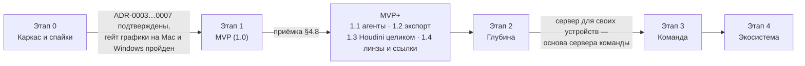
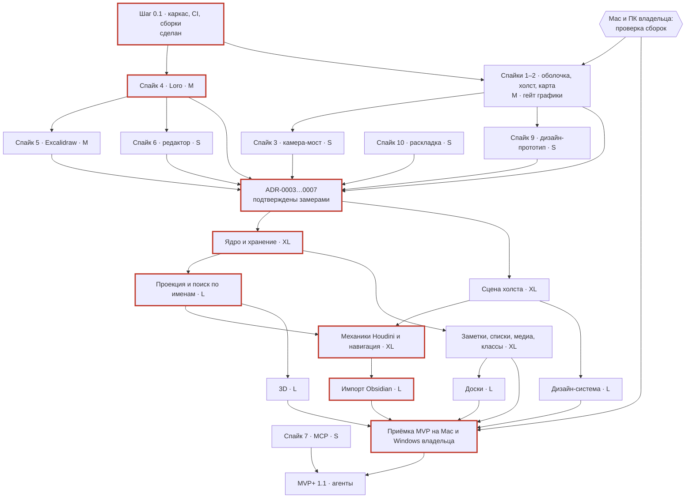

# 16. Дорожная карта и MVP

> Статус: черновик. Этапы от каркаса и спайков до экосистемы: цель, состав, критерии готовности, зависимости, риски и относительный размер работы каждого; кто реализует и что значит «сборка вехи готова» (§1). Здесь окончательно решается, что входит в MVP: другие документы помечают свои этапы как 💡 со ссылкой «итог — в 16».
>
> Опирается на [05-domain-model.md](05-domain-model.md) (ядро) и [глоссарий](glossary.md). Связано: [03](03-vision.md) (не-цели, критерии успеха), [04](04-personas-scenarios.md) (сценарии, матрица §4, антисценарии §5), [06](06-canvas-ux.md) (§17 — этапы клавиш), [07](07-design-system.md) (§13), [08](08-view-3d.md) (§1.2), [09](09-search-navigation.md) (§9), [10](10-storage-sync-collab.md) (§15), [11](11-server-selfhost.md) (§10), [12](12-mcp-ai.md) (§11), [13](13-interop.md) (§10), [14](14-nfr.md) (NFR-ID), [15](15-architecture.md) (§7), ADR [0003](adr/0003-sync-engine.md), [0008](adr/0008-mcp-architecture.md). Источники оценок: [R3](research/R3-crdt-sync.md), [R5](research/R5-board-engine.md), [R6](research/R6-mcp-ai.md), [R7](research/R7-retro-design-assets.md); механики — [R1](research/R1-houdini-kinopio-ux.md); риски рынка — [R8](research/R8-competitors.md).
>
> Обозначения: ✅ решено ответами, ☑ решено по делегированию владельца (раунд 2), 💡 предложение (с 2026-10-19 считается принятым, [README](README.md)), ❓ вопрос (собраны в [17-open-questions.md](17-open-questions.md)). ✅ R2: B2, B3 — весь код пишет Claude по этой карте; календарных сроков нет, только порядок (§10) и относительные размеры S/M/L/XL (§9). Прогресс — по вехам: каждая заканчивается сборкой, которую владелец проверяет на macOS и Windows (§1.2).

## Кратко

- ✅ O1 задаёт MVP: навигация по нодам как в Houdini, ноды разных видов, импорт vault Obsidian, первичный дизайн, 3D-визуализация. 💡 К ним — основания, без которых пять пунктов не работают: локальное CRDT-хранилище, проекция, отмена, корзина, поиск по именам, появления, флаги.
- 💡 Этапы: **0** — каркас и спайки; **1** — MVP (1.0); **MVP+** — четыре коротких релиза 1.1–1.4; **2** — «Глубина»; **3** — «Команда»; **4** — «Экосистема».
- ✅ R2: B2, B3 — весь код пишет Claude; владелец проверяет сборку каждого шага и вехи на Mac и ПК с Windows по чек-листу на 5–10 минут и отвечает на вопросы. «Сборка готова» — зелёный запуск CI с артефактами для macOS и Windows и сообщение с чек-листом (§1.2).
- ✅ R2: Q-15-1 — основные платформы macOS и Windows; Linux собирается в CI и проходит автотесты. Вместо гейта Linux — гейт графики на машинах владельца (§3.3).
- ✅ R2: Q-07-1, Q-16-8 — русский и английский интерфейс в MVP. ✅ R2: Q-05-1 — задачи с подзадачами в MVP. ☑ R2: B4 — лицензия AGPL-3.0-or-later, файл `LICENSE` — с шага 0.1.
- ☑ Q-16-1: механики Houdini (✅ D1) — быстрые метки и мини-карта в MVP, это навигация и небольшая работа; рамки, стикеры, точки и жесты «с предками и потомками» — в MVP+ 1.3. Место под них в документе сети есть с MVP (05 §9.2), миграции не будет.
- ☑ Q-16-2: локальный MCP (✅ K1) — первый релиз после MVP (1.1), вместе с флагами «Скрыть от AI» и «Замок». В MVP — его основания: доменные операции в ядре, наборы изменений с источником, IPC-сокет, проекция.
- ☑ Q-04-4: совместная работа (✅ J2) — CRDT и единый формат данных с первого дня; сервер для своих устройств — этап 2; команда, веб и присутствие — этап 3.
- ☑ Q-04-5: приёмка MVP — S1, S4, S2 целиком; S3, S5, S6, S10 частично, чтобы каждый пункт O1 проверялся сценарием; на macOS и Windows. Измеримые цели — NFR из [14](14-nfr.md). ☑ Q-16-4: MVP выходит в два шага — 1.0-α «Переезд» → 1.0.
- Сроков нет (✅ R2: B3). MVP — 10 блоков размера L и XL (§9.4); критический путь — спайк 4 → ядро → проекция → механики Houdini → импорт → приёмка (§10).

## 1. Принципы плана

| # | Принцип | Следствие |
|---|---|---|
| 1 | **MVP строго по ✅ O1** | Всё, что не нужно пяти пунктам O1 и их основаниям, уходит в MVP+ или позже, даже если дёшево |
| 2 | **Основания — сразу окончательные** | Формат папки, документы Loro, наборы изменений, стабильные ID — как для сервера ([10](10-storage-sync-collab.md) §1, §3.1). Этапы 2–3 добавляют функции, а не мигрируют данные |
| 3 | **Спайк до кода** | ADR-0001…0009 приняты по делегированию (☑ R2, [adr/](adr/README.md)); спайк подтверждает решение замером до продуктового кода ([15](15-architecture.md) §7). Провал спайка — новый ADR, а не обходной путь в коде |
| 4 | **Этап закрывает приёмка** | Сценарии [04](04-personas-scenarios.md) и NFR [14](14-nfr.md); красный бенч — этап не закрыт (NFR-121) |
| 5 | **Короткие релизы после MVP** | MVP+ — четыре релиза размера L; порядок 1.2–1.4 меняется по просьбе владельца |
| 6 | **Размеры пересматриваются** | После каждого спайка и вехи — по фактическому объёму работы; календарных сроков нет (✅ R2: B3) |
| 7 | **Веху закрывает проверка владельца** | Каждый шаг этапа 0 и каждая веха заканчиваются сборкой из CI и чек-листом на 5–10 минут на Mac и ПК с Windows (§1.2). Linux — только автотесты в CI (✅ R2: Q-15-1) |

### 1.1. Кто реализует

✅ R2: B2, B3 — «делаем дорожную карту и идём по ней».

| Кто | Что делает |
|---|---|
| **Claude** | Пишет весь код, тесты, бенчмарки, ADR и документы; ведёт работу по порядку §3.2, §4.7 и §10; собирает сборки в CI; к каждой сборке готовит чек-лист; вопросы записывает в «Открытые вопросы» с 💡 предложением и, пока ответа нет, работает по предложению ([README](README.md)) |
| **Владелец** | Проверяет сборку каждого шага и вехи на Mac и ПК с Windows по чек-листу; отвечает на вопросы; утверждает дизайн: прототип спайка 9, иконку приложения, отбор «Гравюр» (☑ Q-07-4) |

Календарных сроков нет. План задаёт порядок (§10) и относительные размеры S/M/L/XL (§9.3); прогресс — число закрытых шагов и вех.

### 1.2. Сборка вехи: что значит «готова»

Сборка шага или вехи **готова**, когда выполнены три условия:

1. Запуск CI на коммите шага зелёный: fmt, clippy с `-D warnings`, тесты Rust и TypeScript, Biome, typecheck, CPU-бенчмарки ([15](15-architecture.md) §8).
2. В этом запуске есть артефакты десктопа: `strata-macos` (образ диска `.dmg`, universal — Apple Silicon и Intel), `strata-windows` (установщик NSIS `.exe`, x64), `strata-linux` (`.AppImage`, для CI и желающих). Артефакты не подписаны (☑ Q-15-11) и хранятся 30 дней ([15](15-architecture.md) §8.6).
3. Claude прислал сообщение о сборке: ссылку на запуск CI, что изменилось, чек-лист шага (§3.2) или вехи (§4.7) и, если шаг этого требует, ссылку на веб-страницу бенчмарка.

Что делает владелец:

| Действие | Как |
|---|---|
| Скачать | GitHub → вкладка Actions → запуск по ссылке → блок Artifacts внизу страницы: на Mac — `strata-macos`, на ПК — `strata-windows`. Скачивается zip, внутри — `.dmg` или `.exe` |
| Запустить без подписи | macOS: открыть `.dmg`, перетащить Strata в «Программы», при первом запуске — «Открыть» из контекстного меню Finder; в macOS 15 и новее — разрешить запуск в «Системных настройках» → «Конфиденциальность и безопасность». Windows: запустить `.exe`, в окне SmartScreen — «Подробнее» → «Выполнить в любом случае» ([15](15-architecture.md) §8.6) |
| Пройти чек-лист | 5–10 минут на машину; каждый пункт — «да» или «нет» с одной фразой |
| Ответить | По каждой машине: «всё да» или номера пунктов с «нет»; отчёт харнесса бенчмарка — если чек-лист его просит (☑ Q-15-12). Скриншот или запись экрана — по желанию |

Шаг или веха **закрыты**, когда чек-лист пройден на обеих машинах, а CPU-бенчмарки в CI и GPU-бенчмарки по отчётам харнесса не хуже базовой линии больше чем на 10 % (NFR-121). «Нет» в чек-листе — исправление и новая сборка того же шага. Следующий блок, который от результата проверки не зависит, Claude начинает, не дожидаясь ответа.

## 2. Этапы одним взглядом

| Этап | Цель | Главное | Приёмка | Размер (§9) |
|---|---|---|---|---|
| **0. Каркас и спайки** | Снять технические риски до продуктового кода и запустить конвейер сборок | Каркас и CI, спайки 1–6, 9, 10, выбор крейтов спайка 11, дизайн-прототип; ADR-0003…0007 подтверждены замерами | Гейт графики на Mac и Windows владельца, критерии спайков, чек-листы шагов | 5 шагов S–M |
| **1. MVP (1.0)** | Владелец переносит базу и работает в Strata каждый день | ✅ O1 + основания; задачи с подзадачами; RU + EN | S1, S4, S2 целиком; S3, S5, S6, S10 частично; на macOS и Windows | 10 блоков: 4 XL, 6 L |
| **MVP+ (1.1–1.4)** | Дешёвое и ценное сразу после MVP | MCP, экспорт и повторный импорт, Houdini целиком, линзы и ссылки | S8; S3, S5, S6 целиком; S9 локально | 4 релиза по L |
| **2. Глубина** | Личная работа без потолка: AI, Obsidian рядом, свои устройства | Сервер для своих устройств, AI-функции, канбан и календарь, зеркало Obsidian, локальный режим 3D, темы | S3 шаг 12, S6 шаг 9, S8 этапа 2, S10 целиком | 9 блоков: 2 XL, 3 L, 4 M |
| **3. Команда** | 10 человек правят одно пространство без конфликтов | Сервер с ролями, веб-клиент, присутствие, удалённый MCP | S7, S9 целиком | 7 блоков: 2 XL, 2 L, 3 M |
| **4. Экосистема** | Расширение по запросу | Импорт из других, плагины или скрипты, мобильный клиент, публичные ссылки | По сценарию каждого пункта | не оценено |

## 3. Этап 0. Каркас и спайки

### 3.1. Цель

Подтвердить замерами стек и модель до первой строки продуктового кода и запустить конвейер вех: каркас, CI, сборки на три ОС. Стек выбран (✅ R2: B2 — план А: Tauri 2 + ядро на Rust + TS SPA на React). Главные риски: потянут ли WKWebView и WebView2 холст и карту на Mac и ПК владельца (гейт графики, ✅ R2: Q-15-1) и выдержит ли Loro наши документы.

### 3.2. Состав

**Документация.**
- ✅ Ответы раунда 2 получены 2026-10-19 ([17](17-open-questions.md)): все вопросы решены, минимальный набор для ядра (B2, B3, Q-15-1, Q-15-2, Q-14-6, Q-05-1, Q-05-5, Q-05-6, Q-15-4, Q-16-1, Q-16-2) закрыт.
- ☑ R2: ADR-0001…0009 приняты по делегированию владельца ([adr/](adr/README.md)). Спайки подтверждают их замерами: ADR-0003 — спайк 4, ADR-0004 — спайк 1, ADR-0005 — спайки 1–3, ADR-0006 — спайк 5, ADR-0007 — спайк 6, ADR-0008 — спайк 7 (к MVP+ 1.1). Провал спайка — новый ADR, а принятый помечается «Заменён».
- ☑ R2: B4, Q-11-7 — лицензия Strata AGPL-3.0-or-later на весь репозиторий, файл `LICENSE` — шаг 0.1; ассеты — под своими лицензиями (OFL, CC BY 3.0, MIT, CC0), GPL-2.0-only не берём ([15](15-architecture.md) §8.4).

**Шаги.** ✅ R2: B3 — шаги идут по порядку, без календаря; каждый заканчивается сборкой или отчётом и чек-листом владельца (§1.2). 0.3 не зависит от 0.2 и может идти параллельно; 0.4 ждёт 0.2 — биндинги строятся на Loro.

| Шаг | Что делает Claude | Сборка | Владелец проверяет (5–10 минут) | Где |
|---|---|---|---|---|
| **0.1. Каркас** | Cargo workspace и pnpm workspace по [15](15-architecture.md) §2; CI в GitHub Actions: fmt, clippy, тесты, Biome, typecheck, сборки десктопа для macOS, Windows и Linux; `LICENSE` AGPL-3.0-or-later; каталоги строк RU и EN | Оболочка Tauri 2 с окном «О программе» | 1) Сборка скачивается и запускается по инструкции §1.2. 2) Окно открывается, в строке «Ядро» — версия ядра, а не «веб, без ядра». 3) Кнопка «RU → EN» переключает все строки окна на английский и обратно. 4) Окно двигается, меняет размер, сворачивается и закрывается без ошибок | Mac и ПК с Windows |
| **0.2. Спайк 4 — Loro** (критический путь) | Пункты 1–8 [10](10-storage-sync-collab.md) §15 в Rust и WASM; бенчи — в CI; отчёт [spikes/S4-loro.md](spikes/S4-loro.md) | CPU-часть — в CI; браузерная часть — страница бенчмарка индекса | 1) Открыть страницу бенчмарка в Safari и в Edge или Chrome, нажать «Запустить», скопировать отчёт в ответ. 2) Прочитать «Кратко» отчёта и ответить на его вопросы, если они есть | Safari на Mac; Edge или Chrome на ПК |
| **0.3. Веб-бенчмарк рендера** (спайки 1, 2, 3, 9) | Pixi-холст N-5k и N-10k с 15 000 нитей и MSDF-кириллицей; звёздная карта three.js на 20 000 звёзд; «камера-мост»; дизайн-прототип; харнесс с отчётом для копирования ([15](15-architecture.md) §8.3) | Веб-страница бенчмарка и Tauri-сборки для macOS и Windows с тем же сценарием | 1) Страница в Safari (Mac) и в Edge или Chrome (ПК): «Запустить», скопировать отчёт. 2) Tauri-сборка: тот же прогон, скопировать отчёт — по нему засчитывается гейт. 3) Глазами: панорама и зум плавные, нет мерцания и пустого окна, кириллица чёткая на своём экране, 2D → 3D → 2D без скачка. 4) Щипок трекпада, `Alt`-жесты, ссылка `strata://` открывает приложение. 5) Дизайн-прототип: контраст, чёткость, вид «Гравюры» — «нравится» или «нет» с одной фразой | Mac: Safari и сборка; ПК: Edge или Chrome и сборка |
| **0.4. Спайки 6 и 5** — CM6, Excalidraw | Автотесты в headless Chromium в CI: открыть → сохранить → `diff` на V-synth и V-help, сходимость биндингов CM6 ↔ Loro и Excalidraw ↔ Loro, B-2k | Tauri-сборка с окном заметки и окном доски | 1) Заметка: набрать абзац по-русски с `[[ссылкой]]`, жирным и списком; live preview не прыгает, символы не теряются, в том числе при наборе через IME. 2) Доска: нарисовать фигуры, вставить картинку, панорама и зум плавные. 3) Закрыть и открыть приложение — заметка и доска на месте | Mac и ПК с Windows |
| **0.5. Спайк 10 и крейты спайка 11** | Раскладка `strata-layout` в WASM в воркере; выбор Rust-крейтов для Markdown, YAML, LZString и JSON Canvas ([15](15-architecture.md) §2.6), корпус NFR-122 зелёный | Сборка с `L` на трёх синтетических сетях | Нажать `L` на трёх сетях — слоистой, радиальной, силовой: раскладка читается, баблы не налезают друг на друга, отклик без заметной паузы (NFR-08). Крейты владелец не проверяет | Mac или ПК |

Спайк 7 (MCP) — к MVP+ 1.1, спайк 8 (эмбеддинги) — к этапу 2; остальные пункты спайка 11 ([13](13-interop.md) §7.3) — до MVP+ 1.2. В критерии готовности этапа 0 они не входят.

Состояние на 2026-10-23: шаг 0.1 сделан — каркас, CI и неподписанные сборки на три ОС; чек-лист 0.1 ждёт проверки владельца. Шаг 0.2 — часть 1 из 3 ([отчёт](spikes/S4-loro.md)). Шаг 0.3 — часть 1: окно бенчмарка с холстом N-5k и N-10k и Loro в WebView. Прогон 1 на Mac 2026-10-21: гейт не пройден (N-5k — 54,7 fps, N-10k — 31 fps, упор в CPU), сцена оптимизирована по 15 §5.3, ждём прогон 2 на Mac и прогон 1 на ПК ([отчёт](spikes/S1-canvas.md)). Спайк 9, прототип холста ([отчёт](spikes/S9-prototype.md)): часть 1 — кликабельный (Tab-меню, протяжка, вставка в нить, встряхивание на 200 баблах); часть 2 — дизайн (шрифты OFL в сборке и их CI-тест, ретро-окна на DPR 1 / 1,25 / 1,5 / 2, 200 иконок game-icons, все состояния бабла, четыре процедурных фона и своё фото с проверкой контраста, окно «Гравюра»). Обе части ждут проверки владельца; отзывы 2026-10-23 учтены: пометки концов нитей (кружки и стрелки, вариант — Q-07-20) и менее чувствительное встряхивание. Новые вопросы Q-07-18 (кегль при 125 и 150 %), Q-07-19 (фото-пресеты фона) и Q-07-20 (концы нитей). Шаг 0.3b, спайк 2, часть 1 — физика ([отчёт](spikes/S2-starmap.md)): ни d3-force-3d, ни ngraph не держат NFR-16 и NFR-17 на 20 000 телах, ngraph ещё и не запускается под CSP десктопа; свой Барнс — Хат на Rust в WASM (`crates/strata-layout`) держит оба бюджета в V8 — 6,0 с и 3,55 мс; решение записано в ADR-0005. Часть 2 — рендер three.js: 20 000 звёзд и 30 000 нитей с туманом и bloom в ½ за 7 draw call, кадр с ожиданием GPU на M1 — 13,6 мс p95; сценарий `map-orbit-20k` в окне «Бенчмарк» ждёт прогона на машинах владельца. Спайк 3, «камера-мост» ([отчёт](spikes/S3-bridge.md)): кадр 0 совпадает с холстом на 100 %, первый кадр 3D — 17,6 мс (NFR-15 ≤ 100 мс), `M` в прототипе и сценарий `bridge-2d-3d` в бенчмарке. Кадр на 5 000 нодах со всем дизайном (R7 §8 п. 4, `canvas-look-n5k`): 13,8 мс p95 с ожиданием GPU на M1. Шаг 0.4, спайк 6, часть 1 ([отчёт](spikes/S6-editor.md)): редактор заметок на CodeMirror 6 и Loro — V-synth побайтно, два клиента сходятся, 1 МБ открывается за 47 мс, символ — 9,6 мс; окно заметки и нити из `[[ссылок]]` в прототипе.

**Спайки.** Состав и объём — [15](15-architecture.md) §7; каждый заканчивается отчётом с замерами и статусом ADR. Столбец «Объём» — ориентир размера работы из исследований, не срок (✅ R2: B3).

| # | Спайк | Объём | Критерий приёмки | Решает | Блокирует |
|---|---|---|---|---|---|
| 1 | Оболочка и холст на машинах владельца: Pixi 8, N-5k и N-10k, 15 000 анимированных нитей, MSDF-кириллица; Tauri на WKWebView и WebView2 (MO-mac, MO-win), веб-страница бенчмарка в Safari и Edge или Chrome; WebKitGTK — в CI без порогов кадра; `Alt`-жесты, щипок трекпада, `strata://`, хранилище ключей ОС | 1–2 нед. | Гейт графики [15](15-architecture.md) §5.3; NFR-01, NFR-02 на MO-mac и MO-win | [ADR-0004](adr/0004-app-shell.md), [ADR-0005](adr/0005-rendering.md) | Старт MVP |
| 2 | Звёздная карта: three.js, 20 000 точек, 30 000 связей, туман, bloom в ½; ngraph против d3-force-3d | 3–5 дн., внутри 1 | NFR-12, NFR-16, NFR-17; выбрана библиотека физики | [ADR-0005](adr/0005-rendering.md), [08](08-view-3d.md) | 3D |
| 3 | «Камера-мост» 2D → 3D → 2D | 2–3 дн. | Кадр 0 three.js совпадает с Pixi (разница ≤ 1 % пикселей); NFR-15 | [ADR-0005](adr/0005-rendering.md) | 3D |
| 4 | Loro: пункты 1–8 [10](10-storage-sync-collab.md) §15 — CM6 + `loro-codemirror`, биндинг Excalidraw, индекс 100 000 нод в Chrome и Safari, 1 000 комнат на сокете, Rust ↔ WASM, офлайн 30 дней, перешардирование, офлайн-очередь веба | 2–3 нед. | Пункты 1–5 обязательны: вставка 1 МБ ≤ 200 мс, ввод p95 ≤ 16 мс, побайтная сходимость за 10 мин, импорт индекса < 0,5 с и < 200 МБ, правка поля < 5 мс, один формат в Rust и WASM. Иначе — план Б ([10](10-storage-sync-collab.md) §14) | [ADR-0003](adr/0003-sync-engine.md) | Ядро — критический путь |
| 5 | Excalidraw `next`: `ui={false}` в окне Strata, B-2k, `onIncrement` ↔ Loro на 3 клиентах, виджет to-do, три реальных `.excalidraw.md` ([R5](research/R5-board-engine.md), «Спайк до ADR-0006») | 1–2 нед. | NFR-30, NFR-52; панорама p95 ≤ 16,7 мс; сходимость; экспорт открывается в Obsidian | [ADR-0006](adr/0006-board-engine.md) | Доски |
| 6 | Редактор: CM6 live preview + `[[ссылки]]` + `loro-codemirror`; V-synth и V-help «открыть → сохранить → `diff`» (vault владельца не нужен, ✅ Q-14-6); русский ввод и IME на macOS и Windows; T-1M | 1 нед. | `diff` пуст; NFR-29, NFR-33 | [ADR-0007](adr/0007-text-editor.md) | Заметки, импорт |
| 7 | MCP с живыми клиентами: пункты 1, 2, 6 [12](12-mcp-ai.md) §11.2 | ~1 нед. | Claude Code, Claude Desktop, Codex, Cursor подключаются; NFR-37; ядро без окна ≤ 5 с | [ADR-0008](adr/0008-mcp-architecture.md) | MVP+ 1.1; на старт MVP не влияет, но проверяет IPC ядра |
| 8 | Эмбеддинги на русском: 50 запросов владельца, bge-m3, Qwen3-Embedding-0.6B, multilingual-e5-small, BM25 как база | 3–5 дн. | [12](12-mcp-ai.md) §11.2 п. 3 | [12](12-mcp-ai.md) §9 | Этап 2; можно отложить до него |
| 9 | Дизайн-прототип: 200 баблов game-icons на трёх фонах, ретро-окно на DPR 1 / 1,25 / 1,5 / 2, 20 картинок через «Гравюру», кадр на 5 000 нодах ([R7](research/R7-retro-design-assets.md) §8) | 1 нед. | Контраст [07](07-design-system.md) §11.1; NFR-09, NFR-118; доля «Гравюры» без ручной правки зафиксирована | [07](07-design-system.md) | Дизайн-система |
| 10 | Раскладка `strata-layout`: слоистый DAG, радиальная, силовая на сетях из V-synth и W-10k; WASM в воркере | 3–5 дн. | NFR-08 | ☑ Q-06-9 | Механики Houdini |
| 11 | Совместимость с Obsidian: 7 пунктов [13](13-interop.md) §7.3 | 1 нед. | Каждый пункт закрыт ответом; выбраны Rust-крейты для Markdown, YAML, LZString, JSON Canvas | [13](13-interop.md), [15](15-architecture.md) §2.6 | Выбор крейтов — шаг 0.5, до вехи 1B; остальное — до MVP+ 1.2 |

**Дизайн-прототип.** Строки [07](07-design-system.md) §13 с этапом «до MVP»: прототип холста, проверка шрифтов, конвейер иконок — это спайк 9, его сборка — шаг 0.3. 💡 Ветку спайков 1 и 9 стоит довести до кликабельного прототипа ([01](01-analysis.md) §5): Tab-меню, протяжка, вставка в нить и встряхивание на 200 баблах, чтобы владелец проверил «ощущение Houdini» руками до кода MVP.

**Инфраструктура.** Генератор наборов W-10k, W-100k, N-5k, N-10k, B-2k, T-1M, V-synth, V-10k ([14](14-nfr.md) §1.3); харнесс бенчмарков спайков 1–2 — отладочная сборка и веб-страница с отчётом для копирования. GPU-раннеров нет (☑ Q-15-12): GPU-бенчмарки — на машинах владельца по сборкам шагов и вех, в CI — CPU-бенчмарки и функциональные тесты.

### 3.3. Критерии готовности

1. ✅ R2: B2, B3 — стек выбран: план А (Tauri 2 + ядро на Rust + TS SPA, [15](15-architecture.md) §6). Каркас, CI и сборки на три ОС работают (шаг 0.1).
2. **Гейт графики** ([15](15-architecture.md) §5.3) пройден на Mac и ПК с Windows владельца по Tauri-сборкам из CI (шаг 0.3) или выбрана ступень лестницы отступления. Linux гейт не блокирует: сборка и функциональные e2e в CI зелёные (✅ R2: Q-15-1).
3. ADR-0003…0007 подтверждены спайками 1–6 или заменены новыми ADR. ADR-0008 подтверждается спайком 7 до MVP+ 1.1.
4. Владелец одобрил дизайн-прототип на своих машинах: контраст, чёткость на своём DPR, вид «Гравюры».
5. Наборы данных и CPU-бенчмарки спайков — в CI; харнесс GPU-бенчмарков выдаёт отчёт на macOS и Windows (NFR-121).
6. Чек-листы шагов 0.1–0.5 пройдены владельцем (§1.2).

### 3.4. Зависимости

| От чего | Что ждёт |
|---|---|
| Сборки CI для macOS и Windows (шаг 0.1) | Все проверки владельца, гейт графики |
| Машины владельца MO-mac и MO-win (✅ Q-15-1, [14](14-nfr.md) §1.2) | Гейт графики (шаг 0.3), GPU-бенчмарки |
| Генератор V-synth и V-10k; V-owner не нужен (✅ Q-14-6) | Спайк 6 и, позже, приёмка S1 |
| Спайк 4 | Спайки 5 и 6 ([15](15-architecture.md) §7) |
| Проверка сборки владельцем | Закрытие шага (§1.2) |

### 3.5. Риски

| Риск | Чем грозит | Что делаем |
|---|---|---|
| Гейт графики провален на Mac или Windows ([R4](research/R4-app-shell-rendering.md), риск 1) | Холст и карта медленные на основной платформе | Оптимизация сцены и повтор гейта; для WKWebView — ступени лестницы [15](15-architecture.md) §5.3: Canvas-фолбэк → Tauri 3 + CEF (на 2026-10 — alpha) → Electron-оболочка. На Windows WebView2 — уже Chromium: провал там — повод оптимизировать сцену. Стоимость ступеней 1–2 не оценена |
| WebKitGTK на Linux молча уходит на медленный путь ([R4](research/R4-app-shell-rendering.md) §1.3) | Медленный холст у пользователей Linux; ручной проверки нет (✅ Q-15-1) | e2e в CI, Canvas-фолбэк, определение по времени кадра, лестница [15](15-architecture.md) §5.3 |
| Loro проваливает п. 1 или 2 спайка | Ядро на другом движке | План Б — Yjs v14 ([10](10-storage-sync-collab.md) §14); стоимость перехода не оценивалась |
| Один исполнитель — Claude (✅ R2: B2, B3) | Ошибки архитектуры копятся незаметно; владелец не видит прогресса | Шаги и вехи со сборкой и чек-листом (§1.2); ADR на каждое значимое решение; спайк до кода |
| Спайки расползаются | Этап 0 не кончается | Каждый спайк с объёмом и критерием; объём превышен — промежуточный отчёт: что проверено, что нет (как [отчёт спайка 4](spikes/S4-loro.md)) |
| Сборки без подписи (☑ Q-15-11) | Gatekeeper и SmartScreen не дают открыть сборку | Инструкция запуска в README, в §1.2 и в каждом сообщении о сборке ([15](15-architecture.md) §8.6) |
| Владелец не успевает проверить сборку | Шаг не закрыт | Чек-лист — не больше 10 минут на машину; веб-страница бенчмарка без установки; блоки, не зависящие от проверки, идут дальше (§1.2) |
| Новые вопросы к владельцу | Работа ждёт ответа | Вопрос — в «Открытые вопросы» документа и в [17](17-open-questions.md) с 💡 предложением; до ответа работа идёт по предложению ([README](README.md)) |

## 4. Этап 1. MVP

### 4.1. Цель

Владелец импортирует свой vault и работает в Strata каждый день на Mac и ПК с Windows: ходит по нодам как в Houdini, создаёт ноды всех видов, ведёт проекты с задачами и подзадачами, облетает пространство в 3D, переключает интерфейс между русским и английским. Критерий успеха — [03](03-vision.md): через месяц после выхода основная база живёт в Strata.

### 4.2. Состав по ✅ O1

| ✅ O1 | Что входит в MVP | Документы |
|---|---|---|
| **1. Навигация по нодам как в Houdini** | Камера: панорама, зум, `H` / `G` / `F`. Нырок `Enter` / `I` / двойной клик, подъём `U` по пути захода. Строка пути показывает путь захода ([05](05-domain-model.md) §9.3), с `▾`, вводом пути и «Скопировать путь» (канонический). История `Alt+←/→`, предыдущий вид `` ` ``. **Быстрые метки** `Ctrl+1…5` / `1…5` и **мини-карта** `O` (§4.4). Обход `PgUp` / `PgDn`, `Shift+PgUp/PgDn`, стрелки. Выделение ветки вверх и вниз по течению. Инфокарточка по удержанию СКМ, `Shift+I`. Внешние связи «↗N», сводные нити, призраки. Палитра `Ctrl+P`, справка `?`, подсказки ввода | [06](06-canvas-ux.md) §3, §4.4, §10, §11, §14; [09](09-search-navigation.md) §3–4, §6.1–6.2, §6.4 |
| **2. Ноды разных видов** | Виды: сеть, заметка (CM6 + live preview, `[[ссылки]]` → нити, ✅ C8), доска (Excalidraw `next`, картинки, виджеты «Заметка» и «To-do» с простыми галочками), список (вложенные пункты), медиа (картинка, PDF, видео, аудио). Классы «Задача» (✅ Q-05-1: сеть с «Описанием» и «Требованиями», сроки `start` и `deadline`, ответственные, подзадачи — ноды класса «Задача» внутри сети задачи), «Проект», «Референсы», «Чек-лист». Tab-меню; протяжка от порта, `J`-цепочка, вставка в нить, встряхивание и `Ctrl+Shift+X`, нож `Y`, ответвление «а», `Alt`-drag, копия и появление, `Ctrl+D`, «Обернуть в сеть» `Shift+C`, раскладка `L` и `A`+drag, стиль нитей сети `Shift+S`. Атрибуты и панель `P`, локальный список людей, подсветка сроков, свёртки по всей глубине (☑ Q-05-2): прогресс и ближайший срок задачи — по подзадачам. Окна содержимого: плавающее, закреплённое, на весь экран | [05](05-domain-model.md) §4–6, §8, §10; [06](06-canvas-ux.md) §2.2, §5–6, §9, §12–13; [07](07-design-system.md) §4.6; [ADR-0006](adr/0006-board-engine.md), [ADR-0007](adr/0007-text-editor.md) |
| **3. Импорт vault Obsidian** | Столбец MVP [13](13-interop.md) §10: `.md`, папки → сети, свойства, теги, алиасы, ссылки → нити или призраки, вложения → ассеты и медиа; `.canvas` → сеть, `.excalidraw.md` → доска, Tasks → дедлайны; отчёт импорта; фоновый пакетный импорт; откат одним набором изменений. Vault не меняется | [13](13-interop.md) §2–3; [04](04-personas-scenarios.md) S1 |
| **4. Первичный дизайн** | Тема «Туман», режим читаемости, `prefers-reduced-motion`. Токены, шрифты с CI-тестом кириллицы и латиницы (✅ Q-07-1). Бабл со всеми состояниями и машиной срока. ~40 своих значков, иконки Хрома. Пресеты game-icons с `credits.json` и экраном «Благодарности» (☑ Q-07-3). Конвейер «Привести к стилю» («Гравюра» по умолчанию, ☑ Q-05-7; «Пиксель», «Силуэт», «Фото», «Как есть»). Шесть пресетов фона и загрузка своего. Компоненты Хрома [07](07-design-system.md) §8.2. Иконка приложения | [07](07-design-system.md) §2–8, §11, §13 |
| **5. 3D-визуализация** | Строка MVP [08](08-view-3d.md) §1.2 (линзы и флаг `T` в 3D — MVP+): карта всего пространства, скопления по вложенности, отражения появлений; полёт ПКМ + `WASD` / `QE`, орбита, перелёты `F` / `G` / `H`; `Ctrl+O` и `Ctrl+F` с перелётом; справка при приближении; `Enter` / `I` / `U`; создание через `Tab`; флаги `R` / `Q` / `E`; удаление; быстрые метки; «камера-мост» в обе стороны; схватить и швырнуть, «Закрепить на карте» `B` (локально, в отличие от `pinned` в 2D); пресеты качества | [08](08-view-3d.md) §2–8 |

### 4.3. Основания

| Основание | Что в MVP | Документы |
|---|---|---|
| Локальное CRDT-хранилище | Документы Loro: манифест, шард индекса (K = 1, перешардирование 1 → 16), `net/*`, `content/*`; `store.sqlite` с WAL; ассеты по SHA-256 с производными; резервные копии; версии формата; лок пространства | [10](10-storage-sync-collab.md) §1–3, §11, §13; [ADR-0003](adr/0003-sync-engine.md) |
| Доменные операции | Все операции [05](05-domain-model.md) §5 и §8.4 в ядре с проверкой инвариантов §14 | [10](10-storage-sync-collab.md) §4; [15](15-architecture.md) §1.2 |
| Проекция | SQLite: имена, пути, свёртки, превью, 3D-выписка; обновление по событиям; пересборка с нуля | [10](10-storage-sync-collab.md) §7 |
| Отмена и наборы изменений | Граф-стек на 200 шагов, UndoManager Loro в заметках и списках, undo Excalidraw; наборы изменений с автором и источником `user`, `import` и `system` (действия ведущего ядра); панель «История изменений» с откатом набора | [05](05-domain-model.md) §11; [10](10-storage-sync-collab.md) §9 |
| Корзина | Мягкое удаление, восстановление вместе с размещениями и нитями, очистка через 30 дней; `Delete` и `Shift+Delete` с диалогом путей | [05](05-domain-model.md) §5, §11; [10](10-storage-sync-collab.md) §10.3; [07](07-design-system.md) §8.3 |
| Поиск по именам | Движок [09](09-search-navigation.md) §2 в воркере: имена и алиасы ([05](05-domain-model.md) §6.1), нормализация, `ё` = `е`, исправление раскладки, ранжирование, недавние. Tab-меню, `Ctrl+O`, `Ctrl+F` с синтаксисом Houdini Find | [09](09-search-navigation.md) §2–3 |
| Появления | `Ctrl+Shift+V`, `Alt+Ctrl+Shift`+drag на бабл сети (в текущей сети появление невозможно, инвариант 3), пункт «существующая» в Tab-меню; значок ярлыка, «×N», панель «Где размещена» с «Сделать основным» | [05](05-domain-model.md) §5; [06](06-canvas-ux.md) §12 |
| Флаги | `R`, `Q`, `E` и кольцо флагов. Биты «Скрыть от AI» и «Замок» есть в модели и 3D-выписке, но без интерфейса (§4.5) | [05](05-domain-model.md) §7; [06](06-canvas-ux.md) §8; [08](08-view-3d.md) §8.3 |
| CLI и IPC | `strata doctor`, `backup`, `reproject` через IPC-сокет ядра | [11](11-server-selfhost.md) §10; [15](15-architecture.md) §5.2 |
| Платформа | Tauri 2 на macOS и Windows — основные (✅ Q-15-1); Linux — сборка и функциональные e2e в CI. Автообновление с подписью обновлений ключом апдейтера; подпись кода ОС — перед публичным релизом, до него — неподписанные сборки CI (☑ Q-15-11). Canvas-фолбэк 2D, клавиатура для всех сценариев без мыши. Русский и английский интерфейс через ключи каталога, оба каталога на 100 % (✅ Q-07-1, NFR-107) | [15](15-architecture.md) §5, §8.6; [14](14-nfr.md) §13–15 |

### 4.4. Механики Houdini: что в MVP, что в MVP+

✅ D1: владелец хочет все механики из списка, плюс ответвления, отвязку жестами и стили нитей. [06](06-canvas-ux.md) §17 и [R1](research/R1-houdini-kinopio-ux.md) («Набор механик») ставят часть из них после MVP. ☑ Q-16-1: решение — по двум признакам: относится ли механика к навигации (пункт 1 ✅ O1) и сколько стоит. Справочные недели в столбце «Трудоёмкость» — человеческие оценки (§9.1).

| Механика | Где была | Решение | Трудоёмкость | Почему |
|---|---|---|---|---|
| Tab-меню, вставка в нить, встряхивание, нож, `L`, `Alt`-drag, нырок и выход, строка пути, выделение ветки, цвет `C` | MVP везде | MVP | В блоке «Механики», XL | Ядро «как в Houdini» |
| Флаги `R`, `Q`, `E` | [06](06-canvas-ux.md) §8: MVP; R1: только `Q` и `R` | MVP | S | Бит и слот кольца; `E` нужен Tab-меню для шаблонов |
| Ответвление «а» (`Shift`+drag) | [06](06-canvas-ux.md) §6.5: MVP; [05](05-domain-model.md) §8.4: точка в месте ответвления | MVP | S | Не требует точек ([06](06-canvas-ux.md) §6.5); с точками (1.3) в месте захвата ставится незакреплённая точка — вариант «б» ([05](05-domain-model.md) §8.4). ☑ Q-06-12 |
| Стили нитей сети `Shift+S` | MVP | MVP | В блоке «Сцена» | ✅ D1 «стили нитей» |
| **Быстрые метки** | [04](04-personas-scenarios.md) S4, [06](06-canvas-ux.md) §17, [09](09-search-navigation.md) §6.2: после MVP | **MVP** | S, 2–3 дня | Метка — это `NavEntry` без выделения ([09](09-search-navigation.md) §6.1–6.2), история уже есть; локальное состояние, новых данных нет |
| **Мини-карта** `O` | [06](06-canvas-ux.md) §10.3, §17: после MVP | **MVP** | S, 3–5 дней | Точки размещений из уже загруженного документа сети; ориентир в сетях на 5 000 баблов (NFR-01) |
| Рамки и стикеры | [04](04-personas-scenarios.md) S5: этап 2; [06](06-canvas-ux.md) §17, R1: после MVP | **MVP+ 1.3** | M, 2–3 нед. | Общий слой прямоугольных объектов сети: членство по размещению, рост «медленно к краю», свёртка с нитями к краю, `Shift+Delete` (☑ Q-06-18), экспорт в группы JSON Canvas |
| Точки, ответвление «б», вставка через точку | [04](04-personas-scenarios.md) S5: этап 2; [06](06-canvas-ux.md) §6.6, R1: после MVP | **MVP+ 1.3** | M, 2–3 нед. | Самое дорогое в пакете: маршруты нитей в каждой сети при глобальных нитях ([05](05-domain-model.md) §9.2), вставка во все ветви после точки (§8.4), `Alt`-жесты на Linux перехватывает оконный менеджер ([R1](research/R1-houdini-kinopio-ux.md) §5) |
| Выравнивание `Shift+A` / `Alt+A`, перемещение и копия с предками и потомками, изгиб нити, копия из Tab-меню | [06](06-canvas-ux.md) §17: после MVP | **MVP+ 1.3** | S, ~1 нед. | Дёшево поверх выделения ветки; направление `Shift`/`Ctrl`-drag в Houdini не проверено ([R1](research/R1-houdini-kinopio-ux.md), «Риски») |
| Флаг «Замок» | [06](06-canvas-ux.md) §8: после MVP; [04](04-personas-scenarios.md): этап 2 | **MVP+ 1.1** | S | Главный смысл — защита от правок агента ([12](12-mcp-ai.md) §6.4); приходит вместе с MCP |
| Форма ноды | ✅ D1: запрошена; [05](05-domain-model.md) §4.1: «позже»; [07](07-design-system.md) §1.5: только круг | В v1 бабл — круг; палитра форм — после v1 (☑ Q-16-1) | — | Вид кодируется кромкой и значком ([07](07-design-system.md) §1.5); поле `shape` есть в модели ([05](05-domain-model.md) §4.1), поэтому палитра форм позже не мигрирует данные. Палитра `Z` в MVP — «Палитра иконки и размера» (палитра форм — после v1, ☑ Q-16-1) |
| Вкладки сетей, радиальное меню `N`, порядок детей `Shift+R`, переназначение клавиш, вложенные рамки | [06](06-canvas-ux.md): после MVP или позже | Этап 2 | M | Нет в списке D1 |

Формат под рамки, стикеры и точки — в документе сети с MVP ([05](05-domain-model.md) §9.2), поэтому MVP+ 1.3 не мигрирует данные. ☑ Q-16-1.

### 4.5. MCP и флаг «Скрыть от AI»

☑ Q-16-2: **локальный MCP — первый релиз после MVP (1.1).**

| Довод | Суть |
|---|---|
| ✅ O1 | MCP нет в пятёрке; MVP и без него — самый большой этап плана: 10 блоков L и XL (§9.4) |
| Стоимость | Не «пара дней»: 26 инструментов, две ревизии протокола, лаунчер и ядро без окна, профили, `confirm_token`, лимиты, панель «Действия агентов», полнотекст tantivy, экран «Подключить AI», `.mcpb` ([12](12-mcp-ai.md) §11.1) — размер L |
| Почему дёшево после MVP | MCP-слой — разбор аргументов, политика и формат ответа поверх тех же доменных операций ([12](12-mcp-ai.md) §1.3 п. 1). Наборы изменений с откатом, IPC-сокет, проекция — уже в MVP. Спайк 7 и ADR-0008 — до 1.1 |
| ✅ K1 | Агент приходит первым релизом после MVP, раньше всех остальных добавлений |

**Флаг «Скрыть от AI» (`T`)** появляется в интерфейсе вместе с MCP в 1.1: клавиша `T`, слот в кольце флагов, значок на бабле ([07](07-design-system.md)). В MVP бит есть в модели и 3D-выписке, но интерфейса нет: флаг, который ничего не меняет, вводит в заблуждение, а принцип 5 [03](03-vision.md) требует, чтобы каждый визуальный признак что-то значил. Экран «Подключить AI» в 1.1 первым шагом предлагает отметить личные сети флагом `T`. ☑ Q-12-3: скрыты ноды, у которых все размещения лежат внутри скрытых сетей; агенту скрытое отвечает `NOT_FOUND` ([12](12-mcp-ai.md) §6.3).

Если владелец попросит MCP раньше, релиз 1.1 целиком переезжает в MVP, и MVP вырастает на блок размера L.

### 4.6. Совместная работа: что готово с первого дня

✅ J2: совместная работа в реальном времени обязательна. ✅ O1 её не называет. ☑ Q-04-4: MVP — локально, но с CRDT внутри; этап 2 — свой сервер для одного человека на нескольких устройствах; этап 3 — команда:

| Этап | Что | Документы |
|---|---|---|
| MVP | Архитектура: CRDT Loro как источник правды; одна папка для локального и серверного пространства; граф меняется только доменными операциями ядра; UI говорит с данными через `Backend`; наборы изменений с автором; детерминированные ID нитей и ключи размещений; статус «Сохранено» в статусной строке; тест сходимости ядра и WASM-редакторов (NFR-61) | [10](10-storage-sync-collab.md) §1–4, §2.5; [15](15-architecture.md) §1.4; [ADR-0003](adr/0003-sync-engine.md) |
| Этап 0 | Протокол проверен до кода: спайк 4 — 1 000 комнат на сокете, догон по ленте, офлайн 30 дней | [10](10-storage-sync-collab.md) §15 |
| Этап 2 | Сервер для своих устройств: один человек, синхронизация, без ролей и веба (☑ Q-04-4, ☑ Q-16-3). Это половина сервера команды: протокол, ведущее ядро, реплики и офлайн проверяются на одном пользователе | [11](11-server-selfhost.md) §10; [10](10-storage-sync-collab.md) §1.3, §3.7, §8 |
| Этап 3 | Команда: роли, приглашения, веб-клиент, присутствие, совместная правка, удалённый MCP | [11](11-server-selfhost.md); [10](10-storage-sync-collab.md) §5, §8; [04](04-personas-scenarios.md) S7 |

Сервер для своих устройств стоит на этапе 2, а не сливается с этапом 3: он проверяет протокол, ведущее ядро и офлайн на одном человеке до прихода команды. Если команда понадобится раньше, план пересобирается вокруг этапа 3 — сервер команды строится на том же протоколе.

### 4.7. Вехи внутри MVP

☑ Q-04-2: сначала база знаний и навигация, затем проекты. Дизайн-система и оба языка интерфейса идут сквозь все вехи: токены, Хром и каталоги RU и EN нужны с первой.

Каждая веха заканчивается сборкой вехи (§1.2): Claude присылает ссылку на зелёный запуск CI и чек-лист ниже, владелец проходит его на Mac и ПК с Windows. В каждой вехе к чек-листу добавляются прогон харнесса GPU-бенчмарков с копией отчёта (около 6 минут, ☑ Q-15-12) и переключение RU ↔ EN на новых экранах.

☑ Q-16-4: MVP выходит в два шага ради ранней обратной связи владельца. **1.0-α «Переезд»** — вехи 1A–1C: ядро, холст, навигация, заметки, списки, медиа, задачи с подзадачами, импорт, «Туман». **1.0** — веха 1D: доски, 3D, конвейер иконок, фоны и приёмка §4.8 целиком. Поэтому доска стоит в 1D, а не в 1C.

| Веха | Что | Что может владелец | Чек-лист сборки (Mac и Windows, 5–10 минут) | Сценарии |
|---|---|---|---|---|
| **1A. Скелет** | Ядро, хранилище, проекция, сцена холста, Tab-меню, протяжка, нырок и выход, заметка, отмена, корзина | Проверить руками «ощущение Houdini» | Создать 20 нод через `Tab`; протянуть нити от порта; панорама и зум плавные; нырнуть `Enter` и выйти `U`; написать заметку по-русски; `Ctrl+Z` отменяет каждый шаг; удалить ноду и вернуть из корзины; перезапустить — всё на месте | S4 шаги 1–3, 6 |
| **1B. Переезд** | Импорт Obsidian, призраки, внешние и сводные нити, `L`, `Ctrl+O` / `Ctrl+F` / `Ctrl+P`, строка пути, история, быстрые метки, мини-карта, жесты нитей, «Обернуть в сеть» | Импортировать vault и жить в нём | Импортировать свой vault или синтетический V-synth из артефактов CI; прочитать отчёт импорта; найти ноду через `Ctrl+O`; поставить быструю метку и вернуться по ней; открыть мини-карту `O`; `L` на импортированной сети; поднести ноду к нити — встраивается, встряхнуть — отвязывается; откатить импорт одним набором — vault на диске не изменился | S1, S4, S5 |
| **1C. Проекты** — конец 1.0-α | Появления, список, медиа, классы, атрибуты, задачи с подзадачами (✅ Q-05-1), сроки, свёртки, флаги `R` / `Q` / `E` | Вести проекты с задачами и подзадачами | Создать проект, в нём задачу с двумя подзадачами; поставить сроки — снаружи видны «1 из 2» и подсветка ближайшего срока; поставить подзадаче паузу `Q` — свёртка её не считает; разместить одну ноду в двух проектах — правка видна в обоих; открыть список, картинку и PDF | S3 шаги 1–9 |
| **1D. Доски, звёзды и стиль** — 1.0 | Доска, 3D, конвейер иконок, фоны, режим читаемости, полировка, приёмка | Всё из ✅ O1 | Доска с картинками в двух проектах; в 3D найти ноду, долететь и войти; сменить иконку на свою — «Гравюра» приемлема; сменить фон; включить режим читаемости; полный прогон харнесса | S2, S6 шаги 1–6 и 8, S10 |

### 4.8. Приёмка

☑ Q-04-5: S1, S4, S2 — целиком; S3, S5, S6, S10 — частично, по шагам таблицы. Так каждый пункт ✅ O1 проверяется хотя бы одним сценарием (1 — S4, S5; 2 — S2, S3; 3 — S1; 4 — S10; 5 — S6). Сценарии проходит сам владелец на macOS и Windows (MO-mac, MO-win, [14](14-nfr.md) §1.2); бюджеты кадра — по отчётам харнесса на тех же машинах (☑ Q-16-6); Linux — сборка и функциональные e2e в CI. Численные цели импорта и производительности — на синтетических наборах, V-owner не нужен (✅ Q-14-6).

| Сценарий | Шаги в MVP | Измеримые цели | Данные | Готово, если |
|---|---|---|---|---|
| **S1.** Импорт vault | 1–10 | NFR-40, NFR-41, NFR-42, NFR-43, NFR-45, NFR-08, NFR-112 | V-synth, V-help, V-10k; свой vault владельца — проверка, а не набор для замеров (✅ Q-14-6) | V-synth и V-help импортированы без ручных правок; владелец импортировал свой vault на Mac и Windows; каждая ссылка — нить или призрак; неоднозначные — в отчёте; импорт откатывается одним набором. Нулевой diff после экспорта — в 1.2 |
| **S4.** Ежедневная навигация | 1–12 (быстрые метки — тоже MVP) | NFR-21, NFR-22, NFR-23, NFR-25, NFR-26, NFR-31, NFR-32, NFR-34, NFR-101, NFR-110, NFR-111 (поиск по именам) | W-100k, N-5k | Любая нода — не больше трёх действий из любого места |
| **S2.** Доска в двух проектах | 1–13 | NFR-30, NFR-35, NFR-52, NFR-71, NFR-79 | B-2k | Правка доски в одном проекте видна в другом без перезагрузки; ни одно действие не удаляет ноду молча |
| **S5.** Реструктуризация (☑ Q-04-5, частично) | 1–12 | NFR-03, NFR-07, NFR-08, NFR-32, NFR-79 | N-5k | Каждый жест — один шаг отмены; ни одного диалога, кроме удаления нити из текста. Граничный случай «вставка через точку» — в 1.3 |
| **S3.** Планирование, частично | 1–9; шаги 10–11 — в 1.4; шаг 12 — этап 2 | NFR-32, NFR-36, NFR-104, NFR-105 | W-10k | Срочность различима без цвета; свёртка «4 из 11» и подсветка «внутри горит» видны снаружи сети; прогресс и ближайший срок задачи — свёртка по подзадачам (✅ Q-05-1) |
| **S6.** 3D, частично | 1–6, 8; шаг 7 — в 1.4; шаг 9 — этап 2 | NFR-12, NFR-13, NFR-15, NFR-16, NFR-17, NFR-19, NFR-20, NFR-48 | W-100k | Найти → долететь → войти без 2D (критерий [03](03-vision.md)); создание ноды без перехода в 2D |
| **S10.** Кастомизация (☑ Q-04-5, частично) | 1–8, 10; в шаге 9 — только «Туман» и режим читаемости | NFR-98, NFR-103, NFR-105, NFR-106, NFR-118 | 20 картинок спайка 9 | «Гравюра» приемлема без правки не реже, чем зафиксировал спайк 9; контраст бабла и нити держится на любом фоне |

**Сквозные требования.** Все NFR с этапом «MVP» в [14](14-nfr.md), кроме перенесённых в MVP+ (§11): холст NFR-01…11, карта NFR-12…20, старт и открытие NFR-21…23, NFR-25, NFR-26, NFR-28 (десктоп), NFR-29…31, отклик NFR-32…36 и NFR-38, память NFR-47…52, NFR-54, NFR-55, масштаб NFR-66…68, надёжность NFR-69…80, безопасность NFR-81…84, NFR-89, NFR-90, NFR-92, приватность NFR-93…95, NFR-97, доступность NFR-98…101, NFR-103…106, язык NFR-107 (русский и английский, ✅ Q-07-1), NFR-108…110, NFR-111 (поиск по именам), NFR-112…114, платформы NFR-115, NFR-117…120, качество NFR-121…124, NFR-126…128; MVP-части NFR-61, NFR-65, NFR-77.

### 4.9. Критерии готовности

1. Все сценарии §4.8 пройдены владельцем на macOS и Windows (MO-mac, MO-win); на Linux сборка и функциональные e2e в CI зелёные (✅ Q-15-1).
2. Сквозные NFR §4.8: CPU-бенчмарки и функциональные тесты зелёные в CI; бюджеты кадра — по отчётам харнесса на MO-mac и MO-win (☑ Q-16-6, ☑ Q-15-12).
3. Тест «рубильник» (NFR-69…71) и property-тесты инвариантов (NFR-124) — 0 потерь и 0 нарушений.
4. Автообновление с подписью обновлений работает (NFR-89); проверка обновлений — только с согласия (NFR-94). Подпись кода ОС и нотаризация — перед публичным релизом; до него — неподписанные сборки CI с инструкцией запуска (☑ Q-15-11).
5. ADR-0003…0007 подтверждены спайками и не заменены без нового ADR; открытых вопросов, влияющих на формат данных, нет.
6. Русский и английский каталоги строк заполнены на 100 % (NFR-107, ✅ Q-07-1).

### 4.10. Зависимости

| От чего | Что ждёт |
|---|---|
| Этап 0 закрыт | Старт вехи 1A |
| Решения раунда 2 получены: ✅ Q-05-1 (задача — сеть с подзадачами), ☑ Q-05-5 (глобальные нити), ☑ Q-05-6 (каскад удаления с диалогом), ☑ Q-06-1 (встряхивание при ≥ 2 входах; при одном входе — ✅ D1), ☑ Q-06-4 (где открывается содержимое), ☑ Q-07-3 (game-icons под CC BY 3.0), ☑ Q-15-5 (снапшот `next` Excalidraw) | Ядро, механики, дизайн, доски — больше не ждут ответов |
| Выбор просмотрщика PDF и видео: не исследовался ([15](15-architecture.md) §2.6) | Вид «Медиа» |
| Генератор V-synth и V-10k; V-owner не нужен (✅ Q-14-6) | Приёмка S1 |
| Харнесс GPU-бенчмарков и машины владельца (☑ Q-15-12) | NFR-01…20 |
| Проверка сборки каждой вехи владельцем (§1.2) | Закрытие вехи |
| Подпись кода ОС и сертификаты (☑ Q-15-11) | Публичный релиз 1.0 |

### 4.11. Риски

| Риск | Чем грозит | Что делаем |
|---|---|---|
| Объём: «несколько продуктов в одном» ([01](01-analysis.md) §2 п. 3); доски дорогие — Logseq снял whiteboards при переходе на БД ([R8](research/R8-competitors.md), «Риски») | MVP не доходит до ежедневного использования | Строго ✅ O1; вехи 1A–1D со сборкой и чек-листом владельца; доска — только адаптер к Excalidraw; ☑ Q-16-4: выпуск в два шага, 1.0-α «Переезд» → 1.0 |
| Свои нити-шейдеры и хит-тест ([R4](research/R4-app-shell-rendering.md), риск 9) | Большой объём кода в ядре «ощущения Houdini» | Спайк 1 с реальными нитями; NFR-07, NFR-09 |
| Темп Excalidraw `next`, память картинок ([R5](research/R5-board-engine.md), риски 1, 3) | Ломающие обновления; доска «съедает» гигабайты | Точный снапшот за адаптером; рабочие копии картинок; NFR-52 — триггер патча |
| Порог входа Houdini-UX, путаница появлений ([R8](research/R8-competitors.md), «Риски») | Владелец или будущие участники путаются | Подсказки ввода, палитра `Ctrl+P`, «Где размещена», разные команды «Убрать отсюда» и «Удалить везде» |
| Markdown перестаёт совпадать байт-в-байт ([R2](research/R2-obsidian-format.md), «Риски») | Импорт «портит» заметки | CM6 без сериализации, корпус NFR-122 в CI |
| Три WebView в матрице ([R4](research/R4-app-shell-rendering.md), риск 4) | Дорогое тестирование | ☑ Q-16-6: бюджеты — на macOS и Windows владельца; Linux — функциональные тесты в CI (NFR-115, NFR-127) |
| Английский каталог отстаёт от русского | Строки без перевода в интерфейсе | NFR-107: ключ без перевода на любой из двух языков — красная сборка CI |
| Зрелость Loro ([R3](research/R3-crdt-sync.md), риски 1–2) | Ломающие обновления формата | Адаптер `DocEngine`, точные версии, корпус форматов (NFR-78) |

## 5. MVP+ (1.x)

### 5.1. Цель

Сразу после MVP закрыть то, что дёшево на готовых основаниях и ценно для владельца: агенты (✅ K1), выход данных (принцип 7 [03](03-vision.md)), полный набор механик Houdini (✅ D1), линзы для задач. Четыре коротких релиза вместо одного длинного.

### 5.2. Состав

| Релиз | Состав | Документы | Приёмка | Размер |
|---|---|---|---|---|
| **1.1. Агенты** | `strata mcp` с IPC к ядру и ядром без окна; две ревизии протокола; 26 инструментов; ресурсы пространства, нод и ассетов-картинок (URI в формате глубоких ссылок; в приложении открываются с 1.4, когда регистрируется обработчик `strata://`, [12](12-mcp-ai.md) §4.7); промпты `structure_text`, `triage_inbox`, `weekly_review`; профили; подтверждения с `confirm_token` и тостом; лимиты; панель «Действия агентов» поверх журнала наборов изменений; полнотекст tantivy в `search_content`; `add_to_board` по `path` и `url`; экран «Подключить AI», `.mcpb`; CLI `strata mcp`; флаги «Скрыть от AI» и «Замок» | [12](12-mcp-ai.md) §2–7, §11.1; [ADR-0008](adr/0008-mcp-architecture.md); [05](05-domain-model.md) §7 | S8 шаги 1–11 (в шаге 6 — тост и список, баблы предпросмотра — этап 2, ☑ Q-12-14); NFR-37, NFR-39 (keyword), NFR-91, NFR-111 (стеммер), NFR-125 | L |
| **1.2. Данные не заперты** | Экспорт: папка Markdown + JSON Canvas, `Tasks.base`, доски как `.excalidraw` с карточкой; JSON Canvas одной сети; JSON пространства; импорт папки Markdown; повторный импорт со слиянием; `.canvas` → доска, Kanban → сеть, Dataview inline; CLI `strata export`; спайк 11 до старта | [13](13-interop.md) §3.7, §5, §9, §10 | S1 «Готово, если», п. 3: нулевой diff тел `.md`; NFR-44, NFR-46, NFR-122 (импорт → экспорт) | L |
| **1.3. Houdini целиком** | Рамки и стикеры; точки, ответвление «б», вставка через точку; выравнивание и распределение; перемещение и копия с предками и потомками; изгиб нити; копия из Tab-меню `Ctrl+Enter` | [06](06-canvas-ux.md) §6.5–6.6, §7, §9.1, §12.1, §17 | S5 целиком с граничным случаем «вставка через точку»; NFR-03, NFR-07, NFR-79 на новых жестах | L |
| **1.4. Линзы и ссылки** | Линзы по статусу, сроку, ответственному, тегу; готовые «Горит», «Мои», «Открытые», «Здоровье»; синтаксис фильтров без скобок; `\`; линзы в 3D; вид-линза «Список» и DOM-вид для скринридера (один компонент); обработчик `strata://` и «Скопировать ссылку»; избранное на устройстве; демо-пространство «проект игры» (☑ Q-04-1) | [06](06-canvas-ux.md) §15, §19; [08](08-view-3d.md) §2.5, §6.6; [09](09-search-navigation.md) §3.6, §5, §6.3, §8.1–8.2 | S3 шаги 10–11; S6 шаг 7; S9 шаги 1–6 и 8 для `strata://`; NFR-102 | L |

Английский каталог строк из 1.4 убран: русский и английский интерфейс — в MVP (✅ Q-07-1, Q-16-8, §4.3).

Порядок — по номерам. 1.1 — первым (☑ Q-16-2, ✅ K1, основания готовы). 1.2 — вторым: переезд разовый (☑ Q-13-1), но экспорт — «аварийный выход» данных (принцип 7 [03](03-vision.md), ☑ Q-16-7). 1.3 и 1.4 — затем; их порядок меняется по просьбе владельца после 1.0. Каждый релиз заканчивается сборкой и чек-листом (§1.2), как веха.

### 5.3. Критерии готовности

Каждый релиз — своя приёмка из §5.2. Для всего MVP+:
1. S8 проходит в Claude Code и Codex CLI на macOS и Windows без ручной правки JSON, Claude Desktop — через `.mcpb` (☑ Q-04-8); нода с флагом «Скрыть от AI» не попадает ни в один ответ ([04](04-personas-scenarios.md) S8).
2. Импорт → экспорт даёт нулевой diff тел `.md`; повторный экспорт без правок — нулевой diff по всей папке ([13](13-interop.md) §7.2).
3. S3, S5 и S6 проходят целиком, кроме шагов этапа 2.
4. Сквозные NFR MVP не деградировали (NFR-121).

### 5.4. Зависимости

| От чего | Что ждёт |
|---|---|
| Спайк 7 подтверждает ADR-0008 | 1.1 |
| Решения ☑ Q-12-1 (права агента по умолчанию), ☑ Q-12-2 (что подтверждать), ☑ Q-12-3 (наследование `T`), ☑ Q-12-9 (ядро в фоне) — получены | 1.1 |
| Спайк 11 (пункты 13 §7.3); решения ☑ Q-13-2, ☑ Q-13-8, ☑ Q-13-15 | 1.2 |
| Решения ☑ Q-06-12, ☑ Q-06-18 | 1.3 |
| Решения ☑ Q-06-22, ☑ Q-09-6 | 1.4 |

### 5.5. Риски

| Риск | Чем грозит | Что делаем |
|---|---|---|
| Переходный период MCP, темп `rmcp` ([12](12-mcp-ai.md) §12) | Часть клиентов не подключится; ломающие обновления | Две ревизии, контрактные тесты (NFR-125), точная версия |
| Claude Desktop на Linux — бета ([12](12-mcp-ai.md) §12) | У пользователей Linux нет Claude Desktop | Владелец работает на macOS и Windows, где Claude Desktop есть (✅ Q-12-5); на Linux — Claude Code и Codex, `.mcpb` и мост |
| Экспорт и Obsidian Sync ([13](13-interop.md) §6.7) | Obsidian переписывает экспорт | Корпус и ручная проверка в новой минорной версии Obsidian |
| Точки при глобальных нитях | Маршрут в одной сети ломает вид в другой | Маршруты — в документе сети, не в нити ([05](05-domain-model.md) §9.2); тесты на ноду с несколькими размещениями |
| MVP+ разрастается | «Короткие» релизы становятся этапом 2 | Каждый релиз — размер L; не влезло — в этап 2 |

## 6. Этап 2. Глубина

### 6.1. Цель

Личная работа без потолка: AI внутри приложения, Obsidian рядом на той же папке, свои устройства в синхронизации, полноценные виды задач. Заодно — первая проверка серверной части на одном пользователе.

### 6.2. Состав

| Блок | Состав | Документы |
|---|---|---|
| Сервер для своих устройств (☑ Q-04-4) | `strata serve` для одного: `/sync`, ведущее ядро на сервере, полная реплика на десктопе, офлайн и слияние, индикатор синхронизации, «Добавить сервер», публикация локального пространства; без ролей и веба | [11](11-server-selfhost.md) §7.2–7.3, §10; [10](10-storage-sync-collab.md) §1.3, §3.7, §8 |
| AI в приложении | Локальные эмбеддинги и гибридный поиск; «Разобрать в ноды» с предпросмотром плана, в том числе для `dry_run` агента; провайдеры LLM, ключи и лимиты трат; `generate_image` на досках и для иконок; тикеты загрузки; локальный HTTP-вход MCP; промпты `find_related`, `moodboard`; промпт «Разобрать картинки» (☑ Q-TR-2); панель «Искать в содержимом» (☑ Q-09-1) | [12](12-mcp-ai.md) §8–10, §11.1 |
| Obsidian | Одностороннее зеркало с приёмом текста и свойств; доски → `.excalidraw.md`; PNG сети и досок | [13](13-interop.md) §6, §9.1, §10 |
| Задачи и виды | Канбан, календарь, сохранённые линзы; повторяющиеся задачи и напоминания (поля `recurrence` и `remindAt` зарезервированы), системные уведомления десктопа; пользовательские классы; пункт to-do доски → нода-задача | [09](09-search-navigation.md) §8.3; [05](05-domain-model.md) §4.3, §6.1; ☑ Q-04-10, ☑ Q-15-9 |
| Навигация и холст | Вкладки сетей, радиальное меню `N`, переназначение клавиш, порядок детей `Shift+R`, вложенные рамки; быстрый захват на десктопе; транслитерация (опция); `Ctrl+Shift+P`; `OR` и скобки в фильтрах | [06](06-canvas-ux.md) §2.2, §10.3, §17; [09](09-search-navigation.md) §7, §9 |
| Доски | Свой рендер доски только для чтения на PixiJS — подмножество элементов (картинки, фигуры, текст, виджеты): превью в бабле, «подглядывание» без входа, карточки в 3D без загрузки Excalidraw | [R5](research/R5-board-engine.md) §15; [ADR-0006](adr/0006-board-engine.md), «Условия перехода»; [12](12-mcp-ai.md) §7.5 |
| 3D | Локальный режим, нити в 3D, полёт с клавиатуры `V`, дыхание, «Собрать окрестность», 1-битный дизеринг; перенос ноды в другую сеть из 3D — команда с поиском целевой сети (☑ Q-TR-1) | [08](08-view-3d.md) §1.2, §6.5–6.6 |
| Дизайн | Темы BSOD, «Терминал», Dinolab, пользовательская тема; «пиксель везде» — опция темы (☑ Q-07-2); набор «Гравюры»; звуки, пиксельные курсоры, пасхалки | [07](07-design-system.md) §9, §10.1, §13 |
| История | Просмотр и откат версии ноды | [10](10-storage-sync-collab.md) §10.2 |

☑ Q-16-9: порядок блоков — сервер для своих устройств (раньше снимает риск этапа 3), затем AI в приложении, затем задачи и виды, затем зеркало Obsidian (☑ Q-13-1: без срочности); остальные блоки — между ними, по просьбе владельца.

### 6.3. Критерии готовности

1. S3 шаг 12, S6 шаг 9, S10 шаг 9 целиком.
2. S8 этапа 2: поиск по смыслу включён, только если спайк 8 показал прирост гибрида к BM25 не меньше 5 п. п. ([12](12-mcp-ai.md) §11.2 п. 3); `generate_image` кладёт картинку на доску без порчи (п. 5).
3. NFR-39 (гибрид), NFR-85, NFR-96.
4. Зеркало: корпус [13](13-interop.md) §7.2 и сценарии §6 — без потерь при открытом Obsidian.
5. Сервер для своих устройств: два своих устройства, офлайн 30 дней и догон (спайк 4 п. 6), NFR-62 и NFR-65 на одном пользователе.

### 6.4. Зависимости

| От чего | Что ждёт |
|---|---|
| Спайк 4 п. 6 (офлайн 30 дней); решения ☑ Q-04-4, ☑ Q-10-4 | Сервер для своих устройств |
| Спайк 8; [12](12-mcp-ai.md) §11.2 п. 4–5; решения ☑ Q-12-4, ✅ Q-12-5, ☑ Q-12-8, ☑ Q-12-13 | AI в приложении |
| Решения ☑ Q-13-1, ☑ Q-13-6, ☑ Q-13-12 | Зеркало |
| Решения ☑ Q-09-9, ☑ Q-04-10, ☑ Q-15-9 | Задачи и виды |

### 6.5. Риски

| Риск | Чем грозит | Что делаем |
|---|---|---|
| Эмбеддинги на русском ([12](12-mcp-ai.md) §12) | Слабый поиск по смыслу | Спайк 8, BM25 как база |
| `sqlite-vec` до v1 | Формат может сломаться | trait `VectorIndex`, запасной `usearch` |
| Свой сервер синхронизации ([R3](research/R3-crdt-sync.md), риск 7) | Объём кода: сервер и проекция — часть оценки «2–3 человеко-месяца» | Начинаем с одного пользователя; протокол уже проверен спайком 4 |
| Shallow-снапшоты и офлайн ([R3](research/R3-crdt-sync.md), риск 5) | Давно офлайн-устройство теряет правки | Полная история на сервере, спасённые правки ([10](10-storage-sync-collab.md) §8.7) |
| Зеркало и Obsidian Sync ([13](13-interop.md) §6.7) | «Последний победил» для `.canvas` | Из Obsidian принимаем только текст и свойства `.md` |
| Этап 2 — самый пёстрый | Распыление | Порядок блоков — ☑ Q-16-9 (§6.2); каждый блок — своя веха со сборкой и чек-листом |

## 7. Этап 3. Команда

### 7.1. Цель

✅ J2 и критерий [03](03-vision.md): 10 человек одновременно правят одно пространство без конфликтов; участник открывает задачу по ссылке из браузера.

### 7.2. Состав

| Блок | Состав | Документы |
|---|---|---|
| Сервер команды | Роли (владелец, админ, редактор, читатель), приглашения, пароль и OIDC, сессии и токены устройств, персональные токены, много пространств, ассеты в S3, админка `/admin` и CLI, Docker | [11](11-server-selfhost.md) §3–9 |
| Веб-клиент | Тонкий клиент той же SPA через `RemoteBackend`, офлайн-очередь, Service Worker, веб-пресет клавиш, матрица браузеров | [10](10-storage-sync-collab.md) §5; [15](15-architecture.md) §5.4; [06](06-canvas-ux.md) §17.1; [14](14-nfr.md) §15 |
| Совместная работа | Аватары, курсоры, чужое выделение; совместная правка холста, заметок, досок; одновременные вставки; удаление того, что правит другой; отмена только своего; офлайн и статус синхронизации | [06](06-canvas-ux.md) §16; [10](10-storage-sync-collab.md) §8; [04](04-personas-scenarios.md) S7 |
| Ссылки и общее | `https://`-ссылки и «Открыть в приложении»; общее «Закреплённое»; сохранённые представления (вид `query`); дорожки канбана по ответственным | [09](09-search-navigation.md) §5, §6.3, §8.3–8.4 |
| MCP и AI | 3а: `/mcp` с персональными токенами, мост `--remote`, лента действий агентов команды, серверные эмбеддинги. 3б: OAuth 2.1, AI-резюме в справке 3D, предложения связей, поиск по картинкам, MCP Apps | [12](12-mcp-ai.md) §11.1 |
| 3D | Присутствие в 3D, общая карта, линза «сообщества и мосты» | [08](08-view-3d.md) §2.4, §9 |
| Obsidian | Зеркало сервера в git в одну сторону | [13](13-interop.md) §10, ☑ Q-13-9 |

### 7.3. Критерии готовности

1. S7 и S9 целиком; критерий [03](03-vision.md) «10 человек без конфликтов».
2. NFR-24, NFR-27, NFR-28 (веб), NFR-53, NFR-56…64, NFR-86…88, NFR-116, NFR-127 (браузеры).
3. Аудит доступности со скринридерами VoiceOver и NVDA (☑ Q-14-5).
4. Обновление сервера не ломает клиентов на минорную версию назад ([11](11-server-selfhost.md) §8.1).

### 7.4. Зависимости

| От чего | Что ждёт |
|---|---|
| Сервер для своих устройств (этап 2) или его перенос сюда | Всё |
| Решения ☑ Q-11-1…9, ☑ Q-12-6 | Вход, доступ из интернета, площадка |
| Решения ☑ Q-10-1…3 | Веб и офлайн |
| Решения ☑ Q-09-7, ☑ Q-08-8 | Общее «Закреплённое», общая карта |
| Машина класса S1 | Нагрузочные тесты ([14](14-nfr.md) §1.2) |

### 7.5. Риски

| Риск | Чем грозит | Что делаем |
|---|---|---|
| Порог входа для участников ([R8](research/R8-competitors.md), «Риски»; P3 в [04](04-personas-scenarios.md)) | Команда не принимает Houdini-UX | Палитра, подсказки, контекстные меню на каждое действие; ☑ Q-06-5: один пресет Houdini плюс веб-пресет, пресет «Обычный» — по запросу |
| Молчаливые сбои синхронизации — антиобразец AFFiNE ([R8](research/R8-competitors.md) §4) | Потеря доверия | Статус всегда виден (NFR-65), `beforeunload`, спасённые правки |
| Присутствие растёт как N² ([14](14-nfr.md) §9) | Нагрузка выше 10 участников | Лимиты частоты (NFR-59); цель — 10 участников |
| Свой сервер авторизации для OAuth ([12](12-mcp-ai.md) §12) | Поверхность атаки | 3а на персональных токенах, OAuth — отдельным шагом 3б |
| Запрос на права по поддеревьям (☑ Q-11-4) | Перешардирование индекса по доменам прав | v1 — роли на пространство; поддеревья — этап 4 по реальному сценарию |

## 8. Этап 4. Экосистема

### 8.1. Цель

Расширять продукт по запросам после того, как соло и команда работают. Состав — кандидаты; каждый пункт перед стартом получает сценарий и NFR.

### 8.2. Состав

| Кандидат | Документы |
|---|---|
| Импорт из Heptabase (первым), Anytype, Logseq, Notion | [13](13-interop.md) §9.2, ☑ Q-13-13 |
| Экспорт в SVG и PDF | [13](13-interop.md) §9.1 |
| Публичные ссылки только для чтения | [09](09-search-navigation.md) §5.5, ☑ Q-09-6; [11](11-server-selfhost.md) §10 |
| Плагины или скрипты (M1), публичный API (M2) | [02](02-questions.md) M1, M2; не-цель v1 ([03](03-vision.md)) |
| Мобильный клиент: сначала PWA, затем Tauri mobile | [15](15-architecture.md) §5.5, ☑ Q-15-10 |
| Перо с давлением, тач | [06](06-canvas-ux.md) §18; ☑ Q-15-8 |
| Passkeys, права на поддеревья | [11](11-server-selfhost.md) §10, ☑ Q-11-4 |
| Сквозное шифрование `%ELO` для личной синхронизации через чужой сервер | [10](10-storage-sync-collab.md) ☑ Q-10-5 |
| Полный офлайн веба с репликой в браузере | [10](10-storage-sync-collab.md) ☑ Q-10-1 |
| Ортогональные нити; свой редактор доски на PixiJS поверх рендера этапа 2 (§6.2), если Excalidraw станет тесен | [06](06-canvas-ux.md) ☑ Q-06-8; [R5](research/R5-board-engine.md); [ADR-0006](adr/0006-board-engine.md), «Условия перехода» |

### 8.3. Критерии готовности, зависимости, риски

| | |
|---|---|
| Критерии | По сценарию каждого пункта; общий — сквозные NFR предыдущих этапов не деградировали |
| Зависимости | Лицензия выбрана — AGPL-3.0-or-later (☑ B4), плагины и форки подчиняются ей; сервер этапа 3 — для публичных ссылок, PWA, API |
| Риски | Плагины открывают исполнение чужого кода; мобильный холст под тач — отдельная работа ([15](15-architecture.md) §5.5); распыление без явного запроса |

## 9. Трудоёмкость

### 9.1. Оговорки

- ✅ R2: B2, B3 — реализует Claude, календарных сроков нет. План задаёт порядок (§10) и относительные размеры (§9.3), а не недели.
- Размер — мера объёма работы и риска. Он нужен, чтобы делить XL на части, видеть, какой блок растёт, и выбирать, что отложить.
- Размеры пересматриваются после каждого спайка и вехи по фактическому объёму (§1, п. 6).
- Ассеты по [07](07-design-system.md) §13 делает Claude; иконку приложения и отбор «Гравюр» владелец утверждает на сборке вехи (☑ Q-07-4).
- Не входят: ожидание проверок и ответов владельца, переделки после проверки сборки, ступени отступления при проваленных спайках.
- **Недели в §4.4, §9.2, §9.4 и §9.5 — справочные человеческие оценки** для одного разработчика на полный день, знающего TypeScript и Rust: из исследований и прошлой редакции плана. К плану они не применяются — сроков в нём нет — и сохранены только как мера относительного объёма. Оценки «для двух разработчиков» убраны: исполнитель определён (✅ R2: B2).
- Всё, что не взято из исследований, — грубая оценка без замеров.

### 9.2. Опорные оценки исследований (справочно)

Все помечены в источниках как оценка, не проверено; все — человеческие.

| Оценка | Источник |
|---|---|
| Сервер, биндинг Excalidraw, стек отмены для графа и проекция — не меньше 2–3 человеко-месяцев | [R3](research/R3-crdt-sync.md), «Риски», п. 7 |
| Биндинг Excalidraw ↔ Loro — около 300–500 строк | [R3](research/R3-crdt-sync.md) §9; [R5](research/R5-board-engine.md) |
| Интеграция Excalidraw (0.18.1 или снапшот `next`) до MVP — 4–7 недель; мягкий форк — ещё 2–4 недели; свой редактор — 3–6 месяцев | [R5](research/R5-board-engine.md), «Сравнение вариантов» |
| Спайк Loro — 2–3 недели; спайки MCP — около недели; спайк совместимости — неделя | [R3](research/R3-crdt-sync.md) рек. §11; [R6](research/R6-mcp-ai.md) рек. 5; [13](13-interop.md) §7.3 |
| Свои значки — 1–2 дня; макеты Хрома — 3–5 дней; пресеты фонов — 1–2 дня; «Благодарности» — 1 день; иконка — 1 день; тема — 1 день; «Гравюры» — 2–4 дня | [07](07-design-system.md) §13, [R7](research/R7-retro-design-assets.md) |

### 9.3. Шкала

| Размер | Объём | Справочно: человеческая оценка |
|---|---|---|
| **S** | Правка поверх готовых оснований: один модуль или один экран с тестами | до недели |
| **M** | Новый компонент или несколько связанных модулей | 1–3 недели |
| **L** | Подсистема с тестами, бенчмарками и своей приёмкой | 3–6 недель |
| **XL** | Несколько подсистем; при планировании делится на части, у каждой — своя сборка | больше 6 недель |

### 9.4. MVP по блокам

| Блок | Состав | Размер | Справочно, нед. | Основание |
|---|---|---|---|---|
| Ядро и хранение | §4.3: документы Loro, `store.sqlite`, доменные операции и инварианты, наборы изменений, граф-отмена, корзина, ассеты, резервные копии, версии формата, CLI | XL | 6–9 | Часть оценки [R3](research/R3-crdt-sync.md) (стек отмены для графа); сервер сюда не входит |
| Проекция и поиск по именам | [10](10-storage-sync-collab.md) §7; [09](09-search-navigation.md) §2–3; паритет нативного и WASM-поиска (NFR-126) | L | 4–6 | Часть той же оценки R3 (проекция) |
| Сцена холста | Pixi, нити-шейдеры с кинетикой, хит-тест, семантический зум, состояния бабла, Canvas-фолбэк, слой ввода | XL | 6–8 | 💡; [R4](research/R4-app-shell-rendering.md), риск 9 |
| Механики Houdini и навигация | §4.2 п. 1–2 без редакторов содержимого | XL | 6–9 | 💡 по [06](06-canvas-ux.md) §5–12, §14 |
| Заметки, списки, медиа, окна, классы и атрибуты | CM6 с live preview и OFM, список, просмотрщик медиа, модель окон, панель `P`, классы, задачи с подзадачами (✅ Q-05-1), сроки, свёртки | XL | 7–11 | 💡; CM6 даёт round-trip без своей сериализации ([R4](research/R4-app-shell-rendering.md) §6) |
| Доски | Excalidraw `next`, биндинг ↔ Loro, виджеты, картинки по видимой области | L | 4–7 | [R5](research/R5-board-engine.md): 4–7 недель |
| Импорт Obsidian | Столбец MVP [13](13-interop.md) §10, отчёт, корпус V-synth | L | 3–5 | 💡; парсеры пишем сами ([13](13-interop.md), «Кратко») |
| Дизайн-система | Строки MVP [07](07-design-system.md) §13 + компоненты Хрома + конвейеры иконок и фонов в воркере | L | 3–5 | [07](07-design-system.md) §13 + реализация |
| 3D | Строка MVP [08](08-view-3d.md) §1.2 (линзы — 1.4) | L | 4–6 | 💡; риск рендера снимают спайки 2–3 |
| Платформа и качество | Tauri на macOS и Windows, сборка Linux в CI; автообновление; CI с CPU-бенчмарками; харнесс GPU-бенчмарков для машин владельца; property-тесты; клавиатура; каталоги строк RU и EN (✅ Q-07-1) | L | 3–5 | 💡; [15](15-architecture.md) §8 |
| **Итого** | 10 блоков | 4 XL, 6 L | **46–71** (справочно) | — |

### 9.5. Итог по этапам

| Этап | Размер | Справочно, нед. | Из чего |
|---|---|---|---|
| 0. Каркас и спайки | 5 шагов S–M (§3.2) | 8–12 | Сумма объёмов каркаса, спайков 1–6, 9, 10 и выбора крейтов спайка 11 ([15](15-architecture.md) §7) |
| 1. MVP | 10 блоков: 4 XL, 6 L | 46–71 | §9.4 |
| MVP+ | 4 релиза по L | 15–23 | 1.1 — 4–6; 1.2 — 3–5; 1.3 — 5–7; 1.4 — 3–5 |
| 2. Глубина | 9 блоков: 2 XL, 3 L, 4 M | 31–51 | Сервер для своих устройств 8–12 (XL, часть оценки R3 «сервер»); AI 5–8 (XL); зеркало 4–6 (L); задачи и виды 4–7 (L); навигация 3–5 (L); рендер доски 2–3 (M, [R5](research/R5-board-engine.md) §15: «недели работы, а не месяцы»); 3D 2–4 (M); дизайн 1–3 (M, [07](07-design-system.md) §13); история версий 2–3 (M) |
| 3. Команда | 7 блоков: 2 XL, 2 L, 3 M | 23–36 | Сервер команды 5–8 (XL); веб-клиент 5–8 (XL); совместная работа 4–6 (L); ссылки и общее 2–3 (M); MCP и AI 3а/3б 3–5 (L); 3D 2–3 (M); нагрузка, безопасность, аудит 2–3 (M) |
| 4. Экосистема | не оценено | — | Не оценивается до выбора пунктов |
| **0–3 вместе** | 5 шагов этапа 0 и 30 блоков и релизов | **123–193** (справочно) | Без ожидания проверок и ответов владельца |

## 10. Критический путь

- **Цепочка:** каркас и CI (шаг 0.1, сделан) → спайк 4 → ADR-0003 → ядро → проекция → механики Houdini → импорт → приёмка на Mac и Windows владельца.
- **Исполнитель один — Claude** (✅ R2: B2), поэтому блоки идут в основном друг за другом, и объём MVP — сумма блоков §9.4. Параллельно цепочке идёт только то, что не ждёт ядра: сцена холста и дизайн-система поверх тестовой реализации `Backend`, а также проверка владельцем предыдущей сборки. Это убирает простои, но не сокращает объём.
- **Проверка владельца** стоит на пути каждого шага и вехи: шаг не закрыт, пока чек-лист не пройден на Mac и Windows (§1.2). Пока владелец проверяет, Claude продолжает блок, который от результата не зависит.
- **Развилки на пути:** провал спайка 4 → план Б на Yjs; провал гейта графики на Mac или Windows → оптимизация сцены и лестница отступления ([15](15-architecture.md) §5.3). Развилка «нет Rust» снята (✅ R2: B2). Стоимость развилок не оценена, каждая сдвигает весь путь.
- Спайк 7 на старт MVP не влияет: он нужен к 1.1. IPC ядра и CLI проектируются под MCP с вехи 1A ([15](15-architecture.md) §5.2), поэтому 1.1 их не переделывает.

## 11. Сверка с другими документами

Другие документы помечают свои этапы 💡 и ссылаются сюда за итогом. Ниже — расхождения, которые нашла сквозная сверка, и решение 16. Проходом сверки 2026-10 документы 04–15, глоссарий и ADR выровнены по этой таблице, поэтому столбец «Где было» описывает их состояние до правки. Строки с меткой R2 в конце таблицы — последствия раунда 2 ответов (2026-10-19). Новое расхождение — новая строка здесь и правка того документа в том же проходе.

| Что | Где было | Решение 16 | Почему |
|---|---|---|---|
| Быстрые метки | [04](04-personas-scenarios.md) S4, §3.1: этап 2; [06](06-canvas-ux.md) §17, [09](09-search-navigation.md) §6.2: после MVP | MVP | Пункт 1 ✅ O1; работа S (§4.4) |
| Мини-карта | [06](06-canvas-ux.md) §10.3, §17; [09](09-search-navigation.md) Q-09-8: после MVP | MVP | То же |
| Рамки, стикеры, точки | [04](04-personas-scenarios.md) S5, §4: этап 2; [06](06-canvas-ux.md) §17, R1: после MVP | MVP+ 1.3 | ✅ D1 — раньше этапа 2; работа M (§4.4) |
| Флаг «Замок» | [04](04-personas-scenarios.md) §4: этап 2; [06](06-canvas-ux.md) §8: после MVP | MVP+ 1.1 | Вместе с MCP |
| Флаг «Скрыть от AI» `T` | [06](06-canvas-ux.md) §8, §17; [08](08-view-3d.md) §1.2, §5.2; [04](04-personas-scenarios.md) §4: MVP | MVP+ 1.1 | Без MCP флаг ничего не делает (§4.5) |
| Локальный MCP, `search_content`, tantivy, «Действия агентов» | [04](04-personas-scenarios.md) «Кратко», §3.1 S8, §4; [12](12-mcp-ai.md) §11.1; [ADR-0008](adr/0008-mcp-architecture.md); [14](14-nfr.md) NFR-37, NFR-39, NFR-91, NFR-111, NFR-125: MVP | MVP+ 1.1 | Нет в ✅ O1 (§4.5) |
| CLI `strata export`, `strata mcp` | [11](11-server-selfhost.md) §10: MVP | MVP+ 1.2 и 1.1 | Вместе с экспортом и MCP |
| Экспорт Markdown и JSON Canvas | [04](04-personas-scenarios.md) S1, §4 и [14](14-nfr.md) NFR-46: этап 2; [13](13-interop.md) §10: MVP+; [10](10-storage-sync-collab.md) §1.1: этап не указан | MVP+ 1.2 | По [13](13-interop.md): принцип 7 [03](03-vision.md), парсеры импорта уже есть, проверка NFR-43 |
| Повторный импорт со слиянием | [04](04-personas-scenarios.md) S1 и [14](14-nfr.md) NFR-44: MVP; [13](13-interop.md) §3.7: MVP+ | MVP+ 1.2 | По [13](13-interop.md); в MVP страхует нетронутый vault и откат импорта (NFR-45) |
| Линзы, фильтры, вид-линза «Список», линза «Здоровье», DOM-вид для скринридера | [04](04-personas-scenarios.md) §4; [06](06-canvas-ux.md) §15, §19; [08](08-view-3d.md) §1.2, §2.5; [09](09-search-navigation.md) §9; [14](14-nfr.md) NFR-102: MVP | MVP+ 1.4 | Нет в ✅ O1; S3 и S6 принимаются частично |
| `strata://`, избранное | [04](04-personas-scenarios.md) S9, §4; [09](09-search-navigation.md) §9: MVP | MVP+ 1.4 | Нет в ✅ O1; ID стабильны с MVP, поздние ссылки не ломаются |
| Английский интерфейс | [14](14-nfr.md) NFR-107: MVP; [07](07-design-system.md) Q-07-1: только русский в MVP; 16 до R2: английский — 1.4 | Русский и английский — MVP, оба каталога на 100 % | ✅ R2: Q-07-1, Q-16-8 (A5) |
| S8 в MVP | [04](04-personas-scenarios.md) «Кратко»: основной путь S1–S6 и S8 — MVP | S8 — приёмка 1.1 | Следует из решения по MCP |
| Публичные ссылки | [09](09-search-navigation.md) §5.5, §9 и [11](11-server-selfhost.md) §5: этап 3; [11](11-server-selfhost.md) §10: «После» | Этап 4 | После прав и аудита безопасности сервера команды. ☑ Q-16-10 |
| Сервер для своих устройств | [11](11-server-selfhost.md) §10: этап 2, если Q-04-4 так решится; [10](10-storage-sync-collab.md) «Кратко», §8 и [15](15-architecture.md) §1.1: этап 3 | Этап 2 | §4.6; ☑ Q-04-4 |
| Предпросмотр плана в S8 | [04](04-personas-scenarios.md) S8 шаг 6: баблы предпросмотра в окне Strata — 1.1 | В 1.1 — тост и строка в «Действиях агентов»; баблы предпросмотра — этап 2 | Как в [07](07-design-system.md) §4.5, [12](12-mcp-ai.md) §6.5; ☑ Q-12-14 |
| Ответвление | [05](05-domain-model.md) §8.4: в месте ответвления всегда точка | «а» без точки — MVP; «б» с незакреплённой точкой — MVP+ 1.3 | Точек в MVP нет (§4.4); ☑ Q-06-12 |
| Появление перетаскиванием | [06](06-canvas-ux.md) §12.1 и §4.3 здесь: `Alt+Ctrl+Shift`+drag как общий жест | `Alt+Ctrl+Shift`+drag на бабл другой сети или в панель сплита; в текущей сети — обычное перетаскивание | Инвариант 3 [05](05-domain-model.md) §5 |
| Форма ноды | ✅ D1: «цвет и форма»; [07](07-design-system.md) §1.5: «всегда круг»; [05](05-domain-model.md) §4.1: «позже» | В v1 — круг; палитра форм — после v1 | Ответ владельца выше правила грамматики, поэтому поле `shape` есть с MVP; ☑ Q-16-1 |
| Пресеты линз | [04](04-personas-scenarios.md) S3, S6: «Горит на неделе» (≤ 7 дней), «Мои задачи», «Просрочено», «Без ответственного» | «Горит» (≤ 3 дня), «Мои», «Открытые», «Здоровье» — MVP+ 1.4 | Как в [06](06-canvas-ux.md) §15 и [09](09-search-navigation.md) §8.1 |
| `Ctrl+Shift+P` | [06](06-canvas-ux.md) §17: MVP; [09](09-search-navigation.md) §3.1: этап 2 | Этап 2 | §6.2; в MVP — `Ctrl+P` |
| Сектор «3D» радиального меню | [08](08-view-3d.md) §5.2: MVP | Этап 2, вместе с меню `N` | §4.4; в MVP — `M` и кнопка «2D \| 3D» |
| Панель «Искать в содержимом» | [12](12-mcp-ai.md) §6.3: полнотекст нужен интерфейсу; [10](10-storage-sync-collab.md) §7.1: только MCP и AI | `search_content` — 1.1; панель — этап 2 (☑ Q-09-1) | ✅ G1: в строке поиска — только имена |
| Глубокие ссылки в ответах агента | [12](12-mcp-ai.md) §4.7: ссылка из ответа открывает ноду с 1.1 | URI ресурсов — с 1.1; открываются в приложении с 1.4 | Обработчик `strata://` приходит в 1.4 вместе со «Скопировать ссылку» |
| Рендер доски только для чтения | [12](12-mcp-ai.md) §7.5, [ADR-0006](adr/0006-board-engine.md): «MVP+1» — такого этапа нет | Этап 2 (§6.2) | Превью в бабле и карточки в 3D без загрузки Excalidraw; работа на недели ([R5](research/R5-board-engine.md) §15) |
| Свой редактор доски | [ADR-0006](adr/0006-board-engine.md): этап 3 | Этап 4 (§8.2) | Только если форк Excalidraw дороже своего кода |
| R2: платформы и гейт | [15](15-architecture.md) §5.3, [14](14-nfr.md) NFR-115 и 16 до R2: гейт Linux на машине владельца, Linux — основная ОС | macOS и Windows — основные; гейт графики на машинах владельца; Linux — сборка и e2e в CI | ✅ R2: Q-15-1, Q-12-5 |
| R2: сроки и исполнители | 16 §9 и [17](17-open-questions.md) B3 до R2: недели для одного и двух разработчиков | Сроков нет: порядок и размеры S/M/L/XL; человеческие недели — справочно (§9.1) | ✅ R2: B2, B3 |
| R2: вехи | 16 §4.7 до R2: показ владельцу без формы | Каждый шаг и веха — сборка CI и чек-лист на Mac и Windows (§1.2, §3.2, §4.7) | ✅ R2: B3 |
| R2: набор V-owner | [14](14-nfr.md) §1.3; 16 §3.4, §4.8, §4.10 до R2 | Не нужен; S1 — на V-synth, V-help, V-10k; свой vault владелец импортирует как проверку | ✅ R2: Q-14-6 |
| R2: подзадачи | [05](05-domain-model.md) §4.3 до R2: задача — сеть с «Описанием» и «Требованиями» | Подзадача — нода класса «Задача» внутри сети задачи; прогресс и ближайший срок — свёртка; MVP, веха 1C | ✅ R2: Q-05-1 |
| R2: доска в вехах | 16 §4.7 до R2: доска в вехе 1C | Доска — в вехе 1D, чтобы 1.0-α «Переезд» совпал с вехами 1A–1C | ☑ Q-16-4 |
| R2: подпись сборок | 16 §4.3, §4.9 до R2: подписанные сборки в MVP | До публичного релиза — неподписанные сборки CI с инструкцией запуска; подпись кода ОС — перед публичным релизом | ☑ Q-15-11 |
| R2: спайк 7 | [15](15-architecture.md) §7, порядок: «затем 7 и 10» на этапе 0 | Спайк 7 — к MVP+ 1.1, вне критериев этапа 0 (§3.2) | Не влияет на старт MVP (§10) |

## 12. Что сознательно не делаем

| Не делаем | Источник | Что вместо | Вернёмся? |
|---|---|---|---|
| Мобильное приложение в v1 | ✅ B1; [03](03-vision.md) | Десктоп; веб — на этапе 3 | Этап 4 |
| Замену Jira: спринты, burn-down, отчёты, роли на сотни людей | [03](03-vision.md); [04](04-personas-scenarios.md) §5 | Атрибуты, свёртки, линзы | Нет |
| Графический редактор уровня Figma на доске | ✅ E1; [03](03-vision.md) | Excalidraw с доработкой инструментов | Нет |
| Облачный сервис и регистрацию в облаке Strata | ✅; [03](03-vision.md); [11](11-server-selfhost.md) §11 | Локально и свой сервер | Нет |
| Систему плагинов в v1 | [03](03-vision.md) | Агенты через MCP | Этап 4 (M1) |
| Сквозное шифрование в v1 | [03](03-vision.md); [10](10-storage-sync-collab.md) §12 | Свой сервер под своим контролем | Этап 4 (Q-10-5) |
| Встроенный AI-чат; Strata как MCP-клиент | [03](03-vision.md); [12](12-mcp-ai.md) §1.2 | Внешние агенты через MCP; AI-функции этапа 2 | Нет |
| Поиск по содержимому в строке поиска интерфейса | ✅ G1; [04](04-personas-scenarios.md) §5 | `search_content` агента (1.1); панель «Искать в содержимом» — этап 2 (Q-09-1) | — |
| Смену вида ноды | [05](05-domain-model.md) §4.2 | «Обернуть в сеть» или новая нода | Нет |
| Длинный текст на доске | ✅ C2 | Заметка рядом с доской | Нет |
| Полное двустороннее зеркало Obsidian с `.canvas` | [13](13-interop.md) §1.3; [04](04-personas-scenarios.md) §5 | Импорт, экспорт, одностороннее зеркало | Нет |
| Лимиты мест, деление на CE и EE | [11](11-server-selfhost.md) §11; [04](04-personas-scenarios.md) §5 | — | Нет |
| Конструктор типов как обязательный первый шаг | [04](04-personas-scenarios.md) §5; [R8](research/R8-competitors.md) рек. 9 | Готовые классы; свои — этап 2 | — |
| Глобальный граф-«клубок» как главный экран | [04](04-personas-scenarios.md) §5 | 2D-сети; 3D со скоплениями и нырком | Нет |
| Автоудаление «осиротевших» нод | [04](04-personas-scenarios.md) §5 | Линза «Здоровье» (1.4) — подсказки, не удаление | Нет |
| Агент чистит корзину, удаляет пространство, управляет участниками, снимает «Замок» | [04](04-personas-scenarios.md) §5; [12](12-mcp-ai.md) §4.6 | Только человек в интерфейсе | Нет |
| Пространство в браузере без сервера | [04](04-personas-scenarios.md) Q-04-6; [10](10-storage-sync-collab.md) Q-10-1 | Соло — десктоп | Этап 4 по запросу |
| Кластер, Postgres, Redis, MongoDB, MinIO | [11](11-server-selfhost.md) §11 | Один процесс, SQLite | Нет |
| Телеметрию | [14](14-nfr.md) NFR-93 | Отчёты о падениях локально | Нет |
| WebGPU в v1 | [14](14-nfr.md) §15 | WebGL2 | После v1 |
| Таймлайн (Гант) | [09](09-search-navigation.md) Q-09-9 | Календарь — этап 2 | Нет |
| Пиксельный редактор иконок | [07](07-design-system.md) Q-07-5 | Конвейер «Привести к стилю» | По запросу |
| Форму бабла, кроме круга, в v1 | [07](07-design-system.md) §1.5; форму запросил ✅ D1 | Кромка, значок, цвет кольца; поле `shape` в модели ([05](05-domain-model.md) §4.1) | Палитра форм — после v1 (☑ Q-16-1) |
| RTL-языки | [14](14-nfr.md) §14 | — | Нет |

## Открытые вопросы

Все вопросы раунда 2 решены 2026-10-19 (✅ R2 — ответ владельца, ☑ R2 — решение по делегированию). Новые вопросы добавляются сюда.

- **Q-16-1.** ☑ R2: раскладка принята — в MVP все механики D1, кроме рамок, стикеров и точек, плюс быстрые метки и мини-карта; в MVP+ 1.3 — рамки, стикеры, точки, выравнивание, жесты «с предками и потомками», изгиб нити. В v1 бабл — круг, поле `shape` в модели есть, палитра форм — после v1 (§4.4). (Подходит ли раскладка механик Houdini и когда нужна палитра форм, D1?)
- **Q-16-2.** ☑ R2: да — локальный MCP — первый релиз после MVP (1.1), вместе с флагами «Скрыть от AI» и «Замок»; если агент понадобится раньше, 1.1 целиком переезжает в MVP (§4.5). (Локальный MCP — в 1.1, а не в MVP, K1, O1?)
- **Q-16-3.** ☑ R2: этап 2 — без веба; веб-клиент — этап 3, вместе с ролями и присутствием (§4.6, §7.2). (Нужен ли веб-клиент для одного человека на сервере этапа 2, B1?)
- **Q-16-4.** ☑ R2: выпуск в два шага сохраняется ради ранней обратной связи владельца: 1.0-α «Переезд» — вехи 1A–1C (ядро, холст, навигация, заметки, списки, медиа, задачи с подзадачами, импорт, «Туман»), 1.0 — веха 1D (доски, 3D, конвейер иконок, фоны) (§4.7). (Выпускать ли MVP в два шага, B2, B3?)
- **Q-16-5.** ☑ R2: да — задачам в MVP хватает атрибутов, подзадач (✅ Q-05-1), подсветки сроков и свёрток; линзы, фильтры и вид-линза «Список» — 1.4; S3 в MVP — шаги 1–9 (§4.8). (Хватит ли задачам в MVP атрибутов, подсветки и свёрток, F2?)
- **Q-16-6.** ☑ R2: приёмка MVP — бюджеты [14](14-nfr.md) на macOS и Windows владельца (MO-mac, MO-win); Linux — сборка и функциональные тесты в CI (§4.8, §4.9). (На каких ОС принимать MVP, NFR-115?)
- **Q-16-7.** ☑ R2: экспорт и повторный импорт — 1.2, вторым релизом после MVP; в MVP страхуют нетронутый vault и откат импорта одним набором (§5.2). (Экспорт — в 1.2 или уже в MVP, L1?)
- **Q-16-8.** ✅ R2: русский и английский интерфейс — с первого дня, в MVP; оба каталога на 100 % (NFR-107), из 1.4 английский убран (§4.3, §5.2). (Английский интерфейс — с первого дня или в 1.4, A5?)
- **Q-16-9.** ☑ R2: первым на этапе 2 — сервер для своих устройств (☑ Q-04-4), затем AI-функции, затем канбан, календарь и напоминания, затем зеркало Obsidian (☑ Q-13-1: без срочности) (§6.2). (Что первым на этапе 2?)
- **Q-16-10.** ☑ R2: этап 4, после прав и аудита безопасности сервера команды (§8.2). (Публичные ссылки только для чтения — этап 3 или позже, G3?)
- **Q-16-11.** ☑ R2: в первую очередь — вставка в нить и перелёт с нырком в 3D: два отличия от конкурентов, видимые за минуту; на них уходит запас вехи 1D (§4.7). (Что отполировать к показу MVP первым, O2?)
