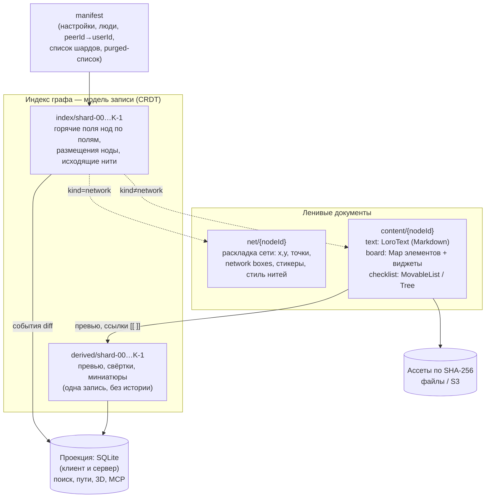

# R3. CRDT и синхронизация: движок для local-first, совместной работы и ленивой загрузки

> Дата исследования: 2026-10-13. Версии и даты релизов взяты из реестров npm, crates.io и PyPI на эту дату. Документация прочитана в исходных репозиториях на GitHub: `yjs/yjs` `d01eefc` (2026-10-07), `loro-dev/loro` `4f60d92` (2026-10-09), `automerge/automerge-repo` `8b178e7`, `automerge/automerge.github.io` `b4cfd9a`, `ueberdosis/hocuspocus` `bd288a4` (2026-10-12), `excalidraw/excalidraw` `541653c` (2026-10-12) и других (ссылки в тексте).
>
> **Ограничение доступа.** Сайты loro.dev, automerge.org и cdn.jsdelivr.net из среды исследования не открывались: прокси отклонял соединение. Тексты блога и документации Automerge прочитаны в исходниках сайта на GitHub, ссылки даны на опубликованные страницы. Страницы loro.dev с бенчмарками видны только в выдержках поиска, такие данные помечены «по данным поиска». Цифры в разделе 12.3 — **собственный синтетический замер** (Node 22.22.0, Linux x64, 4 vCPU, по одному прогону). Это ориентир, а не бенчмарк для публикации.

## Кратко

- **Рекомендация: Loro 1.16 (MIT) как единый CRDT-движок, Yjs — план Б, Automerge сейчас не берём.** Почему Loro подходит требованиям Strata: в нём есть все нужные типы данных (переставляемый список, дерево, счётчик, текст с разметкой), встроенная история (`checkout`, `fork`, `revertTo`, `diff`), shallow-снапшоты для сжатия истории и одно ядро на Rust. Это ядро работает в десктопе (Tauri), на сервере и в браузере через WASM.
- **Состояние рынка на 2026-10.** Yjs стабилен (13.6.33), но v14 в предрелизах с 2025-04 (сейчас пакет `@y/y` 14.0.0-rc.28): биндинги переезжают в `@y/*`, будет миграция. У Automerge хорошее ядро: 3.0 сократил память больше чем в 10 раз, Hexane v1 ускорил его в 2–9 раз. Зато вокруг ядра всё в переходе: тег `latest` у `automerge-repo` указывает на alpha, новый протокол Subduction — «early preview», эталонный сервер — «unsecured». Loro выпускает релизы почти ежемесячно (1.16.4 от 2026-09-30).
- **Наш замер индекса на 100 тыс. нод** (120 тыс. размещений, 150 тыс. нитей) в одном документе. Снапшот весит 22–33 МБ у обоих движков. Loro импортирует его за 0,14 с, потому что разбирает состояние лениво. Yjs тратит 2,5–5,5 с и занимает +260…640 МБ ОЗУ. Но Loro медленно отдаёт «всё сразу», когда у каждой ноды свой контейнер: 6 с на чтение всех имён. Раскладка «карта на поле» сокращает это до 0,94 с. Вывод: CRDT-индекс служит моделью записи. Для поиска и 3D нужна локальная проекция (SQLite), а сам индекс нужно шардировать.
- **Готового production-биндинга Excalidraw нет ни у кого.** `y-excalidraw` синхронизирует целые элементы, последний коммит — 2024-12. `loro-excalidraw` — прототип. Свой биндинг пишется просто: карта `elementId → элемент` с правилом «последний победил» на уровне элемента. Так работает и сам Excalidraw: поля `version` и `versionNonce` плюс дробный `index` для z-порядка.
- **CodeMirror 6 закрыт у Yjs и Loro.** `y-codemirror.next` 0.3.6 и `loro-codemirror` 0.3.3 умеют курсоры и совместный undo. Текст храним как Markdown-исходник в `LoroText`. Метод `updateByLine` (diff Майерса) даёт готовый мост для правок из зеркала Obsidian (см. R2).
- **Сервер «под ключ» есть только у Yjs.** Это Hocuspocus 4.7.1 (MIT): хуки авторизации, хранение в SQLite, S3, Redis и любой БД через `extension-database`, мультиплекс документов. У Loro есть протокол `loro-protocol` 0.x: мультиплекс комнат, хуки auth/load/save, E2EE `%ELO`. Сервер на нём придётся писать самим. Но Strata в любом случае нужен свой сервер: MCP, ассеты, проекция, права.
- **Зрелого E2E нет.** `secsync` в бете и не развивается с 2024-09. Keyhive — pre-alpha без аудита. Loro `%ELO` шифрует, но управление ключами оставляет приложению. E2E мешает серверному MCP и AI-поиску, поэтому в MVP его не делаем.
- **Undo, история и корзина.** Внутри редакторов undo делает UndoManager движка. Граф-операции, например «вставить в нить», меняют индекс и документ сети одновременно, для них нужен свой стек команд с обратными операциями. История версий строится на `checkout`/`revertTo` Loro и серверном журнале, где сервер сам проставляет `userId`. Корзина — поле `trashedAt` и серверная очистка через 30 дней. Полную историю хранит сервер, клиенты держат shallow-снапшоты.

## Находки

### 1. Срез версий на 2026-10-13

**Движки и их ядра**

| Проект | Стабильная версия (дата) | Предрелиз / ветка | Лицензия (где проверено) | Источник |
|---|---|---|---|---|
| Yjs | `yjs` 13.6.33 (2026-09-23) | v14 под именем `@y/y`: 14.0.0-rc.28 (2026-09-29, тег `beta`). У `yjs` тег `beta` = 14.0.0-16 (2025-12-07) | MIT (LICENSE в `yjs/yjs`) | https://www.npmjs.com/package/yjs, https://www.npmjs.com/package/@y/y, https://github.com/yjs/yjs |
| yrs (Rust-порт Yjs) | `yrs` 0.28.0 (2026-09-17) | — | MIT (LICENSE в `y-crdt/y-crdt`) | https://crates.io/crates/yrs, https://github.com/y-crdt/y-crdt |
| Automerge | `@automerge/automerge` 3.5.0 (2026-09-16); crate `automerge` 0.12.0 (2026-09-16) | — | MIT (LICENSE) | https://www.npmjs.com/package/@automerge/automerge, https://crates.io/crates/automerge |
| automerge-repo | 2.5.6 (2026-05-18) — последняя без суффикса | Тег npm `latest` указывает на **2.6.0-alpha.3** (2026-08-07). Есть 3.0.0-experimental.2 (2026-10-09) и ветка `subduction` | MIT (LICENSE, Ink & Switch) | https://www.npmjs.com/package/@automerge/automerge-repo |
| Loro | `loro-crdt` 1.16.4 (2026-09-30); crate `loro` 1.16.2; PyPI `loro` 1.16.2 | `loro.js` 0.3.0 (2026-09-30) — экспериментальная реализация на чистом TS без WASM | MIT (LICENSE в `loro-dev/loro`) | https://www.npmjs.com/package/loro-crdt, https://crates.io/crates/loro, https://pypi.org/project/loro/, https://github.com/loro-dev/loro/tree/main/loro-js |

**Серверы, протоколы, биндинги**

| Проект | Версия (дата) | Лицензия | Комментарий | Источник |
|---|---|---|---|---|
| Hocuspocus (Yjs) | 4.7.1 (2026-10-12). 4.0.0 — 2026-04-23 | MIT (LICENSE.md, Tiptap GmbH) | Активно развивается | https://github.com/ueberdosis/hocuspocus |
| y-websocket (клиент) | 3.1.0 (2026-08-06). Сервер вынесен в `@y/websocket-server` 0.1.5 (2026-02-18) | MIT | В `main` уже 4.0.0-rc.4 | https://github.com/yjs/y-websocket |
| `@y/hub` (бывший y-redis) | 0.9.1 (2026-09-30), «beta» | **AGPL-3.0 OR проприетарная** | Масштабируемый бэкенд Yjs | https://github.com/yjs/y-redis |
| y-sweet | 0.9.1 (2025-09-16), последний коммит 2025-12-04 | MIT | Активность низкая | https://github.com/jamsocket/y-sweet |
| y-partyserver | 2.2.0 (2026-04-24) | ISC (npm) | Cloudflare Durable Objects | https://github.com/cloudflare/partykit |
| automerge-repo-sync-server | 0.3.0 (2026-09-30) | MIT | «unsecured Express app» | https://www.npmjs.com/package/@automerge/automerge-repo-sync-server |
| samod (automerge-repo на Rust) | 0.15.0 (2026-09-30) | MIT | «don't use this anywhere serious yet» | https://github.com/alexjg/samod |
| Subduction (новый sync Automerge) | коммит 2026-10-13 | MIT OR Apache-2.0 | «early release preview… DO NOT use for production» | https://github.com/inkandswitch/subduction |
| Keyhive (права и E2E для Automerge) | pre-alpha; ARK `@automerge/automerge-repo-keyhive` 0.0.0-alpha.53, тег `next` 0.7.0-alpha.1 | Apache-2.0 | «DO NOT use… in production», без аудита | https://github.com/inkandswitch/keyhive |
| loro-protocol / loro-websocket / loro-adaptors | 0.3.0 / 0.6.2 / 0.6.1 (репо 2026-09-30) | MIT (package.json, README) | Протокол, клиент, простые серверы на TS и Rust | https://github.com/loro-dev/protocol |
| y-codemirror.next | 0.3.6 (2026-08-18) | MIT | В `main` готовится `@y/codemirror` для v14 | https://github.com/yjs/y-codemirror.next |
| y-prosemirror / `@tiptap/y-tiptap` | 1.3.7 (2025-07-03) / 3.0.10 (2026-10-13) | MIT | TipTap Collaboration 3.32.0 построен на Yjs | https://www.npmjs.com/package/y-prosemirror, https://www.npmjs.com/package/@tiptap/y-tiptap |
| loro-codemirror / loro-prosemirror | 0.3.3 (2025-10-07; коммит в репо 2026-09-13) / 0.4.4 (2026-08-22) | MIT | Синхронизация, курсоры, undo | https://github.com/loro-dev/loro-codemirror, https://github.com/loro-dev/loro-prosemirror |
| automerge-codemirror / `@automerge/prosemirror` | 0.2.0 (2025-07-21) / 0.2.0 (2026-02-25) | MIT (npm) | ProseMirror-биндинг — «beta quality» | https://github.com/automerge/automerge-codemirror, https://github.com/automerge/automerge-prosemirror |
| `@excalidraw/excalidraw` | 0.18.1 (2026-04-20) | MIT | — | https://www.npmjs.com/package/@excalidraw/excalidraw |
| y-excalidraw | 2.0.12 (2024-12-10) | MIT | Последний коммит 2024-12-10 | https://github.com/RahulBadenkal/y-excalidraw |
| secsync | 0.5.0 (2024-06-04), последний коммит 2024-09-21 | Apache-2.0 | «beta software» | https://github.com/serenity-kit/secsync |

### 2. Yjs (и yrs)

**Зрелость.** Самая распространённая CRDT-библиотека. По README её используют AFFiNE, Evernote, GitBook, Linear, JupyterLab, Nextcloud, Huly. AppFlowy использует порт yrs ([README](https://github.com/yjs/yjs)). Лицензия MIT, но README прямо говорит о «social expectation to sponsor» при коммерческом использовании.

**Переход на v14.** Ветка `main` репозитория `yjs/yjs` уже называется `@y/y` 14.0.0-rc.28. Первые предрелизы v14 вышли в пакете `yjs` (14.0.0-2 — 2025-04-30). С 2025-12-10 v14 публикуется как `@y/y`. Биндинги переезжают туда же: `@y/codemirror` (beta 0.0.0-3), `@y/prosemirror` (beta 2.0.0-15), `@y/websocket` (beta 4.0.0-rc.2) ([npm @y/y](https://www.npmjs.com/package/@y/y)). README `y-codemirror.next` предупреждает: «Most users should continue to use the stable `y-codemirror.next` package with Yjs v13 for now». Что нового в v14:
- **атрибуция изменений** (`IdSet`/`IdMap`). Она рисует версии в духе Google Docs: кто, когда и что вставил или удалил ([attributing-content.md](https://github.com/yjs/yjs/blob/main/attributing-content.md));
- события и правки в формате `lib0/delta` (`applyDelta`, `toDelta` с `renderer`) ([README](https://github.com/yjs/yjs/blob/main/README.md)).

Стартовать на Yjs сейчас значит выбирать между v13 с будущей миграцией и RC-версией v14.

**Типы данных.** `Y.Map`, `Y.Array`, `Y.Text` (форматирование, embeds), `Y.XmlFragment`/`XmlElement`. Перемещения в массиве (`move`) в JS-версии **нет**: по таблице паритета y-crdt оно есть только «(move branch)», а в yrs реализовано. Дерева и счётчика в ядре нет. Дерево делают сторонние пакеты, например `yjs-orderedtree` 1.0.1-beta.3 ([таблица y-crdt](https://github.com/y-crdt/y-crdt#feature-parity-among-projects), [README yjs: Utilities](https://github.com/yjs/yjs#utilities)). Переупорядочивание списков решается вручную: дробные индексы плюс `Y.Map`.

**GC и история.** GC включён по умолчанию: удалённый контент заменяется на `ItemDeleted`/`GC`-структуры. Чтобы восстанавливать старое состояние, нужен `doc.gc = false` («in order to disable gc and be able to restore old content») ([README: Y.Doc](https://github.com/yjs/yjs#ydoc), [CRDT algorithm](https://github.com/yjs/yjs#yjs-crdt-algorithm)). Снапшоты (`Y.snapshot`) есть. Графа версий и машины времени «из коробки» нет, в v14 их отчасти заменяет атрибуция. Автор Loro оценивает, что сохранение версии в Yjs требует отдельно хранить version vector и delete set на каждую версию ([zxch3n/crdt-benchmarks](https://github.com/zxch3n/crdt-benchmarks)).

**Undo.** `Y.UndoManager` поддерживает `trackedOrigins`, `captureTimeout` и `stopCapturing()`. По умолчанию он «never overwrite remote changes» ([README: Y.UndoManager](https://github.com/yjs/yjs#yundomanager)). Undo через несколько документов даёт `YMultiDocUndoManager` из `y-utility` 0.1.4 (2024-05-08) ([y-utility](https://github.com/yjs/y-utility)).

**Поддокументы.** `Y.Doc` можно вложить в общий тип. Он остаётся пустым до вызова `subDoc.load()`, `destroy()` освобождает память, идентификатор — `guid`. Две копии с одним `guid` синхронизируются, так что одну ноду можно разместить в нескольких местах. Но: «all official Yjs providers currently think of sub-documents as separate entities» ([docs: subdocuments](https://docs.yjs.dev/api/subdocuments), [исходник](https://github.com/yjs/docs/blob/main/api/subdocuments.md)). В исходниках Hocuspocus 4.7.1 subdocs не упоминаются. Вместо них Hocuspocus умеет несколько документов на одном WebSocket: `HocuspocusProviderWebsocket` и `sessionAwareness` в v4 ([RELEASE_NOTES_V4](https://github.com/ueberdosis/hocuspocus/blob/main/RELEASE_NOTES_V4.md)).

**Хранение на клиенте.** `y-indexeddb` 9.0.12 не обновлялся с 2023-11 ([npm](https://www.npmjs.com/package/y-indexeddb)). Можно синхронизировать на уровне бинарных апдейтов без загрузки `Y.Doc` в память: `encodeStateVectorFromUpdate`, `diffUpdate` ([README](https://github.com/yjs/yjs#example-syncing-clients-without-loading-the-ydoc)). Это удобно серверу.

**yrs.** Бинарно совместим с Yjs. Через него есть биндинги для Python (`pycrdt` 0.14.8), Ruby, .NET, Swift, Kotlin, R и C FFI ([y-crdt README](https://github.com/y-crdt/y-crdt)). Для десктопа на Tauri это значит, что Rust-ядро возможно и на Yjs.

### 3. Automerge 3 и automerge-repo

**Automerge 3.0 (2025-07-14).** Сжатое колоночное представление теперь используется и в памяти. Расход памяти упал больше чем в 10 раз: вставка «Моби Дика» занимала 700 МБ в Automerge 2 и 1,3 МБ в Automerge 3. Документ, который раньше не загрузился за 17 часов, грузится за 9 секунд. Формат файла не изменился, класс `Text` удалён, `RawString` переименован в `ImmutableString` ([блог Automerge 3.0](https://automerge.org/blog/automerge-3/), [исходник](https://github.com/automerge/automerge.github.io/blob/main/content/blog/automerge-3.md)).

**Hexane v1 (июль 2026).** Переписанный колоночный движок хранения, «2–9× faster». Например, сохранение delta 100k ускорилось с 2,92 мс до 372 мкс, загрузка string 100k — с 4,01 мс до 1,44 мс. В том же цикле `wasm-bindgen` научился `panic=unwind`, и паники Rust стали JS-исключениями ([This Month in Automerge: July '26](https://automerge.org/blog/2026-july/)). В августе вышли JS 3.4.1, crate 0.11.0 и `samod` 0.13.0. Тогда же в automerge-repo появился «memory profiling harness» ([August '26](https://automerge.org/blog/2026-august/)).

**automerge-repo.** Даёт управление множеством документов. `Repo.find(url)` с версии 2.0 асинхронный ([Automerge Repo 2.0, 2025-05-13](https://automerge.org/blog/automerge-repo-2/)). У `DocHandle` есть `history()`, `view(heads)`, `diff()`, `metadata()`, `changeAt()`, `merge()`, `unload()`/`reload()`, `broadcast()` ([DocHandle.ts](https://github.com/automerge/automerge-repo/blob/main/packages/automerge-repo/src/DocHandle.ts)). Ссылки на часть документа — `handle.ref(...)` ([Deep References](https://automerge.org/docs/reference/repositories/refs/)). Эфемерные данные (курсоры) передаются через `handle.broadcast` в CBOR ([Ephemeral Data](https://automerge.org/docs/reference/repositories/ephemeral/)). Хранилища: IndexedDB и NodeFS, свой адаптер пишется на любом KV с range-запросами ([Storage](https://automerge.org/docs/reference/repositories/storage/)).

**Предупреждение о гранулярности** из официального гайда: «Having hundreds of docs should be fine… [PushPin] was built around very granular documents… the overhead of syncing many thousands of documents was high» ([Modeling Data](https://automerge.org/docs/cookbook/modeling-data/)). Ink & Switch решает это новым протоколом Subduction: Patchwork нужно грузить «low thousands of Automerge documents at a time». Для него сделали бэкенд на `redb`, ограничение частоты запросов на пира и транспорт iroh 1.0 ([July '26](https://automerge.org/blog/2026-july/)). Сам Subduction помечен «DO NOT use for production» ([README](https://github.com/inkandswitch/subduction)).

**Сервер.** `automerge-repo-sync-server` описан так: «unsecured Express app… partly for demonstration». Хранит файлы в `DATA_DIR`, авторизации нет (README в npm-пакете 0.3.0). Политика раздачи задаётся через `sharePolicy`/`shareConfig` в `Repo` ([Repo.ts](https://github.com/automerge/automerge-repo/blob/main/packages/automerge-repo/src/Repo.ts)).

**Типы.** Map, List, текст (обычная JS-строка — совместная, `ImmutableString` — нет), `Automerge.updateText` для правок через diff, rich text с метками и блок-маркерами, `Counter` ([Documents](https://automerge.org/docs/reference/documents/), [Rich text](https://automerge.org/docs/reference/documents/rich-text/), [Counters](https://automerge.org/docs/reference/documents/counters/)). Перемещения в списке и дерева в документации нет (по поиску в доках; не проверено исчерпывающе).

**Undo.** Встроенного UndoManager в JS API нет. Есть сторонняя обёртка `automerge-repo-undo-redo`, она «experimental» и «alters the history of your document» (по данным поиска: https://github.com/onsetsoftware/automerge-repo-undo-redo).

### 4. Loro 1.x

**Обзор.** Rust-ядро, доступное через WASM (JS), Swift (`loro-ffi`) и Python (`loro-py`). Лицензия MIT. Типы данных: Text (алгоритм Fugue), Rich Text, Movable Tree, Movable List, LWW Map, Counter ([README](https://github.com/loro-dev/loro)). В README заявлены «Fast Document Loading», «Fast Time Travel», «Version Control with Real-Time Collaboration» и «Shallow Snapshot that Works like Git Shallow Clone». Версия 1.0 вышла в октябре 2024 со стабильным форматом кодирования.

**История и версии** (по исходнику биндинга [`crates/loro-wasm/src/lib.rs`](https://github.com/loro-dev/loro/blob/main/crates/loro-wasm/src/lib.rs)):
- переход к версии и обратно: `checkout(frontiers)`, `checkoutToLatest()`;
- ветвление: `fork()`, `forkAt(frontiers)`;
- откат новыми операциями без переписывания истории: `revertTo(frontiers)`;
- `diff()`, `travelChangeAncestors()`, `getChangeAt()`;
- метаданные коммита: `setNextCommitMessage()`, `setNextCommitOrigin()`; метки времени: `setRecordTimestamp(true)`, слияние мелких изменений: `setChangeMergeInterval()`;
- `subscribeJsonpath()`, `importBatch()`, `redactJsonUpdates()`.

**Shallow-снапшоты.** Работают как `git clone --depth`: хранят историю только после корня `F`. Гарантии описаны в [shallow-snapshot-concurrency.md](https://github.com/loro-dev/loro/blob/main/docs/shallow-snapshot-concurrency.md) (сверено с кодом 2026-09-04): апдейты, причинно идущие после `F`, применяются, история до `F` при повторном импорте игнорируется. С 1.16.0 апдейты, **конкурентные корню**, отвергаются ошибкой `ImportUpdatesThatDependsOnOutdatedVersion` ([CHANGELOG 1.16.0](https://github.com/loro-dev/loro/blob/main/crates/loro-wasm/CHANGELOG.md)). Отсюда архитектурное следствие: **полную историю должен хранить сервер**. Иначе клиент, долго бывший офлайн, не сможет влить свои правки в shallow-копию.

**Undo.** `UndoManager` откатывает только локальные коммиты («cannot revert changes made by other peers»). По умолчанию `maxUndoSteps` = 100, `mergeInterval` = 1000 мс. Есть `groupStart`/`groupEnd`, `addExcludeOriginPrefix` и `pause`/`resume` ([lib.rs](https://github.com/loro-dev/loro/blob/main/crates/loro-wasm/src/lib.rs)). Undo через несколько документов не поддерживается.

**Присутствие.** `EphemeralStore` с таймаутом записей ([awareness.rs](https://github.com/loro-dev/loro/blob/main/crates/loro-wasm/src/awareness.rs)).

**Новое в 2026:**
- 1.13.0 (2026-06-08): **mergeable child containers** — `ensureMergeable{Map,List,MovableList,Text,Tree,Counter}`. Если два пира одновременно впервые создают дочерний контейнер под одним ключом, получается один детерминированный `ContainerID`, а не два конкурирующих. `getOrCreateContainer` объявлен устаревшим ([CHANGELOG](https://github.com/loro-dev/loro/blob/main/crates/loro-wasm/CHANGELOG.md), [context/mergeable-containers.md](https://github.com/loro-dev/loro/blob/main/context/mergeable-containers.md)). Для индекса это значит, что две вкладки, одновременно создавшие запись ноды, сойдутся без конфликта.
- 1.16.0: исправлено удержание около 4 КБ на каждый прочитанный контейнер. Раньше память не освобождалась до `doc.free()` и «trapped wasm32 at the 4 GiB limit around one million containers». Кэш теперь ограничен 2048 записями, обход 188 тыс. хэндлов ускорился примерно в 10 раз. Экспорт shallow-снапшота на документах с множеством контейнеров стал быстрее до ~20 раз. Добавлены массовые чтения `getDeepValueWithID()` и `toContainerTree()`. Есть «potentially breaking» изменение формата `cid` ([CHANGELOG 1.16.0](https://github.com/loro-dev/loro/blob/main/crates/loro-wasm/CHANGELOG.md)).
- `LoroText.update()` и `updateByLine()` — правка текста до целевого через diff Майерса ([lib.rs](https://github.com/loro-dev/loro/blob/main/crates/loro-wasm/src/lib.rs)). Нужно для приёма правок из Obsidian (R2).
- У `LoroTree` порядок соседей задаётся дробным индексом (`enableFractionalIndex(jitter)`), есть `fractional_index()` на узле.

**Риски зрелости.** Минорные релизы иногда несут «potentially breaking» изменения (1.16.0). Сборка WASM весит 3,3 МБ, около 1,1 МБ в gzip (наш замер 1.16.4; у Automerge 3.5.0 столько же, 3,6/1,1 МБ). У Yjs `yjs.mjs` без минификации — 293/61 КБ.

### 5. Новички: стоит ли брать как основу

| Проект | Что это | Лицензия (где проверено) | Статус на 2026-10 | Подходит Strata как ядро? |
|---|---|---|---|---|
| **Jazz 2.0** | «local-first relational database», полностью новый API | MIT (LICENSE в `garden-co/jazz`) | Публичная alpha с 2026-04-18 ([what-is-jazz.mdx](https://github.com/garden-co/jazz/blob/main/docs/content/blog/what-is-jazz.mdx)). `jazz-tools` 2.0.0-alpha.59 (2026-10-04), классическая ветка 0.20.19 | Нет. Для совместного текста сами советуют «any CRDT library… Automerge, Loro or Yjs» поверх Jazz ([рецепт](https://github.com/garden-co/jazz/blob/main/docs/content/docs/recipes/data-patterns/collaborative-text-editing.mdx)). Зашифрованные колонки — открытый вопрос спецификации ([7_authorization.md](https://github.com/garden-co/jazz/blob/main/crates/jazz/SPEC/7_authorization.md)) |
| **ElectricSQL** | Синхронизация «на чтение» из Postgres в клиенты | Apache-2.0 (npm `@electric-sql/client` 1.5.28, 2026-09-09) | 1.0 вышел в 2025-03 ([блог](https://electric.ax/blog/2025/03/17/electricsql-1.0-released)). Покупка Databricks в 2026-08 — **не проверено** (только агрегатор) | Нет: строки Postgres, нет текстового CRDT, офлайн-запись своя |
| **Zero** (Rocicorp) | Синхронизация на основе запросов, Postgres → SQLite-реплика | Apache-2.0 (package.json `@rocicorp/zero` 1.10.0, 2026-10-09) | 1.0 вышел в 2026 ([InfoQ](https://infoq.com/news/2026/06/zero-version-1)). Нужен Postgres 15+ с логической репликацией | Нет: нет текстового CRDT, требует Postgres, ориентирован на онлайн |
| **PowerSync** | Postgres/Mongo/MySQL → SQLite на клиенте | SDK — Apache-2.0. Сервис — **FSL-1.1-ALv2** (LICENSE в `@powersync/service-core`) | Open Edition для self-host | Нет: source-available сервер, нет текстового CRDT |
| **Triplit** | Полноценная local-first БД | AGPL-3.0-only (`@triplit/client` 1.0.50) | Последний релиз 2025-07-31. Сооснователь перешёл в Supabase 2025-10-08 ([Supabase](https://supabase.com/blog/triplit-joins-supabase)) | Нет: застой, AGPL |
| **DXOS** (ECHO, Composer) | Local-first фреймворк | **FSL-1.1-Apache-2.0** (LICENSE в `@dxos/client` 0.14.0, 2026-10-10) | Активен | Нет: не OSI-лицензия. Какой CRDT сейчас в ECHO, не проверено |
| **tldraw sync** | Синхронизация досок tldraw | «tldraw license»: «Not to use the Software in Production Environments» без ключа ([LICENSE.md](https://github.com/tldraw/tldraw/blob/main/LICENSE.md)) | 5.5.2 (2026-10-02) | Нет: не open source |
| **Ditto** | Коммерческий P2P SDK | проприетарная (не проверено по LICENSE) | — | Нет |

Вывод: для документно-графового приложения с богатым текстом и досками новички закрывают в лучшем случае табличную часть. Из них стоит следить только за Jazz 2.0 — как за референсом прав доступа и схем.

### 6. Типы данных (что есть «из коробки»)

| Тип | Yjs 13/14 | Automerge 3 | Loro 1.16 | Где нужен в Strata |
|---|---|---|---|---|
| Map (LWW по ключу) | ✅ `Y.Map` | ✅ | ✅ `LoroMap` | Индекс, раскладка сети, элементы доски |
| List | ✅ `Y.Array` | ✅ | ✅ `LoroList` | — |
| Переставляемый список | ❌ в JS (только ветка `move`; в yrs есть) | ❌ (не нашли) | ✅ `LoroMovableList` | Чек-листы, порядок виджетов |
| Дерево с перемещением | ❌ (сторонний `yjs-orderedtree`, beta) | ❌ | ✅ `LoroTree` с дробным индексом | Вложенные чек-листы и аутлайны. **Не для размещений:** сеть нод — DAG, а не дерево (см. рекомендацию) |
| Текст | ✅ `Y.Text` | ✅ строка + `splice`/`updateText` | ✅ `LoroText` (Fugue) + `update`/`updateByLine` | Текстовые ноды (Markdown) |
| Rich text | ✅ атрибуты форматирования, `XmlFragment` | ✅ метки и блоки | ✅ стили (Peritext-подобные) | Если когда-нибудь будет WYSIWYG |
| Счётчик | ❌ | ✅ `Counter` | ✅ `LoroCounter` | Счётчики голосов и оценок (не MVP) |
| Детерминированное создание дочернего контейнера | ❌ (решается вручную) | — (не проверено) | ✅ `ensureMergeable*` (1.13) | Создание записей ноды офлайн на двух устройствах |

### 7. Много документов и ленивая загрузка

- **Yjs:** поддокументы с `load()` и `destroy()` и общим `guid` удобны для повторного использования одной ноды в нескольких местах. Но провайдеры и Hocuspocus их не поддерживают как группу ([docs](https://docs.yjs.dev/api/subdocuments)). На практике проще держать **отдельные `Y.Doc` с собственными ID и мультиплексом через один сокет**: так делает Hocuspocus 4 через `HocuspocusProviderWebsocket` ([RELEASE_NOTES_V4](https://github.com/ueberdosis/hocuspocus/blob/main/RELEASE_NOTES_V4.md)).
- **Automerge:** `Repo` + `DocHandle` + `AutomergeUrl` — готовый менеджер документов с `unload()`. Ограничения: тысячи документов синхронизируются с заметными накладными расходами ([Modeling Data](https://automerge.org/docs/cookbook/modeling-data/)), Subduction для масштаба ещё сырой.
- **Loro:** менеджера документов нет, каждый `LoroDoc` независим. `loro-protocol` мультиплексирует много комнат на одном соединении. Ограничения протокола: 256 КиБ на сообщение, большие апдейты фрагментируются, подтверждения через `Ack`, при вытеснении приходит `RoomError` ([protocol README](https://github.com/loro-dev/protocol), [protocol.md](https://github.com/loro-dev/protocol/blob/main/protocol.md)). Импорт снапшота ленивый: в нашем замере 28 МБ импортировались за 0,14 с (§12.3).
- **Ссылки между документами** во всех трёх движках прикладные: ID ноды и ID документа. Нативных «ссылок с подгрузкой» нет. Исключение — вложенный `Y.Doc` по `guid` в Yjs и `AutomergeUrl` в Automerge.

### 8. Биндинги редакторов

| Редактор | Yjs | Automerge | Loro |
|---|---|---|---|
| CodeMirror 6 | `y-codemirror.next` 0.3.6: синхронизация, курсоры через awareness, совместный undo (у каждого своя история) ([README](https://github.com/yjs/y-codemirror.next)) | `@automerge/automerge-codemirror` 0.2.0: синхронизация через `DocHandle`. Курсоров и undo в README нет ([README](https://github.com/automerge/automerge-codemirror)) | `loro-codemirror` 0.3.3: синхронизация, курсоры через `EphemeralStore`/Awareness, undo через `UndoManager` ([README](https://github.com/loro-dev/loro-codemirror)) |
| ProseMirror / TipTap | `y-prosemirror` 1.3.7; TipTap Collaboration 3.32.0 поверх `@tiptap/y-tiptap` 3.0.10 и Hocuspocus — главный индустриальный стек | `@automerge/prosemirror` 0.2.0, «beta quality», только своя схема rich text ([README](https://github.com/automerge/automerge-prosemirror)) | `loro-prosemirror` 0.4.4: синхронизация, курсоры, `LoroUndoPlugin` ([README](https://github.com/loro-dev/loro-prosemirror)) |

Для Strata важно, что Obsidian сам построен на CodeMirror 6 («Obsidian uses CodeMirror 6 (CM6) to power the Markdown editor») ([docs.obsidian.md](https://docs.obsidian.md/Plugins/Editor/Editor+extensions)). Markdown-исходник в CRDT-тексте и CM6 сохраняют совместимость с Obsidian без преобразования Markdown ↔ ProseMirror с потерями.

### 9. Excalidraw и CRDT

**Как сливает правки сам Excalidraw** ([reconcile.ts](https://github.com/excalidraw/excalidraw/blob/master/packages/excalidraw/data/reconcile.ts), [types.ts](https://github.com/excalidraw/excalidraw/blob/master/packages/element/src/types.ts)):
- элемент несёт `version` («sequentially incremented on each change»), `versionNonce` («regenerated on each change… in case the versions are identical»), дробный `index` (по `rocicorp/fractional-indexing`) и флаг `isDeleted`;
- удалённый элемент отбрасывается, если локальный сейчас редактируется (`editingTextElement`, `resizingElement`, `newElement`). Иначе побеждает больший `version`, а при равенстве — меньший `versionNonce`;
- после слияния элементы сортируются по дробному индексу (`orderByFractionalIndex`), повторяющиеся индексы чинятся (`syncInvalidIndices`).

То есть это LWW на уровне элемента, а z-порядок без конфликтов задаёт дробный индекс. Сама совместная работа в excalidraw.com построена на E2E-шифрованной ретрансляции через сервер без координации (по данным поиска: [блог Excalidraw](https://plus.excalidraw.com/blog/building-excalidraw-p2p-collaboration-feature)).

**Готовые привязки:**
- `y-excalidraw` 2.0.12 (MIT, 2024-12-10). `Y.Array<Y.Map>` элементов, ассеты, awareness, отдельный плагин undo. Синхронизирует **на уровне элемента, не ключа** («Even the excalidraw cloud offering doesn't support that»). Undo приходится перехватывать через DOM ([README](https://github.com/RahulBadenkal/y-excalidraw)).
- `loro-excalidraw` — «proof of concept… not optimized for production» (2024-10-29). Использует `LoroList` элементов и `checkout` для машины времени ([репо](https://github.com/loro-dev/loro-excalidraw)).

Excalidraw 0.18.1 уже несёт всё нужное для LWW-слияния (`version`, `versionNonce`, `index`), поэтому биндинг для любого движка — это примерно 300–500 строк (оценка, не проверено). Схема: `Map<elementId, elementJSON>` и запись только изменившихся по `version` элементов.

### 10. Self-hosted серверы синхронизации

| Сервер | Движок | Хранение | Авторизация | Присутствие | Масштаб | Лицензия и статус |
|---|---|---|---|---|---|---|
| **Hocuspocus 4.7.1** | Yjs | Расширения `database` (fetch/store), `sqlite` (better-sqlite3), `s3` (AWS, MinIO, R2, B2), `redis` (горизонтально), `webhook`. `onLoadDocument` принимает `Uint8Array` | `onAuthenticate` с типизированным `Context`, повтор авторизации без переподключения | awareness | Node ≥22, Bun, Deno, Cloudflare Workers (crossws). Апдейты кодируются один раз на все соединения | MIT, активен ([RELEASE_NOTES_V4](https://github.com/ueberdosis/hocuspocus/blob/main/RELEASE_NOTES_V4.md), [extension-s3](https://github.com/ueberdosis/hocuspocus/tree/main/packages/extension-s3)) |
| `@y/websocket-server` 0.1.5 | Yjs | В памяти + persistence-хуки | Через заголовки и cookies при апгрейде | awareness | Один процесс | MIT ([y-websocket README](https://github.com/yjs/y-websocket)) |
| `@y/hub` 0.9.1 | Yjs | Redis streams + S3 или Postgres, отдельный worker | Плагин `authenticate`/`authorize` | awareness | Без Y.Doc в памяти сервера, горизонтально | **AGPL-3.0 или платная**, beta ([README](https://github.com/yjs/y-redis)) |
| y-sweet 0.9.1 | Yjs (Rust) | S3-совместимое хранилище | Клиентские токены на документ | awareness | «session backend» | MIT, активность низкая с 2025-12 ([README](https://github.com/jamsocket/y-sweet)) |
| y-partyserver 2.2.0 | Yjs | Durable Objects | Свой код | awareness | Cloudflare | ISC; self-host вне Cloudflare не проверялся ([cloudflare/partykit](https://github.com/cloudflare/partykit)) |
| automerge-repo-sync-server 0.3.0 | Automerge | Файлы (`DATA_DIR`) | **Нет** («unsecured») | `broadcast` | Один процесс | MIT (README в npm) |
| Subduction | Automerge и другие | Файлы, `redb` | Через Keyhive | — | P2P и серверы | MIT/Apache, «DO NOT use for production» |
| **loro-websocket** `SimpleServer` (TS) / `loro-websocket-server` (Rust) | Loro (и Yjs через адаптеры) | `onLoadDocument`/`onSaveDocument`; в Rust опционально SQLite-снапшоты | `handshakeAuth` при HTTP-апгрейде и `authenticate(roomId, crdt, auth) → Permission` | `EphemeralStore` | Мультиплекс комнат на одном сокете | MIT, 0.x, «minimal servers for local testing or self-hosting» ([README](https://github.com/loro-dev/protocol)) |

### 11. Сквозное шифрование (E2E) — статус

- **secsync.** Архитектура «снапшот + апдейты + эфемерные сообщения», шифрование XChaCha20-Poly1305. Есть примеры для Yjs и Automerge. Обмен и ротация ключей вне протокола. «beta software», последний коммит 2024-09-21 ([README](https://github.com/serenity-kit/secsync)). Проект фактически не развивается.
- **Keyhive и BeeKEM** (Ink & Switch). Права и E2E для automerge-repo через ARK (`@automerge/automerge-repo-keyhive`). В 2026-08 вышел гайд по API. Препринт BeeKEM опубликован на ePrint ([2026/1434](https://eprint.iacr.org/2026/1434)). Статус: «pre-alpha… DO NOT use this release in production… The code has not had a security audit» ([README](https://github.com/inkandswitch/keyhive)). Авторство коммитов в Automerge, нужное для отзыва прав, только начато ([July '26](https://automerge.org/blog/2026-july/)).
- **Loro `%ELO`** в loro-protocol. AES-GCM, сервер не расшифровывает, а индексирует открытые заголовки для догрузки истории. «Keys and key agreement are application‑provided and out of scope» ([README](https://github.com/loro-dev/protocol), [protocol-e2ee.md](https://github.com/loro-dev/protocol/blob/main/protocol-e2ee.md)).
- **Jazz 2.0** — шифрование колонок пока открытый вопрос спецификации. **Excalidraw** шифрует комнату ключом из URL (по данным поиска).

Вывод для Strata. E2E исключает серверный MCP, AI-поиск по содержимому и серверную проекцию индекса, а владелец хочет именно этого. Для self-hosted сервера на команду до 10 человек достаточно TLS, шифрования диска и аутентификации.

### 12. Производительность

#### 12.1. Опубликованные бенчмарки (с датами)

**dmonad/crdt-benchmarks** (последний коммит 2024-02-12; yjs 13.6.11, ywasm 0.9.3, loro 0.10.1, automerge 2.1.10; Node 20.5) ([README](https://github.com/dmonad/crdt-benchmarks)). Тест B4 — реальная трасса правок, 260 тыс. операций, 105 тыс. символов:

| Метрика | yjs | loro | automerge |
|---|---|---|---|
| Время B4 | 5 714 мс | 3 089 мс | 14 326 мс |
| Размер документа | 159 929 Б | 258 228 Б | 129 116 Б |
| Разбор документа | 39 мс | 13 мс | 1 805 мс |
| Память на B4×100 (10 млн символов) | 327,1 МБ | (WASM не измеряется) | — |

**zxch3n/crdt-benchmarks** (форк автора Loro, 2024-10-18; yjs 13.6.15, loro 1.0.0-beta.2, automerge 2.1.10) ([README](https://github.com/zxch3n/crdt-benchmarks)):
- B4×100: разбор — yjs 1 270 мс, loro 66 мс; память — yjs 314,1 МБ;
- gzip-бандл: yjs 25 КБ, loro 894 КБ, automerge 591 КБ;
- оговорка авторов: «`memUsed` does not measure the memory usage of the wasm runtime».

**Нативные бенчмарки Loro** (2024-10-18, M2 Max, по данным поиска с https://loro.dev/docs/performance/native): декодирование набора данных из статьи Automerge — automerge 506 мс, loro 0,189 мс, yrs 3,82 мс. Конкурентные вставки в список: yrs 13,95 мс против loro 130,63 мс.

Важно: все опубликованные сравнения сделаны **до Automerge 3 (2025-07) и до Hexane v1 (2026-07)**. По памяти и загрузке Automerge они устарели.

#### 12.2. Чего нет в публичных бенчмарках

Все тесты выше — один большой текст. У Strata профиль другой: десятки тысяч мелких записей (метаданные нод, размещения, нити) в одном индексе плюс множество мелких документов содержимого. Поэтому ниже собственный замер.

#### 12.3. Собственный замер: «индекс графа» на 10 тыс. и 100 тыс. нод (2026-10-13)

**Данные.** На каждую ноду: `kind`, `name` (2–4 слова), `icon`, иногда `color`, `status` и `deadline`, `summary` (около 90 символов), `createdAt`. Примерно 1,2 размещения на ноду (ключ `сеть/нода`) и 1,5 нити (ключ `from>to`). Затем «история»: 30% нод дважды правятся (имя и статус) коммитами по 100 штук. Исходный JSON весит 3,5 МБ на 10 тыс. нод и 35 МБ на 100 тыс.

**Раскладки:**
- `nested` — у каждой ноды свой CRDT-контейнер-карта;
- `record` — запись ноды целиком как JSON-значение (LWW на всю запись);
- `columnar` — отдельная карта на каждое поле, `поле → {nodeId: значение}`.

«Чтение» — получить все имена и все нити, то есть то, что нужно для нечёткого поиска и 3D. Импорт и чтение замерены в отдельном свежем процессе. Версии: loro-crdt 1.16.4, yjs 13.6.33 (`encodeStateAsUpdateV2`), @automerge/automerge 3.5.0.

| Движок, раскладка, N | Снапшот | gzip | Shallow | Импорт | Чтение имён и нитей | ΔRSS после импорта и чтения |
|---|---|---|---|---|---|---|
| Loro `nested`, 10k | 3,0 МБ | 2,1 МБ | 1,7 МБ | 0,03 с | 0,28 с | +29 МБ |
| Yjs `nested`, 10k | 3,3 МБ | 0,6 МБ | — | 0,56 с | 0,01 с | +95 МБ |
| Automerge `nested`, 10k | 1,8 МБ | 1,8 МБ | — | **3,0 с** (сборка 18,9 с) | 0,97 с (`toJS`, в том же процессе) | — |
| Loro `nested`, 100k | 27,9 МБ | 20,0 МБ | 16,3 МБ | 0,14 с | **6,0 с** | +210 МБ |
| Loro `record`, 100k | 22,5 МБ | 17,0 МБ | 10,9 МБ | 0,14 с | 2,7 с | +221 МБ |
| Loro `columnar`, 100k | 27,4 МБ | 20,3 МБ | 17,0 МБ | 0,14 с | **0,94 с** | **+95 МБ** |
| Yjs `nested`, 100k | 25,9 МБ | 4,9 МБ | — | **5,5 с** | 0,16 с | **+644 МБ** (куча +487) |
| Yjs `record`, 100k | 24,7 МБ | 5,1 МБ | — | 2,5 с | 0,05 с | +263 МБ |
| Yjs `columnar`, 100k | 33,3 МБ | 6,2 МБ | — | 5,3 с | 0,14 с | +523 МБ |

Что из этого следует:
1. **Размер.** CRDT-снапшот занимает 0,64–0,95 от сырого JSON, около **0,22–0,33 КБ на ноду** вместе с её размещениями и нитями. Оценка в [05-domain-model §13](../05-domain-model.md) (0,5 КБ на ноду, 50–70 МБ на 100 тыс.) консервативна, но порядок верный.
2. **Сеть.** Снапшот Yjs V2 хорошо сжимается gzip (≈19%), у Loro он почти не сжимается (≈70%). Вероятно, у Loro уже есть своё сжатие LZ4 в формате ([docs/encoding-lz4.md](https://github.com/loro-dev/loro/blob/main/docs/encoding-lz4.md)), но это предположение. Первичная загрузка индекса на 100 тыс. нод по сети: около 5 МБ у Yjs против 17–20 МБ у Loro.
3. **Холодный старт.** Loro импортирует лениво (0,14 с), Yjs строит весь граф объектов в куче JS (2,5–5,5 с и сотни мегабайт). Automerge уже на 10 тыс. записей импортирует за 3 с, для большого индекса он не подходит.
4. **Раскладка для Loro критична.** Контейнер на каждую ноду — медленный путь (6 с), карта на поле — быстрый (0,94 с, вдвое меньше памяти). При этом слияние остаётся на уровне поля.
5. **Запись.** Полный экспорт снапшота на 100 тыс. нод занимает около 3,9 с у Loro и 4,3 с у Yjs (первый прогон). Значит, на диск пишем инкрементальными апдейтами, а компактируем в воркере и по шардам.

Ограничения замера: синтетические данные, Node, а не браузер, один прогон. Память WASM не возвращается ОС, ΔRSS приблизительна. Перед фиксацией решения замер нужно повторить в Chrome и Safari (см. спайк).

## Сравнение вариантов

Оценки даны относительно требований Strata: ✅ — сильная сторона, ⚠️ — есть оговорки, ❌ — слабое место.

| Критерий | Yjs (+ yrs, Hocuspocus) | Automerge 3 (+ repo) | Loro 1.16 |
|---|---|---|---|
| Зрелость и экосистема | ✅ Самая большая, продакшн у многих | ⚠️ Ядро зрелое, обвязка (repo, Subduction, сервер) в переходе | ⚠️ Стабильный формат с 1.0 (2024-10), частые релизы, команда меньше |
| Стабильность API на горизонте года | ⚠️ Миграция v13 → v14 (`@y/y`) впереди | ⚠️ automerge-repo 2.6 alpha → 3.0 experimental | ⚠️ Минорные «potentially breaking» (1.16.0) |
| Лицензия | ✅ MIT (сервер `@y/hub` — AGPL) | ✅ MIT (Keyhive — Apache) | ✅ MIT |
| Rust для Tauri и сервера | ✅ yrs (совместим бинарно) | ✅ ядро на Rust, но «API for Rust code is low level» | ✅ одно ядро везде, плюс Swift и Python |
| Размер JS | ✅ десятки КБ | ❌ WASM около 1,1 МБ gzip | ❌ WASM около 1,1 МБ gzip (есть экспериментальный `loro.js` на чистом TS) |
| Индекс на 100 тыс. нод (наш замер) | ⚠️ импорт 2,5–5,5 с, +260…640 МБ | ❌ уже 10 тыс. — 3 с импорта | ✅ импорт 0,14 с, +95 МБ (раскладка по полям) |
| Сетевой размер индекса | ✅ около 5 МБ gzip | — | ⚠️ 17–20 МБ, shallow — 11–17 МБ |
| Типы: переставляемый список, дерево, счётчик | ❌ / ❌ / ❌ | ❌ / ❌ / ✅ | ✅ / ✅ / ✅ |
| История, машина времени, ветки | ⚠️ снапшоты при `gc=false`, атрибуция в v14 | ✅ полная DAG-история, `view`/`diff`/`merge` | ✅ `checkout`, `fork`, `revertTo`, `diff`, сообщения коммитов |
| Сжатие истории | ⚠️ GC без истории | ⚠️ сжатие в 3.0, без shallow | ✅ shallow-снапшоты |
| Undo | ✅ `UndoManager`, мульти-док в y-utility | ❌ встроенного нет | ✅ `UndoManager` с группами (в пределах одного документа) |
| CodeMirror 6 | ✅ | ⚠️ без курсоров и undo | ✅ |
| ProseMirror / TipTap | ✅ эталон (TipTap, Hocuspocus) | ⚠️ beta | ✅ |
| Excalidraw | ⚠️ `y-excalidraw` (2024, поэлементно) | ❌ | ⚠️ PoC |
| Сервер «из коробки» | ✅ Hocuspocus (MIT) | ❌ демо без авторизации | ⚠️ протокол и минимальные серверы с хуками |
| Мульти-док по одному сокету | ✅ Hocuspocus | ✅ repo (с оговорками по масштабу) | ✅ loro-protocol |
| Присутствие | ✅ awareness | ⚠️ `broadcast` | ✅ `EphemeralStore` |
| E2E | ⚠️ secsync (застой) | ⚠️ Keyhive pre-alpha | ⚠️ `%ELO` без управления ключами |

## Рекомендация для Strata

### 1. Движок: Loro, Yjs — запасной

**Берём Loro (`loro-crdt` 1.16.x в вебе, crate `loro` 1.16.x в десктопе и на сервере).** Как выбор связан с требованиями:
- **Гибкая иерархия и одна нода во многих местах (C3).** Модель — карты с детерминированными ключами: размещение `сеть/нода`, нить `hash(from→to)` (ADR-0001). Повторное использование ноды стоит O(1): у ноды один документ содержимого, размещений сколько угодно. `LoroTree` для размещений **не используем**, потому что дерево разрешает одного родителя, а сети Strata образуют DAG (ADR-0002). Дерево берём только для вложенных чек-листов.
- **Ленивая загрузка (N1) и холодный старт.** Ленивый импорт: снапшот индекса на 100 тыс. нод открывается за 0,14 с против 2,5–5,5 с у Yjs. Памяти уходит в 3–6 раз меньше (§12.3). На десктопе Rust-ядро вообще не упирается в лимиты кучи JS и 4 ГиБ wasm32.
- **История и откат версии ноды (J8), корзина.** `checkout`, `revertTo`, `forkAt`, сообщения коммитов и метки времени встроены. У Yjs то же самое пришлось бы строить на снапшотах с `gc=false`.
- **Вид содержимого задаётся при создании ноды (C2).** У Loro есть все нужные типы: `LoroText` для заметки, `LoroMap` элементов для доски, `LoroMovableList`/`LoroTree` для чек-листа, `LoroCounter` на будущее. В Yjs переставляемые списки пришлось бы эмулировать.
- **Платформы.** Одно ядро на Rust для Tauri-десктопа, self-hosted сервера (один бинарник) и браузера (WASM). Есть Python (`loro-py`) для AI-инструментов вокруг MCP.
- **Сервер.** Strata всё равно нужен свой сервер: авторизация, MCP, ассеты, проекция индекса, корзина. Главное преимущество Yjs — Hocuspocus — поэтому весит меньше. `loro-protocol` даёт готовый проводной протокол с мультиплексом и хуками авторизации.

**Почему не Yjs как основной.** Он сильнее экосистемой: TipTap, Hocuspocus, вдвое-вчетверо меньший трафик индекса. Но впереди миграция на v14, нет переставляемых списков и деревьев, история слабее, холодный старт большого индекса тяжелее. **Yjs остаётся планом Б.** Переходим на него, если спайк (§11) провалит критерии или если владелец выберет WYSIWYG-редактор на TipTap вместо Markdown на CM6.

**Почему не Automerge.** Медленный холодный старт на множестве мелких записей (§12.3). Нет переставляемых списков, деревьев и UndoManager. Сервер — демо без авторизации, сборка репозитория в переходе (alpha в `latest`, Subduction в preview). Стоит следить за Keyhive и Subduction как за будущим E2E и P2P.

**Изоляция решения.** Доменные операции (`createNode`, `place`, `connect`, `insertIntoWire`, `trash`…) объявляются в слое `strata-core` и вызывают движок только через тонкий адаптер `DocEngine`. Такой адаптер не делает движки взаимозаменяемыми бесплатно, но удерживает CRDT-специфику в одном модуле на первые месяцы.

### 2. Схема документов

| Документ | Ключ | Содержимое | Когда загружается | Кто пишет |
|---|---|---|---|---|
| `manifest` | `ws/{wsId}/manifest` | Настройки, люди, `peerId → userId`, число шардов `K`, версия схемы, список удалённых навсегда документов | Всегда | Все; служебные поля — сервер |
| `index/shard-k` | `ws/{wsId}/index/{k}` | Горячие поля нод (карта на поле), размещения ноды, **исходящие** нити ноды (`from` в шарде) | Десктоп — все шарды. Веб — проекция сразу, CRDT-шард по требованию при правке | Все |
| `derived/shard-k` | `ws/{wsId}/derived/{k}` | `preview`, свёртки (прогресс, ближайший дедлайн), ID миниатюр | Вместе с проекцией | Один писатель: сервер, в локальном режиме — клиент. Регулярно компактируется в shallow |
| `net/{nodeId}` | `ws/{wsId}/net/{nodeId}` | Позиции `{x,y}` по ноде (LWW на пару), точки на нитях, network boxes, стикеры, локальные флаги «скрыта здесь» и стиль нитей | При входе в сеть; упреждающе — родитель и соседи | Все |
| `content/{nodeId}` | `ws/{wsId}/content/{nodeId}` | По виду ноды (см. §9) | При открытии ноды. Превью — из `derived`, не отсюда | Все |
| Ассеты | `sha256` | Бинарные файлы, миниатюры, размытые фоны | По показу | Все, через сервер |

### 3. Индекс: раскладка, ID, шардирование

- **Раскладка «карта на поле»** внутри шарда: `name: Map<nodeId,string>`, `kind`, `icon`, `color`, `shape`, `status`, `deadline`, `class`, `assignees`, `flags`, `trashedAt`, `createdAt` и т. д. В замере это самый быстрый вариант чтения для поиска и 3D (0,94 с на 100 тыс. против 6 с) и самый экономный по памяти. Слияние остаётся на уровне поля: переименование не затирает одновременную смену статуса. Создание ноды — один коммит в нескольких картах одного шарда, то есть атомарно.
- **Размещения:** `placements: Map<"{netId}/{nodeId}", {primary, addedAt}>` в шарде **ноды**. **Нити:** `edges: Map<edgeId, {from,to,origin}>` в шарде **`from`**, где `edgeId = hash(from→to)` (ADR-0001). Нить, созданная ссылкой из текста, хранит `origin=text` и пересчитывается детерминированно.
- **ID.** UUIDv7 (05-domain-model) в компактной текстовой форме (26 символов base32, как ULID) или как 16 байт. Ключи участвуют в каждой записи, а на 100 тыс. нод ключи нитей сами по себе занимают несколько мегабайт (оценка).
- **Шардирование.** `shard = hash(nodeId) mod K`, `K` — степень двойки и записан в `manifest`. Старт: `K=1` до примерно 20 тыс. нод. Затем `K=16`, при росте — 64. Разделение шарда `k` на `k` и `k+K` выполняет сервер как миграцию с версией схемы. Почему по хешу, а не по сетям верхнего уровня: при многократных размещениях локальности всё равно нет, а для 3D и поиска нужны все шарды. Хеш даёт ровные размеры и ограниченную стоимость компактирования: на 100 тыс. нод и `K=16` шард весит около 1,7 МБ и экспортируется примерно за 0,25 с (экстраполяция замера).
- **Холодное отдельно от горячего.** `summary`/`preview` и свёртки вынесены в `derived`. Это вычисляемые поля с частой перезаписью: в общем индексе они раздували бы историю и трафик.
- **Межшардовые операции.** «Вставить в нить» A→B ⇒ удалить A→B и добавить A→X (шард A), добавить X→B (шард X). Клиент шлёт их одним **пакетом через несколько документов**, сервер применяет пакет вместе. При частичной синхронизации возможна кратковременная промежуточная картина, CRDT её сводит.

### 4. Ленивая загрузка и синхронизация

- **Одно WebSocket-соединение на пространство**, комнаты мультиплексируются (`loro-protocol`). Подписка = `manifest` + шарды индекса + открытые `net/*` и `content/*` + закреплённые для офлайна.
- **Лента изменений на сервере.** Каждый принятый апдейт получает монотонный `seq` в пределах пространства. После переподключения клиент спрашивает: «какие docId изменились после `seq` X?». Затем подтягивает только те документы, что лежат у него в кэше, обменом version vector. 100 тыс. документов не перебираются при каждом подключении. Похожую целочисленную версию использует secsync ([README](https://github.com/serenity-kit/secsync)).
- **Десктоп хранит всё** (диск — единственный лимит, ✅ A4), но **в памяти держит только открытое**. `LoroDoc` закрытых нод освобождаются (`free()`), LRU по 50–200 документам (подобрать в спайке).
- **Веб** — частичный кэш в OPFS или IndexedDB. Сначала приходит **проекция** индекса: компактный бинарный read-model с именами, видами, иконками, размещениями, нитями и превью. CRDT-шард загружается, когда пользователь правит ноду из этого шарда.
- **Бутстрап.** Сервер отдаёт shallow-снапшоты (для индекса 100 тыс. — 11–17 МБ, не gzip, §12.3), историю клиент дотягивает по требованию. Полная история живёт на сервере, иначе отстающие офлайн-клиенты упрутся в `ImportUpdatesThatDependsOnOutdatedVersion` (§4 находок).
- **Предзагрузка.** При входе в сеть грузятся `net/{id}`, `net/{parent}` и сети, на которые ведут видимые ноды-сети. Превью при наведении берутся из `derived` в проекции, `content/*` не трогается.

### 5. Как это масштабируется до 100 тыс. нод

| Показатель (100 тыс. нод, 120 тыс. размещений, 150 тыс. нитей) | Значение | Основание |
|---|---|---|
| CRDT-индекс целиком | около 22–28 МБ, shallow — около 11–17 МБ | Замер §12.3 (с `summary`; без него меньше — не замерено) |
| Шард при `K=16` | около 1,4–1,7 МБ | Деление замера |
| Холодный старт десктопа | импорт шардов около 0,15 с суммарно + проекция из SQLite (мгновенно) | Замер Loro, Rust ещё быстрее (не замерено) |
| Память под индекс | около 100 МБ (раскладка по полям) | Замер ΔRSS |
| Документы сетей | около 5 тыс. (5% нод — сети), по 10–100 КБ | Оценка |
| Документы содержимого | около 95 тыс., загружены единицы | Ленивая загрузка |
| Поиск по именам | в проекции: 100 тыс. строк, около 2–3 МБ, нечёткий поиск в памяти или FTS5 в SQLite | Оценка |

Где граница. При 1 млн нод индекс вырастет примерно до 250–300 МБ: на десктопе с Rust-ядром это рабочий объём, в браузере уже нет. Отсюда правило: **браузер не обязан держать CRDT всего индекса**, ему достаточно проекции.

### 6. Как 3D получает данные без загрузки содержимого

- Источник — **проекция индекса** (локальный SQLite на десктопе, read-model с сервера в вебе). Из неё берутся ноды (имя, вид, иконка, цвет, статус, «ключевая или второстепенная» для размера бабла), размещения (кластеры-«звёзды» по сетям) и нити. В typed arrays это несколько мегабайт.
- Физика (сила, пружины) считается в воркере или на GPU. Координаты 3D — **локальный кэш**, не синхронизируются, как и камера (05-domain-model §9.2).
- Короткая справка при приближении берётся из `derived` (`preview`, свёртки) — она уже есть в проекции. Документ содержимого загружается только при «нырке» в ноду: `Enter`/`I` в 3D открывает `net/*` или `content/*`.
- Поиск и создание нод в 3D идут через те же доменные операции, что и в 2D. Новая нода сразу попадает в проекцию через событие шарда.

### 7. История, undo, корзина

**Undo (два уровня):**
1. **Внутри редакторов** (текст, доска, чек-лист) — `UndoManager` Loro на документ содержимого. Он откатывает только свои изменения. Для текста используется `LoroUndoPlugin` из `loro-codemirror`, для доски — `groupStart`/`groupEnd` на жест.
2. **Граф-операции** (создать, переместить, соединить, вставить в нить, встряхнуть, удалить, Alt-дублировать) затрагивают шард(ы) индекса и `net/*`, а `UndoManager` Loro не группирует несколько документов. Поэтому делаем **свой стек команд**. Команда запоминает прежние значения затронутых ключей и при отмене записывает их обратно новыми операциями, без переписывания истории. Если ключ с тех пор изменил другой человек, шаг пропускается и показывается подсказка. Так выполняется требование 05-domain-model §11: «вставить в нить» отменяется одним шагом.

**История версий:**
- Каждый коммит получает `setNextCommitMessage` (например, «вставка X в нить A→B», «через MCP: Claude») и `origin` (`ui`/`mcp`/`import`). Метки времени включены (`setRecordTimestamp(true)`), мелкие изменения сливаются (`setChangeMergeInterval`).
- **«Кто» определяет сервер.** `peerId` в Loro объявляет сам клиент, поэтому сервер при приёме апдейта пишет в журнал (`seq`, `docId`, `userId`, `ts`, байты) аутентифицированного пользователя. UI истории соединяет DAG изменений Loro с этим журналом.
- **Просмотр версии ноды** — `forkAt(frontiers)` в воркере (только чтение). **Откат** — `revertTo(frontiers)`: новые операции, которые синхронизируются как обычная правка и сами отменяемы.
- **Хранение.** Сервер держит полную историю (апдейты плюс периодические снапшоты в файлах или S3). Клиенты держат shallow-снапшоты с окном, например 30–90 дней (решает владелец).

**Корзина:**
- «Удалить везде» ставит `trashedAt` и `trashedBy` в шарде ноды. Размещения и нити не удаляются, а скрываются в UI, пока нода в корзине, поэтому восстановление — это просто очистка `trashedAt`. «Убрать отсюда» удаляет одно размещение по правилам 05-domain-model §5.
- **Окончательное удаление** через 30 дней делает **только сервер**. Он удаляет ключи ноды из шарда (её поля, размещения, нити `from` и нити `to` в чужих шардах), удаляет хранилище `content/*` и `net/*`, вносит docId в `manifest.purged`, освобождает ассеты по счётчику ссылок. Сервер отвергает апдейты к документам из `purged`, чтобы офлайн-клиент их не «воскресил». В локальном режиме без сервера то же самое делает клиент.

### 8. Сервер: хранение, авторизация, присутствие, MCP

- **Стек.** Rust (axum или похожий) + crate `loro` + серверная часть `loro-protocol` на Rust (есть минимальный сервер с SQLite-снапшотами как отправная точка). Тогда сервер и Tauri-десктоп используют один `strata-core`. Если команда сильна только в TypeScript, подойдёт Node с `loro-crdt` (WASM) и `loro-websocket` `SimpleServer` (хуки `onLoadDocument`/`onSaveDocument`/`authenticate`). Это открытый вопрос.
- **Хранение.** По умолчанию SQLite: один бинарник плюс Docker Compose, как в 01-analysis. Опционально Postgres. Таблицы: `docs(id, type, shard, snapshot, vv, updated_at)`, `updates(seq, doc_id, bytes, user_id, ts)`, `assets(sha256, size, refcount)`. Снапшоты и ассеты лежат в файлах или S3. Компактирование апдейтов в снапшот выполняется в фоне по шардам.
- **Авторизация.** Сессия или JWT проверяется при HTTP-апгрейде (`handshakeAuth`), права на комнату — `authenticate → read|write`. Модель прав для MVP — на пространство. Права на поддеревья с общим индексом сделать трудно: потребуются шарды по доменам прав (открытый вопрос).
- **Присутствие.** `EphemeralStore` на пространство: в какой сети пользователь, курсор на холсте, выделение. Отдельно на документ содержимого: курсоры текста через `loro-codemirror`.
- **MCP.** Чтение (поиск, связи, пути) идёт из серверной проекции: SQL плюс FTS по извлечённому тексту. Запись идёт **через те же доменные операции**. MCP-агент — отдельный пир со своим `peerId`, `origin=mcp:<agent>` и понятными сообщениями коммитов. Поэтому правки ИИ видны в истории и откатываются `revertTo`. Генерация картинок на доске — это ассет плюс элемент в `content/{board}`.

### 9. Содержимое по видам нод

- **Текст.** `LoroText` с **Markdown-исходником** + CM6 + `loro-codemirror`: синхронизация, курсоры, undo. Ссылки `[[…]]` разбираются из текста, нити `origin=text` пересчитываются в шарде индекса. Правки из зеркала Obsidian (R2) применяются через `updateByLine`. Переименование ноды не переписывает ссылки во всех текстах сразу: сервер обновляет их в фоне по обратным ссылкам из индекса. Это аналог настройки Obsidian `alwaysUpdateLinks` (см. R2).
- **Доска (Excalidraw).** `elements: LoroMap<elementId, elementJSON>` с LWW на элемент. Пишем только элементы, у которых вырос `version`, порядок задаёт дробный `index`, удаление — `isDeleted`. Это повторяет `reconcileElements`. `files: LoroMap<fileId, sha256>` указывает на ассеты. Виджеты (короткие заметки, to-do) — элементы со ссылкой на дочерние контейнеры того же документа (`ensureMergeableText`/`ensureMergeableMovableList` под ключом виджета). Undo доски — `UndoManager` с группой на жест.
- **Чек-лист.** `LoroMovableList` пунктов `{text, done}` или `LoroTree` при вложенности.
- **Сеть.** Её содержимое и есть `net/{nodeId}`.

### 10. E2E

В MVP не делаем. Причины: серверный MCP и AI, серверная проекция и сам сценарий «сервер в своей команде» требуют открытого текста на сервере. Если позже понадобится «личная синхронизация через чужой сервер», вариантом будет Loro `%ELO` с ключами на пространство. Keyhive смотрим как источник идей для отзыва прав.

### 11. Спайк до фиксации решения (2–3 недели) и критерии отката на Yjs

1. CM6 + `loro-codemirror`: два клиента, курсоры, undo, вставка 1 МБ Markdown, `updateByLine` из внешнего файла.
2. Биндинг Excalidraw 0.18 ↔ `LoroMap` по схеме §9: 3 клиента, 2 000 элементов, перетаскивание группы.
3. Индекс 100 тыс. нод в **Chrome и Safari**: импорт, раскладка по полям, событийное обновление проекции, память. Цель: импорт меньше 0,5 с, память меньше 200 МБ, правка поля меньше 5 мс.
4. `loro-websocket`: 1 000 комнат на одном сокете, переподключение по ленте `seq`, пакет через несколько документов.
5. Rust (Tauri) ↔ WASM: один бинарный формат и общая папка хранения.

**Переходим на Yjs v14**, если провален пункт 1 или 2 и починить его своими силами за неделю не удаётся, если пункт 3 в браузере хуже Yjs по времени до первого взаимодействия, или если владелец выберет WYSIWYG-редактор на TipTap.

## Риски

1. **Зрелость экосистемы Loro.** Меньше пользователей и интеграций, чем у Yjs, серверная часть в 0.x. Минорные релизы иногда несут ломающие изменения (`cid` в 1.16.0). Митигация: фиксировать точные версии, держать свой адаптер `DocEngine` и регрессионные тесты на форматы.
2. **Bus factor.** Loro развивает небольшая команда. Как он финансируется, не проверено. Формат открыт, но альтернативных реализаций, кроме экспериментального `loro.js`, нет.
3. **Трафик и вес в вебе.** Около 1,1 МБ WASM в gzip и 17–20 МБ индекса на 100 тыс. нод против примерно 5 МБ у Yjs. Митигация: read-model-проекция для веба, ленивые шарды, shallow-снапшоты.
4. **Лимиты WASM.** Потолок wasm32 в 4 ГиБ и прошлые утечки кэша контейнеров (исправлены в 1.16.0). Митигация: раскладка по полям без контейнера на каждую ноду, `free()` закрытых документов, Rust-ядро на десктопе.
5. **Shallow-снапшоты и офлайн.** Апдейты, конкурентные корню, отвергаются. Если сервер начнёт хранить только shallow, давно офлайн-клиенты потеряют правки. Митигация: полная история на сервере, явный срок офлайна.
6. **Межшардовые и межтиповые операции не атомарны** на уровне CRDT. Митигация: пакеты через несколько документов на сервере, идемпотентные детерминированные ID нитей, сверка инвариантов (05 §14) в фоновой задаче.
7. **Свой код вместо готового.** Сервер, биндинг Excalidraw, стек undo для графа и проекция — это работа, которую Yjs с Hocuspocus и y-excalidraw закрыли бы частично. Не меньше 2–3 человеко-месяцев (оценка, не проверено).
8. **Атрибуция.** `peerId` не аутентифицирован, без серверного журнала история «кто что изменил» подделывается. Митигация: `userId` проставляет сервер.
9. **Права на поддеревья** с общим индексом почти не реализуются. Если они понадобятся, придётся перешардировать индекс по доменам прав.
10. **Устаревание сравнений.** Публичные бенчмарки сделаны до Automerge 3 и Hexane v1, наш замер синтетический и сделан в Node. Решение нужно подтвердить спайком в браузерах.

## Открытые вопросы

1. Кто будет писать код и на чём команда сильнее: Rust или только TypeScript? От этого зависит сервер на Rust с общим `strata-core` или на Node с WASM.
2. Текстовая нода — это Markdown-исходник с live preview, как в Obsidian (CM6), или WYSIWYG блочный редактор (TipTap/ProseMirror)? Второй вариант склоняет выбор к Yjs.
3. Веб-клиент — полноценный офлайн с полным индексом или «тонкий» с частичным кэшем? Рекомендация предполагает второе.
4. Нужны ли права доступа на поддеревья и отдельные сети или достаточно прав на всё пространство?
5. Сколько хранить историю: полную вечно на сервере или с обрезкой (например, год)? Какое окно истории держать на клиентах?
6. Сколько клиент может быть офлайн и при этом гарантированно влить свои правки (влияет на компактирование)?
7. Нужно ли E2E хоть в каком-то режиме? Если да, придётся отказаться от серверного MCP и поиска для таких пространств.
8. Лицензия Strata (MIT, Apache или AGPL)? От неё зависит, можно ли использовать AGPL-компоненты вроде `@y/hub` и копилефт-код плагинов Obsidian (R2).
9. Мобильный клиент «позже» — на нативе (биндинги Loro Swift и Python есть, Kotlin не проверен) или как PWA?
10. Можно ли писать в Obsidian-заметки свойства `strata-*` (R2) и использовать UUIDv7 как `strata-id`?

## Источники

**Yjs и экосистема**
- https://github.com/yjs/yjs
- https://github.com/yjs/yjs/blob/main/README.md
- https://github.com/yjs/yjs/blob/main/attributing-content.md
- https://www.npmjs.com/package/yjs
- https://www.npmjs.com/package/@y/y
- https://docs.yjs.dev/api/subdocuments
- https://github.com/yjs/docs/blob/main/api/subdocuments.md
- https://github.com/y-crdt/y-crdt
- https://crates.io/crates/yrs
- https://github.com/ueberdosis/hocuspocus
- https://github.com/ueberdosis/hocuspocus/blob/main/RELEASE_NOTES_V4.md
- https://github.com/ueberdosis/hocuspocus/tree/main/packages/extension-s3
- https://www.npmjs.com/package/@hocuspocus/server
- https://github.com/yjs/y-websocket
- https://github.com/yjs/y-websocket-server
- https://github.com/yjs/y-redis
- https://github.com/jamsocket/y-sweet
- https://github.com/cloudflare/partykit
- https://github.com/yjs/y-codemirror.next
- https://www.npmjs.com/package/y-prosemirror
- https://www.npmjs.com/package/@tiptap/y-tiptap
- https://www.npmjs.com/package/@tiptap/extension-collaboration
- https://github.com/yjs/y-utility
- https://www.npmjs.com/package/y-indexeddb
- https://github.com/RahulBadenkal/y-excalidraw

**Automerge**
- https://automerge.org/blog/automerge-3/
- https://github.com/automerge/automerge.github.io/blob/main/content/blog/automerge-3.md
- https://automerge.org/blog/automerge-repo-2/
- https://automerge.org/blog/2026-july/
- https://automerge.org/blog/2026-august/
- https://automerge.org/docs/cookbook/modeling-data/
- https://automerge.org/docs/reference/repositories/refs/
- https://automerge.org/docs/reference/repositories/ephemeral/
- https://automerge.org/docs/reference/repositories/storage/
- https://automerge.org/docs/reference/documents/
- https://automerge.org/docs/reference/documents/rich-text/
- https://automerge.org/docs/reference/documents/counters/
- https://github.com/automerge/automerge
- https://github.com/automerge/automerge-repo
- https://github.com/automerge/automerge-repo/blob/main/packages/automerge-repo/src/DocHandle.ts
- https://github.com/automerge/automerge-repo/blob/main/packages/automerge-repo/src/Repo.ts
- https://www.npmjs.com/package/@automerge/automerge
- https://www.npmjs.com/package/@automerge/automerge-repo
- https://www.npmjs.com/package/@automerge/automerge-repo-sync-server
- https://crates.io/crates/automerge
- https://github.com/alexjg/samod
- https://github.com/inkandswitch/subduction
- https://github.com/inkandswitch/keyhive
- https://eprint.iacr.org/2026/1434
- https://github.com/automerge/automerge-codemirror
- https://github.com/automerge/automerge-prosemirror
- https://github.com/onsetsoftware/automerge-repo-undo-redo

**Loro**
- https://github.com/loro-dev/loro
- https://github.com/loro-dev/loro/blob/main/crates/loro-wasm/CHANGELOG.md
- https://github.com/loro-dev/loro/blob/main/crates/loro-wasm/src/lib.rs
- https://github.com/loro-dev/loro/blob/main/crates/loro-wasm/src/awareness.rs
- https://github.com/loro-dev/loro/blob/main/docs/shallow-snapshot-concurrency.md
- https://github.com/loro-dev/loro/blob/main/docs/encoding-lz4.md
- https://github.com/loro-dev/loro/blob/main/context/mergeable-containers.md
- https://github.com/loro-dev/loro/tree/main/loro-js
- https://www.npmjs.com/package/loro-crdt
- https://crates.io/crates/loro
- https://pypi.org/project/loro/
- https://github.com/loro-dev/protocol
- https://github.com/loro-dev/protocol/blob/main/protocol.md
- https://github.com/loro-dev/protocol/blob/main/protocol-e2ee.md
- https://github.com/loro-dev/loro-codemirror
- https://github.com/loro-dev/loro-prosemirror
- https://github.com/loro-dev/loro-excalidraw
- https://loro.dev/docs/performance (по данным поиска)
- https://loro.dev/docs/performance/native (по данным поиска)

**Excalidraw, tldraw, Obsidian**
- https://github.com/excalidraw/excalidraw/blob/master/packages/excalidraw/data/reconcile.ts
- https://github.com/excalidraw/excalidraw/blob/master/packages/element/src/types.ts
- https://github.com/excalidraw/excalidraw/blob/master/packages/element/src/fractionalIndex.ts
- https://www.npmjs.com/package/@excalidraw/excalidraw
- https://plus.excalidraw.com/blog/building-excalidraw-p2p-collaboration-feature
- https://github.com/tldraw/tldraw/blob/main/LICENSE.md
- https://docs.obsidian.md/Plugins/Editor/Editor+extensions

**Бенчмарки**
- https://github.com/dmonad/crdt-benchmarks
- https://github.com/zxch3n/crdt-benchmarks

**Новички и E2E**
- https://github.com/garden-co/jazz
- https://github.com/garden-co/jazz/blob/main/docs/content/blog/what-is-jazz.mdx
- https://github.com/garden-co/jazz/blob/main/docs/content/docs/recipes/data-patterns/collaborative-text-editing.mdx
- https://github.com/garden-co/jazz/blob/main/crates/jazz/SPEC/7_authorization.md
- https://electric.ax/blog/2025/03/17/electricsql-1.0-released
- https://www.npmjs.com/package/@electric-sql/client
- https://infoq.com/news/2026/06/zero-version-1
- https://www.npmjs.com/package/@rocicorp/zero
- https://www.powersync.com/blog/powersync-open-edition-release
- https://www.npmjs.com/package/@powersync/service-core
- https://supabase.com/blog/triplit-joins-supabase
- https://www.npmjs.com/package/@triplit/client
- https://www.npmjs.com/package/@dxos/client
- https://github.com/serenity-kit/secsync
